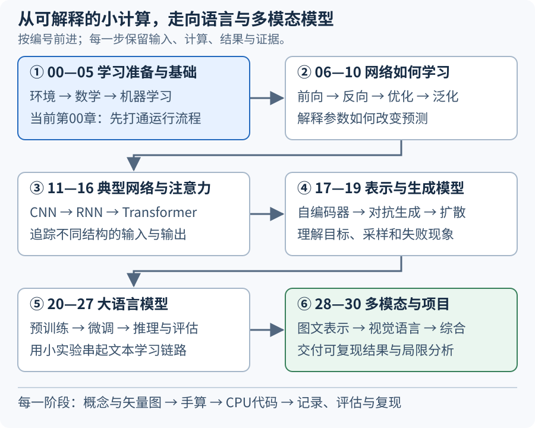
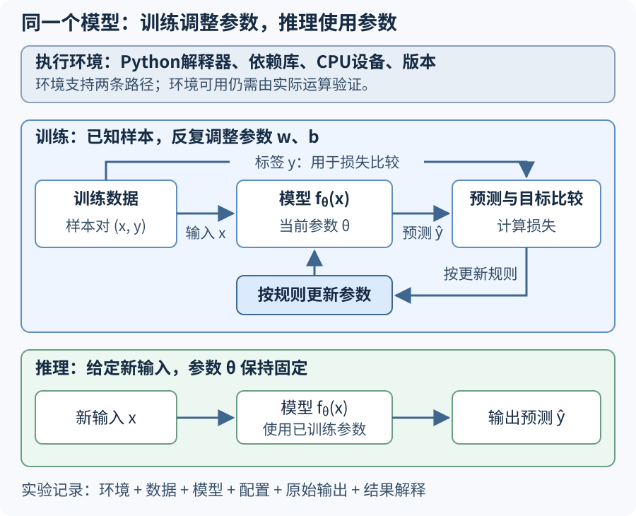

# 第 00 章：学习路线与本机实验环境

> 对应任务：00；状态：已完成本章实践与 HTML/PDF 验收；最后更新：2026-11-15。

[阅读入口](../../README.md) · [章节计划](../chapter-plan.md) · [本机环境报告](../appendices/environment.md) · [构建说明](../build-guide.md)

## 1. 本章目标与前置知识

学大模型时，很容易先遇到“参数量”“训练”“显存”等词，却还不能说明一次计算究竟做了什么。本章先用一个只有两个可调数字的预测器，建立后面反复使用的语言，再把这套语言对应到本机运行流程。

学完后，你应当能够：

- 说明本教程各阶段解决什么问题，以及为什么先学数学和小模型。
- 区分环境、数据、模型结构、参数和实验配置，并说出训练与推理各自输入、输出什么。
- 手算一次预测和一个小数据集的平均误差，解释这个数字能证明什么。
- 从项目根目录检查环境、执行 CPU 最小验证，并读懂成功、缺依赖和未验证的区别。

只需会四则运算、看懂简单函数，并能在 PowerShell 中运行命令。没有接触过矩阵也可以先完成本章；后文会逐步解释数组形状。微积分、反向传播和神经网络层的推导从后续章节展开，本章只先认识实验中的职责。

## 2. 问题、直觉与整体图景

### 2.1 从能解释的小预测器开始

假设有人给出若干输入数字和对应答案，我们希望根据新输入给出预测。规则可以先写得很简单：把输入乘以一个数，再加上另一个数。即使未来的模型有很多层，这个小问题仍能帮助我们辨认：哪些是观察到的数据，哪些是模型计算，哪些数在训练中改变。

花书第 1 章把深度学习放在机器学习与表示学习的背景中，强调通过多步组合形成表示。[1] 本教程沿着“先理解计算，再理解如何学习，再理解复杂结构”的顺序前进。先弄清两个参数怎样影响预测，后续才有依据解释大量参数的作用。



图 00-1：本教程学习路线。图为本项目原创课程编排；基础先于模型的安排参考花书第 1 章与 D2L 第 2 章的知识结构，[1][3] 不是教材原图。箭头表示建议学习顺序，每一阶段都把概念、手算、代码和实验记录连起来。

### 2.2 每一阶段究竟学会什么

**00～05：学习准备与基础。** 环境让代码能够运行；线性代数帮助描述很多数字及其运算；微积分说明参数变化如何影响误差；概率帮助处理不确定性；数值计算提醒我们计算机的数值并非无限精确。随后用机器学习基础把这些工具连成预测问题。D2L 的预备知识也覆盖数据操作、线性代数、微积分、自动微分和概率等内容。[3]

**06～10：神经网络如何学习。** 把简单计算组合成网络，追踪输入怎样变成输出，再追踪误差怎样指导参数更新，最后观察训练效果与新数据表现。到这一步，应该能解释一条训练曲线背后的计算。

**11～16：典型网络与 Transformer。** 分别学习适合图像、序列和文本的计算结构，解释卷积如何利用局部关系、序列模型怎样处理前后信息、注意力怎样组合不同位置的信息。比较结构时始终标出输入输出的形状。

**17～19：表示与生成模型。** 研究如何压缩、表示和生成数据，区分“把已有输入重建出来”和“生成新样本”，认识不同训练目标及其失败现象。

**20～27：大语言模型。** 从文本如何变成训练样本出发，串起微型预训练、指令微调、参数高效微调、偏好学习、推理、检索和评估。现代 Transformer、LLM 等主题会补充原始论文及大学课程，不能把它们都归于 2016 年的花书。

**28～30：多模态与综合实践。** 理解图像和文本如何建立联系，用前面形成的实验方法完成小项目。最终交付应包括运行说明、结果与失败分析，让其他人能追溯结论从何而来。

## 3. 符号与形状

先把本章需要的记号放在一起。这里每个输入、目标和预测都是一个实数；多特征向量及矩阵运算在第 01 章系统介绍。

| 符号 | 含义 | 范围或形状 |
| --- | --- | --- |
| $`x, y`$ | 输入与观察到的目标值 | 标量，属于 $`\mathbb{R}`$ |
| $`\hat{y}`$ | 模型对目标的预测 | 标量；帽子表示预测 |
| $`w, b`$ | 权重与偏置 | 两个可学习标量 |
| $`\boldsymbol{\theta}=(w,b)^{\top}`$ | 把两个参数收集起来 | 长度为 2 的列向量 |
| $`f_{w,b}`$ | 参数为 $`w,b`$ 的预测函数 | 从一个实数到一个实数 |
| $`N, i`$ | 样本数与样本编号 | $`N`$ 为正整数；$`1\leq i\leq N`$ |
| $`\mathcal{D}`$ | 输入与目标组成的数据集 | $`\{(x_i,y_i)\}_{i=1}^{N}`$ |
| $`\mathcal{L}(w,b)`$ | 在指定数据集上的平均损失 | 非负标量 |
| $`\eta`$ | 学习率，控制参数调整幅度 | 本例取 $`0.1`$ |

下标 $`i`$ 表示第几个样本，不是指数。$`\mathbb{R}`$ 是实数集合，$`\top`$ 表示转置。写 $`f_{w,b}`$ 是把两个具体参数展开；后续写 $`f_{\boldsymbol{\theta}}`$ 时仍表达“由一组参数确定的函数”。

## 4. 核心概念：一次学习实验由什么构成

### 4.1 环境决定代码怎样被执行

环境（environment）包括操作系统、Python 解释器、依赖库和计算设备。解释器负责运行程序；NumPy、PyTorch 等库提供数组计算或自动微分；CPU、可选加速设备执行实际运算。同一台电脑可以有多个 Python 环境，因此“装过某个包”还需要补上“装在哪个解释器里”。

文档工具与训练工具也有不同职责：Node.js 和浏览器负责将 Markdown 排成 HTML/PDF；Python 及训练库负责实验。PDF 生成成功说明文档流程可用，不能据此认定模型训练已验证。

### 4.2 数据给出问题，模型提供可计算的规则

一个有监督样本写成 $`(x_i,y_i)`$：$`x_i`$ 是输入，$`y_i`$ 是已知目标。例如输入可以是一个测量值，目标是希望预测的结果。本章采用人为生成的无量纲数字，避免把教学规则当成真实世界规律。

模型（model）规定输入到输出的计算方式。本章使用：

```math
\hat{y}=f_{w,b}(x)=wx+b.
```

这里 $`w`$ 控制输入增加时预测改变的幅度，$`b`$ 控制 $`x=0`$ 时的预测。选择“乘再加”是确定模型形式；选择 $`w=2,b=1`$ 才确定了其中一个具体预测器。相同形式可以对应不同参数和不同结果。

参数（parameter）是训练过程要调整的数。学习率、训练步数等则是配置训练过程的超参数（hyperparameter），本例中不由该训练循环直接学习。明确二者，才能描述一次对照实验究竟改变了什么。

### 4.3 损失把预测偏差变成可比较的数字

只说“预测不好”无法比较两个参数方案。先定义第 $`i`$ 个样本的误差：

```math
e_i=\hat{y}_i-y_i.
```

误差有正负，直接相加会让高估和低估互相抵消。本章把误差平方，再对所有样本取平均，得到均方误差（mean squared error，MSE）：

```math
\mathcal{L}(w,b)
=\frac{1}{N}\sum_{i=1}^{N}(wx_i+b-y_i)^2.
```

$`\sum`$ 表示把 $`i=1`$ 到 $`N`$ 的各项相加。平方让每项非负，并使较大偏差的贡献更大。除以 $`N`$ 得到每个样本的平均值。在数据与定义一致时，较小的 MSE 表示这些预测更接近目标。若目标带单位，MSE 的单位是目标单位的平方；本章的数字没有物理单位。

损失（loss）是训练中用来指导参数调整的目标；评估指标（metric）描述任务关心的表现。二者可以相同，本章都观察 MSE，也可以不同。实际应用怎样选择指标，要从任务目标出发，见花书第 11.1 节。[2]

### 4.4 训练改变参数，推理使用已确定的参数

训练（training）从初始参数出发，在训练数据上反复计算预测和损失，再由更新方法调整参数。损失给出“当前错多少”，更新方法决定“下一步怎样改”。本章先观察流程；梯度为什么指向某个方向、学习率怎样选择，会在数学及优化章节展开。

推理（inference）是给定模型与参数，对新输入计算输出。本例训练结束后保存 $`w,b`$，输入 $`x=3`$ 即可算出预测，不需要先知道新输入的正确答案。若后来取得目标值，可以额外评估误差；评估本身也不要求更新参数。



图 00-2：本机实验中的训练与推理数据流。本项目原创示意，按本章线性预测器绘制。训练框内的回路表示重复更新，标签 $`y`$ 送入损失比较；推理框内沿单向路径计算，参数保持固定。环境为两条路径提供相同的执行基础。

### 4.5 实验把一次运行变成能够解释的证据

实验（experiment）是围绕明确问题组织的一次或一组运行，例如“相同数据下，候选参数 B 的 MSE 是否小于 A”。它需要记录环境、数据、模型、配置、输出和比较方法。运行成功只证明代码完成了约定工作；要回答模型是否学到有用规律，还要检查数据与评估设计。

训练集用于调整参数；验证集用于比较方案、选择配置；测试集用于最后检查未参与这些选择的数据。第 05 章会细讲划分及信息泄漏。本章五个确定性样本全部用于训练，只检验计算链路，**不提供独立的泛化评估**。这种局限应随结果一起记录。

花书第 11 章开头建议先明确目标与指标，建立端到端基线，再根据测量逐步改进。[2] 在本机的第一步，就是让一个很小但完整的预测—损失—更新流程运行起来。

## 5. 两个手算例子：从预测到比较

### 5.1 例一：同一输入，换参数会发生什么

取一个样本 $`x=2,y=5`$。候选 A 采用 $`w=1,b=1`$：

```math
\hat{y}_{A}=1\times2+1=3,
\qquad
e_A=3-5=-2,
\qquad
e_A^2=4.
```

候选 B 采用 $`w=2,b=1`$：

```math
\hat{y}_{B}=2\times2+1=5,
\qquad
e_B=5-5=0,
\qquad
e_B^2=0.
```

数据、模型形式和比较方式都相同；只改变参数，就改变了预测。这次比较说明 B 在这个样本上更准确。一个样本无法唯一确定两个参数，例如 $`w=0,b=5`$ 也能预测出 5，因此不能据此认定所有新输入都预测正确。

### 5.2 例二：多个样本怎样归约为一个损失

使用后续脚本相同的五个输入，目标由 $`y=2x+1`$ 生成。候选 A 取 $`w=0,b=0`$，候选 B 取 $`w=1,b=1`$。

| $`x_i`$ | $`y_i`$ | A 的预测 | B 的预测 | B 的平方误差 |
| --- | --- | --- | --- | --- |
| $`-2`$ | $`-3`$ | $`0`$ | $`-1`$ | $`(-1+3)^2=4`$ |
| $`-1`$ | $`-1`$ | $`0`$ | $`0`$ | $`(0+1)^2=1`$ |
| $`0`$ | $`1`$ | $`0`$ | $`1`$ | $`(1-1)^2=0`$ |
| $`1`$ | $`3`$ | $`0`$ | $`2`$ | $`(2-3)^2=1`$ |
| $`2`$ | $`5`$ | $`0`$ | $`3`$ | $`(3-5)^2=4`$ |

A 的平方误差依次是 $`9,1,1,9,25`$，所以：

```math
\mathcal{L}_A=\frac{9+1+1+9+25}{5}=9,
\qquad
\mathcal{L}_B=\frac{4+1+0+1+4}{5}=2.
```

若取 $`w=2,b=1`$，五个预测恰好等于目标，手算损失为 0。这个例子展示的是怎样评价参数；训练程序还需要自动找到合适参数。稍后运行脚本时，初始 MSE 应为 9，恰好能与手算对照。

## 6. 从数学到代码

完整实现保存在 [cpu-smoke.py](../../scripts/cpu-smoke.py)，本章复用 INF-01 的小型验证入口。先读其中最直接的对应关系：

```python
xs = [-2.0, -1.0, 0.0, 1.0, 2.0]
ys = [2.0 * x + 1.0 for x in xs]

def loss(w, bias):
    squared_errors = [
        (w * x + bias - y) ** 2
        for x, y in zip(xs, ys)
    ]
    return sum(squared_errors) / len(xs)
```

这段是完整脚本中损失函数的等价教学展开。`xs`、`ys` 各有 5 项，`zip` 每次配对一个输入与目标；`bias` 对应公式中的 $`b`$；列表每项对应一个平方误差；`sum` 与除以长度对应求和与平均。运行 `loss(0.0, 0.0)` 应得到 9.0。

完整脚本还计算两个 $`2\times2`$ 数组的矩阵乘法，结果为 `[[19, 22], [43, 50]]`。例如左上角是 $`1\times5+2\times7=19`$。矩阵有两行两列，形状记为 $`(2,2)`$；形状描述各轴的长度。张量（tensor）在本教程计算语境中是按若干轴组织的数值数组，矩阵是其中有两个轴的一种。

标准库版本用嵌套列表表达矩阵；安装 NumPy/PyTorch 后，同一入口还能验证数组或张量运算。PyTorch 分支中，输入与目标形状均为 $`(5,)`$，$`w,b`$ 是形状为 `()` 的零维张量，逐个作用于这 5 个输入，再把 5 项平方误差取平均。自动微分（automatic differentiation）负责按实际计算关系求导；它怎样得到更新所需的导数，将在后续章节拆开解释。

## 7. 本机实践与结果分析

### 7.1 已知环境、数据与配置

截至 INF-01 的 2026-11-15 20:24 采样，本机为 Windows 11、i9-13900H、16 GiB 物理内存，发现 Intel Iris Xe，未发现 NVIDIA 设备。Python 3.11.5 已可用，采样时 NumPy/PyTorch 未安装。本章环境准备与复测结果以章末记录及后续实际输出为准；历史记录保存在[原始快照](../appendices/environment-snapshot.json)，不能用旧快照判断新虚拟环境是否已安装依赖。

当时可用内存约 1.16 GiB，D 盘可用约 562.76 GiB。这些数字会变化。默认实验设备为 CPU；小实验先验证机制，扩大规模前复查内存。集成显卡驱动字段不等于 PyTorch 已支持该设备。D2L 安装页也建议先核对设备，并用 CPU 开始基础学习。[4]

| 项目 | 本章配置与含义 |
| --- | --- |
| 数据与来源 | 本项目按 $`y=2x+1`$ 生成 5 个确定性样本，无外部数据下载 |
| 数据划分 | 全部用于训练和链路检查；无独立验证集、测试集 |
| 模型与参数量 | $`f_{w,b}(x)=wx+b`$；2 个可学习标量 |
| 初始化与随机性 | $`w=b=0`$；无随机采样，无须随机种子 |
| 更新与预算 | 全量梯度下降，学习率 $`0.1`$，200 步 |
| 数值精度 | 标准库 Python 浮点数；PyTorch 分支显式用 float64 |
| 保存与恢复 | 无检查点；每次从固定初始化重跑这 200 步 |

### 7.2 运行步骤与判读方法

第一步，打开 PowerShell，进入正式仓库。先检查根目录和解释器；后续命令都在这里执行。

```powershell
Set-Location -LiteralPath 'D:\code\workspace\deep-learning-journey'
Get-Item -LiteralPath ./AGENTS.md
py -3.11 --version
```

第二步，按照[初始依赖说明](../../requirements/README.md)准备独立项目 `.venv`。本教程直接调用其解释器，避免把“当前激活的是哪个环境”变成隐含条件。尚未准备第三方依赖时，可以先运行无额外依赖的基线：

```powershell
py -3.11 -B scripts/cpu-smoke.py
```

第三步，在项目环境中重查设备和依赖，并运行包含框架的验证：

```powershell
& ./scripts/check-environment.ps1 `
    -PythonPath ./.venv/Scripts/python.exe

& ./.venv/Scripts/python.exe -B `
    scripts/cpu-smoke.py --with-frameworks
```

环境检查默认输出到终端，不覆盖已提交的历史快照。不加网络参数即可完成硬件与依赖检查；下载需要联网时再按环境说明核对连接。缺少 `.venv` 时，先完成依赖说明中的创建步骤，再运行上述项目环境命令。

第四步，阅读 JSON 各字段。`baseline.status` 对应标准库检查；`numpy.status` 对应数组计算；`torch.status` 对应 CPU 张量与自动微分训练。只有对应字段为 `passed` 才能说该分支通过。脚本在依赖缺失时可能报告 `not_installed`，同时总状态仍为 `passed`；这是已执行基线通过，不能解释为全部框架就绪。

检查 `torch.cuda_available` 前，先确认 `torch.status`。值为 `null` 表示接口未执行，值为 `false` 表示该次接口执行后未发现可用 CUDA；两种证据不同。即使 CUDA 不可用，本章 CPU 训练仍可完成。

### 7.3 本章实际复测结果

2026-11-15 21:31，项目 .venv 中的Python 3.11.5、NumPy 2.4.6、PyTorch 2.15.0+cpu已实际运行三个分支并全部通过。原始数据见[复测JSON](../appendices/framework-validation.json)，安装与资源说明见[框架记录](../appendices/framework-validation.md)。

| 检查 | 本次实际结果 |
| --- | --- |
| 三个分支矩阵乘法 | 均为 [[19,22],[43,50]] |
| 训练配置 | 5样本、2参数、零初始化、学习率0.1、200步；CPU / float64 / 2线程 |
| 初始 MSE | 9.0，与第5节手算一致 |
| 最终 MSE | $`1.9721522630525296\times10^{-32}`$ |
| 参数 | $`w=2.0`$，$`b=0.9999999999999998`$ |
| PyTorch训练耗时 | 约0.0227秒；含导入的该分支总耗时约1.746秒 |
| CUDA检查 | CPU构建，cuda_build为null，cuda_available为false |

21:27复测时系统可用物理内存约0.74 GiB，扩大模型前应检查系统负载；未测量本次进程峰值内存。时间来自这一次运行，受负载和缓存影响。

重跑时检查矩阵逐项相同，最终MSE为有限数且小于 $`10^{-12}`$，参数接近2和1。浮点舍入可能改变末尾几位。小损失符合人为构造的直线关系，不提供独立泛化评估，无法推算LLM训练速度。


## 8. 常见误区与适用边界

**“运行没报错，就说明模型有效。”** 先读程序实际验证了哪些字段。本例只验证数组运算、参数更新和已知规则拟合，真实任务还需要独立数据、合适指标和错误分析。

**“每次预测时都会继续学习。”** 本章推理只代入固定的 $`w,b`$ 计算输出。只有显式执行参数更新的过程才改变这两个数。将新输入送入训练好的模型，本身不等于重新训练。

**“参数越多，结果一定越好。”** 参数量描述模型的可调数字数量；结果还受数据、目标、训练方法和资源约束影响。两个参数足以表示本例规则，增大模型不自动增加证据。

**“有显示用显卡，就能按 CUDA 教程训练。”** 需要核对硬件、驱动、框架构建及接口实测。本机默认走 CPU；其他加速后端需另外验证，不能把未执行当成支持或不支持。

**“换台电脑照抄损失和耗时就算复现。”** 复现要保留原始输出、环境与配置，并检验预定范围。固定数据让结果更容易比较，仍须如实记录设备和数值差异。

## 9. 习题与解析

### 9.1 习题

1. 在本章实验中，Python 版本、五个 $`(x_i,y_i)`$、公式 $`wx+b`$、$`w,b`$、学习率分别属于什么？若只更换学习率，数据和模型形式是否随之变化？
2. 对新样本 $`x=3,y=7`$，分别计算 $`(w,b)=(1,1)`$ 与 $`(2,1)`$ 的预测、误差和平方误差。如果只知道 $`x=3`$，还可以执行哪些步骤？
3. 两个样本的误差为 $`-2`$ 和 $`2`$。误差平均值与 MSE 各是多少？为什么不能仅凭平均误差判断这次预测准确？
4. 同学看到总 `status` 为 `passed`，但 `torch.status` 是 `not_installed`，便写“PyTorch 训练和 CUDA 检查通过”。这句话哪一部分没有证据？应怎样改写？
5. 执行 CPU 验证并记录解释器路径、三个分支状态、初始与最终 MSE。若想比较两个训练方案，你应固定什么、改变什么，并额外保存什么证据？

### 9.2 参考解析

**第 1 题。** Python 版本属于环境；五个输入目标对属于数据；$`wx+b`$ 是模型形式；$`w,b`$ 是参数；学习率是训练超参数。只改学习率时，这些样本与模型形式可保持一致，但更新路径和最终参数可能改变。报告应写出明确的控制条件。

**第 2 题。** 第一组预测 $`1\times3+1=4`$，误差 $`4-7=-3`$，平方误差为 9；第二组预测 $`2\times3+1=7`$，误差与平方误差都为 0。只知道输入仍能推理，算出 4 或 7；没有目标 $`y`$，无法计算这一个样本的监督误差。

**第 3 题。** 平均误差为 $`(-2+2)/2=0`$，MSE 为 $`(4+4)/2=4`$。正负抵消掩盖了两个样本都偏离目标的事实，平方后保留了偏离程度。MSE 的具体数值仍需结合目标尺度解释。

**第 4 题。** `not_installed` 没有执行 PyTorch 张量训练，CUDA 字段也可能为 `null`。可以改写为“已执行的标准库基线通过；PyTorch 尚未安装，该分支及 CUDA 框架接口未验证”。如果 NumPy 字段也缺失，应分别记录，不能让总状态代替各分支证据。

**第 5 题。** 记录必须来自实际 JSON，不能填用书中示例数字。比较学习率时，可固定解释器、设备、数据、初始化、模型、精度和步数，只改变学习率；保存各次配置、原始输出、指标定义及执行日期。本章没有独立测试集，因此结果解释限于训练链路。后续真实学习实验还需预先确定划分，并保留未参与调参的数据做评估。

## 10. 本章小结与下一步

我们已经把一个小预测问题拆成了环境、数据、模型、参数、损失和实验。训练用数据与损失调整参数，推理用确定的参数计算新输入；一次运行能支持哪些结论，取决于它实际验证了什么。

接下来第 01 章把单个数推广为向量、矩阵与张量，解释形状、内积、矩阵乘法和广播。届时可以重新审视本章五个输入怎样批量进入同一个计算，以及为什么代码必须明确各轴的含义。尚未完成的章节可在[章节计划](../chapter-plan.md)中查看要求。

## 11. 参考文献

1. Ian Goodfellow、Yoshua Bengio、Aaron Courville，*Deep Learning*，MIT Press，2016，第 1 章 Introduction，正文开头及 §1.1。用于机器学习、表示学习的背景与教材学习结构。[官方在线章节](https://www.deeplearningbook.org/contents/intro.html)。
2. 同上，第 11 章 Practical Methodology，章首设计流程、§11.1 Performance Metrics、§11.2 Default Baseline Models。用于目标、指标、端到端基线及逐步改进的实验方法。[官方在线章节](https://www.deeplearningbook.org/contents/guidelines.html)。
3. Aston Zhang、Zachary C. Lipton、Mu Li、Alexander J. Smola，*Dive into Deep Learning*，在线版 1.0.3，第 2 章 Preliminaries 导言及 §2.1～§2.7 目录。用于说明数据操作、数学、自动微分与文档查阅的准备顺序。[官方页面](https://d2l.ai/chapter_preliminaries/index.html)。
4. 同上，Installation，Installing the Deep Learning Framework and the d2l Package 小节。用于先核对设备、基础章节可从 CPU 起步的安排。[官方页面](https://d2l.ai/chapter_installation/index.html)。该页有其写作时测试的旧版本安装示例；本项目实际版本以本机验收与依赖记录为准。

以上外部页面于 2026-11-15 核验。本章手算数据、示例分析和两幅 SVG 为本项目原创；本机硬件、软件与历史实测引用仓库[环境报告](../appendices/environment.md)及[原始 JSON](../appendices/environment-snapshot.json)。

## 12. 实现与验证记录

- 正文、两个手算与两幅原创SVG已完成，图注保留依据。
- 2026-11-15：标准库、NumPy、PyTorch CPU张量和200步自动微分训练均通过；pip检查通过，版本已锁定。
- 已检查数学符号、概念关系、SVG无位图、本地链接及公式严格渲染。
- HTML/PDF已首轮构建，1440/390像素下无页面横向溢出、断锚、重复ID或外部资源请求。
- 最终PDF为12页、2幅SVG、109处公式，零位图、字体全部嵌入；逐页与300dpi图形放大检查通过，打印底导航多余页已修正。
