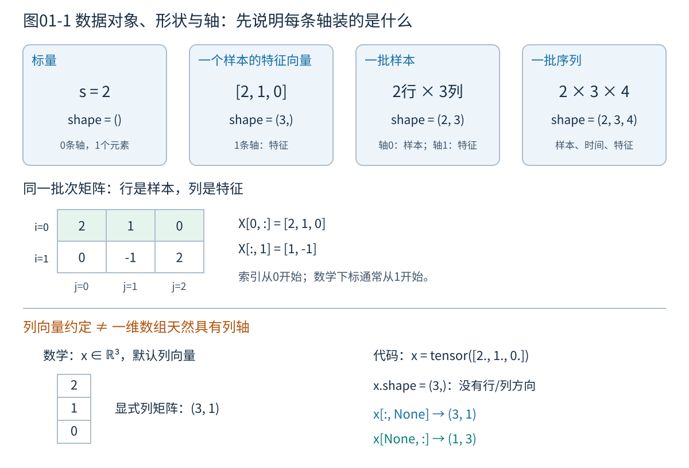
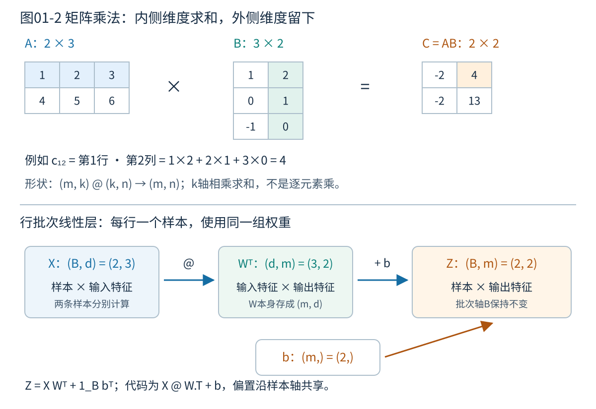
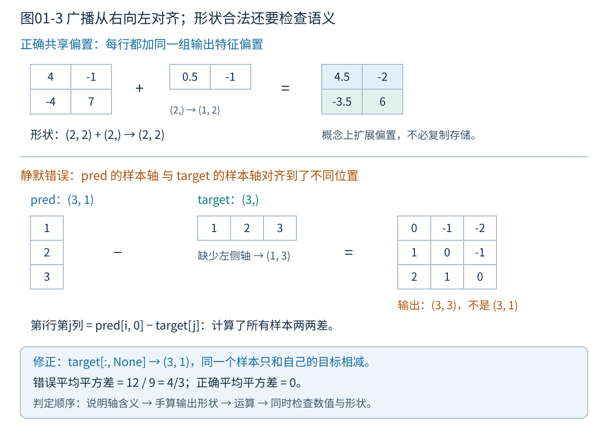
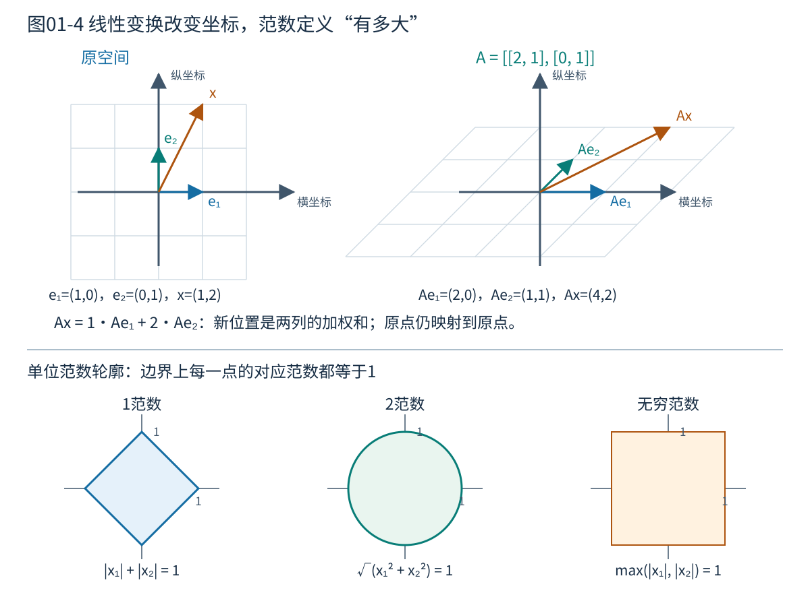

# 第01章：线性代数与张量

> 本章从“一个样本如何变成一批输出”出发，把形状、运算和几何意义接起来。配图均为原创 SVG，公式为可复制的 LaTeX。
> 最后更新：2026-11-15；状态：已验收。实践与验收详见首导航。

[阅读入口](../../README.md) · [上一章：学习路线与本机实验环境](00-learning-and-environment.md) · [章节计划](../chapter-plan.md) · [验收记录](../appendices/chapter-validation.md)

## 1. 学习目标、前置知识与问题

你现在有两个样本，每个样本包含三个数字。希望用同一条规则，把每个样本变成两个输出。怎样把数据写成数组，怎样检查乘法能否进行，怎样知道程序真的按“每个样本分别计算”运行？

这些问题贯穿整个教程。后面的神经网络会反复执行“组织数据、做加权求和、共享参数、检查输出形状”。先把最小计算讲清楚，才能理解更深的网络。

读完本章，你应能：

- 区分标量、向量、矩阵和高阶张量，说明形状中每条轴的含义。
- 手算内积、矩阵向量乘法及小型矩阵乘法，区分它们与逐元素乘法。
- 用列向量写单样本公式，用行批次数组写代码，并解释权重为什么要转置。
- 按规则预测广播结果，识别“能运行却比较错样本”的错误。
- 用基向量解释二维线性变换，计算向量范数及矩阵 Frobenius 范数。
- 运行 CPU 实验，让手算、NumPy 和 PyTorch 相互核对。

前置知识只有第00章的运行环境、初等代数的加减乘除、平面坐标与平方根。本章不要求事先掌握矩阵；求和符号、转置等会在用到时解释。无需先理解模型训练、求导或自动微分。

## 2. 从数据组织到数学对象

### 2.1 一个数字、一条特征、一批样本

假设一个样本记录三个已经转换为无量纲数值的特征：$(2,1,0)$。这只是教学数字，不代表真实数据，也不暗示三个特征有相同统计分布。

 **标量（scalar）** 是一个数，如 $s=2$。 **向量（vector）** 是按次序组织的一组数，如三维向量 $\mathbf x\in\mathbb R^3$。符号 $\mathbb R^3$ 表示三个分量都是实数；三个分量的顺序具有意义，不能随意互换。

本教程默认向量写成列：

$$
\mathbf x=
\begin{bmatrix}
2\\1\\0
\end{bmatrix}.
$$

 **矩阵（matrix）** 是按行和列组织的二维数组。把两个样本分别放在两行，可得

$$
\mathbf X=
\begin{bmatrix}
2&1&0\\
0&-1&2
\end{bmatrix}
\in\mathbb R^{2\times3}.
$$

这里的第一条轴表示样本，第二条轴表示特征。数学上，矩阵本身并不规定“行就是样本”；这是我们为这份数据选择的约定，后文必须保持一致。花书第2.1节采用标量、向量、矩阵和张量逐层引入这些对象。[1]



*图01-1：数据对象、形状与轴。依据花书第2.1节及数组索引规则原创绘制。上排逐步增加轴，下排特别区分列向量约定与一维数组。图中的代码索引从0开始。*

图01-1中的矩阵共有 $2\cdot3=6$ 个元素，但只有两条轴。不能把“有六个元素”说成“六维矩阵”。在数学里，“三维向量”通常指三个分量；在数组程序中，“三维张量”通常指三条轴。为避免混淆，后者优先说“三阶张量”或“有三条轴的数组”。

### 2.2 高阶张量与形状的语义

如果每个样本是一段长度为 $T$ 的序列，而每个时间位置有 $d$ 个特征，一批 $B$ 个样本就可以写成

$$
\mathcal X\in\mathbb R^{B\times T\times d}.
$$

例如 $(B,T,d)=(2,3,4)$ 表示两条样本序列，每条三个位置，每个位置四个特征，共 $2\cdot3\cdot4=24$ 个数。本章中的 **张量（tensor）** 采用数值计算中的多维数组含义；不在此引入更一般的张量变换理论。

 **形状（shape）** 记录各条轴的长度， **轴数量** 记录需要几个下标定位元素。形状 $(2,3,4)$ 本身没有说明哪条是时间轴，轴的语义必须由数据说明和程序共同约定。相同形状可以承载不同含义，不应仅凭数字猜测。

在 NumPy 与 PyTorch 中，标量的形状为 `()`，一维数组为 `(d,)`，二维数组为 `(B,d)`。单元素向量 `(1,)` 和标量 `()` 都只有一个元素，但轴数量不同。D2L 第2.3节的对象与形状示例可作为代码对照。[2]

### 2.3 数学列向量与代码一维数组

数学中的 $\mathbf x\in\mathbb R^d$ 默认按列参与 $\mathbf W\mathbf x$。代码中的 `x = torch.tensor([2.,1.,0.])` 只有一条轴，形状是 `(3,)`，并不是明确的 `(3,1)` 列矩阵，也不是 `(1,3)` 行矩阵。

显式添加轴的方法为：

```python
x = torch.tensor([2., 1., 0.], dtype=torch.float64)
column = x[:, None]  # (3, 1)，三个元素排在一列
row = x[None, :]     # (1, 3)，三个元素排在一行
```

`None` 表示在相应位置插入一条长度为1的轴。 **增加轴不等于增加数据** ：这三个对象都只有三个元素，区别是如何给这些元素分组。

转置对二维矩阵交换行列。若 $\mathbf A\in\mathbb R^{m\times n}$，则 $\mathbf A^\top\in\mathbb R^{n\times m}$，且 $(\mathbf A^\top)_{ji}=a_{ij}$。一维 NumPy 数组的 `.T` 不会为它新增行轴或列轴；要表达列，仍须显式添加轴。[3] 后文代码中的 `W.T` 始终用于二维权重。

### 2.4 改变形状不等于转置

`reshape` 在指定遍历顺序下把原有元素重新分组，新的各轴长度乘积必须等于原元素数。它不自动保留原来的行、列语义。例如

$$
\mathbf M=\begin{bmatrix}1&2&3\\4&5&6\end{bmatrix}
$$

按默认顺序重新分组成三行两列，得到 $\begin{bmatrix}1&2\\3&4\\5&6\end{bmatrix}$；转置则得到 $\begin{bmatrix}1&4\\2&5\\3&6\end{bmatrix}$。两者形状都是 $(3,2)$，数值位置却不同，因为前者按顺序重新分组，后者按原轴交换索引。[14]

因此，决定使用哪一种操作时，应先问“是改变数据分组，还是交换两条轴的职责”。只验证元素数相同，不能保证样本与特征仍一一对应。

## 3. 本章符号与形状约定

| 符号 | 含义 | 形状或范围 |
| --- | --- | --- |
| $s,\alpha$ | 标量、缩放系数 | $\mathbb R$ |
| $B,d,m$ | 批大小、输入特征数、输出特征数 | 正整数 |
| $\mathbf x,\mathbf u,\mathbf v$ | 单个向量，默认列向量 | 按使用处说明 |
| $\mathbf X$ | 行批次输入，每行一个样本 | $B\times d$ |
| $\mathbf W$ | 同一组输出使用的权重 | $m\times d$ |
| $\mathbf b,\mathbf z$ | 偏置、单样本输出 | $\mathbb R^m$ |
| $\mathbf Z$ | 行批次输出 | $B\times m$ |
| $\mathbf1_B$ | $B$ 个分量全为1的列向量 | $B\times1$ |
| $a_{ij}$ | 矩阵第 $i$ 行第 $j$ 列元素 | 标量 |
| $\odot,\top,\|\cdot\|$ | 逐元素乘、转置、范数 | 逐节定义 |

数学元素下标从1开始，代码索引从0开始。例如数学 $x_1=2$，在代码中写 `x[0] == 2`。本章用 $i$ 表示行或样本编号、$j$ 表示列或输出编号；求和的中间下标为 $k$。这些下标是整数编号，不是向量本身。

## 4. 从逐元素计算到矩阵乘法

### 4.1 逐元素运算：对应位置各算各的

先考虑相同形状的两个向量：

$$
\mathbf u=
\begin{bmatrix}1\\2\\3\end{bmatrix},
\qquad
\mathbf v=
\begin{bmatrix}4\\-1\\2\end{bmatrix}.
$$

相加是在对应位置相加，结果仍有三个分量。逐元素乘法，也称  **Hadamard 积** ，用 $\odot$ 表示：

$$
\mathbf u\odot\mathbf v=
\begin{bmatrix}
1\cdot4\\2\cdot(-1)\\3\cdot2
\end{bmatrix}
=
\begin{bmatrix}4\\-2\\6\end{bmatrix}.
$$

NumPy 和 PyTorch 数组中的 `u * v` 实现这种逐元素运算。没有求和时，三个乘积仍分别保存；不能把结果读成一个相似度或一个加权总分。相同形状矩阵也遵循同一规则。[2]

### 4.2 归约与内积：多个数如何汇成一个数

 **归约（reduction）** 是沿指定轴把多个元素合成较少的元素，例如求和、均值。求和符号

$$
\sum_{k=1}^{d} r_k=r_1+r_2+\cdots+r_d
$$

表示依次累加 $d$ 个数。对刚才的逐元素积求和，得到 **内积（inner product）** ：

$$
\mathbf u^\top\mathbf v
=\sum_{k=1}^{3}u_kv_k
=4-2+6=8.
$$

内积把两个同维实向量映射为一个标量。本章只讨论实数；复数情形需要处理共轭，不能原样照搬。其意义可先理解为“用一组系数对另一组分量加权求和”。

```python
elementwise = u * v       # (3,)，三个分量
inner = (u * v).sum()     # ()，一个标量
inner_again = u @ v       # 两个一维数组时，也是内积
```

图01-2的上半部分会把同一个“逐项乘再累加”的动作放进矩阵中。对显式二维数组 `u[None,:] @ v[:,None]`，结果为 `(1,1)`，而一维 `u @ v` 的结果形状为 `()`；两者的数值都是8，数组结构不同。[4]

### 4.3 矩阵向量乘法：每一行生成一个输出

若希望由 $d$ 个特征生成 $m$ 个输出，就给每个输出准备一组 $d$ 个系数，放到矩阵的一行：

$$
\mathbf z=\mathbf W\mathbf x,
\qquad
z_j=\sum_{k=1}^{d}w_{jk}x_k.
$$

这里 $\mathbf W$ 有 $m$ 行、$d$ 列；$\mathbf x$ 有 $d$ 个分量；每行与输入做一次内积，最终生成 $m$ 个数。维度 $d$ 必须匹配，因为一行里的每个系数都需要对应一个输入特征。

“所有输出共享同一个输入向量”不意味着“所有输出使用同一行权重”。矩阵每一行都可以有不同系数，决定不同的输出组合。下一节用完整数字展示。

### 4.4 矩阵乘法：一行与一列产生一个元素

矩阵乘法把前一动作扩展到多个列向量。设

$$
\mathbf A\in\mathbb R^{m\times k},
\qquad
\mathbf B\in\mathbb R^{k\times n},
\qquad
\mathbf C=\mathbf A\mathbf B\in\mathbb R^{m\times n}.
$$

第 $i$ 行和第 $j$ 列的对应元素相乘，再沿共同的 $k$ 轴累加：

$$
c_{ij}=\sum_{\ell=1}^{k}a_{i\ell}b_{\ell j}.
$$

为了不把轴长度 $k$ 与求和编号混淆，这里用 $\ell$ 作为实际遍历的下标。内侧长度 $k$ 决定每个输出需累加多少项，外侧 $m,n$ 决定结果共有多少行和列。图01-2把保留的轴与求和的轴放在一起。



*图01-2：行乘列与批次计算。依据花书第2.2节及 MIT 18.06 第3讲矩阵乘法视角原创绘制；权重存储形式与 PyTorch Linear 文档对应。[1][5][6]*

对图中的矩阵，先计算第一行：

$$
\begin{aligned}
c_{11}&=1\cdot1+2\cdot0+3\cdot(-1)=-2,\\
c_{12}&=1\cdot2+2\cdot1+3\cdot0=4.
\end{aligned}
$$

第二行同理：

$$
\begin{aligned}
c_{21}&=4\cdot1+5\cdot0+6\cdot(-1)=-2,\\
c_{22}&=4\cdot2+5\cdot1+6\cdot0=13.
\end{aligned}
$$

所以结果为 $\begin{bmatrix}-2&4\\-2&13\end{bmatrix}$。程序 `A @ B` 得到相同结果；`A * B` 不能代替它。即使两个方阵形状相同，这两种运算通常也会给出不同数值。

矩阵乘法一般不可交换。这里 $\mathbf A\mathbf B$ 是 $2\times2$，而 $\mathbf B\mathbf A$ 是 $3\times3$，输出连形状都不同。相同形状只保证某些乘法可以进行，不保证交换后结果相同。

## 5. 单样本公式与行批次实现

### 5.1 把一次加权求和完整算出来

我们采用以下固定权重、输入和偏置：

$$
\mathbf W=
\begin{bmatrix}
1&2&-1\\
0&-1&3
\end{bmatrix},
\quad
\mathbf x=
\begin{bmatrix}2\\1\\0\end{bmatrix},
\quad
\mathbf b=
\begin{bmatrix}0.5\\-1\end{bmatrix}.
$$

 **偏置（bias）** 是在加权求和之后额外加上的常数向量。它允许在输入全部为0时仍产生非零输出。暂时把权重和偏置看成给定数字，如何学习这些数字会在后续章节解释。

先只做乘法：

$$
\mathbf W\mathbf x=
\begin{bmatrix}
1\cdot2+2\cdot1+(-1)\cdot0\\
0\cdot2+(-1)\cdot1+3\cdot0
\end{bmatrix}
=
\begin{bmatrix}4\\-1\end{bmatrix}.
$$

再按分量加偏置：

$$
\mathbf z=\mathbf W\mathbf x+\mathbf b
=
\begin{bmatrix}4+0.5\\-1-1\end{bmatrix}
=
\begin{bmatrix}4.5\\-2\end{bmatrix}.
$$

形状依次是 $(2\times3)(3\times1)+(2\times1)$，最终为 $2\times1$。若代码用一维输入 `(3,)` 与偏置 `(2,)`，输出就是一维 `(2,)`。两种写法都可用，必须说明所用形状，不能一边按一维存储，一边声称实际数组是二维列矩阵。

### 5.2 为什么行批次要右乘权重的转置

现在让两个样本分别成为 $\mathbf X$ 的两行：

$$
\mathbf X=
\begin{bmatrix}
\mathbf x_1^\top\\
\mathbf x_2^\top
\end{bmatrix}
=
\begin{bmatrix}
2&1&0\\
0&-1&2
\end{bmatrix}.
$$

单样本是 $\mathbf z_i=\mathbf W\mathbf x_i+\mathbf b$。整批按行保存输出，就需要把这个等式转置：

$$
\mathbf z_i^\top
=(\mathbf W\mathbf x_i)^\top+\mathbf b^\top
=\mathbf x_i^\top\mathbf W^\top+\mathbf b^\top.
$$

最后一个等号使用乘积转置规则：转置一个乘积要反转乘法顺序。把所有行叠起来：

$$
\mathbf Z=\mathbf X\mathbf W^\top+\mathbf1_B\mathbf b^\top.
$$

其中 $\mathbf1_B\mathbf b^\top$ 是每一行都等于 $\mathbf b^\top$ 的矩阵。逐轴核对：

$$
(B\times d)(d\times m)+(B\times1)(1\times m)
\longrightarrow B\times m.
$$

因此代码写 `X @ W.T + b`。本例先得到 $\begin{bmatrix}4&-1\\-4&7\end{bmatrix}$，加偏置后得到

$$
\mathbf Z=
\begin{bmatrix}
4.5&-2\\
-3.5&6
\end{bmatrix}.
$$

读第二行时，必须回到第二个样本 $(0,-1,2)$：第一个输出为 $0-2-2+0.5=-3.5$，第二个输出为 $0+1+6-1=6$。这样能检查程序是否混淆了样本轴与特征轴。

### 5.3 与框架线性模块对应

PyTorch 的 `nn.Linear(d,m)` 把权重保存为 `(m,d)`，偏置为 `(m,)`，输入最后一轴长度必须为 $d$，输出最后一轴变成 $m$。在本例中，它与 `X @ W.T + b` 使用同一份权重约定。[6]

```python
W = torch.tensor([[1., 2., -1.], [0., -1., 3.]], dtype=torch.float64)
b = torch.tensor([0.5, -1.], dtype=torch.float64)
X = torch.tensor([[2., 1., 0.], [0., -1., 2.]], dtype=torch.float64)
Z = X @ W.T + b  # (2, 3) @ (3, 2) + (2,) -> (2, 2)
```

## 6. 广播与归约：形状相容还不够

### 6.1 为什么偏置可以省掉显式复制

在上一节，$\mathbf Z$ 是 $B\times m$ 矩阵，而代码中的 `b` 只有 `(m,)`。 **广播（broadcasting）** 允许某些形状不同的数组逐元素运算，结果等效于沿缺少或长度为1的轴共享数据。[8][9]

规则是：从最右侧开始对齐各轴；对应长度相同，或者至少一方为1，就兼容；缺少的左侧轴按长度1处理。结果在每个兼容轴上使用扩展后的长度。本章示例轴长均为正；空轴另有边界，不用于这里的推导。

对于 `(B,m)+(m,)`，先把后者概念上写成 `(1,m)`。最右侧 $m$ 对齐，左侧1可以扩展到 $B$，因此每个样本加到相同的偏置。 **这个解释不要求实际复制 $B$ 份存储** ；广播是一套运算规则，底层可以复用同一数据。



*图01-3：广播规则与语义核对。依据 NumPy 和 PyTorch 官方规则原创绘制；下半部分是本章构造的反例。[8][9]*

### 6.2 明确报错与静默错误

`(2,3)+(2,)` 从右侧比较得到3与2，既不相同也没有1，因此运算应报错。不能看见左边也有一个2就认为可以相加；广播是按位置对齐，不会自动寻找“相似的轴”。

更危险的是图01-3下半部分：

```python
pred = torch.tensor([[1.], [2.], [3.]], dtype=torch.float64)  # (3, 1)
target = torch.tensor([1., 2., 3.], dtype=torch.float64)      # (3,)
wrong = pred - target                                     # (3, 3)
right = pred - target[:, None]                            # (3, 1)
```

我们本来希望每个样本只减自己的目标，三个差都为0。实际第一行却是 $(1-1,1-2,1-3)$，第二行是 $(2-1,2-2,2-3)$，所以

$$
\mathbf E_{\mathrm{wrong}}=
\begin{bmatrix}
0&-1&-2\\
1&0&-1\\
2&1&0
\end{bmatrix}.
$$

原因是 `(3,)` 被视作 `(1,3)`，而 `(3,1)` 与之运算时，两条轴都能扩展。结果比较了所有样本的两两组合。程序没有义务知道哪条轴代表样本，因此不会替你拒绝它。

如果计算“所有差的平方再取平均”，错误结果为

$$
\frac{0^2+(-1)^2+(-2)^2+1^2+0^2+(-1)^2+2^2+1^2+0^2}{9}
=\frac{12}{9}=\frac43.
$$

正确平均平方差是0。以后这种量会成为训练误差的一种形式；此处只需理解它是九个或三个平方差的算术平均。把 `target` 显式变成 `(3,1)` 后，同一行只比较同一样本。

### 6.3 指定归约轴与保留轴

若要从每个样本中减去“本样本的特征均值”，应该沿特征轴求平均：

$$
\mu_i=\frac1d\sum_{k=1}^{d}X_{ik},
\qquad
\widetilde X_{ik}=X_{ik}-\mu_i.
$$

本例两行均值分别为1和 $1/3$。使用

```python
row_mean = X.mean(dim=1, keepdim=True)  # (2, 1)
centered = X - row_mean                # (2, 3)
```

`dim=1` 表示沿第二条轴归约；`keepdim=True` 保留一条长度为1的轴，让每行均值沿特征轴广播。NumPy 对应 `axis=1, keepdims=True`。

若丢掉这条轴，均值成了 `(2,)`，与 `(2,3)` 相减会报错；若样本数刚好等于特征数，则可能运行成功却沿错误方向相减。判断归约是否正确，应先说“我要得到每个样本一个数”，再决定轴和输出形状，而非反复试到程序不报错。[2][8]

### 6.4 高阶数组的批次矩阵乘法

前面的矩阵公式仍是理解核心。对于更高阶数组，`@` 把最后两条轴看作矩阵轴，把之前的轴当作批次轴进行广播。例如：

$$
(2,3,4)\ @\ (1,4,5)\ \longrightarrow\ (2,3,5).
$$

先检查矩阵内侧长度4，再检查前面的批次长度2与1兼容；输出保留批次2、行数3和列数5。需要转置这类数组中的每个矩阵时，PyTorch 使用 `transpose(-1,-2)`，NumPy 使用 `swapaxes(-1,-2)`，只交换最后两轴。高阶 `np.dot` 的规则不同，本教程优先使用 `@` 明确表达矩阵乘法。[4][7]

## 7. 线性变换：矩阵如何改变空间

### 7.1 一列就是一个基向量的去向

到目前为止，矩阵像一张系数表。换一个视角：平面向量 $\mathbf x=(x_1,x_2)^\top$ 可写为

$$
\mathbf x=x_1\mathbf e_1+x_2\mathbf e_2,
\qquad
\mathbf e_1=
\begin{bmatrix}1\\0\end{bmatrix},
\quad
\mathbf e_2=
\begin{bmatrix}0\\1\end{bmatrix}.
$$

$\mathbf e_1,\mathbf e_2$ 是两个坐标方向的单位基向量。对

$$
\mathbf A=
\begin{bmatrix}2&1\\0&1\end{bmatrix},
$$

矩阵乘法给出 $\mathbf A\mathbf e_1=(2,0)^\top$、$\mathbf A\mathbf e_2=(1,1)^\top$，恰好分别是 $\mathbf A$ 的第一列、第二列。因此任意输入的输出为

$$
\mathbf A\mathbf x=x_1
\begin{bmatrix}2\\0\end{bmatrix}
+x_2
\begin{bmatrix}1\\1\end{bmatrix}.
$$

这就是“矩阵列的线性组合”。MIT 18.06 第1讲把列组合视角与线性方程的行视角并列介绍，可帮助理解同一计算的几何含义。[10]



*图01-4：二维线性变换与长度的不同定义。上半部分参考 MIT 18.06 第1讲列组合视角，下半部分依据范数定义原创绘制；不是对教材某一幅原图的直接复刻。[10][1]*

输入 $(1,2)^\top$ 映到 $1(2,0)^\top+2(1,1)^\top=(4,2)^\top$。图01-4中的网格也对每一点使用同一公式：它改变了位置和夹角，仍保持直线与原点的对应关系。某些别的矩阵还可以把平面压到一条线，甚至全部压到原点；“矩阵变换”不保证可逆。

### 7.2 线性与仿射的区别

映射 $f$ 是线性的，需要对所有合适的向量和标量满足

$$
f(\mathbf u+\mathbf v)=f(\mathbf u)+f(\mathbf v),
\qquad
f(\alpha\mathbf u)=\alpha f(\mathbf u).
$$

矩阵映射 $f(\mathbf x)=\mathbf A\mathbf x$ 满足这两条性质，因为矩阵乘法对加法可分配，并与标量乘法相容。由取 $\alpha=0$ 可知线性映射必须把零向量送到零向量。

若 $g(\mathbf x)=\mathbf A\mathbf x+\mathbf b$，且 $\mathbf b\ne\mathbf0$，则 $g(\mathbf0)=\mathbf b\ne\mathbf0$，因此它是 **仿射映射（affine map）** 。神经网络中习惯称包含偏置的模块为“线性层”，阅读框架接口时要记住数学上这一点。固定几个例子的实验可以帮助检查代码，但不能代替“对所有输入成立”的数学论证。

## 8. 范数：长度、误差与整体大小

### 8.1 为什么“有几个分量”不能说明大小

$(1,1)^\top$ 与 $(100,100)^\top$ 都有两个分量，但后者的坐标尺度更大。 **范数（norm）** 把向量映到非负标量，用来定义一种大小。不同范数回答的是不同的大小问题。[1]

一个范数须满足：非负且仅零向量的范数为0；乘标量后范数乘该标量的绝对值；两个向量之和的范数不大于各自范数之和。最后一条叫三角不等式，表达“绕一段路的总长度不会短于直接连接”。

### 8.2 向量的1、2与无穷范数

三个常用定义为

$$
\|\mathbf x\|_1=\sum_{k=1}^{d}|x_k|,
\qquad
\|\mathbf x\|_2=\sqrt{\sum_{k=1}^{d}x_k^2},
\qquad
\|\mathbf x\|_\infty=\max_k|x_k|.
$$

1范数累加各坐标的绝对大小；2范数是平面直角三角形长度向高维的推广；无穷范数只关注最大的绝对分量。对 $\mathbf x=(-3,4)^\top$：

$$
\|\mathbf x\|_1=3+4=7,\quad
\|\mathbf x\|_2=\sqrt{9+16}=5,\quad
\|\mathbf x\|_\infty=4.
$$

图01-4下排的每条边界上，对应范数都为1。1范数的轮廓是菱形，2范数是圆，无穷范数是正方形；这说明它们使用不同几何尺度，而不是三种写法都在计算同一条欧氏长度。

对一批向量 $\mathbf X$，如果要得到“每个样本的2范数”，必须只沿特征轴归约，输出 $B$ 个数：

```python
per_sample = torch.linalg.vector_norm(X, ord=2, dim=1)  # (B,)
```

不指定轴而把所有元素一起归约，得到的一个数就无法表示“每个样本各多大”。[11]

### 8.3 矩阵 Frobenius 范数与名称陷阱

对矩阵，常用的  **Frobenius 范数** 为

$$
\|\mathbf A\|_{\mathrm F}
=\sqrt{\sum_{i=1}^{m}\sum_{j=1}^{n}a_{ij}^{\,2}}.
$$

先平方每个元素，再累加所有行列，最后开平方。它等于把矩阵元素按任意固定顺序排成一个长向量后，计算该向量的2范数。对

$$
\mathbf D=\begin{bmatrix}3&0\\0&4\end{bmatrix},
\qquad
\|\mathbf D\|_{\mathrm F}=\sqrt{9+0+0+16}=5.
$$

不要把它简称为“矩阵2范数”。矩阵的诱导2范数定义为所有单位2范数输入中，输出2范数的最大值；对这个对角矩阵，最大拉伸倍数为4，因此它的矩阵2范数是4。这里的区分用于避免错误调用接口；其一般计算方法留待需要时补充。

```python
torch.linalg.matrix_norm(D, ord="fro")  # 5：所有元素整体大小
torch.linalg.matrix_norm(D, ord=2)      # 4：最大拉伸倍数
torch.linalg.vector_norm(D, dim=1)     # [3, 4]：分别计算每一行
```

NumPy 的 `np.linalg.norm(D,ord="fro")`、`ord=2` 和指定 `axis=1` 也区分这些问题。调用前应先写出希望归约哪些轴、保留哪些轴。[12][13]

## 9. 本机实践：让公式、形状与两种实现互证

### 9.1 数据、配置与运行入口

完整实验见[运行代码](../../examples/01-linear-algebra/run.py)及[实验说明](../../examples/01-linear-algebra/README.md)。输入全部是本章给出的固定数组，无外部数据集、许可下载或数据划分；本章验证的是算术与数据组织，没有训练、优化器、轮数和检查点。

代码选择 CPU、`float64`、单线程，固定种子0。种子只约束框架模块初始化；其权重立即被本章固定值覆盖，实际数值不依赖随机采样。选用双精度是为了让手算对照更直接，不代表后续训练必须采用同一精度。

从仓库根目录执行：

```powershell
& ./.venv/Scripts/python.exe -B examples/01-linear-algebra/run.py
```

默认输出 `build/experiments/01-linear-algebra/results.json`，记录解释器、包版本、操作系统、设备、输入输出形状、关键数值与18项检查。该文件是本地构建产物，不要求提交每次运行产生的不同时间戳。

### 9.2 18项检查对应什么教学目标

实验不是仅检查“程序没有抛异常”。它对每个关键结果先检查形状，再与独立期望值比较，避免比较操作本身又偷偷广播。

- 对象组织：标量至三阶张量、显式行列、一维内积的标量输出。
- 计算对应：标准库逐项求和、NumPy、PyTorch、`nn.Linear` 的结果一致。
- 形状风险：非法广播实际抛出预期异常；合法广播反例实际产生错误两两差。
- 轴与结构：行均值中心化、保留轴、重排与转置区别、批次矩阵乘法。
- 几何与大小：图中基向量坐标、固定例子的线性性质、偏置反例、三种向量范数与 Frobenius。

每个浮点结果使用相对容差 `1e-10` 和绝对容差 `1e-12`。这不意味着任意大矩阵或低精度计算都应采用同一容差；这里限定为小规模双精度例子。故意错误的广播被捕获并解释，属于预期通过项，不把异常栈当成实验失败。

### 9.3 实际记录与结果解释

2026-11-15 21:34（Asia/Shanghai），在本机 Windows build 26200、Python 3.11.5、NumPy 2.4.6、PyTorch 2.15.0+cpu 上实际运行，18项全部通过。设备为CPU、双精度、单线程。一次运行含依赖导入共6.177秒，其中导入4.459秒；Python跟踪分配峰值约105.54 MiB。数值验证的固定仿射层含6个权重和2个偏置，共8个指定参数。以下均为手算答案与两库实际输出核对后的结果：

| 检查对象 | 固定结果 |
| --- | --- |
| 小矩阵乘法 | $\begin{bmatrix}-2&4\\-2&13\end{bmatrix}$ |
| 行批次仿射层 | $\begin{bmatrix}4.5&-2\\-3.5&6\end{bmatrix}$ |
| 错误广播 | 形状 $(3,3)$，平均平方差 $4/3$ |
| 修正广播 | 形状 $(3,1)$，平均平方差0 |
| $(-3,4)^\top$ 的范数 | 1范数7、2范数5、无穷范数4 |
| 对角矩阵 $\mathbf D$ | Frobenius 范数5、矩阵2范数4 |

报告计入导入依赖的总耗时，并记录 Python 分配跟踪峰值。 **该峰值不包含完整原生张量内存，不等于进程总内存** ，不能用来推算模型训练占用。性能受冷启动、磁盘缓存与其他程序负载影响，本实验的通过标准是数值和形状正确，不是达到某个速度。

## 10. 常见误区与排查顺序

| 误区 | 检查与修正 |
| --- | --- |
| 一维数组天然是列向量 | 查看实际 `shape`；需要二维列时显式加轴 |
| `*` 就是矩阵乘法 | 写出是否需要沿共同特征轴求和；矩阵乘法用 `@` |
| `W` 是 $(m,d)$，所以输入也应右乘 `W` | 单样本按列用 `Wx`；行批次用 `XW.T` |
| 能广播就表示语义正确 | 给每条轴写上样本/时间/特征含义，再核对输出 |
| 改成任何相同元素数的形状都等价 | `reshape` 重新分组，转置交换轴，结果一般不同 |
| 范数就是向量有几维 | 维度数描述结构，范数描述数值大小 |
| 矩阵2范数就是 Frobenius | 明确使用的定义及 `ord`，不要只看函数名 |

固定例子或随机例子通过，只验证那些输入；全称线性结论仍需要一般推导。排查一个形状错误时，按以下顺序走：说明每条轴的语义；把所有输入形状写出来；手算广播或矩阵乘法的输出形状；再看数值；最后核对是否沿预期轴归约。仅增加 `reshape` 直到不报错，会把明显异常变成更难发现的静默错误。

## 11. 习题

### 11.1 概念与形状题

1. 形状为 $(4,5,6)$ 的数组有几条轴、多少元素？仅凭形状能否断言4是批大小？
2. 数学 $\mathbf x\in\mathbb R^3$、代码 `x.shape==(3,)` 和 `x[:,None].shape==(3,1)` 有什么关系？
3. 判断 $(4,3)+(3,)$、$(4,3)+(4,)$、$(4,1)+(3,)$ 的结果形状或失败原因。
4. $(2,3,4)@(1,4,5)$ 的输出是什么？哪条轴求和，哪条是批次？

### 11.2 手算与推导题

5. 令 $\mathbf u=(2,-1)^\top$、$\mathbf v=(3,4)^\top$，计算逐元素积和内积。
6. 使用本章 $\mathbf W,\mathbf b$，计算新输入 $\mathbf x=(1,0,-1)^\top$ 的输出，并说明其形状。
7. 取 $\mathbf A=\begin{bmatrix}2&1\\0&1\end{bmatrix}$，计算 $\mathbf A(2,-1)^\top$，分别用行乘列和列组合解释。
8. 计算 $(3,-4)^\top$ 的三种向量范数，以及 $\begin{bmatrix}1&2\\2&1\end{bmatrix}$ 的 Frobenius 范数。

### 11.3 实践与错误分析题

9. 对 $\mathbf M=\begin{bmatrix}1&2\\3&4\end{bmatrix}$，比较 `M-M.mean(dim=1)` 与 `M-M.mean(dim=1,keepdim=True)`。为什么两个都能运行，只有后者符合“每行减本行均值”？
10. 在实验中把批次线性层期望结果误写成一维数组，为什么即使某些数值看似接近也应该拒绝？说明同时检查形状与数值的作用。

## 12. 分步解析

### 12.1 概念与形状题解析

 **题1。**  有三条轴，元素数为 $4\cdot5\cdot6=120$。4可以表示批大小，也可以是时间、通道等；需要查看数据约定。

 **题2。**  三者都可以表示同样三个坐标。数学采用默认列方向；一维代码只有一条特征轴；显式列矩阵增加一条长度1的列轴。添加轴保留数值，改变与其他对象运算时的形状规则。

 **题3。**  第一项把 $(3,)$ 补为 $(1,3)$，结果 $(4,3)$；第二项末轴3与4不匹配，失败；第三项补齐为 $(4,1)+(1,3)$，两轴各自扩展，结果 $(4,3)$。第三项还要检查它是否真是任务想要的两两组合。

 **题4。**  输出 $(2,3,5)$。矩阵部分是 $(3,4)@(4,5)$，共同长度4被累加；前面的2与1是兼容的批次轴。样本批次不参与这个内积的求和。

### 12.2 手算与推导题解析

 **题5。**  逐元素积为 $(6,-4)^\top$；内积继续求和，得到 $6-4=2$。前者保留两个分量，后者是标量。

 **题6。**  第一行乘法为 $1\cdot1+2\cdot0+(-1)\cdot(-1)=2$，加偏置为 $2.5$；第二行为 $0\cdot1+(-1)\cdot0+3\cdot(-1)=-3$，加偏置为 $-4$。输出 $(2.5,-4)^\top$，数学上是二维列向量；代码按输入约定可能存成 $(2,)$ 或 $(2,1)$，应保持一致。

 **题7。**  行乘列得第一分量 $2\cdot2+1\cdot(-1)=3$，第二分量 $-1$。列组合是 $2(2,0)^\top-(1,1)^\top=(3,-1)^\top$。两种计算得到同一坐标。

 **题8。**  向量1范数 $3+4=7$，2范数 $\sqrt{9+16}=5$，无穷范数4。矩阵 Frobenius 范数为 $\sqrt{1^2+2^2+2^2+1^2}=\sqrt{10}$，平方和需要覆盖四个元素。

### 12.3 实践与错误分析题解析

 **题9。**  每行均值是 $(1.5,3.5)$。丢掉轴后形状为 $(2,)$，广播按列减去不同数，结果为 $\begin{bmatrix}-0.5&-1.5\\1.5&0.5\end{bmatrix}$。保留轴后为 $(2,1)$，每行减本行均值，得到 $\begin{bmatrix}-0.5&0.5\\-0.5&0.5\end{bmatrix}$。前者的每行均值不为0，后者均为0。两个样本、两个特征恰好长度相等，掩盖了轴错误。

 **题10。**  行批次输出应为 $(B,m)$，一维数组丢掉了样本或特征的结构。若仅做允许广播的数值比较，比较过程也可能再次扩展数组，从而误判。先检查精确形状，再逐元素比较，才能保证是在比较同一语义位置。

## 13. 本章小结与下一步

本章从单个数字走到批次数组，把“行乘列”拆成逐项乘法与归约，并用同一组权重连接单样本列向量、行批次代码和框架模块。你现在应能在运行之前预测一个线性层的形状，并解释每个输出来自哪些输入。

广播减少了重复数据表达，但不理解样本轴、特征轴时也会扩大错误比较；范数则回答数值有多大，不能替代形状检查。遇到后面的复杂模型，可以继续使用本章的方法：标轴、写形状、取小例子手算、再与实现互证。

下一章研究输入或参数略微变化时，输出怎样变化。矩阵已经告诉我们如何组织多个变量，导数与梯度将告诉我们如何描述这些变化，为后续“学习权重”做准备。

## 14. 参考文献

1. Goodfellow, I., Bengio, Y., Courville, A.  **Deep Learning** , MIT Press, 2016，第2章，重点2.1、2.2、2.5节。[官方章节](https://www.deeplearningbook.org/contents/linear_algebra.html)。
2. Zhang, A. 等， **Dive into Deep Learning** , 1.0.3，第2.3节 Linear Algebra，标量至张量、逐元素运算、归约、内积与矩阵乘法。[官方正文](https://d2l.ai/chapter_preliminaries/linear-algebra.html)。
3. NumPy， **numpy.transpose** ，二维轴交换与一维数组转置说明。[官方文档](https://numpy.org/doc/2.1/reference/generated/numpy.transpose.html)。
4. PyTorch， **torch.matmul** ，一维、二维及批次矩阵乘法语义。[2.15官方文档](https://docs.pytorch.org/docs/2.15/generated/torch.matmul.html)。
5. Strang, G.， **MIT 18.06 Linear Algebra, Spring 2010** ，Lecture 3: Multiplication and inverse matrices，采用乘法相关部分。归档页说明视频录于1999年秋。[官方讲次](https://ocw.mit.edu/courses/18-06-linear-algebra-spring-2010/resources/lecture-3-multiplication-and-inverse-matrices/)。
6. PyTorch， **torch.nn.Linear** ，权重形状及输入输出最后一轴的对应。[2.15官方文档](https://docs.pytorch.org/docs/2.15/generated/torch.nn.Linear.html)。
7. NumPy， **numpy.matmul** ，矩阵最后两轴及与 dot 的区别。[官方文档](https://numpy.org/doc/stable/reference/generated/numpy.matmul.html)。
8. NumPy， **Broadcasting** ，从右向左对齐、长度1扩展和内存边界。[官方说明](https://numpy.org/doc/stable/user/basics.broadcasting.html)。
9. PyTorch， **Broadcasting semantics** ，逐轴广播规则与异常。[2.15官方说明](https://docs.pytorch.org/docs/2.15/notes/broadcasting.html)；D2L 第2.1.4节也给出广播示例：[官方正文](https://d2l.ai/chapter_preliminaries/ndarray.html)。
10. Strang, G.， **MIT 18.06 Linear Algebra, Spring 2010** ，Lecture 1: The geometry of linear equations，行、列与矩阵视角。[官方讲次](https://ocw.mit.edu/courses/18-06-linear-algebra-spring-2010/resources/lecture-1-the-geometry-of-linear-equations/)。
11. PyTorch， **torch.linalg.vector_norm** ，沿指定轴计算向量范数。[2.15官方文档](https://docs.pytorch.org/docs/2.15/generated/torch.linalg.vector_norm.html)。
12. PyTorch， **torch.linalg.matrix_norm** ，Frobenius 与矩阵2范数的区分。[2.15官方文档](https://docs.pytorch.org/docs/2.15/generated/torch.linalg.matrix_norm.html)。
13. NumPy， **numpy.linalg.norm** ，向量与矩阵范数分类及 axis/keepdims。[官方文档](https://numpy.org/doc/stable/reference/generated/numpy.linalg.norm.html)。
14. NumPy， **numpy.reshape** ，元素遍历与重新分组，不等于转置。[2.1官方文档](https://numpy.org/doc/2.1/reference/generated/numpy.reshape.html)。

来源于2026-11-15核验；NumPy稳定版网站可能更新，实际实验版本单独记录。配图为本项目原创矢量示意，未使用教材截图；[生成源文件](../../scripts/generate-chapter01-figures.mjs)可重建全部四图。重排与转置的区别依据文献[14]。
