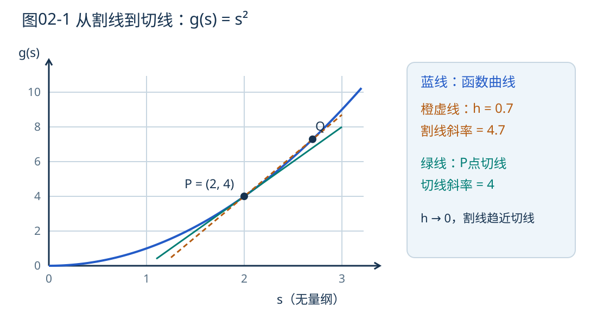
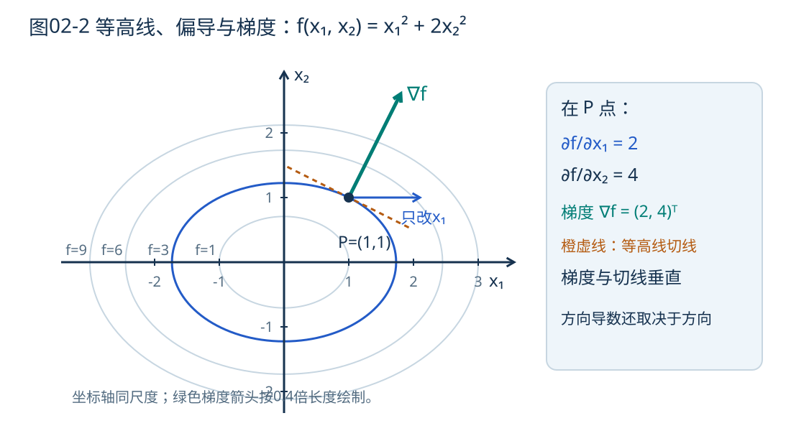
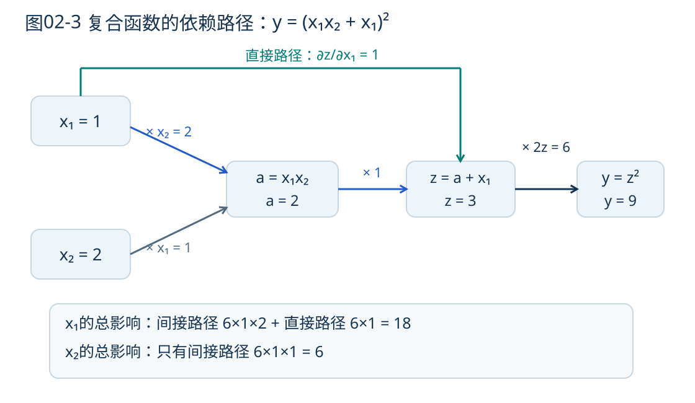
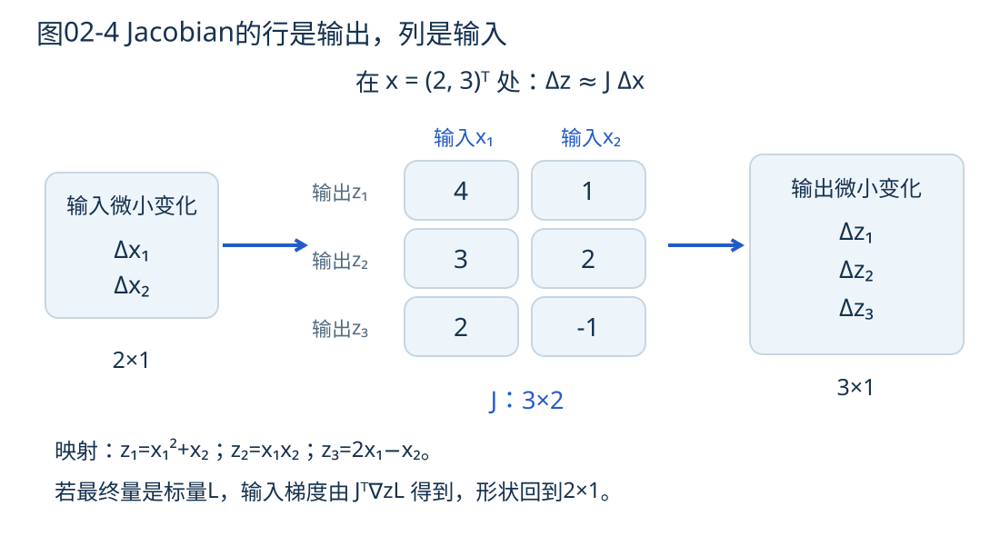

# 第02章：导数、梯度与链式法则

> 状态：正文、CPU实验与HTML/PDF已验收；完成记录见章节计划。
> [阅读入口](../../README.md) · [章节计划](../chapter-plan.md) · [公共符号](../appendices/notation.md) · [完整实验](../../examples/02-calculus/README.md)

## 1. 本章目标与前置知识

第01章让我们能看懂“输入经过哪些矩阵运算得到输出”。本章接着回答：输入改变一点，输出会怎样改变？以后需要调整模型参数时，也会问同样的问题。这里先学习求变化率的方法，不提前展开训练算法。

学完后，你应能从割线理解导数；分别计算偏导、梯度和单位方向导数；按依赖路径计算复合函数导数；写出非方形Jacobian矩阵及其形状；用手算、中心差分和自动微分核对结果，并识别不可微点造成的例外。

前置知识是第01章的向量、内积、矩阵乘法和范数，以及高中函数、幂、指数与三角函数的基本含义。若尚不熟悉 $\sin$ 或 $\exp$，可以先完成所有多项式例子，再把非多项式实验作为函数求值的对照。我们默认讨论实数变量，数学向量为列向量，代码中的 `(d,)` 是存储形式，不自动表示二维列矩阵。

## 2. 从具体变化到局部变化率

假设输出是 $g(s)=s^2$。从 $s=2$ 走到 $s=3$，输出由4变9，平均变化率为5；只走到 $s=2.1$，平均变化率为4.1。它们都正确，但所覆盖的区间不同。我们想描述的是 $s=2$ 附近自身的性质，因此要不断缩短区间。



图02-1中的橙虚线经过 $P=(2,4)$ 和 $Q=(2.7,7.29)$，斜率为4.7；绿线是 $P$ 点的切线，斜率为4。曲线、切线和割线均由解析公式原创绘制，概念依据D2L §2.4.1 [1]。图没有来自训练的数据。

不要把“输出很大”与“变化很快”混在一起：$g(2)=4$ 是高度，$g'(2)=4$ 是局部斜率。这次两个数相同只是巧合，例如 $g(3)=9$、$g'(3)=6$ 就不同。

## 3. 本章符号与形状

| 符号 | 含义 | 范围或形状 |
| --- | --- | --- |
| $s,h$ | 单变量输入与非零微小扰动 | 实数；极限中让 $h$ 趋近0 |
| $\mathbf{x},\Delta\mathbf{x}$ | 多变量输入与它的变化 | $d$ 维列向量 |
| $f,\mathbf{F}$ | 标量值函数、向量值函数 | 分别映射到 $\mathbb{R}$ 与 $\mathbb{R}^{m}$ |
| $\mathbf{e}_j$ | 第 $j$ 个坐标方向的单位向量 | $d$ 维，其第 $j$ 项为1、其余为0 |
| $\nabla_{\mathbf{x}} f$ | $f$ 对输入的梯度 | $d$ 维列向量 |
| $\mathbf{u}$ | 单位方向向量 | $\lVert\mathbf{u}\rVert_2=1$ |
| $\mathbf{J}_{\mathbf{F}}$ | $\mathbf{F}$ 的Jacobian矩阵 | $m\times d$，输出为行、输入为列 |
| $\mathbf{z},y$ | 中间向量与最终标量 | 本章每个例子单独给出形状 |

这里的 $h$ 是差分扰动，不是网络隐藏状态。实验的 `epsilon` 对应 $h$，所有对照使用64位浮点数（`float64`），以便更清楚地观察误差；数值计算的系统讨论留到第04章。

## 4. 导数：单输入、单输出的局部斜率

### 4.1 极限定义到底在做什么

单变量函数的导数（derivative）定义为：

$$
g'(s)=\lim_{h\to0}\frac{g(s+h)-g(s)}{h}.
$$

分子是输出变化，分母是输入变化。$\lim$ 表示观察 $h$ 从两侧接近0时，整个比值是否趋近同一个有限值；不是把 $h=0$ 直接代入产生 $0/0$。本章在定义域内部讨论这个双侧极限；边界的一侧导数须另行说明。[1]

在 $g(s)=s^2$ 中，先保持 $h\neq0$，再展开并消去 $h$：

$$
\frac{(s+h)^2-s^2}{h}
=\frac{2sh+h^2}{h}
=2s+h
\quad\Longrightarrow\quad
g'(s)=2s.
$$

在 $s=2$ 处，$h=0.5,0.1,0.01$ 给出的割线斜率依次为4.5、4.1、4.01，趋近4。这就是图02-1中切线的斜率。

### 4.2 导数给出的近似与误差

当输入改变很小的 $\Delta s$，使用切线得到：

$$
g(s+\Delta s)\approx g(s)+g'(s)\Delta s.
$$

例如 $\Delta s=0.01$ 时，切线预测 $g(2.01)\approx4+4\times0.01=4.04$；实际值为4.0401，误差为0.0001。这来自平方展开中剩下的 $(\Delta s)^2$，不是导数算错。导数只描述局部一阶变化，不能保证走很远仍然准确。

后续例子会使用以下基本规则。$u,v$ 都是同一变量的可导函数，$a,b$ 是与该变量无关的常数；$n$ 为正整数。

| 函数或组合 | 导数 | 条件或解释 |
| --- | --- | --- |
| 常数 $a$ | $0$ | 输入变化时常数不变 |
| $s^n$ | $ns^{n-1}$ | 幂函数法则 |
| $au+bv$ | $au'+bv'$ | 每项变化率按常数权重相加 |
| $uv$ | $u'v+uv'$ | 两个因子都可变化，贡献要相加 |
| $\sin s$ | $\cos s$ | 角度使用弧度 |
| $\exp s$ | $\exp s$ | 自然指数函数 |
| $\log s$ | $1/s$ | 本书为自然对数，$s>0$ |

例如 $(s^3s)'=3s^2\cdot s+s^3\cdot1=4s^3$，与先合成 $s^4$ 再求导相同。复合函数的规则将在第7节单独推导。

## 5. 偏导：一次只改变一个坐标

有多个输入时，“输入变化一点”还不够明确：改变哪一项？偏导数（partial derivative）固定其他坐标，只让指定坐标变化。例如 $f(x_1,x_2)=x_1^2+2x_2^2$，对 $x_1$ 求偏导时，把 $x_2$ 当成常数。[2]

$$
\frac{\partial f}{\partial x_j}(\mathbf{x})
=\lim_{h\to0}
\frac{f(\mathbf{x}+h\mathbf{e}_j)-f(\mathbf{x})}{h}.
$$

对这个二元函数分别计算：

$$
\frac{\partial f}{\partial x_1}=2x_1,
\qquad
\frac{\partial f}{\partial x_2}=4x_2.
$$

在 $\mathbf{x}=(1,1)^{\top}$ 处，两项为2和4。手算检验第一项：$f(1+h,1)-f(1,1)=2h+h^2$，除以 $h$ 后趋近2；第二项则由 $f(1,1+h)-f(1,1)=4h+2h^2$ 得到4。它们是两种不同的坐标切片斜率。



图02-2画的是 $f$ 的等高线，即输出相同的输入点组成的曲线。蓝色椭圆上每一点都满足 $f=3$；蓝色水平箭头表示只改变 $x_1$。因此等高线图能在二维纸面上显示一个二元函数的变化关系。绿色梯度与橙色切线的关系在下一节解释。图为原创解析绘制，概念依据MIT Session 35 [3]。

## 6. 梯度与方向导数：把坐标变化合在一起

### 6.1 梯度保留所有坐标的信息

梯度（gradient）把一个标量函数的偏导依次排成列向量：

$$
\nabla_{\mathbf{x}}f
=\begin{bmatrix}
\partial f/\partial x_1\\
\partial f/\partial x_2
\end{bmatrix}
=\begin{bmatrix}2x_1\\4x_2\end{bmatrix}.
$$

输入是2维、输出是标量，所以这里梯度是2维。梯度不是把偏导相加成一个数；每一项仍对应一个输入坐标。[3]

若 $f$ 在该点可微，即它在足够小邻域内能被同一个线性变化规则近似，则：

$$
f(\mathbf{x}+\Delta\mathbf{x})
\approx f(\mathbf{x})
+\nabla_{\mathbf{x}}f(\mathbf{x})^{\top}\Delta\mathbf{x}.
$$

右侧内积把每个坐标的“变化率×变化量”加起来。例如 $\Delta\mathbf{x}=(0.01,-0.02)^{\top}$，在 $(1,1)$ 处，一阶预测变化为 $2\times0.01+4\times(-0.02)=-0.06$；精确变化为 $-0.0591$，相差 $0.01^2+2\times0.02^2=0.0009$。

更精确地说，可微要求近似余项除以 $\lVert\Delta\mathbf{x}\rVert_2$ 后趋近0。只知道各坐标偏导存在，还不足以保证这一点；邻域内偏导连续是常用的充分条件。本章的多项式、正弦与指数例子都满足所需条件。

### 6.2 方向导数为什么需要一个方向

方向导数（directional derivative）研究沿给定方向移动时的变化率。使用单位方向 $\mathbf{u}$，定义为：

$$
D_{\mathbf{u}}f(\mathbf{x})
=\lim_{h\to0}
\frac{f(\mathbf{x}+h\mathbf{u})-f(\mathbf{x})}{h}.
$$

把上一节的线性近似代入，输出变化的一阶项为 $h\nabla f^{\top}\mathbf{u}$，再除以 $h$ 并取极限，得到：

$$
D_{\mathbf{u}}f(\mathbf{x})
=\nabla f(\mathbf{x})^{\top}\mathbf{u}.
$$

此式要求 $f$ 在该点可微。[4] 对单位向量 $\mathbf{u}=(3/5,4/5)^{\top}$，先检查其长度为1，再计算：

$$
D_{\mathbf{u}}f(1,1)
=2\times\frac35+4\times\frac45
=\frac{22}{5}=4.4.
$$

沿该方向的精确展开为 $f((1,1)^{\top}+h\mathbf{u})=3+4.4h+1.64h^2$，因此这个方向上的局部变化率确实是4.4。若改用非单位向量 $\mathbf{v}$，$\nabla f^{\top}\mathbf{v}$ 是相对于路径参数的变化率，仍有意义，但包含了移动速度，不能直接比较为“每单位距离”的变化率。

### 6.3 梯度与等高线、最快上升方向

内积满足 $\nabla f^{\top}\mathbf{u}\leq\lVert\nabla f\rVert_2\lVert\mathbf{u}\rVert_2$。这个不等式表达“内积不超过长度乘积”。当 $\mathbf{u}$ 为单位向量且梯度非零时，选择 $\mathbf{u}=\nabla f/\lVert\nabla f\rVert_2$ 使等号成立。因此梯度给出当前位置按欧氏距离衡量的最快上升方向，反向则给出最快下降方向；这只描述局部一阶变化。[4,5]

沿等高线切线方向，函数一阶变化为0，所以该方向与梯度内积为0，即二者垂直。在图02-2的 $P$ 点，梯度是 $(2,4)^{\top}$，切线方向可取 $(2,-1)^{\top}$，内积 $2\times2+4\times(-1)=0$。两条箭头的方向与这个计算一致。

若梯度为0，所有一阶方向导数都为0，但这并不能判定是最小值。例如 $g(s)=s^3$ 在0的导数为0，函数仍由负变正。怎样选择有限步长以及怎样优化函数，是第04章的内容。

## 7. 链式法则：变化怎样穿过复合计算

### 7.1 一条路径：局部变化率相乘

考虑先算 $u=3s+1$，再算 $y=u^2$。链式法则（chain rule）把两步的局部变化率相乘：[1,6]

$$
\frac{dy}{ds}=\frac{dy}{du}\frac{du}{ds}
=(2u)\times3.
$$

在 $s=1$ 处，$u=4$、$y=16$，因此导数是 $8\times3=24$。直觉上，$s$ 的小变化先被第一步放大3倍，再由第二步按当前位置斜率8倍变化。独立展开 $y=9s^2+6s+1$，导数为 $18s+6$，在1处同样得到24。规则要求参与复合的函数在相关位置可微，不是把符号当分数随意约掉。

### 7.2 多条路径：每条相乘，再把贡献相加

如果 $y=q(\mathbf{z})$，而 $\mathbf{z}=\mathbf{F}(\mathbf{x})$，则 $x_j$ 可以通过多个 $z_r$ 影响同一个输出：

$$
\frac{\partial y}{\partial x_j}
=\sum_{r=1}^{m}
\frac{\partial q}{\partial z_r}
\frac{\partial F_r}{\partial x_j}.
$$

求和不是额外的经验技巧，而是多个中间坐标变化的一阶贡献相加。MIT Session 34给出了多变量链式法则的具体组织方式。[7]



图02-3为本章原创依赖图，依据链式法则组织，不复刻教材原图。每个方框表示一次计算；箭头表示谁依赖谁，边上数字是该运算对对应直接输入的偏导。取 $x_1=1,x_2=2$：

$$
a=x_1x_2=2,
\qquad z=a+x_1=3,
\qquad y=z^2=9.
$$

$z$ 这个加法节点把 $a$ 和 $x_1$ 视为两个直接输入，因此对每个直接输入的局部偏导都为1。$x_1$ 到最终 $y$ 有两条路径：

$$
\frac{\partial y}{\partial x_1}
=\underbrace{(2z)\times1\times x_2}_{\text{经过乘法节点}}
+\underbrace{(2z)\times1}_{\text{直接进入加法节点}}
=12+6=18.
$$

$x_2$ 只有经过乘法节点这一条路径：

$$
\frac{\partial y}{\partial x_2}=(2z)\times1\times x_1=6.
$$

因此列梯度是 $(18,6)^{\top}$。如果只沿第一条路径算出12，就漏掉了 $x_1$ 直接进入加法节点的影响。第08章会将这种局部求导与贡献累加组织成完整反向传播；本章先把数学路径解释清楚。

## 8. Jacobian：多个输出要保留一张偏导表

### 8.1 为什么梯度向量不够用

标量函数每个输入只有一个偏导；向量函数的每个输出都对应一组偏导。因此使用Jacobian矩阵（Jacobian matrix，雅可比矩阵）保留它们。本书约定：输出编号为行，输入编号为列。

$$
(\mathbf{J}_{\mathbf{F}})_{rj}
=\frac{\partial F_r}{\partial x_j},
\qquad
\mathbf{F}:\mathbb{R}^{d}\to\mathbb{R}^{m},
\quad
\mathbf{J}_{\mathbf{F}}\in\mathbb{R}^{m\times d}.
$$

例如 $d=2,m=3$，定义：

$$
\mathbf{F}(\mathbf{x})
=\begin{bmatrix}
x_1^2+x_2\\x_1x_2\\2x_1-x_2
\end{bmatrix},
\qquad
\mathbf{J}_{\mathbf{F}}(\mathbf{x})
=\begin{bmatrix}
2x_1&1\\x_2&x_1\\2&-1
\end{bmatrix}.
$$

在 $\mathbf{x}=(2,3)^{\top}$ 处，$\mathbf{z}=(7,6,1)^{\top}$，Jacobian为：

$$
\mathbf{J}_{\mathbf{F}}(2,3)
=\begin{bmatrix}4&1\\3&2\\2&-1\end{bmatrix}
\in\mathbb{R}^{3\times2}.
$$



图02-4按本章原创例子绘制，第一行对应 $z_1$ 对两个输入的偏导，第三行对应 $z_3$。它把输入的微小变化线性映射为输出的微小变化：$\Delta\mathbf{z}\approx\mathbf{J}_{\mathbf{F}}\Delta\mathbf{x}$。维度是 $(3\times2)(2\times1)=3\times1$。

### 8.2 最终输出为标量时，为什么出现转置

假设再定义 $y=q(\mathbf{z})=z_1+2z_2-z_3$。中间梯度为 $\nabla_{\mathbf{z}}q=(1,2,-1)^{\top}$。第7节对每个输入分量求和的式子，可以整理成：

$$
\nabla_{\mathbf{x}}y
=\mathbf{J}_{\mathbf{F}}(\mathbf{x})^{\top}
\nabla_{\mathbf{z}}q.
$$

形状为 $(2\times3)(3\times1)=2\times1$，回到输入维度。代入数字：

$$
\nabla_{\mathbf{x}}y
=\begin{bmatrix}4&3&2\\1&2&-1\end{bmatrix}
\begin{bmatrix}1\\2\\-1\end{bmatrix}
=\begin{bmatrix}8\\6\end{bmatrix}.
$$

独立检查：将 $\mathbf{F}$ 代入 $q$ 后，$y=x_1^2+2x_1x_2-2x_1+2x_2$，直接求偏导得到 $(2x_1+2x_2-2,2x_1+2)^{\top}$，在 $(2,3)$ 处仍为 $(8,6)^{\top}$。

用框架时也要区分两件事：完整Jacobian保留每一个输出的偏导；把输出加权成一个标量后再求梯度，只保留这个标量对输入的影响。实验会分别验证两者。PyTorch接口返回的轴顺序为“输出形状在前、输入形状在后”，在本例中正好是 `(3, 2)`。[8,9]

## 9. 三种求导途径与不可微边界

### 9.1 手算、中心差分与自动微分分别做什么

解析求导直接按函数规则推导表达式，是本章手算基准。有限差分（finite difference）在邻近输入处实际求值，用输出差近似导数。我们采用中心差分：

$$
\frac{\partial f}{\partial x_j}(\mathbf{x})
\approx
\frac{f(\mathbf{x}+h\mathbf{e}_j)-f(\mathbf{x}-h\mathbf{e}_j)}{2h}.
$$

对足够光滑的函数，可以把两侧函数值分别展开：常数项相减消失，线性项相加得到 $2h\partial f/\partial x_j$，二次项相减消失，剩余误差除以 $2h$ 后通常随 $h^2$ 缩小。这要求相应高阶导数和局部光滑条件成立，并且暂时忽略了计算机舍入误差。[5]

自动微分（automatic differentiation，AD）按程序实际执行的基本运算及链式法则组合导数。它不是通过扰动输入来近似导数，也不是自动输出一份代数推导；实际值仍受浮点计算以及各运算导数规则影响。[8]

| 方法 | 本章用途 | 主要限制 |
| --- | --- | --- |
| 解析推导 | 解释规则并建立独立基准 | 复杂表达式容易漏路径或符号 |
| 中心差分 | 不读取内部求导实现，检查数值结果 | 选取 $h$ 有误差折中，每个输入坐标要额外求值 |
| 自动微分 | 按链式法则计算实际程序的导数 | 需支持的可微运算，特殊边界采用接口约定 |

中心差分的 $h$ 并非越小越好。$h$ 太大时局部近似偏差大；太小时，两次函数值非常接近，有限精度的减法和除法会放大误差。本章用 $\sin s$ 的实际扫描展示这个现象，第04章再系统解释有限精度。

### 9.2 返回数字不代表数学上处处可导

考虑 $g(s)=|s|$ 在0处。令 $h>0$，分别从两侧计算：

$$
\frac{g(h)-g(0)}{h}=1,
\qquad
\frac{g(0)-g(-h)}{h}=-1.
$$

两边斜率不相等，所以经典双侧导数不存在。然而中心差分恰为 $(|h|-|-h|)/(2h)=0$。本机PyTorch对 `abs(0)` 的自动微分也返回0，这是该运算在尖点处采用的规则。[10] 这两个0相同，并不能把不存在的经典导数变成0。

因此先确认可微性和定义域，再使用数值一致性作证据。差分只说明有限精度、有限扰动下的一次对照；框架给出的数值只说明它按自身规则完成了计算。后续网络中的分段函数也需要这样理解。

## 10. 从公式到代码

完整入口是[实验脚本](../../examples/02-calculus/run.py)。下面摘出分叉函数的核心片段：

```python
import torch

x = torch.tensor([1.0, 2.0], dtype=torch.float64,
                 device="cpu", requires_grad=True)
a = x[0] * x[1]
z = a + x[0]
y = z ** 2
gradient, = torch.autograd.grad(y, x)
print(y.item(), gradient.tolist())  # 9.0 [18.0, 6.0]
```

`requires_grad=True`让框架记录计算所需的导数关系；`torch.autograd.grad(y, x)`指定求标量 `y` 对输入 `x` 的梯度，返回一个元组，所以左侧逗号用于取出唯一结果。`x[0]` 对应数学中的 $x_1$，`x[1]` 对应 $x_2$。结果存为形状 `(2,)` 的数组，与数学列梯度 $(18,6)^{\top}$ 的两个分量对应。

完整Jacobian采用：

```python
def vector_map(x):
    return torch.stack((x[0] ** 2 + x[1],
                        x[0] * x[1], 2 * x[0] - x[1]))

x = torch.tensor([2.0, 3.0], dtype=torch.float64)
jacobian = torch.autograd.functional.jacobian(vector_map, x)
assert tuple(jacobian.shape) == (3, 2)
```

这里明确要求完整的三输出、二输入偏导表。[9] 对三维向量直接调用仅针对标量的梯度方式，不能自动得到同一张表；要么求Jacobian，要么先说明自己需要的标量组合。

## 11. 本机实践与实测结果

### 11.1 数据、环境与配置

本实验使用固定解析函数和常数输入，无外部数据集，无训练参数、训练轮数、数据划分或检查点。所有数值均为教学构造，不声称来自模型训练。无随机采样，因此随机种子不适用；复现仍依赖解释器、依赖版本和浮点实现。

实测日期为2026-11-15（Asia/Shanghai）。正式仓库的项目虚拟环境为Python 3.11.5、NumPy 2.4.6、PyTorch 2.15.0+cpu；设备强制CPU、精度float64、PyTorch线程数1。运行平台为Windows，内部版本26200；Python平台API将其报告为 `Windows-10-10.0.26200-SP0`，操作系统名称另见[环境报告](../appendices/environment.md)。

中心差分默认 $h=10^{-5}$。一般梯度检查使用 `rtol=1e-6, atol=1e-7`，自动微分与解析式对照使用 `rtol=1e-12, atol=1e-12`；精确设置会写入结果JSON。误差阈值是本实验的检查设置，不是任意函数、任意输入的保证。

### 11.2 从仓库根目录运行

先按第00章准备项目CPU环境，再执行：

```powershell
& ./.venv/Scripts/python.exe -B examples/02-calculus/run.py
```

报告保存在 `build/experiments/02-calculus/results.json`，包含环境、配置、全部数值、误差扫描、不可微边界和资源记录。构建目录属于本机生成结果，不作为必须已存在的教程源文件。以下命令使用更小扰动保存一份独立对照：

```powershell
& ./.venv/Scripts/python.exe -B examples/02-calculus/run.py --epsilon 1e-6 --output build/experiments/02-calculus/h-1e-6.json
```

若更换 $h$ 后超出脚本阈值，程序会报错，而不是仍打印通过；这需要结合误差和函数性质分析，不能直接放宽阈值隐藏问题。

### 11.3 本机实际观察

2026-11-15 21:28运行默认配置，三组梯度均通过解析式、中心差分与自动微分对照：

| 实验 | 差分最大绝对误差 | 自动微分最大绝对误差 |
| --- | --- | --- |
| 二次函数，输入(1,1) | $1.31\times10^{-11}$ | $0$ |
| 分叉函数，输入(1,2) | $5.97\times10^{-11}$ | $0$ |
| 非多项式，输入(0.7,-0.2) | $3.44\times10^{-11}$ | $0$ |

前两组解析梯度分别为 $(2,4)^{\top}$ 和 $(18,6)^{\top}$，均与前文手算一致。第三组函数为 $\sin x_1\exp x_2+x_1^3x_2$，输入处梯度约为 $(0.33220,0.87044)^{\top}$。它用于避免只用差分恰好精确的简单二次函数作对照，其解析梯度为：

$$
\begin{bmatrix}
\cos x_1\exp x_2+3x_1^2x_2\\
\sin x_1\exp x_2+x_1^3
\end{bmatrix}.
$$

方向导数实测为约4.3999999999933，与解析值4.4一致；Jacobian实测形状为 `(3, 2)`，与手算矩阵一致，进一步组合为标量后的输入梯度为 `[8.0, 6.0]`。这里的“误差0”只表示本次输出的浮点结果一致，不是无限精度证明。

误差扫描采用 $\sin s$ 在 $s=0.7$ 的导数 $\cos(0.7)$ 作独立基准。本机中心差分观察如下：

| $h$ | 绝对误差 |
| --- | --- |
| $10^{-1}$ | $1.27\times10^{-3}$ |
| $10^{-3}$ | $1.27\times10^{-7}$ |
| $10^{-5}$ | $1.70\times10^{-11}$ |
| $10^{-8}$ | $2.30\times10^{-9}$ |
| $10^{-12}$ | $9.55\times10^{-6}$ |

误差先减小又增大，验证了“更小的扰动并非总是更准确”。不可微边界同时实测得到左差商 $-1$、右差商 $1$、中心差分0与框架返回0，符合第9节的解释。

该次脚本记录纯计算约0.107秒、含库导入约1.831秒；Windows进程峰值驻留内存约197.7 MiB，含Python与依赖导入，不是函数自身的数据量或机器总内存。这是一次本机观察，后台负载与缓存状态会改变耗时和内存；报告会在每次运行时重新测量。

## 12. 常见误区与适用边界

- **把极限当成直接代入0**：导数先计算非零扰动下的比值，再讨论它趋近什么。
- **求偏导时让其他坐标也跟着变**：偏导固定其他独立坐标；沿路径共同变化要用链式法则。
- **把梯度与方向导数当成同一个对象**：梯度为向量，方向导数为选定方向上的标量。
- **漏掉重复依赖路径**：同一个输入多次参与输出时，每条路径的贡献都需计入。
- **把Jacobian转置或压成一个向量**：先写输出数、输入数，再定位各偏导的行列。
- **认为梯度为0就是最小值**：它只说明一阶局部变化为0，仍需进一步分析。
- **认为框架给数值就是可导证明**：尖点处可能按约定返回数值，须核对数学定义与接口规则。

## 13. 习题与解析

### 13.1 习题

1. 求 $y=(2s-1)^3$ 在 $s=2$ 处的导数，分别用链式法则与展开法检查。
2. 对本章二次函数，在 $(1,1)$ 处沿 $(1,1)$ 方向每单位距离的变化率是多少？为什么不能直接回答6？
3. 在图02-3中，有人得到 $\partial y/\partial x_1=12$。指出遗漏路径，并计算正确梯度。
4. 对第8节的向量函数，在 $(2,3)$ 处取 $\Delta\mathbf{x}=(0.01,-0.02)^{\top}$。用Jacobian预测变化，再与实际变化比较。
5. 为什么 $|s|$ 在0处中心差分与框架结果一致，仍不能证明它可导？
6. 运行实验的两种扰动配置，比较第三组函数的差分误差，说明结果支持的范围。不要用单个输入的成功宣称任意程序求导都正确。

### 13.2 解析

1. 令 $u=2s-1$，在 $s=2$ 时 $u=3$，导数为 $3u^2\times2=54$。展开得 $8s^3-12s^2+6s-1$，导数 $24s^2-24s+6$，代入2也为54。
2. 先归一化，$\mathbf{u}=(1,1)^{\top}/\sqrt2$，方向导数为 $(2+4)/\sqrt2=3\sqrt2$。6对应沿路径参数 $\mathbf{x}(t)=(1,1)^{\top}+t(1,1)^{\top}$ 的变化率，该路径每增加1单位参数移动 $\sqrt2$ 单位距离。
3. 遗漏了 $x_1$ 直接进入加法节点的路径，其贡献为6。正确结果为 $\partial y/\partial x_1=12+6=18$，另一分量为6。
4. 矩阵乘法给出预测变化 $(0.02,-0.01,0.04)^{\top}$。实际新输出为 $(7.0201,5.9898,1.04)^{\top}$，实际变化为 $(0.0201,-0.0102,0.04)^{\top}$。差别 $(0.0001,-0.0002,0)^{\top}$ 来自二次项；第三个输出本来就是线性的，所以该分量无近似误差。
5. 双侧导数要求左右差商趋近同一个值，而它们分别为 $-1$ 与 $1$。中心差分的对称抵消和框架约定各自返回0，均不能改变左右极限不相等的事实。
6. 根据每次生成JSON的实际数值回答；平滑函数及合适扰动下的三方一致，支持当前例子的公式与实现相符。跨平台误差和耗时可以不同；尖点、非法定义域、极端扰动与未覆盖输入需要独立检查。

## 14. 小结与下一步

导数描述一个输入方向的局部变化，偏导固定其他坐标，梯度把所有坐标偏导保留在列向量中。单位方向与梯度的内积给出方向导数；多个输出需要Jacobian。复合函数通过局部导数相乘和多路径贡献相加求导，形状始终约束计算是否合法。

下一章转向概率、统计与信息论，之后第04章会把梯度用于数值优化。第08章再将本章的计算图和链式法则组织成网络求梯度的方法。后续章节的实际进度见[章节计划](../chapter-plan.md)。

## 15. 参考文献

以下官方页面于2026-11-15核验，图示与数值例子为本章原创设计。

1. Aston Zhang、Zachary C. Lipton、Mu Li、Alexander J. Smola，*Dive into Deep Learning*，在线1.0.3，§2.4.1 Derivatives and Differentiation、§2.4.4 Chain Rule：[官方章节](https://d2l.ai/chapter_preliminaries/calculus.html)。
2. Denis Auroux，MIT 18.02SC *Multivariable Calculus*，Fall 2010，Session 26: Partial Derivatives：[具体课次](https://ocw.mit.edu/courses/18-02sc-multivariable-calculus-fall-2010/pages/2.-partial-derivatives/part-a-functions-of-two-variables-tangent-approximation-and-optimization/session-26-partial-derivatives/)。
3. Denis Auroux，同一课程，Session 35: Gradient: Definition, Perpendicular to Level Curves：[具体课次](https://ocw.mit.edu/courses/18-02sc-multivariable-calculus-fall-2010/pages/2.-partial-derivatives/part-b-chain-rule-gradient-and-directional-derivatives/session-35-gradient-definition-perpendicular-to-level-curves/)。
4. Denis Auroux，同一课程，Session 38: Directional Derivatives：[具体课次](https://ocw.mit.edu/courses/18-02sc-multivariable-calculus-fall-2010/pages/2.-partial-derivatives/part-b-chain-rule-gradient-and-directional-derivatives/session-38-directional-derivatives/)。
5. Ian Goodfellow、Yoshua Bengio、Aaron Courville，*Deep Learning*，MIT Press，2016，第4章§4.3 Gradient-Based Optimization：[官方章节](https://www.deeplearningbook.org/contents/numerical.html)。
6. Denis Auroux，MIT 18.02SC，Fall 2010，Session 32: Total Differentials and the Chain Rule：[具体课次](https://ocw.mit.edu/courses/18-02sc-multivariable-calculus-fall-2010/pages/2.-partial-derivatives/part-b-chain-rule-gradient-and-directional-derivatives/session-32-total-differentials-and-the-chain-rule/)。
7. Denis Auroux，同一课程，Session 34: The Chain Rule with More Variables：[具体课次](https://ocw.mit.edu/courses/18-02sc-multivariable-calculus-fall-2010/pages/2.-partial-derivatives/part-b-chain-rule-gradient-and-directional-derivatives/session-34-the-chain-rule-with-more-variables/)。
8. D2L，在线1.0.3，§2.5 Automatic Differentiation，尤其§2.5.1～2.5.2：[官方章节](https://d2l.ai/chapter_preliminaries/autograd.html)。
9. PyTorch 2.15，`torch.autograd.functional.jacobian`，输出及输入轴顺序：[官方接口](https://docs.pytorch.org/docs/2.15/generated/torch.autograd.functional.jacobian.html)。
10. PyTorch 2.15，Autograd mechanics，Gradients for non-differentiable functions：[官方说明](https://docs.pytorch.org/docs/2.15/notes/autograd.html#gradients-for-non-differentiable-functions)。

## 16. 实现与验证记录

本章采用四幅真正SVG，资源和[矢量图生成脚本](../../scripts/generate-chapter02-figures.mjs)同源维护，无位图截图、内嵌图像或外站图片。手算的标量导数、二元梯度、分叉路径、方向导数及三行两列Jacobian与float64 CPU程序对照通过；不可微边界作为预期例外解释。默认实验已记录实际环境、结果与资源，用不同扰动复跑的步骤见第11节。

2026-11-15已用正式单章命令生成HTML与14页PDF，包含4幅SVG、230处数学表达。1440及390像素页面无水平溢出、缺失锚点、裁剪图形或外站请求；PDF审计确认零位图、字体嵌入、书签与文档结构存在、文本无越界。逐页联系表及图、公式、结果表格的放大检查通过。首次窄屏检查发现结果表格过宽，拆成三列表格后重新构建并通过。正式全书是否纳入本章仍由按顺序的章节验收决定，不因单章预览通过而绕过前置章节。
