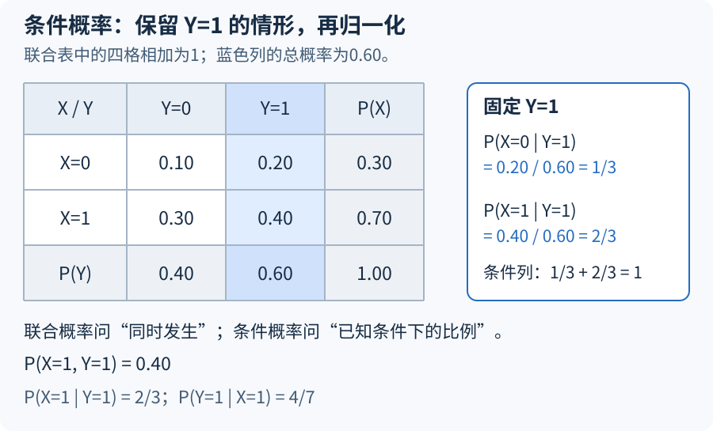
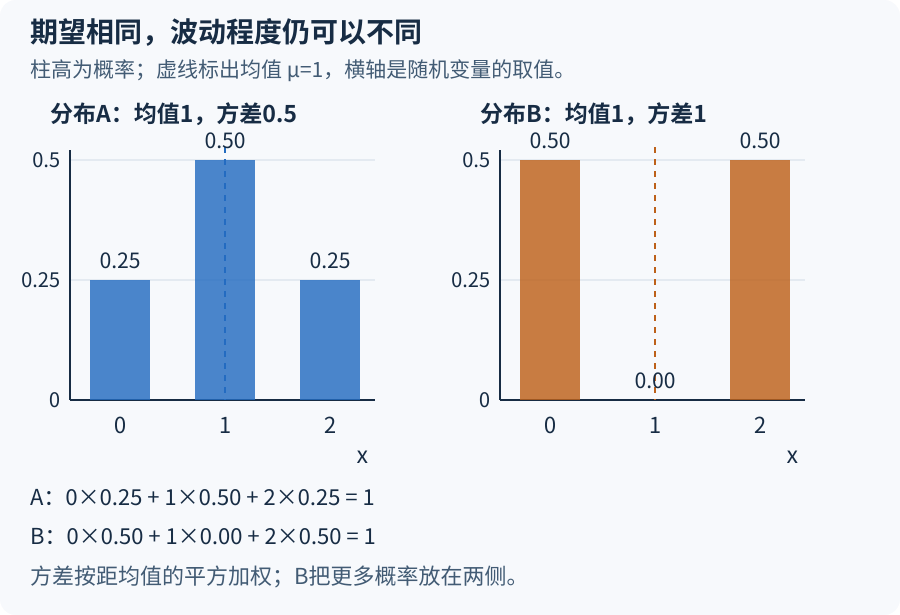
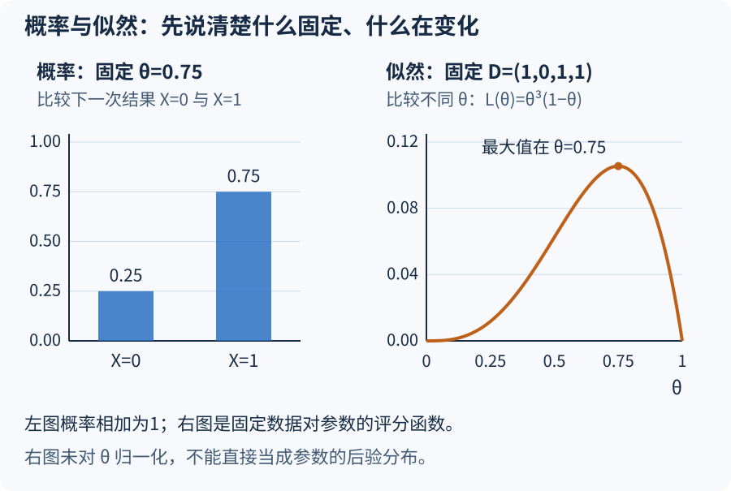
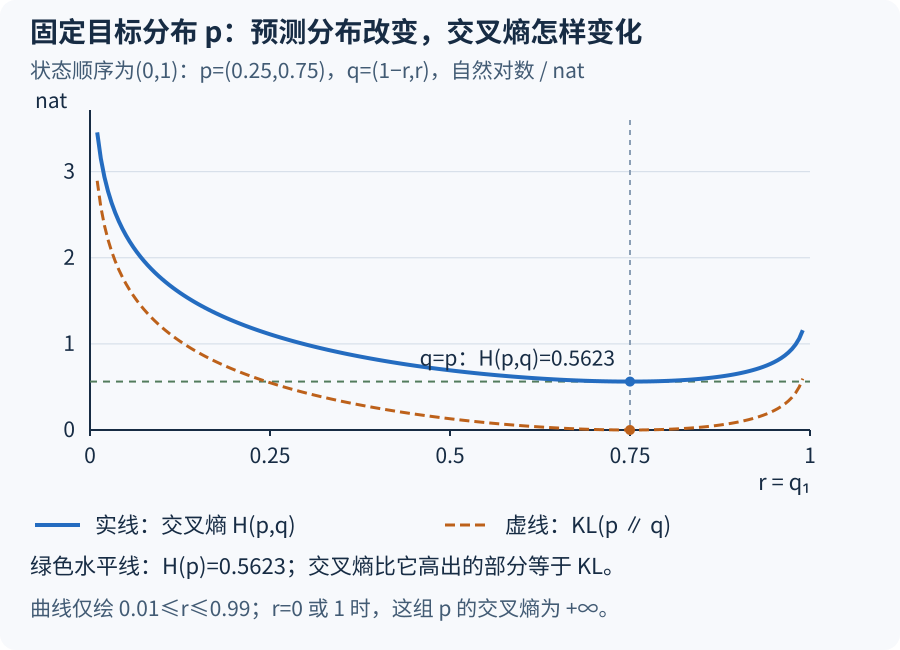

# 第 03 章：概率、统计与信息论

> 对应任务：03；状态：正文、CPU 实验与 HTML/PDF 验收完成；最后更新：2026-11-15。

[阅读入口](../../README.md) · [上一章：导数与梯度](02-calculus.md) · [章节计划](../chapter-plan.md) · [公共符号](../appendices/notation.md) · [实验说明](../../examples/03-probability/README.md)

## 1. 本章目标与前置知识

第 00 章使用一个确定规则预测数字；面对分类、文本和真实观测时，我们还需要表达“不确定”。给出一个答案和给这个答案分配概率，是两种不同的信息。本章建立概率语言，再解释训练中经常出现的“似然”“交叉熵”和“KL”究竟在比较什么。

学完后，你应当能够从一个联合概率表算出边缘分布、条件概率和 Bayes 反向条件；用独立的定义检查能否把联合分布拆成乘积；手算期望、方差和小样本估计；明确概率与似然的自变量；推导离散交叉熵等于熵加 KL，并处理零概率边界。

前置为第 01 章的向量、数组与求和，第 02 章的函数、导数和自然对数。阅读时可对照[公共符号表](../appendices/notation.md)。本章先在**有限离散状态空间**上完整推导，连续变量仅解释密度和适用边界，避免直接把离散求和结论照搬到连续情况。

## 2. 从“会发生哪个结果”到“怎样评价预测分布”

想象一个程序需要判断一张卡片是否为蓝色。即使两个模型都选“蓝色”，它们给蓝色分配 0.51 和 0.99 的概率，表达的确信程度也不同。要评价这种输出，需要先说明真实结果怎样产生，再定义怎样比较预测分布与观测。

本章按三步前进：先用十张合成卡片理解条件概率；再用有限分布的加权平均理解统计量与采样；最后用四次二值观测联系似然、熵和交叉熵。概率、期望与信息论的主线对应花书第 3 章，[1] 本文例子与图均为项目原创。

## 3. 符号、状态顺序与单位

| 符号 | 含义与约定 |
| --- | --- |
| $`\Omega,A,B`$ | 样本空间与其中的事件；$`A\cap B`$ 表示同时发生 |
| $`X,Y,Z`$；$`x,y`$ | 随机变量与某次取值；大写斜体不表示批次矩阵 |
| $`P(X=x)`$ | 离散取值的概率，范围为 $`[0,1]`$ |
| $`p_X(x)`$ | 连续随机变量的密度，不能直接当成点概率 |
| $`p_c,q_c`$ | 同一有限状态空间中，第 $`c`$ 个状态的目标与预测概率 |
| $`\theta`$ | Bernoulli 分布中 $`P(X=1;\theta)`$，属于 $`[0,1]`$ |
| $`N,x^{(i)}`$ | 观测数与第 $`i`$ 个观测；上标括号不是乘方 |
| $`\mu,\sigma^2`$ | 总体期望与方差，需在相应分布下计算 |
| $`\bar{x},\hat p`$ | 样本均值与由样本频率得到的分布估计 |
| $`L(\theta;\mathcal D)`$ | 固定观测数据后的似然函数 |
| $`H(p),H(p,q),D_{\mathrm{KL}}(p\Vert q)`$ | 熵、交叉熵与有方向的 KL 散度 |

本章公式显式使用自然对数 $`\ln`$，与公共约定的 $`\log`$ 同底，信息量单位为 **nat**。若使用 $`\log_2`$，单位为 bit，两者通过 $`1\,\mathrm{bit}=\ln2\,\mathrm{nat}`$ 换算。概率向量中的状态顺序必须一致；后面的二值例子统一按 $`(0,1)`$ 排列。

## 4. 概率：先定义可以发生的结果

### 4.1 随机变量、概率质量与密度

样本空间（sample space）列出一次随机试验的可能结果，事件（event）是其中一组结果。随机变量（random variable）把结果映射成数值。例如抽到一张卡是试验结果，$`X=1`$ 可以表示卡片为圆形，$`X=0`$ 表示方形。抽取前用 $`X`$ 表示尚未确定的量，抽取后得到具体数值 $`x`$。[1，§3.2～§3.3]

离散概率质量函数（probability mass function，PMF）为每个状态分配概率。有限状态 $`c=0,\ldots,C-1`$ 的分布必须满足：

```math
p_c=P(X=c)\geq0,
\qquad
\sum_{c=0}^{C-1}p_c=1.
```

这两条条件使概率总量为 1，每项也就不会超过 1。概率表示给定模型中的规律；抽取少量样本得到的频率只是估计，并不保证恰好等于该概率。

连续情况下，若 $`X`$ 有概率密度函数（probability density function，PDF），区间概率由面积给出：

```math
P(a\leq X\leq b)=\int_a^b p_X(x)\,\mathrm dx,
\qquad
p_X(x)\geq0,
\quad
\int_{-\infty}^{\infty}p_X(x)\,\mathrm dx=1.
```

例如 $`X`$ 在 $`[0,0.5]`$ 上均匀分布，密度为 2；区间 $`[0,0.1]`$ 的概率是 $`2\times0.1=0.2`$。密度可以大于 1，而有密度的连续分布在单点的概率为 0。后面若将概率改为密度，必须同步改用积分并重新检查量的含义。[1，§3.3.2]

### 4.2 联合、边缘与条件概率

构造十张等概率抽取的卡片：1 张橙色方形、2 张蓝色方形、3 张橙色圆形、4 张蓝色圆形。用 $`X=1`$ 表示圆形，$`Y=1`$ 表示蓝色，0 分别表示另一种形状或颜色。联合概率（joint probability）同时描述两个变量：

| $`P(X=x,Y=y)`$ | $`Y=0`$ | $`Y=1`$ | 行和 $`P(X=x)`$ |
| --- | --- | --- | --- |
| $`X=0`$ | $`0.10`$ | $`0.20`$ | $`0.30`$ |
| $`X=1`$ | $`0.30`$ | $`0.40`$ | $`0.70`$ |
| 列和 $`P(Y=y)`$ | $`0.40`$ | $`0.60`$ | $`1.00`$ |

若只关心形状，就把每种形状下的颜色概率加起来。所得分布称为边缘分布（marginal distribution）：

```math
P(X=x)=\sum_y P(X=x,Y=y).
```

现在已经知道抽到蓝色卡片，即 $`Y=1`$。我们只在原来 6 张蓝色卡中比较，圆形占 4 张，因此 $`P(X=1\mid Y=1)=4/6`$。这就是条件概率（conditional probability）的“限制范围后重新归一化”。[1，§3.4～§3.5][2，§2.6.4]



图 03-1：联合表与条件分布。按本章十张合成卡片原创绘制；方法对应花书 §3.4～§3.5。左表四格总和为 1，右侧两个条件概率的和也为 1，但它们使用的归一化范围不同。

一般事件的定义为：

```math
P(A\mid B)=\frac{P(A\cap B)}{P(B)},
\qquad P(B)>0.
```

竖线右侧是已知条件。对本表，$`P(X=1,Y=1)=0.4`$，除以 $`P(Y=1)=0.6`$ 得 $`2/3`$；反过来除以 $`P(X=1)=0.7`$ 则得到 $`P(Y=1\mid X=1)=4/7`$。两者的分母不同，不能交换条件方向。对概率为零的事件，上述比值未定义；连续变量的条件密度需要另外的定义，不直接套用这个零分母比值。

### 4.3 乘法法则、链式分解与独立

把条件概率公式两边乘以分母，就得到乘法法则：

```math
P(A\cap B)=P(A\mid B)P(B).
```

重复这一过程，可以按选定次序把联合概率拆成条件概率。例如：

```math
P(X=x,Y=y,Z=z)
=P(X=x\mid Y=y,Z=z)P(Y=y\mid Z=z)P(Z=z).
```

这是概率的链式法则，[1，§3.6] 与第 02 章对复合函数求导的链式法则解决不同问题。这里每一步只使用条件概率定义，没有要求变量独立；相关条件概率应在条件事件具有正概率处使用。

若所有状态都满足

```math
P(X=x,Y=y)=P(X=x)P(Y=y),
```

则称 $`X,Y`$ 独立（independent）。在 $`P(Y=y)>0`$ 时，它意味着 $`P(X=x\mid Y=y)=P(X=x)`$：知道 $`Y`$ 后，$`X`$ 的分布不变。十张卡片的表并不独立，因为 $`0.4\ne0.7\times0.6=0.42`$。[1，§3.7][3]

独立也不等于互斥。若两个正概率事件互斥，它们不能同时发生，联合概率为 0，而边缘概率乘积大于 0，反而不满足独立。若只在给定 $`Z=z`$ 后满足条件分布的乘积分解，则是条件独立；它既不自动推出总体独立，总体独立也不自动保证任意条件下独立。后续把样本似然写成乘积时，必须明确采用哪一种假设。

### 4.4 Bayes：由两个条件方向的同一个联合概率推导

在 $`P(A)>0`$、$`P(B)>0`$ 时，把同一个联合概率按两种顺序写出：

```math
P(A\mid B)P(B)=P(A\cap B)=P(B\mid A)P(A).
```

再除以 $`P(B)`$：

```math
P(A\mid B)=\frac{P(B\mid A)P(A)}{P(B)}.
```

这就是 Bayes 公式。$`P(A)`$ 是先验（prior），$`P(B\mid A)`$ 描述假设成立时观测证据的概率，$`P(B)`$ 是证据（evidence）的总概率，$`P(A\mid B)`$ 是后验（posterior）。这些名字标注的是公式中的角色，不会改变条件概率的定义。[1，§3.11][4]

取 $`A=\{X=1\}`$、$`B=\{Y=1\}`$。已知圆形比例为 $`0.7`$，圆形卡中蓝色比例为 $`4/7`$，总体蓝色比例为 $`0.6`$，于是：

```math
P(X=1\mid Y=1)=\frac{(4/7)\times0.7}{0.6}=\frac23.
```

若没有直接给出证据概率，可按互斥且覆盖全部情况的形状分类求和：

```math
P(Y=1)=\sum_{x\in\{0,1\}}P(Y=1\mid X=x)P(X=x)
=\frac23\times0.3+\frac47\times0.7=0.6.
```

这称为全概率计算。观察颜色会更新我们对形状的判断，但它没有把方形卡片变成圆形；条件概率本身不表示干预的因果作用。

## 5. 期望、方差与样本统计量

### 5.1 期望是按概率加权的平均

期望（expectation）描述分布下的平均值。有限离散变量的定义为：

```math
\mu=\mathbb E[X]=\sum_x xP(X=x),
\qquad
\mathbb E[g(X)]=\sum_x g(x)P(X=x).
```

取 $`X\in\{0,1,2\}`$，概率依次为 $`(0.25,0.50,0.25)`$：

```math
\mathbb E[X]=0\times0.25+1\times0.50+2\times0.25=1,
```

```math
\mathbb E[X^2]=0^2\times0.25+1^2\times0.50+2^2\times0.25=1.5.
```

可见 $`\mathbb E[X^2]`$ 与 $`(\mathbb E[X])^2=1`$ 不同；一般不能把非线性函数移到期望外。期望的线性性质允许 $`\mathbb E[aX+bY]=a\mathbb E[X]+b\mathbb E[Y]`$，其中 $`a,b`$ 为常数，这一步不要求 $`X,Y`$ 独立。[1，§3.8][2，§2.6.6]

### 5.2 方差测量围绕均值的波动

知道均值仍不够。一个变量可以经常靠近均值，也可以经常落在两端。方差（variance）用离均值距离的平方描述这种波动：

```math
\begin{aligned}
\mathop{\mathrm{Var}}\nolimits(X)
&=\mathbb E[(X-\mu)^2]\\
&=\mathbb E[X^2-2\mu X+\mu^2]\\
&=\mathbb E[X^2]-2\mu\mathbb E[X]+\mu^2\\
&=\mathbb E[X^2]-\mu^2.
\end{aligned}
```

第二行展开平方；第三行使用期望的线性性质；最后代入 $`\mathbb E[X]=\mu`$。上例方差是 $`1.5-1^2=0.5`$。标准差（standard deviation）为 $`\sigma=\sqrt{\mathop{\mathrm{Var}}\nolimits(X)}`$，与 $`X`$ 的单位相同，而方差带平方单位。



图 03-2：相同均值，不同方差。图按本章两组固定概率原创绘制，不是采样直方图。分布 A 为 $`(0.25,0.50,0.25)`$，分布 B 为 $`(0.50,0,0.50)`$；B 的二阶矩为 2，方差为 1，说明单个均值不能描述全部分布。

有限状态下这些量必然存在；推广到无限或连续状态时，有限期望通常要求 $`\mathbb E[|X|]\lt \infty`$，使用有限方差还需有限二阶矩。不能默认所有重尾分布都有可用的均值和方差。

### 5.3 理论量怎样与采样估计联系起来

观测 $`N`$ 个数 $`x^{(1)},\ldots,x^{(N)}`$ 后，样本均值为：

```math
\bar x=\frac1N\sum_{i=1}^{N}x^{(i)}.
```

它按出现次数等权平均，是对总体期望的估计。若样本独立同分布（independent and identically distributed，i.i.d.）且总体方差为有限的 $`\sigma^2`$，则 $`\mathbb E[\bar X]=\mu`$，$`\mathop{\mathrm{Var}}\nolimits(\bar X)=\sigma^2/N`$；后一结论利用了独立样本方差可相加。它说明平均值的波动尺度随样本数减小，不保证每增加一次样本，实际误差都下降。

两种常见方差估计也要分清：

```math
\hat v_N=\frac1N\sum_{i=1}^{N}(x^{(i)}-\bar x)^2,
\qquad
s^2=\frac1{N-1}\sum_{i=1}^{N}(x^{(i)}-\bar x)^2,
\quad N>1.
```

前者是样本经验分布本身的方差；后者在上述 i.i.d.、有限方差假设下是总体方差的无偏估计。无偏描述重复采样的平均性质，不表示单次必然更接近真值。NumPy 的 `var(ddof=0)` 和 `var(ddof=1)` 分别使用这两个分母；默认取哪个必须在实验中声明。

## 6. 概率与似然：表达式相同，自变量不同

### 6.1 固定参数，看未来数据的概率

Bernoulli 分布描述取值为 0 或 1 的一次试验。设 $`P(X=1;\theta)=\theta`$，则 $`P(X=0;\theta)=1-\theta`$。对 $`0\lt \theta\lt 1`$，可以统一写成：

```math
P(X=x;\theta)=\theta^x(1-\theta)^{1-x},\qquad x\in\{0,1\}.
```

当 $`\theta=0.75`$ 固定时，变化的是可能结果 $`x`$：结果 0 的概率是 0.25，结果 1 的概率是 0.75，两者相加为 1。由定义还能手算 $`\mathbb E[X]=\theta`$、$`\mathop{\mathrm{Var}}\nolimits(X)=\theta-\theta^2=\theta(1-\theta)`$。[1，§3.9.1]

### 6.2 固定观测，看不同参数怎样解释它

现在观察到一个**有序**序列 $`\mathcal D=(1,0,1,1)`$。假设四次试验在同一个参数 $`\theta`$ 下独立，联合概率才可分解为：

```math
P(\mathcal D;\theta)=\prod_{i=1}^{4}P(X=x^{(i)};\theta)
=\theta\,(1-\theta)\,\theta\,\theta=\theta^3(1-\theta).
```

固定这个已观察的数据，把 $`\theta`$ 当作函数的自变量，便得到似然（likelihood）：

```math
L(\theta;\mathcal D)=\theta^3(1-\theta).
```

似然沿用概率模型的表达式，职责是比较参数对这份固定数据的支持程度。它**通常没有在参数空间归一化**，也不是 $`P(\theta\mid\mathcal D)`$。要得到参数后验，还需要先验及 Bayes 归一化；本例只比较似然。[5，§5.5]



图 03-3：概率与似然的自变量。按本章模型原创绘制。左边两个柱高相加为 1；右边曲线不是对参数的概率分布，且两图纵轴尺度分别标注，不能直接比较图形面积。

代入两组参数即可手算：

```math
L(0.5;\mathcal D)=0.5^4=0.0625,
\qquad
L(0.75;\mathcal D)=0.75^3\times0.25=0.10546875.
```

因此 0.75 对这份观测的似然更高。对数把乘积化为求和：

```math
\ln L(\theta;\mathcal D)=3\ln\theta+\ln(1-\theta),
\qquad 0\lt \theta\lt 1.
```

利用第 02 章的导数，导数为 $`3/\theta-1/(1-\theta)`$，令其为 0 得 $`\theta=3/4`$；二阶导数 $`-3/\theta^2-1/(1-\theta)^2\lt 0`$，且两端似然均为 0，所以这是全局最大值。本例的最大似然估计等于观测中 1 的比例。

这里数据是完整有序序列。若只观察“四次中恰好三次为 1”，这一事件包含四种序列，概率要乘以组合数 4；不能悄悄把两个观测事件当成同一个。该因子与 $`\theta`$ 无关，所以此例最大值位置相同，但似然数值不同。

## 7. 从信息量到熵、交叉熵与 KL

### 7.1 单次信息量与平均不确定性

一个在分布下很罕见的结果，出现时更出人意料。自信息（self-information）用负对数衡量：

```math
I(c)=-\ln p_c,\qquad p_c>0.
```

概率为 1 时信息量为 0；概率为 $`1/4`$ 时信息量是 $`\ln4`$。负对数还把独立事件概率相乘变为信息量相加。对所有结果按目标分布 $`p`$ 加权，得到熵（entropy）：

```math
H(p)=\mathbb E_{U\sim p}[-\ln p_U]
=-\sum_c p_c\ln p_c.
```

这里 $`U`$ 是类别随机变量，求和遍历本章约定的全部有限状态。熵描述分布的平均不确定性；当分布集中在一个状态时为 0，两个等概率状态时为 $`\ln2\approx0.6931`$ nat。[1，§3.13]

对 $`p=(0.25,0.75)`$：

```math
H(p)=-0.25\ln0.25-0.75\ln0.75\approx0.562335\ \mathrm{nat}.
```

分布本身不确定性较低，不保证用它预测某个具体样本时一定正确。信息量也不等于一个模型“懂了多少知识”，它是在这里明确定义的概率量。

### 7.2 交叉熵使用目标概率加权预测的负对数

若真实采样规律是 $`p`$，模型却给出预测分布 $`q`$，同一次结果的评分变为 $`-\ln q_c`$，仍然按实际结果来源 $`p`$ 求平均，得到交叉熵（cross-entropy）：

```math
H(p,q)=-\sum_c p_c\ln q_c.
```

第一个分布决定“哪些结果更常出现”，第二个分布决定“对出现结果给出怎样的负对数评分”。交换二者通常会改变结果。若出现了 $`q`$ 认为不可能的状态，负对数代价会发散；这是定义的一部分，不应直接用一个小常数掩盖。

以同一个 $`p=(0.25,0.75)`$ 比较三个预测：

| 预测分布 $`q`$，按 $`(0,1)`$ 排列 | $`H(p,q)`$ / nat | 与 $`H(p)`$ 的差 |
| --- | --- | --- |
| $`(0.25,0.75)`$ | $`0.562335`$ | $`0`$ |
| $`(0.50,0.50)`$ | $`0.693147`$ | $`0.130812`$ |
| $`(0.75,0.25)`$ | $`1.111641`$ | $`0.549306`$ |

第二行可手算为 $`-(0.25+0.75)\ln0.5=\ln2`$。第三行把更多预测概率分给实际较少出现的状态，平均代价更高。这里 $`p`$ 是已知的合成分布；真实学习任务往往只能用样本频率或标签估计它。

### 7.3 KL 的方向、支持集与分解

KL 散度（Kullback–Leibler divergence）衡量用 $`q`$ 代替 $`p`$ 时的额外平均负对数代价：

```math
D_{\mathrm{KL}}(p\Vert q)
=\sum_{c:p_c>0}p_c\ln\frac{p_c}{q_c}.
```

先限定在同一有限状态空间、两个分布均归一化，且所有 $`p_c>0`$ 的位置均有 $`q_c>0`$。这称为 $`q`$ 的支持集覆盖 $`p`$ 的支持集，保证当前求和各项有限。展开对数并逐项求和：

```math
\begin{aligned}
D_{\mathrm{KL}}(p\Vert q)
&=\sum_{c:p_c>0}p_c\ln p_c
  -\sum_{c:p_c>0}p_c\ln q_c\\
&=-H(p)+H(p,q).
\end{aligned}
```

因此：

```math
\boxed{H(p,q)=H(p)+D_{\mathrm{KL}}(p\Vert q)}.
```

第一项只依赖目标分布；第二项量化预测分布与目标分布的差异。[1，§3.13] 这就是表中第三列的含义。



图 03-4：解析交叉熵与 KL 曲线。固定 $`p=(0.25,0.75)`$，令 $`q=(1-r,r)`$，按定义计算后原创绘图。绿色水平线是 $`H(p)`$；交叉熵与它的高度差等于 KL。图只画 $`0.01\leq r\leq0.99`$，端点的无穷大不伪装成有限曲线值。

为什么 KL 非负？利用 $`\ln u\leq u-1`$（$`u>0`$，且仅在 $`u=1`$ 时取等），令支持集 $`S=\{c:p_c>0\}`$：

```math
\begin{aligned}
D_{\mathrm{KL}}(p\Vert q)
&=-\sum_{c\in S}p_c\ln\frac{q_c}{p_c}\\
&\geq\sum_{c\in S}(p_c-q_c)
=1-\sum_{c\in S}q_c\geq0.
\end{aligned}
```

最后一步使用 $`q`$ 总概率为 1。对这些有限分布，等号要求 $`p=q`$。所以在 $`p`$ 固定、$`q`$ 可选时，交叉熵最小值为 $`H(p)`$。KL 通常不对称，例如本例与均匀分布 $`u=(0.5,0.5)`$ 有：

```math
D_{\mathrm{KL}}(p\Vert u)\approx0.130812,
\qquad
D_{\mathrm{KL}}(u\Vert p)\approx0.143841.
```

KL 不能作为通常的对称距离。某些特别配对的分布可能恰好得到相同双向数值，也不意味着普遍对称。

### 7.4 零概率与连续情形的边界

遇到零项时采用明确的定义：

- $`p_c=0`$ 的项贡献为 0，包括 $`p_c=q_c=0`$；熵中的 $`0\ln0=0`$ 按极限解释。
- 若某处 $`p_c>0,q_c=0`$，交叉熵与该方向 KL 都为 $`+\infty`$。反向 KL 需要重新检查它自己的支持条件。
- 若 $`q_c`$ 很小但严格为正，代价很大却有限。例如 $`p=(0,1)`$、$`q=(1-10^{-300},10^{-300})`$ 的交叉熵约为 $`690.7755`$ nat。

给 $`q`$ 加 epsilon、截断或重归一化会改变被比较的分布。可以为明确目的采用平滑方法，但必须说明修改后的定义，不能声称无条件等于原始 KL。

连续情况下可定义微分熵 $`h(p)=-\int p(x)\ln p(x)\,\mathrm dx`$，但它可能为负。例如前述 $`[0,0.5]`$ 上的均匀密度得到 $`h=-\ln2`$。连续 KL 则要按密度比积分，并检查相应支持与可积条件。本章关于离散熵非负、有限状态求和的推导不能直接当成连续熵的所有性质。

### 7.5 为什么训练常使用负对数似然

回到四次观测 $`\mathcal D=(1,0,1,1)`$。其经验分布为 $`\hat p=(0.25,0.75)`$，候选 Bernoulli 分布为 $`q_\theta=(1-\theta,\theta)`$。将对数似然按观测数求平均再取负：

```math
\begin{aligned}
-\frac14\ln L(\theta;\mathcal D)
&=-\frac14\bigl[3\ln\theta+\ln(1-\theta)\bigr]\\
&=-0.25\ln(1-\theta)-0.75\ln\theta\\
&=H(\hat p,q_\theta).
\end{aligned}
```

因此，对这份固定数据，最大化似然、最小化平均负对数似然、最小化该经验分布到模型的交叉熵具有相同的最优参数。由于 $`H(\hat p)`$ 不随模型参数变化，也等价于最小化 $`D_{\mathrm{KL}}(\hat p\Vert q_\theta)`$。这里明确了观测、独立假设、求和轴和分母；后续分类与语言模型会把同一思想推广到条件分布。

## 8. 从公式到本机 CPU 实验

### 8.1 数据、环境与执行

完整代码与说明位于 [run.py](../../examples/03-probability/run.py) 和 [README](../../examples/03-probability/README.md)。本次是数值模拟和公式核对，无外部数据，无模型训练；训练/验证/测试划分、优化器、学习率、网络参数量和检查点均不适用。Bernoulli 参数候选值是手工指定的比较对象，不由本脚本训练得到。

本机实测为 Windows Build 26200、项目 Python 3.11.5、NumPy 2.4.6、CPU、float64；使用 `numpy.Generator(PCG64)`，种子 `20261115`。有限分布样本数取 100、1000、10000，三次估计使用同一段长度 10000 的序列前缀。数组形状为 `(10000,)`，联合表形状为 `(2,2)`，二类概率向量形状为 `(2,)`。

从正式仓库根目录运行：

```powershell
& ./.venv/Scripts/python.exe -B examples/03-probability/run.py
```

JSON 保存到 `build/experiments/03-probability.json` 并显示在终端。程序遇到公式关系不符时以非零状态退出。无模型状态需要恢复；使用相同 NumPy 版本、生成器、种子和调用顺序重跑。版本变化时不单凭种子承诺跨版本样本完全相同，应保留实际输出。

### 8.2 沿轴计算与稳定处理

联合表的行对应 $`X`$，列对应 $`Y`$，所以 `joint.sum(axis=1)` 将列加掉，得到每行的 $`P(X)`$；`joint.sum(axis=0)` 将行加掉，得到 $`P(Y)`$。`joint[:, 1] / marginal_y[1]` 则给出条件 $`Y=1`$ 下 $`X`$ 的完整分布。这里代码索引从 0 开始，与取值 0、1 对应。

信息量代码先验证形状、非负与归一化，再筛选 $`p>0`$ 的项：

```python
mask = p > 0
log_p = np.log(p[mask])
if np.any(q[mask] == 0):
    cross_entropy = math.inf
    kl = math.inf
else:
    log_q = np.log(q[mask])
    cross_entropy = -np.dot(p[mask], log_q)
    kl = np.dot(p[mask], log_p - log_q)
```

这里 `p,q` 是已验证的 NumPy 概率数组，`np` 与 `math` 已在完整脚本导入。筛选避免执行 `0 * log(0)`；先判断 $`q=0`$，再对有效项取对数。KL 使用对数之差，减少直接构造概率比值带来的范围问题。没有统一给概率加 epsilon。Bernoulli 对数似然用 `log1p(-theta)` 计算 $`\ln(1-\theta)`$，端点单独处理。

标准 JSON 不支持无穷数，输出用字符串 `"+inf"`、`"-inf"` 表达数学边界。它们与有限浮点测量值不同，程序也不把 NaN 当成有效结果。

### 8.3 2026-11-15 本机实测与解释

本章于 21:28（Asia/Shanghai）执行上述命令，**21 项数值检查通过**。其中包括 Bayes 与直接条件计算一致、矩估计、两组似然、三组交叉熵分解、KL 非对称、零支持边界及拒绝未归一化输入。

| 样本数 | 样本均值 | `ddof=0` 方差 | `ddof=1` 方差 |
| --- | --- | --- | --- |
| 100 | 0.9600 | 0.438400 | 0.442828 |
| 1000 | 1.0200 | 0.481600 | 0.482082 |
| 10000 | 1.0098 | 0.499304 | 0.499354 |
| 理论总体 | 1.0000 | 0.500000 | 不适用：总体量不含样本分母 |

10000 个样本的均值绝对误差为 0.0098，方差接近 0.5。本次三项均值误差变小是这次样本的现象；它不证明误差必然单调下降。两种方差估计在样本增多时差异变小，也不保证某一种每次都更准确。

其余实测：$`P(X=1\mid Y=1)=0.6666667`$，两组似然约为 0.0625 和 0.10546875；三组交叉熵与上表理论值一致。交叉熵分解最大绝对误差约为 $`2.78\times10^{-17}`$；缺失支持得到 `"+inf"`，极小正概率得到有限的 690.775528 nat。

数值函数内部实测耗时约 0.255 秒，不含解释器启动及导入；样本数组载荷为 80000 字节。后者只统计这一个 float64 数组，不是进程总内存，进程峰值内存未测量。这是小型公式与采样实验，不用其耗时估计神经网络训练速度。

## 9. 常见误区与适用边界

**把条件方向反过来。** $`P(A\mid B)`$ 的分母是 $`P(B)`$，$`P(B\mid A)`$ 的分母是 $`P(A)`$。先标已知条件，再从联合表取正确行列。

**觉得“没同时发生”就是独立。** 独立要求联合等于边缘乘积；正概率互斥事件无法满足该等式。

**把样本平均当成已知总体期望。** 样本统计量是随机的估计。增加数据改善典型误差的依据依赖采样假设，不能靠一张看起来下降的曲线替代。

**把似然当作参数概率。** 固定数据后变化的是参数；后验还需先验与归一化。连续密度作为似然时还可以大于 1，不能据值大于 1 判定错误。

**觉得 KL 为正说明每个求和项都为正。** 某项 $`p_c\ln(p_c/q_c)`$ 可以为负，非负结论针对总和。方向、归一化和支持条件共同决定结论。

**认为交叉熵越小就一定是模型越好。** 只有目标分布、数据、对数底数与归约一致时才可直接比较。改变任务、样本划分或平均方式会改变数值含义；训练交叉熵也不能替代独立评估。

## 10. 习题与解析

### 10.1 习题

1. 从卡片联合表计算 $`P(Y=1\mid X=0)`$、$`P(X=0\mid Y=1)`$，并用 Bayes 核对后者。$`X,Y`$ 是否独立？给出一个反例格。
2. 对 Bernoulli 参数 $`\theta=0.75`$，从定义求 $`\mathbb E[X]`$ 与 $`\mathop{\mathrm{Var}}\nolimits(X)`$。样本恰为 $`(1,0,1,1)`$ 时，经验方差与 `ddof=1` 方差分别是多少？
3. 对这四次有序观测，$`L(0.25;\mathcal D)`$ 是多少？平均负对数似然是多少？若观测事件改成“四次中恰好三次为 1”，似然如何变化？
4. 取 $`p=(1,0)`$、$`q=(0.5,0.5)`$，计算 $`H(p)`$、$`H(p,q)`$、$`D_{\mathrm{KL}}(p\Vert q)`$ 和反向 KL。解释为什么两个方向的有限性不同。
5. 同学把每项概率都加 $`10^{-6}`$，未重新归一化就使用 KL 公式，并说“这与原定义相等且必然非负”。应怎样指出问题？对 $`p=q=(1,0)`$，怎样直接处理零项？
6. 将采样种子改成 `20261116` 重跑。记录三个样本量的误差，检查其是否单调。无论观察结果如何，能够支持什么、不能支持什么？

### 10.2 参考解析

**第 1 题。** $`P(Y=1\mid X=0)=0.2/0.3=2/3`$；$`P(X=0\mid Y=1)=0.2/0.6=1/3`$。Bayes 给出 $`(2/3)\times0.3/0.6=1/3`$。例如 $`P(X=1,Y=1)=0.4`$ 而边缘乘积为 $`0.7\times0.6=0.42`$，所以不独立。不能凭一对条件概率数值刚好相同就宣布独立，需检查完整定义。

**第 2 题。** $`\mathbb E[X]=0\times0.25+1\times0.75=0.75`$，$`\mathbb E[X^2]=0.75`$，方差为 $`0.75-0.75^2=0.1875`$。样本均值也是 0.75，离差平方和为 $`3(0.25)^2+(-0.75)^2=0.75`$。除以 4 得经验方差 0.1875；除以 3 得无偏样本方差 0.25。这次前者恰等于总体方差，不推翻后者的重复采样无偏性质。

**第 3 题。** $`L(0.25;\mathcal D)=0.25^3\times0.75=0.01171875`$。平均负对数似然为 $`-[3\ln0.25+\ln0.75]/4\approx1.111641`$ nat，与目标经验分布 $`(0.25,0.75)`$ 和预测 $`(0.75,0.25)`$ 的交叉熵一致。计数事件包含 4 个同概率有序序列，似然变为 0.046875；若改用该计数似然再除以 4，其值会额外减去 $`\ln4/4`$，因此不能仍宣称数值恰等于有序样本平均交叉熵。

**第 4 题。** 熵为 0；交叉熵和正向 KL 都为 $`-\ln0.5=\ln2`$。正向中 $`p`$ 为 0 的第二项跳过。反向 $`q`$ 的第二个状态有正概率而 $`p`$ 对该状态赋零，因此 $`D_{\mathrm{KL}}(q\Vert p)=+\infty`$。这同时展示支持集条件和方向的重要性。

**第 5 题。** 加常数改变了分布，且总和变成 $`1+C\times10^{-6}`$，已经不满足原先的归一化条件，不能直接引用同一非负证明。即使重新归一化，也比较的是修改后的分布。对 $`p=q=(1,0)`$，只在 $`p>0`$ 处计算；保留的项为 $`1\ln(1/1)=0`$，另一项按定义贡献 0，无须加常数。

**第 6 题。** 结果必须来自新运行。若不单调，是样本误差可波动的直接例子；若恰好单调，只能报告这次的现象。两种观察都不能单独证明或推翻在给定假设下的大样本收敛结论；也不能把一个样本均值当作完整分布。比较时保持分布、生成器、样本量与统计量定义不变，并保存种子和实际输出。

## 11. 本章小结与下一步

概率分布描述可能结果，条件概率在指定信息下重新归一化；Bayes 联系两个条件方向。期望与方差分别描述平均水平与波动，样本统计量是对它们的估计。固定数据再比较参数得到似然；对观测的平均负对数评分把它与交叉熵联系起来。

在同一有限状态空间、归一化和支持条件下，交叉熵分解为目标熵与有方向的 KL。下一章会处理计算机的浮点范围、对数与指数的稳定实现，解释数学上等价的写法为什么在程序中会出现不同结果。

## 12. 参考文献

1. Ian Goodfellow、Yoshua Bengio、Aaron Courville，*Deep Learning*，MIT Press，2016，第 3 章 Probability and Information Theory：§3.2 Random Variables；§3.3.1/§3.3.2 PMF 与 PDF；§3.4 Marginal Probability；§3.5 Conditional Probability；§3.6 概率链式法则；§3.7 独立与条件独立；§3.8 期望与方差；§3.9.1 Bernoulli；§3.11 Bayes；§3.13 Information Theory。[官方章节](https://www.deeplearningbook.org/contents/prob.html)。
2. Aston Zhang、Zachary C. Lipton、Mu Li、Alexander J. Smola，*Dive into Deep Learning*，在线版 1.0.3，§2.6.4 Multiple Random Variables、§2.6.6 Expectations。[官方章节](https://d2l.ai/chapter_preliminaries/probability.html)。
3. John Tsitsiklis，MIT 6.041SC *Probabilistic Systems Analysis and Applied Probability*，Fall 2013，Lecture 3: Independence；课程页给出事件独立及教材 §1.5 阅读定位。[官方课程页](https://ocw.mit.edu/courses/6-041sc-probabilistic-systems-analysis-and-applied-probability-fall-2013/pages/unit-i/lecture-3/)。
4. 同课程，Lecture 2: Conditioning and Bayes' Rule，条件概率、乘法法则、全概率与 Bayes，教材 §1.3～§1.4。[官方课程页](https://ocw.mit.edu/courses/6-041sc-probabilistic-systems-analysis-and-applied-probability-fall-2013/pages/unit-i/lecture-2/)。
5. Goodfellow 等，*Deep Learning*，2016，第 5 章 §5.5 Maximum Likelihood Estimation。用于固定观测、参数为自变量的似然以及负对数似然与 KL 的连接；本章只用有限 Bernoulli 例子，后续再展开统计学习。[官方章节](https://www.deeplearningbook.org/contents/ml.html)。

外部页面于 2026-11-15 核验。四幅 SVG 的可重建源为 [generate-chapter03-figures.mjs](../../scripts/generate-chapter03-figures.mjs)；图中的表、概率与曲线均按本章原创例子和公式生成，不复制教材图像。

## 13. 实现与验证记录

- 2026-11-15，本机 Python 3.11.5 / NumPy 2.4.6 / CPU：21 项数值检查通过，原始 JSON 与结果见第 8 节。
- 同源 HTML/PDF 构建通过：16 页、4 幅纯 SVG、262 处公式、零位图，书签和文档结构存在。
- 1440 px / 390 px 检查通过：无页面溢出、公式错误、断链、裁切或残留 Markdown 标记。
- PDF 字体全部嵌入，无缺字符号与纸外文字；16 页已渲染逐页目视，配图另行放大检查。
- 构建与审计输出在 `build/`，不作为手工维护源文件；任务登记与提交按主流程顺序执行。
