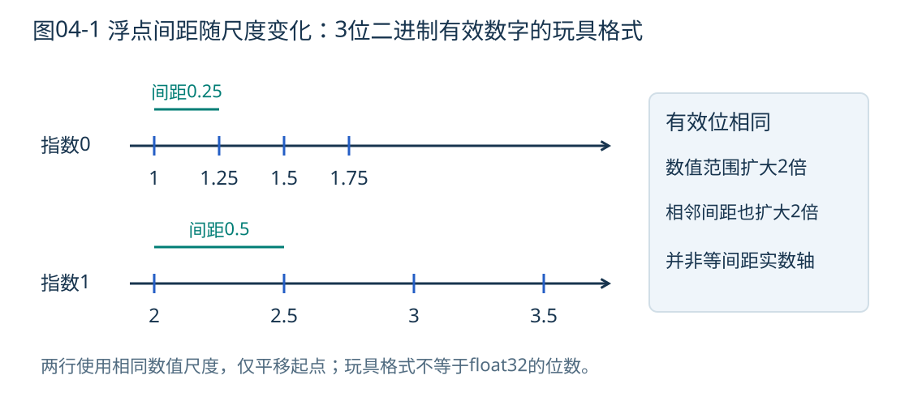
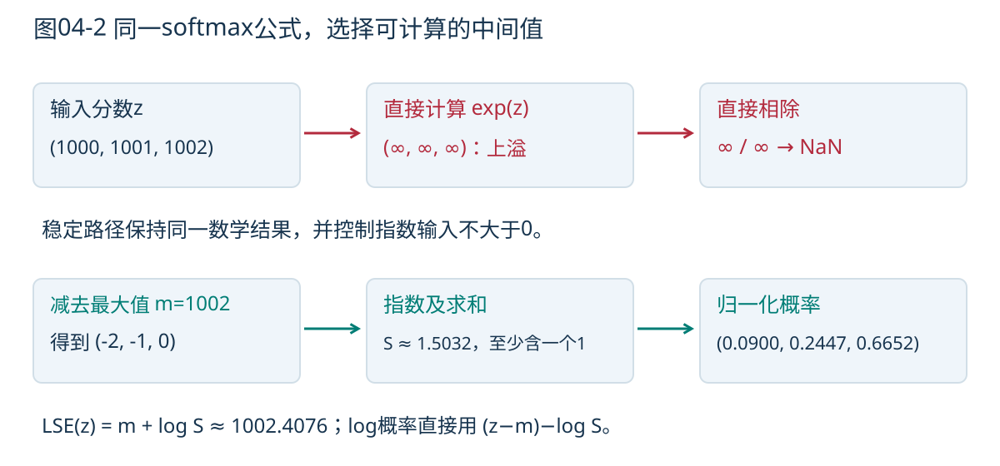
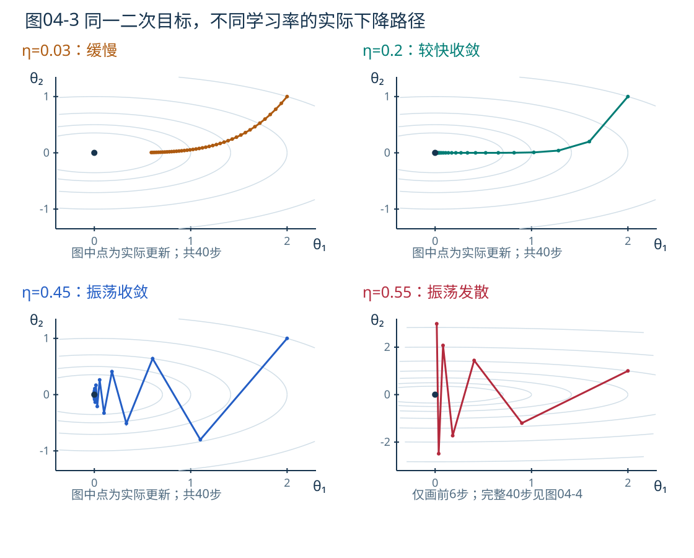
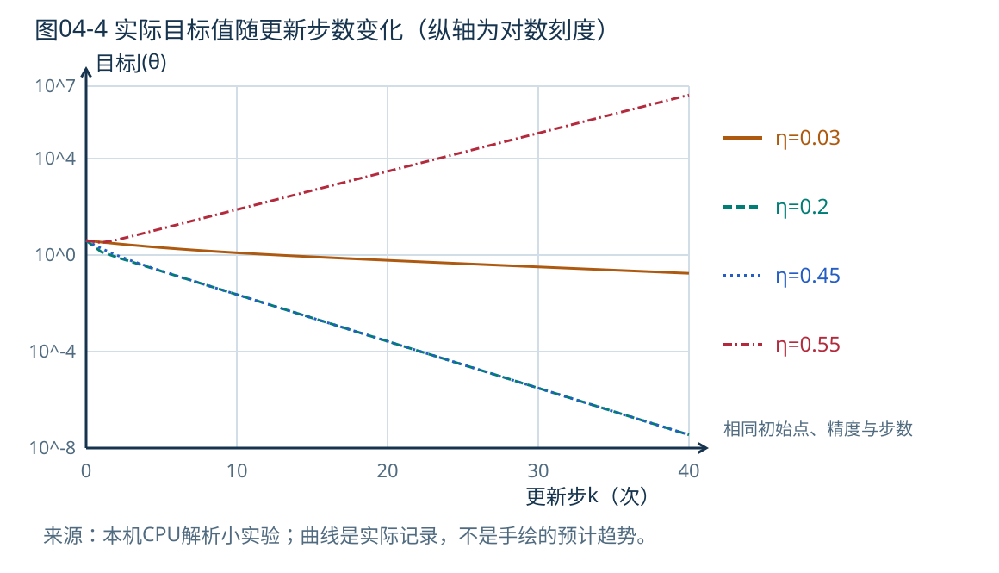

# 第04章：数值计算与优化入门

> 状态：正文、CPU实验与单章导出已通过验证；正式完成状态以章节计划为准。
> [阅读入口](../../README.md) · [上一章：概率与信息论](03-probability.md) · [章节计划](../chapter-plan.md) · [公共符号](../appendices/notation.md) · [实验说明](../../examples/04-numerical-optimization/README.md)

## 1. 本章目标与前置知识

前面我们在实数上推导了矩阵、导数和概率公式。把它们输入计算机时，还必须选择有限精度的表示方式与具体计算顺序。一个数学上正确的表达式可能产生无穷大、零或无效值；一个局部下降方向也可能因为移动过远而让目标变大。本章把这两个问题连起来，说明怎样让公式成为可信的数值计算。

学完后应能区分表示误差、上溢、下溢与相近数相减的问题；逐步推导稳定softmax、log-sum-exp及log-softmax；写清批次归一化轴；从局部近似得到梯度下降更新；在简单二次函数上推导学习率条件，并用本机实验解释缓慢、振荡和发散。

前置为第01章的向量与内积、第02章的梯度和局部近似、第03章的离散分布、自然对数与交叉熵。我们的实验只有固定函数和两个优化变量，不训练神经网络；它先建立后续机器学习实验需要的数值直觉。

## 2. 两个容易误判的现象

输入分数 $`(1000,1001,1002)`$，softmax在数学上应给出三个有限、归一化的概率。直接计算指数却会超出常见浮点格式的范围。这个失败不说明概率模型定义错误，需要改变计算中间值的方式。[1]

再考虑一个有唯一最小值的二次函数。沿负梯度更新，第一步目标确实下降，后面却可能快速增大。这也不说明梯度方向算错，而是局部近似不能保证任意长度的一步都下降。我们会用闭式解和实测曲线同时核对。

本章先处理“一个函数怎样稳定求值”，再处理“一个变量怎样逐步更新”，不把这两种原因都笼统称为“训练失败”。

## 3. 符号、形状与精度

| 符号 | 含义与约定 |
| --- | --- |
| $`\operatorname{fl}(x)`$ | 按指定浮点格式表示或计算出的近似值 |
| $`\epsilon_{\mathrm{mach}}`$ | 本章取1与其上方相邻浮点数之差，与NumPy `finfo.eps` 一致 |
| $`\mathbf{z},\mathbf{p}`$ | 分类分数与概率，均为 $`C`$ 维列向量 |
| $`m`$ | 当前样本最大分数，$`m=\max_c z_c`$；本章该字母表示标量 |
| $`\mathbf{Z}\in\mathbb{R}^{B\times C}`$ | 按行存放样本的批次分数，沿类别轴归一化 |
| $`\boldsymbol{\theta}_k`$ | 第 $`k`$ 次更新后的优化变量，本章为2维列向量 |
| $`\mathcal{J}(\boldsymbol{\theta})`$ | 要最小化的标量目标 |
| $`\eta>0`$ | 学习率，控制负梯度更新的尺度 |

优化及稳定概率实验使用CPU和float64；浮点格式对比同时使用float32。$`\log`$ 为自然对数。图04-4的纵轴采用以10为底的对数刻度，只改变展示方式，不改变目标函数中的运算或信息量单位。

## 4. 浮点数：用有限集合近似实数

### 4.1 有效数字与指数分别控制什么

浮点数（floating-point number）用有限位二进制有效数字和一个指数表示数值。对普通非零正规数，可以把形式写成：

```math
(-1)^s\,(1.b_1b_2\ldots b_{p-1})_2\,2^e.
```

$`s`$ 决定符号，$`p`$ 是有效二进制位数，$`e`$ 决定尺度。括号下标2表示二进制。有效位有限意味着只能保留有限精度；指数范围有限意味着可表示大小也有上下界。零、无穷大、NaN和非正规数使用另外的编码规则，不把它们硬套进上式。[2]



图04-1采用原创玩具格式，只有3位二进制有效数字。第一行的 $`1.00_2,1.01_2,1.10_2,1.11_2`$ 对应1、1.25、1.5、1.75；同一组有效数字乘以2后，第二行间距由0.25变为0.5。两行使用相同数值尺度、只平移起点。这张图解释非等距性质，不能拿3位玩具格式冒充float32的实际精度。

本机NumPy查询给出的实际值如下：[3]

| 类型 | 有效二进制位数 | 1上方相邻间距 |
| --- | --- | --- |
| float32 | 24 | 约 $`1.19\times10^{-7}`$ |
| float64 | 53 | 约 $`2.22\times10^{-16}`$ |

float32的最大有限数约 $`3.40\times10^{38}`$，float64约 $`1.80\times10^{308}`$。`smallest_normal`是最小正正规数，**不是最小正可表示数**；非正规数还能填充靠近0的一部分间隙，但有效精度降低。实验完整记录了这些边界，不假定所有数值都能以同一绝对精度表示。[3]

### 4.2 表示误差不等于运算任意出错

例如十进制0.1在二进制中通常需要无限展开，所以存成有限位时会舍入；1、2以及一定范围内的整数则能精确表示。不能据此声称“所有浮点运算都有随机误差”。

若数学值为 $`x`$、计算结果为 $`\hat x`$，绝对误差为 $`|\hat x-x|`$；当 $`x\neq0`$ 时，相对误差为：

```math
\frac{|\hat x-x|}{|x|}.
```

本章 $`\epsilon_{\mathrm{mach}}`$ 只取“1上方间距”这个明确约定，不把它当成任何规模、任何算法的全局绝对误差上限。多个运算累积后的误差，还取决于公式、次序、输入尺度与问题本身。[2,4]

### 4.3 加法次序与相近数相减

在float32中取 $`a=10^8,b=-10^8,c=1`$。先算 $`a+b`$ 得到0，再加1得到1；先算 $`b+c`$ 时，1小于该尺度能保留的间隔，结果舍入回 $`-10^8`$，再加 $`a`$ 得到0。因此实际有：

```math
\operatorname{fl}(\operatorname{fl}(a+b)+c)
\neq
\operatorname{fl}(a+\operatorname{fl}(b+c)).
```

本机float64在这组特定数值中两种次序都得到1，但这不意味着提高精度后所有输入都满足实数的结合律。框架并行求和、分批计算和不同设备可能采用不同运算顺序，不能要求结果逐位一致。[4]

相近数相减还可能放大已有相对误差。取 $`x=10^{-8}`$，想计算 $`\sqrt{1+x}-1`$。可以先在实数上有理化：

```math
\sqrt{1+x}-1
=\frac{(\sqrt{1+x}-1)(\sqrt{1+x}+1)}{\sqrt{1+x}+1}
=\frac{x}{\sqrt{1+x}+1}.
```

这里 $`x\geq-1`$ 时平方根有定义，分母至少为1。float32中 $`1+x`$ 已舍入成1，直接相减得到0；有理化版本把小量 $`x`$ 保留在分子，本机得到约 $`5\times10^{-9}`$。数学表达式等价，数值中间过程不同。这是数值稳定性（numerical stability）的核心问题之一：选择能控制误差放大的计算方法。[9]

## 5. 上溢、下溢与NaN要分别解释

上溢（overflow）是结果过大、超出格式的有限范围；在本章浮点指数例子中会得到正无穷。下溢（underflow）发生在极小结果进入低精度的非正规区间，继续缩小可能舍入成0。NaN（not a number）则表示无效数值结果，例如 $`0/0`$ 或 $`\infty/\infty`$。[1]

在float64中，$`\exp(1000)`$ 的数学值有限但不可表示，计算为正无穷；$`\exp(-1000)`$ 的数学值严格为正，但小于可表示范围，计算为0。随后归一化可能分别遇到 $`\infty/\infty`$ 或 $`0/0`$。所以“输出没有报Python异常”不能代替检查结果是否有限、范围是否合理、归一化是否正确。

本章代码只在刻意制造失败的局部计算中用 `np.errstate` 收集这些预期现象，随后明确验证失败标记；其他计算仍必须通过数值与形状检查。NaN与Infinity在结果JSON中存为说明性字符串，避免生成非标准JSON数字。

## 6. 稳定softmax：把共同偏移消掉

### 6.1 从分类分数到概率

softmax把任意有限实数分数映射为一个离散概率向量：[5]

```math
p_c=\frac{\exp(z_c)}{\sum_{j=1}^{C}\exp(z_j)},
\qquad c=1,\ldots,C.
```

每个概率为正，所有概率之和为1；有限精度实现中极小概率可能舍入成0。较大分数产生较大概率，但分数本身可以为负，也不需要预先归一化。它在这里是一次概率转换，如何学习分数的参数在第05章再解释。

### 6.2 为什么减最大值不改变结果

对任意共同常数 $`a`$，分子分母同时除以 $`\exp(a)`$，得到：

```math
\frac{\exp(z_c)}{\sum_j\exp(z_j)}
=\frac{\exp(z_c-a)}{\sum_j\exp(z_j-a)}.
```

选择 $`a=m=\max_j z_j`$，所有指数输入不大于0，至少一项为0，所以指数结果不大于1、分母至少包含一个1。这样避免指数上溢，也避免全部指数下溢造成分母为0。[1] 这个论证依赖输入分数有限；含NaN、无穷大或空类别轴时要先明确语义，不能认为一个减法自动解决所有特殊输入。



图04-2为本章原创流程图，结果来自本机CPU实测。以 $`(1000,1001,1002)`$ 为例，先减1002，得到 $`(-2,-1,0)`$；指数约为 $`(0.1353,0.3679,1)`$，总和约1.5032，再除以总和，得到：

```math
\mathbf{p}\approx
\begin{bmatrix}0.09003\\0.24473\\0.66524\end{bmatrix}.
```

原始分数都很负时也同样处理。例如 $`(-1000,-1001,-1002)`$ 减去最大值 $`-1000`$，得到 $`(0,-1,-2)`$，结果是上面概率的逆序。稳定方法解决的是计算范围，没有偷偷改动样本的相对分数。

### 6.3 批次必须沿类别轴计算

若 $`\mathbf{Z}`$ 的形状为 $`B\times C`$，每行是一份独立样本，每行最大值 $`m_b=\max_c Z_{bc}`$，每行输出满足 $`\sum_c P_{bc}=1`$。代码使用 `axis=1` 或 `dim=1`，并保留最大值和求和结果的形状为 `(B,1)`，再沿列广播：

```python
maximum = Z.max(axis=1, keepdims=True)       # (B, 1)
shifted = Z - maximum                      # (B, C)
exponentials = np.exp(shifted)
S = exponentials.sum(axis=1, keepdims=True) # (B, 1)
P = exponentials / S                       # (B, C)
```

全矩阵只减一个最大值虽然在精确数学中仍是共同偏移，但不能保证每行都保留一个指数项1，极端行仍可能全部下溢。沿批次轴归一化则会让不同样本相互影响，改变问题定义。

## 7. log-sum-exp与log-softmax：保留对数信息

### 7.1 log-sum-exp的等价变形

log-sum-exp（简称LSE）是“先求指数和，再取对数”：

```math
\operatorname{LSE}(\mathbf{z})
=\log\sum_{j=1}^{C}\exp(z_j).
```

先在指数和中提出 $`\exp(m)`$，再用 $`\log(ab)=\log a+\log b`$：

```math
\begin{aligned}
\operatorname{LSE}(\mathbf{z})
&=\log\left(\exp(m)\sum_j\exp(z_j-m)\right)\\
&=m+\log\sum_j\exp(z_j-m).
\end{aligned}
```

第二行不需要真的计算 $`\exp(m)`$。对上节例子，结果为 $`1002+\log(1.5032\ldots)\approx1002.4076`$。框架的 `torch.logsumexp` 提供按指定轴的稳定实现，可用 `keepdim=True` 保留归约轴。[6]

### 7.2 为什么不能先softmax再log

由概率定义，$`\log p_c=z_c-\operatorname{LSE}(\mathbf{z})`$。为了继续控制中间值，本章直接用：

```math
\log p_c
=(z_c-m)-\log\sum_j\exp(z_j-m).
```

例如分数为 $`(0,-1000)`$，有限精度的稳定softmax得到 $`(1,0)`$。再对第二项取对数就得到负无穷，信息已经在概率舍入为0时丢失；直接log-softmax可以保留约 $`-1000`$ 的有限对数概率。本机对照也得到这个结果。[7]

如果真实类别是第二类，其单样本负对数概率约为1000。它表达“模型给真实类别极低概率”的大损失，与NaN有不同含义。第03章交叉熵中的对数运算因此需要认真选择实现；在分类训练中常用框架融合后的稳定目标，不能把已归一化概率误当原始分数反复输入。

稳定计算仍受可表示范围、舍入以及输入质量约束，不能保证所有极小概率都以普通概率形式保留，也不能修复已经丢失的输入信息。

## 8. 梯度下降：用局部变化设计一次更新

### 8.1 从近似式得到负梯度方向

现在考虑最小化标量目标 $`\mathcal{J}(\boldsymbol{\theta})`$。第02章给出的局部近似为：

```math
\mathcal{J}(\boldsymbol{\theta}+\Delta\boldsymbol{\theta})
\approx
\mathcal{J}(\boldsymbol{\theta})
+\nabla\mathcal{J}(\boldsymbol{\theta})^{\top}\Delta\boldsymbol{\theta}.
```

取 $`\Delta\boldsymbol{\theta}=-\eta\nabla\mathcal{J}`$，得到一阶预测变化：

```math
\nabla\mathcal{J}^{\top}\Delta\boldsymbol{\theta}
=-\eta\lVert\nabla\mathcal{J}\rVert_2^2.
```

当 $`\eta>0`$ 且梯度非零时，这一阶项为负。于是定义梯度下降（gradient descent）的迭代：

```math
\boldsymbol{\theta}_{k+1}
=\boldsymbol{\theta}_k
-\eta\nabla\mathcal{J}(\boldsymbol{\theta}_k).
```

学习率（learning rate）$`\eta`$ 决定每步尺度。[8] 它乘的是未经归一化的梯度，所以实际移动距离还取决于梯度长度。这个推导只支持足够局部的一步；高阶变化足够大时，一阶项为负也不能保证真实目标下降。

### 8.2 一次手算

采用本章的二维目标：

```math
\mathcal{J}(\boldsymbol{\theta})
=\frac12(\theta_1^2+4\theta_2^2),
\qquad
\nabla\mathcal{J}
=\begin{bmatrix}\theta_1\\4\theta_2\end{bmatrix}.
```

初始 $`\boldsymbol{\theta}_0=(2,1)^{\top}`$，目标为4，梯度为 $`(2,4)^{\top}`$。选择 $`\eta=0.2`$，第一步为：

```math
\boldsymbol{\theta}_1
=\begin{bmatrix}2\\1\end{bmatrix}
-0.2\begin{bmatrix}2\\4\end{bmatrix}
=\begin{bmatrix}1.6\\0.2\end{bmatrix}.
```

新目标为 $`\tfrac12(1.6^2+4\times0.2^2)=1.36`$。一阶预测下降 $`0.2(2^2+4^2)=4`$，而真实下降只有 $`4-1.36=2.64`$，差别说明有限步长的一阶预测有余项。

## 9. 学习率条件与收敛、振荡、发散

### 9.1 先在一个方向上证明

对 $`q(t)=\tfrac12 a t^2`$，其中 $`a>0`$，梯度下降为：

```math
t_{k+1}=(1-a\eta)t_k,
\qquad
t_k=(1-a\eta)^k t_0.
```

如果初值非零，收敛到0要求乘数绝对值小于1：

```math
|1-a\eta|<1
\quad\Longleftrightarrow\quad
0<\eta<\frac{2}{a}.
```

乘数在0与1之间时，同号逐渐缩小；在 $`-1`$ 与0之间时，左右交替但幅度仍缩小；小于 $`-1`$ 时，交替且幅度增大。等于 $`-1`$ 时振幅保持，不能宣称收敛。这个结论针对当前固定步长二次函数，不是所有网络的通用阈值。

### 9.2 二维中要同时照顾两个方向

本章目标的两个坐标分别满足：

```math
\theta_{1,k}=2(1-\eta)^k,
\qquad
\theta_{2,k}=(1-4\eta)^k.
```

两个初始坐标都非零，因此要同时满足 $`|1-\eta|<1`$ 与 $`|1-4\eta|<1`$，合并为 $`0<\eta<0.5`$。第二个方向的曲率更大、梯度变化更快，限制了整体步长。



图04-3依据实际记录原创绘制。前三幅显示40步，第四幅为清楚展示振荡，只显示发散过程前6步，并使用更宽的纵向范围；不能把它们的屏幕长度直接当成相同物理距离。黑点为最小值，彩色点为更新位置。图中等高线只帮助看位置关系，完整目标变化见下一图。

$`\eta=0.03`$ 的两个乘数都接近1，进展慢；$`\eta=0.2`$ 分别为0.8和0.2，较快收敛；$`\eta=0.45`$ 的第二个乘数为 $`-0.8`$，振荡收敛；$`\eta=0.55`$ 的第二个乘数为 $`-1.2`$，振荡发散。这些现象由闭式解预测，再与代码独立核对。

### 9.3 一步下降不能证明全程收敛

$`\eta=0.55`$ 时，第一步为 $`(0.9,-1.2)^{\top}`$，目标由4降到3.285；第二步为 $`(0.405,1.44)^{\top}`$，目标又升到约4.2292。第一个坐标缩小暂时抵消了第二个方向变大的影响，所以只看第一步容易误判。



图04-4的曲线来自CPU程序记录的41个点，包括初值和40次更新，未对数据平滑。目标都为正，因此可以使用对数纵轴；在本例中最小目标为0，但曲线不把有限步数的微小正值当成已经精确达到0。两条收敛曲线在末段接近，是当前系数与初值造成的数值现象，不代表学习率相同或路径相同。

## 10. 从公式到实现

完整程序在[实验目录](../../examples/04-numerical-optimization/README.md)。稳定概率函数同时返回概率、LSE和对数概率，避免先把极小概率舍入后再取对数：

```python
maximum = Z.max(axis=1, keepdims=True)
shifted = Z - maximum
E = np.exp(shifted)
log_S = np.log(E.sum(axis=1, keepdims=True))
P = E / E.sum(axis=1, keepdims=True)
LSE = maximum + log_S
log_P = shifted - log_S
```

代码调用前检查二维输入、非空类别轴与全部有限分数。优化部分则直接对应更新公式：

```python
theta = np.array([2.0, 1.0], dtype=np.float64)
for k in range(40):
    gradient = np.array([theta[0], 4 * theta[1]])
    theta = theta - learning_rate * gradient
```

完整脚本还在每个实际点使用第02章学过的自动微分核对解析梯度，并用第9节闭式解核对每次更新。它不是靠“曲线看着下降”就判断实现正确。每个点独立创建求导变量，避免为这个小控制实验保留所有历史计算关系。

## 11. 本机实践与结果分析

### 11.1 数据、精度与预算

实验使用本章构造的固定分数和二次函数，不下载数据，无随机采样，所以数据许可、训练/验证/测试划分和随机种子不适用。优化变量只有2个，没有神经网络或学习数据的过程。各组初值、目标、40步预算和float64精度相同，只改变学习率；不使用模型检查点，完整路径记录在JSON中。

2026-11-15的实际运行环境为Windows、Python 3.11.5、NumPy 2.4.6、PyTorch 2.15.0+cpu，强制CPU和1个PyTorch线程。浮点对比使用float32与float64，稳定概率及优化使用float64。软最大、LSE和对数概率分别与框架官方实现对照，非有限输入的朴素路径作为预期失败记录。

### 11.2 运行方法与矢量源

从项目根目录运行：

```powershell
& ./.venv/Scripts/python.exe -B examples/04-numerical-optimization/run.py
```

生成 `build/experiments/04-numerical-optimization/results.json`，并依据记录重建本章四幅SVG。SVG源由同目录的[矢量生成程序](../../examples/04-numerical-optimization/figures.py)维护，曲线路径由实际数值转换，不经过位图。只复核数值、保留现有图源时可运行：

```powershell
& ./.venv/Scripts/python.exe -B examples/04-numerical-optimization/run.py --skip-figures
```

脚本成功打印 `PASS`，断言失败以错误退出。报告保留版本、所有坐标和目标值、概率结果、预期失败、容差检查与资源记录；本机生成报告不作为克隆后必须已经存在的正文链接。

### 11.3 实测观察与证据边界

2026-11-15 21:51运行默认配置，float32加法次序分别得到1和0；平方根直接差为0，有理化结果约 $`5\times10^{-9}`$。float64在该次平方根例子中两式都保留非零结果，但精细值仍略有差异。它支持“等价公式数值表现不同”，不支持“float64永远没有误差”。

两行大幅度分数的朴素softmax均产生NaN，稳定版给出有限且每行和为1的概率；给每行整体加123后结果一致。稳定概率、LSE及log-softmax与PyTorch接口在设定容差内一致。分数 $`(0,-1000)`$ 的概率第二项舍入为0，先求概率再log得到负无穷，直接log-softmax仍保留 $`-1000`$。

二次函数初值均为4，实测如下：

| 学习率 | 第1步目标 | 第40步目标 |
| --- | --- | --- |
| 0.03 | 3.4306 | 约0.174964 |
| 0.2 | 1.36 | $`3.53\times10^{-8}`$ |
| 0.45 | 1.885 | $`3.53\times10^{-8}`$ |
| 0.55 | 3.285 | $`4.32\times10^{6}`$ |

所有实际点的解析梯度与自动微分一致，所有坐标与闭式解核对通过。过大的学习率导致的发散在本例中已经由代数条件解释，不需要把它归因于随机噪声、梯度实现错误或“机器性能不够”。

该次记录纯数值检查约0.075秒，含库导入约1.966秒，Windows进程峰值驻留内存约198.2 MiB，含解释器和依赖导入。计时不含随后SVG生成；它不是整次进程端到端耗时，也不是数据本身大小。硬件负载、缓存和版本都会影响这些单次数字。

## 12. 常见误区与边界

- **更高精度就能修复所有不稳定公式**：它扩大可表示范围和精度，但不替代公式选择、输入尺度与误差分析。
- **数学等价就会逐位相同**：相同实数表达式可能有不同中间值与舍入过程。
- **减最大值会让softmax概率变小**：共同偏移会在分子分母抵消，改变的是计算范围。
- **稳定softmax保证每个概率都非零**：极小分子仍可能舍入为0，对数信息应直接稳定计算。
- **沿负梯度每一步必然下降**：局部方向正确不保证任意步长正确。
- **学习率0.5是通用界限**：它只属于本章特定二次目标及固定更新规则。
- **优化成功就是泛化好**：这里根本没有训练数据或测试任务；第05章才建立这种区分。

## 13. 习题与解析

### 13.1 习题

1. 用3位二进制有效数字的玩具格式解释图04-1两行为什么分别间隔0.25和0.5；这能否直接给出float32在任意位置的间隔？
2. 对分数 $`(100,100,100)`$ 计算稳定softmax及LSE，写出中间值。
3. 对分数 $`(-1000,-1001)`$，说明应减哪个最大值，并计算两类概率的近似值。为什么不能只把所有负号去掉？
4. 对 $`q(t)=3t^2`$，推导固定学习率的收敛范围；边界处会怎样？
5. 对本章二维目标取 $`\eta=0.5`$、初值 $`(2,1)`$，第2个坐标是否收敛？其目标趋近什么？
6. 有人只观察 $`\eta=0.55`$ 的第一步下降就宣布配置有效。用第2步和40步证据纠正结论，再说明这个小实验不能证明什么。

### 13.2 解析

1. 第一行尾位权重为 $`2^{-2}=0.25`$；乘以 $`2^1`$ 后权重变为0.5。实际float32有效位为24，而且间距随指数区间变化，所以玩具图只解释机制，不能给出任意位置的数值间隔。
2. 最大值100，移位后全0、指数全1、分母为3，概率全为 $`1/3`$。LSE为 $`100+\log3\approx101.0986`$。
3. 最大值为 $`-1000`$，移位后为 $`(0,-1)`$，概率约 $`(0.73106,0.26894)`$。去掉负号会得到 $`(1000,1001)`$，颠倒相对大小，改变模型分数，不能称为稳定的等价变形。
4. 导数 $`6t`$，更新乘数为 $`1-6\eta`$，要求其绝对值小于1，得到 $`0<\eta<1/3`$。在 $`\eta=1/3`$ 处，非零初值正负交替、幅度不变；$`\eta=0`$ 时没有更新。
5. 第2坐标乘数为 $`-1`$，所以为 $`(-1)^k`$，不收敛到0；第1坐标为 $`2(0.5)^k`$，趋近0。目标趋近2，而不是最小值0。
6. 第2步目标约4.2292，已超过初值4；40步约 $`4.32\times10^6`$。固定二次函数的全部记录和闭式解都支持发散判断。它不能推出任意神经网络的最佳学习率，也没有验证数据泛化能力。

## 14. 小结与下一步

有限表示使计算顺序成为算法的一部分。减最大值让softmax的指数处于可计算范围，LSE与log-softmax保留对数域中的信息；梯度下降则需要把局部方向与有限步长分别分析。我们通过手算、闭式解、框架对照与实测SVG曲线共同验证了这些结论。

下一章将把数据、模型、损失、优化与评价组成完整的机器学习基线。当前掌握的稳定概率计算和梯度更新，会直接用于回归与分类实验。实际完成进度以[章节计划](../chapter-plan.md)为准。

## 15. 参考文献

以下官方资料于2026-11-15核验，图和数值实验为本章原创设计。

1. Ian Goodfellow、Yoshua Bengio、Aaron Courville，*Deep Learning*，MIT Press，2016，第4章§4.1 Overflow and Underflow、§4.3 Gradient-Based Optimization：[官方章节](https://www.deeplearningbook.org/contents/numerical.html)。
2. Steven G. Johnson，MIT 18.335J *Introduction to Numerical Methods*，Spring 2019，Week 1，Lecture 2: Floating-Point Arithmetic：[具体教学单元](https://ocw.mit.edu/courses/18-335j-introduction-to-numerical-methods-spring-2019/pages/week-1/)；[Lecture 2讲义](https://ocw.mit.edu/courses/18-335j-introduction-to-numerical-methods-spring-2019/2f313023ae3404bc217a81a31b227170_MIT18_335JS19_lec2.pdf)。
3. NumPy 2.4，`numpy.finfo`与 `numpy.nextafter`，有效精度、正规/非正规数及相邻数：[finfo官方说明](https://numpy.org/doc/2.4/reference/generated/numpy.finfo.html)、[nextafter官方说明](https://numpy.org/doc/2.4/reference/generated/numpy.nextafter.html)。
4. PyTorch 2.15，Numerical accuracy，浮点运算次序及跨实现数值差异：[官方说明](https://docs.pytorch.org/docs/2.15/notes/numerical_accuracy.html)。
5. Aston Zhang、Zachary C. Lipton、Mu Li、Alexander J. Smola，*Dive into Deep Learning*，在线1.0.3，§4.1 Softmax Regression：[官方章节](https://d2l.ai/chapter_linear-classification/softmax-regression.html)。
6. PyTorch 2.15，`torch.logsumexp`，稳定归约与 `keepdim`：[官方接口](https://docs.pytorch.org/docs/2.15/generated/torch.logsumexp.html)。
7. PyTorch 2.15，`torch.nn.functional.log_softmax`，直接稳定计算而非分开执行softmax与log：[官方接口](https://docs.pytorch.org/docs/2.15/generated/torch.nn.functional.log_softmax.html)。
8. D2L，在线1.0.3，§12.3.1.1 Learning Rate、§12.3.2 Multivariate Gradient Descent：[官方章节](https://d2l.ai/chapter_optimization/gd.html)。
9. Steven G. Johnson，MIT 18.335J，Spring 2019，Week 2，Lecture 3: Floating-Point Summation and Backwards Stability：[具体教学单元](https://ocw.mit.edu/courses/18-335j-introduction-to-numerical-methods-spring-2019/pages/week-2/)。本章只引用误差与抵消的动机，不要求先掌握该研究生课程的完整稳定性分析。

## 16. 实现与验证记录

本章四幅SVG由[图生成程序](../../examples/04-numerical-optimization/figures.py)直接输出可缩放文字和路径，无位图中间步骤。概率与log域结果同框架核对，下降路径同解析梯度和闭式解核对；默认CPU实验已实际通过，图中数据与报告来自同一次配置。

2026-11-15，正式单章HTML与14页PDF构建通过：4幅SVG、138处数学表达。1440及390像素验收无页面溢出、错误公式、断链、裁切或残留Markdown；PDF字体全部嵌入、零位图、书签与文档结构存在、无纸外文字。14页已渲染目视，四图另行放大；目视发现下降路径面板间距偏紧，增大间距后重建复验，并以线型区分目标曲线。最终任务状态与逐章提交仍由章节计划和主流程记录。
