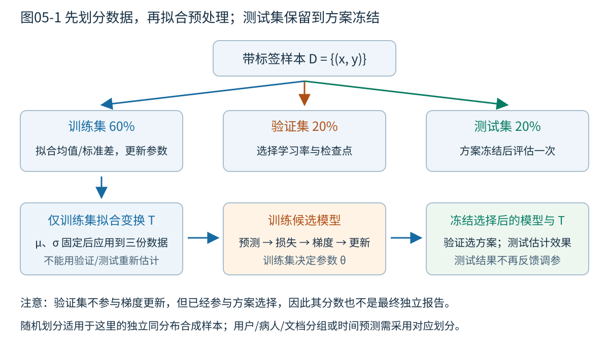
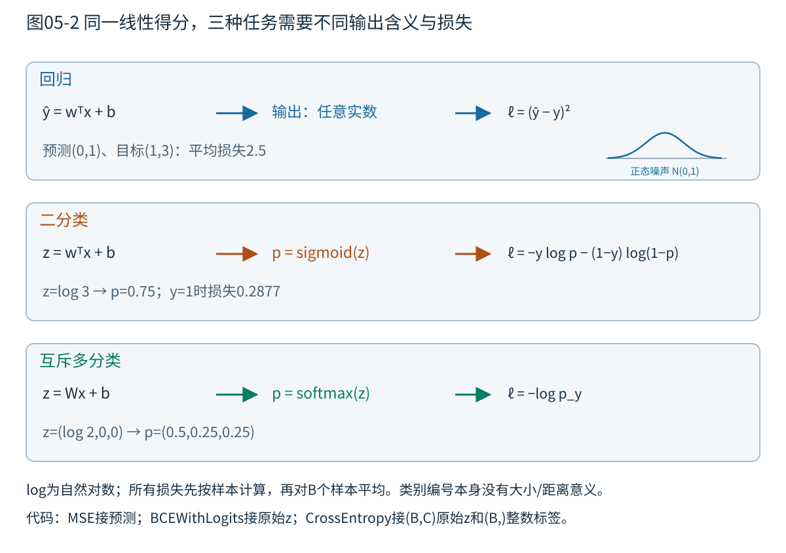
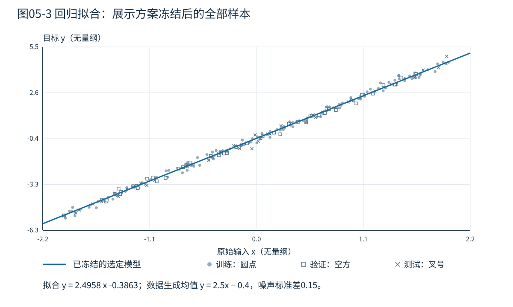
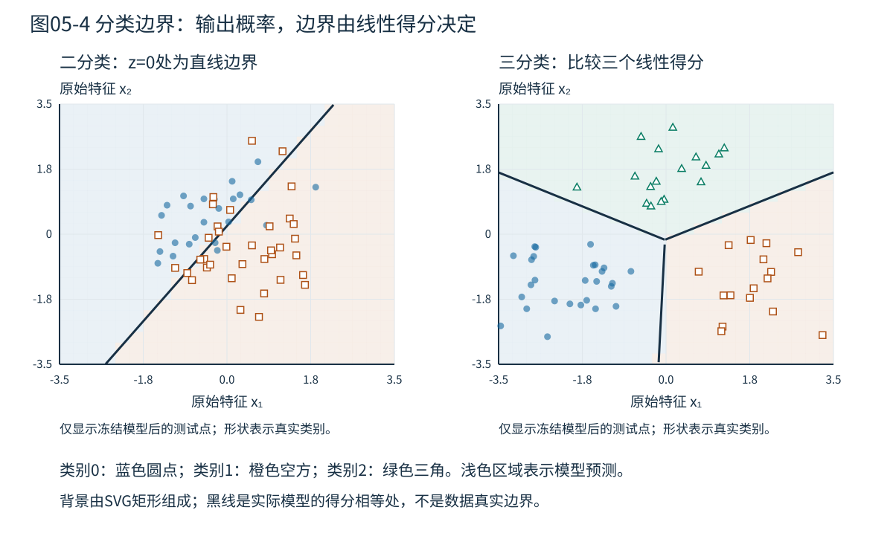
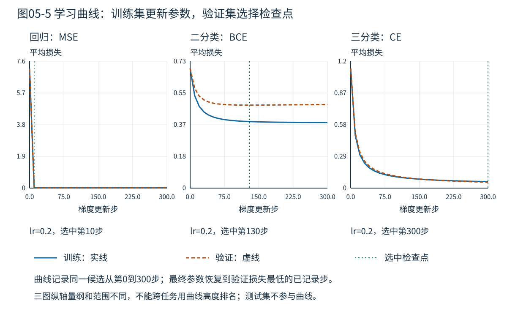

# 第05章：机器学习问题与线性基线

> 从同一条“加权求和”出发，分别学习预测连续数值、二分类概率和互斥类别。真正的学习目标还包括：在没有参与选择的新数据上保持效果。
> 更新日期：2026-11-15。实验为本机实际执行的 CPU 合成数据实验，不需要下载数据。

[阅读入口](../../README.md) · [章节计划](../chapter-plan.md) · [公共符号](../appendices/notation.md) · [完整实验](../../examples/05-machine-learning/README.md)

## 1. 本章目标与前置知识

前四章提供了积木：第01章组织向量与矩阵，第02章计算变化率，第03章描述不确定性与交叉熵，第04章用稳定计算和梯度下降寻找较小的目标。本章把这些积木组成一次完整的学习实验。

我们要回答一个具体问题：给定过去样本的输入和正确结果，怎样学到一条用于新样本的预测规则？“过去样本拟合得好”是否足以说明它能处理新样本？

读完后，你应能定义监督学习的输入、目标、模型和损失；解释训练、验证、测试各自职责；从公式推导线性回归、逻辑回归和 softmax 分类的基本梯度；建立 CPU 可运行的简单基线，并准确报告证据的范围。

前置为01～04章的相应概念。必要的小回顾是：数学向量默认列向量，代码批次按行保存；梯度告诉参数微小变化如何影响标量损失；独立样本的似然可以相乘，取负对数后变成可相加的损失；稳定的 log-sum-exp 避免先算巨大指数再取对数。遇到记号不熟时先查[公共数学符号](../appendices/notation.md)，不需要提前掌握完整神经网络。

## 2. 监督学习：数据怎样变成预测规则

### 2.1 输入与标签不是一回事

**监督学习（supervised learning）** 使用成对的输入与目标：

```math
\mathcal D=\{(\mathbf x^{(i)},y^{(i)})\}_{i=1}^{N}.
```

其中 $`\mathbf x^{(i)}`$ 是预测时能获得的特征，$`y^{(i)}`$ 是训练时提供的目标，也称标签。上标 $`(i)`$ 是样本编号，不是乘方。标签可能是一个连续数值，也可能是离散类别；这个区别决定输出含义和评价方法。[1，§5.1]

例如预测一个无量纲测量值时，输出可以是任意实数；判断某个合成样本属于类别0还是类别1时，类别编号没有“相差1单位”的测量意义。不能因为类别也是数字，就把多分类当成回归任意相减。

模型写成 $`f(\mathbf x;\boldsymbol\theta)`$，分号把输入与可学习参数区分开。$`\boldsymbol\theta`$ 可以是若干权重和偏置的集合。训练用数据选择参数；推理把固定参数用于新输入。标签在推理时通常未知，否则预测任务本身就失去意义。

### 2.2 模型、损失与优化分工

**模型** 定义有哪些预测规则可供选择；**损失函数** 量化某个预测与目标有多不合适；**优化方法** 根据训练损失改变参数；**评估指标** 则回答任务关心的效果。四者有关联，但不能互相替代。

例如二分类模型输出概率，用交叉熵训练，却用固定阈值后的准确率辅助报告。概率从0.51提高到0.99，若真实类别为1，两次准确率都为100%，但模型对结果的置信程度不同，交叉熵会区分它们。

本章先建立**基线（baseline）**：简单、可复现、可解释的参考方案。它给后续神经网络提供比较对象，也能暴露数据、标签或评估流程中的错误。简单基线的失败同样有信息：它可能表明表达能力不足，而不是“训练不够久”。

## 3. 先划分数据，再开始学习

### 3.1 三份数据分别解决什么问题

如果在同一批数据上反复试方案，再把最好的分数当成新数据表现，就会把选择过程的收益混进评价。花书§5.2～5.3区分训练误差、泛化和验证集选择。[1]



*图05-1：数据划分与实验闭环。依据花书§5.1～5.3和预处理隔离原则原创绘制。[1][2] 箭头表示信息用于哪个阶段，测试结果不返回训练与选择过程。*

把职责落实到信息流，比给文件起三个名字更可靠：只有训练损失对应的梯度用于参数更新；验证分数只能影响候选选择；测试指标不能再返回选择阶段。一次候选训练可以记录验证曲线，关键在于验证信息如何被使用。

| 数据 | 允许的职责 | 本章做法 |
| --- | --- | --- |
| 训练集 | 拟合预处理、更新模型参数 | 估计特征均值/标准差，计算梯度 |
| 验证集 | 在候选方案间选择 | 选择学习率和已记录的参数快照 |
| 测试集 | 在选择结束后估计最终效果 | 冻结全部方案后评估一次 |

学习率和训练步数等属于 **超参数**：在一次参数更新过程之外决定的设置。验证集不参与梯度更新，但参与了选择，因此它的最佳分数也不是完全独立的最终报告。反复查看测试分数再改变方案，会把测试集变成另一份验证集。

本章的合成样本来自固定、相互独立的生成机制，因此采用随机60%/20%/20%划分。若同一用户、病人或文档贡献多个相似样本，应考虑按组分开；若预测未来，应考虑时间顺序。随机打散不能自动解决重复样本、相关性和时间泄漏。

### 3.2 预处理也可能学到了保留集的信息

即使没有把测试标签交给优化器，也可能泄漏信息。例如先用所有样本计算均值与标准差，再划分数据，就让保留集参与了输入变换的拟合。官方实践建议先划分，并仅在训练数据上拟合预处理。[2]

对第 $`j`$ 个特征，训练集标准化定义为

```math
\mu_j=\frac1{N_{\mathrm{tr}}}\sum_{i\in\mathrm{tr}}x_j^{(i)},
\qquad
\sigma_j=\sqrt{\frac1{N_{\mathrm{tr}}}\sum_{i\in\mathrm{tr}}(x_j^{(i)}-\mu_j)^2},
```

```math
\widetilde x_j=\frac{x_j-\mu_j}{\sigma_j}.
```

先用训练集固定 $`\mu_j,\sigma_j`$，随后对训练、验证、测试使用同一变换。代码的 `ddof=0` 对应上述除以训练样本数的定义。若训练中某一特征恒定，脚本把其缩放分母设为1，避免除零；不从保留集“补估”方差。

小反例：训练特征为 $`(0,2)`$，保留数据为 $`(100,102)`$。训练均值是1，混合均值却是51。后者已经使用了未参与训练的分布信息。这个例子证明流程受污染，不声称每一种泄漏都必然让每一个指标变好。

把真实标签复制到输入、同一样本的近副本跨集合出现、使用预测时无法获得的未来字段，也属于应检查的信息通路。先问“部署预测那一刻是否能得到这个特征”，再讨论模型复杂度。

## 4. 符号、形状与统一目标

| 符号 | 含义 | 形状或范围 |
| --- | --- | --- |
| $`N_{\mathrm{tr}},B,d,C`$ | 训练样本数、实际批大小、输入维度、类别数 | 正整数 |
| $`\mathbf X`$ | 已完成规定预处理的行批次 | $`B\times d`$ |
| $`\mathbf w,b`$ | 单输出权重与偏置 | $`\mathbb R^d,\mathbb R`$ |
| $`\mathbf W,\mathbf b`$ | 多输出权重与偏置 | $`C\times d,\mathbb R^C`$ |
| $`z,\mathbf z`$ | 分类原始得分，即 logit | 实数或 $`\mathbb R^C`$ |
| $`\hat y,p_c`$ | 预测数值、第 $`c`$ 类预测概率 | 由任务定义 |
| $`\ell_i,\mathcal L`$ | 单样本损失、样本平均损失 | 标量 |
| $`\eta,k`$ | 学习率、参数更新步编号 | $`\eta>0,\ k=0,1,\ldots`$ |

默认训练目标是样本平均：

```math
\mathcal L(\boldsymbol\theta)
=\frac1B\sum_{i=1}^{B}\ell_i(\boldsymbol\theta).
```

本章没有正则化项、类别权重、样本权重或标签平滑。它们会改变目标或归约方式，后续需要时再引入。回归和二分类均为每个样本一个输出，因此这里“对全部预测元素平均”恰与“对样本平均”相同；多输出回归时必须另说清楚是否再除以输出数。

三类任务的对应关系放在图05-2中。它们都从线性得分开始，但输出域、概率解释和损失不同。



*图05-2：模型输出与损失的三条路径，依据本章定义和花书概率监督学习视角原创绘制。[1，§5.5.1、§5.7.1] 图中的对数均为自然对数，示例由手算得到；右上小钟形曲线依据第5.3节正态密度定义原创绘制，σ=1。[3]*

## 5. 线性回归：预测连续数值

### 5.1 模型与平方误差

线性回归使用

```math
\hat y=\mathbf w^\top\mathbf x+b.
```

严格说，含非零偏置的输入映射是仿射的；“线性回归”是这一模型族的惯用名称。对于一批样本，预测向量为 $`\hat{\mathbf y}=\mathbf X\mathbf w+b\mathbf1_B`$。

一种常见目标是**均方误差（mean squared error，MSE）**：

```math
\ell_i=(\hat y^{(i)}-y^{(i)})^2,
\qquad
\mathcal L_{\mathrm{MSE}}=\frac1B\sum_{i=1}^{B}(\hat y^{(i)}-y^{(i)})^2.
```

平方使正负误差不能相互抵消，也会更重地惩罚较大残差。它的单位是目标单位的平方。根均方误差 $`\mathrm{RMSE}=\sqrt{\mathrm{MSE}}`$ 则回到原目标单位。对预测 $`(0,1)`$、目标 $`(1,3)`$，误差是 $`(-1,-2)`$，平方为 $`(1,4)`$，MSE为2.5，RMSE为 $`\sqrt{2.5}\approx1.5811`$。

D2L有时在单样本平方误差前乘 $`1/2`$，便于求导。[3] 本章采用不含 $`1/2`$ 的 MSE，所以梯度中保留因子2；不能把两种损失数值或学习率设置直接混用。

### 5.2 用梯度更新一条直线

令残差向量 $`\mathbf r=\mathbf X\mathbf w+b\mathbf1_B-\mathbf y`$。对每个样本应用链式法则，再求平均：

```math
\frac{\partial\ell_i}{\partial\hat y^{(i)}}=2r_i,
\qquad
\nabla_{\mathbf w}\mathcal L=\frac2B\mathbf X^\top\mathbf r,
\qquad
\frac{\partial\mathcal L}{\partial b}=\frac2B\sum_i r_i.
```

因为 $`\partial\hat y^{(i)}/\partial w_j=x_j^{(i)}`$，残差与相应输入相乘后累加，就得到每个权重的梯度。梯度形状分别是 $`d`$ 与标量，与待更新的对象一致。

手算一步：取 $`x=(0,1)`$、$`y=(1,3)`$，初始 $`w=b=0`$。预测为 $`(0,0)`$，残差 $`(-1,-3)`$，MSE为5。于是

```math
\frac{\partial\mathcal L}{\partial w}
=\frac22(0\cdot(-1)+1\cdot(-3))=-3,
\qquad
\frac{\partial\mathcal L}{\partial b}
=\frac22(-1-3)=-4.
```

学习率 $`\eta=0.1`$ 更新为 $`w=0.3,b=0.4`$。新预测为 $`(0.4,0.7)`$，新 MSE为 $`(0.6^2+2.3^2)/2=2.825`$，比原来的5小。一个例子下降不能证明任意学习率都会稳定；第04章已经给出了步长过大的边界。

### 5.3 固定方差下的可选概率解释

下面补充一种选择平方损失的概率理由；它是可选建模假设，使用MSE并不要求先证明真实数据严格满足该假设。

设输出由模型均值与随机噪声相加得到：

```math
y=\mathbf w^\top\mathbf x+b+\epsilon,
\qquad
\epsilon\sim\mathcal N(0,\sigma^2),\quad \sigma>0.
```

$`\mathcal N(0,\sigma^2)`$ 表示均值为0、方差为 $`\sigma^2`$ 的正态分布，也叫高斯分布；$`\sigma`$ 是标准差。它描述噪声多数接近0、离0越远通常越少的钟形密度。图05-2右上角按 $`\sigma=1`$ 的密度定义画出其形状。密度值不是“恰好等于某个实数”的单点概率。

若 $`e`$ 是噪声的一次取值，密度为

```math
p_\epsilon(e)
=\frac1{\sqrt{2\pi\sigma^2}}
\exp\left(-\frac{e^2}{2\sigma^2}\right).
```

因此给定输入后，输出的条件密度以 $`\hat y=\mathbf w^\top\mathbf x+b`$ 为中心：

```math
p(y\mid\mathbf x;\boldsymbol\theta)
=\frac1{\sqrt{2\pi\sigma^2}}
\exp\left(-\frac{(y-\hat y)^2}{2\sigma^2}\right).
```

对单个样本取负自然对数，乘积变成和，指数项回到残差平方。令 $`r_i=\hat y^{(i)}-y^{(i)}`$，得到

```math
-\log p(y^{(i)}\mid\mathbf x^{(i)};\boldsymbol\theta)
=\frac{r_i^2}{2\sigma^2}
+\frac12\log(2\pi\sigma^2).
```

再假设各样本的条件噪声独立，并把共同的 $`\sigma^2`$ 固定为一个正数。联合负对数似然可以逐样本相加，除以样本数后：

```math
\frac1B\sum_i-\log p(y^{(i)}\mid\mathbf x^{(i)};\boldsymbol\theta)
=\frac{\mathcal L_{\mathrm{MSE}}}{2\sigma^2}
+\frac12\log(2\pi\sigma^2).
```

第二项与权重和偏置无关，第一项只是MSE乘一个正系数，所以最小化MSE与该固定方差模型的最大似然有同一组最优参数。[1，§5.5.1][3] 两个目标的数值不同，不能把MSE直接报告成完整负对数似然。

若噪声并非零均值、方差随输入变化，或者存在明显异常值，概率解释或损失选择就需要进一步检查。非线性关系也可能使线性均值本身不足。连续密度的负对数还可能为负，这与本章非负的平方误差并不矛盾：两者之间保留着上式的系数和常数。



*图05-3：本机实际回归结果。固定种子、生成机制与划分见实验；直线由选定参数计算。图在方案冻结后统一绘制，测试点没有参与参数或超参数选择。全部元素为SVG矢量。*

## 6. 逻辑回归：线性得分怎样成为二分类概率

### 6.1 sigmoid、logit与分类阈值

二分类标签 $`y\in\{0,1\}`$。若直接把无界线性值当作概率，可能得到负数或大于1的数。逻辑回归先生成实数得分 $`z=\mathbf w^\top\mathbf x+b`$，再通过 sigmoid：

```math
p=p(y=1\mid\mathbf x;\boldsymbol\theta)
=\sigma(z)=\frac1{1+\exp(-z)}.
```

另一个类别的概率为 $`1-p`$。由定义整理可得

```math
\frac p{1-p}=\exp(z),
\qquad
z=\log\frac p{1-p}.
```

因此 $`z`$ 是概率比值的对数，即 logit；它本身不是概率。比如 $`z=\log3`$ 给出 $`p=3/(1+3)=0.75`$。

本章预测规则为 $`p\ge0.5`$ 时取类别1，否则取0。由于 sigmoid 单调且 $`\sigma(0)=0.5`$，边界就是 $`\mathbf w^\top\mathbf x+b=0`$。二维输入时这是直线；概率映射虽然非线性，分类边界仍受线性得分限制。[1，§5.7.1]

阈值0.5是本章的固定规则，适合用来演示等代价二分类，不是所有任务的必然最优值。实际需要按错误代价调整时，应在验证阶段确定，不能用测试结果挑阈值。

### 6.2 从Bernoulli概率到二元交叉熵

一个标签的条件概率写成

```math
p(y\mid\mathbf x)=p^y(1-p)^{1-y}.
```

当 $`y=1`$，式子只留下 $`p`$；当 $`y=0`$，只留下 $`1-p`$。希望给真实结果较高概率，可以最小化它的负对数：

```math
\ell_{\mathrm{BCE}}=-\log p(y\mid\mathbf x)
=-y\log p-(1-y)\log(1-p).
```

这就是本章的**二元交叉熵（binary cross-entropy）**。对 $`y=1,p=0.75`$，损失为 $`-\log0.75\approx0.287682`$；若错误地只给真实类别0.01的概率，损失为 $`-\log0.01\approx4.60517`$。损失会严厉惩罚非常自信的错误。

计算时使用

```math
\ell_{\mathrm{BCE}}(z,y)=\log(1+\exp z)-yz
```

的稳定等价实现。$`\log(1+\exp z)`$ 也称 softplus，较大的正 $`z`$ 下不能先直接算 $`\exp z`$。PyTorch 的 `BCEWithLogitsLoss` 已合并 sigmoid 与稳定损失，输入必须是原始 $`z`$，不应先额外 sigmoid 再传入。[4]

### 6.3 梯度为什么变成“预测概率减标签”

在 $`0\lt p\lt 1`$ 内先对概率求导，再乘 sigmoid 的导数：

```math
\frac{\partial\ell}{\partial p}
=-\frac yp+\frac{1-y}{1-p}
=\frac{p-y}{p(1-p)},
\qquad
\frac{dp}{dz}=p(1-p).
```

链式法则让两者相乘，得到

```math
\frac{\partial\ell}{\partial z}=p-y.
```

于是批次权重梯度为 $`\mathbf X^\top(\mathbf p-\mathbf y)/B`$，偏置梯度是 $`p_i-y_i`$ 的平均。若真实类别为1却预测概率偏低，残差为负，更新会沿提高对应得分的方向移动。这里的“残差”是概率差，不是回归中的数值差，目标的含义不同。

## 7. softmax回归：处理互斥的多个类别

### 7.1 多个得分如何归一化

对于恰好属于一个类别的任务，令 $`y\in\{0,\ldots,C-1\}`$。类别编号只是名字，不能把类别2理解为类别1的“两倍”。模型先计算

```math
\mathbf z=\mathbf W\mathbf x+\mathbf b,
\qquad
p_c=\frac{\exp z_c}{\sum_{r=0}^{C-1}\exp z_r}.
```

本节类别编号采用0开始，便于与代码标签一致；矩阵其余索引仍在使用处说明。softmax 让每个 $`p_c>0`$，且 $`\sum_c p_c=1`$。它通过共同分母把各类别联系起来：提高一类得分会改变其他类别的相对概率。[5]

对 $`\mathbf z=(\log2,0,0)^\top`$，指数为 $`(2,1,1)`$，总和4，概率为 $`(0.5,0.25,0.25)`$。给所有得分加同一个常数，概率不变；实际计算可先减最大得分以避免指数上溢，见第04章。

### 7.2 交叉熵、归约与梯度

用 one-hot 向量 $`\mathbf e_y`$ 标记真实类别：第 $`y`$ 项为1，其余为0。单样本交叉熵为

```math
\ell_{\mathrm{CE}}
=-\sum_{c=0}^{C-1}(\mathbf e_y)_c\log p_c
=-\log p_y
=\log\sum_{c=0}^{C-1}\exp z_c-z_y.
```

若上述例子的真实类别为0，损失为 $`-\log0.5=\log2\approx0.693147`$。均匀三分类概率对应 $`\log3\approx1.098612`$。不要把整个 $`B\times C`$ 概率矩阵的所有项负对数再平均：每个样本的目标是其真实类别那一项，随后对 $`B`$ 个样本平均。

对每个得分求导：

```math
\frac{\partial\ell}{\partial z_c}
=\frac{\exp z_c}{\sum_r\exp z_r}-(\mathbf e_y)_c
=p_c-(\mathbf e_y)_c.
```

令 $`\mathbf E=\mathbf P-\mathbf Y_{\mathrm{onehot}}\in\mathbb R^{B\times C}`$，则

```math
\nabla_{\mathbf W}\mathcal L=\frac1B\mathbf E^\top\mathbf X
\in\mathbb R^{C\times d},
\qquad
\nabla_{\mathbf b}\mathcal L=\frac1B\mathbf E^\top\mathbf1_B.
```

D2L的某些实现把权重存为 $`d\times C`$，本教程沿用 $`C\times d`$，所以行批次始终写 $`\mathbf X\mathbf W^\top+\mathbf b`$。梯度的转置也须跟着权重约定一致。[5]

PyTorch `CrossEntropyLoss` 在本章接收 `(B,C)` 原始 logits 和 `(B,)` 整数类别标签；整数标签使用 `torch.long`。它在内部处理稳定的 log-softmax，不要先 softmax 再把概率当成 logits 传入。[6] 二分类 BCE 则接收与 logits 相同形状的浮点0/1标签，不能把两种接口规则混用。

### 7.3 决策边界与多标签的边界

预测类别为 $`\arg\max_c z_c`$，即选得分最大的类别；softmax 的单调指数与共同分母不改变这个排序。两个类别得分相等处满足

```math
(\mathbf w_c-\mathbf w_r)^\top\mathbf x+(b_c-b_r)=0.
```

二维时是直线；实际某段边界还要求它们超过第三类得分。图05-4显示本机训练后的实际边界，而不是用数据生成中心代替模型。



*图05-4：本机实际分类结果。浅色矢量矩形表示模型预测区域，黑线表示实际得分相等的位置；圆、空方、三角表示真实类别。只有方案冻结后的测试点被绘制，测试不参与选择。*

softmax 对应本章的“恰好属于一类”。如果一张图可以同时有猫、狗和车，是多标签任务，通常需要分别建模各标签的概率和相应损失。把这种任务硬塞进概率总和为1的互斥分类，会改变问题本身。

## 8. 训练误差、泛化与失败

### 8.1 小训练损失为什么还不够

**经验损失** 是有限数据上的平均；**泛化风险** 是从希望服务的真实分布抽取新样本时的期望损失：

```math
R(\boldsymbol\theta)
=\mathbb E_{(\mathbf x,y)\sim P_{\mathrm{target}}}
[\ell(f(\mathbf x;\boldsymbol\theta),y)].
```

我们通常无法直接计算这个期望，只能用合适的保留样本估计。估计是否有意义取决于划分、样本量、相关性以及目标分布是否一致。训练拟合得更好，不自动使这个期望更小。[1，§5.2][7]

**欠拟合** 指模型或学习过程未捕获数据中的重要规律；**过拟合** 指过度适应训练样本中的偶然性，影响新样本表现。不能仅凭一次“验证比训练高一点”就下结论。还应检查优化是否完成、训练验证是否同分布、样本是否足够，以及差异是否稳定。

图05-5画的是本次固定候选的实际曲线。验证集用于选择已记录的检查点；最终参数可以恢复到第130步，即使候选还运行到了第300步。这是明确的选择规则，不是在测试分数出来后倒挑一次好结果。



*图05-5：实际训练与验证损失。每10步记录一次，选择验证损失最低的记录点。三图的损失类型与纵轴范围不同，不以绝对高度跨任务排名；测试集没有出现在学习曲线中。*

### 8.2 一个必须承认的表达能力边界

对四个输入 $`(0,0),(0,1),(1,0),(1,1)`$，XOR标签为 $`0,1,1,0`$。这四个点不能由一条直线把两类完全分开。即使无限延长线性分类训练，也不能把不在线性模型族中的边界变出来。

本章固定零初始化、完整四点训练时，逻辑回归停在概率0.5、BCE为 $`\log2`$、准确率50%。对称性使该点梯度为0；这是一个具体运行结果。下一章会进一步讨论线性可分性及感知机，再后面引入非线性隐藏层。

这不表示逻辑回归在所有XOR式构造中只能到50%准确率，也不表示任意优化器、初始化都会走同一路径。数学上能断言的是单一线性边界不能把这四点全部分对；脚本只复现声明的那次实验。

## 9. 从公式到CPU实现

### 9.1 显式梯度让更新过程可追踪

完整入口为[run.py](../../examples/05-machine-learning/run.py)。主训练使用上文推导出的梯度，而非把学习步骤藏在大型训练器中：

```python
logits = X @ W.T + b
residual = torch.sigmoid(logits[:, 0]) - y  # 二分类，形状(B,)
grad_W = residual[None, :] @ X / len(X)     # (1,d)
grad_b = residual.mean().reshape(1)        # (1,)
W -= learning_rate * grad_W
b -= learning_rate * grad_b
```

训练器收到训练集与验证集，不接收测试集。每隔10步记录训练和验证指标；比较两种学习率及记录点后，保存最优验证快照。保存的JSON含权重、偏置、训练预处理统计、学习率与步数，重建后在验证输入上严格检查预测一致，再进行测试评估。

代码还用NumPy独立公式与PyTorch自动微分，交叉检查三种损失和手写梯度。第02章已经介绍自动微分接口；它在这里是核对工具，训练更新依然来自可逐步解释的公式。

### 9.2 数据、参数与配置

本章数据完全由固定种子生成，不包含真实人物、外部下载或第三方数据集；无需训练/测试许可获取。三项任务分别为：

| 任务 | 生成机制 | 训练/验证/测试 | 参数数 |
| --- | --- | --- | --- |
| 回归 | $`x\sim U[-2,2]`$，$`y=2.5x-0.4+\epsilon`$，噪声标准差0.15 | 144/48/48 | 2 |
| 二分类 | 二维标准正态输入，按 $`\sigma(1.7x_1-1.2x_2+0.2)`$ 抽取0/1标签 | 180/60/60 | 3 |
| 三分类 | 三个中心周围的二维高斯簇，各100点，噪声标准差0.65 | 180/60/60 | 9 |

三分类中心为 $`(-1.8,-1.2),(1.8,-1.2),(0,1.8)`$。回归与二分类的单输出有 $`d+1`$ 个参数；三分类有 $`C(d+1)=3(2+1)=9`$ 个参数。

种子为20261115，划分使用另行固定的偏移种子；CPU float64、单线程、零初始化。每项任务训练两种学习率0.05与0.2，各最多300次完整批次梯度更新，每10步记录一次。无权重衰减、无动量、无随机小批次。每个候选都从相同零参数出发，比较只改变所列候选与检查点。

### 9.3 运行方法与18项验收

从仓库根目录执行：

```powershell
& ./.venv/Scripts/python.exe -B examples/05-machine-learning/run.py
```

默认在 `build/experiments/05-machine-learning/` 输出结果JSON、三份可恢复模型JSON和三幅实际结果SVG。发布在正文中的结果图由以下明确命令刷新：

```powershell
& ./.venv/Scripts/python.exe -B examples/05-machine-learning/run.py --figure-dir docs/assets/05-machine-learning
node scripts/generate-chapter05-figures.mjs
```

第二条生成前两幅静态教学图，实验生成其余三幅。所有图均是文字、路径、圆与矩形，不使用位图。18项检查涵盖三任务的NumPy/手推/AD梯度、手算与极端得分稳定性、划分互斥完整、训练统计来源、验证效果超过训练拟合常数、模型JSON恢复、XOR失败和泄漏反例。

检查目标不包含“在测试上达到人为挑选的阈值”。测试用于报告，不用来反复修改设置追求通过。随机生成机制、数据内容哈希与各集合ID都保存在报告中，方便判断复现是否使用同一份数据。

### 9.4 本机实测与分析

2026-11-15实际执行，Python3.11.5、NumPy2.4.6、PyTorch2.15.0+cpu，Windows build26200，18项全部通过。含导入约7.413秒，导入约4.856秒；Python跟踪分配峰值约104.68 MiB。它不包括完整原生张量内存和进程RSS，不等于训练张量自身内存。

下表是选择方案冻结后的实际平均损失：

| 任务 | 选定学习率/步数 | 训练 | 验证 | 测试 |
| --- | --- | --- | --- | --- |
| 回归MSE | 0.2/10 | 0.023975 | 0.020331 | 0.022478 |
| 二分类BCE | 0.2/130 | 0.385343 | 0.480761 | 0.490591 |
| 三分类CE | 0.2/300 | 0.059218 | 0.054024 | 0.041107 |

回归还原到原始输入坐标后，拟合直线约为 $`\hat y=2.495793x-0.386282`$，接近生成均值 $`2.5x-0.4`$。测试RMSE约0.14993，与噪声尺度0.15相近；这是一次有限样本观察，不是噪声下界的严格估计。

为了知道模型是否比“猜固定值”更有用，常数基线也只在训练集拟合：回归预测训练目标均值，分类预测训练类别频率并选多数类。测试比较为：

| 任务 | 学习模型 | 训练拟合的常数基线 |
| --- | --- | --- |
| 回归MSE | 0.022478 | 7.846846 |
| 二分类准确率 | 75.00% | 60.00% |
| 三分类准确率 | 100.00% | 26.67% |

二分类训练准确率81.11%、验证81.67%、测试75%；其标签本来按概率抽样，所以输入相近也可能拥有不同标签。不能期待对所有未来样本零错误。三分类测试100%只涉及60个较容易的合成点，不能外推为真实数据上的完美分类，也不能证明模型概率已校准。

默认复跑应重现相同固定数据、选中方案及近似指标；耗时和内存随机器负载变化。即使固定种子，跨依赖版本、硬件或实现也可能产生微小数值差异，不以JSON时间戳或字节完全相同作为成功条件。

## 10. 常见误区

- **先标准化所有数据再划分**：预处理统计也属于学习结果，必须隔离拟合来源。
- **验证集没算梯度，所以可以当测试集**：选择学习率和步数已经使用了验证信息。
- **类别编号可以直接做平方差**：互斥类别的编号没有天然距离；先定义任务语义。
- **BCE/CE先做一次概率变换更保险**：带logits接口要求原始得分，重复变换改变目标。
- **准确率不变，所以学习没有发生**：概率和交叉熵可能变化，阈值决策仍相同。
- **训练损失持续下降就证明泛化改善**：要看独立保留数据与实验协议。
- **合成测试100%就说明真实任务解决了**：这里仅验证固定机制下的简单基线。
- **XOR失败只需多跑几轮**：需要先检查模型族能否表达所需边界。

## 11. 习题与分步解析

### 11.1 习题

1. 某人先用全部数据均值填补缺失值，再随机划分三份。即使没有读取测试标签，流程有什么问题？怎样修正？
2. 用本章 $`x=(0,1),y=(1,3)`$、零初始化与不含 $`1/2`$ 的MSE，重新计算学习率0.1的第一步，解释因子2来自哪里。
3. 二分类 $`z=\log3,y=0`$ 时，概率、BCE和对logit的梯度各是多少？
4. 三分类得分 $`(\log2,0,0)`$，真实类别改为2。求概率、CE和三个logit梯度，说明梯度之和为什么为0。
5. 某模型对两个真实类别均为1的样本给概率 $`(0.6,0.9)`$，另一个给 $`(0.9,0.99)`$。阈值0.5下两者准确率一样，哪个平均BCE更小？
6. 三分类权重用 $`C\times d`$ 保存，批次为 $`B\times d`$。写出 logits 和权重梯度的形状，指出该沿哪条轴softmax。
7. 先看测试分数发现第300步不如第130步，于是报告第130步，为什么破坏测试职责？怎样在运行前设计合适选择规则？
8. 复跑实验，检查二分类验证最低的记录点是否等于训练结束点。说明这个现象支持什么，不能支持什么。

### 11.2 解析

**题1。** 全数据均值已经包含验证/测试输入的分布信息，填补过程因此受保留集影响。先划分，再只在训练集估计每个字段的填补值，最后把同一规则应用到其余集合。无标签变换仍可能泄漏信息。

**题2。** 残差为 $`(-1,-3)`$，平方误差平均为5。平方求导得到 $`2r_i`$，所以梯度为 $`(-3,-4)`$，更新 $`w=0.3,b=0.4`$。新MSE为2.825。若定义改为半MSE，梯度也整体减半；不是同一公式下凭空消去2。

**题3。** $`p=0.75`$；真实类别为0，所以 BCE为 $`-\log(1-0.75)=\log4\approx1.386294`$。梯度 $`p-y=0.75`$，沿负梯度更新会降低logit，使类别1概率下降。

**题4。** 概率仍为 $`(0.5,0.25,0.25)`$。真实类别2的概率为0.25，CE为 $`\log4`$。梯度为 $`(0.5,0.25,-0.75)`$，和为0，因为概率和与one-hot标签和均为1；这也对应所有logit同时平移不改变概率。

**题5。** 两者准确率都为100%。第一组平均BCE为 $`-(\log0.6+\log0.9)/2\approx0.308093`$；第二组为 $`-(\log0.9+\log0.99)/2\approx0.057705`$，第二组更小。只对这两个已给目标成立，不能据此认为越自信越好；自信错误会受更大惩罚。

**题6。** logits为 $`\mathbf X\mathbf W^\top+\mathbf b`$，形状 $`B\times C`$；按每个样本的类别轴，即代码 `dim=1` 归一化。残差矩阵 $`\mathbf E`$ 为 $`B\times C`$，权重梯度 $`\mathbf E^\top\mathbf X/B`$ 为 $`C\times d`$。

**题7。** 测试已经用于选步数，不再是独立最终评估。应预先规定在验证记录中选最小损失快照，冻结后再计算测试指标。若已经基于测试做了选择，需要新的独立评价数据或明确标注评价受选择影响，不能把原分数继续称作未参与选择的测试结果。

**题8。** 依据当前结果JSON回答，本次记录选到第130步，而候选运行到300步。它说明本次验证准则偏好一个较早快照；不能仅凭一条曲线断言所有逻辑回归都应在130步结束，也不能据此证明一般过拟合理论。改变数据或候选应重新执行完整协议。

## 12. 小结与下一步

本章把模型、数据、损失、梯度更新和评价接成完整流程。回归对连续值计算平方误差；二分类把线性logit转成Bernoulli概率；互斥多分类用softmax和真实类别负对数概率。三者共享加权求和，却有不同的输出语义和损失条件。

最重要的实验约定是：训练拟合参数和预处理，验证选择方案，测试在冻结后报告。它约束了怎样解释每一个分数。下一章从神经元和感知机继续研究线性边界，再逐步引入能够表达非线性关系的网络。

## 13. 参考文献

1. Goodfellow、Bengio、Courville，**Deep Learning**，MIT Press，2016，第5章：§5.1学习算法、§5.1.4线性回归、§5.2容量/过拟合/欠拟合、§5.3超参数和验证集、§5.5.1条件似然与MSE、§5.7.1概率监督学习。[官方章节](https://www.deeplearningbook.org/contents/ml.html)。
2. scikit-learn，**Common pitfalls and recommended practices**，§12.1～12.2，预处理一致性、数据泄漏及训练拟合原则。[官方实践说明](https://scikit-learn.org/stable/common_pitfalls.html)。本实验不依赖scikit-learn软件包。
3. Zhang等，**Dive into Deep Learning**，在线1.0.3，§3.1.1模型和平方损失、§3.1.3概率解释。[Linear Regression](https://d2l.ai/chapter_linear-regression/linear-regression.html)。
4. PyTorch2.15，**BCEWithLogitsLoss**，合并sigmoid和稳定二元交叉熵。[官方接口](https://docs.pytorch.org/docs/2.15/generated/torch.nn.BCEWithLogitsLoss.html)。
5. D2L1.0.3，§4.1.1 softmax、§4.1.2负对数似然、损失与梯度。[Softmax Regression](https://d2l.ai/chapter_linear-classification/softmax-regression.html)。
6. PyTorch2.15，**CrossEntropyLoss**，原始logits、整数标签、类别轴与归约。[官方接口](https://docs.pytorch.org/docs/2.15/generated/torch.nn.CrossEntropyLoss.html)。
7. D2L1.0.3，§3.6.1训练与泛化误差、§3.6.2欠拟合/过拟合、§3.6.3模型选择。[Generalization](https://d2l.ai/chapter_linear-regression/generalization.html)。
8. PyTorch2.15，**MSELoss**，平方差及默认平均归约。[官方接口](https://docs.pytorch.org/docs/2.15/generated/torch.nn.MSELoss.html)。

来源于2026-11-15核验。图05-1～2为定义示意，生成源见[静态SVG生成器](../../scripts/generate-chapter05-figures.mjs)；图05-3～5由本章实际实验数据、选定模型与曲线生成，不用解析示意冒充实测。

## 14. 实现与验证记录

2026-11-15，正文、5幅SVG、三任务CPU训练和18项检查均完成，独立复跑得到相同数据、选中方案与指标。HTML/PDF实际构建，公式严格渲染、零位图；1440/390宽无溢出、断锚、公式错误、原始Markdown标记或外部请求。PDF字体嵌入、书签、页码、链接与文本边界独立审计通过；全部页面和五图已目视检查，并修正曲线末刻度的窄屏越界。证据保存在build/qa/chapter-05；任务勾选及提交由总计划维护。
