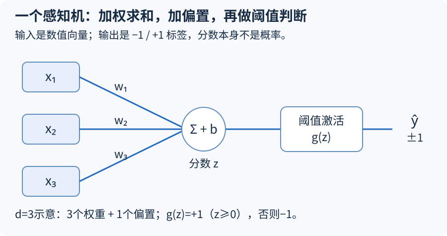
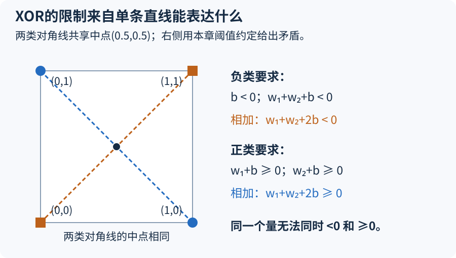
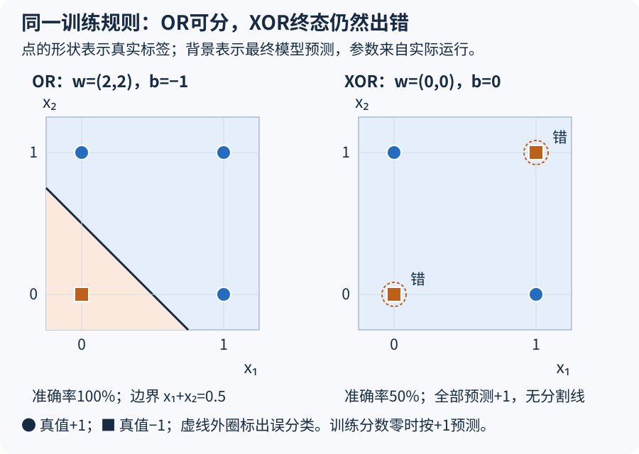
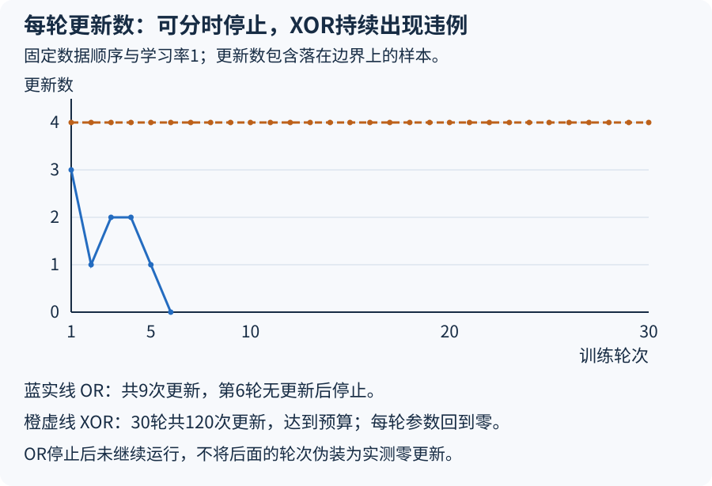

# 第 06 章：神经元与感知机

> 对应任务：06；状态：正文、CPU 实验与 HTML/PDF 验收完成；最后更新：2026-11-15。

[阅读入口](../../README.md) · [上一章：机器学习问题与基线](05-machine-learning.md) · [章节计划](../chapter-plan.md) · [公共符号](../appendices/notation.md) · [完整实验](../../examples/06-perceptron/README.md)

## 1. 本章目标与前置知识

前面的线性模型已经能把若干输入加权汇总，但分类还需要把一个分数变成类别，并根据错误调整规则。本章研究最小的神经计算单元：感知机（perceptron）。它足够简单，能让我们从一张真值表手算更新，观察一条决策边界怎样形成；它也有明确的表达能力边界。

学完后，你应能写出仿射分数与阈值输出，解释偏置为何必要；用标签 $-1/+1$ 手算一次更新；区分预测正确、严格正间隔和训练停止；说明可分条件下的有限更新保证；用数学与真实运行共同解释 XOR 失败。

前置为第 01 章的内积、矩阵和范数，第 02 章的函数及局部变化概念，第 05 章的分类、训练数据与基线。这里使用 NumPy 从零实现，不依赖自动微分；不要求提前掌握多层网络或反向传播。

## 2. 从两个输入的逻辑问题建立图景

设两个特征 $x_1,x_2$ 都取 0 或 1。OR（逻辑或）要求只要至少一个输入为 1，就输出正类。XOR（异或）要求恰好一个输入为 1 才输出正类。为了与感知机更新公式一致，本章把逻辑“真”编码为 $+1$，“假”编码为 $-1$：

| 输入 $(x_1,x_2)$ | OR 标签 | XOR 标签 |
| --- | --- | --- |
| $(0,0)$ | $-1$ | $-1$ |
| $(0,1)$ | $+1$ | $+1$ |
| $(1,0)$ | $+1$ | $+1$ |
| $(1,1)$ | $+1$ | $-1$ |

只有最后一点的标签不同，却足以改变能否用一条直线正确分开两类。这是本章要解释的问题。花书 §6.1 也使用 XOR 展示线性模型的限制；[1] 本章改用 $\pm1$ 标签，聚焦单一阈值单元及其更新规则。

神经网络中的“神经元”在工程上是一种计算单元：接收输入，做参数化运算，再经过激活函数。生物启发提供了命名背景，但这个计算模型不声称完整模拟真实神经细胞。花书第 6 章开头也强调从函数近似与计算结构理解网络。[1]



图 06-1：一个阈值单元，示意取 $d=3$。按本章仿射计算与阈值定义原创绘制；实验实际为两个输入、三个可训练参数。图中输入到输出的连接表示计算关系，不表示神经细胞的生理细节。

## 3. 符号与形状

| 符号 | 含义 | 本章形状或范围 |
| --- | --- | --- |
| $\mathbf x$ | 单样本特征，默认列向量 | $\mathbb R^d$；实验 $d=2$ |
| $\mathbf w,b$ | 权重与偏置 | $\mathbb R^d$ 与标量 |
| $z$ | 仿射分数 | $\mathbf w^\top\mathbf x+b$，标量 |
| $g(z),\hat y$ | 阈值激活与预测标签 | $\{-1,+1\}$ |
| $y$ | 真实标签 | 必须为 $-1$ 或 $+1$ |
| $m=yz$ | 带标签的分数，称符号间隔 | 标量；不是概率 |
| $\mathbf X,\mathbf y$ | 按行排列的样本与对应标签 | $N\times d$ 与 $N$ |
| $\eta,k,M$ | 学习率、更新编号、累计更新数 | $\eta>0$；$k,M$ 为整数 |
| $\widetilde{\mathbf x},\widetilde{\mathbf w}$ | 吸收偏置后的增广向量 | $\mathbb R^{d+1}$ |
| $R,\gamma$ | 增广输入范数上界与单位分隔器的最小间隔 | $R>0,\gamma>0$，见第 6 节 |

样本索引写作 $\mathbf x^{(i)}$，特征索引写作 $x_j$，训练更新步用下标 $k$。一轮（epoch）是按指定顺序看完全部样本；一次参数更新发生在某个样本上。一轮可以有多次更新，也可以完全没有更新，二者不能混为同一个预算单位。

## 4. 仿射分数、阈值与决策边界

### 4.1 为什么加权求和后还要加偏置

分数计算为：

$$
z=\mathbf w^\top\mathbf x+b
=\sum_{j=1}^{d}w_jx_j+b.
$$

每个权重控制相应特征对分数的贡献，偏置提供与输入无关的整体平移。数学上，非零偏置使该映射成为仿射映射；“线性分类器”这一惯称仍包括这种带偏置的边界。

例如在 OR 数据中取 $\mathbf w=(2,2)^\top,b=-1$。对 $(0,0)$，分数为 $-1$；对 $(0,1)$、$(1,0)$ 和 $(1,1)$，分数分别为 1、1 和 3。只看分数正负就能给出四个标签。偏置把阈值边界从原点移开，使原点可以被判为负类。[2]

### 4.2 明确零分数怎样预测

本章使用硬阈值激活（threshold activation）：

$$
\hat y=g(z)=
\begin{cases}
+1,&z\geq0,\\
-1,&z<0.
\end{cases}
$$

不同教材对 $\operatorname{sign}(0)$ 的定义可能不同，所以不能只写 `sign` 而省略边界约定。代码采用 `np.where(scores >= 0, 1, -1)`，恰与上式对应。

激活函数（activation function）将输入分数转换为单元输出。本章阈值只输出两种标签；该输出没有经过概率校准，分数 3 也不代表概率 3。激活函数还可以是连续非线性函数，后续多层网络将进一步比较；D2L §5.1.2 可作拓展阅读。[3]

### 4.3 一条超平面把空间分成两侧

当 $\mathbf w\ne\mathbf0$，满足 $\mathbf w^\top\mathbf x+b=0$ 的点构成决策边界。二维时是直线，三维时是平面，更高维称为超平面（hyperplane）。其一侧分数为正，另一侧为负。

在二维且 $w_2\ne0$ 时，可以把边界写成：

$$
x_2=-\frac{w_1}{w_2}x_1-\frac{b}{w_2}.
$$

若 $w_2=0,w_1\ne0$，它是一条竖直线，不能再除以 $w_2$。若所有权重都为 0，分数对每个输入相同；此时可能全部判正或全部判负，不能假装仍有一条有效分割线。

把 $\mathbf w,b$ 同时乘以正数，预测保持不变；分数大小却改变。因此不同缩放的原始分数不能直接当成可比较的几何距离。在权重非零时，点到边界的距离为 $|z|/\lVert\mathbf w\rVert_2$。本章主要用分数符号判断分类，不训练最大间隔分类器。

## 5. 感知机更新：用带标签的分数找出违例

### 5.1 一个表达式统一正类与负类

令符号间隔 $m=yz=y(\mathbf w^\top\mathbf x+b)$。对于正类 $y=+1$，希望 $z>0$；对于负类 $y=-1$，希望 $z<0$，两种情况统一成 $m>0$。

本章训练把 $m\leq0$ 视为需要更新的违例。它既包括错误分类，也包括边界上的样本。因为预测在 $z=0$ 时输出正类，一个正类边界样本可能预测正确，却仍然触发更新。训练目标是得到严格分开两类的参数，所以后文把 $M$ 称为“更新次数”，不把它无条件等同于按某个零点约定计算的误分类次数。

### 5.2 更新公式及其方向

遇到违例时，用当前样本更新：

$$
\mathbf w_{k+1}=\mathbf w_k+\eta y\mathbf x,
\qquad
b_{k+1}=b_k+\eta y,
\qquad \eta>0.
$$

正类样本把权重沿 $\mathbf x$ 方向移动并增加偏置；负类则沿相反方向移动并减小偏置。一次更新后，对**当前这个样本**的符号间隔变化为：

$$
\begin{aligned}
y(\mathbf w_{k+1}^\top\mathbf x+b_{k+1})
&=y(\mathbf w_k^\top\mathbf x+b_k)
 +\eta y^2(\mathbf x^\top\mathbf x+1)\\
&=m_k+\eta(\lVert\mathbf x\rVert_2^2+1).
\end{aligned}
$$

这里使用 $y^2=1$，因此当前样本的符号间隔必然增加。但增量不一定足够一次改正任意大的负间隔，其他样本的间隔也可能变差。不能据此推出每一步都提高整批准确率。[2]

阈值函数几乎处处为常数，在跳变处又不连续；直接对最终 $\pm1$ 标签求普通导数，不能得到这条更新规则。这里显式按照符号间隔执行在线校正；“如何为更一般网络构造可训练目标并反向求导”从后续章节继续展开。

### 5.3 从零开始手算前三次更新

采用数据顺序 $(0,0),(0,1),(1,0),(1,1)$，OR 标签为 $(-1,+1,+1,+1)$，初始化 $\mathbf w=(0,0)^\top,b=0$，学习率为 1。

| 当前样本与标签 | 更新前分数 $z$ | $yz$ | 更新后 $(w_1,w_2,b)$ |
| --- | --- | --- | --- |
| $(0,0),-1$ | $0$ | $0$ | $(0,0,-1)$ |
| $(0,1),+1$ | $-1$ | $-1$ | $(0,1,0)$ |
| $(1,0),+1$ | $0$ | $0$ | $(1,1,1)$ |

第一步输入是零向量，权重完全不变，只有偏置改为 $-1$。若漏掉偏置更新，这个负类原点就无法按本章阈值被正确处理。

第二步加 $y\mathbf x=(0,1)^\top$，并把偏置从 $-1$ 加到 0，得到 $(0,1,0)$。第三步是正类零间隔样本，即使当前预测为 $+1$，仍按训练约定更新。最后一个 $(1,1)$ 得分为 3，不再更新。整轮结束还需重新看完整数据；此时原点分数为 1，又被误判为正类。

## 6. 什么时候会停止：可分性与收敛条件

### 6.1 线性可分是对数据和表示的条件

有限训练集线性可分（linearly separable），是指存在一组参数让所有带标签分数严格为正。OR 可以用 $(w_1,w_2,b)=(2,2,-1)$ 达成这一点。条件涉及当前特征表示以及全部训练标签，不能通过只看一两个样本判定。

为了把偏置纳入同一套内积，引入增广向量：

$$
\widetilde{\mathbf x}=
\begin{bmatrix}\mathbf x\\1\end{bmatrix},
\qquad
\widetilde{\mathbf w}=
\begin{bmatrix}\mathbf w\\b\end{bmatrix},
\qquad
\widetilde{\mathbf w}^{\top}\widetilde{\mathbf x}
=\mathbf w^\top\mathbf x+b.
$$

于是更新可以统一写成 $\widetilde{\mathbf w}_{k+1}=\widetilde{\mathbf w}_k+\eta y\widetilde{\mathbf x}$。常数 1 对应偏置，与原始输入特征的含义不同。[2]

### 6.2 有限更新保证具体保证什么

在以下条件下考虑本章的普通感知机：有限数据；固定正学习率 $\eta$；增广权重从零开始；对非正符号间隔更新，并持续遍历全部样本。还要存在单位向量 $\mathbf u^*$ 和正数 $\gamma$，使所有样本满足：

$$
\lVert\mathbf u^*\rVert_2=1,
\qquad
y^{(i)}(\mathbf u^*)^\top\widetilde{\mathbf x}^{(i)}\geq\gamma>0,
\qquad
\lVert\widetilde{\mathbf x}^{(i)}\rVert_2\leq R.
$$

其中 $\gamma$ 是**增广空间中、已单位化分隔器**的最小符号间隔，不直接等同于未归一化分数。对有限且严格可分的数据，总能在选择分隔器后得到正的最小值。

感知机收敛结论给出更新数上界 $M\leq R^2/\gamma^2$。[2] 下面保留关键推理，说明边界从何而来。

每次更新在正确分隔器方向上至少增加 $\eta\gamma$，从零累积 $M$ 次得到：

$$
\widetilde{\mathbf w}_M^\top\mathbf u^*\geq M\eta\gamma.
$$

另一方面，更新只发生于 $y\widetilde{\mathbf w}_k^\top\widetilde{\mathbf x}\leq0$，展开平方范数：

$$
\begin{aligned}
\lVert\widetilde{\mathbf w}_{k+1}\rVert_2^2
&=\lVert\widetilde{\mathbf w}_k\rVert_2^2
+2\eta y\widetilde{\mathbf w}_k^\top\widetilde{\mathbf x}
+\eta^2\lVert\widetilde{\mathbf x}\rVert_2^2\\
&\leq\lVert\widetilde{\mathbf w}_k\rVert_2^2+\eta^2R^2.
\end{aligned}
$$

因此 $\lVert\widetilde{\mathbf w}_M\rVert_2\leq\eta R\sqrt M$。内积不超过两向量长度的乘积（Cauchy–Schwarz 不等式），而 $\mathbf u^*$ 为单位向量，所以：

$$
M\eta\gamma
\leq\widetilde{\mathbf w}_M^\top\mathbf u^*
\leq\lVert\widetilde{\mathbf w}_M\rVert_2
\leq\eta R\sqrt M.
$$

对 $M>0$，除以 $\eta\sqrt M$ 再平方，得到 $M\leq R^2/\gamma^2$；没有更新的 $M=0$ 情况也满足。该结论保证有限次更新后找到分隔器，不保证最短训练时间、唯一解、最大间隔或对未知数据的表现。

### 6.3 在本例中实际核对条件

OR 的一个单位增广分隔器为 $\mathbf u^*=(2/3,2/3,-1/3)^\top$。四个样本最小间隔为 $1/3$；最大增广范数平方为 $R^2=1^2+1^2+1^2=3$。因此上界为 $3/(1/3)^2=27$ 次更新，实验的 9 次满足这个上界。

这只是一个有效上界，不意味着实际必须恰好更新 27 次。若数据不可分，上述正间隔假设不存在，定理便不提供停止保证。反过来，任意数据在某个有限预算内没停止，也不能单凭这一现象证明不可分；它可能只是间隔小或训练尚未足够。

## 7. XOR 的失败：用代数证明，再看运行证据

### 7.1 按预测约定写出四个必要条件

若某个单一仿射阈值模型能够正确分类 XOR，负类 $(0,0)$ 与 $(1,1)$ 的分数必须严格小于 0，正类 $(1,0)$ 与 $(0,1)$ 的分数必须大于等于 0。因此：

$$
\begin{aligned}
b&<0,&\qquad w_1+w_2+b&<0,\\
w_1+b&\geq0,&\qquad w_2+b&\geq0.
\end{aligned}
$$

将两个负类条件相加，得到 $w_1+w_2+2b<0$；将两个正类条件相加，却得到同一个量 $w_1+w_2+2b\geq0$。这构成矛盾，所以按本章零点约定也不可能完全正确分类。[1，§6.1]



图 06-2：XOR 不可能性的原创示意。左图中两类对角线中点相同，右侧给出与本章阈值一致的代数证明；不是把训练时间不足当成数学证明。后面的图 06-3 使用实际训练终态作实验对照。

### 7.2 局限属于什么模型范围

证明针对的是原始两个输入上的**一个仿射分数加一次阈值**。它不表示计算机无法计算 XOR，也不表示所有神经网络都失败。例如允许新增特征 $x_1x_2$，则

$$
z=x_1+x_2-2x_1x_2-0.5
$$

在四点上的分数依次为 $-0.5,0.5,0.5,-0.5$，就能分类。这条规则使用输入间的乘积交互，已改变原先的特征表示。下一章将用隐藏层与非线性解释怎样构造不同表示。[1][3，§5.1.1]

## 8. 本机实践：同一实现训练两个任务

### 8.1 数据、配置、参数与运行方法

[完整代码](../../examples/06-perceptron/run.py)只依赖 NumPy，输入为本章四点真值表。两组任务共享同一输入、初始化、学习率、样本顺序与预算，只更改最后一点的标签。模型有两个权重和一个偏置，共 3 个可训练标量。

本机环境为 Windows Build 26200、Python 3.11.5、NumPy 2.4.6、CPU、float64。参数零初始化，数据固定，不随机采样或打乱，因此随机种子不适用。学习率 $\eta=1$，最多 30 轮，按真值表顺序循环。每轮更新时使用单个样本；一轮无更新才停止。

完整四点表既用于训练，也用于观察是否拟合这张表；没有独立测试集，不把此处准确率当成实际任务泛化评估。OR/XOR 是合成逻辑数据，无外部下载或数据许可依赖。

```powershell
& ./.venv/Scripts/python.exe -B examples/06-perceptron/run.py

# 用本次真实参数和每轮日志重建四幅SVG
& ./.venv/Scripts/python.exe -B `
    examples/06-perceptron/run.py --write-figures
```

原始记录为 `build/experiments/06-perceptron/results.json`；推理参数为同目录的 `or-model.json`。代码保存后读回参数，验证预测完全一致。此存档只包含推理参数，不提供训练中断恢复；本例固定小数据可直接从零重跑。

### 8.2 将更新公式对应到代码

输入 `X` 的形状为 `(4,2)`，标签 `y` 为 `(4,)`，权重 `w` 为 `(2,)`，偏置为标量。整批分数 `X @ w + b` 得到 `(4,)`，每项与同一样本的标签相乘。关键循环为：

```python
score = float(X[i] @ w + b)
if y[i] * score <= 0.0:
    w += learning_rate * y[i] * X[i]
    b += learning_rate * y[i]
```

完整代码用 `weights`、`bias` 等名称，和上述简写含义相同。这里每次实际发生更新，累计编号才增加；每轮日志另记更新数、准确率、非正间隔数量和当前参数。判定“收敛”依据的是完整一轮零更新，不能用循环没有报错或某一瞬间准确率等于 100% 替代。

### 8.3 实际结果、决策边界与失败证据

2026-11-15 22:03（Asia/Shanghai）本机运行，**16 项检查通过**：前三次手算、OR 严格可分终态、XOR 每轮循环、零分数约定、参数缩放、收敛上界与参数保存恢复均已实际核对。

| 指标 | OR | XOR |
| --- | --- | --- |
| 实际轮数 | 6 | 30，达到预算 |
| 累计更新数 | 9 | 120 |
| 最终权重 | $(2,2)$ | $(0,0)$ |
| 最终偏置 | $-1$ | $0$ |
| 四点训练准确率 | $100\%$ | $50\%$ |
| 训练停止判断 | 一轮无更新，严格正间隔 | 未收敛，每轮 4 次更新 |



图 06-3：实际参数的决策结果。点形状表示真实标签，背景表示模型预测；图按实验 JSON 原创生成。OR 边界为 $x_1+x_2=0.5$。XOR 终态权重与偏置均为零，图中如实显示全正类区域，不虚构一条不存在的分割线。被虚线圈出的 $(0,0)$ 和 $(1,1)$ 是误分类。

XOR 的一个完整周期可以从更新日志直接核对：从零开始，前三次更新与 OR 相同，得到 $(1,1,1)$；最后一点标签变为 $-1$、分数为 3，更新后权重减去 $(1,1)$，偏置减 1，又回到 $(0,0,0)$。固定顺序下每轮重复这个周期，因此总计 $30\times4=120$ 次更新。



图 06-4：真实逐轮日志。OR 的 6 轮更新数依次为 $3,1,2,2,1,0$，并非每轮单调减少；XOR 每轮为 4。OR 停止后未继续运行，图不把第 7～30 轮虚写为实测零更新。

本次数值实验函数内部耗时约 0.054 秒，不含解释器启动、导入与 SVG 写出。输入与两组标签的数组载荷共 128 字节，不包含解释器、库与中间状态；进程峰值内存未测量。这个极小实验的作用是解释机制和失败，不用其耗时估计大模型训练成本。

## 9. 常见误区与适用边界

**把标签 0 直接代入本章更新。** 若用 $y=0$ 表示负类，更新项 $y\mathbf x$ 与 $y$ 都变成零，无法校正该类。本章严格使用 $\pm1$；其他编码需要相应重写公式。

**觉得准确率 100% 就应立即停止。** 预测零点归正类，训练却更新所有非正间隔；两套判断各有定义。应检查全部样本间隔和一轮更新数。

**忘记偏置或零向量样本。** 没有偏置时边界经过原点；对原点输入，权重更新无法改变分数。负类原点与本章阈值约定组合时，这尤其明显。

**把符号间隔读成概率。** 正倍缩放参数改变分数，但不改变预测；阈值输出没有提供类别概率。比较几何距离还需规范化。

**给 XOR 加大轮数就应该成功。** 矛盾来自模型表达范围，增加同一算法的预算不能产生不存在的解。对任意新数据，有限预算未收敛本身也不是不可分的证明。

**把收敛定理扩大到噪声数据或所有网络。** 正间隔、有限数据、更新规则、遍历与初始化等条件属于结论的一部分；普通感知机的保证不直接覆盖多层非凸训练或不可分数据。

## 10. 习题与解析

### 10.1 习题

1. 取 $\mathbf w=(1,-1)^\top,b=-0.5$，对 $(2,1)$ 与 $(0,1)$ 分别计算分数、预测。写出决策边界，说明偏置为 0 后有何变化。
2. 当前参数为 $\mathbf w=(1,-1)^\top,b=0$，样本 $\mathbf x=(0,1)^\top,y=+1$，学习率为 1。逐步更新并核对同一样本的符号间隔增量。
3. 初始全零参数遇到 $\mathbf x=(1,0)^\top,y=+1$ 时，预测是否正确？本章训练是否更新？说明二者为什么可以不同。
4. OR 的单位增广分隔器为 $(2/3,2/3,-1/3)^\top$。手算范数、四点最小间隔与 $R^2$，得到理论上界，再比较实测更新数。
5. 按本章零点预测约定重新写 XOR 四个分类条件，不借助示意图证明矛盾。若允许特征 $x_1x_2$，本章给出的规则对四点各输出什么？
6. 去掉代码中的偏置更新，重新跑 OR。预期哪一个点阻止严格正间隔？如果更换样本顺序后 XOR 最终准确率不同，是否推翻不可分证明？

### 10.2 参考解析

**第 1 题。** 两个分数分别为 $2-1-0.5=0.5$ 与 $0-1-0.5=-1.5$，预测分别为 $+1,-1$。边界为 $x_2=x_1-0.5$；偏置为 0 后变为 $x_2=x_1$，直线经过原点。权重决定法向方向，偏置参与整体平移。

**第 2 题。** 原分数为 $-1$，符号间隔为 $-1$，触发更新。新权重 $(1,-1)+(0,1)=(1,0)$，偏置变为 1；新分数及符号间隔都为 1。增量为 2，恰等于 $\eta(\lVert\mathbf x\rVert_2^2+1)=1(1+1)$。

**第 3 题。** 分数为 0，预测约定给出 $+1$，所以标签判断正确；但 $y z=0$，训练仍更新。新权重 $(1,0)$，偏置为 1。只看这一个预测的正确性，不能替代训练采用的严格间隔条件。

**第 4 题。** 范数平方为 $4/9+4/9+1/9=1$。增广四点为 $(0,0,1)$、$(0,1,1)$、$(1,0,1)$、$(1,1,1)$，带标签内积依次为 $1/3,1/3,1/3,1$，所以 $\gamma=1/3$。最大范数平方为 3，上界为 27 次。实测 9 次在界内；上界不要求取等。

**第 5 题。** 两个负类要求 $b<0$ 与 $w_1+w_2+b<0$，两个正类要求 $w_1+b\geq0$ 与 $w_2+b\geq0$。前两式相加严格为负，后两式相加非负，左侧却完全相同，矛盾。新增特征后的分数为 $-0.5,0.5,0.5,-0.5$，阈值输出 $(-1,+1,+1,-1)$；模型已获得原始单层仿射式中没有的乘积项。

**第 6 题。** 偏置始终为零时，原点分数永远为零。其标签为负，本章预测将它判正，符号间隔也无法变正，因此不能满足停止标准。XOR 改顺序可能改变循环轨迹和最终的有限预算参数，准确率也可能变化；不可能性证明针对任意单一仿射阈值参数仍成立，不能由一次局部表现改善推翻。

## 11. 本章小结与下一步

感知机把一次仿射计算和一次阈值决策连起来，用 $\pm1$ 标签的符号间隔统一判断两类违例，再逐样本校正参数。在线性可分及明确训练条件下，更新次数有上界；OR 实测满足这些条件，XOR 则既有代数矛盾，也在固定顺序下呈现可追踪的循环。

下一章加入隐藏层与非线性，研究怎样组合多个单元改变表示。新增层必须带来新的计算能力；仅把仿射映射堆叠，仍可合并成一个仿射映射，具体推导将在第 07 章展开。[3，§5.1.1.3]

## 12. 参考文献

1. Ian Goodfellow、Yoshua Bengio、Aaron Courville，*Deep Learning*，MIT Press，2016，第 6 章 Deep Feedforward Networks 导言与 §6.1 Example: Learning XOR。用于计算单元、函数近似与 XOR 的表达限制背景；本章感知机更新及收敛证明另据文献[2]，不假称为花书逐页内容。[官方章节](https://www.deeplearningbook.org/contents/mlp.html)。
2. Cornell University，CS4780 Machine Learning，Fall 2018，Lecture 3: The Perceptron，Classifier、Perceptron Algorithm、Perceptron Convergence 及证明。课程采用 $\pm1$ 标签与偏置增广；本章显式固定零分数约定，并把单位输入界推广写成 $R$。[大学官方讲义](https://www.cs.cornell.edu/courses/cs4780/2018fa/lectures/lecturenote03.html)。
3. Aston Zhang、Zachary C. Lipton、Mu Li、Alexander J. Smola，*Dive into Deep Learning*，在线版 1.0.3，§5.1.1 Hidden Layers，尤其 §5.1.1.1 与 §5.1.1.3；§5.1.2 Activation Functions。[官方章节](https://d2l.ai/chapter_multilayer-perceptrons/mlp.html)。

外部来源于 2026-11-15 核验。四幅 SVG 为本项目原创，单元图与不可能性图按本章定义绘制；边界及更新曲线依据实际运行日志。可编辑源在[完整实验](../../examples/06-perceptron/run.py)的 `write_figures` 中，使用 `--write-figures` 重建。

## 13. 实现与验证记录

- 2026-11-15 22:03（Asia/Shanghai）：Python 3.11.5 / NumPy 2.4.6 / CPU，16 项检查通过；原始结果和参数存档见第 8 节。
- 同源输出 12 页、4 幅纯 SVG、192 处公式，零位图；字体全部嵌入，书签与文档结构存在，无缺字与纸外文字。
- 1440 px / 390 px 检查通过：无页面溢出、公式错误、断链、图裁切、外站请求或残留 Markdown。
- 全部 12 页已渲染目视，4 图另行放大核对。出版与审计记录在 `build/qa/chapter-06/` 及 PDF 同目录；章节状态与提交由主流程顺序登记。
