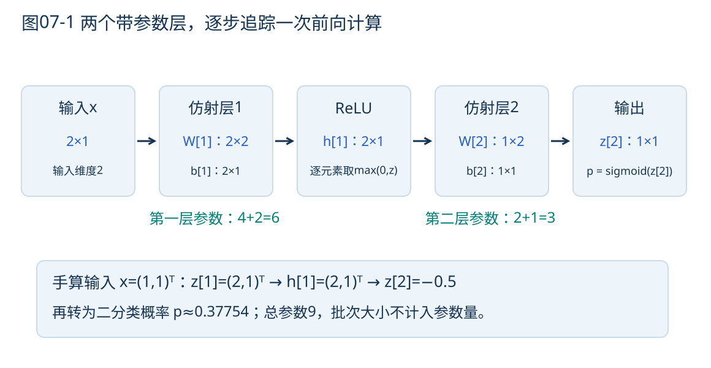
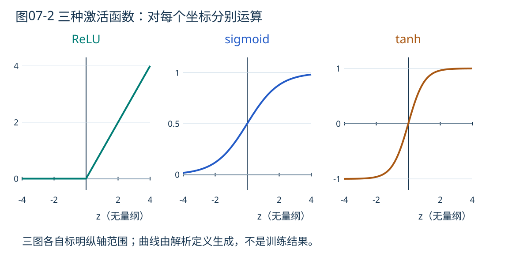
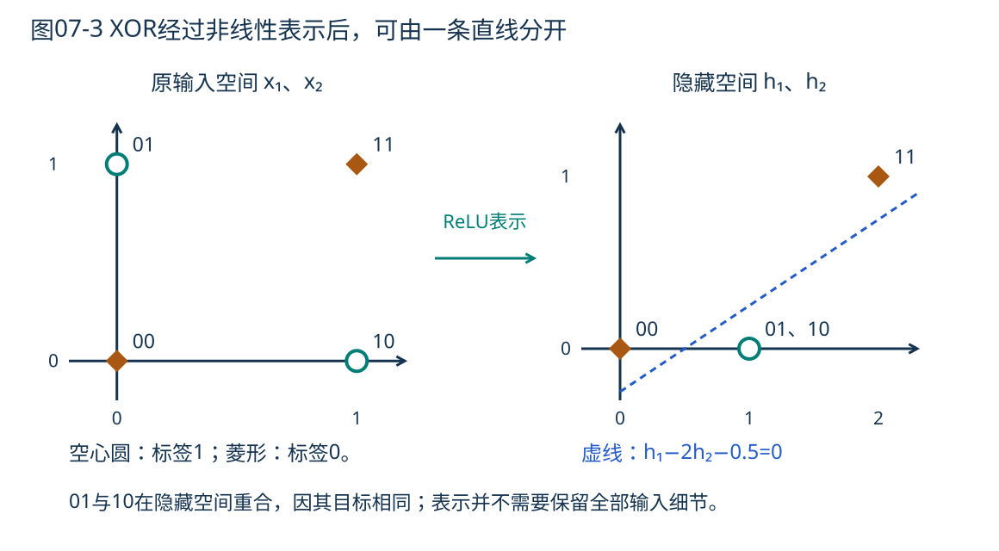

# 第07章：多层感知机与前向传播

> 状态：正文、固定权重CPU实验与单章导出已通过验证；正式完成状态以章节计划为准。
> [阅读入口](../../README.md) · [上一章：神经元与感知机](06-perceptron.md) · [章节计划](../chapter-plan.md) · [公共符号](../appendices/notation.md) · [完整实验](../../examples/07-multilayer-perceptron/README.md)

## 1. 本章目标与前置知识

第06章说明，单个仿射分数加阈值不能表达XOR。接下来需要先改变输入的表示，再做最终判断。多层感知机（multilayer perceptron，MLP）把多个带参数的变换与非线性激活连接起来，提供这种能力。本章逐层算清楚这个过程，暂不把“计算输出”与“学习参数”混为一谈。

学完后应能解释隐藏层与函数复合，指出非线性为什么必要；手算一个2→2→1网络；追踪单样本和批次的形状；计算参数量；用固定参数验证XOR的非线性表示，并说明表达能力与训练成功之间的区别。

前置为第01～04章的矩阵、函数与概率运算，第05章的分类分数与预测，第06章的感知机及XOR限制。上一章逻辑真假编码为 $`-1/+1`$；本章为了使用二分类概率，将目标改编码为0/1，映射为 $`t=(y+1)/2`$，逻辑任务没有变化。

## 2. 为什么需要隐藏层

XOR的四个输入与标签为 $`(0,0)\mapsto0`$、$`(0,1)\mapsto1`$、$`(1,0)\mapsto1`$、$`(1,1)\mapsto0`$。单个分数 $`w_1x_1+w_2x_2+b`$ 不能全部判对。若非负分数判为1，则原点要求 $`b<0`$，两个正类要求 $`w_1+b\geq0`$、$`w_2+b\geq0`$，于是 $`w_1+w_2+b\geq-b>0`$，与最后一点必须为负矛盾。[1，§6.1]

一种办法是构造两个新的特征，使四个点在新空间中可以用一个仿射分数区分。隐藏层（hidden layer）就是输入与最终输出之间的表示。它“隐藏”在网络内部，不表示数值不能查看，也不表示有秘密标签。一般训练数据只规定最终答案，不直接指定每个隐藏单元应该输出什么；本章为理解机制，主动构造固定权重。[2，§5.1.1]



图07-1按本章固定网络原创绘制。图内 `[1]`、`[2]` 表示层号，不表示幂；数学正文用上标方括号标层号。两个带参数层中间有ReLU，最终分数之后再转为概率。信息从输入沿计算顺序传到输出，称为前向传播（forward propagation）。[3，Example feed-forward computation]

## 3. 符号、层数与张量形状

| 符号 | 含义及形状 |
| --- | --- |
| $`\mathbf{h}^{[0]}=\mathbf{x}`$ | 单样本输入，$`d_0`$ 维列向量 |
| $`\mathbf{W}^{[\ell]},\mathbf{b}^{[\ell]}`$ | 第 $`\ell`$ 层权重与偏置，形状为 $`d_\ell\times d_{\ell-1}`$ 与 $`d_\ell`$ |
| $`\mathbf{z}^{[\ell]}`$ | 非线性之前的仿射输出，$`d_\ell`$ 维 |
| $`\mathbf{h}^{[\ell]}`$ | 经过激活的表示，$`d_\ell`$ 维 |
| $`\phi_\ell`$ | 第 $`\ell`$ 层激活函数，逐元素作用时不改变形状 |
| $`z,p,\hat t`$ | 本章最终标量分数、类别1概率及0/1预测 |
| $`\mathbf{X}\in\mathbb{R}^{B\times d_0}`$ | 每行一个样本的批次输入 |

本章按带参数的仿射层计算层数，因此2→2→1有一个隐藏层、两个参数层，输入不算计算层。宽度是指定隐藏层的单元数，本例为2。不同资料的层数计法可能不同，比较模型前先说明口径。激活本身在本章没有参数，不因为单列成一块就额外增加一个带参数层。

## 4. 前向传播就是明确的函数复合

第 $`\ell`$ 层先算仿射变换，再算激活：

```math
\mathbf{z}^{[\ell]}
=\mathbf{W}^{[\ell]}\mathbf{h}^{[\ell-1]}+\mathbf{b}^{[\ell]},
\qquad
\mathbf{h}^{[\ell]}=\phi_\ell(\mathbf{z}^{[\ell]}).
```

矩阵乘法的形状为 $`(d_\ell\times d_{\ell-1})(d_{\ell-1}\times1)`$，输出仍是 $`d_\ell`$ 维列向量。每层的输出成为下一层的输入，因此整个网络是函数的复合，而不是把每层独立投票后取平均。[1，第6章开头]

对一个隐藏层、一个输出分数的网络：

```math
z=\mathbf{W}^{[2]}
\phi_1(\mathbf{W}^{[1]}\mathbf{x}+\mathbf{b}^{[1]})
+b^{[2]}.
```

这里 $`\mathbf{W}^{[2]}`$ 是 $`1\times d_1`$，输出是标量。二分类时再用 $`p=\sigma(z)`$，以 $`p\geq0.5`$ 判1，等价于 $`z\geq0`$。多分类可使用第04章的softmax；回归则可以直接输出实数。隐藏层激活与任务输出变换的职责不同，不要求每层都使用同一种函数。

前向传播在固定参数下只负责求值，不会自动修改权重。要计算参数影响需要导数，要更新参数还需要目标和优化规则；这些环节在第08～09章展开。

## 5. 为什么只堆仿射层仍然不够

如果把隐藏层激活替换为恒等函数 $`\phi(\mathbf{z})=\mathbf{z}`$，两层变成：

```math
\begin{aligned}
z
&=\mathbf{W}^{[2]}(\mathbf{W}^{[1]}\mathbf{x}+\mathbf{b}^{[1]})+b^{[2]}\\
&=(\mathbf{W}^{[2]}\mathbf{W}^{[1]})\mathbf{x}
 +(\mathbf{W}^{[2]}\mathbf{b}^{[1]}+b^{[2]}).
\end{aligned}
```

令有效权重 $`\widetilde{\mathbf{W}}=\mathbf{W}^{[2]}\mathbf{W}^{[1]}`$、有效偏置 $`\tilde b=\mathbf{W}^{[2]}\mathbf{b}^{[1]}+b^{[2]}`$，又回到一个仿射函数。继续堆叠任意多层仍可重复合并，不能凭层数越多就解决XOR。[2，§5.1.1.3][3]

这说明必须有打破仿射合并的运算。ReLU虽然由几段直线组成，整体并不是一个仿射函数，因此能改变表示空间的分隔结构。即便最终再接sigmoid，若隐藏部分始终可合并，$`p=0.5`$ 仍对应一个仿射零分数边界，不能因此表达XOR。

## 6. 三种激活的定义、直觉与边界



图07-2由解析定义原创绘制。每条曲线对每个坐标分别作用，不把不同样本混在一起。[2，§5.1.2] 图中的不同纵轴范围已单独标注，不能直接根据面板高度比较数值大小。

### 6.1 ReLU保留正值，截断负值

整流线性单元（rectified linear unit，ReLU）定义为：

```math
\operatorname{ReLU}(z)=\max(0,z).
```

输入为 $`(-1,0,2)^{\top}`$，输出为 $`(0,0,2)^{\top}`$。对一个固定单元，负半轴不贡献输出、正半轴保持线性；多个单元通过不同权重与偏置，可以在不同位置折转。[1，§6.3.1][4]

$`z<0`$ 时导数为0，$`z>0`$ 时导数为1，0处经典双侧导数不存在。第02章已解释框架在不可微点采用规则与数学可导性的区别。ReLU也不保证所有单元都有效：若一个单元对所有观察输入都落在负侧，它的输出始终为0；是否能在训练中改变需要结合导数路径分析。

### 6.2 Sigmoid把分数映射为二分类概率

```math
\sigma(z)=\frac{1}{1+\exp(-z)}.
```

它严格递增，值域为 $`(0,1)`$，且 $`\sigma(0)=0.5`$。本章用它将最终分数解释为类别1的预测概率。只是把数值放进0与1之间，并不能独自证明概率准确或经过校准；那还依赖学习目标、数据和评估。

导数为 $`\sigma(z)(1-\sigma(z))`$，在0附近最大为 $`1/4`$，两端变小。连续复合很多小导数可能让参数影响变弱；这里只观察局部性质，完整梯度路径在后续章节讨论。[2，§5.1.2.2]

### 6.3 Tanh提供有正负号的有界表示

双曲正切（hyperbolic tangent，tanh）定义为：

```math
\tanh z=\frac{\exp(z)-\exp(-z)}{\exp(z)+\exp(-z)}.
```

其值域为 $`(-1,1)`$，$`\tanh0=0`$，导数为 $`1-\tanh^2z`$。它允许正负输出，原点附近变化较快、两端逐渐平坦。上式用于理解定义；实际代码调用框架实现，不对极端输入直接计算两个大指数相减。[2，§5.1.2.3]

这些是不同的建模选择。不存在只按图形好看程度就能选出所有任务的最佳激活；本章固定使用ReLU，其他两种用于定义与对照。

## 7. 手算一个完整的XOR网络

### 7.1 固定权重与每个单元的作用

取：

```math
\mathbf{W}^{[1]}=\begin{bmatrix}1&1\\1&1\end{bmatrix},
\quad
\mathbf{b}^{[1]}=\begin{bmatrix}0\\-1\end{bmatrix},
\quad
\mathbf{W}^{[2]}=\begin{bmatrix}1&-2\end{bmatrix},
\quad b^{[2]}=-\frac12.
```

隐藏单元分别是 $`h_1=\operatorname{ReLU}(x_1+x_2)`$、$`h_2=\operatorname{ReLU}(x_1+x_2-1)`$。第一个响应输入和为正的程度，第二个只在输入和超过1后响应。最终分数为 $`z=h_1-2h_2-0.5`$。

这些参数是为教学手工设计的，不是脚本训练出来的。它证明网络结构中存在一个能表达XOR的函数；学习算法能否从随机初始值找到它，是另一项需要实验回答的问题。

### 7.2 从一个样本走完每一步

对 $`\mathbf{x}=(1,1)^{\top}`$，先做矩阵乘法并加偏置：

```math
\mathbf{z}^{[1]}
=\begin{bmatrix}1&1\\1&1\end{bmatrix}
\begin{bmatrix}1\\1\end{bmatrix}
+\begin{bmatrix}0\\-1\end{bmatrix}
=\begin{bmatrix}2\\1\end{bmatrix}.
```

两项都为正，所以ReLU后仍为 $`(2,1)^{\top}`$。下一层分数 $`z=1\times2-2\times1-0.5=-0.5`$；概率 $`p=\sigma(-0.5)\approx0.37754`$，预测为0，与XOR标签一致。

其余样本也逐行核对：

| 输入 | 隐藏表示 $`(h_1,h_2)`$ | 最终分数 |
| --- | --- | --- |
| (0,0) | (0,0) | -0.5 |
| (0,1) | (1,0) | 0.5 |
| (1,0) | (1,0) | 0.5 |
| (1,1) | (2,1) | -0.5 |

这里两个不同的正类样本映射到相同隐藏位置，并不妨碍分类。表示可以保留任务需要的信息，不必可逆地保存输入的每个细节。

### 7.3 在新空间看决策边界



图07-3按本章实际输出原创绘制。空心圆与实心菱形同时区分类别，避免只靠颜色。右图的虚线是 $`h_1-2h_2-0.5=0`$：位置 $`(1,0)`$ 得分为正，而 $`(0,0)`$、$`(2,1)`$ 为负。输入空间里不能由一条线分开的四点，经过非线性表示后可以分开。

图并不表示ReLU把所有分类问题都自动变成可分；权重、偏置、宽度和数据共同决定实际表示。本章也只验证四点真值表，没有独立测试集，不把100%正确率当成对任意连续输入的泛化证据。

## 8. 参数量与表达能力怎样联系

全连接层中，每个输出读取全部 $`d_{\ell-1}`$ 个输入，共 $`d_\ell d_{\ell-1}`$ 个权重；每个输出再有一个偏置，共 $`d_\ell`$ 个。总参数量是：

```math
P=\sum_{\ell=1}^{L}
\left(d_\ell d_{\ell-1}+d_\ell\right).
```

本例第一层 $`2\times2+2=6`$，第二层 $`1\times2+1=3`$，总计9。ReLU与sigmoid没有本章可训练参数；批次大小不计入参数量。同样数值的两个权重依旧是两个独立参数位置，只有明确共享同一个参数对象时才另作计数。[5]

更多隐藏单元可以提供更多特征，更多复合层可以组织更复杂的表示；对于ReLU网络，固定激活区间内的输出分数仍是仿射函数，不同区域可以使用不同仿射规则。这解释了分段表达的机制，而不是宣称任意增加参数必然提高效果。[3，Representational power]

表达能力是“结构允许表示哪些函数”；训练是“按数据与目标寻找参数”；泛化是“对未用于拟合的数据表现怎样”。即使构造出了完美匹配四点的参数，也没有自动解决后两件事。较大的网络还改变计算、存储、优化与数据需求，必须结合实验预算。

## 9. 从列向量公式到行批次代码

四个样本排成 $`\mathbf{X}\in\mathbb{R}^{4\times2}`$，代码为：

```python
Z1 = X @ W1.T + b1          # (4,2) @ (2,2) -> (4,2)
H = np.maximum(Z1, 0)       # (4,2)
Z2 = H @ W2.T + b2         # (4,2) @ (2,1) -> (4,1)
P = 1 / (1 + np.exp(-Z2))  # 本例分数仅为±0.5
prediction = (Z2[:, 0] >= 0).astype(np.int64)
```

偏置存为 `(2,)` 与 `(1,)`，分别沿批次行广播；数学上对应每行加相同列偏置的转置。这里sigmoid直接写公式，是因为分数范围很小；极端分数应采用稳定框架实现，不把这个短片段当作所有范围都安全的通用函数。

完整程序还构建 `Linear(2,2) → ReLU → Linear(2,1)`，把所有参数明确复制为第7节数值，与NumPy每层结果核对。PyTorch `Linear` 的权重形状为 `(out_features,in_features)`，正好符合本书数学布局。[5] 不同教材若把权重存成输入维×输出维，要先转置对应，不能混合两套布局。

把四行一起算、逐行单独算、调换批次行顺序后再算，结果应保持对应关系。这是本章没有跨样本运算的前馈网络所具有的性质；后续出现按批次统计的模块时，应重新分析适用条件。

## 10. 本机实践与实测结果

### 10.1 环境、数据与配置

本实验数据是完整XOR真值表，属于教学构造，无外部数据许可或下载。没有训练/验证/测试划分，因为目标是检查固定网络的前向机制；也没有优化器、学习率、训练轮数或学习到的检查点。模块构造种子为7，但所有初始权重和偏置均随后覆盖，最终数值由明确给出的9个参数决定。

2026-11-15本机环境：Python 3.11.5、NumPy 2.4.6、PyTorch 2.15.0+cpu，CPU、float64、1个PyTorch线程。NumPy、模块输出及激活定义对照使用 `rtol=1e-13, atol=1e-13`，固定批次顺序与逐行结果另作完全一致检查。

### 10.2 运行与矢量图复现

从仓库根目录运行：

```powershell
& ./.venv/Scripts/python.exe -B examples/07-multilayer-perceptron/run.py
```

报告保存在 `build/experiments/07-multilayer-perceptron/results.json`，并由[矢量程序](../../examples/07-multilayer-perceptron/figures.py)重建三幅SVG。只重新核对数值可加 `--skip-figures`。失败会以错误退出，成功打印 `PASS`。源代码和SVG均可随仓库保存；本机结果JSON可重建，不链接到克隆后尚未存在的文件。

### 10.3 实测观察

2026-11-15 22:05执行通过。批次形状依次为 `(4,2) → (4,2) → (4,2) → (4,1)`，模块参数计数为9。最终概率与预测如下：

| 输入 | 类别1概率 | 预测 |
| --- | --- | --- |
| (0,0) | 0.37754067 | 0 |
| (0,1) | 0.62245933 | 1 |
| (1,0) | 0.62245933 | 1 |
| (1,1) | 0.37754067 | 0 |

四点全部正确，但概率距0或1仍有明显距离；分类正确不意味着概率已经很确信，更不意味着经过校准。

把ReLU替换为恒等函数，使用相同参数得到有效权重 $`(-1,-1)`$、有效偏置1.5，分数依次为 $`(1.5,0.5,0.5,-0.5)`$，只判对3点。程序还用另一组固定非退化矩阵核对仿射合并关系，排除只因本例特殊数值而碰巧成立的解释。3/4是这组对照参数的实际结果，不把它描述为任意数据上线性分类器的最优准确率。

本次数值检查约0.793秒，含库导入约2.735秒；输入数组载荷64字节，只是4×2个float64，不是进程总内存。进程峰值内存未测量，计时不包含随后SVG生成。单次耗时受后台负载与依赖初始化影响，不能估计真实训练速度。

## 11. 常见误区与适用边界

- **层数多就一定有非线性**：多个仿射层仍能合并，关键是中间运算。
- **隐藏层是看不到的黑箱数值**：本章明确输出每一层，可以按样本检查；“隐藏”指内部表示的角色。
- **ReLU输出非负就只能表达正函数**：后续权重和偏置可有正负号，本例分数就有两种符号。
- **输出sigmoid可以替代隐藏非线性**：对单个仿射分数的单调转换不改变其0.5决策边界形状。
- **前向传播会更新权重**：它在当前参数下求值，参数学习还需目标、梯度与更新规则。
- **多个相同数值只算一个参数**：数值相等不等于参数共享。
- **XOR四点全对证明泛化**：本例没有独立评价数据，也未进行学习实验。

## 12. 习题与解析

### 12.1 习题

1. 将网络尺寸改为3→4→2，带偏置，参数量是多少？批次大小从1增到8后是否改变？
2. 对本章固定网络，输入 $`(0,1)`$，逐步计算预激活、隐藏表示、分数、概率及预测。
3. 隐藏激活改为恒等函数，手算有效权重与偏置，找出四点中哪个样本出错。
4. 为什么两个不同输入在隐藏层重合仍可能有利于分类？何时这种重合必然使分类失败？
5. ReLU在0处能否按经典双侧导数求出1或0？区分前向定义、数学导数与框架求导规则。
6. 保持其他参数不变，将输出偏置改为0.25，手算并查看脚本中的独立偏置对照。这个例子是否支持“只要有非线性就一定能分类正确”？

### 12.2 参考解析

1. 第一层 $`4\times3+4=16`$，第二层 $`2\times4+2=10`$，合计26。批次改变同时计算的样本数，不增加这26个参数位置。
2. $`\mathbf{z}^{[1]}=(1,0)^{\top}`$，ReLU后仍为 $`(1,0)^{\top}`$，最终分数0.5，概率约0.622459，预测1。恰好为0的隐藏分量按前向定义输出0，无须先解决该点可导性。
3. 有效权重为 $`[1,-2]\begin{bmatrix}1&1\\1&1\end{bmatrix}=[-1,-1]`$，有效偏置为 $`[1,-2](0,-1)^{\top}-0.5=1.5`$。原点分数1.5，被误判为1，其余三点恰好正确。
4. 若两个输入目标相同，丢掉不影响任务的区别可以仍然分类正确；本例两正类就是如此。若同一确定性隐藏表示对应两个不同且必须区分的目标，后续仅依据该表示的确定性输出无法同时满足它们。
5. 左导数为0、右导数为1，不相等，所以经典导数不存在。前向值仍明确为0；框架在该点采用的导数规则属于计算约定，不能改变这个事实。
6. 四点分数变为 $`(0.25,1.25,1.25,0.25)`$，全判为1，只有两个正类正确。结构具备表达能力并不保证任意参数都产生正确函数。

## 13. 本章小结与下一步

MLP用非线性隐藏表示连接多个仿射变换，前向传播按明确形状逐层求值。只堆仿射层可以合并；加入ReLU后，本章固定网络在隐藏空间把XOR变成可分问题。参数量由连接尺寸决定，是否能表示、是否能学到、是否能泛化需要分别回答。

下一章会给前向计算图标上局部导数，计算每个参数怎样影响最终目标，再把这些梯度交给更新规则。当前先保证每一步数值、形状和参数含义都能独立解释。

## 14. 参考文献

以下官方页面于2026-11-15核验；三幅图与权重例子为本章原创。

1. Ian Goodfellow、Yoshua Bengio、Aaron Courville，*Deep Learning*，MIT Press，2016，第6章开头、§6.1 Example: Learning XOR、§6.3 Hidden Units，尤其§6.3.1 ReLU：[官方章节](https://www.deeplearningbook.org/contents/mlp.html)。本书权重采用输出维×输入维布局，引用原式时按形状转置对应。
2. Aston Zhang、Zachary C. Lipton、Mu Li、Alexander J. Smola，*Dive into Deep Learning*，在线1.0.3，§5.1.1 Hidden Layers、§5.1.1.3 From Linear to Nonlinear、§5.1.2 Activation Functions：[官方章节](https://d2l.ai/chapter_multilayer-perceptrons/mlp.html)。
3. Stanford CS231n，Neural Networks, Part 1，Layer-wise organization、Example feed-forward computation、Representational power：[官方课程笔记](https://cs231n.github.io/neural-networks-1/)。页面未明确固定课程年份，本章按此次核验版本引用，不编造讲次或录像时间。
4. PyTorch 2.15，`torch.nn.ReLU`，逐元素激活定义：[官方接口](https://docs.pytorch.org/docs/2.15/generated/torch.nn.ReLU.html)。
5. PyTorch 2.15，`torch.nn.Linear`，输入输出形状、权重及偏置：[官方接口](https://docs.pytorch.org/docs/2.15/generated/torch.nn.Linear.html)。

## 15. 实现与验证记录

固定CPU实验已实际核对NumPy、手算及模块输出、9个参数、逐样本/批次/置换一致性、三种激活和移除非线性的仿射合并。图由[生成程序](../../examples/07-multilayer-perceptron/figures.py)输出真正SVG文字与路径，无位图中间过程。2026-11-15正式单章导出通过：11页PDF、3幅SVG、85处数学表达。1440与390像素页面均无溢出、缺失锚点、裁切或残留Markdown；PDF审计确认零位图、字体全部嵌入、书签和结构存在、无纸外文字。11页已渲染目视，三图单独放大核验。脚本也核对输出偏置0.25的失败对照，四点全判为1、正确率仅1/2。按顺序的最终任务状态与提交由章节计划记录。
