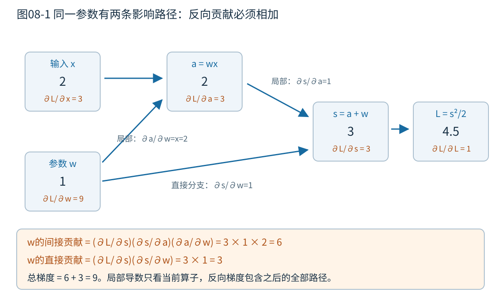
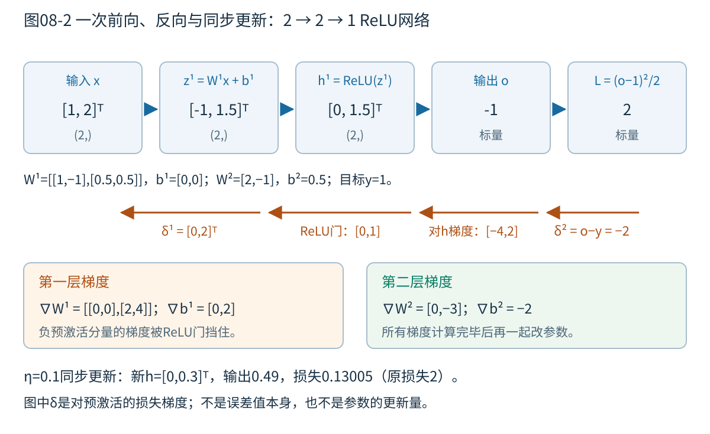
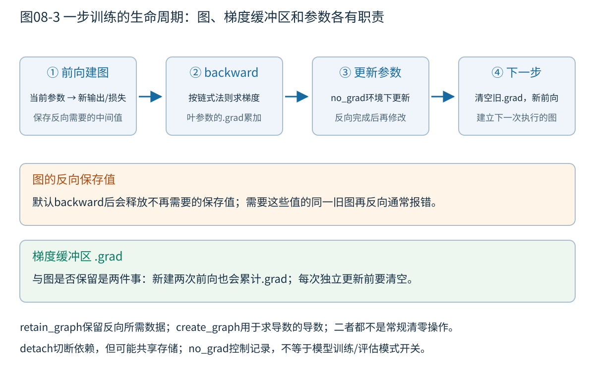
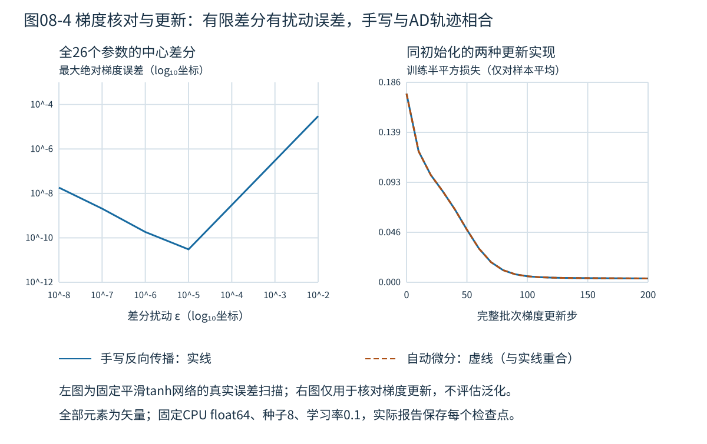

# 第08章：计算图、反向传播与自动微分

> 先把一次前向计算变成有依赖关系的图，再沿图反向累加梯度。本章用同一个两层网络手算前向、反向与更新，并用独立数值方法核对。
> 更新日期：2026-11-15。实验为实际 CPU float64 运行，核心实现与全部SVG可复现。

[阅读入口](../../README.md) · [章节计划](../chapter-plan.md) · [公共符号](../appendices/notation.md) · [完整实验](../../examples/08-backpropagation/README.md)

## 1. 本章要解决什么问题

第07章给出了多层感知机的前向过程：输入通过若干层，得到输出和损失。现在每一层都有参数，只知道最终预测错了，还不能直接回答“第一层的哪一个权重应该怎样改”。

第02章的链式法则已经提供数学规则：沿路径乘局部导数，多条路径的贡献相加。网络中有大量共享中间结果，如果每个参数都把整条表达式重新展开，计算会重复且容易漏项。反向传播把这套规则组织成可复用的算法。[1，§6.5]

读完后，你应能：

- 画出变量、运算和共享依赖，区分局部导数与最终损失对变量的梯度。
- 沿反向拓扑顺序累加梯度，手算两层网络的参数梯度和一次更新。
- 在列向量与行批次布局下写出正确形状，解释偏置广播在反向中为何要求和。
- 用手写公式、中心差分和自动微分交叉核对，说明各自边界。
- 区分计算图保存值、参数数值和 `.grad` 缓冲区，处理清零、图释放与断开依赖。

直接前置是第02章的梯度/Jacobian、04章的梯度下降与07章的前向网络。必要回顾：一个标量损失对 $d$ 维输入的梯度是 $d$ 维列向量；若局部映射为 $\mathbf z=\mathbf F(\mathbf x)$，则链式法则需要把输出侧梯度左乘 $\mathbf J_{\mathbf F}^\top$，回到输入维度。代码批次仍按行保存。

## 2. 计算图：把依赖与数值分开看

### 2.1 节点、边与前向执行

**计算图（computational graph）** 用节点记录变量或运算，用有向边记录依赖。不同教材可以把运算画成边或独立节点，关键是说明当前图例。本章方框展示一次运算及输出变量，蓝色箭头表示前向依赖，橙色标注表示损失对该变量的梯度。

例如参数 $w$、输入 $x$ 先做乘法 $a=wx$，再让同一个 $w$ 参与加法 $s=a+w$，最后计算 $L=s^2/2$。同一个参数出现两次，不能当成两个互不相关的参数。



*图08-1：共享参数的两条路径。依据花书§6.5.1～6.5.3的计算图与链式法则思想原创绘制，不复刻教材原图。[1] 本例取 $w=1,x=2$，前向值为 $a=2,s=3,L=4.5$。*

前向时必须先获得某个节点依赖的输入，才能计算它；这称为按依赖顺序执行。当前图没有从后面回到前面的环，可以按拓扑顺序安排。图的形状表示“谁依赖谁”，节点里的数字表示“在这一次输入与参数下的值”，两者不要混为一谈。

### 2.2 局部导数与总梯度

对加法 $s=a+w$，把直接输入 $a,w$ 看成独立变量时，局部导数都是1。它不等于已经把 $a=wx$ 代回之后，对 $w$ 的总影响。

用上横线记最终损失对一个中间变量的梯度，例如 $\bar s=\partial L/\partial s$。从末端开始：

$$
\bar L=1,\qquad
\bar s=s=3,\qquad
\bar a=\bar s\frac{\partial s}{\partial a}=3.
$$

参数 $w$ 的间接贡献为 $\bar a x=6$，直接贡献为 $\bar s=3$，因此

$$
\bar w=\bar a x+\bar s=6+3=9,
\qquad
\bar x=\bar a w=3.
$$

独立展开 $L=w^2(x+1)^2/2$，对 $w$ 求导为 $w(x+1)^2$，代入得到9。这个展开是核对小图的工具；大网络中的反向传播避免为每个参数反复展开整式。

## 3. 本章记号、形状和损失约定

| 符号 | 含义 | 形状或约定 |
| --- | --- | --- |
| $\mathbf x,\mathbf h$ | 单样本输入、隐藏输出 | 默认列向量 |
| $\mathbf z^{[1]},\mathbf z^{[2]}$ | 两层激活前的输出 | 分别为 $h,m$ 维 |
| $\mathbf W^{[1]},\mathbf b^{[1]}$ | 第一层参数 | $h\times d,\ h$ |
| $\mathbf W^{[2]},\mathbf b^{[2]}$ | 第二层参数 | $m\times h,\ m$ |
| $\phi$ | 逐分量激活函数 | 本章使用ReLU或tanh |
| $\boldsymbol{\delta}^{[\ell]}$ | 损失对第 $\ell$ 层预激活的梯度 | 单样本列向量 |
| $\mathbf X,\mathbf H,\mathbf O$ | 行批次输入、隐藏、输出 | $B\times d,B\times h,B\times m$ |
| $\boldsymbol{\Delta}^{[\ell]}$ | 行批次预激活梯度 | 与对应预激活同形状 |
| $k,\eta,\varepsilon$ | 更新步、学习率、差分扰动 | 三者用途不同 |

本章采用单样本**半平方损失**，以及“先对输出分量求和，再对样本平均”的批次目标：

$$
\ell=\frac12\|\mathbf o-\mathbf y\|_2^2,
\qquad
\mathcal L=\frac1{2B}\sum_{i=1}^{B}\sum_{r=1}^{m}
(o_r^{(i)}-y_r^{(i)})^2.
$$

第05章单输出MSE不含 $1/2$，这里加它是为了让输出梯度恰为残差。若调用框架默认 `MSELoss(mean)`，它还会对输出分量数量 $m$ 取平均；多输出时需按上式显式写 `0.5 * error.square().sum(dim=1).mean()`，不能只凭函数名认为归约相同。

层编号写在方括号上标中，样本编号写在圆括号上标中。参数的梯度与参数本身形状相同；这是一项重要的计算检查，而非额外的学习规则。

## 4. 反向传播怎样组织链式法则

### 4.1 从一个标量输出反向累积

**反向传播（backpropagation）** 是计算梯度的算法，不是参数更新公式。[1，§6.5][2] 对单个标量损失，可以这样理解：

1. 前向计算每个节点，并保留反向所需的输入、输出或掩码。
2. 给损失本身的梯度设为1，其他待累积位置初始为0。
3. 按依赖关系的反方向处理节点。
4. 用当前节点的梯度乘其局部导数，把贡献加到各个直接输入。
5. 一个输入被多次使用时，把所有消费者的贡献相加。

反向顺序保证处理某个节点时，来自它后面各条路径的贡献已经汇合。这里的“加到”不能随意改成“覆盖”，否则图08-1会丢失一条路径。

在常见算子的局部反向计算与其前向成本同量级时，求一个标量对大量参数的梯度，通常只需与前向相同量级的额外工作。代价是需要保存一些中间值；它不是免费计算，也不保证所有复杂程序都有同样的常数开销。

### 4.2 常见局部规则

下面的上横线都表示“最终损失传到该变量的梯度”，不是变量自身数值。

| 运算 | 局部反向贡献 | 理由 |
| --- | --- | --- |
| $s=a+b$ | $\bar a\mathrel{+}=\bar s,\ \bar b\mathrel{+}=\bar s$ | 两个局部偏导均为1 |
| $s=ab$ | $\bar a\mathrel{+}=\bar s b,\ \bar b\mathrel{+}=\bar s a$ | 固定另一因子求导 |
| $\mathbf z=\mathbf W\mathbf x+\mathbf b$ | $\bar{\mathbf x}=\mathbf W^\top\bar{\mathbf z}$ | Jacobian转置乘输出侧梯度 |
| 同一仿射层的参数 | $\bar{\mathbf W}=\bar{\mathbf z}\mathbf x^\top,\ \bar{\mathbf b}=\bar{\mathbf z}$ | 每个系数只乘对应输入 |
| $\mathbf h=\phi(\mathbf z)$ | $\bar{\mathbf z}=\bar{\mathbf h}\odot\phi'(\mathbf z)$ | 各分量独立应用链式法则 |

前两行的 $\mathrel{+}=$ 表示累积贡献。后几行是在当前单一路径下列出的局部结果；若同一变量还被其他分支使用，仍须与其他路径相加。

这里无需构造巨大的完整Jacobian。比如仿射映射直接算 $\mathbf W^\top\bar{\mathbf z}$，就是一个**向量与Jacobian的乘积**在列向量记法下的形式。框架常称它 VJP；“vector-Jacobian product”名称来自另一种行向量布局，最终数学对象仍应按约定检查形状。

### 4.3 广播的反向为什么要归约

若偏置 $\mathbf b$ 被每个样本共享，前向 $Z_{ir}=\cdots+b_r$。同一个 $b_r$ 影响所有 $i$，因此反向是

$$
\frac{\partial\mathcal L}{\partial b_r}
=\sum_{i=1}^{B}\frac{\partial\mathcal L}{\partial Z_{ir}}.
$$

这与图08-1的共享参数完全同理，只是路径来自一批样本。前向沿样本轴广播，反向就沿该共享轴求和；若上游梯度已经含 $1/B$，这里不能再重复除一次。

小例子：$\mathbf X=\begin{bmatrix}1&2\\3&4\end{bmatrix}$，$\mathbf b=\mathbf0$，$\mathcal L=\frac14\sum_{i,r}(X_{ir}+b_r)^2$。每个元素的上游梯度为 $X_{ir}/2$，所以偏置梯度为 $((1+3)/2,(2+4)/2)=(2,3)$，而不是保留成一个 $2\times2$ 矩阵。

## 5. 两层网络的逐步反向推导

### 5.1 先写清前向与激活导数

单样本前向为

$$
\mathbf z^{[1]}=\mathbf W^{[1]}\mathbf x+\mathbf b^{[1]},
\quad
\mathbf h=\phi(\mathbf z^{[1]}),
\quad
\mathbf o=\mathbf W^{[2]}\mathbf h+\mathbf b^{[2]}.
$$

本章输出层不再额外激活，最终使用半平方损失。若输出改成分类交叉熵，需要按第05章的输出损失梯度替换起点，而不是照抄残差公式。

对于ReLU，$\phi(z)=\max(0,z)$，在 $z>0$ 导数为1，在 $z<0$ 为0；在0处经典导数不存在，框架需要采用约定。手算例避开0。对于平滑tanh，

$$
\phi(z)=\tanh z=\frac{\exp z-\exp(-z)}{\exp z+\exp(-z)},
\qquad
\phi'(z)=1-\tanh^2z.
$$

把同一函数写成 $\phi(z)=(\exp(2z)-1)/(\exp(2z)+1)$，按商法则求导并整理：

$$
\phi'(z)=\frac{4\exp(2z)}{(\exp(2z)+1)^2}
=1-\left(\frac{\exp(2z)-1}{\exp(2z)+1}\right)^2
=1-\phi(z)^2.
$$

因此可以复用前向已存的 $h$，把导数写成 $1-h^2$。本章的全面差分核对使用tanh，以避免扰动跨过ReLU尖点。[1，§6.3、§6.5.4]

### 5.2 输出层先得到梯度

因为 $\ell=\|\mathbf o-\mathbf y\|^2/2$，输出侧梯度为

$$
\boldsymbol{\delta}^{[2]}=\nabla_{\mathbf o}\ell=\mathbf o-\mathbf y.
$$

第 $r$ 个输出 $o_r=\sum_j W_{rj}^{[2]}h_j+b_r^{[2]}$，所以

$$
\frac{\partial\ell}{\partial W_{rj}^{[2]}}
=\delta_r^{[2]}h_j.
$$

把所有元素排回矩阵：

$$
\nabla_{\mathbf W^{[2]}}\ell=\boldsymbol{\delta}^{[2]}\mathbf h^\top,
\qquad
\nabla_{\mathbf b^{[2]}}\ell=\boldsymbol{\delta}^{[2]},
\qquad
\nabla_{\mathbf h}\ell=(\mathbf W^{[2]})^\top\boldsymbol{\delta}^{[2]}.
$$

形状分别为 $m\times h$、$m$、$h$。权重梯度是**外积**：一个输出分量的误差信号乘每个隐藏输入，不能用内积把它压成标量。

### 5.3 继续穿过激活和第一层

逐分量激活不把不同坐标相互混合，因此

$$
\boldsymbol{\delta}^{[1]}
=\left((\mathbf W^{[2]})^\top\boldsymbol{\delta}^{[2]}\right)
\odot\phi'(\mathbf z^{[1]}).
$$

再按同一仿射层规则：

$$
\nabla_{\mathbf W^{[1]}}\ell=\boldsymbol{\delta}^{[1]}\mathbf x^\top,
\qquad
\nabla_{\mathbf b^{[1]}}\ell=\boldsymbol{\delta}^{[1]},
\qquad
\nabla_{\mathbf x}\ell=(\mathbf W^{[1]})^\top\boldsymbol{\delta}^{[1]}.
$$

这就是反向传播把后一层的损失影响送回前一层。每层使用的仍是第02章链式法则，没有引入独立于微积分的新求导规则。D2L§5.3.3按这一顺序给出MLP反向计算。[2]

### 5.4 行批次版本与平均位置

行批次前向写成 $\mathbf Z^{[1]}=\mathbf X(\mathbf W^{[1]})^\top+\mathbf b^{[1]}$、$\mathbf H=\phi(\mathbf Z^{[1]})$、$\mathbf O=\mathbf H(\mathbf W^{[2]})^\top+\mathbf b^{[2]}$，偏置按行广播。

在本章的损失归约下，令

$$
\boldsymbol{\Delta}^{[2]}=\frac{\mathbf O-\mathbf Y}{B}.
$$

则

$$
\nabla_{\mathbf W^{[2]}}\mathcal L=(\boldsymbol{\Delta}^{[2]})^\top\mathbf H,
\quad
\nabla_{\mathbf b^{[2]}}\mathcal L=(\boldsymbol{\Delta}^{[2]})^\top\mathbf1_B,
$$

$$
\boldsymbol{\Delta}^{[1]}=
\left(\boldsymbol{\Delta}^{[2]}\mathbf W^{[2]}\right)
\odot\phi'(\mathbf Z^{[1]}),
$$

$$
\nabla_{\mathbf W^{[1]}}\mathcal L=(\boldsymbol{\Delta}^{[1]})^\top\mathbf X,
\quad
\nabla_{\mathbf b^{[1]}}\mathcal L=(\boldsymbol{\Delta}^{[1]})^\top\mathbf1_B.
$$

前向与反向都保持同一权重存储约定。注意 $1/B$ 只在 $\boldsymbol{\Delta}^{[2]}$ 中出现一次，其后传递已包含这个系数。若把单样本公式直接叠起来又额外平均两次，会得到比例错误但形状完全合法的梯度。

## 6. 把一次前向、反向和更新完整算完

### 6.1 固定九个参数与输入

取一个2→2→1网络，共 $2\cdot2+2+1\cdot2+1=9$ 个参数：

$$
\mathbf x=\begin{bmatrix}1\\2\end{bmatrix},
\quad
\mathbf W^{[1]}=\begin{bmatrix}1&-1\\0.5&0.5\end{bmatrix},
\quad
\mathbf b^{[1]}=\begin{bmatrix}0\\0\end{bmatrix},
$$

$$
\mathbf W^{[2]}=\begin{bmatrix}2&-1\end{bmatrix},
\qquad b^{[2]}=0.5,\qquad y=1.
$$

先算第一层：$\mathbf z^{[1]}=(-1,1.5)^\top$，ReLU保留正分量，得到 $\mathbf h=(0,1.5)^\top$。输出为 $o=2\cdot0-1\cdot1.5+0.5=-1$，所以残差 $-2$，损失 $\ell=(-2)^2/2=2$。



*图08-2：本章固定数值例子的前向、反向和同步更新，依据上述推导原创绘制。激活前两个数均远离0，便于独立差分核对。*

### 6.2 一层一层反向计算

输出梯度 $\boldsymbol{\delta}^{[2]}=o-y=-2$。由外积：

$$
\nabla_{\mathbf W^{[2]}}\ell
=-2\begin{bmatrix}0&1.5\end{bmatrix}
=\begin{bmatrix}0&-3\end{bmatrix},
\qquad
\nabla_{b^{[2]}}\ell=-2.
$$

回传到隐藏输出：

$$
\nabla_{\mathbf h}\ell
=\begin{bmatrix}2\\-1\end{bmatrix}(-2)
=\begin{bmatrix}-4\\2\end{bmatrix}.
$$

ReLU导数为 $(0,1)^\top$，所以

$$
\boldsymbol{\delta}^{[1]}
=\begin{bmatrix}-4\\2\end{bmatrix}
\odot\begin{bmatrix}0\\1\end{bmatrix}
=\begin{bmatrix}0\\2\end{bmatrix}.
$$

这里 $-4$ 的影响已经传到第一隐藏输出，但被负预激活处的ReLU导数0挡住。它仅说明当前输入、当前参数下该条路径梯度为0，不能断言这个单元对所有别的样本永远不起作用。

第一层梯度为

$$
\nabla_{\mathbf W^{[1]}}\ell
=\begin{bmatrix}0\\2\end{bmatrix}
\begin{bmatrix}1&2\end{bmatrix}
=\begin{bmatrix}0&0\\2&4\end{bmatrix},
\qquad
\nabla_{\mathbf b^{[1]}}\ell=\begin{bmatrix}0\\2\end{bmatrix}.
$$

输入梯度也可以检查：$(\mathbf W^{[1]})^\top(0,2)^\top=(1,1)^\top$。输入本次不是待训练参数，但其梯度说明两维输入如何影响损失。

### 6.3 所有梯度算完，再更新参数

用学习率 $\eta=0.1$ 对全部参数应用 $\theta_{\mathrm{new}}=\theta-\eta\nabla_\theta\ell$，得到

$$
\mathbf W_{\mathrm{new}}^{[1]}
=\begin{bmatrix}1&-1\\0.3&0.1\end{bmatrix},
\quad
\mathbf b_{\mathrm{new}}^{[1]}=\begin{bmatrix}0\\-0.2\end{bmatrix},
$$

$$
\mathbf W_{\mathrm{new}}^{[2]}
=\begin{bmatrix}2&-0.7\end{bmatrix},
\qquad b_{\mathrm{new}}^{[2]}=0.7.
$$

重新前向：第一层输出 $(-1,0.3)^\top$，隐藏输出 $(0,0.3)^\top$，新输出 $-0.7\cdot0.3+0.7=0.49$。新损失为 $(0.49-1)^2/2=0.13005$，低于原来的2。

计算第一层梯度时必须使用原前向的 $\mathbf W^{[2]}$。不能先修改第二层，再拿新权重回传第一层：那样组合的是两个不同参数时刻的计算，已经不是原损失的完整梯度。

反向传播到此只负责求梯度；上面的梯度下降更新属于优化方法。换成Momentum或Adam，求梯度的链式法则不变，但参数更新还会使用别的状态。第09章再系统展开这些更新算法。

## 7. 自动微分接口到底返回什么

### 7.1 对标量求梯度

PyTorch按实际执行的张量运算记录反向关系。[3] 一个最小例子是：

```python
w = torch.tensor(1., dtype=torch.float64, requires_grad=True)
x = torch.tensor(2., dtype=torch.float64, requires_grad=True)
a = w * x
s = a + w
loss = 0.5 * s.square()
gw, gx = torch.autograd.grad(loss, (w, x))
# gw=9，gx=3；本调用返回梯度，不写入w.grad/x.grad
```

`requires_grad=True` 说明需要跟踪相应输入的求导关系。直接由用户构造、不是另一个跟踪运算产物的这类张量称为**叶张量**；模型参数通常是叶张量。

`autograd.grad` 返回指定对象的梯度，默认不把结果累加到叶张量的 `.grad`。[4] `loss.backward()` 则常用于训练，默认把相关叶参数的梯度累计到其 `.grad` 中。[5] 中间非叶张量不默认保留 `.grad`；需要观察中间量时，可以用明确求梯度的接口，或按官方规则保留其梯度。不能只因 `h.grad` 为空就认定链式法则没有经过它。

### 7.2 多输出为何需要指定权重

若输出是一个向量，反向接口需要知道你希望求哪个标量组合的梯度。比如

$$
\mathbf F(\mathbf x)=
\begin{bmatrix}x_1x_2\\x_1+x_2\end{bmatrix},
\quad
\mathbf x=\begin{bmatrix}2\\3\end{bmatrix},
\quad
\mathbf v=\begin{bmatrix}1\\2\end{bmatrix}.
$$

给 `grad_outputs=v`，对应对标量 $\mathbf v^\top\mathbf F(\mathbf x)$ 求导：

$$
\mathbf J_{\mathbf F}=
\begin{bmatrix}3&2\\1&1\end{bmatrix},
\qquad
\mathbf J_{\mathbf F}^\top\mathbf v
=\begin{bmatrix}5\\4\end{bmatrix}.
$$

这不是完整Jacobian，只是它与给定权重的乘积。单个标量损失的默认种子1，则对应 $\partial L/\partial L=1$。把多输出随意求和会固定成另一种标量目标，应说明它是不是任务真正需要的目标。

## 8. 图的生命周期与梯度缓冲区

### 8.1 每次前向建立当前执行的图

普通PyTorch eager执行中，每次前向会按实际运行路径建立图，不要求一开始把全部Python分支都预先画好。[3] 对 `x>0` 时算 `x**2`、否则算 `3*x` 的程序，输入2实际走平方分支，导数为4；输入-2走另一分支，导数为3。这只描述各自分支内部，不能忽略分支边界的可微性条件。

为了反向，算子可能保存输入、输出或其他中间值。默认反向完成后，不再需要的保存值会释放以节省内存。此时Python变量仍然存在，不代表其旧图里的所有反向材料仍然存在。



*图08-3：图、梯度缓冲与参数的不同生命周期。依据PyTorch官方Autograd mechanics与反向接口说明原创绘制。[3][5] 箭头是一次常规独立更新的顺序，不要求每一种高级训练方法都照此分组。*

### 8.2 不能用保留旧图代替梯度清零

取叶参数 $w=3$，第一次计算 $w^2$ 并反向，`w.grad=6`。重新前向 $w^2$ 后再次反向，梯度缓冲会累计为12。如果先令 `w.grad=None` 再用新前向反向，结果回到6。

这三个结果分别对应三种明确操作。即使图已经重建，旧 `.grad` 仍可能保留；清空 `.grad` 不等于释放或保留计算图。[5][6]

对于需要保存值的平方旧图，第一次默认反向后，再对同一个旧结果反向会报错。若确实要复用同图，可以在第一次反向显式保留所需图数据；但 `retain_graph=True` 不会自动清空梯度，仍可能累计到12。某些不需要保存中间值的简单算子可以再次反向，不能据此推断所有旧图都可重用。

`create_graph=True` 的另一职责是让求梯度的运算本身也可被继续求导，以计算更高阶导数；它和 `retain_graph`、`zero_grad` 解决的是不同问题。普通独立迭代默认重新前向，不需要靠持续保留所有旧图工作。

### 8.3 detach、no_grad与原地修改

`detach()` 得到一个与当前反向图断开、但可共享存储的张量。例如 $h=2w$，再令 $L=h_{\mathrm{detach}}a$，损失对 $a$ 仍有梯度，对 $w$ 的路径却被切断。它不等于“把梯度算成0”：对未连接的输入，接口可能返回 `None`，表示没有这条依赖。[7]

detach后的张量可能与原张量共享存储，因此不是独立数据快照。若还要在一边改值而保留另一边，应明确复制的需求。不能用原地改detach结果的方式，假定前向保存的原始数据不受影响。

`torch.no_grad()` 控制其内部运算不记录普通反向图，常用于参数更新和无梯度评估。它不等于 `model.eval()`；后者影响某些层的训练/评估行为，不负责统一关闭梯度记录。[3]

如果一个平方运算已经保存了旧 $w$ 用于反向，却在反向前原地把 $w$ 改掉，保存值与当前数据就不一致。框架会对本章的这种例子抛出版本检查错误。[3] 正确流程是先完成当前损失的反向，再在不记录梯度的环境里更新参数，然后重新前向。

## 9. 怎样独立核对反向传播

### 9.1 三种方法分工

**手写反向** 直接实现本章推导，便于逐层解释；**自动微分** 使用框架内置的局部求导与图遍历；**有限差分** 则不读取反向实现，只改变输入参数并重新计算前向损失。

对每个参数位置 $\theta_j$，中心差分为

$$
g_j^{\mathrm{FD}}
=\frac{\mathcal L(\boldsymbol\theta+\varepsilon\mathbf e_j)
-\mathcal L(\boldsymbol\theta-\varepsilon\mathbf e_j)}{2\varepsilon}.
$$

本章把每个参数张量的每个位置都遍历一遍，不以只查一个梯度代表整个网络。三种方法都还须核对形状与损失归约；如果两份实现复制了同一处错误，表面一致不够独立。

### 9.2 差分扰动与不可微点的边界

差分扰动太大时，局部近似误差明显；太小时，有限精度的相近数相减使误差上升。我们使用平滑3→4→2 tanh网络的全部26个参数，扫描多个 $\varepsilon$。ReLU手算例也做差分，但先确保扰动不会让其预激活跨过0。

若某个测试点恰在尖点，框架返回的约定值与中心差分相同，也不能证明经典导数存在。第02章的 $|s|$ 已经说明这个边界。检查不通过时，应先看定义域、可微性、归约与参数顺序，再考虑扰动设置，不能立即放宽容差掩盖差异。



*图08-4：本机真实梯度核对与更新轨迹。左侧两轴取log10坐标，右侧仅比较相同训练数据和初始化下的实现；它不构成泛化评估。图由实验报告数据生成，全部为SVG矢量。*

## 10. 本机实践与真实结果

### 10.1 数据、配置和运行方式

完整实验在[run.py](../../examples/08-backpropagation/run.py)。手算网络无随机数据；全面梯度检查使用种子8生成的5个样本、3输入、4隐藏、2输出、tanh，共26参数。有限差分主扰动为 $10^{-5}$，另扫描 $10^{-2}$ 至 $10^{-8}$。

为了检查求导是否导致相同的参数更新，还用32个项目合成样本运行2→3→1 tanh网络，共13参数。目标由 $0.7\tanh(1.2x_1-0.5x_2)+0.2$ 生成，学习率0.1，完整批次梯度下降200步，单线程CPU float64，无正则化、无动量。手写NumPy和PyTorch自动微分从相同参数开始，逐步比较轨迹。

这组训练只用于核对梯度与更新实现，未划分验证/测试，也不报告泛化效果。它不替代第05章的预测质量实验；若要选择模型或声明新样本效果，仍须执行训练/验证/测试协议。

```powershell
& ./.venv/Scripts/python.exe -B examples/08-backpropagation/run.py
```

默认结果在 `build/experiments/08-backpropagation/results.json`，曲线图在同目录的 `figures/`。发布图可用以下命令重建：

```powershell
node scripts/generate-chapter08-figures.mjs
& ./.venv/Scripts/python.exe -B examples/08-backpropagation/run.py --figure-dir docs/assets/08-backpropagation
```

本实验不需要外部数据下载。它没有断点续训任务，200步轨迹从固定种子重新计算；保存的是数值检查、误差扫描与每10步的曲线记录，不把未做的检查点恢复写成已通过。

### 10.2 本机14项验收

2026-11-15，Windows build26200、Python3.11.5、NumPy2.4.6、PyTorch2.15.0+cpu实际执行，14项全部通过，含导入约7.432秒，其中导入5.311秒；Python跟踪峰值约103.43 MiB。此跟踪不包含完整原生张量内存与进程RSS，不作为网络训练总内存。

| 实测对象 | 结果 |
| --- | --- |
| 9参数ReLU手算例 | 前向损失2；全部梯度与AD相同；更新后损失0.13005 |
| 26参数手写与AD | 最大绝对梯度误差 $1.11\times10^{-16}$ |
| 26参数中心差分，$\varepsilon=10^{-5}$ | 最大绝对误差 $3.03\times10^{-11}$ |
| 200步轨迹 | 损失0.175330降到0.003560 |
| 两实现的轨迹参数差 | 最大绝对差 $1.11\times10^{-16}$ |

差分扫描在 $\varepsilon=10^{-2},10^{-4},10^{-5},10^{-8}$ 下的最大绝对误差约为 $3.00\times10^{-5}$、$3.00\times10^{-9}$、$3.03\times10^{-11}$、$1.83\times10^{-8}$，展示“扰动越小不总是更好”。

其余检查实际复现了共享路径相加、偏置归约、`.grad` 的6→12→6、`autograd.grad`不填缓冲、旧图重用报错、保留图后的累计、detach断路、no_grad不记录、修改保存值报错、VJP和不同Python分支。预期错误由脚本捕捉并核对；不把这些受控错误当成程序崩溃。

这些结果证明当前例子的数学、实现与归约一致，并不证明任意自定义算子、任意精度和任意输入都会正确。跨版本或硬件可以存在细小数值差异，运行时间与内存也会变化。

## 11. 常见误区与排查

- **反向就是把前向公式倒过来算值**：反向传播的是损失敏感度，使用局部导数，不是在求函数逆。
- **局部偏导已经包含所有依赖**：共享变量还需要跨路径累加，如图08-1的6+3。
- **偏置前向广播，反向也直接保留大矩阵**：共享参数梯度需沿广播轴汇总。
- **算出一层梯度就立刻更新那一层**：先完成同一参数时刻下的整个反向，再统一更新。
- **梯度为0就说明没有经过该单元**：激活局部导数可能为0，信号到达也可能被门控。
- **每次新前向会自动清空grad**：计算图与缓冲区是不同对象。
- **retain_graph会替我清梯度**：它保留反向所需图数据，不处理旧缓冲。
- **detach是独立副本**：它切断依赖，但可能共享数据存储。
- **差分与AD一致就证明尖点可导**：先检查数学条件，再解释数值。

## 12. 习题与分步解析

### 12.1 习题

1. 图08-1中若只保留 $w\to a\to s\to L$ 的路径，会得到多少梯度？遗漏的是哪一项？
2. 在两层手算例中，把ReLU前的第一分量从-1轻微减少，为什么本次输出不变？这能否证明它对所有样本都无用？
3. 重新计算本章第一层输入梯度，并说明它的形状。
4. 若有人先把输出层更新到 $(2,-0.7)$，再计算第一层梯度，会得到哪个错误的 $\boldsymbol{\delta}^{[1]}$？
5. 两个相同样本组成 $B=2$ 的批次，对样本取平均后，参数梯度应比单样本大两倍吗？解释重复平均的错误。
6. 叶参数 $w=3$，用两次新前向计算 $w^2$，均调用backward且不清零，再做一次梯度下降，为什么更新不等于独立一步？
7. 用本章向量函数与 $\mathbf v=(1,2)$，手算VJP；它与完整Jacobian有什么区别？
8. 对照一次有限差分扫描，说明最小扰动不一定最好；若把平滑tanh换成ReLU，需要额外检查什么？

### 12.2 解析

**题1。** 间接路径贡献为 $\bar s\cdot1\cdot x=3\cdot2=6$。遗漏 $s=a+w$ 直接对 $w$ 的贡献3，总梯度应为9。不是把间接路径算错，而是漏了一条依赖。

**题2。** 当前第一预激活仍小于0，ReLU输出保持0，因此沿这一局部扰动不影响后续值。换一个输入或足够大的参数变化可能使它进入正区间，不能推出所有样本上的永久结论。

**题3。** 第一层预激活梯度为 $(0,2)^\top$，乘 $\begin{bmatrix}1&0.5\\-1&0.5\end{bmatrix}$ 得到 $(1,1)^\top$。输入有两个坐标，输入梯度也为二维列向量。

**题4。** 仍用原输出误差-2，却用新输出权重，会先得到隐藏梯度 $(-4,1.4)^\top$，通过原ReLU门后成为 $(0,1.4)^\top$。正确原梯度是 $(0,2)^\top$；混用新旧参数导致不再对同一个前向损失求导。

**题5。** 两个完全相同样本贡献相同，求和后除以2，结果与单样本一致。若 $\boldsymbol{\Delta}^{[2]}$ 已含 $1/B$，参数梯度再除以 $B$，就会错误地缩小一半。检查“复制一个样本不改变平均损失梯度”能帮助发现归约错误。

**题6。** 两次反向把缓冲累计到12，独立一步本应只用当前一次梯度6。学习率0.1时，使用12会把参数从3改到1.8，而使用6会改到2.4。若确实要做梯度累积，需要事先规定目标和缩放，不能把遗留缓冲误当一次梯度。

**题7。** Jacobian为 $\begin{bmatrix}3&2\\1&1\end{bmatrix}$，转置乘 $(1,2)^\top$ 得 $(5,4)^\top$。完整Jacobian保留两个输出分别对两个输入的影响，VJP只保留给定线性组合对输入的影响。

**题8。** 比较报告中的实际误差：本次 $10^{-5}$ 明显优于 $10^{-8}$，说明舍入影响开始超过截断收益。ReLU还要检查参数两侧扰动是否改变激活区间；若跨过0，不能用平滑点的差分解释替代不可微条件分析。

## 13. 小结与下一步

计算图记录前向依赖，反向传播按链式法则把最终损失敏感度送回各参数。共享依赖相加、仿射层外积、激活逐元素乘和偏置归约，组成了两层网络的完整反向。梯度的数值和形状都应与损失定义对应。

自动微分负责组织求导，优化器负责使用梯度更新参数。图保存值、梯度缓冲与参数更新各有生命周期。下一章会把这些规则放进完整训练循环，比较不同更新算法与训练设置。

## 14. 参考文献

1. Goodfellow、Bengio、Courville，**Deep Learning**，2016，§6.3隐藏单元，§6.5.1计算图、§6.5.2链式法则、§6.5.3递归求梯度、§6.5.4全连接MLP反向、§6.5.6通用反向、§6.5.7 MLP训练示例。[官方第6章](https://www.deeplearningbook.org/contents/mlp.html)。
2. Zhang等，**Dive into Deep Learning**，在线1.0.3，§5.3.1前向、§5.3.2计算图、§5.3.3反向、§5.3.4相互依赖。[官方章节](https://d2l.ai/chapter_multilayer-perceptrons/backprop.html)。
3. PyTorch2.15，**Autograd mechanics**，实际执行图、每步重建、Grad modes、In-place operations与保存值检查。[官方说明](https://docs.pytorch.org/docs/2.15/notes/autograd.html)。
4. PyTorch2.15，**torch.autograd.grad**，返回梯度、grad_outputs和create_graph。[官方接口](https://docs.pytorch.org/docs/2.15/generated/torch.autograd.grad.html)。
5. PyTorch2.15，**torch.autograd.backward**，梯度累积、向量输出与保留图。[官方接口](https://docs.pytorch.org/docs/2.15/generated/torch.autograd.backward.html)。
6. PyTorch2.15，**Optimizer.zero_grad**，梯度置None/置零的接口及区别。[官方接口](https://docs.pytorch.org/docs/2.15/generated/torch.optim.Optimizer.zero_grad.html)。
7. PyTorch2.15，**Tensor.detach**，断开依赖与共享存储。[官方接口](https://docs.pytorch.org/docs/2.15/generated/torch.Tensor.detach.html)。

上述来源于2026-11-15核验。图08-1～3为本章原创解析示意，见[生成源](../../scripts/generate-chapter08-figures.mjs)；图08-4来自实际CPU数值结果，生成逻辑与实验共同维护。

## 15. 实现与验证记录

2026-11-15：14项CPU检查通过；HTML/PDF已实际生成，4幅SVG、零位图。1440/390宽、PDF独立审计及全部页面/四图目视通过，见build/qa/chapter-08。正式状态由总计划维护。
