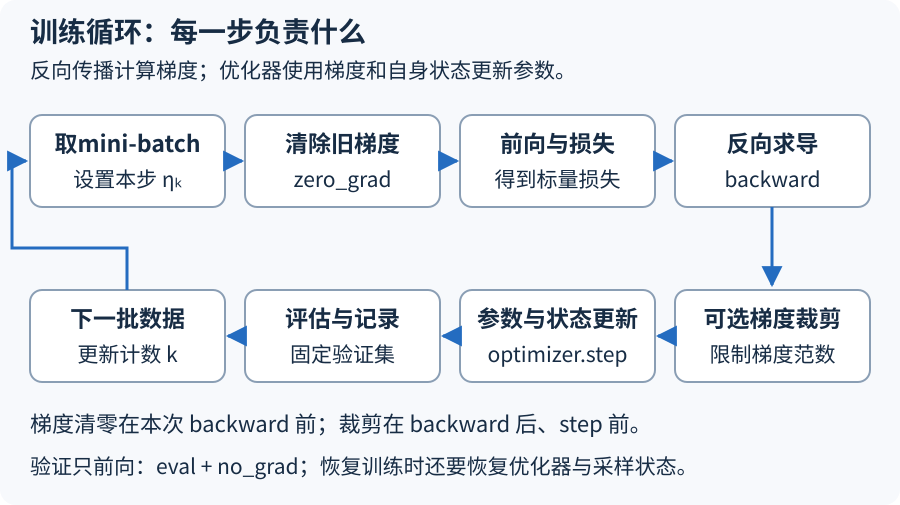
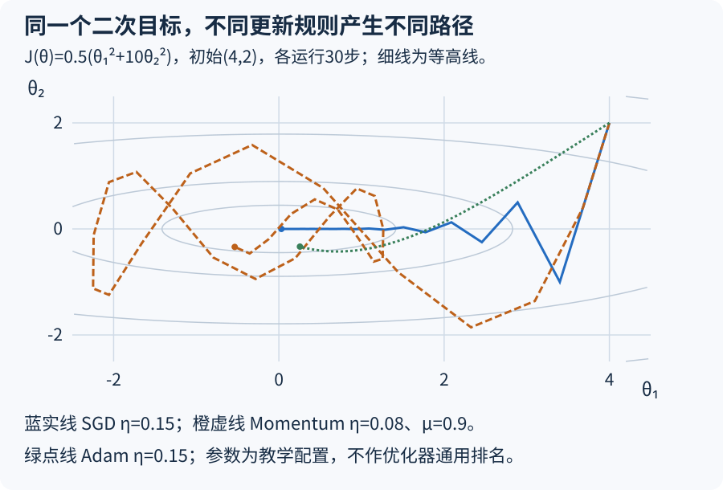
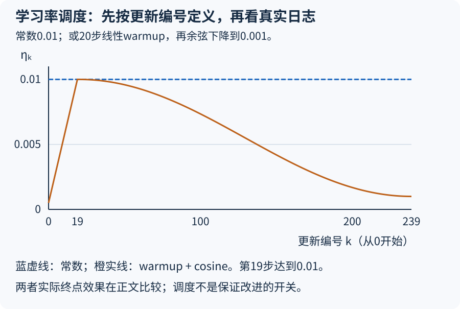
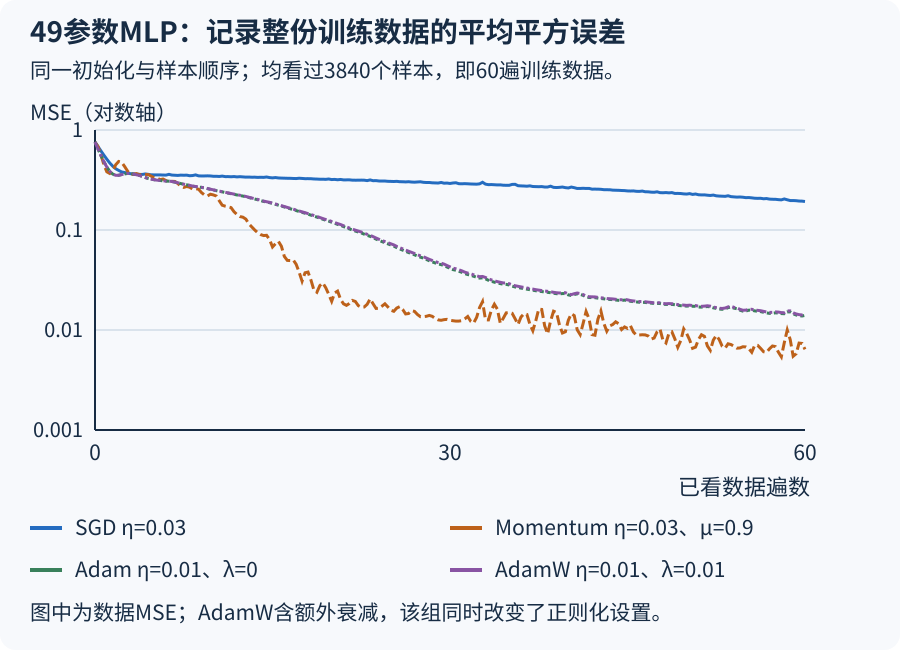
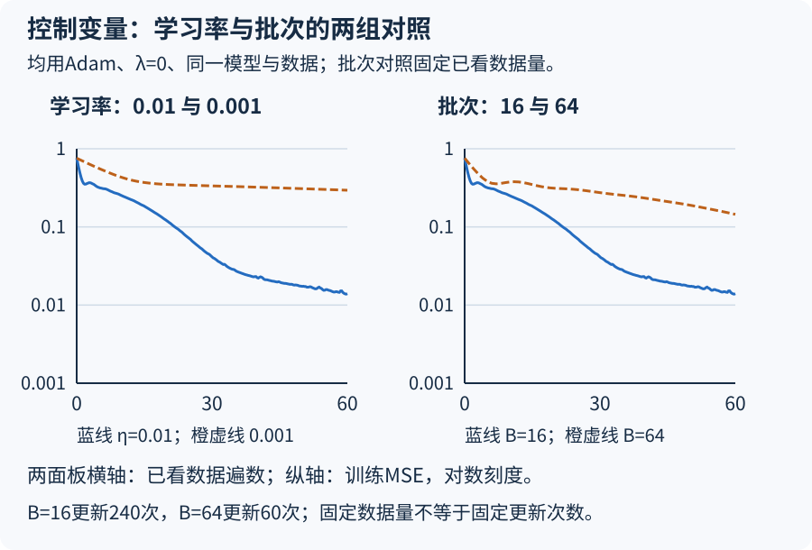

# 第 09 章：训练循环与优化算法

> 本章把已经会计算的梯度接入完整训练循环，用真实 CPU 实验检查每个环节。正文与实验已实现；本页末尾单独记录导出验收状态。

[阅读入口](../../README.md) · [章节计划](../chapter-plan.md) · [公共符号](../appendices/notation.md) · [上一章：反向传播](08-backpropagation.md)

## 1. 学习目标与前置知识

读完本章，你应当能够：

1. 逐项解释取批次、清梯度、前向、反向、裁剪、更新与评估的职责。
2. 手算 SGD、Momentum、Adam 和 AdamW 的小步更新，辨认公式约定。
3. 说明批次、学习率、衰减和预算如何影响比较，避免用一条曲线宣布通用优胜者。
4. 保存足以继续训练的检查点，并实际核对中断前后的参数和日志。

前置是第 02 章的梯度、第 07 章的 MLP 与第 08 章的反向传播。这里只使用两层小网络，不需要 GPU，也不下载外部数据。花书第 8 章区分训练目标的优化与最终泛化表现；本章解决“参数如何更新”，验证集的可靠使用在下一章继续展开。[来源 1](https://www.deeplearningbook.org/contents/optimization.html)

## 2. 先把一次训练迭代讲完整

反向传播回答“损失对每个参数的导数是多少”，优化器回答“拿到梯度后怎样修改参数”。`loss.backward()` 通常把梯度写进参数的 `.grad`；`optimizer.step()` 再读取它们。仅计算梯度不会自动让参数变好。



**图 09-1**：原创纯 SVG 流程图。箭头表示一次迭代中的实际顺序，循环左侧回到下一批数据。学习率在本步参数更新之前设置，日志记录更新后的模型表现。

还要区分两个独立开关。`model.train()` 与 `model.eval()` 改变 Dropout、BatchNorm 等模块的行为；`torch.no_grad()` 控制是否记录自动求导。`eval()` 本身不会关闭求导。当前 Tanh 小网络没有这些随机模块，两种模式的数值相同，但仍保留完整写法，便于后续章节扩展。

训练时只用训练数据计算梯度；验证时固定参数，计算整份验证集损失。验证集在此用来观察实验配置，不参与反向传播。曲线上的“训练损失”也必须注明：本实验画的是整份训练数据的平均平方误差，不是最后一个 mini-batch 的随机值。

## 3. 符号与形状

本章把所有网络参数按固定顺序视为一个向量，公式不要求代码真的把它们拼接起来。

| 符号 | 含义与范围 |
|---|---|
| $`\boldsymbol\theta\in\mathbb R^P`$ | 全部可训练参数；本实验 $`P=49`$ |
| $`N,B`$ | 训练样本数与本批样本数，均为正整数 |
| $`\mathcal B_k`$ | 第 $`k`$ 次更新使用的样本索引集合 |
| $`\mathcal L_{\mathcal B_k}`$ | 本批的标量平均损失 |
| $`\mathbf g_k\in\mathbb R^P`$ | 在当前参数处计算的梯度 |
| $`\eta_k>0`$ | 本次更新使用的学习率 |
| $`\mu\in[0,1)`$ | Momentum 系数 |
| $`\beta_1,\beta_2\in[0,1)`$ | Adam 两个指数平均系数 |
| $`\lambda\geq0,\ \epsilon>0`$ | 权重衰减系数与分母稳定常数 |

为与 Adam 的偏差校正公式对齐，第 5、6 节的更新编号从 $`k=1`$ 开始；代码数组与第 7 节调度编号从 $`k=0`$ 开始，两者相差 1。样本仍用上标 $`(i)`$，不把它与训练步混在一起。

## 4. 为什么用 mini-batch：先定义平均，再谈噪声

训练集上的经验风险为

```math
\mathcal L(\boldsymbol\theta)
=\frac1N\sum_{i=1}^{N}
\ell\bigl(f_{\boldsymbol\theta}(\mathbf x^{(i)}),y^{(i)}\bigr).
```

完整梯度需要遍历全部 $`N`$ 个样本。mini-batch 用其中 $`B`$ 个样本的平均值近似它：

```math
\mathcal L_{\mathcal B_k}(\boldsymbol\theta)
=\frac1B\sum_{i\in\mathcal B_k}\ell_i(\boldsymbol\theta),
\qquad
\mathbf g_k=\nabla_{\boldsymbol\theta}
\mathcal L_{\mathcal B_k}(\boldsymbol\theta_{k-1}).
```

当参数固定、批次由均匀抽样产生时，这个平均梯度对完整梯度无偏。独立同分布抽样还可用方差公式解释平均带来的噪声下降；每轮洗牌后不放回取样的相邻批次有依赖，不能直接声称它们是独立抽样。本实验采用后者。mini-batch 的作用还包括把多个样本组织成矩阵计算，实际速度依赖设备与实现。[来源 2](https://d2l.ai/chapter_optimization/minibatch-sgd.html)

一次 epoch 指完整遍历训练集一次。本实验 $`N=64`$：$`B=16`$ 时每轮更新 4 次，$`B=64`$ 时只更新 1 次。因此，同样 60 个 epoch 不意味着相同更新次数；比较时必须先选择预算口径。

### 4.1 两个不等长批次不能直接等权平均

设五个目标值为 $`1,2,3,4,5`$，标量模型预测 $`\theta`$，损失为平方误差。在 $`\theta=0`$ 处，单样本梯度为 $`-2y`$。完整平均为

```math
\frac{-2-4-6-8-10}{5}=-6.
```

前两项平均梯度为 $`-3`$，后三项平均为 $`-8`$。恢复完整平均要按样本数加权：

```math
\frac25(-3)+\frac35(-8)=-6.
```

简单取两个批次平均却得到 $`-5.5`$。这也解释梯度累积的正确缩放：多个 micro-batch 代替一个大批次时，应按它们占总样本数的比例缩放损失。模型含依赖批次统计或随机性的层时，即使加权正确，逐批计算也未必与一次大批次完全相同。

## 5. SGD 与 Momentum：学习率决定一步走多远

### 5.1 SGD 的更新与稳定边界

无动量、无衰减的 SGD 为

```math
\boldsymbol\theta_k
=\boldsymbol\theta_{k-1}-\eta_k\mathbf g_k.
```

这里的 SGD 接口也可以接收完整批次；“随机”来自样本选择方式。若标量初值为 1、每次给定梯度为 2、学习率为 0.1，两步依次得到 $`0.8`$ 与 $`0.6`$。这是给定梯度的更新算术，不是在声称某个损失在所有点的梯度都相同。

学习率过大可能跨过谷底并发散。对简单目标

```math
J(\theta)=\frac a2\theta^2,\qquad a>0,
```

完整梯度更新变成 $`\theta_k=(1-\eta a)\theta_{k-1}`$。要让非零初值的绝对值逐步缩小，需

```math
|1-\eta a|\lt 1
\quad\Longleftrightarrow\quad 0\lt \eta\lt \frac2a.
```

这是该二次目标的条件，不能当作任意神经网络的通用阈值。我们的二维演示第二个方向曲率为 10：当 SGD 学习率为 0.3 时，这个坐标每步乘 $`-2`$，符号来回变化且绝对值翻倍。脚本真实验证目标值迅速增大。[来源 1，§8.3.1](https://www.deeplearningbook.org/contents/optimization.html)

### 5.2 Momentum 保存历史方向

本章采用 PyTorch SGD 默认 dampening 为 0 的约定，初始缓冲为零：

```math
\mathbf u_k=\mu\mathbf u_{k-1}+\mathbf g_k,
\qquad
\boldsymbol\theta_k=\boldsymbol\theta_{k-1}-\eta_k\mathbf u_k.
```

$`\mathbf u_k`$ 与参数形状相同。持续同向的梯度会积累；方向交替时可部分抵消。另一些教材把梯度乘上 $`1-\mu`$，那是不同的尺度约定，使用同一学习率会产生不同轨迹。本实验与 PyTorch 官方公式一致，未启用 Nesterov。[来源 3](https://docs.pytorch.org/docs/2.15/generated/torch.optim.SGD.html)

仍令两次梯度均为 2，$`\mu=0.9`$。第一步缓冲为 2，参数为 0.8；第二步缓冲为 $`0.9\times2+2=3.8`$，参数为 $`0.8-0.1\times3.8=0.42`$。动量不只取决于当前梯度，还取决于过去的状态。



**图 09-2**：原创 SVG，坐标来自脚本在同一二维二次函数上的真实 30 步更新，细线是等高线。它直接展示参数路径，与后文 MLP 的训练曲线是两个不同实验。不同方法的学习率已在图例注明；路径形状不能独立证明哪种方法普遍更优。

## 6. Adam 与 AdamW：自适应尺度和衰减是两件事

### 6.1 Adam 的两个指数平均

Adam 分别平滑梯度与梯度逐元素平方，初值均为零：

```math
\begin{aligned}
\mathbf m_k&=\beta_1\mathbf m_{k-1}+(1-\beta_1)\mathbf g_k,\\
\mathbf v_k&=\beta_2\mathbf v_{k-1}+(1-\beta_2)(\mathbf g_k\odot\mathbf g_k).
\end{aligned}
```

若梯度均值在开始阶段近似稳定，零初始化会令这些平均偏向零。展开几何级数可见权重之和分别为 $`1-\beta_1^k`$ 与 $`1-\beta_2^k`$，所以使用偏差校正：

```math
\widehat{\mathbf m}_k=\frac{\mathbf m_k}{1-\beta_1^k},
\qquad
\widehat{\mathbf v}_k=\frac{\mathbf v_k}{1-\beta_2^k}.
```

随后逐元素更新：

```math
\boldsymbol\theta_k
=\boldsymbol\theta_{k-1}
-\eta_k\frac{\widehat{\mathbf m}_k}
{\sqrt{\widehat{\mathbf v}_k}+\epsilon}.
```

平方、平方根和除法都逐坐标进行。分母中的 $`\epsilon`$ 在平方根外，改变它的位置会改变算法。二阶量是梯度平方的平均，不是 Hessian，也不是参数方差。本章取 $`(\beta_1,\beta_2)=(0.9,0.999)`$、$`\epsilon=10^{-8}`$。[来源 4](https://d2l.ai/chapter_optimization/adam.html)、[来源 5](https://docs.pytorch.org/docs/2.15/generated/torch.optim.Adam.html)

手算第一步：梯度为 2，则 $`m_1=0.2`$、$`v_1=0.004`$；校正后分别为 2 与 4。从参数 1 出发、学习率 0.1，得到

```math
1-0.1\frac2{2+10^{-8}}\approx0.9000000005.
```

这解释了它为什么与 SGD 的 0.8 不同。Adam 的坐标尺度调整并不意味着不用选择学习率，也不保证任意目标都收敛到全局最小值。

### 6.2 L2 正则化与解耦权重衰减

若给目标加上 $`\lambda\|\boldsymbol\theta\|_2^2/2`$，梯度变成

```math
\mathbf g_k+\lambda\boldsymbol\theta_{k-1}.
```

在无动量 SGD 下，它与每步乘上 $`1-\eta_k\lambda`$ 的衰减等价。但 Adam 会把加过正则项的梯度送进两个历史平均，因而改变自适应尺度。AdamW 将衰减从这个过程分开：

```math
\boldsymbol\theta_k
=(1-\eta_k\lambda)\boldsymbol\theta_{k-1}
-\eta_k\frac{\widehat{\mathbf m}_k}
{\sqrt{\widehat{\mathbf v}_k}+\epsilon},
```

这里的历史平均使用数据梯度。其思想由 AdamW 原始论文提出，时间晚于花书，不能把它标成花书已有算法。[来源 6](https://arxiv.org/abs/1711.05101)、[来源 7](https://docs.pytorch.org/docs/2.15/generated/torch.optim.AdamW.html)

延续上面的第一步，令 $`\lambda=0.1`$，先把 1 衰减为 0.99，再减去约 0.1，得到约 0.8900000005。若 $`\lambda=0`$，本章相同配置的 Adam 与 AdamW 应得到相同结果，代码实际核对了整条损失历史。

PyTorch 2.15 的 Adam 还提供 `decoupled_weight_decay` 参数；本实验显式设为 `False` 做耦合对照，AdamW 使用解耦。演示为了明确对齐公式，对全部 49 个参数施加衰减，包括偏置；实际项目常用参数组分别配置，这需要作为实验选择记录。

## 7. 学习率调度：先明确编号，再给函数

学习率可以保持常数，也可随更新改变。预热 warmup 从较小值逐渐升高；余弦调度随后平滑降低。它们改变的是步长序列，不是新的梯度求导方法。[来源 8，§12.11](https://d2l.ai/chapter_optimization/lr-scheduler.html)

本节编号从 0 开始。总更新数 $`T=240`$，预热步数 $`T_w=20`$；最大与最小学习率分别为 0.01 与 0.001。具体使用

```math
\eta_k=
\begin{cases}
\eta_{\max}(k+1)/T_w,&0\leq k\lt T_w,\\
\eta_{\min}+\dfrac{\eta_{\max}-\eta_{\min}}2
\left[1+\cos(\pi r_k)\right],&T_w\leq k\lt T,
\end{cases}
```

其中余弦段的进度是

```math
r_k=\frac{k-T_w}{T-T_w-1}.
```

这样第 0 次更新使用 0.0005，第 19、20 次都为 0.01，最后第 239 次为 0.001。分母中的减 1 确保最后一次更新确实到达指定终点。其他库可能采用不同端点约定，应检查实际日志。



**图 09-3**：原创 SVG，直接读取两个训练配置记录的学习率。本实验在每次 `step()` 之前按当前更新编号设值，避免“先更新再设置”造成偏移。调度不保证改进，实际反例将在结果表中给出。

## 8. 清梯度与裁剪：容易漏掉的两行

### 8.1 自动求导默认累积梯度

对标量参数 $`p=1`$，两次独立计算 $`\tfrac12p^2`$ 并反向传播：第一次 `.grad` 为 1；如果没有清除，第二次变为 2。它不是当前这次损失的导数，而是两次导数之和。

通常每次更新前调用 `optimizer.zero_grad(set_to_none=True)`。把梯度设为 `None` 与填零在内存和无梯度参数的处理上存在区别；本实验采用前者。只有有意做梯度累积时才跨 micro-batch 保留梯度，并按第 4.1 节正确加权。[来源 9](https://docs.pytorch.org/docs/2.15/generated/torch.optim.Optimizer.zero_grad.html)

### 8.2 全局范数裁剪

把所有参数的梯度视为一个长向量，若阈值为 $`c>0`$，理想全局 L2 裁剪为

```math
\widetilde{\mathbf g}
=\min\left(1,\frac c{\|\mathbf g\|_2}\right)\mathbf g
\quad(\|\mathbf g\|_2>0).
```

零梯度保持为零。例如 $`\mathbf g=(3,4)`$，范数为 5，取 $`c=2`$，整体乘以 0.4 得到 $`(1.2,1.6)`$，方向保持不变。它与把每个分量分别截断到 $`[-2,2]`$ 不同。PyTorch 计算系数含微小稳定项，实测结果略小于上述理想值。

裁剪位置在 `backward()` 之后、`step()` 之前。本实验阈值为 1，并要求范数有限；裁剪不能修复已经产生的 NaN。对 Adam，裁剪的是输入梯度，不保证最后的参数位移范数小于学习率乘阈值；Adam 的历史状态与坐标缩放仍会起作用。耦合 Adam 在优化器内部加入的衰减项也不包含在这次外部裁剪内。[来源 10](https://docs.pytorch.org/docs/2.15/generated/torch.nn.utils.clip_grad_norm_.html)

## 9. 从公式到可运行的训练循环

本实验模型为一维输入、16 个 Tanh 隐藏单元、一维输出：

```math
f_\theta(x)=\mathbf W^{[2]}
\tanh(\mathbf W^{[1]}x+\mathbf b^{[1]})+b^{[2]}.
```

参数量为 $`16+16+16+1=49`$。行批次输入形状是 $`(B,1)`$，隐藏表示为 $`(B,16)`$，输出和目标均为 $`(B,1)`$，防止广播意外制造 $`(B,B)`$ 损失。

完整实现见 [run.py](../../examples/09-training-and-optimizers/run.py)，操作与输出说明见[实验 README](../../examples/09-training-and-optimizers/README.md)。核心顺序如下，调度函数、采样器和检查点逻辑在完整程序中实现：

```python
model.train()
for group in optimizer.param_groups:
    group["lr"] = learning_rate_for_this_step
optimizer.zero_grad(set_to_none=True)
prediction = model(x_batch)            # (B, 1)
loss = ((prediction - y_batch) ** 2).mean()
loss.backward()
torch.nn.utils.clip_grad_norm_(
    model.parameters(), 1.0, error_if_nonfinite=True
)
optimizer.step()

model.eval()
with torch.no_grad():
    validation_mse = ((model(x_validation) - y_validation) ** 2).mean()
```

每次训练迭代都重新切回 `train()`。日志中的训练与验证误差在本次更新后另行计算，不把用于反向传播的旧损失与新参数的指标混写。

## 10. 本机 CPU 实践：用证据检查直觉

### 10.1 数据、配置与运行

数据是本仓库程序自行生成的数学函数，没有外部数据许可或网络下载问题：

```math
y=\sin(2x)+0.1x.
```

训练集取区间 $`[-2,2]`$ 上 64 个等距点；验证集取相邻训练点之间的 63 个中点，两集合不重叠。这只检查同一区间的插值，没有独立测试集，也不能证明区间外推能力。多次查看验证指标本身也是选择过程的一部分。

在仓库根目录运行：

```powershell
& ./.venv/Scripts/python.exe -B examples/09-training-and-optimizers/run.py
# 需要按最新真实日志重建正文图时：
& ./.venv/Scripts/python.exe -B examples/09-training-and-optimizers/run.py --write-figures
```

2026-11-15 22:14 的实际运行环境是 Windows CPU、Python 3.11.5、PyTorch 2.15.0+cpu、NumPy 2.4.6、float64，计算线程数为 1。初始化种子为 20261115；单独的采样器生成器种子为 17，每轮洗牌。九组使用同一初始参数与可比较的样本顺序。Adam 系数为前述默认值，所有训练均裁剪梯度范数到 1。

每组都处理 3840 个样本，即 60 遍训练数据；批次 16 的组更新 240 次，批次 64 更新 60 次。当前小规模运行计时约 1.212 秒，包含比较、检查点恢复和数值核对，排除 Python 导入与 SVG 生成。参数纯数值载荷为 $`49\times8=392`$ 字节；这不是进程内存，未包含优化器状态、张量开销与框架，也未测峰值内存。

### 10.2 真实结果与控制变量

所有组初始训练 MSE 为 0.757568。表中除特别标注外，批次为 16、学习率恒定、衰减为 0。

| 配置 | 学习率与衰减 | 最终训练 MSE | 最终验证 MSE |
|---|---|---:|---:|
| SGD | 0.03 | 0.192747 | 0.183918 |
| Momentum | 0.03，$`\mu=0.9`$ | 0.006406 | 0.006248 |
| Adam | 0.01 | 0.013996 | 0.013518 |
| AdamW，无衰减 | 0.01 | 0.013996 | 0.013518 |
| Adam，耦合 L2 | 0.01，$`\lambda=0.01`$ | 0.022502 | 0.021056 |
| AdamW，解耦衰减 | 0.01，$`\lambda=0.01`$ | 0.014348 | 0.013823 |
| Adam，小学习率 | 0.001 | 0.294752 | 0.283183 |
| Adam，批次 64 | 0.01，60 次更新 | 0.144679 | 0.137844 |
| AdamW，预热余弦 | 见第 7 节，$`\lambda=0.01`$ | 0.040045 | 0.037658 |



**图 09-4**：原创 SVG，数据来自实际逐步日志；纵轴为对数刻度。AdamW 这条曲线含额外衰减，图例明确列出，不能把其与 Adam 的全部差异归因于优化器名称。



**图 09-5**：原创 SVG。左图只改变学习率，右图只改变批次，使用同一种 Adam 且不加衰减。横轴统一为已看数据遍数，因此右图同时包含更新次数差异。

结果应当逐项读：

- 本配置中 Momentum 的终点误差最低；这是一组学习率、初值和小数据的结果，没有做大范围超参数搜索。
- Adam 与零衰减 AdamW 的日志逐项相同，符合公式。正衰减下耦合与解耦结果不同，也不能据此断言所有任务上谁更好。
- 学习率 0.001 在给定预算下下降较慢；不能从终点较高直接推出它永远到不了更低损失。
- 批次 64 的组只更新 60 次，不能把较高终点完全归于“缺少随机噪声”。
- 预热余弦组比恒定学习率 AdamW 的终点更差。这是保留的失败证据：本例训练很短，调度减少了大量后期步长，未带来改善。

### 10.3 检查点必须恢复哪些状态

只保存 `model.state_dict()` 足以在相同结构中加载参数做推理，却不一定足以精确继续训练。Momentum 缓冲、Adam 的两个历史平均和步数都属于优化器状态。学习率进度、采样器位置与随机状态也会影响后续计算。[来源 11](https://docs.pytorch.org/tutorials/beginner/saving_loading_models.html)

本实验对预热余弦 AdamW 在完成第 93 次更新后保存检查点，此时处在一轮中间。内容包括模型、优化器、下一步编号、调度配置、当前样本排列及游标、采样器随机状态、PyTorch 随机状态和历史日志。恢复后继续到 240 次，并与不中断运行比较。

实测最终参数最大绝对差为 **0**，整条日志逐项一致，采样器状态一致。这个结论限定在当前 CPU、精度、版本与确定性配置；跨平台或版本不承诺位级一致。加载自己的可信检查点使用 `weights_only=True`，避免把来源不明的文件当作普通数据加载。

程序共通过 **33 项核对**，包括九组损失有限且下降、参数量、手算更新、梯度累积、裁剪、不等批次加权、过大学习率发散及精确恢复。原始结果写入 `build/experiments/09-training-and-optimizers/results.json`，检查点在同目录；这些是可重建的本机输出，不作为源码提交。

## 11. 常见误区与边界

1. **把反向传播等同于优化器。** 前者求导，后者修改参数；同一梯度可交给不同更新规则。
2. **每次损失降低就算训练正确。** 错误的广播、数据泄漏和不公平预算也可能产生下降曲线，要检查形状与协议。
3. **Adam 自适应所以不用调学习率。** 它调整坐标尺度，仍需要基础学习率、预算与稳定性判断。
4. **梯度裁剪就是限制参数位移。** 对带状态与坐标缩放的优化器没有这种简单等价。
5. **保存权重即可无缝恢复。** 优化器、调度和采样状态丢失，会改变后续轨迹。
6. **训练损失最低就泛化最好。** 优化目标与真实任务表现不同；本例验证集也只覆盖插值。

## 12. 习题与详细解析

### 题 1：一轮到底更新几次？

训练集 10 个样本，批次大小 4，不丢弃最后一批。一轮有几次更新？平均一轮损失时三个批次应如何加权？

**解析**：批次长度为 4、4、2，共 $`\lceil10/4\rceil=3`$ 次更新。若每批日志是该批平均损失，整轮平均需乘权重 0.4、0.4、0.2，再相加。三个均值简单除以 3 会过度强调最后两个样本。

### 题 2：手算 Momentum 并指出约定

初值 $`\theta_0=1`$，缓冲 $`u_0=0`$，学习率 0.1，$`\mu=0.5`$，两步给定梯度分别为 2 与 $`-1`$。使用本章约定计算。

**解析**：第一步 $`u_1=2`$，$`\theta_1=0.8`$。第二步 $`u_2=0.5\times2-1=0`$，所以 $`\theta_2=0.8`$。如果改用含 $`1-\mu`$ 的平均公式，会得到不同数值；应同时注明公式和学习率，不能只写“动量为 0.5”。

### 题 3：Adam 第一、第二步的状态能省略吗？

令每步梯度均为 2，解释前两步校正平均的值，并判断恢复时只保存参数是否足够。

**解析**：第一步校正后为 2 与 4。第二步未校正的一阶平均为 $`0.9\times0.2+0.1\times2=0.38`$，除以 $`1-0.9^2=0.19`$ 得 2；二阶平均为 $`0.999\times0.004+0.001\times4=0.007996`$，除以 $`1-0.999^2=0.001999`$ 得 4。即使在这个常梯度特例中数值相似，恢复时仍需历史平均与更新步数；一般变化梯度下丢失它们会改变下一步。

### 题 4：裁剪手算与发生位置

梯度为 $`(6,8)`$，全局 L2 阈值为 5。裁剪后的向量是什么？应放在 `backward()` 前还是后？

**解析**：原范数为 10，乘以 $`5/10`$，得到 $`(3,4)`$。应放在反向计算之后、优化器更新之前，才能裁剪本次产生的梯度。若只对每个分量截断到 5，会得到 $`(5,5)`$，其范数仍大于 5，且方向已改变。

### 题 5：解释本次“反直觉”的曲线

为什么本实验不能证明预热余弦无用，也不能证明大批次一定更差？设计两个后续对照。

**解析**：调度终点受预热比例、总预算、最小学习率与模型影响；这里只试了一套。可固定 AdamW 的初始化、批次、衰减与总步数，改变预热比例并报告多组种子。批次对照固定数据量时更新次数不同，可另做固定更新次数的对照，但必须同时报告大批次看到的样本更多。这两种预算回答不同问题，不能把结果混为同一个因果结论。

### 题 6：检查点故意漏掉一个状态

复制完整实验，在恢复时只遗漏采样器游标或 Adam 状态之一，预测会发生什么，并给出验证方法。

**解析**：遗漏游标会使下一批样本与原轨迹不同；遗漏 Adam 状态会使更新方向与尺度不同。保留同一检查点与原始不中断结果，比较恢复后的第一批索引、第一次更新参数差、最终最大参数差和完整日志。若某个特例恰巧相同，也不能据此删去状态；本章正确恢复已实际给出全参数差为 0 的基准。

## 13. 小结与下一步

训练循环把数据、模型、损失、导数和参数更新连在一起。mini-batch 定义梯度如何估计，优化器定义如何使用当前与历史梯度，学习率定义每步尺度，裁剪控制输入梯度的极端值，检查点保存继续计算所需的状态。读曲线前先读配置与预算，才能解释差异。

下一章讨论训练误差下降以后，怎样识别过拟合并控制泛化。可以带着本章的固定训练协议，继续阅读[第 10 章：泛化与正则化](10-generalization.md)。

## 14. 参考来源与核验范围

以下官方来源于 2026-11-15 核验。正文公式与示例按统一符号重新组织，五幅 SVG 均为本仓库原创，数值曲线由本章实际程序生成。

1. Goodfellow、Bengio、Courville，*Deep Learning*，第 8 章：§8.1、§8.1.3、§8.3.1、§8.3.2、§8.5.3、§8.5.4。[官方全文](https://www.deeplearningbook.org/contents/optimization.html)。用于优化与学习的区别、基本更新及算法选择边界。
2. D2L 1.0.3，§12.5，*Minibatch Stochastic Gradient Descent*。[官方教材](https://d2l.ai/chapter_optimization/minibatch-sgd.html)。用于批次平均与计算权衡。
3. PyTorch 2.15，`torch.optim.SGD`。[官方接口](https://docs.pytorch.org/docs/2.15/generated/torch.optim.SGD.html)。核对 Momentum 缓冲、dampening 与实现约定。
4. D2L 1.0.3，§12.10，*Adam*。[官方教材](https://d2l.ai/chapter_optimization/adam.html)。核对指数平均及偏差校正。
5. PyTorch 2.15，`torch.optim.Adam`。[官方接口](https://docs.pytorch.org/docs/2.15/generated/torch.optim.Adam.html)。核对稳定项位置及耦合衰减选项。
6. Loshchilov、Hutter，*Decoupled Weight Decay Regularization*，2017 初稿、2019 修订。[原始论文](https://arxiv.org/abs/1711.05101)。用于 AdamW 的思想与适用比较。
7. PyTorch 2.15，`torch.optim.AdamW`。[官方接口](https://docs.pytorch.org/docs/2.15/generated/torch.optim.AdamW.html)。核对解耦更新。
8. D2L 1.0.3，§12.11，*Learning Rate Scheduling*。[官方教材](https://d2l.ai/chapter_optimization/lr-scheduler.html)。调度思想据此讲解，端点公式采用本实验明确约定。
9. PyTorch 2.15，`Optimizer.zero_grad`。[官方接口](https://docs.pytorch.org/docs/2.15/generated/torch.optim.Optimizer.zero_grad.html)。核对累积与 `None` 行为。
10. PyTorch 2.15，`clip_grad_norm_`。[官方接口](https://docs.pytorch.org/docs/2.15/generated/torch.nn.utils.clip_grad_norm_.html)。核对全局范数与原位裁剪。
11. PyTorch，*Saving and Loading Models*。[官方教程](https://docs.pytorch.org/tutorials/beginner/saving_loading_models.html)。核对训练检查点需要优化器状态。

## 15. 实现与验收记录

- 正文、5 幅纯 SVG、完整 CPU 实验与实验说明已实现。
- 2026-11-15 本机真实运行：9 组训练、检查点精确恢复及共 33 项核对通过；结果和局限见第 10 节。
- HTML/PDF 已生成：15 页、103 处数学表达、5 幅 SVG、0 个位图对象。1440/390 像素检查通过，无横向页面溢出、公式错误或未渲染标记。PDF 17 种字体均嵌入、48 个链接（16 个内部）、文字未越界；已逐页目视全部 15 页，并放大检查五幅图、表格、公式与代码。
