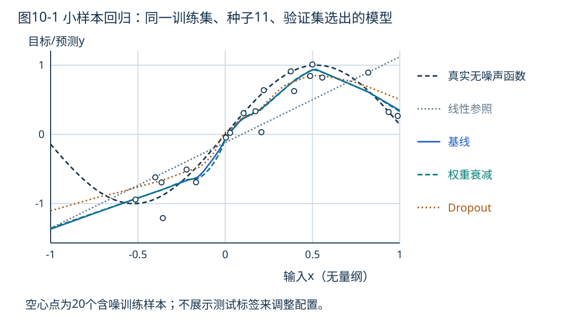
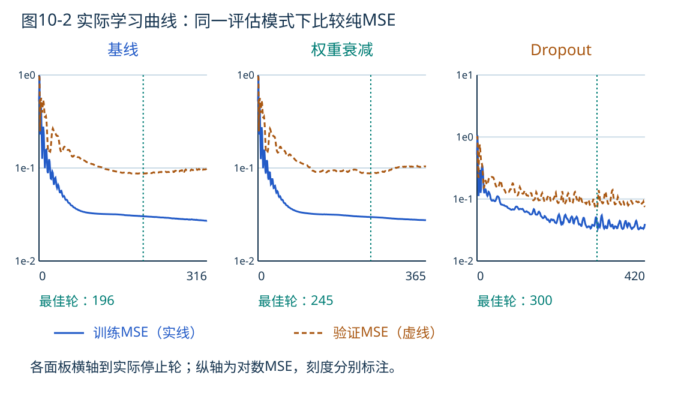
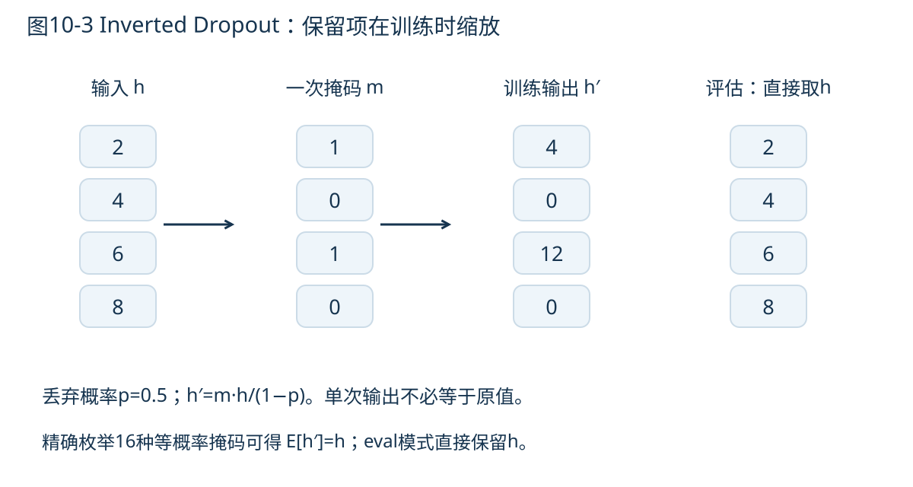
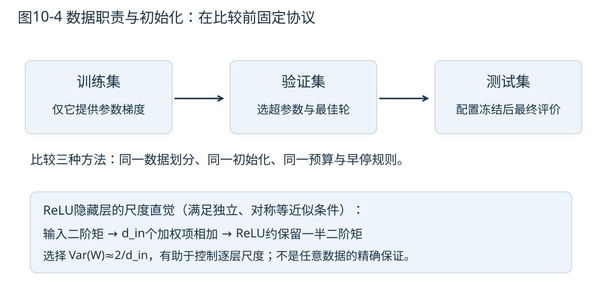

# 第10章：泛化、正则化与实验方法

> 状态：正文、三方法三种子CPU实验、SVG及出版验收已完成；正式完成状态以章节计划为准。
> [阅读入口](../../README.md) · [上一章：训练循环与优化](09-training-and-optimizers.md) · [章节计划](../chapter-plan.md) · [公共符号](../appendices/notation.md) · [完整实验](../../examples/10-generalization/README.md)

## 1. 本章目标与前置知识

模型把训练数据拟合得更好，为什么对新样本反而可能更差？前面已经能计算输出、梯度和参数更新，现在需要决定该学多久、怎样约束模型、怎样判断改动是否有帮助。本章把泛化（generalization）、正则化（regularization）与实验协议放在同一个可复现例子中。[1,2]

学完后应能结合训练与验证指标识别过拟合、欠拟合及其证据边界；推导普通SGD中L2惩罚与权重衰减的关系；区分AdamW的解耦衰减；解释Dropout的随机掩码、期望和评估模式；正确保存验证集选出的最佳模型；用多个种子报告变化，并说明初始化与可复现性的条件。

前置为第05章的数据划分与误差、第07～09章的MLP、梯度与训练循环。本章不引入复杂数据集，只训练一个有2497个参数的CPU小网络，让实验资源用于检验概念。

## 2. 同样的训练误差可以来自不同过程

设真实函数是 $f_*(x)=\sin(3x)$，观测还带有噪声：

$$
y=f_*(x)+\varepsilon,
\qquad x\sim\operatorname{Uniform}[-1,1],
\quad\varepsilon\sim\mathcal{N}(0,0.2^2).
$$

每个样本的噪声相互独立。训练集只有20个点，一个灵活的网络既可能学到函数规律，也可能逐渐追随这些点的偶然噪声。这里知道真函数只是因为数据由我们构造；真实任务往往不知道，需要用未用于参数拟合的数据评价。



图10-1为本章实测模型输出，固定初始化种子11。空心点是训练观测，黑虚线是真函数，浅色点线为线性参照；三条彩色线是各自按验证误差恢复的最佳网络。线型与图例共同区分方法。曲线不取自外部截图，不把一条平滑线当成正则化一定成功的证据。

## 3. 符号、目标与比较口径

| 符号 | 含义 |
| --- | --- |
| $\mathcal{D}_{\mathrm{tr}},\mathcal{D}_{\mathrm{val}},\mathcal{D}_{\mathrm{te}}$ | 训练、验证、测试集，样本互不重用 |
| $\mathcal{L}_{\mathrm{tr}}$ | 训练数据的平均损失，本实验为MSE，无额外 $1/2$ |
| $\mathcal{J}$ | 参数学习时采用的目标或更新规则所针对的目标，需说明正则化位置 |
| $\mathbf{W}^{[\ell]},\lambda$ | 层权重与惩罚/衰减系数；对不同优化器须解释实际作用 |
| $p,m_j$ | Dropout丢弃概率与第 $j$ 项0/1掩码 |
| $k,k_*$ | 当前更新/评估轮与验证选中的最佳轮 |
| $d_{\mathrm{in}}$ | 当前层的输入连接数，用于初始化尺度 |

所有图中的训练MSE与验证MSE都在 `eval()` 模式下计算，不含额外正则化项，避免把有Dropout噪声的训练目标与关闭Dropout的验证指标直接当成同一口径。本实验一轮使用全部20个训练样本，因此一轮等于一次参数更新。

## 4. 过拟合与欠拟合：先看证据，再下结论

过拟合（overfitting）指模型适配了训练数据中对新数据没有帮助的细节。典型迹象是训练误差继续下降，验证误差却停止改善或升高。欠拟合（underfitting）则表示当前学习结果连训练规律都没有充分表达，训练与验证误差都偏高。[3]



图10-2取同一初始化种子11。蓝实线为训练MSE、橙虚线为验证MSE、绿色竖线为该运行的最佳轮；各面板横轴到各自实际停止轮，纵轴为对数刻度。它们使用相同最大预算与早停规则，但实际训练轮数可以不同。

例如基线在第196轮验证MSE约0.08701；继续到316轮时，训练MSE由约0.03025降到0.02714，验证MSE反升到0.09473。它支持“在该划分上后半段继续拟合训练数据没有改善验证表现”。没有测试所有可能的新样本，因此不能把一次曲线形状当成分布层面的证明。

线性参照的训练MSE约0.15377、验证MSE约0.17671，明显高于本例MLP。结合已知的非线性真函数，它提供表达限制的参照。不过一般任务中“双高”还可能来自优化未完成、输入处理或代码错误；不能仅凭曲线就确定一定是容量不足。先检查简单样本能否拟合、梯度与数据流程是否正确，再决定扩大模型或改变正则化。[2,4]

## 5. 权重惩罚与权重衰减

### 5.1 L2惩罚改变目标

对权重加入L2惩罚的一种定义为：

$$
\mathcal{J}(\boldsymbol{\theta})
=\mathcal{L}_{\mathrm{tr}}(\boldsymbol{\theta})
+\frac{\lambda}{2}\sum_{\ell}\lVert\mathbf{W}^{[\ell]}\rVert_F^2.
$$

$\lVert\mathbf{W}\rVert_F^2$ 是所有矩阵元素平方之和，称为Frobenius范数的平方；本章偏置不计入惩罚。$\lambda\geq0$ 控制偏好小权重的强度。它不是直接把权重硬设为0，也不保证任意数据上都改善新样本表现。[1，§7.1]

把某个权重矩阵展平为 $\mathbf{w}$，惩罚梯度为 $\lambda\mathbf{w}$。普通SGD使用固定当前步长 $\eta$ 时：

$$
\begin{aligned}
\mathbf{w}_{k+1}
&=\mathbf{w}_k-\eta(\nabla\mathcal{L}_{\mathrm{tr}}+\lambda\mathbf{w}_k)\\
&=(1-\eta\lambda)\mathbf{w}_k-\eta\nabla\mathcal{L}_{\mathrm{tr}}.
\end{aligned}
$$

因此在这种更新规则下，L2惩罚等价于每步先按 $1-\eta\lambda$ 缩小权重，再做数据梯度更新。例如 $w=2$、数据梯度0.5、$\eta=0.1$、$\lambda=0.2$，新权重为 $2-0.1(0.5+0.4)=1.91$。

### 5.2 AdamW的衰减要单独理解

Adam会根据梯度的一阶、二阶历史自适应调整更新。如果先把 $\lambda\mathbf{w}$ 加进数据梯度，它也会进入这些历史量，不能继续声称与外部乘法衰减无条件等价。

解耦权重衰减（decoupled weight decay）把缩小权重的操作与自适应数据更新分开。用 $\mathbf{d}_k$ 表示Adam根据数据梯度计算出的更新方向，可示意写成：

$$
\mathbf{w}_{k+1}
=(1-\eta\lambda)\mathbf{w}_k-\eta\mathbf{d}_k.
$$

AdamW采用这种解耦方式。[5,6] 本章实际实验用AdamW，而不是把L2项加进MSE；权重矩阵衰减，偏置不衰减。图中记录的是纯数据MSE，所以不能把衰减组的训练指标解释为“已经包含了参数惩罚”。

系数、学习率、参数尺度和训练步数会共同影响最终结果。过强约束可能使模型学不到必要规律，较弱约束也可能几乎不改变表现。本次固定系数是教学对照，未把测试集用于调出一个好看的系数。

## 6. Dropout：对表示施加训练时的随机扰动

### 6.1 掩码与期望保持

Dropout在训练时随机丢弃部分隐藏分量。采用PyTorch常用的inverted dropout定义，在给定隐藏值 $h_j$、$0\leq p<1$ 时：

$$
m_j\sim\operatorname{Bernoulli}(1-p),
\qquad
h'_j=\frac{m_j h_j}{1-p}.
$$

这里 $p$ 是丢弃概率，$1-p$ 是保留概率。分母补偿了保留次数变少的影响：[7,8]

$$
\mathbb{E}[h'_j\mid h_j]
=\frac{\mathbb{E}[m_j]h_j}{1-p}
=\frac{(1-p)h_j}{1-p}=h_j.
$$



图10-3使用固定示意掩码 $(1,0,1,0)$，不是伪装成某次随机实测。输入 $(2,4,6,8)$、$p=0.5$ 时，该次输出为 $(4,0,12,0)$。脚本精确枚举4个分量的16种等概率掩码，验证均值恢复原向量；另记录一次实际随机输出。

期望保持只对这一层的分量成立。一般有 $\mathbb{E}[f(h')]\neq f(\mathbb{E}[h'])$，后面再接非线性函数时不能声称最终网络等于全部随机子网的精确平均。单次输出也不必等于原值。[7]

### 6.2 训练和评估模式的差别

训练模式 `model.train()` 开启掩码；评估模式 `model.eval()` 下，本章Dropout为恒等映射，不再随机丢弃，也不再重复乘一次 $1-p$。这样与训练时已经做过的缩放匹配。[8]

`eval()` 控制模块行为，`torch.no_grad()` 控制是否记录求导关系，二者职责不同。验证和最终推理通常两者一起使用；随后继续训练时还要恢复 `train()`。本章每次验证后下一轮都显式恢复训练模式。

Dropout不是永久删除参数，也不是在测试时随机删数据；它使训练过程对不同内部扰动进行适配。丢弃概率过大可能损害表示，本章预先固定 $p=0.2$，只比较这一个配置，不据测试表现反复调整。

## 7. 早停：恢复验证选出的模型

早停（early stopping）把训练时长作为需要验证选择的量。每次更新后计算验证误差，改善超过指定阈值就保存独立副本；连续若干次不再改善时停止，最后恢复保存的模型。[1，§7.8]

本实验最大800轮，每轮验证一次，改善阈值 $10^{-5}$，耐心值120次。这里的“最佳”指按该阈值规则保存的最优记录，不保证等于无限精度下所有微小波动的最低点。它是选模规则，不应换成看测试损失停止。

例如种子11基线的最佳轮是196，实际停止轮是316。若只拿最后一轮模型交付，就丢掉了早停的主要目的。程序保存 `state_dict` 的深拷贝，写入本地检查点，再重新创建模型加载，验证预测完全一致。

```python
if validation_mse < best_mse - 1e-5:
    best_mse = validation_mse
    best_state = copy.deepcopy(model.state_dict())
    bad_count = 0
else:
    bad_count += 1
# 达到耐心值后，恢复best_state，而非仅结束循环。
```

只写 `best_state = model.state_dict()` 可能继续持有与现有模型共享的张量引用；后续训练会改变以为已经保存的“最佳值”。本章实际验证了保存/加载后的前向一致性。这里恢复用于最佳模型评价；若要从该点继续训练，还需要优化器及随机状态等训练上下文，不能把二者混称为完整训练恢复。

## 8. 初始化、随机种子与实验协议

### 8.1 初始化先打破对称，再控制尺度

若对称隐藏单元拥有完全相同参数，并接受相同梯度更新，它们可能持续计算相同特征。随机初始化让不同单元从不同位置出发；把所有权重都设为0并不是一个通用方案。

尺度也有影响。设某单元输入来自 $d_{\mathrm{in}}$ 个连接，权重独立、零均值，并采用必要的独立与对称近似。加权和的二阶矩约随连接数增加；对于对称输入的ReLU，有：

$$
\mathbb{E}[\operatorname{ReLU}(z)^2]
=\frac12\mathbb{E}[z^2].
$$

因此把权重方差设为约 $2/d_{\mathrm{in}}$，有助于平衡这两种尺度变化。这是本章隐藏层Kaiming初始化的直觉；它保持的是近似二阶矩，不是对任意相关输入都精确保持方差。输出线性层使用Xavier均匀初始化（亦称Glorot初始化），偏置为0。[9] 若该层输入、输出连接数分别为 $d_{\mathrm{in}},d_{\mathrm{out}}$，本实验取缩放系数gain为1：

$$
W_{ij}\sim\operatorname{Uniform}(-a,a),
\qquad
a=\sqrt{\frac{6}{d_{\mathrm{in}}+d_{\mathrm{out}}}}.
$$

对称均匀分布的均值为0、方差为 $a^2/3$，因此这里的权重方差为 $2/(d_{\mathrm{in}}+d_{\mathrm{out}})$。它用输入和输出连接数共同决定尺度；ReLU隐藏层与线性输出层使用的尺度规则应分别说明，不能只写“随机初始化”。本实验输出层为48→1，所以 $a=\sqrt{6/49}\approx0.350$。这些规则提供有条件的尺度起点，仍需观察实际训练。

### 8.2 三种数据承担三种职责



图10-4为本章协议原创图。训练数据用于梯度，验证数据用于早停和方案选择，测试数据仅进入全部预先规定运行完成后的最终评价阶段。即使验证集没有参与梯度，它已经参与选择，因此不能再把验证表现当作完全独立的最终证据。[2,4]

对照三种方法时，先固定数据划分、输入处理、模型尺寸、优化器、学习率、最大预算和早停规则。对每个种子，三方法复制同一份初始权重并核对哈希；Dropout带来的随机扰动本身就是被研究的变化，不能为了“结果一样”而取消它。

本章采用3个初始化种子，数据集保持不变，所以种子间差异主要覆盖初始化和Dropout随机过程，**没有覆盖更换数据划分的全部不确定性**。报告均值和样本标准差，不把3个运行当成已经建立可靠置信区间。固定种子、线程数和确定性设置提高本机复现能力，但不保证跨设备、跨版本、跨平台逐位一致。[10]

## 9. 本机实践：三方法、三种子

### 9.1 数据与模型

数据由NumPy生成，种子20261115，依次独立生成训练20、验证128、测试256个样本，输入形状为 `(N,1)`。脚本验证404个输入无重复，并记录全部数组的SHA-256。公式与噪声设置为第2节所述，无外部数据许可问题，也没有从全体样本拟合预处理统计量。

模型为 `1→48→48→1`，两个ReLU隐藏层，Dropout放在各隐藏激活之后，总参数2497。训练全批次20，float64，AdamW学习率0.01，动量系数0.9/0.999，数值项 $\epsilon=10^{-8}$；三种方法为：

| 方法 | 隐藏Dropout | 权重矩阵衰减 |
| --- | --- | --- |
| 基线 | 0 | 0 |
| 权重衰减 | 0 | 0.05 |
| Dropout | 0.2 | 0 |

所有偏置不衰减。初始化种子为11、22、33；训练随机种子为初始化种子加100000。使用相同完整数据与前述早停协议，不反复试验参数直到测试集变好。还加入闭式最小二乘线性参照，帮助识别该任务中的表示限制。

### 9.2 执行、检查点与图源

本机环境为Python 3.11.5、NumPy 2.4.6、PyTorch 2.15.0+cpu，CPU、1线程、确定性算法设置开启。从仓库根目录运行：

```powershell
& ./.venv/Scripts/python.exe -B examples/10-generalization/run.py
```

主要输出在 `build/experiments/10-generalization/`：`results.json` 包含协议、各轮曲线、最优轮、指标与资源记录，`checkpoints/` 包含各运行的验证最佳参数。图由[矢量生成程序](../../examples/10-generalization/figures.py)从该报告直接输出四幅SVG。只重跑实验可加 `--skip-figures`。

脚本依次训练预先规定的9次运行，再用种子11重跑基线，要求训练/验证曲线与最佳预测逐项完全相同。每次检查点加载后的预测也逐项一致。全部运行冻结后才进行测试评价，每个固定运行只在该最终阶段评价一次；不会根据测试指标回头修改配置。

### 9.3 2026-11-15实测与结果分析

22:16（Asia/Shanghai）的本机运行通过。最佳检查点在各自停止轮之前，三方法平均指标如下：

| 方法 | 验证MSE均值 | 测试MSE均值 |
| --- | --- | --- |
| 基线 | 0.06808 | 0.11587 |
| 权重衰减 | 0.07447 | 0.12691 |
| Dropout | 0.06454 | 0.10756 |

3种子的测试MSE样本标准差依次约0.03352、0.02884、0.00884；验证MSE样本标准差依次约0.01850、0.01822、0.00726。Dropout在这组预设配置中均值较低、种子变化较小，但样本量仅3、数据划分只有一份，不能宣称统计显著或对所有任务更好。

权重衰减组本次没有超过基线。正则化是一种需要验证的约束，不是给模型增加一个必然加分的开关；系数、优化动态、小训练集覆盖和选模波动都可能影响结果。这里保留观察，不因结果不符合直觉就重新调测试集。

基线平均最佳训练MSE约0.02436，Dropout约0.03563。后者训练拟合不如前者，却取得更低的当前验证均值，展示了“训练误差最低”与“当前新样本证据最好”可以不是同一配置。测试误差总体高于验证误差也提醒我们，有限划分与样本覆盖会改变估计，不能把验证选模后的最低数字当作无偏的最终表现。

训练和全部数值检查实测约3.851秒，含库导入约6.959秒，计时不含随后SVG生成。全部输入与目标数组载荷6464字节；这是数组本体，不是模型、梯度、优化器或进程总内存，进程峰值内存未测量。模型很小，本次耗时不能代表大型网络的训练成本。

## 10. 常见误区与适用边界

- **验证误差反弹就只有过拟合一种解释**：先核对数据分布、评估模式、指标口径与代码，再结合对照判断。
- **Dropout保持期望就精确保持整个网络输出**：逐层线性期望不能穿过任意非线性函数。
- **`eval()`等于关闭梯度**：模块行为和求导记录是不同开关。
- **L2与任何优化器的weight_decay都等价**：普通SGD的推导条件不能直接移到自适应更新中。
- **早停就是拿最后模型**：应该恢复验证选出的参数副本。
- **固定一个种子就证明稳定**：同种子重跑检查可复现，多种子比较观察随机变化，职责不同。
- **正则化越强越好**：过强约束也会欠拟合，实际需要验证。

## 11. 习题与解析

### 11.1 习题

1. $w=2$、数据梯度0.5、$\eta=0.1$、L2系数0.2，按普通SGD算一次更新。能否由此断言Adam里加L2与AdamW等价？
2. 输入分量 $h=6$、丢弃概率0.25，训练时可能输出什么？各概率是多少？期望是多少？
3. 验证误差依次为0.40、0.35、0.36、0.34、0.35、0.36，耐心值2、严格改善即保存，应停在哪次评估并恢复哪次模型？
4. 为什么同一训练曲线的训练MSE和验证MSE应尽量使用相同评估模式？Dropout是否可能使训练模式的瞬时损失偏高？
5. 报告3种子的均值较低，是否足以说明一个方法普遍更好？本章还缺少哪些不确定性来源？
6. 复跑脚本，查看同种子重跑与检查点恢复结果，再检查权重衰减组是否一定在每个种子都改善。用实际数字说明结论范围。

### 11.2 参考解析

1. 新权重为1.91。该式利用普通SGD直接使用梯度的形式；Adam会自适应变换包含L2项的梯度历史，AdamW则解耦衰减，不能无条件等同。
2. 概率0.25输出0，概率0.75输出 $6/0.75=8$，期望 $0.25\times0+0.75\times8=6$。评估模式直接输出6，而不是再乘0.75。
3. 第4次评估的0.34为最佳，之后第5、6次连续两次未改善，于第6次停止，恢复第4次参数。仅停止循环而保留第6次参数不符合此选模规则。
4. 训练模式引入随机掩码，验证模式关闭它，直接比较会混合数据差异与运行方式差异。本章图中两类指标都在评估模式测纯MSE，训练更新仍正确使用训练模式。训练瞬时目标当然可以因扰动而更高。
5. 不能。当前只有3个初始化种子、一份训练/验证/测试划分和一组预设超参数，没有覆盖数据重采样、其他噪声、模型尺寸、任务和平台变化。均值与样本标准差是当前证据，不是普遍优势的证明。
6. 同种子曲线完全相同是本机实现的一项复现证据；各种子的最佳轮与误差可不同。权重衰减在当前整体均值未改善，但个别种子可以改善，不能用平均数抹去这种变化，也不能挑一个最好种子代表全部运行。

## 12. 小结与下一步

泛化需要独立于参数拟合的证据。权重衰减、Dropout与早停通过不同机制改变模型或学习过程，是否有效要用一致协议实测。初始化影响起点和尺度，种子与日志帮助复现，多个运行帮助观察变化，测试数据则保留给冻结后的最终评价。

下一章进入卷积网络。届时模型结构会改变，但训练/验证职责、模式切换、正则化口径与对照方法继续适用。

## 13. 参考文献

官方页面于2026-11-15核验，数据与图均为本章原创。

1. Goodfellow、Bengio、Courville，*Deep Learning*，2016，第7章§7.1参数范数惩罚、§7.8早停、§7.12 Dropout：[官方章节](https://www.deeplearningbook.org/contents/regularization.html)。
2. 同书，第11章 Practical Methodology，性能度量、基线与诊断：[官方章节](https://www.deeplearningbook.org/contents/guidelines.html)。
3. Zhang等，*Dive into Deep Learning*，在线1.0.3，§3.6 Generalization：[官方章节](https://d2l.ai/chapter_linear-regression/generalization.html)。
4. Stanford CS231n，Neural Networks, Part 3，Loss/accuracy curves、Hyperparameter optimization、Evaluation：[官方笔记](https://cs231n.github.io/neural-networks-3/)，按此次在线版本引用。
5. Loshchilov、Hutter，*Decoupled Weight Decay Regularization*，ICLR 2019，arXiv v3，2019-01-04：[论文](https://arxiv.org/abs/1711.05101)。
6. PyTorch 2.15，AdamW算法与解耦衰减：[官方接口](https://docs.pytorch.org/docs/2.15/generated/torch.optim.AdamW.html)。
7. D2L，在线1.0.3，§5.6 Dropout，缩放与期望：[官方章节](https://d2l.ai/chapter_multilayer-perceptrons/dropout.html)。
8. PyTorch 2.15，Dropout训练/评估行为：[官方接口](https://docs.pytorch.org/docs/2.15/generated/torch.nn.Dropout.html)。
9. PyTorch 2.15，Kaiming与Xavier初始化：[官方说明](https://docs.pytorch.org/docs/2.15/nn.init.html)。
10. PyTorch 2.15，Reproducibility，随机种子与跨平台限制：[官方说明](https://docs.pytorch.org/docs/2.15/notes/randomness.html)。

## 14. 实现与验证记录

数值、双视口与PDF字体/矢量审计通过；逐页及四图目视通过。数值复跑与检查点细节见第9节。
