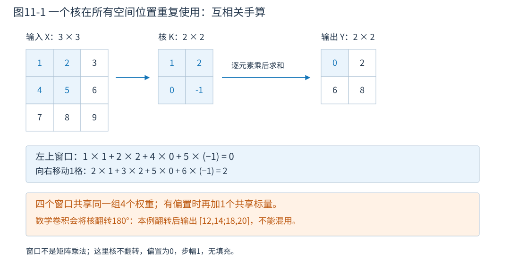
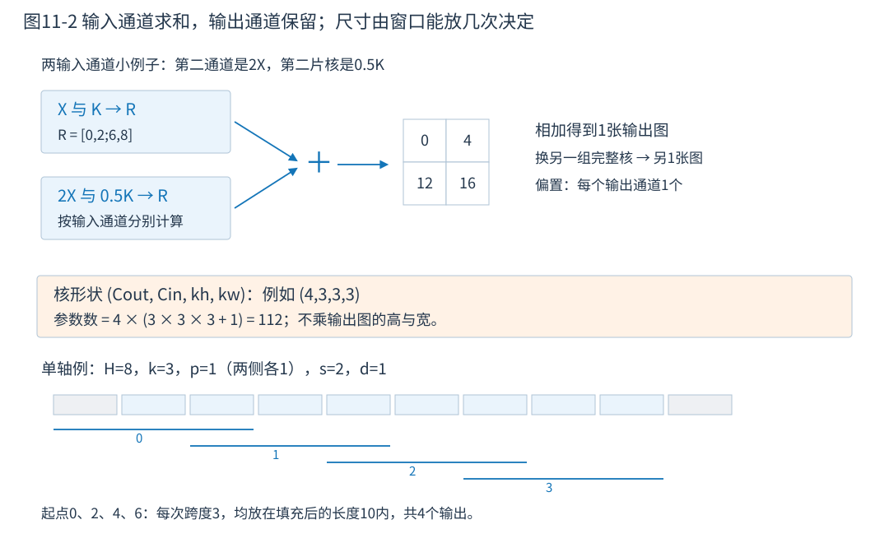
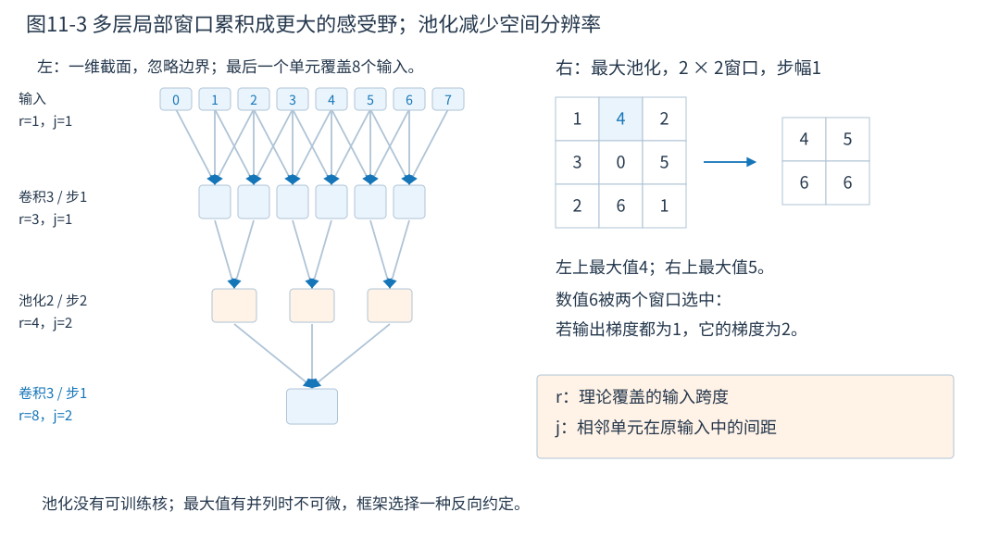
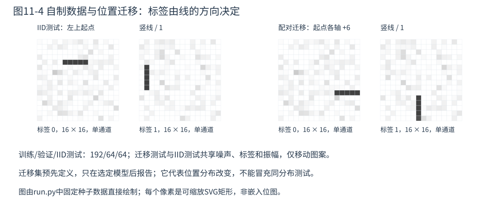
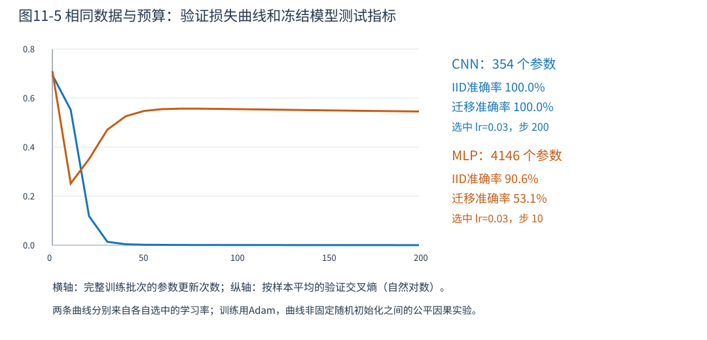

# 第11章：卷积神经网络

> 从图像的邻近关系出发，把“同一个小模式出现在不同位置”写成可训练的运算。本章采用CPU float64，配套数据完全自制，无须下载图像数据集。更新日期：2026-11-15。

[阅读入口](../../README.md) · [章节计划](../chapter-plan.md) · [验收记录](../appendices/chapter-validation.md) · [结构图源](../../scripts/generate-chapter11-figures.mjs) · [公共符号](../appendices/notation.md) · [完整实验](../../examples/11-convolutional-networks/README.md)

## 1. 本章解决什么问题

将一张 $16\times16$ 灰度图展成256维向量，交给第07章的多层感知机（MLP），当然能够分类。问题在于：相邻像素之间的关系没有被明确写进连接方式；位于左上和右下的相同竖线，默认由不同输入坐标上的不同权重处理。用有限训练样本学习所有位置的模式，可能需要更多数据。

 **卷积神经网络（CNN）**  对网格数据加入了一个可检查的结构假设：局部邻近区域有意义，同一种局部检测规则值得在多个位置重复使用。它以局部连接和参数共享减少自由参数，再把局部证据逐层组合。[1, §9.1–9.2]

本章不要求先记住某种著名网络的层数。学完后，你应能：

- 用小矩阵逐项计算互相关，说明它与数学卷积的核翻转有何区别。
- 从窗口合法起点推导尺寸，逐轴处理步幅、填充和膨胀。
- 明确输入通道为何相加、输出通道为何保留，算出参数量。
- 区分平移等变与平移不变，说明边界与下采样的限制。
- 计算理论感受野，解释最大/平均池化及反向梯度。
- 实际训练小CNN，与MLP比较参数、耗时、同分布测试及位置迁移表现。

前置内容：[01章](01-linear-algebra.md)的轴与广播、[07章](07-multilayer-perceptron.md)的线性层与ReLU、[08章](08-backpropagation.md)的链式法则。训练使用[09章](09-training-and-optimizers.md)的Adam；[05章](05-machine-learning.md)和[10章](10-generalization.md)的数据划分、交叉熵与验证集选择仍然适用。下面会就地回顾需要的接口与损失。

## 2. 先固定图像、核与输出的含义

灰度图可写成二维数组；彩色图通常有多个颜色通道。中间层的通道则是不同的特征响应，不必对应颜色。一个 **特征图** 记录某个输出通道在各空间位置的响应；“特征”不保证一定能被人解释成边缘或物体部件。

| 符号 | 含义与形状 | 本章约定 |
| --- | --- | --- |
| $\mathcal{X}$ | 输入张量，$B\times C_{\mathrm{in}}\times H\times W$ | 批次、通道、高、宽 |
| $\mathcal{K}$ | 核权重，$C_{\mathrm{out}}\times C_{\mathrm{in}}\times k_h\times k_w$ | 普通卷积，groups=1 |
| $\mathbf{b}$ | 偏置向量，$C_{\mathrm{out}}$ | 每个输出通道一个 |
| $\mathcal{Y}$ | 输出，$B\times C_{\mathrm{out}}\times H_o\times W_o$ | 不把批次或输出通道相加 |
| $s_h,s_w$ | 步幅 | 正整数 |
| $p_h,p_w$ | 上下、左右 **各侧** 的零填充宽度 | 非负整数 |
| $d_h,d_w$ | 核相邻采样点的膨胀间隔 | 正整数，默认1 |
| $r_\ell,j_\ell$ | 第 $\ell$ 层理论感受野跨度、输出间距 | 相对原输入计量 |
| $a,o,c,i,j,u,v$ | 样本、输出通道、输入通道、位置与核内索引 | 本章全部从0编号 |

代码使用NCHW轴顺序。第01章的“数学向量默认列向量”并没有规定图像张量必须展平；这里直接用四个索引定义运算。最后线性分类器才使用行批次矩阵。某些图像库读入HWC，必须按轴语义转置，再增加批次维；reshape不能代替通道轴移动。

本章公式默认普通卷积、对称零填充；组卷积只在边界说明中简述。偏置为零时是线性运算，含可训练偏置时是仿射运算；再接ReLU后，整个模块不再线性。

## 3. 一个窗口如何产生一个数

### 3.1 先计算二维互相关

先看单通道、无偏置、步幅1、无填充、无膨胀。把小核放在输入左上角，对应元素相乘并求和，再向右滑动。这是 **互相关（cross-correlation）** ；本章所用PyTorch Conv2d实际执行该运算。[2, §7.2.1][7]

$$
Y_{ij}=\sum_{u=0}^{k_h-1}\sum_{v=0}^{k_w-1}
K_{uv}X_{i+u,j+v}.
$$

每个输出是输入局部窗口与核展平后的内积；窗口里的逐元素乘法后还必须求和，不能把两个小矩阵直接做矩阵乘法。

*图11-1：本章原创数值例子及窗口图，依据[1, §9.1–9.2]、[2, §7.2.1]的定义绘制，未复制教材图。蓝色标出第一个窗口和输出。所有窗口共享同一组核参数。*

固定

$$
\mathbf{X}=\begin{bmatrix}1&2&3\\4&5&6\\7&8&9\end{bmatrix},
\qquad
\mathbf{K}=\begin{bmatrix}1&2\\0&-1\end{bmatrix}.
$$

逐个窗口计算：

$$
\begin{aligned}
Y_{00}&=1\cdot1+2\cdot2+4\cdot0+5(-1)=0,\\
Y_{01}&=2\cdot1+3\cdot2+5\cdot0+6(-1)=2,\\
Y_{10}&=4\cdot1+5\cdot2+7\cdot0+8(-1)=6,\\
Y_{11}&=5\cdot1+6\cdot2+8\cdot0+9(-1)=8.
\end{aligned}
$$

所以输出为 $\left[\begin{smallmatrix}0&2\\6&8\end{smallmatrix}\right]$。核没有移动到输入外部；这叫valid计算。原输入3行，小核2行，可放的行起点是0、1，因此输出2行，列同理。

### 3.2 为什么名称叫卷积，公式却不翻核

离散数学卷积常写成

$$
(X*K)_{ij}=\sum_u\sum_v K_{uv}X_{i-u,j-v}.
$$

它与上式的关键区别是核的方向。若在同样大小的有限有效窗口内比较，需要把核沿高、宽两轴翻转，并对齐有效区域。上述核翻转后变成 $\left[\begin{smallmatrix}-1&0\\2&1\end{smallmatrix}\right]$，有效输出为

$$
\begin{bmatrix}12&14\\18&20\end{bmatrix}.
$$

例如左上为 $-1\cdot1+0\cdot2+2\cdot4+1\cdot5=12$。两种结果明显不同，不能在手算时随意混用。CNN习惯把互相关层也叫“卷积层”。当核的每个位置都自由学习时，翻核只会重新排列可学习参数，可表示的函数集合不变；若使用给定方向的固定滤波核，方向必须核准。[1, §9.1][7]

## 4. 通道、偏置与完整运算

### 4.1 输入通道求和，输出通道各算各的

多个输入通道描述同一空间位置的不同信息。一个输出通道的完整核，需要为 **每个输入通道** 准备一片二维核；先分别求响应，再把结果相加。再换一组完整核，得到另一个输出通道。[4, §7.4.1–7.4.2]

*图11-2：本章原创通道例子和合法起点图，依据[3–4]与[7]的定义绘制。上半部分的两个输入通道最终产生一张输出图；不是两张图的拼接。下半部分使用“每侧填充”约定。*

用上一节的输入 $\mathbf X$ 与核 $\mathbf K$，设输入两个通道为 $\mathbf X,2\mathbf X$，同一输出通道对应的核为 $\mathbf K,0.5\mathbf K$。第二通道的响应为 $2\times0.5$ 倍第一通道响应，记第一通道响应为 $\mathbf R$，相加后得到

$$
\mathbf R+\mathbf R
=\begin{bmatrix}0&4\\12&16\end{bmatrix}.
$$

本例偏置为0。若偏置是0.5，每个位置都再加0.5。偏置不需要为每个空间位置重新学习，也不是先对输入通道各加一遍。

### 4.2 把所有索引写清楚

记 $\widetilde{\mathcal X}$ 为上下各补 $p_h$ 行、左右各补 $p_w$ 列后的输入。普通二维层为

$$
\mathcal{Y}_{aoij}=b_o+
\sum_{c=0}^{C_{\mathrm{in}}-1}
\sum_{u=0}^{k_h-1}\sum_{v=0}^{k_w-1}
\mathcal{K}_{ocuv}
\widetilde{\mathcal X}_{ac,\,is_h+ud_h,\,js_w+vd_w}.
$$

读式子的顺序是：先固定样本 $a$、输出通道 $o$、空间位置 $(i,j)$；遍历所有输入通道和核内点，求加权和；最后加这个输出通道的偏置。没有对 $a$ 或 $o$ 求和。一个批次中的图像共享模型参数，但不会在卷积求和中混成一张图。

核尺寸 $1\times1$ 也有用途：它在每个位置对通道向量作线性组合，加偏置。若步幅1、无填充，它不混合邻近空间位置，仍可把3个通道变成4个通道，相当于每个位置共享一个 $4\times3$ 线性映射。[4, §7.4.3]

## 5. 尺寸：从最后一个窗口能放在哪里推导

### 5.1 填充、步幅、膨胀分别改变什么

 **填充（padding）**  在边缘补已约定的值，避免连续小核让空间尺寸过快缩小；它同时引入边界假设。零填充并不是还原图像外面的真实像素。

 **步幅（stride）**  是相邻输出窗口起点的位移。步幅2会跳过一半起点，从而降低空间采样密度。它通常减少计算与输出尺寸，也可能丢失小目标或高频细节。

 **膨胀（dilation）**  是核内相邻采样点之间的间隔。例如长度3的核，膨胀2时采样偏移为0、2、4，覆盖跨度5；参数仍然只有3个。二维分别处理两个轴。[3][7]

对高度一轴，核的有效覆盖跨度是

$$
k_{\mathrm{eff},h}=d_h(k_h-1)+1.
$$

填充后长度是 $H+2p_h$。最后一格合法输出编号为 $i_{\max}$，它的窗口最后一个采样点不能越界：

$$
i_{\max}s_h+d_h(k_h-1)\le H+2p_h-1.
$$

所有编号从0开始，输出数量为最大编号加1，因此

$$
H_o=
\left\lfloor
\frac{H+2p_h-d_h(k_h-1)-1}{s_h}
\right\rfloor+1.
$$

宽度同理：

$$
W_o=
\left\lfloor
\frac{W+2p_w-d_w(k_w-1)-1}{s_w}
\right\rfloor+1.
$$

这些式子假设能放下至少一个窗口；若结果非正，应该改变输入或参数。地板符号 $\lfloor x\rfloor$ 表示向下取整，不能把不能完整放下的窗口算进去。

### 5.2 两个核对尺寸的例子

图11-2给出 $H=8$、$k_h=3$、$p_h=1$、$s_h=2$、$d_h=1$。填充后长度10，合法起点为0、2、4、6，共4个；下一个起点8会覆盖到10，而最大合法索引是9。公式也得到 $\lfloor(8+2-3)/2\rfloor+1=4$。

实际实验还核验非方形情况：输入形状 $(2,3,7,8)$，权重 $(4,3,3,2)$，步幅 $(2,3)$，填充 $(1,0)$，膨胀 $(2,1)$。高度有效核5、宽度有效核2：

$$
H_o=\lfloor(7+2-5)/2\rfloor+1=3,\qquad
W_o=\lfloor(8-2)/3\rfloor+1=3.
$$

输出为 $(2,4,3,3)$，批次仍是2，输出通道由4组核决定。

注意文献记号差异：D2L的部分公式把 $p_h$ 定义为上下 **总共** 补多少行，本章和PyTorch整数padding表示每侧补多少，代入前须转换。对奇数核、膨胀1、步幅1，设 $p_h=(k_h-1)/2$ 可保持高度；偶数有效核可能需要不对称填充。PyTorch2.15的字符串padding="same"仅支持步幅1，不应外推到任意步幅。[3, §7.3.1–7.3.2][7]

## 6. 局部连接与参数共享究竟节省了什么

一个普通卷积输出通道需要 $C_{\mathrm{in}}k_hk_w$ 个权重和一个偏置。所有输出位置复用它们，故

$$
P=C_{\mathrm{out}}\bigl(C_{\mathrm{in}}k_hk_w+1\bigr).
$$

若不使用偏置，去掉括号里的1。批次数和输出空间大小不进入参数数；它们影响激活存储和运算量。

例如输入3通道、输出4通道、核 $3\times3$，参数数为 $4(3\cdot3\cdot3+1)=112$。若输入是 $3\times16\times16$、输出仍为 $4\times16\times16$：

| 连接方式 | 每个输出位置看哪里 | 权重是否跨位置复用 | 含偏置参数数 |
| --- | --- | --- | --- |
| 全连接到所有1024个输出标量 | 整个输入768个标量 | 否 | $768\cdot1024+1024=787456$ |
| 局部连接但每处单独学习 | 邻近 $3\times3$、3通道 | 否 | $16\cdot16\cdot112=28672$ |
| 本章普通卷积 | 邻近 $3\times3$、3通道 | 是 | $112$ |

所以“局部”与“共享”是两个不同约束；仅把窗口变小，不会自动实现参数共享。[1, §9.2][6]

共享也约束了反向传播。一个核元素参与多个输出，对它的梯度必须把所有使用位置的贡献相加。以上述单通道、步幅1例子，设 $\overline Y_{ij}=\partial\mathcal L/\partial Y_{ij}$，则

$$
\frac{\partial\mathcal L}{\partial K_{uv}}
=\sum_{i,j}\overline Y_{ij}X_{i+u,j+v},
\qquad
\frac{\partial\mathcal L}{\partial b}=\sum_{i,j}\overline Y_{ij}.
$$

跨批次时再对样本求和；如果损失已经按批次平均，上游梯度已含 $1/B$，不要重复除一次。输入像素也可能被多个窗口覆盖，它的梯度同样累加，这正是第08章共享节点的规则。

为手算核梯度，临时取 $\mathcal L_0=\sum_{ij}Y_{ij}$，故每个上游梯度为1。四个窗口相加得到

$$
\nabla_{\mathbf K}\mathcal L_0=
\begin{bmatrix}1+2+4+5&2+3+5+6\\4+5+7+8&5+6+8+9\end{bmatrix}
=\begin{bmatrix}12&16\\24&28\end{bmatrix},
\qquad
\frac{\partial\mathcal L_0}{\partial b}=4.
$$

对输入的梯度为 $\left[\begin{smallmatrix}1&3&2\\1&2&1\\0&-1&-1\end{smallmatrix}\right]$。例如中间像素参与四个窗口，系数为 $-1,0,2,1$，相加为2。本节的求和损失只服务于梯度演示，后面的分类训练用平均交叉熵。

参数少并不保证程序耗时短：访存、算子实现、激活尺寸、硬件和数据规模都影响速度。后面的实际CPU小实验中，CNN训练就比MLP耗时更长。

## 7. 平移等变、平移不变与感受野

### 7.1 相同检测规则为什么能跟着模式移动

 **平移等变（equivariance）**  指输入移动，输出响应也按对应方式移动； **平移不变（invariance）**  指输入移动后，输出保持不变。分类器可能希望最终类别不变，检测位置的特征图却通常需要跟着对象移动。

先在无限网格或不受边界影响的有效区域、步幅1条件下讨论。定义平移 $(T_{\boldsymbol\delta}X)_{ij}=X_{i-\delta_h,j-\delta_w}$，记互相关映射为 $F$。代入定义：

$$
\begin{aligned}
F(T_{\boldsymbol\delta}X)_{ij}
&=\sum_{u,v}K_{uv}X_{i+u-\delta_h,j+v-\delta_w}\\
&=F(X)_{i-\delta_h,j-\delta_w}
=(T_{\boldsymbol\delta}F(X))_{ij}.
\end{aligned}
$$

这说明同一个核的检测规则随位置移动。逐位置使用相同偏置与ReLU也保留这种关系。有限图像的裁切、零填充边界，以及步幅大于1后的采样相位，都会限制等变关系；不能因此说整个CNN对任意平移严格不变。[1, §9.2–9.3]

把所有空间响应平均可以减少对位置的敏感：如果特征图只是完整地重新排列位置，平均值不变；但边界导致特征本身变化时，这个前提不成立。图11-4的位置迁移实验是在有限数据上的检验，不是严格不变性的证明。

### 7.2 叠几层以后一个单元能看多大

直接看见的窗口小，不意味着深层只能用很小范围的信息。 **理论感受野** 是可能影响某个单元的原输入区域；它描述计算图允许的依赖，不代表这些位置当前都产生相同或非零梯度。[1, §9.2][6]

*图11-3：原创一维截面依赖图及池化手算。左图的最后一个单元由3个池化输出组成，共可能覆盖8个原输入位置；右图标出池化窗口重叠的梯度累加。依据[1, §9.2–9.3]、[5]绘制。*

先看一轴，初始 $r_0=j_0=1$。第 $\ell$ 层使用有效核跨度 $k_{\mathrm{eff},\ell}$、步幅 $s_\ell$。相邻低层单元在原输入中相隔 $j_{\ell-1}$，核覆盖的最左与最右低层单元相隔 $(k_{\mathrm{eff},\ell}-1)j_{\ell-1}$，加上低层自身已有跨度，得到

$$
r_\ell=r_{\ell-1}+(k_{\mathrm{eff},\ell}-1)j_{\ell-1},
\qquad
j_\ell=s_\ell j_{\ell-1}.
$$

必须先使用旧间距计算 $r_\ell$，再更新 $j_\ell$。对本章CNN，两轴相同：

| 层 | 核/步幅 | $r$ | $j$ |
| --- | --- | --- | --- |
| 输入 | — | 1 | 1 |
| 卷积1 | 3/1 | $1+2\cdot1=3$ | 1 |
| 最大池化 | 2/2 | $3+1\cdot1=4$ | 2 |
| 卷积2 | 3/1 | $4+2\cdot2=8$ | 2 |

所以第二卷积某位置的理论感受野跨度为 $8\times8$，相邻位置相隔原输入的2像素；后续全局平均再汇总所有位置。填充边缘的部分跨度可能落在补零区；有膨胀时，跨度内部还可能有未被连接的空隙。实际对任务有影响的区域也受权重、ReLU门和数据影响，不能把跨度当成可解释性证据。

## 8. 池化：固定窗口汇总与信息损失

### 8.1 最大值和平均值是两种不同汇总

池化（pooling）逐通道汇总空间窗口，通常不含可训练参数。最大池化取窗口最大值，强调是否出现较强响应；平均池化取均值，保留总体强度。它们不把不同通道合并。[5, §7.5.1–7.5.3]

图11-3右边输入为

$$
\mathbf A=\begin{bmatrix}1&4&2\\3&0&5\\2&6&1\end{bmatrix}.
$$

核 $2\times2$、步幅1时，最大池化输出是
$\left[\begin{smallmatrix}4&5\\6&6\end{smallmatrix}\right]$；例如左上取 $\max(1,4,3,0)=4$。平均池化输出是

$$
\begin{bmatrix}
(1+4+3+0)/4&(4+2+0+5)/4\\
(3+0+2+6)/4&(0+5+6+1)/4
\end{bmatrix}
=\begin{bmatrix}2&2.75\\2.75&3\end{bmatrix}.
$$

步幅1的本例仍有窗口重叠。若窗口和步幅都设2，常见效果是空间尺寸约减半。PyTorch MaxPool2d(2)的默认步幅就是核尺寸2，手算若默认成1会得到不同结果。[8]

### 8.2 反向梯度与不可逆性

当窗口中最大值唯一时，最大池化对被选位置的导数是1，对其他位置是0；上游梯度被路由到被选位置。如果多个窗口选中同一像素，贡献相加。本例下排两个窗口都选中数值6；若输出损失是所有池化输出之和，该位置梯度为2。其余被选中的4、5各得1，其他位置为0。

平均池化则把一个窗口的上游梯度均分到4个输入；窗口重叠时仍需累加。最大值并列处不可微，框架使用某种反向约定；不要在并列点用中心差分强行证明唯一导数存在。

池化确实会丢信息：$[1,0]$与$[0,1]$取最大值都得到1，无法从输出恢复最大值的原位置。减少位置敏感也可能损害需要精确定位的任务；步幅采样不是免费获得不变性。

还有一个实现细节：PyTorch最大池化的隐式padding用负无穷，而不是零，否则全负数输入的边界可能错误地选中补入的零。配套实验用全负输入实测这个区别。平均池化的padding是否计入分母由具体接口选项决定；本章平均池化例子无填充，不混入该差异。[8]

## 9. 从公式到一个完整小CNN

### 9.1 各层形状与参数账本

本章模型使用两个卷积模块，之后把每个通道所有空间响应平均成一个数，再做两类线性分类：

| 运算 | 输出形状 | 含偏置参数数 |
| --- | --- | --- |
| 输入 | $B\times1\times16\times16$ | 0 |
| Conv2d(1,4,3,padding=1) + ReLU | $B\times4\times16\times16$ | $4(1\cdot9+1)=40$ |
| MaxPool2d(2, stride=2) | $B\times4\times8\times8$ | 0 |
| Conv2d(4,8,3,padding=1) + ReLU | $B\times8\times8\times8$ | $8(4\cdot9+1)=296$ |
| 对高、宽求平均 | $B\times8$ | 0 |
| Linear(8,2) | $B\times2$ | $2\cdot8+2=18$ |
| 总计 | 每样本2个logit |  **354**  |

全局平均明确写成

$$
H_{ao}=\frac{1}{H_oW_o}\sum_{i,j}\mathcal A_{aoij},
\qquad
\mathbf Z=\mathbf H\mathbf W_{\mathrm{cls}}^\top
+\mathbf1_B\mathbf b_{\mathrm{cls}}^\top.
$$

其中 $\mathcal A$ 是第二次ReLU后的激活，分类权重为 $2\times8$，输出 $\mathbf Z$ 是 $B\times2$。这里只平均空间维，不平均样本维或通道维；mean(dim=(2,3))与该式对应。也可用输出 $1\times1$ 的自适应平均池化，再展成 $B\times8$。[9]

### 9.2 少量代码对应公式

~~~python
class TinyCNN(nn.Module):
    def __init__(self):
        super().__init__()
        self.conv1 = nn.Conv2d(1, 4, 3, padding=1)
        self.conv2 = nn.Conv2d(4, 8, 3, padding=1)
        self.head = nn.Linear(8, 2)

    def forward(self, x):                # B,1,16,16
        h = F.relu(self.conv1(x))        # B,4,16,16
        h = F.max_pool2d(h, 2)           # B,4,8,8
        h = F.relu(self.conv2(h))        # B,8,8,8
        h = h.mean(dim=(2, 3))           # B,8
        return self.head(h)             # B,2，原始logit
~~~

分类损失复用第05章的两类softmax交叉熵。标签 $y_a\in\{0,1\}$，每样本有两个logit：

$$
\mathcal L=
\frac1B\sum_{a=0}^{B-1}
\left[
\log\bigl(\exp Z_{a0}+\exp Z_{a1}\bigr)-Z_{a,y_a}
\right].
$$

实现使用稳定的F.cross_entropy(logits, labels)，默认按样本平均、自然对数；不要先做softmax再把概率传入该logit接口。两类也能用一个logit配BCE，本章统一用两个logit以便与多类分类衔接。[10；另见第05章]

训练步骤仍是：清梯度、前向、算损失、反向、优化器同步更新。卷积并没有另外一套“训练法则”；参数共享改变梯度汇总的连接结构，自动微分按第08章的规则处理。完整实验另写了朴素NumPy循环逐项核验PyTorch算子，没有只用接口输出证明接口自己正确。

## 10. 本机实践：CNN与MLP是否同样依赖图案位置

### 10.1 先声明数据和比较协议

所有图像由[实验入口](../../examples/11-convolutional-networks/run.py)自制，不取自外部数据集。图像为 $16\times16$ 单通道：背景为独立零均值、标准差0.08的正态噪声，叠加长度5、振幅在0.8至1.2均匀取值的线。标签0是横线、1是竖线，各集合两类数量相等。本章只用这些分布来造已知任务，正态密度含义可回看第05章固定噪声解释。

*图11-4：run.py直接从实际数据绘制的SVG矩形网格。每个单元是可编辑矢量矩形，无任何嵌入位图。右侧将同一测试样本的图案向右、向下各移6像素，保留噪声、振幅与标签。*

训练192张、验证64张、同分布（IID）测试64张，种子依次为20261115、20261116、20261117；起点两个坐标都从1至5的整数均匀抽取。另设64张配对迁移测试：沿两轴各移动图案6像素，线仍完全位于图像内，背景噪声保持原样。迁移集的位置分布已改变，不能称为IID测试，也不能用它来选择模型。

不拟合任何预处理统计量，输入直接使用合成像素值。报告保存各集合输入/标签的SHA256以及生成规则，避免只写“随机分了数据”。数据的独立性来自不同生成流；配对迁移集与IID测试明确相关，不能把它们合并当作128个独立测试样本。

比较对象是上述354参数CNN，以及把256像素展平后经16个ReLU隐藏单元、2个输出的MLP，参数数为

$$
256\cdot16+16+16\cdot2+2=4146.
$$

两个架构都在CPU float64、单线程、无权重衰减、无增强条件下训练；模型初始化种子20261118。对每个架构尝试学习率0.01和0.03，Adam使用默认动量系数0.9、0.999及数值项 $10^{-8}$。每次进行200次完整训练批次更新，含初始状态每10步记录一次，共21个时点；以所有候选中最低验证交叉熵选学习率与检查点。选定并冻结后再报告两种测试指标。它们共享搜索预算，网络形状、初始化参数集合和优化轨迹仍然不同。

### 10.2 真实运行方式与结果

在仓库根目录执行：

~~~powershell
& ./.venv/Scripts/python.exe -B examples/11-convolutional-networks/run.py
~~~

结果默认写入build/experiments/11-convolutional-networks，包括JSON报告、两个权重检查点和SVG结果图。发布图按以下方式生成：

~~~powershell
node scripts/generate-chapter11-figures.mjs
& ./.venv/Scripts/python.exe -B examples/11-convolutional-networks/run.py --figure-dir docs/assets/11-convolutional-networks
~~~

2026-11-15，Windows build26200、Python3.11.5、NumPy2.4.6、PyTorch2.15.0+cpu实际执行16项检查通过。首次总耗时19.070秒，其中导入7.029秒；独立复跑13.081秒，模型选择与全部指标完全一致；CNN候选训练及保存/评估5.332秒，MLP对应0.489秒。Python跟踪分配峰值136.38MiB，不含大量原生张量内存，不能当作进程RSS或完整内存预算。

| 指标 | CNN | MLP |
| --- | --- | --- |
| 参数数 | 354 | 4146 |
| 选中学习率/更新步 | 0.03 / 200 | 0.03 / 10 |
| 训练交叉熵/准确率 | 0.000275 / 100% | 0.018958 / 100% |
| 验证交叉熵/准确率 | 0.000320 / 100% | 0.251710 / 87.5% |
| IID测试交叉熵/准确率 | 0.000372 / 100% | 0.228592 / 90.625% |
| 配对位置迁移交叉熵/准确率 | 0.000112 / 100% | 1.259914 / 53.125% |

平衡两类的固定类别基线准确率为50%。CNN的迁移结果支持“本任务中的局部共享结构有助于复用方向规则”；MLP的同分布测试尚可，移动图案后接近基线，说明它的成功依赖训练位置。迁移CNN交叉熵更低也只是一批64张样本上的观察，不说明迁移天然更容易。

*图11-5：来自JSON报告的真实曲线和指标。两条线各自使用选中的学习率；横轴为完整批次更新次数，纵轴为按样本平均的验证交叉熵。分类准确率没有代替验证交叉熵来选择检查点。*

### 10.3 哪些检查保证公式、代码与图一致

16项检查覆盖：四个互相关输出、翻核后输出、NumPy/PyTorch双实现、共享核与偏置梯度、窗口重叠输入梯度、多通道加和、带步幅/填充/膨胀的非方形输出、内部平移等变、最大与平均池化、最大池化负无穷填充、感受野递推、配对数据协议、两个检查点恢复及两模型参数数。

其中随机多通道算子的NumPy与PyTorch最大绝对差小于 $10^{-12}$；两个检查点恢复后的测试logit逐项一致。实验主动限定内部区域的平移核验，未对补零边缘宣称严格等变。

这不是严谨的CNN优于MLP的普遍结论：只有一个小型自制任务、一组数据种子和一次模型初始化；模型参数量、优化性质不同，验证选择还会适应这64张验证样本。若标签本身取决于绝对位置，全局平均甚至可能丢掉任务所需信息。迁移之外的旋转、遮挡、背景相关性和真实图像均未测试。复现时不应只追求100%，应先核对协议、损失曲线、形状和恢复一致性。

## 11. 常见误区与排查

-  **把通道拼接当作通道求和** ：普通卷积对输入通道求和，保留输出通道；只有下一组核才产生另一输出图。
-  **核尺寸写对却忘了膨胀** ：公式需要有效跨度 $d(k-1)+1$，参数数仍按真实核点数计算。
-  **把每侧填充与总填充混用** ：本章PyTorch整数padding是每侧宽度，二维元组先高度后宽度。
-  **以为共享参数等于共享激活** ：权重相同，不同位置的输入窗口不同，输出和激活存储仍各自存在。
-  **用图像尺寸乘参数数** ：空间大小影响计算与存储，普通共享核参数不随它增长。
-  **把CNN称为任意平移不变** ：卷积的内部等变关系不等于含边界、池化、分类头的整体严格不变。
-  **以为池化会训练一个核** ：最大/平均池化是固定汇总；后面的卷积核才是可训练参数。
-  **把通道数当作空间深度或网络层数** ：三者不同，必须在形状表分别说明。
-  **通道轴错了只改reshape** ：先确认HWC/NCHW，再按轴转置，检查进入层的通道数。
-  **把参数更少当成一定更快** ：本次CNN参数少，但小CPU任务实测更慢；必须测具体实现。
-  **以为所有卷积都用本章参数公式** ：groups大于1时每组只连接部分通道；深度卷积等变体需重新核算，不在本次训练范围。

## 12. 习题与分步解析

### 12.1 先独立完成

1. 图11-1中若只把偏置设为2，输出是什么？为什么不是每个乘积都加2？
2. 第5.2节非方形配置的输入通道改成5、输出通道改成6，其他不变，输出形状和含偏置参数数分别是多少？
3. 输入3通道、输出4通道的 $1\times1$ 层，步幅1、无填充，共多少参数？它是否混合相邻像素？
4. 对图11-1取 $\mathcal L_0=\sum Y_{ij}$，推导核右上元素的梯度，以及输入中间元素的梯度。
5. 两个连续 $3\times3$、步幅1、无膨胀卷积的理论感受野是6还是5？插入非线性是否改变连接允许的跨度？
6. 图11-3最大池化若输出损失仍是求和，数值6处为什么得2？平均池化的中间输入梯度是多少？
7. 步幅2为什么会破坏对1像素平移的直接等变关系？用长度4的非负向量、窗口2最大池化举例。
8. 若任务是“线在左半图还是右半图”，为什么本章全局平均分类器可能吃亏？能否从本次方向分类成绩反推出该任务成绩？
9. 实践修改：保持数据不变，把CNN全局平均改成展平后Linear(512,2)。先算参数变化，再重新按验证集选定，最后一次评估两种测试集。能否使用迁移测试挑最终架构？

### 12.2 解析

 **题1。**  每个输出加一次共享偏置，得到 $\left[\begin{smallmatrix}2&4\\8&10\end{smallmatrix}\right]$。偏置对应一个输出通道的截距，不是每条输入连接各有一个偏置；会把偏置重复加4次（总额8而非2）。

 **题2。**  空间形状只由高宽参数决定，仍为 $3\times3$；批次2，输出通道6，所以形状 $(2,6,3,3)$。每个输出通道有 $5\cdot3\cdot2=30$ 个权重和1个偏置，总参数 $6\cdot31=186$。输入通道数增加不会增加空间输出尺寸。

 **题3。**  $4(3+1)=16$。每个位置对该处3维通道向量作4维仿射映射，不混合相邻空间像素；多个位置共用这16个参数。

 **题4。**  右上核元素分别乘输入2、3、5、6，所以梯度16。输入中心5在四个窗口中的核系数依次为 $-1,0,2,1$，梯度和为2。这里是对输入和参数求导，不能把它们的累加索引混为一谈。

 **题5。**  第一层跨度3、间距1，第二层 $3+(3-1)\cdot1=5$。中间ReLU不扩大连接允许的区域，但会让某些实际梯度为0。若没有非线性，不能据“多了层数”就声称得到了任意复杂非线性映射。

 **题6。**  两个重叠窗口都以6为唯一最大值，各传回1，所以2。平均池化的中心0落在四个窗口，每个窗口传回 $1/4$，合计1；最大池化对这个0的梯度却是0。

 **题7。**  长度4向量 $[0,1,0,0]$ 的窗口2、步幅2最大池化为 $[1,0]$；右移1像素到 $[0,0,1,0]$ 后为 $[0,1]$。输入移动1格并不对应输出网格上整数的半格移动。对齐到步幅倍数、避开边界时可讨论相应的较粗网格等变，不能省略条件。

 **题8。**  当特征只发生空间重排，全局平均把不同位置汇总成同一通道数值，可能消掉左右信息。有限边界可能提供间接位置线索，不能说结构绝对无法分类；但本章没有为该任务保留明确位置表示。方向任务的实验不能回答位置任务。

 **题9。**  第二卷积输出 $8\cdot8\cdot8=512$ 个激活。新分类头有 $512\cdot2+2=1026$ 个参数，原头18个，因此总数 $354-18+1026=1362$。先固定候选与验证选择规则，再训练并冻结；迁移测试只能报告预声明的最终评估，不能反复用它挑架构，否则它已成验证集，应另留新的迁移测试。

## 13. 小结与下一步

卷积层把局部加权求和的规则跨位置共享，输入通道参与加和，输出通道代表不同核组。形状由窗口合法起点推导，参数数由独立学习量核算；两者不能混为一谈。共享权重在反向时累加所有使用位置的贡献。

多层局部依赖扩大感受野，池化与全局汇总减少空间分辨率和部分位置敏感，也会丢失信息。本机实验把这些结构假设转成了可运行比较：本次CNN在位置迁移下保持方向判断，MLP下降，但参数少并未带来更快CPU训练。后续章节会讨论更深的卷积结构、残差连接与归一化；本章已建立其基础算子与形状账本。

## 14. 参考文献

1. Goodfellow、Bengio、Courville， **Deep Learning** ，2016，第9章，§9.1卷积与互相关、§9.2局部连接/共享/等变/感受野、§9.3池化。[官方章节](https://www.deeplearningbook.org/contents/convnets.html)。
2. Zhang等， **Dive into Deep Learning** ，在线1.0.3，§7.2.1互相关、§7.2.2卷积层、§7.2.5互相关与卷积、§7.2.6特征图与感受野。[官方章节](https://d2l.ai/chapter_convolutional-neural-networks/conv-layer.html)。
3. D2L1.0.3，§7.3.1填充、§7.3.2步幅；特别注意其总填充记号。[官方章节](https://d2l.ai/chapter_convolutional-neural-networks/padding-and-strides.html)。
4. D2L1.0.3，§7.4.1多输入通道、§7.4.2多输出通道、§7.4.3点卷积。[官方章节](https://d2l.ai/chapter_convolutional-neural-networks/channels.html)。
5. D2L1.0.3，§7.5.1最大与平均池化、§7.5.2填充与步幅、§7.5.3多通道。[官方章节](https://d2l.ai/chapter_convolutional-neural-networks/pooling.html)。
6. Stanford  **CS231n Convolutional Neural Networks** ，官方公开课程笔记，“Convolutional Layer”下Local Connectivity、Spatial arrangement、Parameter Sharing。页面未标单一授课年份，按2026-11-15实际访问版本引用。[课程原文](https://cs231n.github.io/convolutional-networks/)。
7. PyTorch2.15， **Conv2d** ，互相关、NCHW、核/偏置形状、输出尺寸、same与groups条件。[官方接口](https://docs.pytorch.org/docs/2.15/generated/torch.nn.Conv2d.html)。
8. PyTorch2.15， **MaxPool2d** ，默认步幅、负无穷填充与输出形状。[官方接口](https://docs.pytorch.org/docs/2.15/generated/torch.nn.MaxPool2d.html)。
9. PyTorch2.15， **AdaptiveAvgPool2d** ，按目标空间尺寸平均池化。[官方接口](https://docs.pytorch.org/docs/2.15/generated/torch.nn.AdaptiveAvgPool2d.html)。
10. PyTorch2.15， **functional.cross_entropy** ，输入logit、整数标签及默认mean归约。[官方接口](https://docs.pytorch.org/docs/2.15/generated/torch.nn.functional.cross_entropy.html)。
