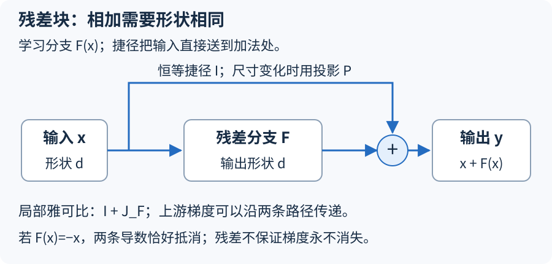
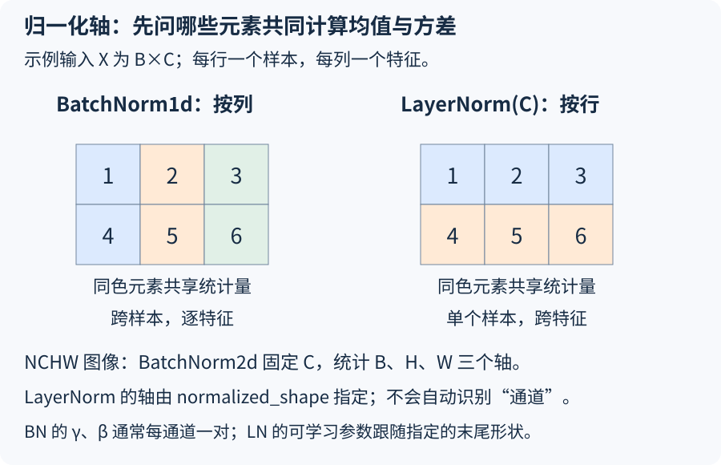
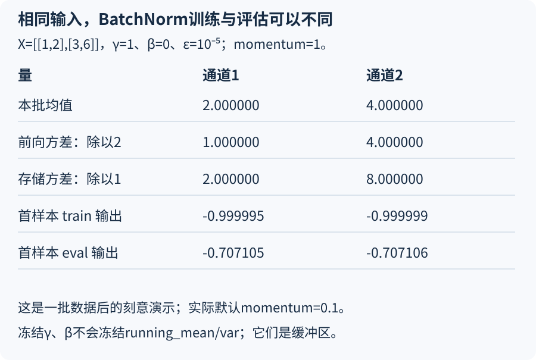
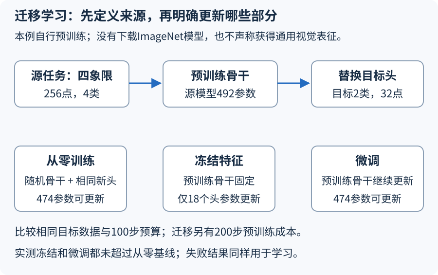
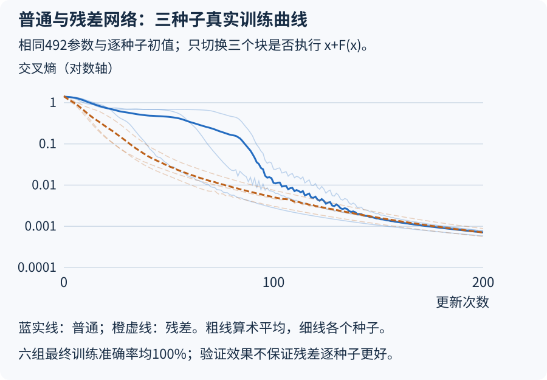
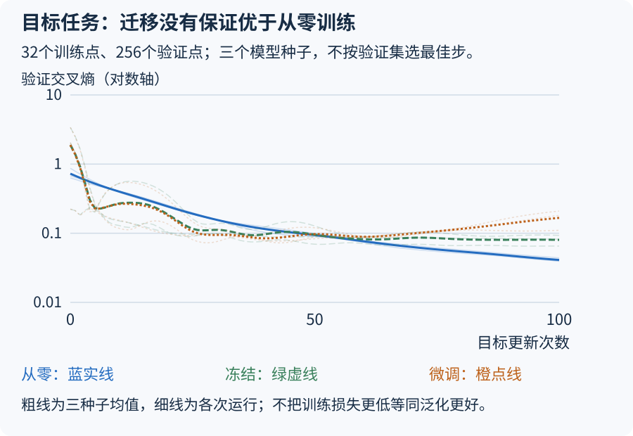

# 第 12 章：残差连接、归一化与迁移学习

> 正文、六幅纯 SVG 与三种子 CPU 实验已实现。导出验收状态见本章末尾，正式完成状态以章节计划为准。

[阅读入口](../../README.md) · [上一章：卷积网络](11-convolutional-networks.md) · [公共符号](../appendices/notation.md) · [完整实验](../../examples/12-residual-and-normalization/README.md)

## 1. 本章目标与前置知识

把网络叠得更深，为什么未必更容易训练？同一张输入，为什么训练与评估模式的结果可能不同？有一个已训练模型，怎样判断应固定它的特征，还是继续修改它？本章按这三个问题依次讲残差、归一化与迁移学习，把结构、状态和参数更新区别开。

学习后应能：解释残差相加的形状要求与导数；手算 BatchNorm、LayerNorm 的统计量并明确轴；区分 `eval()`、`no_grad()`、`requires_grad`；实现冻结和微调，并用真实对照检查收益和失败。

前置为第 07～11 章的网络、梯度、训练协议和通道概念。原理可用于 CNN，本机实验用更小的全连接网络隔离残差与迁移因素。它不是完整 ResNet，也不冒充 ImageNet 预训练结果。主线依据 D2L §8.5～8.6、Stanford CS231n 课程笔记与原始论文；这些扩展内容不强行标成花书已有全部细节。

## 2. 残差：学习对输入的修改

### 2.1 从普通映射到残差映射

普通块直接学习目标映射 $H(\mathbf x)$。残差块让可训练分支学习它与输入的差：

$$
F(\mathbf x)=H(\mathbf x)-\mathbf x,
\qquad
\mathbf y=\mathbf x+F(\mathbf x).
$$

如果理想映射接近恒等，残差分支只需接近零。对允许输出零的分支，把末层权重和偏置设零便能表示恒等捷径；这说明某些深层结构可以保留浅层已有的映射，不代表优化器一定找到它。残差学习最初用于更深的视觉网络，随后成为多种架构的构件。[1,2]



图 12-1 为原创纯 SVG。相加要求形状相同且位置含义对应。对列向量，输入与分支输出都属于 $\mathbb R^d$；对图像批次，两者的 $B,C,H,W$ 都要匹配。不能依赖意外广播“凑出”可相加的结果。

如果要把通道从 8 变成 16，或者下采样空间尺寸，可使用投影捷径：

$$
\mathbf y=P\mathbf x+F(\mathbf x).
$$

CNN 常用适当步幅的 $1\times1$ 卷积实现投影。它有额外参数，已不是恒等矩阵，参数量与梯度公式也要相应修改。经典残差块还可能在加法之后接 ReLU；本节先分析无后置激活的相加，加上激活时要继续应用链式法则。[2，§8.6.2]

### 2.2 梯度路径为什么改变，也为什么没有保证

令 $J_F$ 为分支对输入的雅可比矩阵，各行对应输出分量，各列对应输入分量，则

$$
J_{\mathbf y,\mathbf x}=I+J_F,
\qquad
\nabla_{\mathbf x}\mathcal L
=(I+J_F)^\top\nabla_{\mathbf y}\mathcal L.
$$

这使上游梯度既可经过分支，也可直接经过恒等路径。它改善了信息和导数传播的结构条件；但是两个项仍可能抵消。若 $F(\mathbf x)=-\mathbf x$，整体恒为零，导数也为零。若加法后接 ReLU，负区间的导数还会被截断。因此“有捷径所以梯度永不消失”是错误结论。

手算一个二维例子：

$$
\mathbf x=\begin{pmatrix}2\\-1\end{pmatrix},
\qquad
F(\mathbf x)=
\begin{pmatrix}0.2&0\\0&-0.1\end{pmatrix}\mathbf x.
$$

分支为 $(0.4,0.1)^\top$，输出为 $(2.4,-0.9)^\top$。若损失是两个输出分量之和，上游梯度为 $(1,1)^\top$，输入梯度便是 $(1.2,0.9)^\top$。脚本用自动求导核对这两个结果，并另外实际验证了完全抵消的反例。

## 3. 归一化先看轴，不能只背名字

### 3.1 统一的中心化与缩放式

给定一组共同统计的 $M$ 个数，先计算

$$
\mu=\frac1M\sum_{j=1}^M x_j,
\qquad
s^2=\frac1M\sum_{j=1}^M(x_j-\mu)^2.
$$

然后做

$$
\widehat x_j=\frac{x_j-\mu}{\sqrt{s^2+\epsilon}},
\qquad
y_j=\gamma_j\widehat x_j+\beta_j.
$$

$\epsilon>0$ 防止分母为零；$\gamma,\beta$ 是可学习缩放和平移，形状依归一化方法而定。注意 $s^2$ 使用除以 $M$ 的本批方差，符合此处前向计算目的。加了 $\epsilon$ 后标准化部分的方差是 $s^2/(s^2+\epsilon)$，不严格等于 1；再经过可学习仿射变换，输出也不必均值为 0、方差为 1。[3,4]

| 符号 | 本章含义 |
|---|---|
| $\mathbf X\in\mathbb R^{B\times C}$ | 批次矩阵，行是样本，列是特征 |
| $B,C,H,W$ | 批次、通道、高与宽 |
| $M$ | 一次均值和方差实际使用的元素个数 |
| $\mu,s^2$ | 当前统计组的均值与除以 $M$ 的方差 |
| $\gamma,\beta$ | 可训练缩放和平移，不是批次统计量 |
| $\mu_{\rm run},v_{\rm run}$ | BatchNorm 的移动均值与方差缓冲 |
| $J_F\in\mathbb R^{d\times d}$ | 残差分支的雅可比，不是损失 Hessian |



图 12-2 为原创纯 SVG。同色元素共享统计量；两幅矩阵只是把轴画清楚，实际手算使用下一节的两个特征。归一化不会把相关特征自动变成独立变量，也不是完整的白化变换。

### 3.2 BatchNorm：每个通道跨批次统计

对二维批次矩阵，BatchNorm 固定特征 $c$，跨样本计算

$$
\mu_c=\frac1B\sum_{i=1}^B X_{ic},
\qquad
s_c^2=\frac1B\sum_{i=1}^B(X_{ic}-\mu_c)^2.
$$

每个特征有自己的 $\gamma_c,\beta_c$。对 NCHW 图像的 `BatchNorm2d(C)`，固定通道，统计轴为批次、高、宽，元素数是 $M=BHW$；不是对每张图的所有通道一起求均值。[3，§8.5.2；4]

这种归一化使同一样本的训练输出受同批其他样本影响。运行中的统计量随训练更新，评估时默认改用它们，避免单个输入依赖临时批次组成。小统计组、训练与部署分布变化，都可能影响表现。原论文用“内部协变量偏移”描述动机；不能把这一历史解释写成已经证明的唯一生效机制。[5]

### 3.3 LayerNorm：每个样本内跨指定特征统计

对二维输入和 `LayerNorm(C)`，每行单独计算

$$
\mu_i=\frac1C\sum_{c=1}^C X_{ic},
\qquad
s_i^2=\frac1C\sum_{c=1}^C(X_{ic}-\mu_i)^2.
$$

同一样本的结果不依赖其他样本。LayerNorm 在训练与评估模式都使用当前输入的这组统计量，没有 BatchNorm 式运行均值和方差。PyTorch 默认提供每个被归一化位置对应的可学习仿射参数。[6,7]

接口按输入的末尾若干维选择轴：对 $(B,T,d)$ 的序列，`LayerNorm(d)` 逐样本、逐位置统计最后的 $d$ 个特征；对 $(B,C,H,W)$，`LayerNorm([C,H,W])` 会一起统计后三轴，并有同样形状的仿射参数。直接写 `LayerNorm(C)` 不会自动找到 NCHW 的通道轴；它要求末维长度为 $C$。后面 Transformer 章节会反复使用序列形式。

## 4. 手算归一化与训练、评估模式

### 4.1 用一张小表算出 BatchNorm

令输入为

$$
\mathbf X=
\begin{pmatrix}1&2\\3&6\end{pmatrix},
\qquad
\gamma_c=1,\quad\beta_c=0,\quad\epsilon=10^{-5}.
$$

两个通道的均值为 $(2,4)$。第一通道偏差为 $(-1,1)$，所以方差为 $(1+1)/2=1$；第二通道偏差为 $(-2,2)$，所以方差为 4。训练输出第一行约为 $(-0.999995,-0.999999)$，第二行取相反符号。

PyTorch 的细节要单独核对：本次前向方差除以 $M$，但写入移动统计的方差使用无偏估计，即除以 $M-1$。若把本例 `momentum` 刻意设为 1，一次前向后运行均值是 $(2,4)$，运行方差是 $(2,8)$。随后切换评估模式，相同第一行约变成 $(-0.707105,-0.707106)$。[4]



图 12-3 为原创 SVG，表格数值来自真实 CPU 输出。它故意只使用一批数据和 `momentum=1` 展示估计量差异，不代表所有模型的训练与评估输出都固定相差这个比例。

默认运行统计更新为

$$
\mu_{\rm run}\leftarrow(1-a)\mu_{\rm run}+a\mu_{\rm batch},
$$

方差缓冲使用相同加权方式、输入对应的无偏方差估计。PyTorch 默认 $a=0.1$；这里的 `momentum` 是新统计量的权重，和第 09 章优化器动量系数的含义不同。若 `track_running_stats=False`，评估也用当前批次统计，不能再说 `eval()` 总会使用运行统计。[4]

### 4.2 同一个样本换批次会怎样

保留第一行 $(1,2)$，把第二行从 $(3,6)$ 换成 $(-3,-6)$。BatchNorm 训练模式中，第一行从各通道较小值变成较大值，输出约从 $(-1,-1)$ 变成 $(1,1)$。而 LayerNorm 对第一行只看两个数：均值为 1.5，方差为 0.25，输出约为 $(-0.99998,0.99998)$；换另一个样本不影响它。

批次大小为 1 也要具体看轴。`BatchNorm1d` 输入 $(1,C)$ 时每通道只有一个值，PyTorch 训练前向会报错；`BatchNorm2d` 输入 $(1,C,2,2)$ 时每通道有四个值，仍可计算。不能笼统说“任何 BatchNorm 都不支持 batch=1”。脚本实际验证了两种情况。

### 4.3 三个开关各控制什么

| 操作 | 控制的事情 | 不会自动完成的事情 |
|---|---|---|
| `model.eval()` | 模块的评估行为，例如 BN 改用运行统计 | 不关闭自动求导，不冻结参数 |
| `torch.no_grad()` | 当前计算不记录求导图 | 不切换 BN 模式，不阻止训练模式更新缓冲 |
| `parameter.requires_grad_(False)` | 该参数不再累积求导梯度 | 不冻结 BN 的运行统计，不切换 Dropout |

因此，固定特征提取器通常既要冻结参数，也要明确模块模式。若先调用外层 `model.train()`，子模块也会被切回训练，随后应重新把需要固定的骨干设为 `eval()`。本章实测：BN 的全部参数即使已冻结，而且前向放在 `no_grad()` 内，只要仍处于训练模式，运行均值仍然改变。这些缓冲是模型状态的一部分，保存时不能遗漏。

## 5. 迁移学习：已有参数是起点，不是收益保证

将模型写成骨干特征提取器和任务头的组合：

$$
\mathbf h=\phi_{\boldsymbol\theta}(\mathbf x),
\qquad
\mathbf z=g_{\boldsymbol\psi}(\mathbf h).
$$

源任务训练得到 $\boldsymbol\theta$ 后，目标任务常有两种做法：冻结骨干，只学习新头 $\boldsymbol\psi$；或者从源参数出发继续更新部分或全部骨干，称为微调。预训练输出类别与目标类别不同时，通常替换最后的输出头。[8,9]



图 12-4 为原创 SVG。三种目标策略共用相同目标数据和新头初值；迁移方案另有源任务训练成本。冻结可减少可训练参数和优化器状态，但不意味着不需要骨干前向计算。

源与目标任务的相似程度、目标数据量、预处理和预算都会影响迁移。源任务可能强化对目标无用的区分，甚至使小样本微调过拟合，出现负迁移。实际使用第三方视觉权重时，还需按官方权重说明匹配通道顺序、数值范围、尺寸与标准化；这里不下载外部权重，避免把这些约束隐藏起来。

冻结实现的核心不是给学习率一个模糊的小值，而是明确参数集合：

```python
for parameter in model.backbone.parameters():
    parameter.requires_grad_(False)
model.backbone.eval()       # 明确BN/Dropout等行为
optimizer = torch.optim.Adam(model.head.parameters(), lr=0.02)
```

上段是抽象模块命名示例；完整实验把 `stem` 与 `blocks` 合作骨干。微调时重新启用所需参数，并把它们加入优化器；本实验头学习率为 0.02、骨干为 0.001。若从已有优化器切换策略，还要明确是否保留其历史状态，不能假设参数解冻后旧优化器会自动包含它。

## 6. 本机实践：分三个小实验隔离因素

### 6.1 数据、结构和预算

完整入口是 [run.py](../../examples/12-residual-and-normalization/run.py)，图生成程序是 [figures.py](../../examples/12-residual-and-normalization/figures.py)。在仓库根目录执行：

```powershell
& ./.venv/Scripts/python.exe -B examples/12-residual-and-normalization/run.py
# 需要用本次日志同步正文图时：
& ./.venv/Scripts/python.exe -B examples/12-residual-and-normalization/run.py --write-figures
```

所有数据由程序独立生成，无需网络下载；二维点均匀分布在 $[-2,2]^2$。源任务标签由所在象限决定，共 4 类；目标任务是二分类：

$$
y=\mathbf1[x_1+0.5x_2\geq0].
$$

源训练、源验证各 256 点，目标训练 32 点、目标验证 256 点；数据随机种子依次为 101、102、201、202，生成过程独立。没有测试集；验证集只记录，不用于选择训练步或调整这次配置。模型种子用 11、22、33，固定数据后观察初始化差异。

普通与残差模型都有输入层 $2\to8$、三个块和四分类头。每块为

$$
F(\mathbf h)=\mathbf W_2\tanh(\mathbf W_1\mathbf h+\mathbf b_1)+\mathbf b_2.
$$

普通块输出 $F(\mathbf h)$，残差块输出 $\mathbf h+F(\mathbf h)$；加法后没有额外激活。配对模型逐项加载同一初始权重，唯一结构开关是加法。参数量为

$$
(2\times8+8)+3\times2(8\times8+8)+(8\times4+4)=492.
$$

源训练使用全批次 Adam，学习率 0.01、200 次更新、无衰减。训练模型中不放 BN/LN，避免同时改变归一化因素；归一化通过第 4 节的独立小张量实验核对。它们是三个相关但受控的教学实验，不声称已验证 BN 对本分类任务的性能收益。

### 6.2 普通与残差：能更好传播不等于每次都赢



图 12-5 为原创纯 SVG。细线是各次运行，粗线是同一方法在每个更新点的三种子算术平均，纵轴对数刻度，不把均值曲线当作另一条实际训练轨迹。

| 种子 | 普通：初始输入层梯度范数 | 残差：初始输入层梯度范数 | 普通验证准确率 | 残差验证准确率 |
|---|---:|---:|---:|---:|
| 11 | 0.010203 | 0.378995 | 98.4375% | 98.8281% |
| 22 | 0.006461 | 0.341648 | 100.0000% | 99.2188% |
| 33 | 0.005463 | 0.210858 | 99.2188% | 99.6094% |

初始梯度在这个配置下较大，与捷径改变传播路径的直觉一致，但它也受输出和损失影响，不是纯粹的网络条件数测量。六组最终训练准确率都为 100%，说明普通模型并没有“完全不能学”。两种方法最终验证平均准确率恰好同为 99.21875%，种子 22 的普通模型更好。此结果支持解释机制与实验条件，不支持“残差总能提高准确率”。

### 6.3 小型迁移：把失败也完整记录

每个种子的源残差模型用作预训练骨干，替换成二分类头后总参数为 474。冻结组仅更新头部 18 个参数；从零和微调组更新全部 474 个参数。三组使用相同新头初值、同一目标数据、全批次 Adam 和 100 次目标更新；从零与微调的分组学习率相同，骨干 0.001、头 0.02。



图 12-6 为原创 SVG，细线是三次实际运行，粗线是算术均值。各组固定训练到第 100 次，不用验证曲线选最优中间状态。迁移的源训练成本没有算进这 100 次目标更新，因此这不是总计算成本相同的竞争。

| 策略 | 种子11验证准确率 | 种子22 | 种子33 | 均值 ± 样本标准差 |
|---|---:|---:|---:|---:|
| 从零 | 98.8281% | 99.2188% | 98.4375% | 98.8281% ± 0.3906个百分点 |
| 冻结特征 | 97.2656% | 94.9219% | 94.9219% | 95.7031% ± 1.3532个百分点 |
| 全部微调 | 95.7031% | 94.9219% | 94.9219% | 95.1823% ± 0.4511个百分点 |

标准差在三个模型种子间计算，使用分母 $3-1$，不是置信区间。迁移两组在这套目标配置下均未超过从零基线。以种子 11 为例，微调训练交叉熵降到 0.000481，比从零的 0.030392 低；验证交叉熵却为 0.209222，高于从零的 0.039946。这是训练拟合更强而目标泛化更差的证据。

可能原因包括源特征对四象限的特化、小样本目标集和固定微调预算；本实验没有额外消融，不能把其中某一种说成已被证明的唯一原因。后续可加入更短预算、目标验证选优、不同源任务与更多数据，保留从零基线逐项检查。这里的负结果也不推翻大规模视觉预训练的既有研究，因为任务与数据规模不同。

冻结组骨干参数最大变化在三个种子中都为 0；微调组分别约为 0.116152、0.138448、0.117463，说明更新策略真实生效。另将种子 11 微调权重保存、重新实例化加载，目标验证 logits 最大绝对差为 0；这是推理权重的验证，没有声称实现精确续训。

### 6.4 实际环境与资源

2026-11-15 22:28 实际运行环境为 Windows CPU、Python 3.11.5、NumPy 2.4.6、PyTorch 2.15.0+cpu，float64，计算线程 1，启用确定性算法。15 次小网络训练和张量演示共约 4.267 秒，排除导入与 SVG 生成；不同机器或框架版本不保证位级相同。

源参数数值载荷为 3936 字节，目标为 3792 字节；未计优化器、激活、框架开销，也未测进程峰值内存。共 **40 项核对通过**，覆盖损失下降、参数量、冻结/微调更新、重新加载、BN/LN 轴与模式、BN 缓冲和单值边界、残差手算与抵消反例。完整日志在 `build/experiments/12-residual-and-normalization/results.json`，可随命令重建。

## 7. 常见误区与适用边界

- **相加时形状“能广播”就合理。** 残差需要对应位置相加，错误广播可能生成更大张量且不报错。
- **残差解决一切梯度问题。** 捷径改变局部导数，仍可能抵消、爆炸，后置激活也可能截断。
- **所有归一化都把同一组数标准化。** BN 与 LN 的核心区别是统计轴，必须结合实际布局。
- **BN输出永远均值0方差1。** 稳定项、可学习仿射与评估统计都会改变这个说法。
- **冻结就是调用 `eval()`。** 模式、求导、参数集合和运行缓冲是不同控制对象。
- **预训练总比从零强。** 应保留从零基线、报告源训练成本，并允许负迁移。

## 8. 习题与详细解析

### 题 1：残差相加和参数量

输入批次是 $(B,8,16,16)$，分支输出为 $(B,16,8,8)$。能直接做残差相加吗？用带偏置的 $1\times1$ 卷积捷径、步幅 2 时额外多少参数？

**解析**：通道和空间尺寸都不相同，不能直接相加。捷径映射 8 通道到 16 通道，并以步幅 2 下采样。参数量为 $16\times8\times1\times1+16=144$；步幅改变输出尺寸，不改变卷积核参数数量。仍需检查填充和输出尺寸确实与分支一致。

### 题 2：手算 LayerNorm

对向量 $(1,3,5)$，忽略 $\epsilon$ 并取单位缩放、零平移，计算 LN 输出。若只归一化一个标量会怎样？

**解析**：均值为 3，方差为 $(4+0+4)/3=8/3$，输出为 $(-\sqrt{3/2},0,\sqrt{3/2})$。若统计组只有一个标量，减均值后恒为零；实际带正 $\epsilon$ 的输出恒为平移参数，原数值信息被消掉。因此不能因为 LN 不依赖 batch，就随意把 `normalized_shape` 设为 1。

### 题 3：运行统计与优化器动量

运行均值原为 2，本批均值为 6，PyTorch BN 的 `momentum=0.1`。更新后是多少？它与第 09 章 Momentum 缓冲公式有何区别？

**解析**：更新后为 $0.9\times2+0.1\times6=2.4$。这里 0.1 是新统计量的权重；第 09 章约定中的动量系数乘在旧梯度缓冲上，当前梯度不乘对应的 0.1。两处参数同名但公式不同。

### 题 4：找出冻结骨干中的状态漏洞

先冻结骨干参数，随后每轮调用外层 `model.train()`，在 `no_grad()` 中计算骨干。若骨干含 BN，能保证特征完全固定吗？

**解析**：不能。外层 `train()` 会让子 BN 回到训练模式，`no_grad()` 只关闭求导图，BN仍更新缓冲并使用当前批次统计。应在外层模式切换后重新把固定骨干设为 `eval()`，检查权重和运行缓冲都不改变，并保证输入处理一致。若有意更新目标领域统计，也可以采用该策略，但必须明确记录。

### 题 5：残差导数为何不是下界

标量残差块 $y=x+F(x)$，若 $F'(x)=-1$，其导数是多少？若之后接 ReLU，还需要什么因子？

**解析**：导数为 $1-1=0$。后接 ReLU 后，还需乘该激活在加法结果处的导数；负输入区间为 0，零点使用框架约定。恒等项只是提供一条路径，不保证不同路径相加后非零。

### 题 6：怎样改进这次失败的迁移实验

提出两个能检验原因的对照，并说明不能怎样报告。

**解析**：第一，可固定源模型和目标学习率，仅改变目标训练步数，使用独立验证选择步数，再用保留测试集最终评价；不能把反复用于选择的验证集称为未使用测试集。第二，可固定目标数据、预算与骨干结构，仅替换源任务，检查特征相关性；同时报告源成本与多种子差异，不能只挑迁移最好的一个种子与从零最差的一个比较。

## 9. 小结与下一步

残差提供可学习分支与直接路径的和，归一化通过明确的轴计算统计量，迁移学习复用已有参数。三者都需要配合形状、模式和训练协议理解。真正固定一个模型，既要检查参数，也要检查会变化的缓冲；真正证明一种策略有收益，要对照可比预算和未泄漏的指标。

下一章转向[序列建模与 RNN、LSTM、GRU](13-sequence-models.md)。本章的梯度路径、统计轴和模式区别会继续出现；后续 Transformer 还会把残差与 LayerNorm 组合起来。

## 10. 参考来源与核验说明

以下官方来源于 2026-11-15 核验。所有图为本仓库原创 SVG，曲线由实际 CPU 输出生成；正文手算与原始实验值分别列明，不复制外部教材图片。

1. He、Zhang、Ren、Sun，*Deep Residual Learning for Image Recognition*，2015 预印本。[原始论文](https://arxiv.org/abs/1512.03385)。用于残差学习动机，未把论文大规模成绩当作本机结果。
2. D2L 1.0.3，§8.6.1～8.6.2，函数类与残差块。[官方教材](https://d2l.ai/chapter_convolutional-modern/resnet.html)。用于恒等映射、相加形状与投影捷径。
3. D2L 1.0.3，§8.5.1～8.5.2，归一化与统计轴。[官方教材](https://d2l.ai/chapter_convolutional-modern/batch-norm.html)。具体框架模式和方差约定以 PyTorch 官方接口为准。
4. PyTorch 2.15，`BatchNorm2d`，并对照同系列 `BatchNorm1d`。[官方接口](https://docs.pytorch.org/docs/2.15/generated/torch.nn.BatchNorm2d.html)。核对统计轴、两种方差、运行统计、momentum 和 `track_running_stats`。
5. Ioffe、Szegedy，*Batch Normalization: Accelerating Deep Network Training by Reducing Internal Covariate Shift*，2015。[原始论文](https://arxiv.org/abs/1502.03167)。区分原论文动机与本章实测范围。
6. Ba、Kiros、Hinton，*Layer Normalization*，2016。[原始论文](https://arxiv.org/abs/1607.06450)。用于单样本特征统计与训练/评估一致的设计。
7. PyTorch 2.15，`LayerNorm`。[官方接口](https://docs.pytorch.org/docs/2.15/generated/torch.nn.LayerNorm.html)。核对末尾维度、方差和仿射参数形状。
8. Stanford CS231n，*Transfer Learning* 课程笔记，页面标注为持续完善草稿，无固定授课年份。[大学官方页面](https://cs231n.github.io/transfer-learning/)。用于固定特征、微调与源目标相似性的讨论，不沿用其中过时训练耗时。
9. PyTorch，*Transfer Learning for Computer Vision Tutorial*。[官方教程](https://docs.pytorch.org/tutorials/beginner/transfer_learning_tutorial.html)。用于替换分类头和冻结参数的实现方式。

## 11. 实现与验收记录

- 完整正文、6 幅纯 SVG、三种子 15 组 CPU 训练与实验说明已落盘。
- 2026-11-15 实测 40 项核对通过；迁移失败、模式差异、冻结与推理权重加载均如实记录。
- HTML/PDF 已生成并验收：14 页、85 处数学表达、6 幅 SVG、0 个位图对象；1440/390 像素检查通过，无页面横溢、公式错误或残留标记。PDF 15 种字体全部嵌入、30 个链接（12 个内部）、文字未越界。已逐页目视全部 14 页，并放大核对六幅图、公式、表格与代码。
