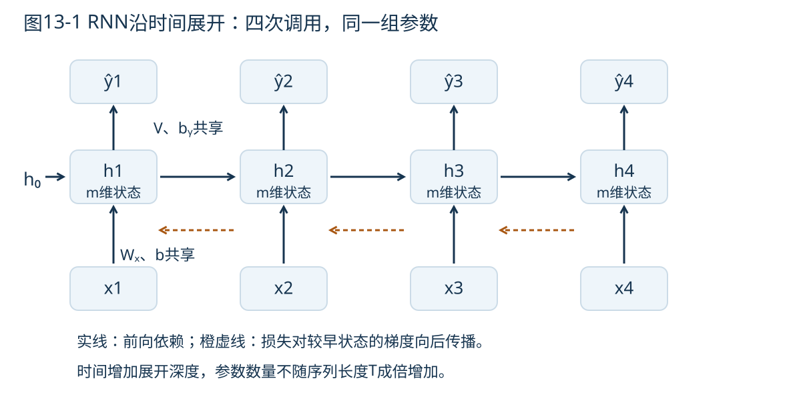
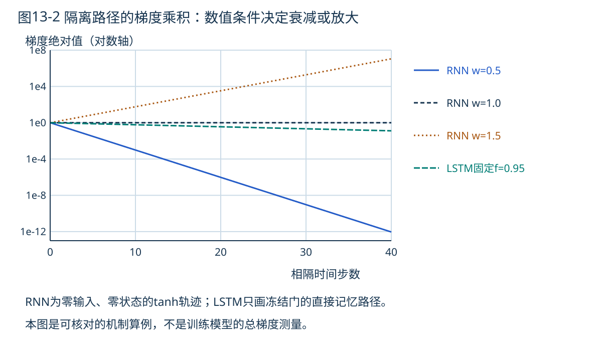
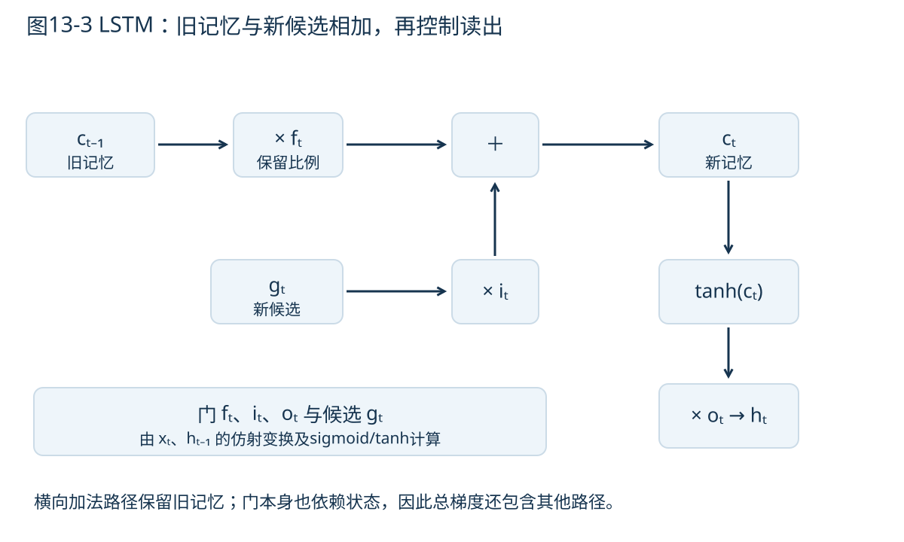
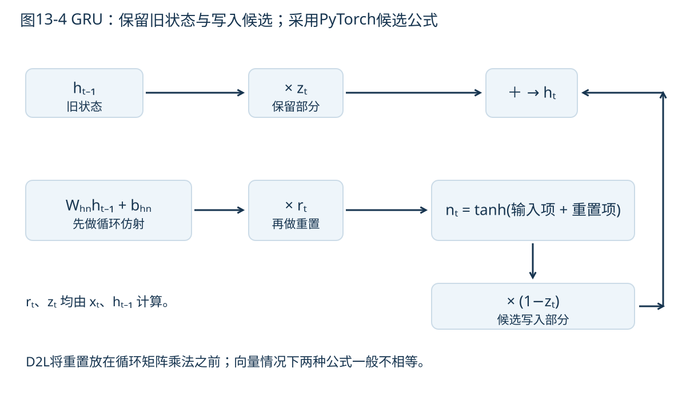
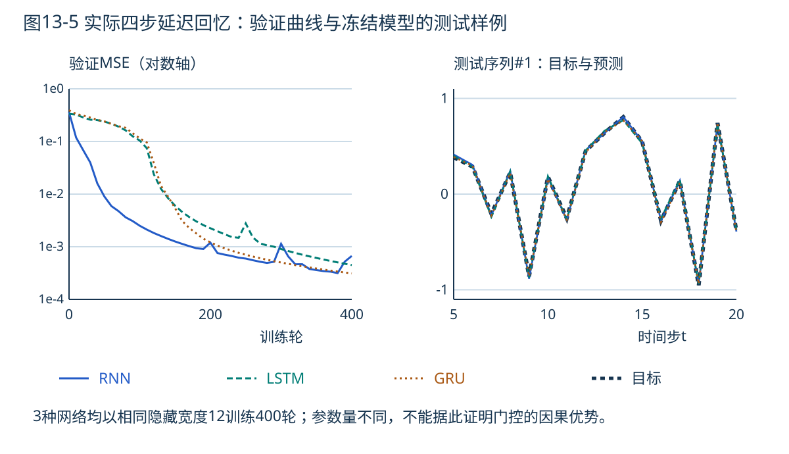

# 第13章：序列建模与RNN、LSTM、GRU

> 状态：正文、五幅SVG、CPU实测与出版验收已完成；正式状态以章节计划为准。
> [阅读入口](../../README.md) · [前置：反向传播](08-backpropagation.md) · [实验方法](10-generalization.md) · [公共符号](../appendices/notation.md) · [完整实验](../../examples/13-sequence-models/README.md)

## 1. 本章目标与前置知识

一个读数是否异常，可能取决于之前的读数；一句话里后面的词，也可能与很早出现的信息有关。如果把每个位置独立交给第07章的MLP，同一输入值总得到同一输出，就无法表达“当前值相同、历史不同、答案不同”的情况。循环神经网络（recurrent neural network，RNN）通过逐步更新隐藏状态，把前面的信息带到后面。[1，§10.1～10.2]

学完后，应能沿时间展开图计算状态与损失，写出共享参数的BPTT梯度，解释梯度为何可能消失或爆炸；逐项计算LSTM与GRU的门控更新；正确处理批次、状态、截断与评估；运行三个CPU小网络，按同一数据协议比较结果及其限制。

前置为第07章的前向传播、第08章的链式法则与自动微分、第09～10章的训练与验证。本章先用标量手算，再过渡到列向量和行批次；不要求已经掌握文本分词。本章实验学习回忆四步前的随机数，不把它包装成能够预测独立随机数的未来。

## 2. 隐藏状态：重复应用同一个更新规则

### 2.1 状态怎样带来历史依赖

把输入序列记为 $`\mathbf{x}_1,\ldots,\mathbf{x}_T`$。时间下标 $`t`$ 表示位置，不一定是物理时钟。本章使用单向、单层网络，先读入当前输入，再产生当前状态和输出：

```math
\begin{aligned}
\mathbf{a}_t&=\mathbf{W}_x\mathbf{x}_t+\mathbf{W}_h\mathbf{h}_{t-1}+\mathbf{b},\\
\mathbf{h}_t&=\tanh(\mathbf{a}_t),\\
\widehat{\mathbf{y}}_t&=\mathbf{V}\mathbf{h}_t+\mathbf{b}_y.
\end{aligned}
```

$`\mathbf{h}_t`$ 称为隐藏状态（hidden state）：它是由历史和当前输入计算出的内部向量，不是隐藏的真实标签。即使两条序列在位置 $`t`$ 的输入相同，只要之前状态不同，当前输出也可以不同。固定维度状态是对历史的压缩，不能保证无损保存任意长度序列。[1,2]



图13-1依据上述递推关系原创绘制。沿时间展开（unrolling）时，图上画出多个状态，但每步都调用同一组参数。它不是每个时间步新建一层独立权重。$`T`$ 增加会增加计算图深度、计算量和训练中需保存的中间状态，参数数量则保持不变。

本章将 $`\mathbf{h}_0`$ 设为零，每条独立序列重新开始。连续读取同一条长流时可以携带状态；不同样本之间随意携带状态，会把前一条样本的信息混进下一条样本。状态使用规则是数据协议的一部分。

### 2.2 输出方式取决于任务

若每个位置都要预测，就让每个状态接读出层；若对整条序列分类，可以用最后的有效状态再接分类器。这里的读出是线性回归输出，因此没有自动附加softmax。

本章结构是因果的：$`\widehat{\mathbf{y}}_t`$ 仅依赖 $`\mathbf{x}_1,\ldots,\mathbf{x}_t`$。双向RNN会同时利用后面的输入，适合整条输入已经可见的任务；若用于只能看到过去的在线预测，会引入不允许的未来信息。两者的可用信息不同，不能直接混作同一实验。[1，§10.3]

## 3. 符号与形状

| 符号 | 含义与形状 |
| --- | --- |
| $`t,T,B`$ | 时间步、序列长度、批次内独立序列数 |
| $`d,m,q`$ | 输入、隐藏状态、输出的维数 |
| $`\mathbf{x}_t,\mathbf{h}_t,\widehat{\mathbf{y}}_t`$ | 单样本列向量，维数分别为 $`d,m,q`$ |
| $`\mathbf{W}_x,\mathbf{W}_h,\mathbf{V}`$ | 形状分别为 $`m\times d,m\times m,q\times m`$ |
| $`\mathbf{b},\mathbf{b}_y`$ | 有效偏置，维数分别为 $`m,q`$ |
| $`\mathcal{X},\mathcal{H}`$ | 代码中的行批次序列，形状为 $`B\times T\times d,B\times T\times m`$ |
| $`\mathbf{c}_t`$ | LSTM细胞状态，维数为 $`m`$，与隐藏状态区分 |
| $`\mathbf{f}_t,\mathbf{i}_t,\mathbf{o}_t`$ | LSTM忘记、输入、输出门，均为 $`m`$ 维 |
| $`\mathbf{r}_t,\mathbf{z}_t`$ | GRU重置、更新门，均为 $`m`$ 维 |
| $`\mathbf{g}_t,\mathbf{n}_t`$ | LSTM记忆候选、GRU状态候选，均为 $`m`$ 维 |
| $`\odot,\mathbf{1}`$ | 同形逐元素乘法、相应维数的全1向量 |
| $`\ell_t,\mathcal{L}`$ | 第 $`t`$ 步的损失贡献、全序列总目标；归约方式在使用处说明 |

本章时间使用下标、训练轮使用epoch，不把时间步和参数更新步混为一谈。行批次的某个时间切片为 $`\mathbf{X}_t\in\mathbb{R}^{B\times d}`$，相应RNN更新是：

```math
\mathbf{H}_t=\tanh\left(
\mathbf{X}_t\mathbf{W}_x^\top+
\mathbf{H}_{t-1}\mathbf{W}_h^\top+
\mathbf{1}_B\mathbf{b}^\top\right).
```

PyTorch的 `batch_first=True` 让序列输入和逐步输出采用 `(B,T,d)` 与 `(B,T,m)`。单层单向的最终状态 `h_n` 仍为 `(1,B,m)`，这个开关不会把它改成 `(B,1,m)`。LSTM还返回同形的 `c_n`。[6～8]

## 4. BPTT：沿展开图应用链式法则

### 4.1 既有直接损失，也有未来状态的贡献

通过时间反向传播（backpropagation through time，BPTT）就是把第08章的方法用于时间展开的无环图。为看清每条路径，先令单序列目标为：

```math
\mathcal{L}=\sum_{t=1}^T\ell_t(\mathbf{h}_t).
```

如果需要平均损失，可以把 $`1/T`$ 纳入每个 $`\ell_t`$；不能在前向求平均、手算梯度却忘记这个因子。定义列梯度：

```math
\mathbf{u}_t=\nabla_{\mathbf{h}_t}\mathcal{L},
\qquad
\boldsymbol{\delta}_t=\nabla_{\mathbf{a}_t}\mathcal{L}.
```

状态 $`\mathbf{h}_t`$ 一方面进入本步损失，另一方面经过 $`\mathbf{W}_h`$ 进入下一个预激活。因此从后向前递推：[1，§10.2；3]

```math
\begin{aligned}
\mathbf{u}_t
&=\nabla_{\mathbf{h}_t}\ell_t+
\mathbf{W}_h^\top\boldsymbol{\delta}_{t+1},\\
\boldsymbol{\delta}_t
&=\mathbf{u}_t\odot(\mathbf{1}-\mathbf{h}_t\odot\mathbf{h}_t),
\qquad \boldsymbol{\delta}_{T+1}=\mathbf{0}.
\end{aligned}
```

这里 $`\nabla_{\mathbf{h}_t}\ell_t`$ 包含读出层的链式法则。例如平方损失 $`\ell_t=\tfrac12\lVert\mathbf{V}\mathbf{h}_t+\mathbf{b}_y-\mathbf{y}_t\rVert_2^2`$ 给出 $`\mathbf{V}^\top(\widehat{\mathbf{y}}_t-\mathbf{y}_t)`$。只有最终步有损失时，较早各步的直接项为零，但未来贡献仍可非零。

### 4.2 共享参数的梯度需要相加

每个时间步都使用 $`\mathbf{W}_h`$，所以其梯度是所有使用位置的贡献之和：

```math
\begin{aligned}
\nabla_{\mathbf{W}_h}\mathcal{L}
&=\sum_{t=1}^T\boldsymbol{\delta}_t\mathbf{h}_{t-1}^\top,\\
\nabla_{\mathbf{W}_x}\mathcal{L}
&=\sum_{t=1}^T\boldsymbol{\delta}_t\mathbf{x}_t^\top,\\
\nabla_{\mathbf{b}}\mathcal{L}
&=\sum_{t=1}^T\boldsymbol{\delta}_t.
\end{aligned}
```

第一项的形状是 $`(m\times1)(1\times m)=m\times m`$，与原权重一致。不能把各时间位置看成不同参数，只留下最后一次使用的梯度。批次中多个样本的贡献还按实际损失的求和/平均规则归约。

### 4.3 手算两步，再核对三步共享梯度

先取标量 $`h_0=0`$、$`w_x=1`$、$`w_h=0.5`$、偏置0，输入为 $`(1,0)`$，最终读出为 $`h_2`$，目标0，损失 $`\mathcal{L}=\tfrac12h_2^2`$：

```math
\begin{aligned}
h_1&=\tanh(1)\approx0.761594,\\
h_2&=\tanh(0.5h_1)\approx0.363399,\\
\mathcal{L}&\approx0.066030,\\
\frac{\partial\mathcal{L}}{\partial w_h}
&=h_2(1-h_2^2)h_1\approx0.240214.
\end{aligned}
```

最后一式已经包含两处共享参数的总贡献；本例第一步的局部项恰为 $`\delta_1h_0=0`$，不是把它遗漏了。脚本得到手算与自动微分均为0.2402138373904254，中心差分约0.2402138373908125。

为避免这个零项掩盖错误，代码再用非零初始状态 $`h_0=0.3`$、$`w_x=0.7`$、$`w_h=0.4`$、输入 $`(0.2,-0.1,0.5)`$、最终目标0.2检查三步情形。状态约为 $`(0.254296,0.031708,0.347575)`$，三个预激活梯度约为 $`(0.019398,0.051847,0.129747)`$，因此：

```math
\frac{\partial\mathcal{L}}{\partial w_h}
\approx0.019398(0.3)+0.051847(0.254296)
+0.129747(0.031708)
\approx0.023118.
```

手工递推与自动微分分别得到0.023117560695203300和0.023117560695203303，说明三个位置的贡献确实累计了。

## 5. 长路径为何会出现梯度消失与爆炸

### 5.1 连乘的是Jacobian，不只是循环权重

令单步状态Jacobian为输出维乘输入维的矩阵：

```math
\mathbf{J}_t
=\frac{\partial\mathbf{h}_t}{\partial\mathbf{h}_{t-1}}
=\mathop{\mathrm{diag}}\nolimits(\mathbf{1}-\mathbf{h}_t\odot\mathbf{h}_t)\mathbf{W}_h
\in\mathbb{R}^{m\times m}.
```

$`\mathop{\mathrm{diag}}\nolimits`$ 把向量放在矩阵对角线上。跨多个时间位置时，链式法则给出：

```math
\frac{\partial\mathbf{h}_T}{\partial\mathbf{h}_s}
=\mathbf{J}_T\mathbf{J}_{T-1}\cdots\mathbf{J}_{s+1}.
```

列梯度向前面的状态回传时，使用该乘积的转置。矩阵乘法通常不可交换，顺序不能颠倒。连续缩小的方向使很早的影响难以收到有效学习信号，称为梯度消失；连续放大的方向可能产生巨大更新，称为梯度爆炸。[1，§10.7；3]



图13-2的RNN采用零输入、零初始状态，整个前向轨迹为零，因此每步 $`\tanh'(0)=1`$，导数严格为 $`w_h^k`$。相隔40步时，$`0.5^{40}\approx9.09\times10^{-13}`$，$`1^{40}=1`$，$`1.5^{40}\approx1.11\times10^7`$；脚本用自动微分逐项核对。它说明前向数值没有爆炸时，局部敏感度仍可很大。

一般非零轨迹还受tanh导数、矩阵方向和状态变化影响，所以不能仅凭某个权重元素大于1就断定整网爆炸。进入饱和区的tanh导数接近0，也可能使信号更弱。

### 5.2 梯度裁剪与截断解决不同问题

全局范数裁剪（gradient norm clipping）在计算全部参数梯度后、更新前，将拼接梯度 $`\mathbf{g}`$ 按阈值 $`c>0`$ 缩放：

```math
\mathbf{g}'=\mathbf{g}\min\left(1,\frac{c}{\lVert\mathbf{g}\rVert_2}\right).
```

零梯度按不缩放处理。例如 $`(3,4)`$ 的范数为5，阈值2给出约 $`(1.2,1.6)`$；框架实现为避免除零含微小数值项。本章核对了这个例子。裁剪能限制单次梯度规模，不能恢复已经消失的长期信息，也不改变前向记忆机制。[1，§10.11]

截断BPTT（truncated BPTT）则把长序列分块，在块边界保留状态数值，但切断其与更早计算图的求导联系，如 `state = state.detach()`。它降低反向图的长度与内存开销，同时改变跨边界梯度，是完整梯度的近似，不等于仅把长数组分段存放。[3，§9.7.1.2]

脚本检查了同一段两步前向：完整图对初始状态的导数约0.149503，切断中间状态后，这条初始状态求导路径不存在。LSTM截断时需要同时切断 $`\mathbf{h}`$ 与 $`\mathbf{c}`$。本章训练只有20步，使用完整BPTT，未采用截断；不能把这项机制核对误报为训练采用了截断。

## 6. LSTM：给记忆建立可调的加法路径

### 6.1 门是连续数值，不是人工开关

长短期记忆网络（long short-term memory，LSTM）区分细胞状态（cell state）$`\mathbf{c}_t`$ 与对外的隐藏状态 $`\mathbf{h}_t`$。细胞状态提供积累与保留的通道，隐藏状态控制当前对其他层可见的信息。下面使用无窥孔、无投影的常见形式。[1，§10.10.1；4]

对输入门、忘记门、输出门分别计算sigmoid值；候选记忆 $`\mathbf{g}_t`$ 使用tanh：

```math
\begin{aligned}
\mathbf{i}_t&=\sigma(\mathbf{W}_{xi}\mathbf{x}_t+\mathbf{W}_{hi}\mathbf{h}_{t-1}+\mathbf{b}_i),\\
\mathbf{f}_t&=\sigma(\mathbf{W}_{xf}\mathbf{x}_t+\mathbf{W}_{hf}\mathbf{h}_{t-1}+\mathbf{b}_f),\\
\mathbf{o}_t&=\sigma(\mathbf{W}_{xo}\mathbf{x}_t+\mathbf{W}_{ho}\mathbf{h}_{t-1}+\mathbf{b}_o),\\
\mathbf{g}_t&=\tanh(\mathbf{W}_{xg}\mathbf{x}_t+\mathbf{W}_{hg}\mathbf{h}_{t-1}+\mathbf{b}_g).
\end{aligned}
```

各 $`\mathbf{W}_{x*}`$ 形状为 $`m\times d`$，$`\mathbf{W}_{h*}`$ 为 $`m\times m`$，偏置为 $`m`$ 维。门分量在 $`(0,1)`$，由数据与参数计算，并随训练改变；不是人工规定何时保留某一个词。逐元素更新为：

```math
\begin{aligned}
\mathbf{c}_t&=\mathbf{f}_t\odot\mathbf{c}_{t-1}
+\mathbf{i}_t\odot\mathbf{g}_t,\\
\mathbf{h}_t&=\mathbf{o}_t\odot\tanh(\mathbf{c}_t).
\end{aligned}
```

忘记门控制旧记忆的保留比例，输入门控制新候选的写入比例，输出门控制当前读出。名字“忘记门”容易误导：这里 $`f`$ 越接近1，保留越多，越接近0才是擦除越多。



图13-3由本章公式原创绘制，门控定义对照D2L §10.1.1。横向记忆路径含加法，让旧记忆不必每步都经过普通RNN的一整次tanh重写。细胞状态可以超出 $`[-1,1]`$；本章形式的隐藏输出受tanh与输出门限制。

### 6.2 手算与长期路径的边界

给定标量旧记忆1、忘记门0.9、输入门0.2、候选0.5、输出门0.8：

```math
c_t=0.9\times1+0.2\times0.5=1,
\qquad
h_t=0.8\tanh(1)\approx0.609275.
```

脚本把仿射层设置成能精确产生这些门值的参数，再与 `LSTMCell` 核对，得到相同结果。这是给定门值的机制算例，正式训练中的门由网络自己学习。

如果暂时固定沿途门值及候选，仅考虑细胞状态的直接保留路径，那么每步的偏导为 $`\mathop{\mathrm{diag}}\nolimits(\mathbf{f}_t)`$，该路径的跨步系数是忘记门的逐元素连乘。固定 $`f=0.95`$，40步保留系数约0.1285，比图中 $`0.5^{40}`$ 衰减慢得多。

必须区分“这条直接路径”与“整网总导数”。门和候选仍通过先前隐藏状态依赖更早记忆；总导数还包括其他路径。忘记门长期偏小、输出门关闭、激活饱和、优化不合适，都可能妨碍学习。LSTM缓解长依赖难题，不保证任意长序列都能记住。[1,4]

## 7. GRU：用两个门混合旧状态与候选

### 7.1 本章明确采用PyTorch的重置位置

门控循环单元（gated recurrent unit，GRU）在本章只有一种状态 $`\mathbf{h}_t`$，没有单独的 $`\mathbf{c}_t`$。重置门 $`\mathbf{r}_t`$ 调节旧信息参与候选计算的程度，更新门 $`\mathbf{z}_t`$ 调节保留旧状态与写入候选的比例。[1，§10.10.2；5]

先计算两个门：

```math
\begin{aligned}
\mathbf{r}_t&=\sigma(\mathbf{W}_{xr}\mathbf{x}_t+\mathbf{b}_{xr}
+\mathbf{W}_{hr}\mathbf{h}_{t-1}+\mathbf{b}_{hr}),\\
\mathbf{z}_t&=\sigma(\mathbf{W}_{xz}\mathbf{x}_t+\mathbf{b}_{xz}
+\mathbf{W}_{hz}\mathbf{h}_{t-1}+\mathbf{b}_{hz}).
\end{aligned}
```

本实验使用的PyTorch候选公式为：[8]

```math
\begin{aligned}
\mathbf{n}_t
&=\tanh\left(\mathbf{W}_{xn}\mathbf{x}_t+\mathbf{b}_{xn}
+\mathbf{r}_t\odot(\mathbf{W}_{hn}\mathbf{h}_{t-1}+\mathbf{b}_{hn})\right),\\
\mathbf{h}_t
&=\mathbf{z}_t\odot\mathbf{h}_{t-1}
+(\mathbf{1}-\mathbf{z}_t)\odot\mathbf{n}_t.
\end{aligned}
```

本章 $`z`$ 越大保留旧状态越多；有些资料把互补量命名为更新门，读公式时要核对。$`r`$ 只控制候选中的循环项，即使它接近0，只要 $`z`$ 接近1，旧隐藏状态依然可沿保留路径传到下一步；不能说重置门必然清空全部记忆。



图13-4依据本章PyTorch形式原创绘制。与LSTM相比，它少了单独的细胞状态和输出门，但仍需要学习何时保留与何时更新，不能仅凭门少就断言所有任务都更快、更准确。

### 7.2 为什么不能悄悄混用两种候选公式

D2L §10.2.2的候选把重置放在循环矩阵乘法之前，包含 $`\mathbf{W}_{hn}(\mathbf{r}_t\odot\mathbf{h}_{t-1})`$；PyTorch则先做循环仿射再逐元素乘门。矩阵混合不同坐标后再缩放，一般不等于先缩放输入坐标再混合，偏置位置也有区别。[5,8]

例如取 $`\mathbf{r}=(0.2,0.8)^\top`$、$`\mathbf{h}=(1,2)^\top`$、$`\mathbf{W}=\left(\begin{smallmatrix}1&2\\3&4\end{smallmatrix}\right)`$，不含偏置时：

```math
\mathbf{r}\odot(\mathbf{W}\mathbf{h})=(1,8.8)^\top,
\qquad
\mathbf{W}(\mathbf{r}\odot\mathbf{h})=(3.4,7)^\top.
```

两种形式都可构造门控模型；把一套公式解释成另一套接口的逐项实现会产生错误。本章代码核对了这一反例。

### 7.3 一个标量更新

设旧状态0.6，重置门0.25，更新门0.8；候选输入项为0.1，循环权重1、循环偏置0：

```math
\begin{aligned}
n_t&=\tanh(0.1+0.25\times0.6)\approx0.244919,\\
h_t&=0.8\times0.6+0.2\times0.244919\approx0.528984.
\end{aligned}
```

`GRUCell` 的实际结果为0.5289837324807418，与手算吻合。若 $`z`$ 接近1，状态主要沿旧值保留；若 $`z`$ 接近0，主要采用候选，但候选本身仍受重置门和非线性影响。

## 8. 从公式到CPU序列实验

### 8.1 数据任务与损失归约

用NumPy种子20261115，从 $`\mathop{\mathrm{Uniform}}\nolimits[-1,1]`$ 独立生成长度20的序列：训练64条、验证32条、测试32条，每步输入为一个标量。数据为本项目合成，无外部下载或许可限制；按整条独立序列划分，不把同一条序列的重叠片段混入训练与测试。

任务是位置 $`t`$ 输出四步前的输入，$`y_t=x_{t-4}`$，仅评价 $`t=5,\ldots,20`$。前4步没有可定义的目标，使用掩码从损失中排除；不是把它们强制设为0再参与平均。训练批次输入形状为 `(64,20,1)`，总损失为：

```math
\mathcal{L}
=\frac{1}{B(T-4)}
\sum_{i=1}^{B}\sum_{t=5}^{T}
\left(\widehat{y}^{(i)}_t-x^{(i)}_{t-4}\right)^2.
```

本式没有额外 $`1/2`$；输出维数为1，分母是有效标量预测总数。对应零基代码为：

```python
prediction = model(x)                 # (B,T,1)
loss = (prediction[:,4:] - x[:,:-4]).square().mean()
```

模型需要记住过去四步，不需要猜测不可预测的独立未来随机数。目标完全在过去，单向网络可合法完成。这个任务很短，不能用于宣称解决了自然语言的长期依赖。

### 8.2 三模型与参数量

三种网络均为单层、单向、输入1维、隐藏12维，随后用同一个形状的线性读出到1维，无Dropout。选择 `RNN`、`LSTM` 或 `GRU`，其余训练设置固定：

```python
hidden_sequence, final_state = recurrent(x)
prediction = readout(hidden_sequence)
```

`final_state` 在LSTM是 `(h_n,c_n)`，另外两类为 `h_n`。本实验每次前向都不传旧状态，使独立序列从零开始。脚本还对比同一序列一次性前向与逐步携带状态的流式前向，输出在float64容差内一致。

PyTorch为输入和循环仿射分别存偏置。普通RNN的参数量因此为：

```math
md+m^2+2m+(m+1)
=12+144+24+13=193.
```

LSTM的四组门/候选仿射为 $`4(md+m^2+2m)`$，再加13个读出参数，共733；GRU的三组共553。有效单偏置公式在RNN/LSTM中可合并两个偏置，但实际存储参数数目仍有两组。GRU候选中重置门包围循环偏置，不能随意跨门合并。[6～8]

固定隐藏宽度并没有固定参数总量，也没有令三种不同结构共享同一组初始化值。这个对照回答“同一数据和预算下这三个具体实现如何表现”，不能单独隔离门控的因果贡献。

### 8.3 预算、选模与复现检查

本机使用Python3.11.5、NumPy2.4.6、PyTorch2.15.0+cpu，CPU、float64、1线程，开启确定性算法。三模型各用种子17初始化，采用接口默认初始化；同一种子不等于不同形状模型的参数相同。

训练400轮，每轮一次全批次更新，Adam学习率0.01、动量系数0.9/0.999、$`\epsilon=10^{-8}`$，无权重衰减。每10轮在 `eval()` 与 `no_grad()` 下记录纯MSE，选验证误差最低的已记录检查点；包含第0轮，不采用早停。最大预算固定，不依据测试结果修改配置。

每轮完整反传20步，然后以全局范数1裁剪梯度再更新。三个实际训练运行中，超过裁剪阈值的次数都是0；本章爆炸与裁剪机制由第5节的单独数值检查展示，不能虚构训练时发生了爆炸。

最佳权重写入检查点，再创建同结构模型加载，验证输出逐项相同。三种预设训练完成后，额外重跑RNN，要求训练/验证曲线及恢复预测完全相同；此后才统一进行各固定模型的最终测试评价。

从仓库根目录运行：

```powershell
& ./.venv/Scripts/python.exe -B examples/13-sequence-models/run.py
```

完整代码与[运行说明](../../examples/13-sequence-models/README.md)给出输出细节。`build/experiments/13-sequence-models/results.json` 保存数据哈希、逐轮记录、机制核对及资源测量；检查点在同目录的 `checkpoints/`。图源[figures.py](../../examples/13-sequence-models/figures.py)直接读取报告生成真正SVG。

## 9. 实测结果与证据边界

2026-11-15 22:29（Asia/Shanghai）本机运行通过。下表为验证选出的模型，不是未经恢复的最后一轮；“最佳轮”只在每10轮记录的检查点中选择。

| 模型 | 参数量 | 最佳轮 | 验证MSE | 测试MSE |
| --- | --- | --- | --- | --- |
| RNN | 193 | 380 | 0.00031544 | 0.00038386 |
| LSTM | 733 | 400 | 0.00044858 | 0.00039039 |
| GRU | 553 | 400 | 0.00031172 | 0.00033429 |

永远预测0的参照在测试集MSE约0.32081，三个模型都明显降低了当前任务误差。第一条测试序列在 $`t=5`$ 的目标为0.384400，来自其 $`t=1`$ 输入，不是当前输入的拷贝。读者可在JSON内逐项对齐输入、目标和预测。



图13-5左侧使用同一对数尺度显示验证MSE，右侧显示选模结束后的测试样例，黑虚线为目标，三种线型对应三个网络。样例曲线重合较多，说明这个四步任务对当前配置并不困难，不应人为画出一个门控必胜的巨大差距。

普通RNN在这里同样学得很好，LSTM的当前测试MSE还略高于它。短延迟、特定初始化与不同参数量都会影响对比；只有一个种子和一份划分，没有覆盖训练随机性、数据变化或更长延迟。这些结果不能构成三类网络普遍优劣的排名，也不能证明门控对长期依赖没有作用。

手算/自动微分/差分、非零初态共享梯度、40步敏感度、门控单元数值、两种GRU公式差异、截断边界、裁剪、流式与整段前向、检查点恢复、同种子重跑均实际通过。训练与检查约4.283秒，含导入约7.145秒，计时不含随后SVG生成；三个数据数组的本体载荷20480字节，进程峰值内存未测量，不能把该载荷当成训练总内存。

## 10. 常见误区与适用边界

- **展开四步就是四套权重**：展开的是计算调用，共享参数的梯度需要累计。
- **隐藏状态保存了全部历史**：固定维度状态是可学习压缩，容量与训练都有限。
- **RNN权重大就必然爆炸**：还要考虑激活导数、Jacobian方向与整段轨迹。
- **裁剪解决了梯度消失**：它限制过大的更新，不能重新创造缺失的远程信号。
- **LSTM的忘记门越大忘得越多**：本章公式中越接近1保留越多。
- **GRU重置门为0就清空所有旧状态**：更新门仍可以沿直接路径保留旧值。
- **门控使任意长期梯度永不衰减**：直接路径可更易保留，整网仍存在门饱和与其他路径。
- **`batch_first`改变所有张量的轴顺序**：最终隐藏/细胞状态仍有层与方向轴在最前。
- **填充为0的位置天然没有影响**：普通循环层仍会更新状态；可变长序列需要正确长度、掩码或打包。最后数组位置可能是填充，不一定是最后有效状态。本章全部长度相同，没有使用填充。

## 11. 习题与解析

### 11.1 习题

1. 为什么将序列顺序打乱会改变RNN结果？时间展开后的参数量是否随 $`T`$ 增长？
2. 重算第4节两步例子的 $`h_1,h_2`$ 与循环权重梯度。为什么第一步局部梯度贡献为0仍不能作为忽略共享梯度的理由？
3. 对标量线性递推 $`h_t=0.8h_{t-1}`$，相隔10步的导数是多少？裁剪能使这个导数恢复为1吗？
4. LSTM有 $`c_{t-1}=2`$、$`f_t=0.75`$、$`i_t=0.4`$、$`g_t=-0.5`$、$`o_t=0.5`$，计算新细胞与隐藏状态。
5. GRU取旧状态0.6、候选0.2、$`z=0.9`$，新状态是多少？把 $`z`$ 改为0.1会怎样？
6. 把三模型的隐藏宽度都设为12，为什么不等于严格控制了参数量？如何设计更有说服力的门控比较？
7. 若目标仍回忆四步前，为什么不能把验证集与训练集从同一长序列的相邻重叠窗口随意切开？如果把实验延迟改长，应保留哪些协议、报告哪些失败？

### 11.2 参考解析

1. 状态递推会让每步处理的历史不同，非线性组合通常不具交换性，所以顺序有意义。权重共享使参数量不随 $`T`$ 增长，计算和保存中间状态的需求仍会增长。
2. 结果约0.761594、0.363399、0.240214。第一步局部贡献为 $`\delta_1h_0=0`$ 只是当前初值导致；换成非零初态后，代码中的三项总和约0.023118，漏项就会不一致。
3. 导数为 $`0.8^{10}\approx0.107374`$。裁剪只缩小过大的梯度，不会放大这个衰减导数到1，也不改变前向模型的依赖结构。
4. $`c_t=0.75\times2+0.4\times(-0.5)=1.3`$，$`h_t=0.5\tanh(1.3)\approx0.430862`$。细胞状态超出1仍符合本章定义。
5. $`h_t=0.9\times0.6+0.1\times0.2=0.56`$；改为0.1后为0.24，更接近新候选。本章的 $`z`$ 是旧状态保留比例。
6. 各单元门/候选的组数不同，参数量为193、733、553。可以同时报告按隐藏宽度和近似参数预算的对照，使用多个初始化与多个数据划分，预设更长延迟和预算，保留相同验证选模、测试冻结规则；即使如此，结论仍需限定任务与实现。
7. 重叠窗口可共享大量输入与目标，使验证证据过于接近训练，时间序列还需尊重未来不可见性。本章以独立整条序列生成划分避免这一点。延迟变长应预先固定长度、数据划分、预算和评价位置，报告实际误差、梯度与资源；不能只挑选成功种子，也不能改变损失掩码却忘记分母。

## 12. 小结与下一步

RNN用共享递推把历史变成状态，BPTT把共享参数的全部时间贡献相加。Jacobian连乘解释了长路径的衰减与放大，裁剪和截断分别改变更新规模与梯度范围。LSTM与GRU提供可学习的保留/写入通道，但机制优势需要结合具体任务、容量和预算验证。

后续文本表示章节会把字符或词转成向量，再用序列模型处理；注意力章节会讨论直接访问多个历史位置的方式。先理解状态压缩与梯度路径，才能看清这些结构分别缓解什么限制。

## 13. 参考文献

官方页面于2026-11-15核验。五幅配图均为本章原创SVG，机制图依据本文公式，实测图来自本机报告。

1. Goodfellow、Bengio、Courville，*Deep Learning*，2016，第10章§10.1计算图展开、§10.2 RNN、§10.7长期依赖、§10.10门控、§10.11优化：[官方章节](https://www.deeplearningbook.org/contents/rnn.html)。
2. Zhang等，*Dive into Deep Learning*，在线1.0.3，§9.4 Recurrent Neural Networks：[官方章节](https://d2l.ai/chapter_recurrent-neural-networks/rnn.html)。
3. 同书，§9.7 Backpropagation Through Time，尤其§9.7.1.2 Truncating Time Steps：[官方章节](https://d2l.ai/chapter_recurrent-neural-networks/bptt.html)。
4. 同书，§10.1 Long Short-Term Memory，尤其§10.1.1.2～10.1.1.5门、候选、细胞与输出：[官方章节](https://d2l.ai/chapter_recurrent-modern/lstm.html)。
5. 同书，§10.2 Gated Recurrent Units，§10.2.1～10.2.3；候选重置位置与本实验区别见正文：[官方章节](https://d2l.ai/chapter_recurrent-modern/gru.html)。
6. PyTorch2.15，RNN公式、形状及两组偏置：[官方接口](https://docs.pytorch.org/docs/2.15/generated/torch.nn.RNN.html)。
7. PyTorch2.15，LSTM无投影形式、门顺序及状态形状：[官方接口](https://docs.pytorch.org/docs/2.15/generated/torch.nn.LSTM.html)。
8. PyTorch2.15，GRU公式及与原始候选重置位置的差异说明：[官方接口](https://docs.pytorch.org/docs/2.15/generated/torch.nn.GRU.html)。

## 14. 实现与验证记录

数值与真实CPU训练通过；独立HTML/PDF为14页、五幅SVG、137处公式。1440/390px检查、PDF字体嵌入与矢量保留审计通过，无位图；全部页面与五图目视通过。
