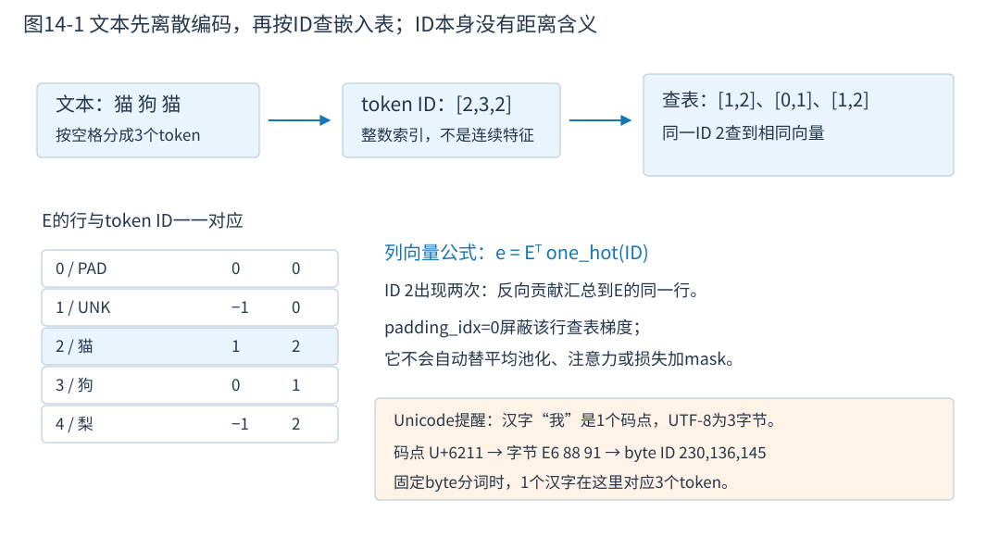
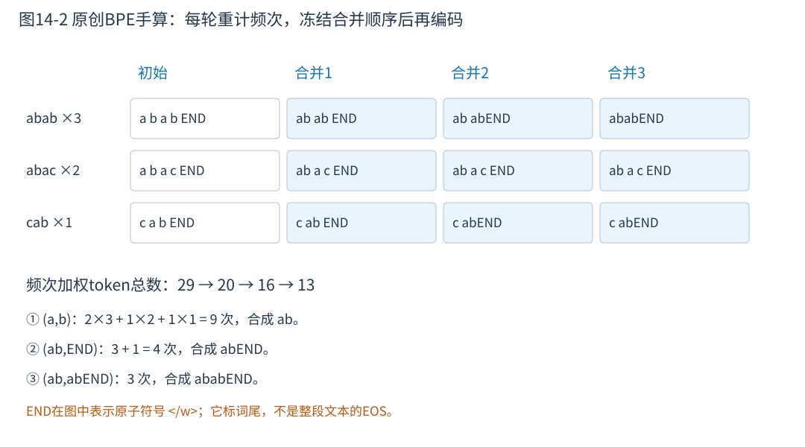
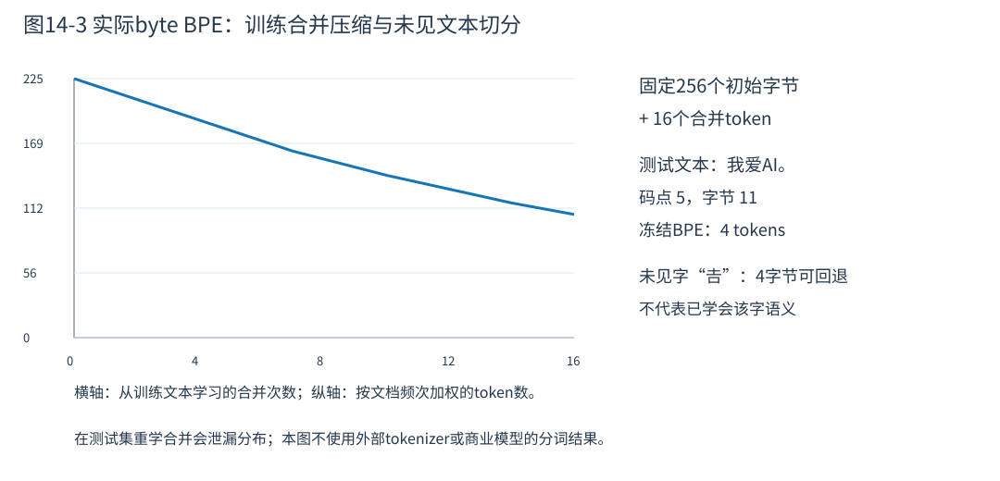
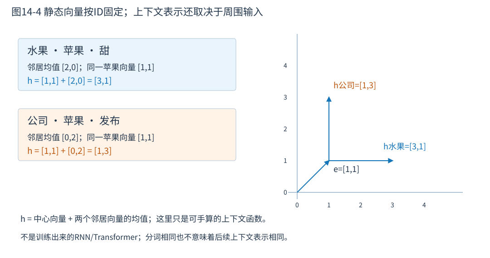
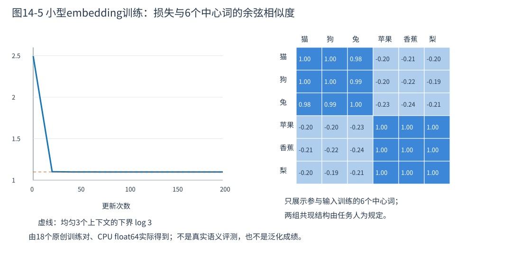

# 第14章：文本表示、词嵌入与分词

> 文本不是天然的实数向量。本章逐步连接“文字怎样切分”“离散符号怎样编号”“编号怎样变成可学习向量”，并用原创小语料完成BPE手算与CPU嵌入训练。更新日期：2026-11-15。

[阅读入口](../../README.md) · [章节计划](../chapter-plan.md) · [公共符号](../appendices/notation.md) · [完整实验](../../examples/14-tokenization-and-embeddings/README.md)

## 1. 为什么不能把文本直接交给矩阵乘法

对图像，我们能把像素强度写成数值；对句子“猫追着狗”，直接给“猫”编号2、“狗”编号3并送进线性层，却会引入一个没有依据的假设：3比2大，编号相差1。换一套编号，这种大小关系就变了，语言内容却没有改变。

我们需要分清三个工作：

1.  **分词（tokenization）** ：把文本转成离散符号序列，符号称为token；它可以是词、码点、子词或字节。
2.  **编码（encoding）** ：按词表把每个符号映射为整数ID；这是查找关系。
3.  **嵌入（embedding）** ：用ID选择参数表的一行，得到能被后续模型处理的实数向量；向量值通过任务训练改变。

“分词器学会了语义”和“嵌入层会自动理解上下文”都不是上述定义的结论。把管线拆开，才能判断未知字符在哪里出现、词表怎样影响参数、padding需要屏蔽哪里。[1, §12.4.1–12.4.3][2, §15.4]

本章前置：[01章](01-linear-algebra.md)的向量/矩阵与形状、[03章](03-probability.md)的条件概率、[05章](05-machine-learning.md)的softmax交叉熵、[08章](08-backpropagation.md)的共享梯度；第13章的序列处理提供背景，本章会就地解释所需符号。完成后应能手算查表与重复索引梯度，解释字符/字节/token差别，逐轮计算BPE，训练一个有明确目标的小嵌入模型。

## 2. 文本、字符、字节、词与token

### 2.1 一个“字”不总等于一个存储单元

 **Unicode码点** 是文字编码中的编号，如“我”的码点是U+6211； **UTF-8字节** 是其具体编码结果，“我”编码为十六进制E6 88 91，共3字节，也就是十进制230、136、145。二者不能混成同一个长度单位。[7–8]

Python3字符串的len统计码点数量，不是UTF-8字节数，也不一定是用户感知的字符数。一个显示出来的字符可由基础字母与组合重音构成；更一般的用户感知字符边界称为 **字素簇** ，Unicode另有分段规则。本章不实现完整字素簇算法，也不把len的结果冒称为该计数。[7, UAX29]

例如下面两种字符串视觉上都可能显示为café：

| 写法 | 最后部分的码点 | Python码点数 | UTF-8字节数 |
| --- | --- | --- | --- |
| 预组合形式café | U+00E9 | 4 | 5 |
| 分解形式café（e+组合重音） | U+0065与U+0301 | 5 | 6 |

它们原始码点序列和字节不相等；NFC正规化能把这里的规范等价写法统一成相同形式。正规化策略必须在训练和使用时一致。正规化也改变原始表示：如果要求逐字节还原，就不能默默先正规化再宣称还原了原文。[7, UAX15] 本章多语种分词实验明确不正规化，另做NFC对照检查；不是完整Unicode标准符合性测试。

### 2.2 不同切分粒度各解决什么

| 粒度 | 本章理解方式 | 好处 | 代价与边界 |
| --- | --- | --- | --- |
| 词级 | 先确定词边界，再用完整词查表 | 序列可能较短 | 稀有词多；中文不能只靠空格确定词 |
| 码点级 | 按Unicode码点切开 | 初始符号直观、组合灵活 | 多码点字符会拆开；训练字表外仍可能未知 |
| 字节级 | 将UTF-8字节0～255作为基础token | 基础词表固定，可编码有效UTF-8文本 | 中文等常需多个token；单字节不一定可单独解码 |
| 子词级 | 用学习到的可变长片段表示 | 在词表大小和序列长度之间折中 | 边界依赖训练语料与算法，不必等于词素 |

对“我爱AI。”按码点切是5个单位，按原始UTF-8字节切是11个；按空格分割只得到一个整串。最后一种结果不能说明中文只有一个“词”，只说明这个空格算法没有做中文词边界分析。

 **token不是一种固定语言学单位。**  同一句话交给不同分词器，token数可以不同；上下文窗口写“64 tokens”时，也必须问它按哪套词表计数。不能把中文字符数、英文单词数或字节数直接当作某个模型的token数。[1, §12.4.1]



*图14-1：本章原创查表例子，依据[1, §12.4.2]、[2, §15.4]与[6–8]绘制。上方先按空格得到猫/狗/猫，再查固定表；右下明确区分“我”的一个码点和三个UTF-8字节。这是两套分词约定的例子。*

## 3. 记号、ID与特殊符号

| 符号 | 含义与形状 | 说明 |
| --- | --- | --- |
| $`\mathcal V,V`$ | 词表及其大小 | ID从0至 $`V-1`$ |
| $`s_t`$ | 位置 $`t`$ 的整数token ID | 不是实数特征大小 |
| $`\mathbf o_t`$ | 独热（one-hot）列向量，$`V`$维 | 只有第 $`s_t`$ 个分量为1 |
| $`\mathbf E`$ | 输入嵌入参数表，$`V\times d`$ | 每行对应一个token |
| $`\mathbf e_t`$ | 查到的 $`d`$ 维列向量 | $`\mathbf E^\top\mathbf o_t`$ |
| $`\mathbf S,\mathcal H`$ | 批次ID矩阵与嵌入张量 | $`B\times T`$ 与 $`B\times T\times d`$ |
| $`\mathbf U`$ | 输出嵌入表，$`V\times d`$ | 小型共现模型中与 $`\mathbf E`$ 分开 |
| $`c,o`$ | 中心token ID、上下文token ID | 与序列位置 $`t`$ 不同 |
| $`N`$ | 共现训练对数量 | 本章训练示范为18 |
| $`f(w)`$ | 某个训练字符串的频次 | BPE统计的加权次数 |

词表必须保存“符号到ID”和反向关系，模型权重也依赖这套对应。把词表排序后直接载入旧权重，会让一个符号查到另一符号的行，形状一样也会错。若同时按相同置换重排词表和参数表，查表输出可以完全不变；实验实际检查了这种等价重编号。

特殊token是人为约定的离散符号，例如PAD表示对齐填充，UNK表示未知符号，BOS/EOS表示序列开始/结束。它们的名称和ID都不具有全局统一标准；词尾边界也不等于整段文本结束。必须查具体协议，不能把任何0都当作PAD。

本章为便于手算采用三套互相独立的小词表：

- 图14-1手算嵌入有5行：PAD=0、UNK=1、猫=2、狗=3、梨=4。
- 三轮字符BPE手算初始为a、b、c和原子词尾符号，合并后共7个符号。
- 多语种byte BPE初始固定256字节，加16个合并token，共272个；不保留特殊ID，0仍是字节NUL。

后面训练小嵌入又使用12词的独立表。各自的ID不能直接混用；这些例子展示运算，不是一个可交换所有权重的完整语言模型。

## 4. One-hot与embedding：查表就是选择参数行

### 4.1 从独热向量得到密集向量

ID 2本身不应参与“2乘权重”的数值计算。可以先把它表示为one-hot列向量，再用线性映射：

```math
\mathbf e_t=\mathbf E^\top\mathbf o_t,
\qquad
\mathbf o_t\in\{0,1\}^{V},
\quad
\mathbf E\in\mathbb R^{V\times d}.
```

由于 $`\mathbf o_t`$ 只有索引 $`s_t`$ 处是1，逐分量可得

```math
e_{tq}=\sum_{k=0}^{V-1}E_{kq}o_{tk}=E_{s_tq}.
```

因此无需真的创建很长的one-hot数组，直接取参数表第 $`s_t`$ 行即可。数学默认列向量，PyTorch存储的一行向量形状为(d,)，两者按相同分量对应。[1, §12.4.2][6]

用图14-1的表，

```math
\mathbf E=
\begin{bmatrix}
0&0\\-1&0\\1&2\\0&1\\-1&2
\end{bmatrix},
\qquad
\mathbf o_{2}=(0,0,1,0,0)^\top.
```

则 $`\mathbf e_{2}=(1,2)^\top`$，狗为 $`(0,1)^\top`$。两次出现猫，静态查表结果相同。稠密并不保证每个分量都非零，也不保证这些初始手填数值已有语言意义。

不同one-hot向量两两正交，欧氏距离都为 $`\sqrt2`$；这种表示没有表达“猫更像狗还是梨”。可学习嵌入把多个token映射到较低维、共享特征坐标的空间，训练目标才决定哪些区别值得保留。[2, §15.4][3]

### 4.2 批次形状与参数规模

一批ID为 $`B\times T`$，查表得到 $`B\times T\times d`$，每个位置都选择一行；不把序列位置求和：

~~~python
ids = torch.tensor([[2, 3, 2], [4, 0, 0]], dtype=torch.long)
table = torch.nn.Embedding(5, 2, padding_idx=0)
h = table(ids)  # (2, 3, 2)
~~~

本章先把表设成上面的手填数值。对应输出为第一行序列[猫向量、狗向量、猫向量]，第二行[梨向量、零向量、零向量]。ID张量是整数索引，不对它求普通连续导数；可训练的是被索引的参数值。

嵌入表有 $`Vd`$ 个参数。例如 $`V=10000`$、$`d=64`$，共640000个参数，float32权重占2560000字节，约2.44MiB；float64翻倍约4.88MiB。这只计权重，未计梯度、优化器状态或激活。若输出端还要为整个词表算logit，输出头通常另有约 $`dV`$ 个权重；词表变大既影响输入表，也影响输出计算。[1, §12.4.3]

### 4.3 重复ID如何反向传播

记位置 $`(a,t)`$ 的上游向量梯度为 $`\mathbf g_{at}`$。对普通查表、未加入padding特殊约定时，

```math
\frac{\partial\mathcal L}{\partial E_{kq}}
=\sum_{a,t}\mathbb I[S_{at}=k]\,g_{atq}.
```

$`\mathbb I[\cdot]`$ 是条件成立取1、否则取0的指示函数。相同ID出现多次，它们对同一参数行的贡献累加；不是“最后一次覆盖前一次”。

实验对上面2×3个ID的输出全部求和，使每个分量上游梯度都是1。指定padding_idx=0后，PyTorch按接口约定屏蔽0行的查表梯度，得到

```math
\nabla_{\mathbf E}\mathcal L=
\begin{bmatrix}
0&0\\0&0\\2&2\\1&1\\1&1
\end{bmatrix}.
```

猫出现两次，所以猫行是(2,2)；狗、梨各一次；UNK未出现；PAD行由padding约定置零。注意：普通one-hot矩阵乘法的前向与查表等价，但若对PAD输出也求和，普通矩阵乘法不会自动带上这个特殊反向约定。不能把本次PAD梯度零归因于“所有矩阵乘法天然忽略0号行”。[6]

### 4.4 padding_idx不会自动完成全部mask

即使PAD向量是零，把[猫、狗、PAD]直接平均，仍会除以3；正确的有效token平均应除以2。令 $`m_t\in\{0,1\}`$ 表示有效位置，且至少一个位置有效：

```math
\overline{\mathbf e}
=\frac{\sum_t m_t\mathbf e_t}{\sum_t m_t}.
```

本例正确均值是 $`(0.5,1.5)^\top`$，不屏蔽时是 $`(1/3,1)^\top`$。注意力可见位置、输出损失的忽略标签和查表PAD梯度是不同工作，需要分别传递mask或设置归约；一个padding_idx不能代替全部设置。对全是padding的样本，分母是0，应拒绝或显式处理。

## 5. BPE：从小符号反复合成常见片段

### 5.1 为什么需要子词

只用完整词时，词表外的新词只能变UNK或交给回退机制；只用码点或字节时，序列又可能很长。子词方法尝试让常见片段使用较少token，稀有组合仍能拆回小符号。

 **字节对编码（Byte Pair Encoding，BPE）**  的名称来自压缩方法。Sennrich等把它改作词内字符片段合并：从初始字符和词尾符号出发，反复合并最常见相邻符号对。本章先实现这个可手算版本，再实现以256个字节为基础、可在一条文档内跨空格合并的教学变体；不能把二者的边界规则混为一谈。[4, §3.2]

### 5.2 统计、合并、重新统计

设当前字符串 $`w`$ 的符号序列为 $`(z_1,\ldots,z_m)`$，训练频次为 $`f(w)`$。符号对 $`(A,B)`$ 的加权相邻计数为

```math
C(A,B)=\sum_w f(w)
\sum_{i=1}^{m_w-1}\mathbb I[z_i=A,\ z_{i+1}=B].
```

每轮选择计数最大的符号对，创建一个新符号，在每条序列内从左到右作不重叠替换，再重新统计下一轮。若多个对并列，本章按整数ID对的字典序选最小者，保证可复现。

计数与替换也要区分：在[a,a,a]中，相邻(a,a)出现两次，但从左至右不重叠替换只能得到[aa,a]，不能同时把中间a用两遍。配套实验专门检查了这个边界。



*图14-2：原创加权词典abab×3、abac×2、cab×1，依据[4, §3.2]的合并定义绘制。END在图里代表一个原子词尾符号，不是三个字母，也不是句末EOS；abEND是一次合并产生的新符号。*

### 5.3 把三轮计数走完

初始序列分别为[a,b,a,b,END]、[a,b,a,c,END]、[c,a,b,END]，总token数按频次加权是 $`5\cdot3+5\cdot2+4\cdot1=29`$。

 **第1轮。**  (a,b)在abab中每次出现2个，在abac和cab中各1个，故计数 $`2\cdot3+1\cdot2+1\cdot1=9`$，合成ab。序列变成[ab,ab,END]、[ab,a,c,END]、[c,ab,END]；加权长度降到20。

 **第2轮。**  必须在新序列中重数。(ab,END)的计数为 $`3+1=4`$，高于(ab,ab)的3；合成abEND。序列变成[ab,abEND]、[ab,a,c,END]、[c,abEND]；长度变16。

 **第3轮。**  (ab,abEND)计数3，其他候选至多2；合成ababEND。结果为[ababEND]、[ab,a,c,END]、[c,abEND]；长度变13。初始4个符号加3个新符号，共7个，未删除旧符号。

这个例子由频次驱动，没用词性、词典或语义标签。合并结果可能碰巧对应完整词或常见词素，也可能只是常见字符片段。

### 5.4 使用分词器时冻结什么

训练分词器后，保存初始符号集合、ID映射、合并顺序、正规化/预切分策略和特殊符号约定。编码新文本时从基础符号开始，依学习到的优先顺序合并，不在测试文本上重新统计“最常见对”。

例如cab仍编码为[c,abEND]。对abaz，若字符z不在基础字表里，这个字符BPE仍会遇到未知符号；“子词”本身没有保证覆盖所有字符。保留全部256字节为基础、允许回退时，可以表示输入UTF-8的每个字节，但不代表模型学会了未见文本的含义。

BPE也不等于“每次选最长词表字符串”。合并优先级、预切分、边界规则都会影响结果。复现生产分词器时应使用其真实实现与配置；本章小实现不宣称兼容任何商业模型的分词规则。

## 6. 多语种byte BPE实践：比较长度并验证还原

训练语料完全原创，用下表的字符串与频次学习16次合并；测试探针不参与合并统计：

| 训练字符串 | 频次 |
| --- | --- |
| 我爱学习。 | 4 |
| 我爱数学。 | 3 |
| 你爱学习。 | 2 |
| I love learning. | 3 |
| I love math. | 2 |
| AI helps learning. | 1 |

这里“字节”是UTF-8存储单位，不是Python显示字符。新token存储其组成字节的连接，解码时先把所有token的字节拼回去，再统一按UTF-8解码；某个单独字节如E6不能严格解码成完整字符。任意生成的字节序列也未必是有效UTF-8，覆盖字节表不等于生成永远合法。

本章没有预切分，合并可以跨文档内空格，不能跨文档。它是说明覆盖与合并机制的教学变体；训练频次、规则、并列处理和JSON配置都保存在结果中。初始词表256，最终272，加权训练token数从225降到107。



*图14-3：由实际报告生成的SVG曲线。只在六条训练字符串上学习合并，右侧测试“我爱AI。”的token数用冻结规则计算；基础字节仍全部保留。*

实际长度比较：

| 测试探针 | 码点数 | UTF-8字节数 | 冻结byte BPE token数 |
| --- | --- | --- | --- |
| 我爱学习AI。 | 7 | 17 | 8 |
| I love learning AI. | 19 | 19 | 15 |
| 我爱AI。 | 5 | 11 | 4 |
| café（预组合） | 4 | 5 | 5 |
| café（分解） | 5 | 6 | 6 |
| U+20BB7，字形𠮷 | 1 | 4 | 4 |

六个字符串都在拼接token字节后严格解码还原原文；恢复保存的分词配置后ID序列也一致。未见汉字能回退成4字节，是编码覆盖检查，不是语义测试。NFC实验另验证两种café规范等价；主实验不执行正规化，所以保留了两者长度差。

词表越大、合并越多，训练文本通常能用更少token表示；这不保证所有未见文本都同比缩短，也不保证下游任务更好。大词表会增加嵌入/输出层的参数与稀有token学习难度，小粒度则增加序列长度；选择需要结合数据、计算与评估，而非只看压缩率。

## 7. 静态嵌入与上下文表示

对同一个ID，静态嵌入表总给相同向量；“水果苹果甜”和“公司苹果发布”里的苹果，若都分成同一个苹果token，查表结果仍然相同。 **上下文表示** 还使用周围token以及可能的位置信息，因而同一token出现在不同输入中可以得到不同向量。[1, §12.4.2][3]

为先讲清区别，不引入完整RNN或Transformer，定义一个可手算的示意函数：

```math
\mathbf h_t=\mathbf e_t+\frac{\mathbf e_{t-1}+\mathbf e_{t+1}}2.
```

这里只讨论有两个邻居的位置。给苹果向量 $`(1,1)^\top`$，水果、甜都取 $`(2,0)^\top`$，公司、发布都取 $`(0,2)^\top`$，则两个上下文分别得到 $`(3,1)^\top`$、$`(1,3)^\top`$。



*图14-4：原创手填二维向量示意。它只展示“还依赖邻居”就能改变表示，未训练语言模型，未把简单邻居均值称为Transformer或真实词义消歧系统。坐标和箭头与本节手算完全对应。*

实际序列网络会学习更复杂的组合函数，可能只用左侧历史，也可能同时使用左右上下文，取决于任务约束。本节的双侧示意不能直接搬去因果语言模型预测未来；那会使用不应可见的右邻居。后续注意力章节会详细建立这些可见关系。

## 8. 一个小型embedding怎样真正训练起来

### 8.1 给出足够明确的学习目标

“把embedding层跑一遍”只是查表，不能说明训练会改变什么。本章用一个完整softmax的简化skip-gram式目标：给中心词 $`c`$，预测上下文词 $`o`$。输入向量 $`\mathbf v_c=\mathbf E_{c:}^\top`$，输出向量 $`\mathbf u_o=\mathbf U_{o:}^\top`$，两张参数表都为 $`V\times d`$，但相互独立。[3, §15.1.3][5]

```math
p(o\mid c)=
\frac{\exp(\mathbf u_o^\top\mathbf v_c)}
{\sum_{k=0}^{V-1}\exp(\mathbf u_k^\top\mathbf v_c)}.
```

对 $`N`$ 个中心/上下文对，最小化按对平均的负对数概率：

```math
\mathcal L=
-\frac1N\sum_{n=1}^{N}\log p(o_n\mid c_n).
```

每对生成的logit向量为 $`\mathbf z_n=\mathbf U\mathbf v_{c_n}`$，使用第05章稳定交叉熵，不先显式算指数再取对数。这里训练对是已知共现关系，不是“好词/坏词”的人工语义分类标签。

### 8.2 由softmax梯度解释哪些行会更新

对单个训练对，记 $`\mathbf p`$ 为输出概率、$`\mathbf o_o`$ 为目标ID的one-hot列向量，未除 $`N`$ 的单对梯度为

```math
\begin{aligned}
\nabla_{\mathbf v_c}\ell&=\mathbf U^\top(\mathbf p-\mathbf o_o),\\
\nabla_{\mathbf U}\ell&=(\mathbf p-\mathbf o_o)\mathbf v_c^\top.
\end{aligned}
```

推导分两步：交叉熵对logit的梯度是 $`\mathbf p-\mathbf o_o`$；logit为 $`\mathbf U\mathbf v_c`$，再用第08章线性映射反向规则。输入表只更新被选中心行，重复中心要累加；输出表的所有行都参与softmax分母，通常都会收到梯度。批次平均时统一除以训练对数量 $`N`$。

因此“词嵌入训练只会更新出现在句子里的词”并不是不带条件的结论：这里输入表与输出表角色不同。若用负采样，目标与计算也会改变，本章没有实现负采样，不能把下面结果冒称为完整生产word2vec训练复现。

### 8.3 原创任务与实际训练结果

词表固定为[猫、狗、兔、苹果、香蕉、梨、跑、跳、睡、甜、酸、熟]。对前三个动物中心，各配跑/跳/睡；对后三个水果中心，各配甜/酸/熟，枚举全部 $`6\cdot3=18`$ 对。这个人为任务故意让同组中心具有相同上下文分布，便于观察训练目标如何塑造表示。

设 $`V=12`$、$`d=8`$，两张表共 $`2\cdot12\cdot8=192`$ 个参数。种子14，初始化为0.1倍标准正态，CPU float64、单线程；Adam学习率0.05、默认其他参数、无权重衰减，完整18对更新200步，每20步记录一次。

同一个中心的三个目标各出现一次，经验条件分布均匀。理想预测应给它们各 $`1/3`$ 的概率，其余目标趋近0；对应损失下确界为 $`\log3\approx1.098612`$。有限logit的softmax概率严格为正，所以一般只能接近这个下界，不能声称有限步恰好达到零概率或零损失。

实际初始损失2.495884，200步后1.098632；不是“损失没到零所以失败”。输入表中猫的前两个近邻为狗、兔，苹果为梨、香蕉；猫与狗余弦约0.99758，猫与苹果约−0.20178。图中只展示参与中心查表训练的前6行；跑等词只作为目标出现，在输入表中的对应行并未被这次中心查询训练。



*图14-5：由实际200步记录与训练后的6行输入嵌入生成，曲线和热图都是SVG路径/矩形/文字。虚线为 $`\log3`$ 下确界。两组关系由原创共现表人为规定，不是对真实词义的独立评测。*

### 8.4 相似度有定义，也有解释边界

对非零向量，余弦相似度为

```math
\mathop{\mathrm{cos}}\nolimits(\mathbf a,\mathbf b)
=\frac{\mathbf a^\top\mathbf b}{\|\mathbf a\|_2\|\mathbf b\|_2}.
```

零向量的这个公式没有定义，实现时应拒绝或明确数值约定。余弦比较方向，点积还受到范数影响；不能不说明度量就把“近邻”当成唯一关系。

训练让某些共现结构反映到向量中，不保证所有语义关系都按直觉排列。比如反义词可能共享上下文而接近；本章合成词对直接规定了两组结构，没测试未见搭配或真实语言泛化。

坐标轴也没有固定语义：把输入、输出向量同时乘同一个正交变换，点积和模型概率不变，单个维度的数值却会改变。仅根据某一坐标大就解释“更像动物”缺乏依据。相似度应结合训练目标、数据与独立任务判断，而不能当作语言理解证书。

## 9. 本机运行、结果与检查范围

在仓库根目录执行：

~~~powershell
& ./.venv/Scripts/python.exe -B examples/14-tokenization-and-embeddings/run.py
~~~

默认结果保存在build/experiments/14-tokenization-and-embeddings：results.json、byte-bpe.json、embedding.pt及SVG结果图。正式章节图生成方式：

~~~powershell
node scripts/generate-chapter14-figures.mjs
& ./.venv/Scripts/python.exe -B examples/14-tokenization-and-embeddings/run.py --figure-dir docs/assets/14-tokenization-and-embeddings
~~~

所有语料和训练对原创，使用仓库许可证，无外部模型/词表/数据下载。实验是运算、编码覆盖和学习目标示范，没有预留验证/测试集用于语义成绩；六条分词探针仅检查冻结规则与无损还原，不能当作语言模型测试。没有模型选择搜索，不用训练损失宣称泛化。

17项检查覆盖三轮BPE计数、重叠替换边界、冻结切分、字符基础表未知项、byte词表与预算、六条Unicode往返、NFC策略、不完整字节解码、分词器恢复、NumPy one-hot/查表等价、PyTorch重复索引与PAD梯度、ID重编号、padding均值、上下文手算、完整softmax手导梯度、训练损失下降及权重恢复。2026-11-15实际成功运行17项检查通过：Python3.11.5、NumPy2.4.6、PyTorch2.15.0+cpu，Python Unicode数据库14.0.0。总耗时26.719秒（导入12.498秒），Python跟踪分配峰值136.10MiB；它不含大量原生张量内存，不是进程RSS。当前并发任务和缓存会影响耗时，独立复跑15.993秒，合并规则、ID序列、完整曲线、近邻和全部权重逐项一致；完整记录保留在JSON。

Windows控制台可能仍使用GBK，无法打印组合重音或扩展汉字。入口显式将标准输出设为UTF-8；文件也用UTF-8读写。这处理的是展示/保存编码，不改变训练字符串、分词或统计规则。

## 10. 常见误区

-  **把token数当字符数** ：先确认码点、字节、字素簇与分词器粒度，本章实测同一句有多个长度。
-  **给ID施加数值大小关系** ：ID是索引；换表和权重行的一致重编号可以保持模型不变。
-  **词表与权重只要形状相同就兼容** ：行语义可能完全错位，必须保存映射与配置。
-  **以为embedding自带上下文** ：同ID查表相同，后续依赖邻居的计算才产生上下文差别。
-  **以为字符BPE永不未知** ：基础字表外仍会未知；byte覆盖与语义学会也是两回事。
-  **在测试文本上重学合并** ：这改变分词器并使用了评估分布；应冻结训练得到的规则。
-  **只保存最终词表、不保存合并顺序** ：无法完整重现同一BPE编码策略。
-  **把padding行零向量等同于所有地方已屏蔽** ：平均分母、注意力和目标损失仍要各自处理。
-  **把词尾当EOS** ：本章BPE词尾只标词边界；byte实验没有特殊EOS。
-  **先逐token解码再拼文本** ：单个byte token可能不是完整UTF-8，必须先拼字节。
-  **用合成近邻证明真实语义** ：本任务结构人为规定，未评估自然语言泛化，也没有实现上下文模型。

## 11. 习题与分步解析

### 11.1 题目

1. “我爱AI。”按码点、UTF-8原始字节分别有多少单位？为什么空格分割得到1段并不回答中文词数？
2. 图14-1里ID序列[2,3,2]查表得到什么？若交换ID 2和3，但不交换参数表行，会发生什么？
3. 不指定padding_idx，对本章2×3个ID的所有嵌入分量求和，PAD行梯度是什么？指定后为何不同？
4. 对[猫、狗、PAD]算有效均值，写出正确向量和直接mean的向量。全PAD时公式哪里失效？
5. 手算第1轮后，(ab,END)的计数为何是4而不是9？三轮后词表为什么还有初始符号？
6. 若新文本为abaz，字符BPE与保留256基础字节的byte BPE分别遇到什么？能够编码就说明理解了吗？
7. 输入/输出嵌入都是 $`5000\times32`$，总权重参数多少？只存float32权重占多少字节？
8. 本章18对训练的损失下界为何是 $`\log3`$？如果改成每个中心只配一个固定目标，下确界会怎样？
9. 将上下文示意函数用于因果预测时，右邻居有什么问题？同一个苹果ID能否仅靠静态查表产生两套向量？
10. 实践：将byte合并预算由16改成0，在相同六条探针上重跑，哪些往返检查应保留？能否根据token更短就判定下游更好？

### 11.2 解析

 **题1。**  码点5个：我、爱、A、I、句号；前两个汉字和中文句号各3字节，A/I各1，共11。空格算法没有看到空格，仅得到一个字符串片段，没建立词的语言学边界。

 **题2。**  依次为(1,2)、(0,1)、(1,2)。若只交换ID，猫会查到原狗行，狗查原猫行，内容改变；若同时交换这两行，查表结果可保持不变。

 **题3。**  普通查表中ID 0出现两次，每次对两个分量贡献1，PAD行会是(2,2)。指定padding_idx=0后，接口特别屏蔽这行的查表梯度，所以为(0,0)。这不同于对普通矩阵乘法无条件求导的结果。

 **题4。**  猫加狗为(1,3)，有效数2，正确(0.5,1.5)；直接除以3为(1/3,1)。全PAD时有效数为0，不能直接除；本章要求至少一个有效位置，否则拒绝该样本或按显式协议处理。

 **题5。**  第1轮的9统计的是旧符号(a,b)；新对(ab,END)只在abab×3、cab×1末尾出现，故4。BPE新增合并符号但保留基础符号，使未合成片段仍可表示；本例词表4+3=7。

 **题6。**  字符基础表没有z，需UNK或显式失败/回退；byte基础表可表示z及其他有效UTF-8字节，能拼回原文。两者都没有仅靠编码就解决语义理解；未知整词与未知基础符号也应区别。

 **题7。**  两张表共 $`2\cdot5000\cdot32=320000`$ 参数，float32每个4字节，共1280000字节，约1.22MiB；未计梯度、优化器或激活。

 **题8。**  每中心三个目标经验概率均为1/3，最小交叉熵趋近其熵 $`-\sum_{i=1}^3(1/3)\log(1/3)=\log3`$。单个确定目标的分布熵为0，模型若可将目标概率趋近1，损失下确界为0；有限logit通常也只是接近。

 **题9。**  预测位置未来目标时，右邻居可能包含本不该可见的答案，造成目标信息泄漏。固定表只按ID查行，所以静态苹果向量相同；后续符合可见约束的上下文函数才能产生不同表示。

 **题10。**  预算0就是原始byte token，词表256，探针token数应等于其UTF-8字节数，六条原文严格往返应继续通过，未见字符仍有基础字节可回退。合并减少长度只是效率相关统计；下游效果需固定数据划分和任务独立评估，不能由压缩率直接推出。

## 12. 小结与下一步

文本到向量有两道不同的转换：分词/编号确定离散表示，嵌入表将ID转成任务可学习参数。字符、字节和token长度不同；特殊符号、正规化、词表映射和合并规则都属于复现协议。

BPE用频率学习常见片段，不直接学习语义。静态嵌入从目标和共现数据学习，重复ID累加梯度；上下文表示还需要符合任务可见约束的序列计算。本机实验把这些关系落实为逐轮合并、严格字节还原、手导梯度和192参数的小型训练。后续注意力与语言模型章节会把离散序列、位置和可见关系连接起来。

## 13. 参考文献

1. Goodfellow、Bengio、Courville， **Deep Learning** ，2016，§12.4.1 token与语言模型、§12.4.2神经语言模型、§12.4.3高维输出。[官方第12章](https://www.deeplearningbook.org/contents/applications.html)。
2. 同书，第15章，§15.4分布式表示。[官方章节](https://www.deeplearningbook.org/contents/representation.html)。
3. Zhang等， **Dive into Deep Learning** ，在线1.0.3，§15.1.1 one-hot、§15.1.2词向量、§15.1.3 skip-gram、§15.1.4 CBOW；本章只用完整softmax简化目标。[官方章节](https://d2l.ai/chapter_natural-language-processing-pretraining/word2vec.html)。
4. Sennrich、Haddow、Birch，2016， **Neural Machine Translation of Rare Words with Subword Units** ，ACL，§3.2 BPE与算法1，pp.1717–1718。初始字符、词尾、频次合并及冻结应用的主来源；手算词典原创。[论文PDF](https://aclanthology.org/P16-1162.pdf)。
5. Stanford  **CS224N Note 1: Introduction and Word2Vec** ，Winter2023 draft，2026课程词向量讲次仍链接的公开笔记；本章参考词向量与概率目标部分。[官方笔记PDF](https://web.stanford.edu/class/cs224n/readings/cs224n_winter2023_lecture1_notes_draft.pdf)。
6. PyTorch2.15， **Embedding** ，输入索引、输出形状、padding_idx与参数表。[官方接口](https://docs.pytorch.org/docs/2.15/generated/torch.nn.Embedding.html)。
7. Unicode18.0， **UAX15**  revision58，2026-08-12，§1.1–1.2规范等价与正规化； **UAX29**  revision49，2026-09-01，§3字素簇边界。[UAX15](https://www.unicode.org/reports/tr15/tr15-58.html)、[UAX29](https://www.unicode.org/reports/tr29/tr29-49.html)。
8. Python3.11， **Built-in Types** ，str、str.encode、bytes.decode；本机Unicode数据库版本另由实验记录。[官方文档](https://docs.python.org/3.11/library/stdtypes.html)。

以上于2026-11-15核验。图14-1、2、4为原创解析示意，见[生成源](../../scripts/generate-chapter14-figures.mjs)；图14-3、5由本章实际报告生成，绘图逻辑保留在run.py中。未使用外部位图或课程截图。

## 14. 实现与验证记录

2026-11-15：17项CPU检查两次通过，编码/数值/权重结果一致。HTML/PDF已实际生成，5幅SVG、零位图；1440/390宽、PDF字体/书签/链接/边界审计与逐页目视通过，见build/qa/chapter-14。正式任务状态由总计划维护。
