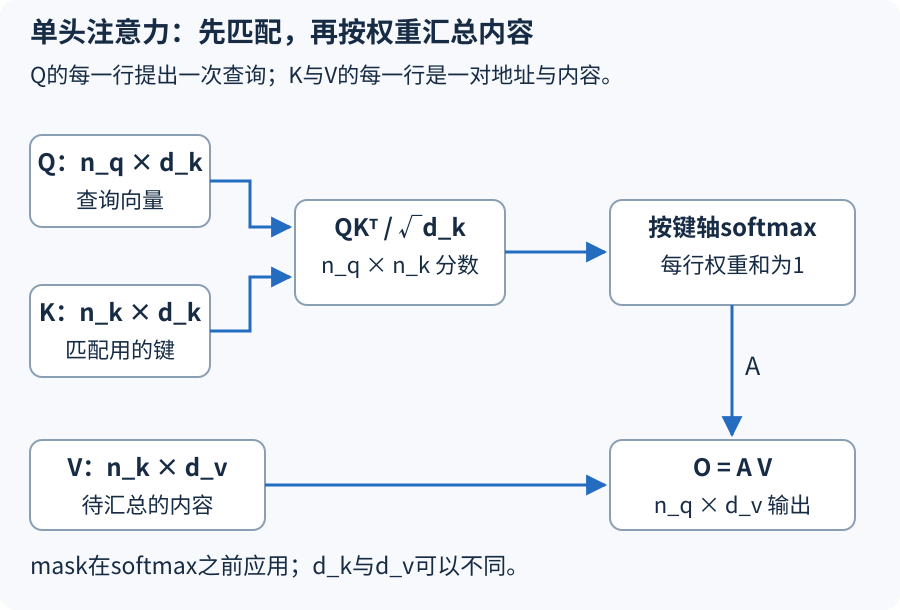
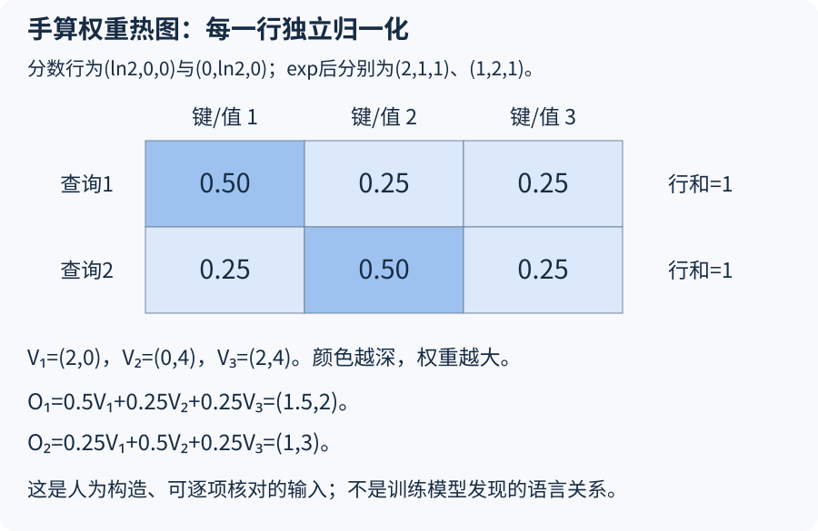
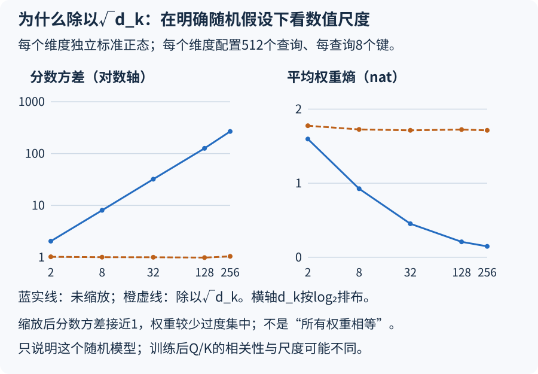
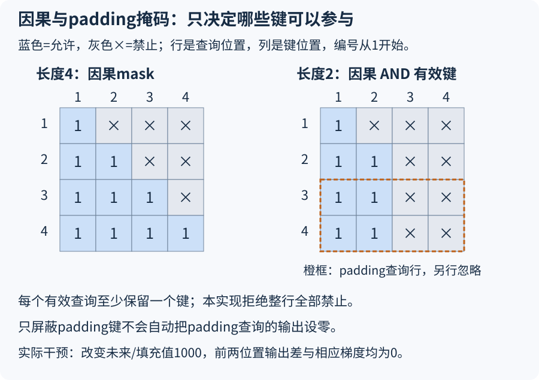
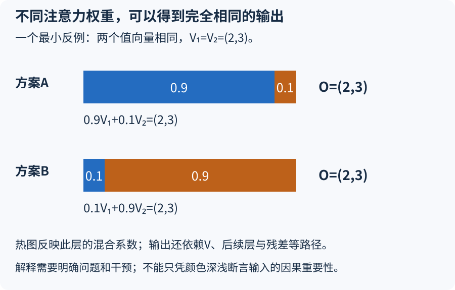

# 第 15 章：注意力机制

> 完整正文、五幅纯 SVG、NumPy 与 PyTorch CPU 实践已实现。导出验收状态见章末，正式完成状态以章节计划为准。

[阅读入口](../../README.md) · [上一章：词嵌入与分词](14-tokenization-and-embeddings.md) · [公共符号](../appendices/notation.md) · [完整实验](../../examples/15-attention/README.md)

## 1. 学习目标与前置知识

第 13 章用递归状态传递序列信息。若当前输出需要回看输入的不同位置，怎样按当前需要组合这些表示，而不总把全部信息压进一个固定向量？注意力提供一种内容相关的加权汇总方法。它既能服务序列模型，也能单独成为更大网络的构件。[1]

本章先讲单个查询，再堆成矩阵，接着处理尺度、掩码和真实数值。读完应能逐项手算 Q/K/V 注意力、追踪形状与 softmax 轴，正确组合因果和 padding 掩码，并知道注意力热图可以与不可以证明什么。多头、位置编码和完整 Transformer 放在下一章，避免一次跨过太多前置步骤。

前置为第 01 章矩阵乘法、第 03 章概率与熵、第 13～14 章序列表示和嵌入。这里不训练语言模型；实践的对象是可检查的注意力算子，所有输入由程序构造或固定种子合成。

## 2. Q、K、V：查询、匹配与内容

### 2.1 从一条查询开始

可以把注意力想成在一组条目中寻找当前需要的内容。查询 query 表达“现在要找什么”；键 key 表达“每个条目怎样被匹配”；值 value 是“匹配后要汇总的内容”。这些词是计算角色，不要求模型真的像人类一样搜索数据库。[2]

给定查询向量 $\mathbf q$ 与成对的键值

$$
(\mathbf k_1,\mathbf v_1),\ldots,(\mathbf k_{n_k},\mathbf v_{n_k}),
$$

先计算每个键的分数 $s_j=a(\mathbf q,\mathbf k_j)$，再将分数归一化为权重：

$$
\alpha_j=\frac{\exp(s_j)}{\sum_{r=1}^{n_k}\exp(s_r)},
\qquad
\mathbf o=\sum_{j=1}^{n_k}\alpha_j\mathbf v_j.
$$

在至少一个键可见、分数有限且没有注意力 Dropout 时，权重非负、和为 1，输出是值向量的凸组合。分数可以为负，不是概率；softmax 后才得到本查询在各键上的权重。权重很集中时输出接近某个值，分散时混合多个值。[3，§3.2]

Q 与 K 用来决定混合系数，V 决定被混合的内容。键和值的位置必须一一对应，但数值不必相同，特征维度也不必相同。不能因为三个名字来自同一段输入，就把它们看作同一个张量。

### 2.2 常见分数函数与可学习投影

点积分数是 $\mathbf q^\top\mathbf k_j$。它受方向与向量长度共同影响，不等同于余弦相似度。另一种加性注意力使用小网络：

$$
a(\mathbf q,\mathbf k)
=\mathbf w_a^\top\tanh(W_q\mathbf q+W_k\mathbf k+\mathbf b_a).
$$

加性式中，若查询宽为 $d_q$、键宽为 $d_k$、隐藏宽为 $d_a$，则 $W_q$ 形状为 $(d_a,d_q)$，$W_k$ 为 $(d_a,d_k)$，向量 $\mathbf w_a,\mathbf b_a$ 的长度均为 $d_a$。投影把查询和键映到同一隐藏宽度，因此它们的原输入宽度可以不同。加性和点积注意力都在学习一种与任务有关的兼容关系，不是预先规定词义相近就必须高分。[4，§11.3]

在神经网络中，Q/K/V 常由线性投影产生。沿用本仓库权重矩阵“输出维在前”的约定，单个列向量为 $\mathbf q=W_Q\mathbf x$。将多个位置按行堆成矩阵后：

$$
\mathbf Q=\mathbf X_QW_Q^\top,
\qquad
\mathbf K=\mathbf X_MW_K^\top,
\qquad
\mathbf V=\mathbf X_MW_V^\top.
$$

例如查询输入宽度为 $d_Q$，记忆输入宽度为 $d_M$，则三个权重形状依次为 $(d_k,d_Q)$、$(d_k,d_M)$、$(d_v,d_M)$。可以另加偏置，是否使用要写明。本章实践直接给定投影后的 Q/K/V，不暗中训练这些矩阵。



图 15-1 为原创纯 SVG。箭头分别追踪“用于匹配”和“被汇总”的数据，所有输出形状在图中标明。掩码在 softmax 之前改变可参与的键。

## 3. 从一个查询到整张矩阵

| 符号 | 含义与形状 |
|---|---|
| $n_q,n_k$ | 查询位置数、键值条目数，可不相等 |
| $d_k,d_v$ | 查询/键特征宽度、值特征宽度 |
| $\mathbf Q\in\mathbb R^{n_q\times d_k}$ | 查询按行排列 |
| $\mathbf K\in\mathbb R^{n_k\times d_k}$ | 键按行排列 |
| $\mathbf V\in\mathbb R^{n_k\times d_v}$ | 与键逐行对应的值 |
| $\mathbf S,\mathbf A\in\mathbb R^{n_q\times n_k}$ | 分数矩阵、归一化权重矩阵 |
| $\mathbf O\in\mathbb R^{n_q\times d_v}$ | 每个查询对应的输出 |
| $\mathbf M$ | 与分数同形或可明确广播的加性掩码 |

缩放点积注意力把多个查询并行计算：[3，§3.2.1]

$$
\mathbf S=\frac{\mathbf Q\mathbf K^\top}{\sqrt{d_k}},
\qquad
A_{ij}=\frac{\exp(S_{ij})}{\sum_{r=1}^{n_k}\exp(S_{ir})},
\qquad
\mathbf O=\mathbf A\mathbf V.
$$

矩阵 $\mathbf Q\mathbf K^\top$ 的 $(i,j)$ 项是第 $i$ 个查询与第 $j$ 个键的点积。softmax 沿最后的键轴，对每一行分别归一化。因此每个查询有自己的权重分布，不是全矩阵归一化，也不是按查询轴让每列和为 1。

批次维加在前面即可：Q 为 $(B,n_q,d_k)$，K 为 $(B,n_k,d_k)$，V 为 $(B,n_k,d_v)$，权重为 $(B,n_q,n_k)$。代码转置的是最后两维，不能直接用会逆转全部维度的错误写法。

### 3.1 一个可以完整手算的例子

令

$$
\mathbf Q=
\begin{pmatrix}\sqrt2&0\\0&\sqrt2\end{pmatrix},
\quad
\mathbf K=
\begin{pmatrix}\ln2&0\\0&\ln2\\0&0\end{pmatrix},
\quad
\mathbf V=
\begin{pmatrix}2&0\\0&4\\2&4\end{pmatrix}.
$$

查询数为 2、键数为 3，$d_k=d_v=2$。先点积、再除以 $\sqrt2$：

$$
\mathbf S=
\begin{pmatrix}\ln2&0&0\\0&\ln2&0\end{pmatrix}.
$$

第一行指数为 $(2,1,1)$，和为 4；第二行为 $(1,2,1)$，和也为 4，所以

$$
\mathbf A=
\begin{pmatrix}1/2&1/4&1/4\\1/4&1/2&1/4\end{pmatrix}.
$$

将第一行权重乘到三个值上，输出第一分量为 $\tfrac12\times2+\tfrac14\times0+\tfrac14\times2=1.5$，第二分量为 $0+1+1=2$。同理第二行输出为 $(1,3)$：

$$
\mathbf O=
\begin{pmatrix}1.5&2\\1&3\end{pmatrix}.
$$



图 15-2 为原创纯 SVG，数值由本章程序实际核对。颜色越深表示此层权重越大，图中条目是人为构造向量，不把它称为模型发现的语言关系。

## 4. 缩放与稳定 softmax：两个不同问题

### 4.1 为什么要除以维度平方根

一个常用的初始化尺度分析假设：查询与键的各分量相互独立、均值 0、方差 1，且不同坐标的乘积不相关。则单个乘积均值为 0、方差为 1；点积是 $d_k$ 项之和，因此

$$
\operatorname{Var}(\mathbf q^\top\mathbf k)=d_k,
\qquad
\operatorname{Var}\left(\frac{\mathbf q^\top\mathbf k}{\sqrt{d_k}}\right)=1.
$$

未缩放时，较大维度更容易产生分数尺度较大的情况。softmax 若过度集中，很多坐标的局部导数会较小：

$$
\frac{\partial\alpha_i}{\partial s_j}
=\alpha_i(\delta_{ij}-\alpha_j).
$$

其中 $\delta_{ij}$ 是 Kronecker delta，索引相同时为 1，否则为 0。这解释缩放的动机，不是对所有训练后 Q/K 的分布定理。它们可能相关、非零均值或有不同尺度；除以 $\sqrt{d_k}$ 也不是把向量单位化，更不保证权重均匀。[3，§3.2.1；4]



图 15-3 为原创 SVG，固定种子分别在五种维度下生成 512 个查询、每查询 8 个独立标准正态键。左图是分数方差，右图是权重分布熵，默认自然对数、单位 nat。曲线来自真实模拟，没有用理论直线代替测量。

当 $d_k=256$，实测未缩放方差为 267.2624，缩放后为 1.0440；平均权重熵从 0.1478 变成 1.7141 nat。8 个键的最大可能熵是 $\ln8\approx2.0794$，因此缩放后的分布也并非完全均匀。有限样本方差不必精确等于理论值。

### 4.2 减最大值避免数值溢出

直接计算大分数的指数可能溢出。对一行分数，取 $m=\max_j s_j$，有

$$
\frac{e^{s_j}}{\sum_r e^{s_r}}
=\frac{e^{s_j-m}}{\sum_r e^{s_r-m}}.
$$

共同减去常数不改变数学结果，却让最大的指数为 1。这个数值技巧与前面的维度缩放作用不同：减最大值不改变权重，除以维度平方根通常改变权重。实践实现先应用掩码，再对仍有可见键的行减最大值。

## 5. 自注意力、交叉注意力与位置

自注意力 self-attention 中，查询、键和值来自同一组位置表示，通常使用不同投影矩阵。某位置可以结合其他位置更新自己的表示；是否能看未来由 mask 决定，不由“自注意力”这个名字决定。

交叉注意力 cross-attention 中，查询来自当前需要更新的序列，键和值来自另一组记忆，例如解码器查询编码器输出。两边长度可以不同；本章的两查询三键手算就是这种形状的通用例子。[3，§3.2.3]

不含位置相关机制和掩码时，如果把键和值按同一个排列重排，对固定查询的输出不变：键的分数和对应的值一起移动，加权和仍相同。脚本实际核对了这一点。对自注意力同步重排所有输入时，输出相应重排，称为置换等变，而不是输出整体不变。序列要表达语序，还需要位置相关信息；下一章再具体加入。

## 6. Mask：先决定允许集合，再归一化

### 6.1 用加性掩码把禁止位置排除

对每个查询，定义至少非空的可见键集合 $\mathcal J_i$。理想数学表达是

$$
M_{ij}=\begin{cases}0,&j\in\mathcal J_i,\\-\infty,&j\notin\mathcal J_i,\end{cases}
\qquad
\mathbf A=\operatorname{softmax}_{\rm keys}(\mathbf S+\mathbf M).
$$

禁止位置的指数变为 0，剩余位置重新归一化。不要先 softmax 再把禁用权重直接置零而不处理归一化，那会使行和小于 1。本章代码的布尔约定是 `True=允许`，以 `masked_fill(~allow, -inf)` 表达禁止位置。

继续手算例子，把中间键视为 padding，第一行权重由 $(1/2,1/4,1/4)$ 改成 $(2/3,0,1/3)$，输出成为 $(2,4/3)$。第二行剩余两个分数都是 0，权重为 $(1/2,0,1/2)$，输出成为 $(2,2)$。这些结果也实际核对。

### 6.2 因果与 padding 是不同约束

对从 1 开始编号、长度相同的因果自注意力，查询位置 $i$ 只允许键位置 $j\leq i$，包含当前位置，禁止严格未来位置。预测下一个 token 时，输入与目标还需要正确移位，单有三角 mask 不会自动完成训练标签对齐。[3，§3.1]

padding 掩码则禁止人工补齐的键。如果一批最大长度是 4、某样本真实长度为 2，那么第 3、4 列都不能参与。两个条件取交集：既不来自未来，也不是填充值。



图 15-4 为原创 SVG。蓝色为允许，灰色为禁止，右图的最后两行属于无效查询位置。仅屏蔽 padding 键，仍可能为 padding 查询产生非零输出；实践随后对这些输出显式置零，训练时还应从损失统计中排除相应位置。

因果保证也有前提：如果查询本身已经由某个非因果前层混入未来信息，当前层的 mask 无法把泄漏抹掉。测试应覆盖整个模型的数据通路，而不仅看这一层的三角图。

### 6.3 整行全被屏蔽与接口约定

一行没有任何可见键时，正常的概率归一化无定义，直接算全 $-\infty$ 的 softmax 可能产生 NaN。本章实现提前抛出清楚的错误，要求每条实际计算的查询至少有一个可见键。其他系统也可以定义零输出策略，但必须明确处理，不把它当作普通的概率行。

随意用有限常数 $-10^9$ 替代 $-\infty$ 还受精度、分数尺度和全遮挡行为影响；所有位置都减同一有限大数，并不能表达“没有可见键”。不要依靠它隐藏无效行。

PyTorch 2.15 的两个常见接口对布尔 mask 语义不同，迁移代码时必须核对：[5,6]

| 接口 | 布尔 `True` 的含义 |
|---|---|
| `functional.scaled_dot_product_attention` 的 `attn_mask` | 允许参与 |
| `MultiheadAttention` 的 `key_padding_mask` | 忽略这个键 |
| `MultiheadAttention` 的 `attn_mask` | 禁止这个位置 |

本章显式把因果与 padding 合并后传入 `attn_mask`，不同时使用 `is_causal=True`。非方形序列、缓存解码的位置偏移，需要单独设计可见关系，不能盲用左上角三角形。函数式 SDPA 的 Dropout 由 `dropout_p` 决定，即使外层模块切换为评估也要显式传 0；本章全程为 0。[5]

## 7. 注意力热图的解释边界

权重确实告诉我们：这一层、这个查询是怎样混合这些值的。但输出还依赖 V 的内容、输出投影、其他头、残差与后续层。高权重不自动等于输入对最终预测有更大因果作用。

最小反例取两个完全相同的值：

$$
\mathbf v_1=\mathbf v_2=(2,3)^\top.
$$

无论权重是 $(0.9,0.1)$ 还是 $(0.1,0.9)$，加权输出都为 $(2,3)^\top$。两张颜色几乎相反的热图，可以对应同一输出。



图 15-5 为原创 SVG，反例已用程序核对。它否定“权重本身足以唯一决定输入重要性”的简单说法，没有声称注意力在任何解释问题中都毫无价值。相关研究对解释定义与评估协议有讨论，应结合特定任务、梯度、输入干预与模型其他路径检查。[7,8]

## 8. 本机 CPU 实践与真实结果

### 8.1 实现与运行

完整实现见 [run.py](../../examples/15-attention/run.py)，输入检查、全屏蔽行策略和对照逻辑都在其中。核心计算可概括为：

```python
scores = (query @ key.transpose(-2, -1)) / math.sqrt(d_k)
if not allow.any(dim=-1).all():
    raise ValueError("每条查询至少需要一个可见键")
weights = torch.softmax(scores.masked_fill(~allow, float("-inf")), dim=-1)
output = weights @ value
```

在仓库根目录运行：

```powershell
& ./.venv/Scripts/python.exe -B examples/15-attention/run.py
# 需要将这次真实输出同步为正文图时：
& ./.venv/Scripts/python.exe -B examples/15-attention/run.py --write-figures
```

实验输入是两查询三键手算矩阵，以及两个长度为 4 的合成批次，真实长度为 4 与 2；后者的 $d_k=3,d_v=2$，实际检查值宽度可以不同。随机种子 20261115，NumPy PCG64 生成标准正态向量。

没有外部数据、训练集划分、优化器或检查点；可训练参数为 0、训练步数不适用。这些值不伪填成“模型训练成功”。本章检查的是前向计算、数值稳定、掩码和梯度约束，为下一章可学习网络做准备。

### 8.2 手算、官方算子与真实干预

2026-11-15 22:39 在 Windows CPU、Python 3.11.5、NumPy 2.4.6、PyTorch 2.15.0+cpu 上实际运行。float64、线程 1、确定性算法；计算约 0.0263 秒，排除导入与 SVG 生成。手算输入 Q/K/V 数值载荷为 128 字节，不是进程或随机模拟峰值内存。

| 核对对象 | 实测结果 |
|---|---|
| 两查询手算输出 | $(1.5,2)$ 与 $(1,3)$ |
| 手算 NumPy 与官方 SDPA 最大差 | $4.44\times10^{-16}$ |
| 批次联合 mask 与官方 SDPA 最大差 | $1.11\times10^{-16}$ |
| 所有禁止位置权重 | 精确为 0 |
| 修改未来键/值后，前两位置输出最大差 | 0 |
| 修改 padding 键/值后，有效查询输出最大差 | 0 |
| 前两输出之和对未来键/值的梯度最大绝对值 | 0 |
| 同样干预去掉 mask 后，前两输出最大变化 | 约 1000.3545 |
| 错沿查询轴 softmax 的行和 | 两行都为 1.5，暴露轴错误 |

干预方法是把第 3、4 个键加 1000、对应值减 1000；前两查询不变。带因果 mask 时，这些键对前缀不可见，输出与梯度都按约束隔离；未加 mask 的对照产生明显泄漏。只查看权重图不足以代替这种干预测试。

共 **23 项核对通过**，还包括不兼容形状拒绝、NaN 输入拒绝、全屏蔽行拒绝、padding 重新归一化、键值联合置换、缩放随机实验和不同权重同输出反例。原始 JSON 在 `build/experiments/15-attention/results.json`，含所有矩阵和五种尺度实验的数值，便于独立复核。

### 8.3 复杂度与结果边界

显式计算分数需要约 $n_qn_kd_k$ 次规模的乘加，显式保存权重需要 $n_qn_k$ 个数；同长自注意力通常随长度呈平方增长。本章只用极小输入验证正确性，不能据此推断长上下文的速度与内存。实际 SDPA 可能选择不同后端与计算方式，不一定显式存储整张权重矩阵，数值尾差也可能变化。[5]

独立标准正态模拟检验的是理论假设下的尺度，不是在真实语言任务上验证学习收益；固定 Q/K/V 的成功计算也不证明学到语义。进一步训练需要明确投影参数、损失、数据划分与模型整体因果路径。

## 9. 常见误区

1. **Q、K、V 数值必须相同。** 它们是不同角色，常用不同投影；相同来源也不代表相同值。
2. **softmax 对任意轴都一样。** 每个查询需在键轴归一化，换轴会改变概率含义和输出。
3. **缩放等于数值稳定减最大值。** 前者改变分布，后者在数学上保持分布。
4. **padding mask 自动清掉所有 padding。** 键可见性、无效查询输出与损失位置是不同处理。
5. **自注意力天然因果。** 可见关系由 mask 与整个模型的数据路径决定。
6. **热图深色就是最终预测原因。** 必须结合值、其他路径和实际干预判断。

## 10. 习题与详细解析

### 题 1：追踪形状

批次大小 2，查询数 3、键数 5，键宽 4、值宽 7。Q/K/V、分数与输出形状分别是什么？

**解析**：依次为 $(2,3,4)$、$(2,5,4)$、$(2,5,7)$、$(2,3,5)$、$(2,3,7)$。键和值必须有相同的条目数 5；值宽不必等于键宽。softmax 沿长度 5 的最后一维。

### 题 2：三分数手算与掩码

一行分数是 $(0,\ln3,0)$，值为标量 $(2,4,8)$，先求注意力输出，再屏蔽第二键重算。

**解析**：指数为 $(1,3,1)$，权重为 $(1/5,3/5,1/5)$，输出为 $2/5+12/5+8/5=22/5=4.4$。屏蔽后权重为 $(1/2,0,1/2)$，输出为 5。若先归一化再删掉中间权重而不重新处理，会得到 2，行和只有 0.4，计算含义已经改变。

### 题 3：缩放的条件与数字

独立标准正态假设下，键宽为 64，点积方差是多少？缩放后是多少？能否推出所有键权重都为 $1/n_k$？

**解析**：未缩放方差 64，除以 8 后方差除以 $8^2$，变成 1。不同键的实际分数仍不同，softmax 一般不均匀。若训练后分量相关或尺度改变，上述方差等式也要重新检查前提。

### 题 4：因果和padding求交

一个序列补到长度 5，真实长度 3。查询在真实位置 2 时哪些键允许？位置 5 是否应该参与目标损失？

**解析**：因果条件允许键 1、2；真实长度条件允许 1、2、3，交集为 1、2。位置 5 是人工 padding 查询，应从目标损失中排除；仅禁止第 4、5 个键不自动完成这一处理。

### 题 5：发现接口反转

已有布尔变量 `is_padding`，真实 token 为 False、填充为 True。如何传给本章的 SDPA 允许掩码？若还要因果约束怎么办？

**解析**：先取反得到有效键，再扩展到查询维，例如 `(~is_padding)[:, None, :]`。随后与形状兼容的因果允许矩阵作逻辑 AND。多头接口可能还需头维广播；必须检查目标函数的 True 语义，不能只看变量叫“mask”。

### 题 6：为什么权重反例成立

若两个值均为 $(2,3)$，任意非负且和为 1 的两个权重是否都给同一输出？这能否证明所有注意力解释都无效？

**解析**：设权重为 $a,1-a$，输出为 $a(2,3)+(1-a)(2,3)=(2,3)$，所以该反例中权重不唯一。它只证明热图本身不总能唯一决定输入的最终作用；解释是否有用仍取决于问题定义、值表示、其他路径及验证协议，不能从一个反例扩大成对所有任务的结论。

## 11. 小结与下一步

注意力用查询与键决定权重，再按这些权重组合值。矩阵实现的每一行对应一次查询，最后键轴定义归一化；缩放控制常见初始化尺度，减最大值改善数值稳定；掩码定义可见关系，但还需要处理无效查询与整个模型的因果性。

下一章把多个注意力头、位置表示、前馈层、残差与归一化组合成[Transformer](16-transformer.md)。本章的手算、形状表和真实干预检查可以直接用作构件验收基准。

## 12. 参考来源与核验说明

以下官方来源于 2026-11-15 核验。公式统一为本仓库列向量权重与行批次约定；五幅图均原创 SVG，数值来自手算与已执行程序，不复制教材截图。

1. Stanford CS224n，Winter 2019 课程笔记 Part VI，§2 *Attention Mechanism*。[大学官方PDF](https://web.stanford.edu/class/cs224n/readings/cs224n-2019-notes06-NMT_seq2seq_attention.pdf)。用于从 Seq2seq 固定上下文转向动态加权的动机。
2. D2L 1.0.3，§11.1 *Queries, Keys, and Values*。[官方教材](https://d2l.ai/chapter_attention-mechanisms-and-transformers/queries-keys-values.html)。用于查询、键、值和加权汇总的角色。
3. Vaswani 等，*Attention Is All You Need*，2017，§3.1、§3.2.1、§3.2.3；核对公开 v7 HTML。[原始论文](https://arxiv.org/html/1706.03762v7)。用于缩放点积、可见关系与应用类型，未把论文任务成绩当本机结果。
4. D2L 1.0.3，§11.3 *Attention Scoring Functions*。[官方教材](https://d2l.ai/chapter_attention-mechanisms-and-transformers/attention-scoring-functions.html)。用于加性与缩放点积分数。补充数学练习参考 Stanford Spring 2024 Assignment 4 §1～2，[大学官方PDF](https://web.stanford.edu/class/cs224n/assignments/a4_spr24_student_handout.pdf)；本章数值习题为独立构造。
5. PyTorch 2.15，`scaled_dot_product_attention`。[官方接口](https://docs.pytorch.org/docs/2.15/generated/torch.nn.functional.scaled_dot_product_attention.html)。核对形状、允许掩码、显式Dropout、因果选项与后端边界。
6. PyTorch 2.15，`MultiheadAttention`。[官方接口](https://docs.pytorch.org/docs/2.15/generated/torch.nn.MultiheadAttention.html)。核对两类布尔 mask 的禁止语义。
7. Jain、Wallace，*Attention is not Explanation*，NAACL 2019。[原始论文](https://arxiv.org/abs/1902.10186)。用于理解不能直接把权重当作预测原因的实验问题。
8. Wiegreffe、Pinter，*Attention is not not Explanation*，EMNLP 2019。[原始论文](https://arxiv.org/abs/1908.04626)。用于解释定义、整体模型与验证协议的边界。

## 13. 实现与验收记录

- 完整正文、5 幅纯 SVG、手算与批次/掩码/梯度/缩放 CPU 实验已实现。
- 2026-11-15 实际执行 23 项核对通过；无模型训练、无下载，参数与训练预算的不适用项已明确。
- HTML/PDF 已生成并验收：13 页、98 处数学表达、5 幅 SVG、0 个位图对象。1440/390 像素检查通过，无页面横溢、公式错误或残留标记；17 种 PDF 字体全部嵌入，30 个链接（14 个内部），文字未越界。全部 13 页已逐页目视，五幅图、公式、表格与代码已放大核对。
