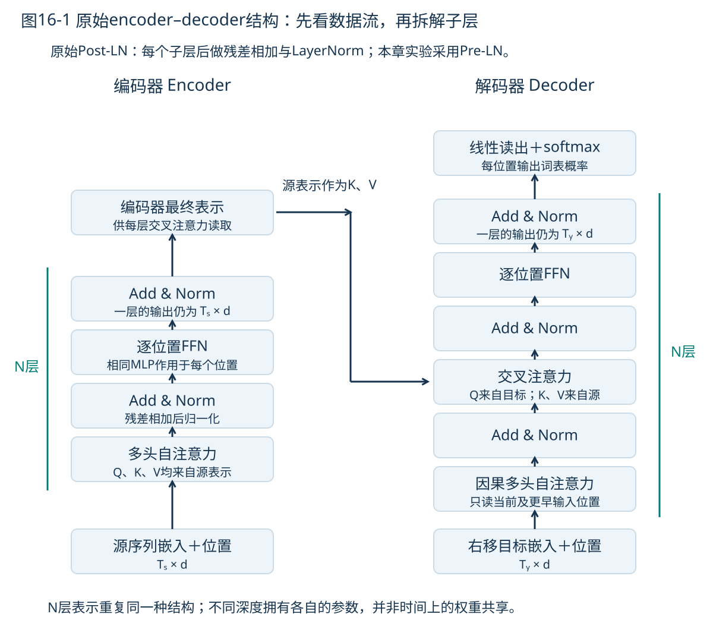
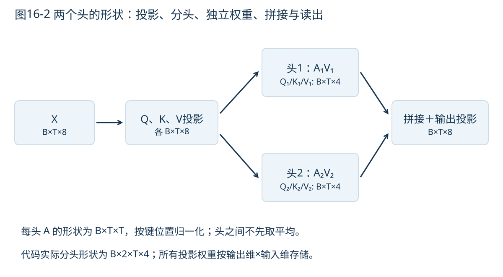
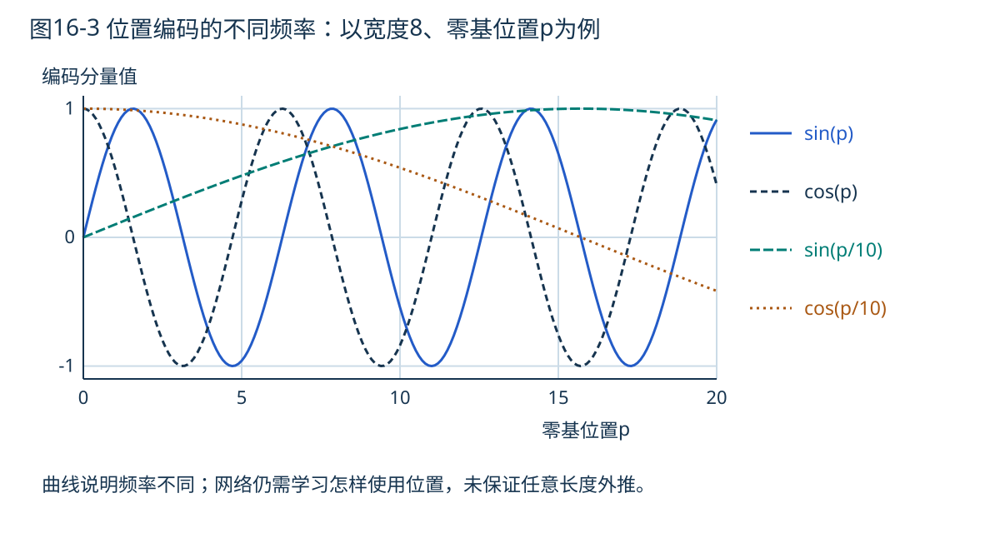
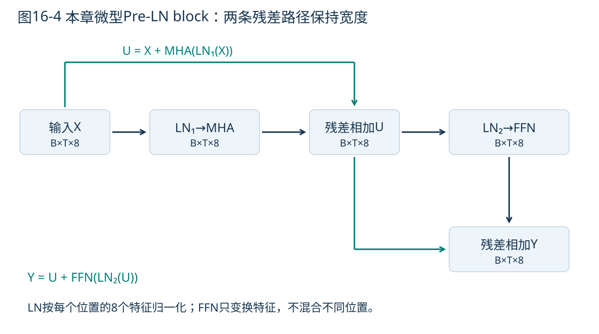
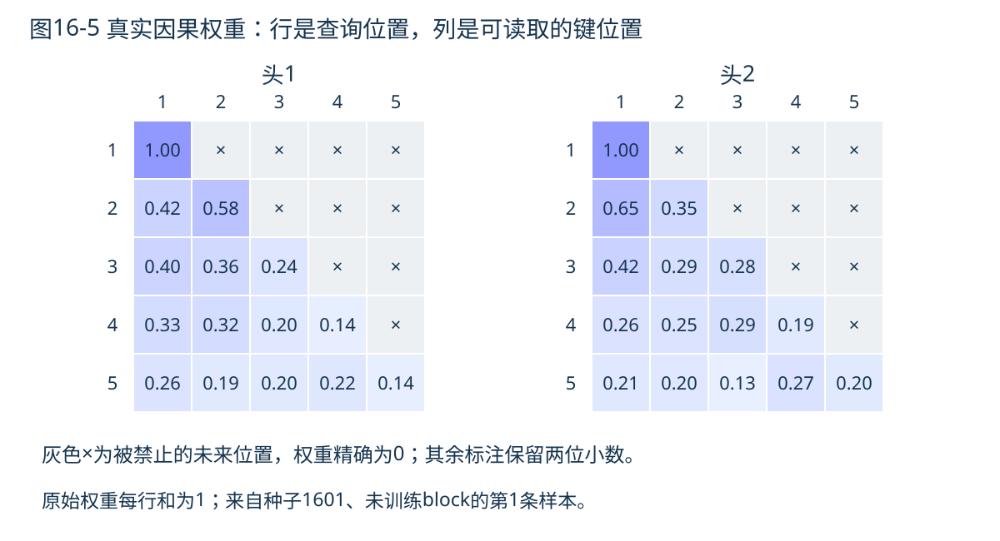
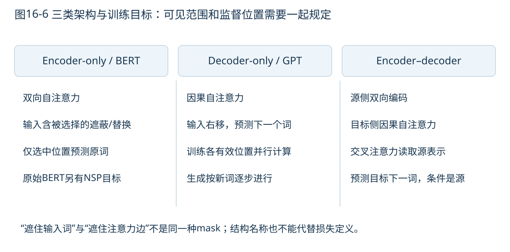

# 第16章：Transformer与模型家族

> 状态：完整正文、六幅SVG、CPU数值实践与出版验收已完成；正式状态以章节计划为准。
> [阅读入口](../../README.md) · [前置：残差与归一化](12-residual-and-normalization.md) · [前置：注意力](15-attention.md) · [公共符号](../appendices/notation.md) · [完整实验](../../examples/16-transformer/README.md)

## 1. 本章目标与前置知识

第13章把历史压缩进逐步更新的状态，第15章允许一个位置从多个位置读取信息。本章要回答：怎样把注意力、位置、逐位置非线性、残差连接和归一化组装成一个完整网络？同一种积木，为什么既能用于理解句子，也能用于逐词生成？

Transformer不是单独一个注意力公式，而是一组可堆叠的计算结构。先从原始编码器—解码器的数据流建立整体图景，再拆开其中的计算，最后检查一个只有600个参数的CPU小块。[1,2] 本章不训练语言模型，不把随机初始化的注意力图解读为已经学会语义。

学完后，应能追踪一层各张量的形状，计算单头和多头注意力，解释位置编码、FFN与残差归一化各自的作用；区分三类结构与对应可见范围、监督目标；用扰动和梯度验证因果性，而不只是看掩码画得像三角形。

前置是第12章的残差与归一化、第14章的词元/嵌入、第15章的查询、键和值。正文仍会给出本章所用定义，避免读者把接口名称当成已经理解的原理。

## 2. 整体结构：哪些位置能够读取哪些信息

编码器（encoder）把可见的源序列变成逐位置表示；解码器（decoder）以源表示和目标前缀为条件产生目标序列。原始Transformer的编码器层含自注意力和逐位置前馈层；解码器层还多一次读取源表示的交叉注意力。[1，§3.1；2，§11.7.1]



图16-1依据Vaswani等（2017）图1与§3重新组织并绘制为SVG，省去Dropout等细节以突出依赖关系。图中 `Add & Norm` 指先将子层输出与其输入相加，再做LayerNorm，即原始Post-LN排列。后面的CPU小块采用Pre-LN，二者的顺序会在第7节明确区分。

编码器自注意力的查询、键和值都来自源表示；解码器自注意力的三者来自目标表示，但受因果掩码约束；交叉注意力的查询来自目标，键和值来自编码器输出。源长和目标长可以不同，不能假定交叉注意力矩阵总是方阵。

图上“重复 $N$ 层”表示多层使用相同结构设计，但一般各层拥有不同参数。它不同于RNN沿时间展开时重复使用同一组权重。每层可以同时计算所有已知输入位置的表示，生成尚未知的下一个词时仍要逐步进行。

## 3. 符号与形状

| 符号 | 含义与形状 |
| --- | --- |
| $B,T,d$ | 批次大小、当前序列长度、模型宽度 |
| $T_q,T_k$ | 查询位置数、键/值位置数；自注意力中二者均为 $T$ |
| $H,d_h$ | 头数与每头宽度；本章 $d=Hd_h$ |
| $\mathbf{x}_t,\mathbf{q}_t,\mathbf{k}_t,\mathbf{v}_t$ | 单位置列向量；输入宽 $d$，每头查询/键/值宽 $d_h$ |
| $\mathbf{X}$ | 单序列行批次矩阵，形状为 $T\times d$ |
| $\mathcal{X}$ | 多序列张量，代码形状为 $B\times T\times d$ |
| $\mathbf{Q}^{[a]},\mathbf{K}^{[a]},\mathbf{V}^{[a]}$ | 第 $a$ 头的行位置矩阵，形状为 $T_q\times d_h,T_k\times d_h,T_k\times d_h$ |
| $\mathbf{A}^{[a]},\mathbf{M}$ | 注意力权重与加性掩码，单头形状为 $T_q\times T_k$ |
| $d_f$ | FFN中间宽度，本章实验为16 |
| $p,j$ | 零基位置与位置编码的频率编号，不是概率与样本编号 |
| $\boldsymbol{\gamma},\boldsymbol{\beta},\epsilon$ | LayerNorm的缩放、平移参数与正数稳定项 |

权重仍按输出维乘输入维存储。单位置第 $a$ 头的查询是 $\mathbf{q}^{[a]}_t=\mathbf{W}^{[a]}_Q\mathbf{x}_t+\mathbf{b}^{[a]}_Q$，其中投影矩阵形状为 $d_h\times d$。同一序列按行存储时，对应乘以该矩阵的转置。

上标 $[a]$ 在本章专指头编号，深度层编号需要时写成 $[\ell]$ 并在局部说明；不把头和时间混成同一维度。以下省略批次维书写公式，代码保留完整四维分头形状。

## 4. 多头注意力：不同投影、各自归一化、再拼接

### 4.1 先明确一个头怎样读取多个值

对单个查询 $\mathbf{q}_i$ 与键 $\mathbf{k}_j$，先计算缩放点积分数，再加入掩码，最后沿键位置做softmax：

$$
s_{ij}=\frac{\mathbf{q}_i^\top\mathbf{k}_j}{\sqrt{d_h}}+M_{ij},
\qquad
\alpha_{ij}=\frac{\exp(s_{ij})}{\sum_{r=1}^{T_k}\exp(s_{ir})},
\qquad
\mathbf{o}_i=\sum_{j=1}^{T_k}\alpha_{ij}\mathbf{v}_j.
$$

被允许的键取 $M_{ij}=0$，被禁止的键取 $-\infty$，使其指数为0。每个查询至少有一个允许键；若一整行都是 $-\infty$，softmax分母无法定义，不能把NaN当成一个合法的“全零分布”。[1，§3.2.1]

实际softmax先减去每行最大值，使用第04章的稳定计算。除以 $\sqrt{d_h}$ 的动机是控制点积尺度：若查询与键分量相互独立、均值0、方差1，则点积方差为 $d_h$；除后方差回到1。它依赖这些近似假设，不是对所有训练表示的精确方差定理。

### 4.2 矩阵形式与两个头的形状

对头 $a$，自注意力使用三组不同投影：

$$
\begin{aligned}
\mathbf{Q}^{[a]}&=\mathbf{X}(\mathbf{W}^{[a]}_Q)^\top+\mathbf{1}_T(\mathbf{b}^{[a]}_Q)^\top,\\
\mathbf{K}^{[a]}&=\mathbf{X}(\mathbf{W}^{[a]}_K)^\top+\mathbf{1}_T(\mathbf{b}^{[a]}_K)^\top,\\
\mathbf{V}^{[a]}&=\mathbf{X}(\mathbf{W}^{[a]}_V)^\top+\mathbf{1}_T(\mathbf{b}^{[a]}_V)^\top,\\
\mathbf{A}^{[a]}&=\operatorname{softmax}_{\mathrm{key}}\left(
\frac{\mathbf{Q}^{[a]}(\mathbf{K}^{[a]})^\top}{\sqrt{d_h}}+\mathbf{M}\right),\\
\mathbf{O}^{[a]}&=\mathbf{A}^{[a]}\mathbf{V}^{[a]}.
\end{aligned}
$$

三者来自同一输入不代表数值相同，投影权重不同。交叉注意力只需把查询输入与键/值输入换成各自来源；位置数可为 $T_q\neq T_k$。



图16-2为本章原创形状图。每头在自己投影出的表示上算权重，再沿特征轴拼接：

$$
\operatorname{MHA}(\mathbf{X})
=\operatorname{Concat}_{\mathrm{feature}}(
\mathbf{O}^{[1]},\ldots,\mathbf{O}^{[H]})\mathbf{W}_O^\top
+\mathbf{1}_T\mathbf{b}_O^\top.
$$

$\mathbf{W}_O\in\mathbb{R}^{d\times Hd_h}$；本章 $Hd_h=d$。多头允许不同投影建立不同的读取方式，但并不强制“某头负责语法、某头负责位置”。也不是先把所有头的注意力矩阵平均，然后只保留一个输出。[1，§3.2.2]

代码先投影为 `(B,T,8)`，重排为 `(B,2,T,4)`。分数为 `(B,2,T,T)`，最后两轴相乘，再合并头与特征回到 `(B,T,8)`。重排轴顺序与矩阵转置有具体含义，不能只看元素总数一样就随意reshape。

### 4.3 一个能手算的注意力例子

取单头宽度1、两个位置：查询为 $(1,0)^\top$，键为 $(1,0)^\top$，值为 $(2,4)^\top$。不加掩码时，分数矩阵为：

$$
\mathbf{S}=\begin{pmatrix}1&0\\0&0\end{pmatrix},
\quad
\mathbf{A}=\begin{pmatrix}
\frac{e}{e+1}&\frac{1}{e+1}\\
\frac12&\frac12
\end{pmatrix}.
$$

第一位置输出 $2e/(e+1)+4/(e+1)\approx2.537883$，第二位置输出3。若采用允许当前位置的因果掩码，第一行的第二个键被禁止，第一位置输出变为2，第二位置仍为3。脚本与官方缩放点积接口核对两种结果。

## 5. 位置编码：告诉网络“这个值在哪里”

### 5.1 没有位置信息会缺少什么

若没有位置编码和依赖位置的掩码，双向自注意力、逐位置FFN与LayerNorm对位置置换是等变的：把输入各行同时重排，输出各行也相应重排。这不等于输出不变，而是输出跟着输入换位置。它没有为内容额外指定绝对位置。[1，§3.5；3]

本章用实际小块验证这一性质：不加位置时，重排输入并把输出顺序还原，与原输出仅有浮点误差；保持位置编码固定、只重排内容时，结果则发生变化。因果掩码本身也具有顺序结构，不能把上述双向算例的结论无条件套到因果块。

### 5.2 原始正弦编码及索引

对偶数宽度 $d$，原始方案使用零基位置 $p=0,1,\ldots$ 和频率编号 $j=0,\ldots,d/2-1$：

$$
\operatorname{PE}_{p,2j}
=\sin\left(\frac{p}{10000^{2j/d}}\right),
\qquad
\operatorname{PE}_{p,2j+1}
=\cos\left(\frac{p}{10000^{2j/d}}\right).
$$

偶数通道取sin，奇数通道取cos，共享同一频率；不同频率让相近与较远的位置都能呈现不同变化。将位置向量与词元嵌入逐元素相加，输出宽度仍为 $d$，而不是把位置作为另一条序列追加进去。[1，§3.5；3，§11.6.3]



图16-3按公式原创绘制，连续曲线用于看频率，实际只在整数位置取值。$d=8$ 时，前四通道为 $\sin p,\cos p,\sin(p/10),\cos(p/10)$；位置0为 $(0,1,0,1,\ldots)$，位置1的前四项约 $(0.841471,0.540302,0.099833,0.995004)$。

正弦式可以直接计算训练长度之外的位置，不代表训练后的网络必然在任意长序列上保持能力。可学习位置嵌入、相对位置和旋转位置编码属于其他设计，本章不把这一种方案宣称为所有Transformer的必选项。

## 6. 逐位置前馈层：在每个位置变换特征

注意力把不同位置的信息汇集到当前表示后，还需要非线性变换。前馈网络（feed-forward network，FFN）在每个位置应用同一套两层MLP：[1，§3.3；2，§11.7.2]

$$
\operatorname{FFN}(\mathbf{x}_t)
=\mathbf{W}_2\operatorname{ReLU}(\mathbf{W}_1\mathbf{x}_t+\mathbf{b}_1)+\mathbf{b}_2.
$$

$\mathbf{W}_1\in\mathbb{R}^{d_f\times d}$、$\mathbf{W}_2\in\mathbb{R}^{d\times d_f}$，先扩展特征再投影回 $d$，以便参与残差相加。本章 $d=8,d_f=16$；原论文常用更大的中间宽度，但它不是由公式强制的常数。

FFN本身不把位置 $t$ 与位置 $t+1$ 相乘，位置间混合来自注意力；它的参数在位置之间共享，不代表不同深度层也必须共享。现代变体可以更换激活函数或门控形式，本章为对应基本MLP选用已经学过的ReLU。

小例子：输入 $(1,-2)^\top$，取 $\mathbf{W}_1$ 为单位阵、$\mathbf{b}_1=0$，$\mathbf{W}_2=\left(\begin{smallmatrix}1&1\\1&-1\end{smallmatrix}\right)$、$\mathbf{b}_2=0$。中间ReLU给出 $(1,0)^\top$，FFN输出为 $(1,1)^\top$。对第二个位置重复同一变换即可，不需要读取第一个位置的值。

## 7. 残差连接与LayerNorm：宽度与统计维度都要对

### 7.1 LayerNorm按一个位置的特征计算

层归一化（Layer Normalization，LayerNorm）在本章按单位置的 $d$ 个特征计算统计量：

$$
\begin{aligned}
\mu_t&=\frac1d\sum_{j=1}^{d}x_{tj},\\
\sigma_t^2&=\frac1d\sum_{j=1}^{d}(x_{tj}-\mu_t)^2,\\
\operatorname{LN}(\mathbf{x}_t)
&=\boldsymbol{\gamma}\odot
\frac{\mathbf{x}_t-\mu_t\mathbf{1}_d}{\sqrt{\sigma_t^2+\epsilon}}
+\boldsymbol{\beta}.
\end{aligned}
$$

$\boldsymbol{\gamma},\boldsymbol{\beta}\in\mathbb{R}^d$ 为可学习参数，$\epsilon>0$ 避免方差为零时除零。分母使用 $d$，不是统计学无偏估计的 $d-1$；它也没有跨批次、跨时间求全局均值。[2，§11.7.3]

当 $\mathbf{x}=(1,3)^\top$、$\gamma=(1,1)^\top$、$\beta=0$、$\epsilon=10^{-5}$，均值2、方差1，归一化输出约 $(-0.999995,0.999995)^\top$。稳定项使输出方差不必精确等于1，学习到的缩放和平移也会改变最后统计量。

### 7.2 Pre-LN和Post-LN的顺序不同

原始Post-LN子层写为 $\operatorname{LN}(\mathbf{X}+F(\mathbf{X}))$，即先加残差再归一化。本章实践使用Pre-LN，把归一化移到子层之前：

$$
\begin{aligned}
\mathbf{U}&=\mathbf{X}+\operatorname{MHA}(\operatorname{LN}_1(\mathbf{X})),\\
\mathbf{Y}&=\mathbf{U}+\operatorname{FFN}(\operatorname{LN}_2(\mathbf{U})).
\end{aligned}
$$



图16-4是本章实际实现的原创图。相加两端均为 $B\times T\times d$；不能把FFN扩展后的 $d_f$ 维直接与原输入相加。残差提供绕过子层的直接通道，但并不保证训练所有深度都容易。

Pre-LN与Post-LN不是仅换了标注的同一函数。GPT-2报告§2.3明确把归一化移到各子块输入，并在最终块后再加归一化；本章只检查单个Pre-LN块，没有声称完整复现GPT-2，也没有添加一个未说明的最终归一化。[4] 官方 `TransformerEncoderLayer(norm_first=True)` 可用于本章逐参数对照。[7]

## 8. 因果掩码、填充与右移：避免看到答案

### 8.1 因果关系要从输入到目标整体检查

对于长度 $T$ 的自注意力，本章加性因果掩码为：

$$
M_{ij}=\begin{cases}0,&j\leq i,\\-\infty,&j>i.\end{cases}
$$

行 $i$ 是当前查询，列 $j$ 是可读取的键。允许对角线是因为位置 $i$ 的输入用于预测下一个词；只要输入和标签正确右移，它没有看到下一个词的真实值。[1，§3.1]

例如完整词元编号为 `(1,2,3,4,5)`，输入为 `(1,2,3,4)`，标签为 `(2,3,4,5)`。第一个输出可以读取输入1，不能读取输入2；它监督的是标签2。若把未右移的原编号同时作为输入与同位置目标，模型可能学习抄写，而不是下一个词的条件分布。



图16-5由实际权重直接生成；禁止的未来位置权重精确为0，原始权重每行和为1。图内标注保留两位小数，所以标注值相加可能略偏离1。该结构检查不能证明模型懂语言；随机模型同样应遵守因果约束。脚本进一步改变后面位置的输入，并核对前缀输出及前缀对未来输入的梯度。

### 8.2 不同接口的布尔语义可能相反

本章自定义 `blocked` 与 `nn.MultiheadAttention.attn_mask` 都用 `True` 表示禁止读取；`functional.scaled_dot_product_attention` 的布尔 `attn_mask` 则用 `True` 表示允许读取。迁移接口时不能原封不动传同一个布尔数组。[6,8]

```python
blocked = torch.ones(T, T, dtype=torch.bool).triu(1)
# 自定义实现：True为禁止。
scores = scores.masked_fill(blocked, float('-inf'))
# 官方SDPA：True为允许。
output = F.scaled_dot_product_attention(q, k, v,
    attn_mask=~blocked, dropout_p=0.0)
```

本章显式设 `dropout_p=0.0`。函数式SDPA会按传入概率执行Dropout，不会自动检查外层模块是不是 `eval()`；训练模式参数与函数式调用之间必须正确连接。[8]

填充掩码用于排除无效键，因果掩码用于排除未来，两种限制可合并。仅屏蔽填充键并不会自动令填充查询输出为0，损失中仍要排除无效位置。本章全部样本等长，无填充；自定义实现直接拒绝全被禁止的一行，避免把未定义softmax隐藏成正确结果。

## 9. 三类架构与BERT/GPT目标差异



图16-6依据原始Transformer、BERT与GPT-2论文中的结构和目标原创整理。[1,4,5] 架构决定信息能够怎样流动，目标决定怎样提供学习信号，两者需要一起说明。

### 9.1 Encoder-only与BERT

仅编码器模型（encoder-only）常使用双向自注意力，使每个位置可读取完整已给定输入。BERT的遮蔽语言建模（masked language modeling，MLM）先选一部分位置并破坏输入，再在被选位置预测原始词元。令 $S$ 为被选位置集合、$\widetilde{\mathbf{x}}$ 为破坏后的输入，一个便于教学的平均损失为：

$$
\mathcal{L}_{\mathrm{MLM}}
=-\frac1{\lvert S\rvert}\sum_{t\in S}
\log p_{\boldsymbol{\theta}}(x_t\mid\widetilde{\mathbf{x}}),
\qquad \lvert S\rvert>0.
$$

这里遮蔽的是输入内容，不是把注意力矩阵改为下三角。模型能利用被选位置左右两侧的可见内容。原始BERT并非把所有被选词都换成 `[MASK]`，还包括随机替换和保留原值的分支；其输入破坏策略与自回归的无未来约束不是同一个协议。[5，§3.1]

原始BERT还包含下一句预测（next sentence prediction，NSP），判断两个片段是否具有训练方案规定的相邻关系。本章公式仅解释MLM核心，不把它冒充完整BERT原始目标，也不声称所有后来编码器都保留NSP。

### 9.2 Decoder-only与GPT式自回归

仅解码器模型（decoder-only）通常保留因果自注意力和FFN，不需要原始解码器中的源侧交叉注意力。GPT式语言建模将序列概率分解为：[4，§2.1]

$$
p_{\boldsymbol{\theta}}(x_1,\ldots,x_T)
=\prod_{t=1}^{T}p_{\boldsymbol{\theta}}(x_t\mid x_{<t}).
$$

$x_{<t}$ 表示之前的词元，起始位置可使用专门起始符。对本文实际四个预测位置，损失是四个目标词元负对数概率的平均；softmax沿词表维归一化，padding等无效位置另行排除。

训练时完整答案已知，可以右移后把多个位置一起计算，用因果掩码保证各位置只能使用合法前缀；这种做法称为教师强制（teacher forcing）。生成时真实下一个词未知，需要用模型给出的词继续扩展前缀。训练中位置并行，不等于推理时可以一次知道整段新文本。[1,4]

### 9.3 Encoder–decoder的条件生成

编码器—解码器模型以源序列 $\mathbf{s}$ 为条件分解目标序列：

$$
p_{\boldsymbol{\theta}}(y_1,\ldots,y_U\mid\mathbf{s})
=\prod_{t=1}^{U}p_{\boldsymbol{\theta}}(y_t\mid y_{<t},\mathbf{s}).
$$

目标侧仍要因果，源侧通常完整可见，交叉注意力允许每个目标位置读取源表示。这适合输入输出长度不同的条件生成。它与decoder-only把源内容拼入前缀是两种数据流设计，不能仅凭都能生成文字就省略其条件来源。

## 10. 本机实践：600参数块的可检查计算

### 10.1 配置与任务范围

本机2026-11-15运行环境为Python3.11.5、NumPy2.4.6、PyTorch2.15.0+cpu，CPU、float64、1线程、确定性算法开启。随机种子1601，无下载。输入是两条长度5、词表大小8的固定编号序列，经过随机嵌入与正弦位置编码得到 `(2,5,8)` 特征。

本实验不使用训练/验证/测试划分，因为目标是数值与信息依赖核对，不估计训练后的泛化误差。没有优化器、参数更新或训练曲线。额外计算一个右移的下词损失并反传，检查全部块参数的梯度有限；不能把这称为已经训练了语言模型。

本块宽8、2头、每头4维、FFN宽16，Pre-LN、ReLU、Dropout为0、LayerNorm的 $\epsilon=10^{-5}$，没有最终额外归一化。四个注意力线性层参数为 $4(8\times8+8)=288$，FFN两层为 $(16\times8+16)+(8\times16+8)=280$，两个LayerNorm为 $2(8+8)=32$，总计600。嵌入64与词表读出72个参数另计，不混入块本身。

原始论文还规定嵌入缩放等完整模型细节；本实验直接把定义好的“嵌入＋位置”特征输入块，检查块的数学实现，不宣称逐项复现原始整网或GPT-2。

### 10.2 多条独立证据

从仓库根目录运行：

```powershell
& ./.venv/Scripts/python.exe -B examples/16-transformer/run.py
```

输出位于 `build/experiments/16-transformer/`，包括 `results.json` 和保存/恢复核对用的 `block.pt`。完整代码和说明见[实验目录](../../examples/16-transformer/README.md)，[图源程序](../../examples/16-transformer/figures.py)从公式和报告生成SVG。

实现按下面的证据分别检查：

1. **NumPy全块重算**：独立实现投影、分头、稳定softmax、拼接、LayerNorm、FFN与残差，与PyTorch自定义块比较。
2. **官方参考层对照**：将相同参数复制到 `TransformerEncoderLayer` 配置 `norm_first=True`、`dropout=0`，而不是比较两套随机权重。
3. **SDPA对照**：给官方函数正确的“允许”布尔掩码，检查每头读取结果。
4. **未来扰动与梯度**：改变第4、5位置，检查前三位置输出不变；对第3位置损失求导，未来输入梯度为0。
5. **无掩码反例**：保留同样权重和输入，去掉因果限制后，未来扰动确实能影响前缀；防止“测试扰动恰好无效”造成假通过。
6. **置换与位置**：检查不带位置的双向块置换等变，以及固定位置后重排内容产生差异。
7. **差分与检查点**：输入一项的中心差分与自动微分吻合，保存加载后的输出逐项一致，全禁止查询被明确拒绝。

### 10.3 实测结果与分析

| 检查 | 本机最大绝对差或观测 |
| --- | --- |
| NumPy全块对照 | $4.44\times10^{-16}$ |
| 官方参考层对照 | $4.44\times10^{-16}$ |
| 官方SDPA对照 | $2.22\times10^{-16}$ |
| 因果前缀受未来扰动影响 | 0 |
| 去掉掩码后的前缀变化 | 约0.356413 |
| 前缀损失对未来输入的梯度 | 0 |
| 无位置、还原顺序后的置换误差 | $4.44\times10^{-16}$ |
| 固定位置后重排内容的变化 | 约1.895360 |

选中输入元素的自动微分为−0.07473774326836305，中心差分为−0.07473774354949114，差约 $2.81\times10^{-10}$。因果前向与反向两个检查都通过，比只检查未来权重为0提供更完整的实现证据；它仍只覆盖当前代码、尺寸和输入样例，不构成对所有实现的形式化证明。

右移输入 `(1,2,3,4)`、标签 `(2,3,4,5)` 的logits形状为 `(1,4,8)`。沿8个词表项归一化，四个有效位置平均的交叉熵实测2.2809250632410447，与逐项取目标log概率的手工归约一致。全部600参数的梯度有限，但未做任何参数更新，不能用这个随机损失评价语言能力。

数值检查约0.073秒，含库导入约3.268秒，不含随后SVG生成。输入特征载荷640字节，两样本两头的注意力权重载荷800字节；它们只是张量本体，不是进程、自动微分图和所有中间结果的总内存。进程峰值内存未测量。

## 11. 计算成本与常见误区

普通稠密注意力显式构造每头 $T\times T$ 权重，故权重存储随长度平方增长；矩阵读取计算量约随 $T^2d$ 增长，投影和FFN还有各自成本。本章的5位置检查很便宜，不代表几万位置的网络也同样便宜；高效注意力与推理缓存放到后续章节讨论。

- **Transformer等于softmax点积**：完整块还有投影、位置、FFN、残差与归一化。
- **多头就是复制同一权重后求平均**：各投影可不同，通常拼接后再投影。
- **位置编码保证任意长外推**：可计算超长位置不等于学得出有效超长行为。
- **LayerNorm跨时间归一化**：本章按每个位置的特征维处理。
- **Pre-LN与Post-LN同名就可互换权重解释**：计算顺序不同，需要明确结构。
- **因果掩码对角线必须禁止**：取决于输入与目标索引，本章下词任务允许当前输入而禁止未来输入。
- **BERT的mask就是GPT的下三角mask**：一个破坏输入内容并选择监督位置，另一个限制注意力信息流。
- **随机注意力图能证明语义分工**：本章图只用于计算和依赖检查。
- **训练能并行就能一次生成全部未知词**：训练可见的真实目标与推理时未知目标不同。

## 12. 习题与解析

### 12.1 习题

1. $B=3,T=7,d=12,H=3$，每头宽度、分头后的查询、注意力矩阵与合并后的输出分别是什么形状？
2. 重算第4节两位置算例。加入因果掩码后，为什么第二位置的输出没有改变？
3. 对 $d=8,p=0$ 写出八维正弦位置向量；若内容重排但位置不重排，为什么不能要求结果只是同样重排？
4. 对 $(1,3)$ 手算本章LayerNorm。若把分母方差误写为无偏估计，会得到相同结果吗？
5. 输入编号为 `(1,2,3,4)`、监督编号也为 `(1,2,3,4)`，只加允许对角线的因果掩码，为什么不等价于下一个词训练？
6. 将自定义 `blocked` 直接传给函数式SDPA会有什么风险？只有“形状对得上”是否足够？
7. 设计一个检查交叉注意力因果性的实验。源侧内容能否改变目标前缀？目标未来位置能否改变更早目标表示？

### 12.2 参考解析

1. $d_h=4$；查询为 `(3,3,7,4)`，注意力为 `(3,3,7,7)`，合并及输出投影后为 `(3,7,12)`。头轴不是位置轴。
2. 无掩码输出约 $(2.537883,3)$，因果后为 $(2,3)$。第二位置的两个键都属于当前或过去，均未被禁止；第一位置则不能读取第二个键。
3. 向量为 $(0,1,0,1,0,1,0,1)$。重排内容而保持位置编码在原位置，改变了内容与位置的配对，所以不再是对原输入的整体行置换。
4. 均值2、总体式方差1，输出约 $(-0.999995,0.999995)$。用分母 $d-1$ 会令方差变为2，归一化结果约为 $(-0.707105,0.707105)$，与定义及框架不同。
5. 当前真实词已经处于可见输入，目标是复制当前词，而非预测下一个未知词。应先说明输入和目标的对齐：本文用完整5词序列形成前4词输入和后4词目标，再配因果约束。
6. SDPA布尔True代表允许，与本文blocked的禁止语义相反；不仅可能泄漏未来，也可能让部分行完全无合法键。需要核对语义、数值、前向扰动和梯度，不能只核对尺寸。
7. 固定权重和目标前缀，改变源序列时，目标前缀通过交叉注意力发生变化是允许的；固定源和目标前缀，只改变目标未来位置，较早目标表示应保持不变。区分两个信息来源，才能避免把合法条件访问误判成未来泄漏。

## 13. 小结与下一步

Transformer通过注意力混合位置，通过FFN非线性变换特征，通过残差和归一化组织可堆叠的块。位置方案、掩码、右移和监督目标共同决定模型可利用哪些信息。编码器、因果解码器、编码器—解码器共享积木，也有不同的数据流和训练协议。

后续表示学习和生成模型会继续讨论“学到什么表示、通过什么目标学习”；LLM章节再把本章因果块扩展为可训练的微型语言模型。先把每个张量与依赖检查清楚，再扩大模型。

## 14. 参考文献

官方教材、论文和接口于2026-11-15核验；本章不把2017年后的结构归到花书中。六图为矢量重绘/原创或真实数值图，来源分别在正文说明。

1. Vaswani等，*Attention Is All You Need*，NIPS 2017，§3.1～3.5、图1/2；核验arXiv v7（2023-08-02）：[论文入口](https://arxiv.org/abs/1706.03762)。
2. Zhang等，*Dive into Deep Learning*，在线1.0.3，§11.7.1～11.7.5结构、FFN、残差归一化和编解码：[官方章节](https://d2l.ai/chapter_attention-mechanisms-and-transformers/transformer.html)。
3. 同书，§11.6，尤其§11.6.3 Positional Encoding：[官方章节](https://d2l.ai/chapter_attention-mechanisms-and-transformers/self-attention-and-positional-encoding.html)。
4. Radford等，*Language Models are Unsupervised Multitask Learners*，2019，§2.1语言目标、§2.3归一化位置：[OpenAI原始报告](https://cdn.openai.com/better-language-models/language_models_are_unsupervised_multitask_learners.pdf)。
5. Devlin、Chang、Lee、Toutanova，*BERT: Pre-training of Deep Bidirectional Transformers for Language Understanding*，2018预印本/NAACL 2019，§3及§3.1：[论文入口](https://arxiv.org/abs/1810.04805)。
6. PyTorch2.15，MultiheadAttention，形状、布尔attention/key-padding掩码语义：[官方接口](https://docs.pytorch.org/docs/2.15/generated/torch.nn.MultiheadAttention.html)。
7. PyTorch2.15，TransformerEncoderLayer，`norm_first`与参考层配置：[官方接口](https://docs.pytorch.org/docs/2.15/generated/torch.nn.TransformerEncoderLayer.html)。
8. PyTorch2.15，scaled_dot_product_attention，True为允许、Dropout参数及缩放：[官方接口](https://docs.pytorch.org/docs/2.15/generated/torch.nn.functional.scaled_dot_product_attention.html)。

## 15. 实现与验证记录

CPU多重数值核对与状态恢复通过；独立HTML/PDF共15页、六幅SVG、116处公式。1440/390px排版与链接检查通过，PDF字体全嵌入、无位图、矢量保留；全部页面和六图目视通过。
