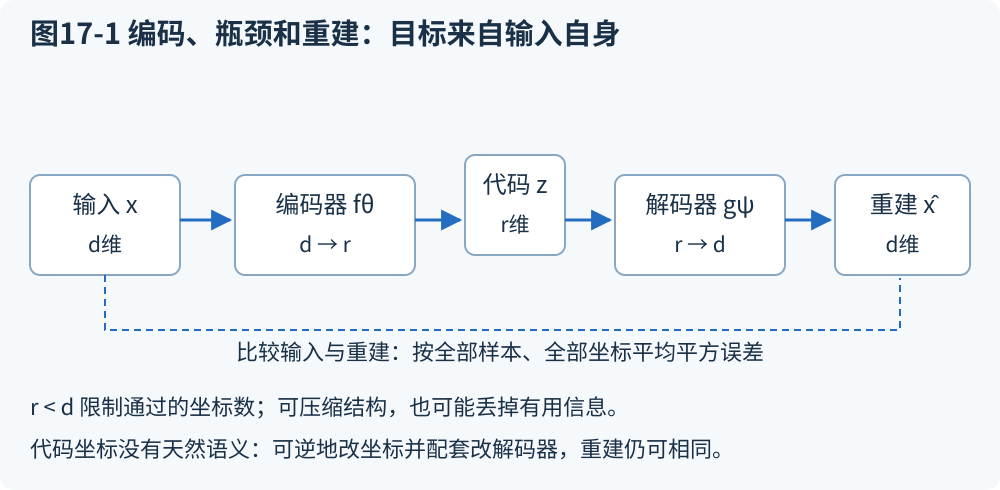
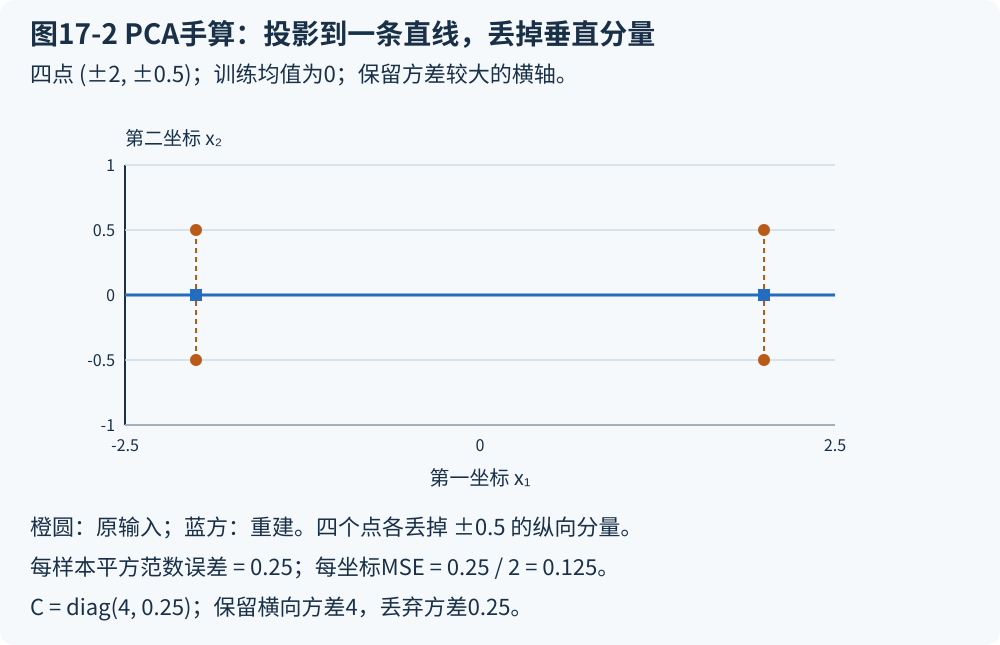
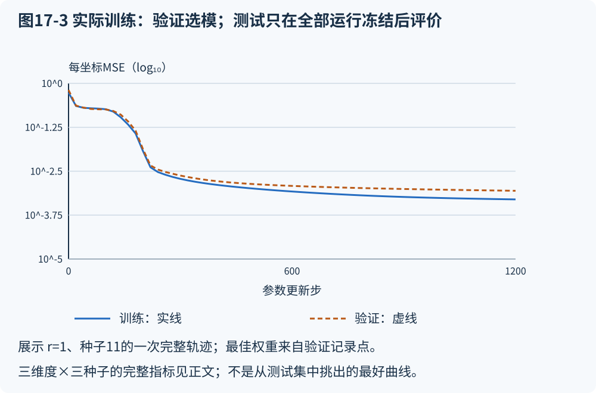
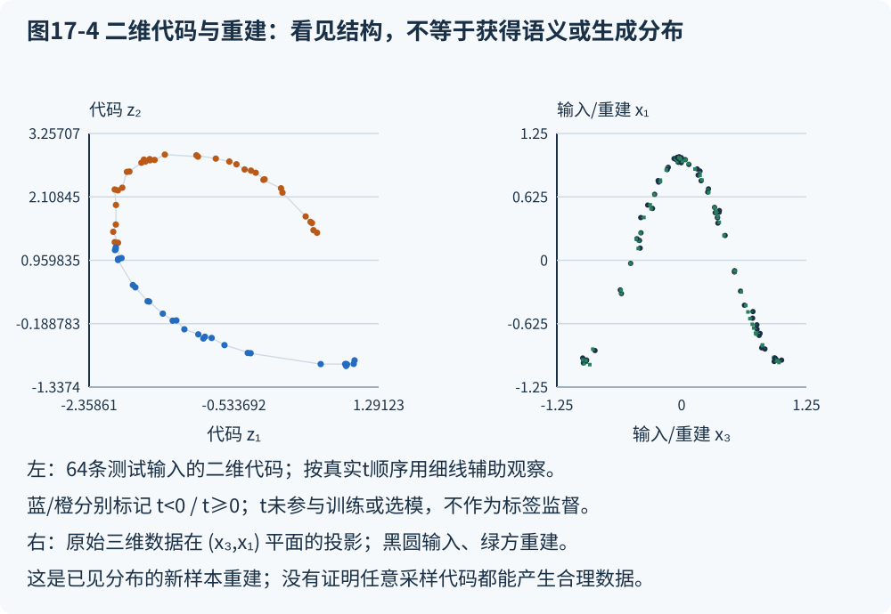
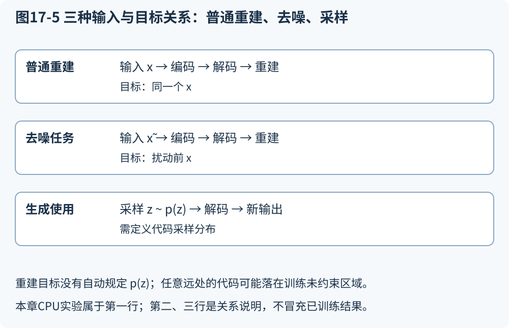

# 第17章：表示学习与自编码器

> 用可核对的低维投影理解“保留什么、丢失什么”，再把直线投影换成可训练的非线性编码与解码。正文和实验按本机CPU配置实现；正式完成状态见章节计划。

[阅读入口](../../README.md) · [章节计划](../chapter-plan.md) · [公共符号](../appendices/notation.md) · [完整实验](../../examples/17-representation-learning/README.md)

## 1. 为什么要学习输入的表示

第07章的隐藏层把原始输入变成另一些数，这些数可以交给后续层使用。**表示（representation）** 就是这种为后续计算提供信息的形式：同一条数据可以用原始坐标、投影坐标或网络隐藏向量表示。它不是仅给原数据换一个名字；不同表示使某些规律更容易表达，也可能删掉任务需要的信息。

例如三维传感读数随一个位置参数弯曲变化。一个读数有三个坐标，却可能主要沿一条曲线移动。若找到描述曲线上位置的少量坐标，就能简化观察或后续预测。若数据本来在整个三维空间变化，强行压成一个连续坐标就可能把不同输入混在一起。表示的价值需要结合任务与数据判断。

本章先讲确定性的自编码器，再推导线性参照PCA，最后比较不同瓶颈大小的真实重建。前置为第01～03章的矩阵、梯度、期望与方差，以及第07～10章的网络、反向传播和数据协议。学完应能：

- 写清编码器、代码、解码器和重建的形状与目标。
- 用正交投影手算信息损失，理解PCA选择主方向的理由。
- 说明线性自编码器与PCA的条件关系，以及非线性网络增加了什么。
- 解释潜在坐标不唯一、压缩维数与存储字节数的区别。
- 用独立验证选模、测试评价，区分重建、去噪与生成。

花书第14章提供自编码器主线；PCA的几何和线性代数推导参照Stanford CS229课程。[1,2,3] 本章数值、数据与五幅SVG均为原创，不复刻来源的图形和实例。

## 2. 编码—代码—解码：监督信号来自输入

### 2.1 两个函数与一次往返

令输入为 $`\mathbf{x}\in\mathbb R^d`$。编码器把它变成代码，解码器再尝试恢复输入：

```math
\mathbf z=f_{\boldsymbol\theta}(\mathbf x)\in\mathbb R^r,
\qquad
\widehat{\mathbf x}=g_{\boldsymbol\psi}(\mathbf z)\in\mathbb R^d.
```

**自编码器（autoencoder）** 训练这两个函数，使往返结果接近输入。[1，§14.1] $`\boldsymbol\theta,\boldsymbol\psi`$分别是编码和解码参数；$`\mathbf z`$称为代码或潜在表示。这里它是确定性函数值，没有额外假定它来自标准正态分布，也没有为每个坐标预先指定语义。



图17-1为原创结构图。目标不是另一个外部类别标签，而是输入自身。训练依然需要一个明确的损失，依然用反向传播计算两部分参数的梯度。常说这类任务“不需要标签”，指不需要人工类别标签，不代表没有监督目标或可以跳过数据划分。

代码可以作为其他任务的输入，例如冻结编码器后训练小分类头；但仅凭重建误差低，不能证明它对某个分类任务有用。模型可能优先保存变化很大的背景，却丢掉幅度很小但决定类别的细节。要主张下游收益，需要另设对应任务和独立评价。

### 2.2 为什么不能只学会复制

若允许网络轻易表示恒等函数 $`\widehat{\mathbf x}=\mathbf x`$，损失可以很低，却没有迫使代码形成有价值的约束。一个常见办法是让 $`r\lt d`$，称为**欠完备自编码器**；中间较窄的表示称为**瓶颈（bottleneck）**。[1，§14.1]

瓶颈限制的是连续坐标数，收益取决于数据结构、模型容量和优化。有限训练点仍可能被有足够容量的非线性网络记忆；它不自动等于一般化能力。反过来，$`r\ge d`$的模型也可以通过其他约束学习有用特征，不能把“有没有瓶颈”当作全部自编码器的定义。

压缩维数也不等于已实现文件压缩。原输入若用三个float64存储为24字节，一个float64代码载荷为8字节，但还需保存均值、解码器参数和格式信息；也未做量化或熵编码。只有明确计算总存储成本后，才能谈具体压缩率。

## 3. 符号、目标与梯度

| 符号 | 本章含义与形状 |
| --- | --- |
| $`N,B,d,r`$ | 训练样本数、当前批次大小、输入维数、代码维数 |
| $`\mathbf x,\mathbf z,\widehat{\mathbf x}`$ | 单样本列向量，维数为$`d,r,d`$ |
| $`\mathbf X,\mathbf Z`$ | 行批次输入与代码，形状$`B\times d,B\times r`$ |
| $`\boldsymbol\theta,\boldsymbol\psi`$ | 编码器与解码器参数集合 |
| $`\boldsymbol\mu,\mathbf u`$ | 仅训练集估计的均值、中心化输入$`\mathbf x-\boldsymbol\mu`$ |
| $`\mathbf C,\lambda_j,\mathbf q_j`$ | 训练协方差、特征值、单位特征向量 |
| $`\mathbf Q_r`$ | 前$`r`$个正交主方向排成的$`d\times r`$矩阵 |
| $`\|\cdot\|_F`$ | Frobenius范数：矩阵全部元素平方和再开方 |

本章训练使用**逐坐标MSE**：

```math
\mathcal L(\boldsymbol\theta,\boldsymbol\psi)
=\frac1{Bd}\sum_{i=1}^{B}
\left\|g_{\boldsymbol\psi}\!\left(f_{\boldsymbol\theta}(\mathbf x^{(i)})\right)
-\mathbf x^{(i)}\right\|_2^2.
```

它先对每个样本的$`d`$个坐标求平方和，再除以$`Bd`$；没有额外的$`1/2`$。框架的 `MSELoss(reduction="mean")`对这里的$`(B,d)`$输出按全部元素平均，与此式一致。[4] 图中“每坐标MSE”都使用这一定义。

目标的输出侧梯度为

```math
\nabla_{\widehat{\mathbf x}^{(i)}}\mathcal L
=\frac{2}{Bd}(\widehat{\mathbf x}^{(i)}-\mathbf x^{(i)}).
```

第08章的链式法则把它先通过解码器，再通过编码器。例如对一个样本，代码收到的梯度是解码器对代码的Jacobian转置乘输出侧梯度；编码器不是固定的“预处理公式”，它的参数也被重建目标共同更新。

不同坐标的单位或量级会改变平方误差的权重。PCA前是否按标准差缩放、网络前如何预处理，都需要声明。本章只减训练均值，不缩放方差，保留三个合成坐标原先的几何尺度；验证、测试使用同一个训练均值。

## 4. PCA：先理解一条直线能保留什么

### 4.1 正交投影与残差

主成分分析（principal component analysis，PCA）选择少量互相正交的方向，用输入在这些方向上的坐标表示数据。[2，pp.3～6；3，slides12～17] 先只保留单位方向$`\mathbf q`$，满足$`\mathbf q^\top\mathbf q=1`$。

对中心化输入$`\mathbf u=\mathbf x-\boldsymbol\mu`$，投影坐标和重建为

```math
z=\mathbf q^\top\mathbf u,
\qquad
\widehat{\mathbf x}=\boldsymbol\mu+\mathbf qz.
```

为什么坐标是这个内积？试图用$`\alpha\mathbf q`$逼近$`\mathbf u`$，误差为

```math
\|\mathbf u-\alpha\mathbf q\|_2^2
=\|\mathbf u\|_2^2-2\alpha\mathbf q^\top\mathbf u+\alpha^2.
```

对$`\alpha`$求导得到$`-2\mathbf q^\top\mathbf u+2\alpha`$，令其为0，得到最小点$`\alpha=\mathbf q^\top\mathbf u`$。重建是到该直线距离最近的点，残差与$`\mathbf q`$垂直。



图17-2为原创手算图。四个点是$`(2,0.5),(2,-0.5),(-2,0.5),(-2,-0.5)`$。它们均值为0，投影到横轴后成为$`(2,0)`$或$`(-2,0)`$。每个样本平方范数误差均为$`0.25`$；逐坐标MSE为$`0.25/2=0.125`$。若漏掉分母里的维数，就会报告相差两倍的数。

### 4.2 为什么选最大方差方向

定义仅由中心化训练集计算的协方差：

```math
\mathbf C=\frac1N\sum_{i=1}^N
\mathbf u^{(i)}(\mathbf u^{(i)})^\top.
```

这里采用分母$`N`$；这是PCA优化目标的矩阵，不是在宣称无偏总体协方差估计。沿$`\mathbf q`$的训练投影均值为0，其方差为

```math
\frac1N\sum_i(\mathbf q^\top\mathbf u^{(i)})^2
=\mathbf q^\top\mathbf C\mathbf q.
```

把最优投影坐标代回误差，得到

```math
\frac1N\sum_i\|\mathbf u^{(i)}-\mathbf q\mathbf q^\top\mathbf u^{(i)}\|_2^2
=\frac1N\sum_i\|\mathbf u^{(i)}\|_2^2-\mathbf q^\top\mathbf C\mathbf q.
```

第一项不随方向改变，所以最小重建误差等价于最大化保留的投影方差。它保留的是当前尺度下的平方变化，不是某个分类目标的全部信息。

为解这个约束问题，可用一个辅助标量$`\lambda`$把单位长度约束加入目标：

```math
F(\mathbf q,\lambda)
=\mathbf q^\top\mathbf C\mathbf q-\lambda(\mathbf q^\top\mathbf q-1).
```

这称为拉格朗日乘子法：在平滑约束的驻点，让目标梯度与约束的法向平行。因为$`\mathbf C`$对称，对$`\mathbf q`$求导为$`2\mathbf C\mathbf q-2\lambda\mathbf q=0`$，即$`\mathbf C\mathbf q=\lambda\mathbf q`$。满足该式的非零方向称为**特征向量**，对应缩放量$`\lambda`$为**特征值**。

实对称协方差有正交单位特征向量，且特征值非负。将候选方向写成这些方向的线性组合，单位长度使系数平方和为1，投影方差就是特征值的加权平均，因此最大值由最大特征值方向取得。这也解释了为何仅找一个任意特征向量还不够。

手算例$`\mathbf C=\mathop{\mathrm{diag}}\nolimits(4,0.25)`$。沿横轴的单位方向得到方差4，沿纵轴得到0.25，所以保留横轴。若把纵轴单位放大10倍后再做PCA，其方差变成25，主方向就会改变；PCA对单位与预处理敏感。

### 4.3 从一个方向扩展到多个

令特征值按$`\lambda_1\ge\cdots\ge\lambda_d\ge0`$排列，取前$`r`$个单位特征向量作为$`\mathbf Q_r`$的列：

```math
\mathbf z=\mathbf Q_r^\top\mathbf u,\qquad
\widehat{\mathbf x}=\boldsymbol\mu+\mathbf Q_r\mathbf Q_r^\top\mathbf u.
```

正交约束为$`\mathbf Q_r^\top\mathbf Q_r=\mathbf I_r`$。在特征向量坐标中，重建保留前$`r`$个分量、删除其余分量，因此**训练集每坐标MSE**为

```math
\frac1{Nd}\sum_i\|\widehat{\mathbf x}^{(i)}-\mathbf x^{(i)}\|_2^2
=\frac1d\sum_{j=r+1}^d\lambda_j.
```

该公式针对拟合PCA的训练集；验证和测试需直接计算重建，不能把训练特征值之和冒充测试误差。相同数据和尺度下，增加PCA方向不会增加训练误差；$`r=d`$时投影为恒等，即使输入有噪声也会原样保留。

代码采用对称矩阵专用的 `np.linalg.eigh(C)`，并将输出从默认升序重新排列。行批次形式是：

```python
mean = train.mean(axis=0)                # (d,)
centered = train - mean                 # (N,d)
C = centered.T @ centered / len(train)   # (d,d)
values, vectors = np.linalg.eigh(C)
Q = vectors[:, np.argsort(values)[::-1][:r]]
z = (new_x - mean) @ Q                   # (B,r)
reconstruction = z @ Q.T + mean         # (B,d)
```

特征向量的正负号不唯一；某个特征值重复时，该子空间内的基也可以旋转。这些变化可改变代码坐标，但不改变对应正交投影。不要用“第一维必须为正”这样的外观规则判断实现是否正确。

## 5. 从PCA到非线性自编码器

### 5.1 线性网络的关系有条件

对中心化输入，令线性编码器为$`\mathbf z=\mathbf E\mathbf u`$，解码器为$`\widehat{\mathbf u}=\mathbf D\mathbf z`$。往返矩阵$`\mathbf D\mathbf E`$的秩至多为$`r`$；**秩**可理解为该线性变换最多保留多少个独立方向。

取$`\mathbf E=\mathbf Q_r^\top,\mathbf D=\mathbf Q_r`$，就恰好得到PCA正交重建。对于无额外约束、平方重建目标、达到全局最优的线性自编码器，它可获得PCA对应的最优重建子空间；隐藏坐标和权重未必等于那组正交特征向量。[1，§14.1] 若只是有限步训练、换了损失或加了别的约束，不能直接套用这个结论。

本章程序直接把PCA矩阵装入两个无偏置线性层，核对输出逐项一致。这验证了构造关系；没有虚构“梯度下降总会找到全局最优”。

### 5.2 非线性让重建不再局限于直线或平面

本机网络的编码与解码分别为

```math
\mathbf z=\mathbf W_{e2}\tanh(\mathbf W_{e1}\mathbf u+\mathbf b_{e1})+\mathbf b_{e2},
```

```math
\widehat{\mathbf u}
=\mathbf W_{d2}\tanh(\mathbf W_{d1}\mathbf z+\mathbf b_{d1})+\mathbf b_{d2}.
```

它使用第07～08章已推导的tanh。宽度为$`3\to16\to r\to16\to3`$，中间的代码层和输出层都不再加tanh；否则会额外限制代码或重建范围。第一层权重形状$`16\times3`$，第二层$`r\times16`$，第三层$`16\times r`$，输出层$`3\times16`$；偏置长度分别为$`16,r,16,3`$。

当$`r=1`$，改变单个代码值，可让解码器输出沿三维空间中的一条弯曲曲线移动。PCA单方向的重建只能落在一条直线上，两者的结构能力不同。增加非线性同时增加参数和优化难度；它并不意味着新样本误差必然更低。

### 5.3 代码坐标不唯一，也不自动等于语义

若对代码施加可逆变换$`\mathbf A`$，重新定义

```math
f'(\mathbf x)=\mathbf A f(\mathbf x),\qquad
g'(\mathbf z')=g(\mathbf A^{-1}\mathbf z'),
```

则$`g'(f'(\mathbf x))=g(f(\mathbf x))`$。重建完全相同，代码的旋转、尺度甚至轴的对应却可以不同。这里要求修改后的函数仍可被模型类表达；对本章线性代码接口的可逆线性变换，可以配套改变相邻线性层。

例如一维代码从$`z`$变成$`2z`$，只要解码器入口把它除以2，结果不变。因此代码距离、每轴意义或不同种子图的朝向，不能只凭重建目标解释成唯一的真实因素。程序用一个可逆二维矩阵实际核对了这一恒等式。

## 6. 本机实验：曲线结构与瓶颈大小

### 6.1 数据、划分与预先固定的方案

用NumPy种子20261117依次独立生成128条训练、64条验证、64条测试输入：

```math
t\sim\mathop{\mathrm{Uniform}}\nolimits[-\pi,\pi],\qquad
\mathbf x=(\cos t,\sin t,t/\pi)^\top+\boldsymbol\epsilon,
\quad
\boldsymbol\epsilon\sim\mathcal N(\mathbf0,0.02^2\mathbf I_3).
```

噪声在每个样本、每个坐标上独立。数据为本项目合成，无外部下载和许可依赖。无噪声时沿一条三维曲线变化；加噪后不再严格位于一维集合上，所以一维瓶颈不应被期待无损保留所有噪声。参数$`t`$只用于生成和解释图形，**没有进入网络、损失或选模**。

只从训练输入计算三维均值；全部输入减这个均值，输出重建再加回来。PCA也只拟合训练协方差。没有用测试统计量做中心化，没有把测试重建损失反过来作为训练数据。

固定三种瓶颈$`r=1,2,3`$，每种初始化种子11、22、33。参数量为

```math
(3\cdot16+16)+(16r+r)+(16r+16)+(16\cdot3+3)
=131+33r,
```

依次164、197、230。不同维数的网络并非同一参数预算；三种子刻画当前固定划分上的初始化变化，不能代表全部数据不确定性。

### 6.2 训练、验证选择与恢复

环境为Windows、Python3.11.5、NumPy2.4.6、PyTorch2.15.0+cpu；CPU、float64、1线程，开启确定性算法。使用PyTorch线性层默认初始化，无Dropout和权重衰减。每步全批次128，Adam学习率0.01、$`\beta_1=0.9,\beta_2=0.999,\epsilon=10^{-8}`$，共1200次更新。

每20步记录一次纯训练/验证MSE，包括第0步与最终步；从这些记录点选验证MSE最低的权重深拷贝，训练预算固定、未采用早停。先完成9个预设运行和一次$`r=1`$种子11的复跑，再统一进行最终测试评价；没有根据测试指标改配置或挑一个幸运种子。



图17-3使用实际日志，纵轴为对数刻度。曲线展示训练进度，最终交付的是验证选出的记录点；不能仅拿最后一次训练损失代替它。所有曲线、最佳步数和各运行指标可在JSON中查看。

代码中的输入形状$`(128,3)`$，编码后$`(128,r)`$，解码后$`(128,3)`$。自编码器前向函数只返回重建，调用 `model.encoder(x)`可独立取代码。

```python
model.train()
optimizer.zero_grad(set_to_none=True)
reconstruction = model(train_centered)
loss = (reconstruction - train_centered).square().mean()
loss.backward()
optimizer.step()
```

每个最佳模型写入自己的检查点，包含参数、潜在维数和训练均值；新建同结构模型加载后，验证预测逐项相同。它是**推理重建的恢复**，没有保存Adam状态与训练计数，不宣称能精确继续原训练。相同环境的种子11复跑要求完整记录曲线和验证预测完全相同。

从仓库根目录执行：

```powershell
& ./.venv/Scripts/python.exe -B examples/17-representation-learning/run.py
# 只训练并记录，不重新生成SVG：
& ./.venv/Scripts/python.exe -B examples/17-representation-learning/run.py --skip-figures
```

结果写入 `build/experiments/17-representation-learning/results.json`；图源 `examples/17-representation-learning/figures.py`直接读取报告，检查点在同目录的 `checkpoints/`。这些运行输出可重建，不将模型文件加入Git。

### 6.3 实测结果与限制

2026-11-15本机真实运行全部通过。PCA为固定训练集拟合的一次计算；自编码器报告3种子的测试MSE均值与样本标准差：

| 潜在维数 | PCA测试MSE | 自编码器测试MSE均值 | 自编码器样本标准差 |
| --- | ---: | ---: | ---: |
| 1 | 0.218235 | 0.00077306 | 0.00001234 |
| 2 | 0.039182 | 0.00031156 | 0.00005515 |
| 3 | $`1.24\times10^{-31}`$ | 0.00002771 | 0.00000648 |

当前弯曲数据上，低维非线性模型比相同维数的直线/平面投影更贴近数据结构；这与其可表达弯曲解码映射相符，但比较也包含额外参数与训练成本，不能据此断言“神经网络总优于PCA”。

$`r=3`$时，PCA保留整个输入空间，重建误差只有浮点舍入量级；网络仍有有限拟合误差。这里PCA胜出没有矛盾：本来已无需有损压缩，通用神经网络的有限步优化并不比直接恒等投影更精确。

增加$`r`$时，本次网络平均测试误差下降；一般网络的有限步训练与验证选择不保证这种单调关系。三种子、一份合成划分和很小的模型，也不足以建立普遍排名。本实验没有训练分类器，不能声称重建更好的代码一定改善分类；没有干净目标的去噪评价，也不能把较平滑重建称为已经证明去噪成功。



图17-4左侧展示64个最终测试输入的二维代码，按生成参数$`t`$排序画辅助细线；右侧只显示三维观测的$`(x_3,x_1)`$投影。黑圆为输入、绿方为重建。图上点接近并不保证未显示的第三个坐标也接近，评价仍使用全部三个坐标。

43项核对包括PCA手算、协方差特征对、训练谱误差公式、线性网络与PCA一致、可逆代码变换、参数量、9次训练下降与恢复，以及同种子复跑。PCA与训练/全部检查共8.728秒，含库导入11.799秒，不含随后SVG生成。三个输入数组载荷6144字节；未测进程峰值内存，该数字不包含参数、梯度、优化器和框架开销。

## 7. 重建、去噪与生成要分别定义



图17-5为原创关系图，三行的箭头分别表示各自数据流；本章实验只执行普通重建。

### 7.1 去噪改变了输入与目标的关系（拓展）

普通重建把同一个输入作为目标；去噪自编码器（denoising autoencoder）则先人为扰动输入，再要求恢复扰动前的目标。[1，§14.2.2、§14.5] 若原目标为$`\mathbf x`$，扰动后为$`\widetilde{\mathbf x}`$，训练关系为

```math
\widetilde{\mathbf x}\longrightarrow f
\longrightarrow g\longrightarrow\widehat{\mathbf x},
\qquad
\ell=\frac1d\|\widehat{\mathbf x}-\mathbf x\|_2^2.
```

输入是$`\widetilde{\mathbf x}`$，目标仍是$`\mathbf x`$，这迫使模型学习如何恢复被扰动的信息。但扰动分布、训练数据与目标本身都决定任务；它不保证修复任意类型的真实噪声。

本章三维实验虽然在数据生成时加过噪声，训练目标却是同一个带噪观测，所以它是普通重建实验。不能因为生成器里出现“噪声”一词，就改称去噪自编码器。

### 7.2 有解码器仍需要说明从哪里取代码

重建已有输入时，代码来自$`\mathbf z=f(\mathbf x)`$。若要产生新的样本，必须另行规定$`\mathbf z`$怎样取值，例如从某个分布$`p(\mathbf z)`$采样后解码。重建目标只约束训练输入所到达的代码附近；它没有自动把这些代码塑造成标准正态，也没有保证空隙或远处的解码输出合理。

例如一维代码若只在两个分离区间出现，在两区间之间均匀采样就会查询训练目标很少约束的位置。把这些输出称为“解码结果”可以，把它们直接当作已学会真实数据分布的证据则不充分。下一章VAE会把潜变量分布和概率目标纳入设计，GAN会使用另一种分布匹配训练思路。

## 8. 常见误区与排查

- **目标等于输入，所以训练没有意义**：约束决定了哪些输入细节需要保留；无约束恒等复制确实可能没有所需价值。
- **瓶颈越小越好**：可能压掉有用变化；需要结合重建、下游任务和资源选择。
- **代码第一维就是某个真实属性**：坐标可逆变换可能不改变重建，语义不能只靠轴外观判断。
- **PCA必须总先缩放到单位方差**：缩放会改变几何与目标，按数据单位和任务选择并记录。
- **线性AE与PCA相关，所以任何神经网络训练都能达到PCA最优**：需满足线性、平方目标与全局最优等条件。
- **PCA训练谱误差等于测试误差**：特征值来自训练集，测试必须按冻结投影实际计算。
- **低重建误差等于好生成模型**：重建没有自动规定代码采样分布。
- **r=1把三个float64变成一个，所以整个模型压缩率就是3倍**：还需计算解码器、均值、编码格式和量化等成本。

## 9. 习题与分步解析

### 题1：完整手算投影与归约

输入$`\mathbf x=(3,2)^\top`$，均值$`\boldsymbol\mu=(1,1)^\top`$，保留$`\mathbf q=(1,0)^\top`$。求代码、重建、平方范数误差与逐坐标MSE。

**解析**：中心化为$`(2,1)^\top`$，内积代码$`z=2`$；中心化重建为$`(2,0)^\top`$，加均值得$`(3,1)^\top`$。残差是$`(0,1)^\top`$，平方范数为1，逐坐标MSE为$`1/2`$。均值既参与编码的减法，也参与解码后的加法，不能漏掉一边。

### 题2：为什么要约束投影方向长度

若直接最大化$`\mathbf q^\top\mathbf C\mathbf q`$却不限制$`\|\mathbf q\|`$，取$`\mathbf C=\mathop{\mathrm{diag}}\nolimits(4,0.25)`$会怎样？

**解析**：令$`\mathbf q=(a,0)^\top`$，目标为$`4a^2`$，可随$`a`$无限增大。单位长度限制排除了仅放大坐标就提高目标的做法，使问题真正比较方向；投影式$`\mathbf q\mathbf q^\top\mathbf u`$也依赖单位向量约定。

### 题3：用特征值核对训练误差

三维训练协方差特征值为$`9,4,1`$，保留前两个方向。每样本平方范数误差与逐坐标MSE各是多少？能直接用作测试误差吗？

**解析**：被删方向方差和为1，所以训练每样本平方范数误差为1，逐坐标MSE为$`1/3`$。新测试输入在该方向上的变化可能不同，必须用已冻结的训练均值和投影重建后计算；训练谱不能代替测试数据。

### 题4：代码坐标改变会不会改变重建

原代码为$`z=f(x)`$，改成$`z'=3z`$，应怎样修改解码器？这说明欧氏距离的解释需要什么条件？

**解析**：定义$`g'(z')=g(z'/3)`$，则$`g'(3f(x))=g(f(x))`$。代码距离放大3倍，重建却不变；距离数值的解释需说明代码坐标、尺度与额外约束。不能把不同训练运行的距离直接当作同一物理量。

### 题5：计算瓶颈2模型参数和代码载荷

本章$`r=2`$模型有多少参数？64条输入的代码用float64存储需多少字节？是否包含模型？

**解析**：$`131+33\times2=197`$个参数。代码有$`64\times2`$个数，载荷$`64\times2\times8=1024`$字节。该数字不含197个参数、均值、文件头或优化器状态；只说明代码数组本体。

### 题6：为什么带噪输入重建不是自动去噪

若训练输入和目标都是$`\mathbf x=\mathbf s+\boldsymbol\epsilon`$，最小MSE目标是否要求输出干净$`\mathbf s`$？如何设计去噪对照？

**解析**：它要求逼近观测$`\mathbf x`$，没有提供必须恢复$`\mathbf s`$的监督。可先固定原目标$`\mathbf x`$，另加预设扰动得到$`\widetilde{\mathbf x}`$并以$`\mathbf x`$为目标；若研究恢复真实干净信号，还要准备相应的干净评价目标。划分应先按独立原样本完成，避免同一原样本的扰动副本跨训练与测试。

### 题7：提出一个可证伪的下游表示评价

如果想证明瓶颈1比瓶颈2更有利于分类，不能只引用哪一个数字？应增加什么实验？

**解析**：不能仅引用重建MSE或挑一张好看的潜空间图。需固定有实际含义的分类标签、训练/验证/测试划分，在各冻结编码器代码上训练相同预算的分类头，用验证选配置后统一测试，并报告多种子及原始输入基线。若瓶颈1分类更差，应保留结果，不能把“压缩更强”当作收益证明。

## 10. 小结与后续衔接

表示学习改变后续计算使用的信息形式。自编码器用重建目标共同训练编码器和解码器，瓶颈限制通过的坐标数；PCA把线性版本变成可精确求解的正交投影，重建损失等于删除方向的方差和。非线性网络可以描述弯曲结构，也带来有限样本、容量和优化问题。

本机实验展示低维曲线的重建优势与全维PCA的精确参照，所有结论都限定在给定任务。下一章继续补足潜变量、概率重建和分布匹配知识，解释VAE与GAN怎样进一步定义生成任务。

## 11. 参考来源与核验

以下链接于2026-11-15核验。正文为按本项目符号重新组织的解释与推导，图和全部数值均为本章原创；来源未参与本机实验。

1. Goodfellow、Bengio、Courville，*Deep Learning*，2016，§14.1欠完备自编码器与线性/PCA关系、§14.2.2及§14.5去噪目标：[官方第14章](https://www.deeplearningbook.org/contents/autoencoders.html)。
2. Andrew Ng，Stanford CS229，*Part XI: Principal Components Analysis*，6页讲义，页面未标固定授课年份；pp.2～6讨论预处理、最大方差方向与算法：[大学官方讲义](https://see.stanford.edu/materials/aimlcs229/cs229-notes10.pdf)。
3. Carlos Guestrin，Stanford CS229，Fall2021，*Lecture14: Dimensionality Reduction / PCA*，slides12～17的投影、重建和特征值关系：[大学官方课件](https://cs229.stanford.edu/notes2021fall/lecture14-pca.pdf)。
4. PyTorch2.15，`MSELoss`的元素平均定义：[官方接口](https://docs.pytorch.org/docs/2.15/generated/torch.nn.MSELoss.html)。
5. NumPy2.4，`numpy.linalg.eigh`，实对称矩阵的特征对及返回顺序：[官方接口](https://numpy.org/doc/2.4/reference/generated/numpy.linalg.eigh.html)。

## 12. 实现与验证记录

已实际完成9组网络训练、一次同种子复跑、PCA对照和43项核对。实际导出15页PDF、五幅纯SVG、137处公式；1440/390px双视口无横向溢出、断锚、残留标记或图形裁剪。独立PDF审计确认零位图、字体全部嵌入、文字未越界，全部15页与五图已目视核验；正式状态仍由总计划维护。
