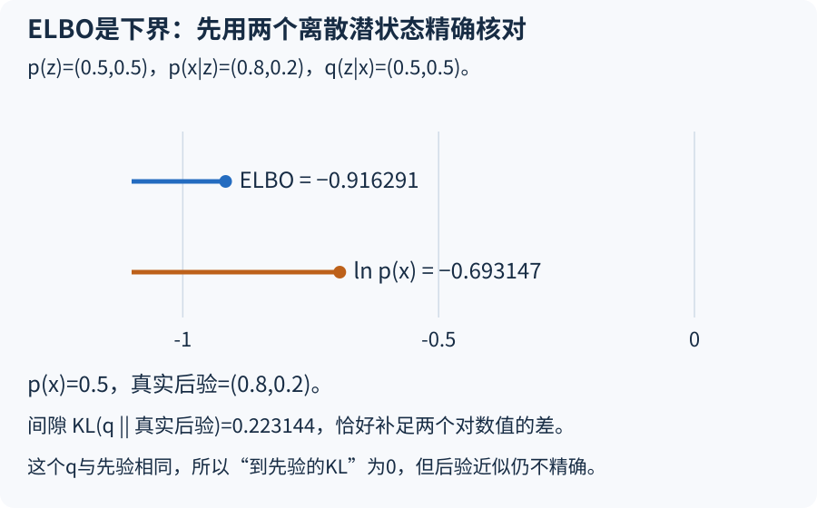
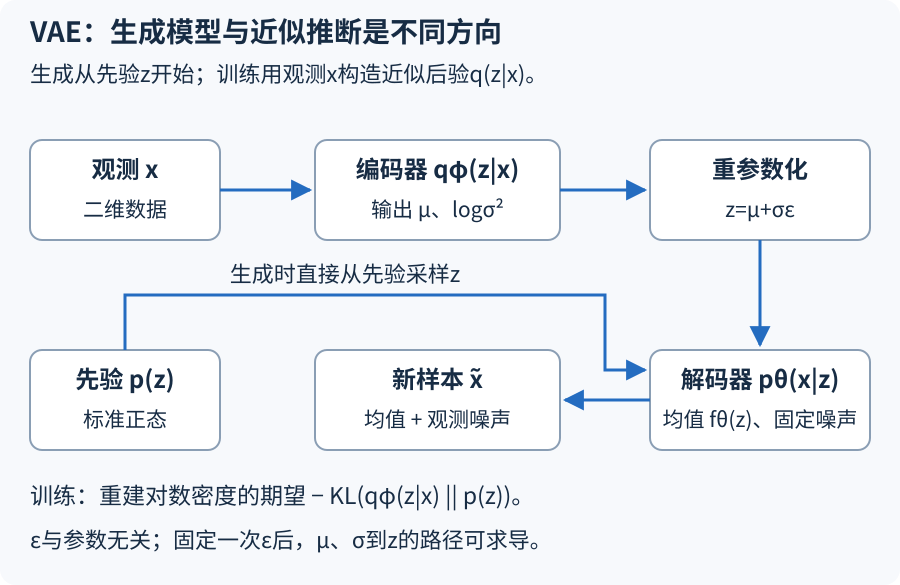
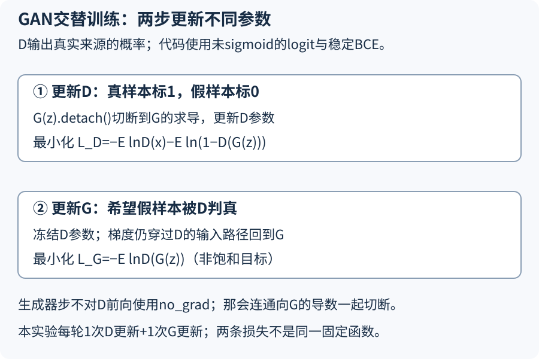
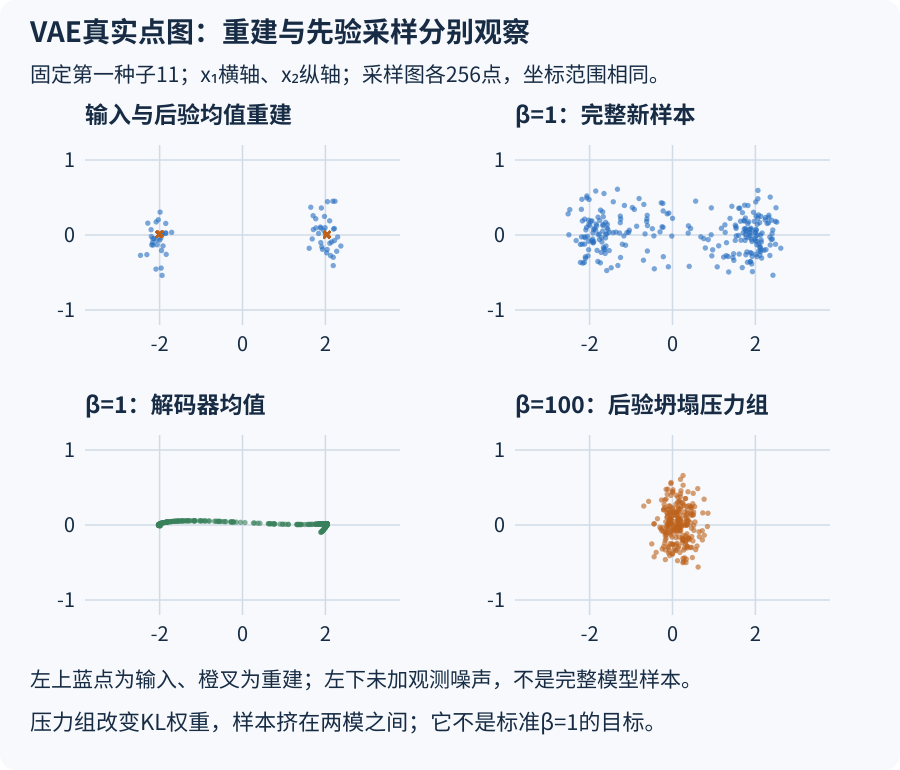
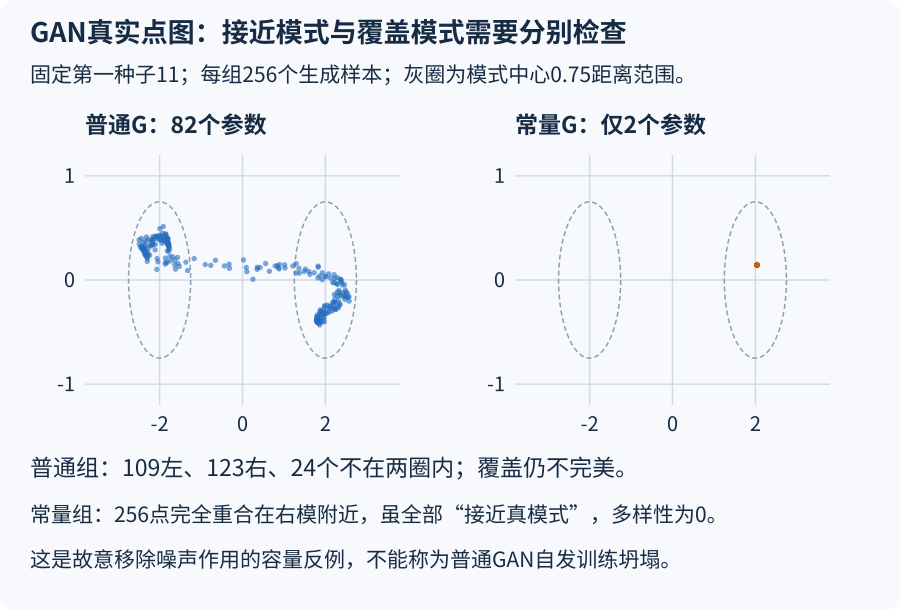
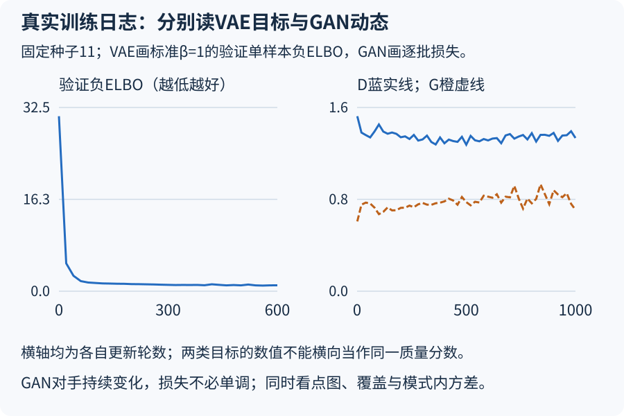

# 第 18 章：生成模型：VAE 与 GAN

> 从第 17 章的确定性重建继续走向概率生成。正文、六幅纯 SVG 与三种子 CPU 训练已实现；导出验收结果单列于章末。

[阅读入口](../../README.md) · [上一章：表示学习与自编码器](17-representation-learning.md) · [公共符号](../appendices/notation.md) · [完整实验](../../examples/18-vae-and-gan/README.md)

## 1. 学习目标与前置知识

自编码器把输入变成代码再重建，但“把任意噪声交给解码器，就能生成像数据的新样本”并不是它的默认保证。要有明确的生成过程，需要规定随机变量从哪里来、输出服从什么分布、训练目标如何约束它。本章用 VAE 与 GAN 回答这些问题，先补足后验、近似推断与下界，再讲对抗训练。

学完后应能区分重建、生成与判别；推导 ELBO 并说清两种 KL 的对象；手算重参数化和高斯 KL；解释 GAN 交替更新的梯度边界；用真实点图和指标辨认后验坍塌、模式遗漏和多样性不足。

前置为第 03 章的条件概率、密度、期望与 KL，第 08～10 章的梯度、优化与实验协议，第 17 章的编码和重建。主线来自花书第 19 章、§20.10.3～20.10.4 与 VAE、GAN 原始论文。[1～4] 本机只训练二维合成数据，不使用图像下载或 GPU。

## 2. 生成分布与潜变量：先给随机过程

### 2.1 目标从预测标签扩展到描述数据

判别模型常学习给定输入后的类别分布。生成模型则试图描述数据本身的分布，例如观测二维点 $`\mathbf x`$ 的密度。两类方法可以结合；GAN 正是用判别任务提供生成器的训练信号。

密度 $`p_\theta(\mathbf x)`$ 在某个点的数值不是该点的概率质量；连续分布的单点概率为 0，某个小区域的概率要积分。密度可以大于 1，因此连续数据的负对数密度也可能为负。后面实验出现负的重建 NLL，不是数学错误。

一种生成过程先抽潜变量，再抽观测：

```math
\mathbf z\sim p(\mathbf z),
\qquad
\mathbf x\sim p_\theta(\mathbf x\mid\mathbf z).
```

联合密度为 $`p_\theta(\mathbf x,\mathbf z)=p(\mathbf z)p_\theta(\mathbf x\mid\mathbf z)`$，观测的边缘密度要把潜变量积分掉：

```math
p_\theta(\mathbf x)=\int p(\mathbf z)p_\theta(\mathbf x\mid\mathbf z)\,d\mathbf z.
```

潜变量表达没有直接观测到的变化因素，不保证每个坐标自动对应人能命名的语义。参数 $`\theta`$ 控制共享网络，潜变量 $`\mathbf z`$ 是每次生成重新抽取的数，二者不能混为一谈。

### 2.2 从生成反推潜变量：后验与近似

看到观测后，真正的后验是

```math
p_\theta(\mathbf z\mid\mathbf x)
=\frac{p(\mathbf z)p_\theta(\mathbf x\mid\mathbf z)}{p_\theta(\mathbf x)}.
```

非线性解码器下，分母的积分常难以精确计算，后验也未必属于简单分布族。VAE 用编码器输出一个可计算的分布 $`q_\phi(\mathbf z\mid\mathbf x)`$ 来近似它。编码器不再只输出一个确定性代码，而是输出近似分布的参数。

同一套 $`\phi`$ 用于所有样本，称为摊销推断：不用为每个新输入从头优化一套独立变分参数。计算更快，但近似族与共享编码器都可能限制后验拟合。[1，§19.1、§19.4；3，§2]

| 符号 | 本章含义与形状 |
|---|---|
| $`\mathbf x\in\mathbb R^d`$ | 观测列向量，实验中 $`d=2`$ |
| $`\mathbf z\in\mathbb R^r`$ | 潜变量；VAE 取 $`r=1`$，普通 GAN 取 $`r=2`$ |
| $`\theta,\phi`$ | VAE 解码器与编码器参数 |
| $`p(\mathbf z),q_\phi(\mathbf z\mid\mathbf x)`$ | 先验、近似后验 |
| $`\mathcal E(\theta,\phi;\mathbf x)`$ | 单观测 ELBO，本章要最大化的下界 |
| $`\boldsymbol\mu,\mathbf l\in\mathbb R^r`$ | 编码均值、对数方差；$`l_j=\ln\sigma_j^2`$ |
| $`\tau>0`$ | 解码观测噪声标准差，本实验固定 0.25 |
| $`G_\psi,D_\omega`$ | GAN 生成器与判别器；参数与 VAE 分开 |

## 3. ELBO：把难算的证据换成可优化下界

### 3.1 先推导恒等式，分清每一项

固定一个观测 $`\mathbf x`$，假设边缘密度正且有限，近似后验归一化，并且下面的期望与 KL 有定义。由后验公式：

```math
\ln p_\theta(\mathbf z\mid\mathbf x)
=\ln p_\theta(\mathbf x,\mathbf z)-\ln p_\theta(\mathbf x).
```

把它代入近似后验到真实后验的 KL：

```math
\begin{aligned}
D_{\rm KL}(q_\phi\|p_\theta(\cdot\mid\mathbf x))
&=\mathbb E_{q_\phi}
\left[\ln q_\phi(\mathbf z\mid\mathbf x)-\ln p_\theta(\mathbf z\mid\mathbf x)\right]\\
&=\mathbb E_{q_\phi}
\left[\ln q_\phi(\mathbf z\mid\mathbf x)-\ln p_\theta(\mathbf x,\mathbf z)\right]
+\ln p_\theta(\mathbf x).
\end{aligned}
```

第二行的最后一项与 $`\mathbf z`$ 无关，可以移出期望。重新排列，定义

```math
\mathcal E(\theta,\phi;\mathbf x)
=\mathbb E_{q_\phi}
\left[\ln p_\theta(\mathbf x,\mathbf z)-\ln q_\phi(\mathbf z\mid\mathbf x)\right],
```

便得到

```math
\ln p_\theta(\mathbf x)
=\mathcal E(\theta,\phi;\mathbf x)
+D_{\rm KL}\!\left(q_\phi(\mathbf z\mid\mathbf x)\|p_\theta(\mathbf z\mid\mathbf x)\right)
\geq\mathcal E(\theta,\phi;\mathbf x).
```

ELBO 是 evidence lower bound，即对数证据下界；这里“证据”指观测的边缘密度，不是日常语言里的实验结论。近似后验与真实后验几乎处处相同时，间隙为零。支持条件不满足时 KL 可为无穷，不能继续把有限数恒等式硬套进去。[1，§19.1；3，§2.2]

### 3.2 展开联合分布，得到实际训练的两部分

用联合密度的分解再整理：

```math
\mathcal E
=\mathbb E_{q_\phi(\mathbf z\mid\mathbf x)}
[\ln p_\theta(\mathbf x\mid\mathbf z)]
-D_{\rm KL}\!\left(q_\phi(\mathbf z\mid\mathbf x)\|p(\mathbf z)\right).
```

第一项鼓励从编码分布采样的潜变量能解释观测；第二项约束编码分布与先验的偏离。注意它和上一节“下界间隙”的 KL 对象不同：训练式是到先验，间隙是到真实后验。到先验的 KL 很小，不代表后验近似就准确，更不代表重建或生成一定好。

我们最小化负 ELBO，常写成“重建负对数密度加 KL”。这里的重建项并非随便选择一个 MSE：它应由明确的条件分布推出。平均或求和的归约方式也必须统一，否则会暗中改变两项的比例。

### 3.3 两个离散潜状态的手算

暂把潜变量换成两个状态，方便精确求和。先验为 $`(0.5,0.5)`$，当前观测在两个状态下的条件概率为 $`(0.8,0.2)`$，所以证据为 $`0.5`$，真实后验为 $`(0.8,0.2)`$。取近似后验仍为 $`(0.5,0.5)`$，则

```math
\mathcal E
=\tfrac12\ln0.8+\tfrac12\ln0.2
=\ln0.4\approx-0.916291.
```

到先验的 KL 为 0；到真实后验的 KL 则为

```math
\tfrac12\ln\frac{0.5}{0.8}
+\tfrac12\ln\frac{0.5}{0.2}
\approx0.223144.
```

相加恰好得到 $`\ln0.5\approx-0.693147`$。这个例子逐项核对了下界关系，也直接说明两种 KL 不可混淆。



图 18-1 为原创纯 SVG，横向坐标使用实际对数值。数值已由代码核对，恒等式残差约为 $`1.67\times10^{-16}`$。

## 4. VAE：让采样路径也能求导

### 4.1 对角高斯近似与重参数化

选标准正态先验，以及编码器给出的对角高斯：

```math
p(\mathbf z)=\mathcal N(\mathbf0,I),
\qquad
q_\phi(\mathbf z\mid\mathbf x)
=\mathcal N\!\left(\boldsymbol\mu_\phi(\mathbf x),
\operatorname{diag}(\boldsymbol\sigma_\phi^2(\mathbf x))\right).
```

网络输出对数方差 $`\mathbf l`$，因此标准差为 $`\exp(\mathbf l/2)`$，保证为正。为了对期望优化，先采一个与参数无关的噪声，再做确定性变换：

```math
\boldsymbol\epsilon\sim\mathcal N(\mathbf0,I),
\qquad
\mathbf z=\boldsymbol\mu+\exp(\mathbf l/2)\odot\boldsymbol\epsilon.
```

这仍然是从同一个高斯采样，只是把随机性移到参数无关的 $`\boldsymbol\epsilon`$。固定一次噪声后，$`\mu,l`$ 到 $`z`$ 的路径可微；在适当可微和可积条件下，用这些随机样本估计目标梯度。它不是把随机采样本身变成确定事件。[3，§2.3～2.4；5]

标量手算：$`\mu=1`$、方差 4、$`\epsilon=-0.5`$，得到 $`z=1+2(-0.5)=0`$。局部导数为

```math
\frac{\partial z}{\partial\mu}=1,
\qquad
\frac{\partial z}{\partial l}=\frac12e^{l/2}\epsilon=-0.5.
```

实践用自动求导得到相同结果。框架提供支持路径导数的 `rsample()`；普通 `sample()` 与它的求导行为不能混用。



图 18-2 为原创 SVG。训练从观测进入编码器，生成新样本则从先验开始，不需要先找一张真实输入。解码器均值与完整随机样本分开表示。

### 4.2 高斯 KL 与观察模型的确切系数

对对角高斯与标准正态，其 KL 可解析计算：

```math
D_{\rm KL}(q_\phi\|p)
=\frac12\sum_{j=1}^r
\left(\mu_j^2+e^{l_j}-1-l_j\right).
```

先写出逐坐标的对数密度比，省略的标准正态归一化常数在相减时恰好抵消：

```math
\ln\frac{q(\mathbf z\mid\mathbf x)}{p(\mathbf z)}
=\frac12\sum_{j=1}^r
\left[z_j^2-\frac{(z_j-\mu_j)^2}{e^{l_j}}-l_j\right].
```

再对$`q`$取期望，使用$`\mathbb E_q[z_j^2]=\mu_j^2+\sigma_j^2`$，以及 $`\mathbb E_q[(z_j-\mu_j)^2/\sigma_j^2]=1`$，即可得到本节开头的KL公式。以均值 1、方差 4 为例，KL 为 $`\tfrac12(1+4-1-\ln4)=1.306853`$ nat。[3，附录 B]

本实验观察模型明确设为

```math
p_\theta(\mathbf x\mid\mathbf z)
=\mathcal N\!\left(f_\theta(\mathbf z),\tau^2I\right),
\qquad \tau=0.25.
```

因此单样本的重建 NLL 为

```math
-\ln p_\theta(\mathbf x\mid\mathbf z)
=\frac{\|\mathbf x-f_\theta(\mathbf z)\|_2^2}{2\tau^2}
+\frac d2\ln(2\pi\tau^2).
```

先对坐标求和，再对样本平均；$`d=2`$。KL 同样先对潜坐标求和、再平均。固定 $`\tau`$ 时常数不影响梯度，但报告 NLL 时本实验保留它；这也解释负值如何出现。不能直接把逐坐标平均 MSE 与未归约 KL 相加，再声称与上式完全相同。

### 4.3 重建、采样与后验坍塌

重建可以从 $`q_\phi(\mathbf z\mid\mathbf x)`$ 采样，也可用编码均值作确定性诊断，后者不是对重建期望的精确计算。生成时则从先验抽 $`z`$，再从观察模型抽 $`x`$。只画 $`f_\theta(z)`$ 会遗漏观察噪声。

如果编码分布几乎不随输入变化、接近先验，解码器也不利用潜变量，称为后验坍塌的一种表现。KL 接近零是线索，还应结合重建和对潜变量的响应检查。我们故意把训练目标改成“重建 NLL 加 100 倍 KL”做压力对照；它不是标准负 ELBO目标，也不把压力对照失败描述成标准配置必然失败。

## 5. GAN：用判别任务训练生成器

### 5.1 隐式生成分布与两个目标

GAN 从噪声 $`\mathbf z\sim p(\mathbf z)`$ 出发，生成 $`\widetilde{\mathbf x}=G_\psi(\mathbf z)`$。它定义了输出样本的分布，但一般不提供容易计算的显式数据密度，也不默认提供编码器。判别器 $`D_\omega(\mathbf x)\in(0,1)`$ 输出“来自真实数据”的概率。[2，§20.10.4；4，§3]

经典博弈目标为

```math
\min_\psi\max_\omega
\left\{
\mathbb E_{\mathbf x\sim p_{\rm data}}[\ln D_\omega(\mathbf x)]
+\mathbb E_{\mathbf z\sim p(\mathbf z)}
[\ln(1-D_\omega(G_\psi(\mathbf z)))]
\right\}.
```

用梯度下降更新判别器时，将它的最大化目标取负：

```math
\mathcal L_D
=-\mathbb E_{\rm real}\ln D(\mathbf x)
-\mathbb E_{\mathbf z}\ln(1-D(G(\mathbf z))).
```

原始 minimax 生成器目标在判别器很容易拒绝假样本时可能梯度较弱；本实验采用原论文也提出的非饱和版本：

```math
\mathcal L_G=-\mathbb E_{\mathbf z}\ln D(G(\mathbf z)).
```

它让生成样本朝“被判为真”移动。两者目标函数不相同，不能只写“GAN loss”而不交代版本。代码使用 `BCEWithLogitsLoss`，判别器输出 logit，由稳定接口合并 sigmoid 和对数；不先 sigmoid 再误当 logit 传入。[4，§3；6]

为看清“梯度较弱”指什么，令判别器logit为$`s`$，$`D=\sigma(s)`$。在生成器步骤对这个logit求导：

```math
\frac{\partial\ln(1-\sigma(s))}{\partial s}=-D,
\qquad
\frac{\partial[-\ln\sigma(s)]}{\partial s}=D-1.
```

当$`D`$接近0，前者的绝对值接近0，后者接近1；再通过判别器对生成样本的导数回传到G。这解释非饱和替代目标的局部动机，不保证判别器输入导数始终有效，也不保证训练收敛。

手算 $`D(x_{\rm real})=0.8`$、$`D(G(z))=0.2`$，单对样本的判别损失为 $`-\ln0.8-\ln0.8=0.446287`$，非饱和生成器损失为 $`-\ln0.2=1.609438`$。本实验判别损失是两个批均值相加，未额外除以 2。

### 5.2 更新谁，与梯度经过谁



图 18-3 为原创 SVG。判别器步骤将假样本 `detach()`，阻止更新 G；生成器步骤冻结 D 的参数，但要保留 D 对输入的导数，梯度才能经过 D 回到 G。若把生成器步骤的 D 前向也放进 `no_grad()`，会切断所需路径。

本实验每轮一次 D 更新、一次 G 更新，并清除两步之间的旧梯度。程序实际核对：D 步无 G 参数梯度，G 步无 D 参数梯度，同时 G 确实接收到梯度。生成结束只需要 G，不需要 D 参与采样。

在理想无限容量和合适优化假设下，经典理论存在匹配数据分布的平衡；有限小网络的交替梯度不保证到达它。判别概率接近 0.5 也可能来自判别器不足，不能单独作为成功证据。[4，§4]

### 5.3 模式坍塌与指标的盲点

真实分布有两个簇，若生成器只输出其中一个，样本可能很像某些训练点，却缺少另一个模式；若全部噪声都映到同一点，甚至没有模式内多样性。只看“有多少样本靠近真实簇”，无法区分覆盖完整与挤在一个簇。

为保证有明确失败证据，我们额外训练受限生成器 $`G(z)=\mathbf c`$，只有二维位置参数，故意不让噪声影响输出。它是真实对抗训练的容量反例；并非声称普通 GAN 在本次运行中自发发生相同坍塌。普通 GAN 还需检查簇内方差、桥接样本与多种子差异，不能仅凭损失曲线下结论。

## 6. 本机实践：真实重建、生成与失败

### 6.1 数据、模型与运行

完整入口为 [run.py](../../examples/18-vae-and-gan/run.py)，纯 SVG 图生成器为 [figures.py](../../examples/18-vae-and-gan/figures.py)。数据是本仓库自行生成的等权二维高斯混合，中心为 $`(-2,0)`$ 和 $`(2,0)`$，每坐标标准差 0.2；无需外部数据许可或下载。

训练 512 点、验证 256 点，独立数据种子为 101 与 102，无测试集。模型种子为 11、22、33；每组固定终点，不根据验证集选择最佳步。命令从仓库根目录运行：

```powershell
& ./.venv/Scripts/python.exe -B examples/18-vae-and-gan/run.py
# 需要将本次真实结果同步到正文图时：
& ./.venv/Scripts/python.exe -B examples/18-vae-and-gan/run.py --write-figures
```

| 配置 | 模型与预算 |
|---|---|
| 标准 VAE | 编码 $`2\to16`$ Tanh，再输出均值/对数方差；解码 $`1\to16\to2`$，共148参数 |
| VAE 压力组 | 同结构同初值，KL系数由1改100 |
| VAE 优化 | Adam 0.01，600步，批次64，观察标准差0.25，无衰减 |
| 普通 GAN | G为 $`2\to16\to2`$、D为 $`2\to16\to1`$，Tanh隐藏层，82与65参数 |
| 受限 GAN | 常量G仅2参数，D仍65参数 |
| GAN 优化 | G/D各Adam 0.003，系数0.5/0.999，1000轮，每轮各更新1次，批次64 |

VAE 编码器、两个参数头、解码器参数依次为 48、17、17、66，相加 148。验证 ELBO 的重建期望每点用一次固定噪声采样，种子 550；KL解析计算。它是有噪声的蒙特卡洛估计，不能称作精确负对数似然。完整生成均固定抽 256 点；图统一展示第一模型种子 11，不挑最好的一次。

### 6.2 VAE结果：重建好不等于先验采样完美



图 18-4 为原创 SVG。左上是64个验证输入与编码均值重建；右上是从先验和观察模型完整采样；左下只画解码器均值；右下为改变KL权重的压力组。坐标范围一致，未用缩放掩饰失败。

| 种子 | 标准组验证负ELBO估计 | 标准组KL | 编码均值重建逐坐标MSE | 压力组KL | 压力组重建MSE |
|---|---:|---:|---:|---:|---:|
| 11 | 1.040938 | 1.326869 | 0.034845 | 0.000292 | 2.055511 |
| 22 | 1.200804 | 1.230962 | 0.032329 | 0.000059 | 2.033634 |
| 33 | 1.105091 | 1.310791 | 0.035900 | 0.000540 | 2.030945 |

标准组能重建两簇，但完整生成仍在两簇之间产生一些点。压力组KL很小，编码均值的平均绝对值也仅约0.008～0.031，生成集中在中间、重建明显恶化，结合这些证据才判断潜变量使用不足。压力组按加权目标优化，其标准负ELBO甚至可比初值更差；不能为了“所有损失都必须下降”删除这个结果。

### 6.3 GAN结果：覆盖与多样性分别测量

定义一个透明的小诊断：生成点距离最近中心不超过0.75，记为“靠近一个模式”；某模式有至少5%的256点靠近，记为覆盖。它只是本合成数据的几何诊断，不是通用生成质量指标，也不是精确似然。



图 18-5 为原创纯 SVG，灰圈是0.75距离边界。常量组的256个点完全重合，所以只看到一个位置；不是漏画了其他样本。

| 种子 | 标准VAE靠近两模式比例 | 普通GAN比例 | 普通GAN的第二坐标标准差 | 常量GAN比例 / 覆盖模式数 |
|---|---:|---:|---:|---:|
| 11 | 76.9531% | 90.6250% | 0.281493 | 100% / 1 |
| 22 | 73.0469% | 89.4531% | 0.032568 | 100% / 1 |
| 33 | 76.1719% | 85.9375% | 0.063608 | 100% / 1 |

标准VAE与普通GAN三种子都覆盖两个模式；压力VAE覆盖零个。常量GAN所有点靠近右模，却完全没有多样性。普通GAN种子22、33虽覆盖双模，第二坐标标准差明显小于真实分布的0.2，说明模式内部形状仍没匹配好。仅用靠近比例给方法排名会忽略这些差异。



图 18-6 为原创 SVG。左图是固定验证噪声下的标准VAE负ELBO估计，右图是不同动态对手下的GAN两种逐批损失。两边不是同一量纲的质量分数；GAN损失无需单调下降，更不能用其绝对大小证明已经收敛。

### 6.4 实测环境、核对与资源范围

2026-11-15 22:56 实际运行于 Windows CPU、Python3.11.5、NumPy2.4.6、PyTorch2.15.0+cpu，float64、线程1、确定性算法。六次VAE训练、六次GAN训练和手算核对共约15.465秒，排除导入与SVG生成。VAE参数数值载荷1184字节，普通GAN两网络共1176字节；未计优化器、激活与框架，也未测进程峰值内存。

共 **51项核对通过**：三种子目标与数值有限、高斯KL非负、参数量、压力组现象、GAN两阶段梯度边界、常量输出零多样性、离散ELBO恒等式与重参数化手算。标准VAE种子11权重实际保存并重新加载，固定解码输入输出差为0；这只验证推理权重，没有声称精确续训。

日志在 `build/experiments/18-vae-and-gan/results.json`，包含完整曲线、重建点和生成点。跨平台、版本、精度与随机算法不保证位级一致；这些小实验展示机制与失败，不代表真实图像生成的性能排序。

## 7. 常见误区

- **自编码器解码器天然能从标准正态生成。** 第17章未约束任意先验，VAE需要明确的概率模型与目标。
- **ELBO就是精确似然。** 它与对数证据之间还有到真实后验的KL间隙，实际期望又常用有限采样估计。
- **两处KL是同一个东西。** 到先验的惩罚与到真实后验的近似间隙对象不同。
- **MSE加KL的比例无关紧要。** 坐标归约、观察方差与KL系数都改变优化目标。
- **D被冻结就应关闭整个D的求导。** G步仍需要穿过D的输入导数。
- **样本像某一簇就表示分布学好了。** 模式覆盖、簇内变化与其他区域都需检查。

## 8. 习题与详细解析

### 题1：先验和后验分别是什么

为什么生成新样本时从先验抽潜变量，而给定输入做重建时常从近似后验抽取？

**解析**：新样本没有给定观测，生成模型定义先从先验抽z再抽x；重建已经观察到x，近似后验表达能解释这个x的潜变量分布。若始终从真实样本的编码开始，只证明了条件重建，未独立检查先验生成。

### 题2：更紧的离散下界

第3.3节若把q改为真实后验(0.8,0.2)，ELBO应是多少？到先验的KL是否也变成0？

**解析**：到真实后验的KL为0，ELBO等于ln0.5。到先验的KL为 $`0.8\ln1.6+0.2\ln0.4\approx0.192745`$，不为0。重建对数概率的期望同时改变，两项相减才得到该下界；不能只看其中一项。

### 题3：高斯KL和重参数化

均值0、方差1时，到标准正态的KL是多少？若均值1、方差4、噪声0.5，z是多少？

**解析**：第一问各项为 $`0+1-1-\ln1=0`$。第二问标准差为2，所以z=2，不是把方差4直接乘噪声。对数方差输出要乘0.5再指数，才能得到正确标准差。

### 题4：观察方差改变重建权重

固定同一平方距离，观察标准差从0.5改成0.25，NLL中的平方误差系数怎样改变？

**解析**：系数由 $`1/(2\times0.5^2)=2`$ 改成 $`1/(2\times0.25^2)=8`$，增大4倍，常数项也改变。相对于同一KL，重建要求更强；因此不能在未声明观察分布时跨实验比较“MSE+KL”。

### 题5：找出GAN梯度错误

G步骤写成 `with torch.no_grad(): score=D(G(z))`，再计算生成器损失，有什么问题？

**解析**：D与G的整段路径都不记录求导，损失不能把输入导数传回G。应冻结D参数，同时保持D前向可微，清除其旧梯度，再用非饱和损失更新G。D步骤则应分离假样本，防止更新G，两个阶段的边界不同。

### 题6：100%靠近模式能否证明生成成功

一个生成器的256个样本全在右簇中心附近，靠近比例100%。还应检查什么？

**解析**：检查左簇覆盖、各簇样本比例、坐标方差和重复程度。若所有点同位置，样本方差为0，完全没有多样性；即使分散在右簇也遗漏左模。与真实分布的比较不能被一个单侧“接近”指标代替。本章常量G是真实容量反例，不能把它当成普通GAN自发失败的统计频率。

## 9. 小结与下一步

VAE用明确潜变量模型和近似后验建立可优化的下界，再用重参数化把随机期望接回梯度路径；GAN用可学习对手提供分布匹配信号，交替更新中要精确控制参数和导数。两者都需要从真实数据协议、采样与失败证据来评价。

下一章进入[扩散模型](19-diffusion-models.md)。它采用逐步加噪与学习反向过程的生成路线，会继续使用密度、随机变量、期望与训练/采样的区别。

## 10. 参考来源与核验范围

以下官方来源于2026-11-15核验。公式和数值按本仓库符号重新组织；六幅图原创生成，点图使用真实CPU结果，不复制原论文图片。

1. Goodfellow、Bengio、Courville，*Deep Learning*，第19章，§19.1与§19.4。[官方全文](https://www.deeplearningbook.org/contents/inference.html)。用于近似推断、ELBO恒等式和变分族。
2. 同书第20章，§20.10.2～20.10.4。[官方全文](https://www.deeplearningbook.org/contents/generative_models.html)。用于生成器、VAE和GAN的模型关系。
3. Kingma、Welling，*Auto-Encoding Variational Bayes*，2013初稿、2014会议版本；核对公开v11的§2.2～2.4、§3、附录B。[原始论文](https://arxiv.org/html/1312.6114v11)。用于下界、重参数化与对角高斯KL。
4. Goodfellow等，*Generative Adversarial Nets*，2014，§3～4。[原始论文](https://arxiv.org/html/1406.2661v1)。用于minimax、非饱和替代目标与理想理论边界。
5. PyTorch2.15，*Probability distributions* 的 Pathwise derivative 与 Normal.rsample。[官方接口](https://docs.pytorch.org/docs/2.15/distributions.html)。核对路径导数与采样区别。
6. PyTorch2.15，`BCEWithLogitsLoss`。[官方接口](https://docs.pytorch.org/docs/2.15/generated/torch.nn.BCEWithLogitsLoss.html)。核对logit输入与稳定二元交叉熵。

## 11. 实现与验收记录

- 完整正文、6幅纯SVG、三种子共12次小型训练与说明已实现。
- 2026-11-15真实执行51项核对通过；压力VAE、受限G与普通GAN的不足均如实记录。
- HTML/PDF已生成并验收：14页、88处数学表达、6幅SVG、0个位图对象。1440/390像素检查通过，无页面横溢、数学错误或残留标记；PDF15种字体全部嵌入、25个链接（12个内部）、文字未越界。已逐页目视全部14页，并放大核对六幅图、公式、表格和代码。
