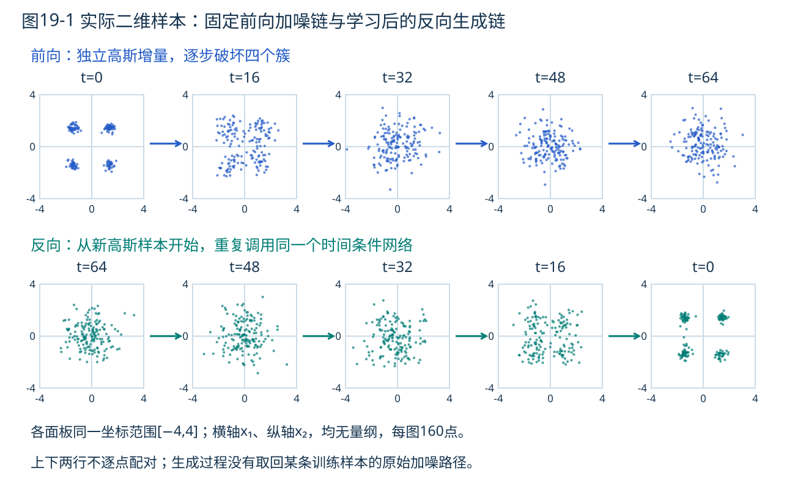
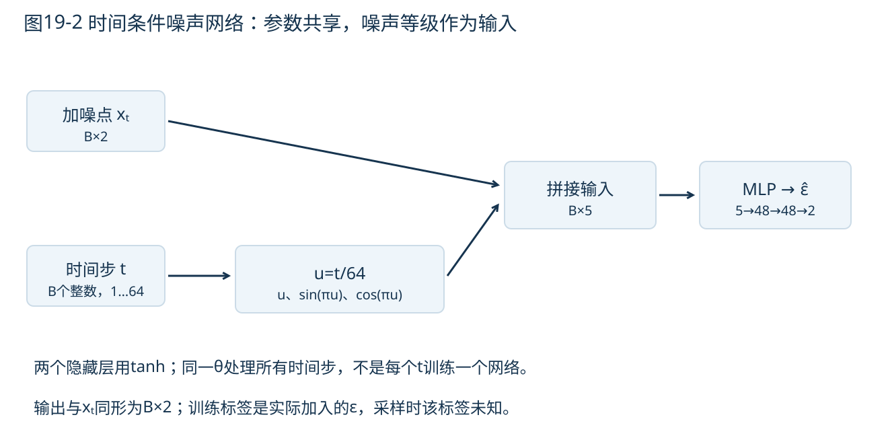
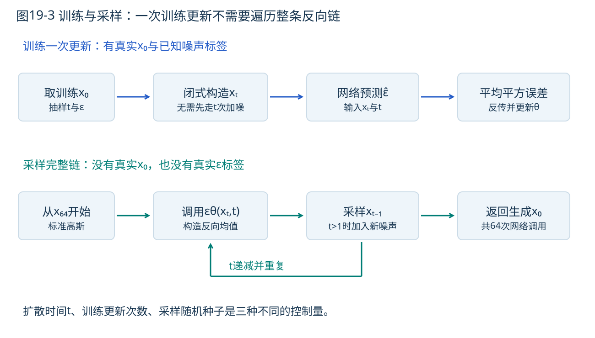
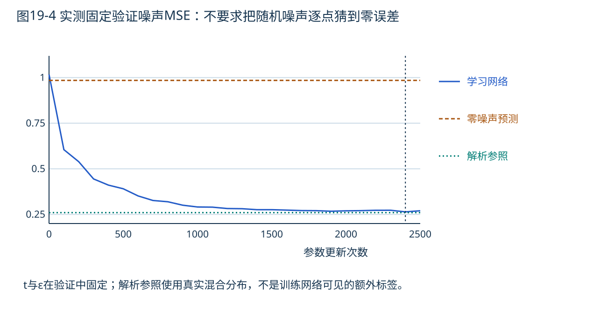
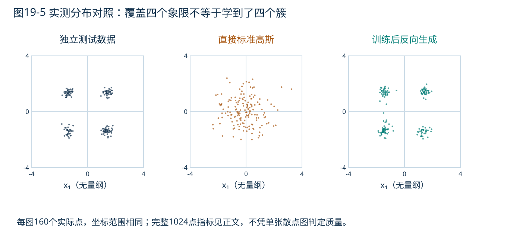

# 第19章：扩散模型入门

> 状态：完整正文、五幅SVG、二维CPU训练采样与出版验收已完成；正式状态以章节计划为准。
> [阅读入口](../../README.md) · [前置：概率](03-probability.md) · [前置：生成模型](18-vae-and-gan.md) · [公共符号](../appendices/notation.md) · [完整实验](../../examples/19-diffusion-models/README.md)

## 1. 本章目标与前置知识

把一组有结构的数据逐渐混入高斯噪声，最终看起来几乎没有结构。若能学习在不同噪声等级下怎样做一个小的反向更新，就可以从新噪声逐步生成有结构的样本。这是本章去噪扩散概率模型（denoising diffusion probabilistic model，DDPM）的主线。[1]

我们先用二维四个簇看清过程，再推导前向边缘分布、反向均值与噪声预测目标，最后实际训练一个2738参数的小网络。学完应能区分扩散时间和训练更新次数，解释训练为何不用每次走完整条链、采样为何需要反复调用网络，并能说明简化实验与原始图像模型的边界。

前置是第03章的高斯与条件概率、第09章的训练循环和第18章的生成分布。这里的数据只是二维向量，因此不需要为图像搭建卷积网络。DDPM是2020年的现代扩展，不声称2016年花书已经讲过这一具体模型。

## 2. 直觉：训练一个跨噪声等级共享的反向规则



图19-1为本章实际CPU记录生成的SVG。上行从有四簇结构的训练点出发，每步加入新的独立高斯增量；下行从另一批新标准高斯点出发，使用训练网络逐步生成。两行没有逐点配对，不是把上面某个点曾经加入的随机数从硬盘取回来倒着减。

前向规则由我们预先指定，不需要学习；反向规则包含网络参数，需要用数据学习。噪声等级不同，合适的反向更新也不同，所以网络必须知道当前时间步 $`t`$。同一组参数处理不同 $`t`$，不是为每个噪声等级各训练一个独立模型。[1，§2与算法1/2；2]

## 3. 符号、维度与时间含义

| 符号 | 含义与范围 |
| --- | --- |
| $`\mathbf{x}_0\in\mathbb{R}^D`$ | 原始数据列向量，本章 $`D=2`$ |
| $`\mathbf{x}_t`$ | 扩散到第 $`t`$ 步的随机状态，与原数据同维 |
| $`t,T`$ | 扩散时间与最大扩散步数，训练/采样使用 $`t=1,\ldots,T`$ |
| $`\beta_t,\alpha_t`$ | 单步噪声方差与信号系数平方，$`0\lt \beta_t\lt 1`$、$`\alpha_t=1-\beta_t`$ |
| $`\bar\alpha_t`$ | 累积系数 $`\prod_{s=1}^t\alpha_s`$，约定 $`\bar\alpha_0=1`$ |
| $`q,p_{\boldsymbol{\theta}}`$ | 固定前向分布、学习到的反向生成分布 |
| $`\boldsymbol{\epsilon},\mathbf{z}`$ | 独立标准高斯噪声向量；使用处区分训练标签与采样新噪声 |
| $`\boldsymbol{\epsilon}_{\boldsymbol{\theta}}`$ | 网络预测的噪声向量，与输入数据同维 |
| $`\boldsymbol{\mu}_{\boldsymbol{\theta}},\widetilde\beta_t`$ | 反向均值、前向条件后验的方差系数 |
| $`B,k`$ | 批次大小、参数更新次数；$`k`$ 不等于扩散时间 $`t`$ |

代码的 `x0`、`xt`、`epsilon` 形状均为 `(B,2)`，时间为 `(B,)` 整数。单步系数取出后变为 `(B,1)`，在两个坐标上广播。公式中 $`\mathbf{I}_D`$ 为 $`D`$ 维单位矩阵，表示本章每个坐标使用同样的独立噪声方差。

## 4. 前向加噪：单步规则与闭式边缘

### 4.1 单步高斯转移

给定上一状态，定义固定的高斯转移：[1，式(2)]

```math
q(\mathbf{x}_t\mid\mathbf{x}_{t-1})
=\mathcal{N}(\sqrt{\alpha_t}\mathbf{x}_{t-1},\beta_t\mathbf{I}_D).
```

采样等价于：

```math
\mathbf{x}_t=\sqrt{\alpha_t}\mathbf{x}_{t-1}
+\sqrt{\beta_t}\boldsymbol{\epsilon}_t,
\qquad \boldsymbol{\epsilon}_t\sim\mathcal{N}(\mathbf{0},\mathbf{I}_D).
```

这里 $`\beta_t`$ 是方差，乘噪声时用其平方根。每步的 $`\boldsymbol{\epsilon}_t`$ 相互独立，也独立于先前状态。既缩小旧信号又加入噪声，使整个过程能够逐渐接近方便采样的分布；它不只是反复往原值上加等量噪声。

### 4.2 为什么可以跳到任意时间步

展开两步可得：

```math
\begin{aligned}
\mathbf{x}_2
&=\sqrt{\alpha_2\alpha_1}\mathbf{x}_0
+\sqrt{\alpha_2\beta_1}\boldsymbol{\epsilon}_1
+\sqrt{\beta_2}\boldsymbol{\epsilon}_2.
\end{aligned}
```

两个独立高斯项之和仍为高斯，其坐标方差是 $`\alpha_2\beta_1+\beta_2=1-\alpha_2\alpha_1`$。一般地，若上一时刻条件均值系数为 $`\sqrt{\bar\alpha_{t-1}}`$、方差为 $`1-\bar\alpha_{t-1}`$，下一步方差递推为：

```math
\alpha_t(1-\bar\alpha_{t-1})+\beta_t
=1-\alpha_t\bar\alpha_{t-1}=1-\bar\alpha_t.
```

因此：[1，式(4)]

```math
q(\mathbf{x}_t\mid\mathbf{x}_0)
=\mathcal{N}(\sqrt{\bar\alpha_t}\mathbf{x}_0,
(1-\bar\alpha_t)\mathbf{I}_D).
```

训练时可以直接抽一个新标准高斯向量 $`\boldsymbol{\epsilon}`$，构造：

```math
\mathbf{x}_t=\sqrt{\bar\alpha_t}\mathbf{x}_0
+\sqrt{1-\bar\alpha_t}\boldsymbol{\epsilon}.
```

这个 $`\boldsymbol{\epsilon}`$ 等效汇总了到该时刻的噪声影响，不是必须等于某一步的独立增量。闭式公式生成的是正确的条件边缘样本；若想同时画出一条真正的前向Markov轨迹，仍要按单步规则用独立增量逐步计算，图19-1上行采用的就是后者。

### 4.3 调度表与终点近似

噪声调度（noise schedule）指预先给定 $`\beta_1,\ldots,\beta_T`$。本实验用64步、从0.001到0.2线性变化，得到 $`\bar\alpha_{64}\approx0.00099396`$。它是适合小实验的较粗调度，不复制原始图像DDPM的1000步配置。

原始数据每坐标方差为 $`1.4^2+0.2^2=2`$，所以前向终点每坐标方差为 $`2\bar\alpha_T+(1-\bar\alpha_T)=1+\bar\alpha_T`$，接近1，但终点仍不是数学上完全相同的标准高斯。生成时从标准高斯开始是一项近似；调度、有限步长和网络误差都会影响结果。

## 5. 反向分布：已知原数据的后验与未知原数据的生成

### 5.1 不能把前向公式直接当成可执行逆运算

若知道实际 $`\mathbf{x}_0`$ 和加入的噪声，当然可以代数还原；生成时二者都未知。给定一个含噪点，多个原始数据点都可能产生它，真正的反向条件分布一般并不是确定的一条逆路径。

当额外给定 $`\mathbf{x}_0`$ 时，前向后验可精确写成高斯。对 $`t\geq2`$，令 $`\mathbf{u}=\mathbf{x}_{t-1}`$，由Bayes关系，忽略与 $`\mathbf{u}`$ 无关的常数：

```math
\begin{aligned}
\log q(\mathbf{u}\mid\mathbf{x}_t,\mathbf{x}_0)
={}&-\frac{\lVert\mathbf{u}-\sqrt{\bar\alpha_{t-1}}\mathbf{x}_0\rVert_2^2}
{2(1-\bar\alpha_{t-1})}\\
&-\frac{\lVert\mathbf{x}_t-\sqrt{\alpha_t}\mathbf{u}\rVert_2^2}{2\beta_t}
+C.
\end{aligned}
```

把关于 $`\mathbf{u}`$ 的二次项配方。精度，也就是方差倒数，为：

```math
\frac1{1-\bar\alpha_{t-1}}+\frac{\alpha_t}{\beta_t}
=\frac{1-\bar\alpha_t}{\beta_t(1-\bar\alpha_{t-1})}.
```

再收集一次项，得到：[1，式(6)/(7)]

```math
\begin{aligned}
\widetilde\beta_t&=\frac{1-\bar\alpha_{t-1}}{1-\bar\alpha_t}\beta_t,\\
\widetilde{\boldsymbol{\mu}}_t
&=\frac{\sqrt{\bar\alpha_{t-1}}\beta_t}{1-\bar\alpha_t}\mathbf{x}_0
+\frac{\sqrt{\alpha_t}(1-\bar\alpha_{t-1})}{1-\bar\alpha_t}\mathbf{x}_t.
\end{aligned}
```

这个后验需要真实 $`\mathbf{x}_0`$，所以不能在生成阶段直接当作可用答案。它提供训练反向模型时的数学参照。$`t=1`$ 的条件后验在给定原数据后退化到原数据本身，方差边界为0，不把前面的非退化配方分母0照搬到这一边界。

### 5.2 用噪声参数化反向均值

由闭式加噪式可写：

```math
\mathbf{x}_0
=\frac{\mathbf{x}_t-\sqrt{1-\bar\alpha_t}\boldsymbol{\epsilon}}
{\sqrt{\bar\alpha_t}}.
```

把它代入后验均值，整理系数后得到：

```math
\widetilde{\boldsymbol{\mu}}_t
=\frac1{\sqrt{\alpha_t}}
\left(\mathbf{x}_t-
\frac{\beta_t}{\sqrt{1-\bar\alpha_t}}\boldsymbol{\epsilon}\right).
```

生成时用网络预测替代未知噪声，定义：[1，式(11)]

```math
\boldsymbol{\mu}_{\boldsymbol{\theta}}(\mathbf{x}_t,t)
=\frac1{\sqrt{\alpha_t}}
\left(\mathbf{x}_t-
\frac{\beta_t}{\sqrt{1-\bar\alpha_t}}
\boldsymbol{\epsilon}_{\boldsymbol{\theta}}(\mathbf{x}_t,t)\right).
```

这说明“预测噪声”怎样决定“走一步反向转移的均值”，并不等于每次把全部预测噪声原样减去。除法、时间系数和随后新采样的噪声都有明确作用。

本章对 $`t>1`$ 使用方差为 $`\widetilde\beta_t\mathbf{I}_D`$ 的高斯反向近似。已知 $`\mathbf{x}_0`$ 的后验是精确高斯，不表示未知原数据的真正反向条件也必然是该高斯；粗步长尤其可能带来近似偏差。

### 5.3 一个标量手算

取两步都为 $`\beta=0.1`$，则 $`\alpha=0.9`$、$`\bar\alpha_2=0.81`$。给定 $`x_0=1`$、汇总噪声 $`\epsilon=0.5`$：

```math
x_2=0.9+\sqrt{0.19}(0.5)\approx1.117945.
```

若此处用已知噪声代入反向均值：

```math
\mu_2
=\frac{1}{\sqrt{0.9}}
\left(1.117945-\frac{0.1}{\sqrt{0.19}}0.5\right)
\approx1.057505,
\qquad
\widetilde\beta_2=\frac{0.1\times0.1}{0.19}\approx0.052632.
```

反向采样应为 $`x_1=\mu_2+\sqrt{\widetilde\beta_2}z`$，不是直接令 $`x_1=x_0`$。本章代码还在默认调度的第23步检查两种后验均值写法，最大差约 $`1.11\times10^{-16}`$，并检查已知噪声还原原数据。

## 6. 噪声预测目标与时间条件

### 6.1 一次训练更新的随机量

训练时抽真实样本、随机时间和新高斯噪声，直接构造该时间的加噪状态，然后预测实际加入的噪声。本文采用：

```math
\mathcal{L}_{\mathrm{simple}}(\boldsymbol{\theta})
=\mathbb{E}_{\mathbf{x}_0,t,\boldsymbol{\epsilon}}
\left[\frac1D
\left\lVert\boldsymbol{\epsilon}
-\boldsymbol{\epsilon}_{\boldsymbol{\theta}}(\mathbf{x}_t,t)
\right\rVert_2^2\right],
\quad t\sim\mathop{\mathrm{Uniform}}\nolimits\{1,\ldots,T\}.
```

批次代码在 $`B\times D`$ 个标量上取平均，无额外 $`1/2`$。原论文式(14)写平方范数，本章再除以固定维数 $`D`$；这个常数不改变理想极小点，但会缩放梯度，实际学习率仍按本章配置报告。[1，§3.4]

这一关系可以接到第18章的高斯KL。固定$`t>1`$，若前向条件后验和模型反向条件使用相同方差$`\widetilde\beta_t\mathbf I_D`$，则两个高斯对数密度的归一化常数与方差项抵消，取期望后交叉项为0，得到

```math
D_{\rm KL}\!\left(
q(\mathbf x_{t-1}\mid\mathbf x_t,\mathbf x_0)
\|p_{\boldsymbol\theta}(\mathbf x_{t-1}\mid\mathbf x_t)\right)
=\frac{\|\widetilde{\boldsymbol\mu}_t-\boldsymbol\mu_{\boldsymbol\theta}\|_2^2}
{2\widetilde\beta_t}.
```

两种均值共有的$`\mathbf x_t/\sqrt{\alpha_t}`$相消，剩下真实噪声与预测噪声之差，因此

```math
D_{\rm KL}
=\frac{\beta_t^2}
{2\widetilde\beta_t\alpha_t(1-\bar\alpha_t)}
\|\boldsymbol\epsilon-\boldsymbol\epsilon_{\boldsymbol\theta}\|_2^2.
```

这明确给出了该方差选择下、$`t>1`$的时间权重；若反向方差另选，系数及额外项需相应调整。$`t=1`$的观测边界单独处理，不能代入零方差KL。完整变分目标还含起点和边界项，所以训练时采用的简化MSE不能与完整目标数值混同。[1，式(8)/(12)]

原论文从变分界得到带时间权重的噪声平方误差，再选择简化目标。本章使用上述不带那些时间权重的MSE，不能把它的数值当成精确负对数似然，也不能仅凭MSE变小就宣称所有生成质量都必然改善。

### 6.2 为什么正确模型也不能把误差降到零

单个 $`\mathbf{x}_t`$ 可能来自不同原数据与噪声组合。对一个固定输入 $`a=(\mathbf{x}_t,t)`$，令预测为 $`f(a)`$，条件平方误差可分解成：

```math
\mathbb{E}[\lVert\boldsymbol{\epsilon}-f(a)\rVert_2^2\mid a]
=\mathbb{E}[\lVert\boldsymbol{\epsilon}-\mathbb{E}[\boldsymbol{\epsilon}\mid a]\rVert_2^2\mid a]
+\lVert\mathbb{E}[\boldsymbol{\epsilon}\mid a]-f(a)\rVert_2^2.
```

交叉项因为条件残差均值为0而消失。因此理想MSE预测是条件均值，不是恢复某次真实但不可知的噪声标签。这一不可消除的不确定性解释了为什么验证误差不必接近零。

本实验知道合成数据的真实混合分布，所以另外构造解析条件均值参照。它读取真实四个中心与分量方差，正式网络没有被提供这些分布参数。该参照用于检查机制和误差尺度，不是一个可随意用于未知真实图像分布的算法。

### 6.3 网络为什么要知道时间



图19-2为实际MLP结构的原创SVG。相同坐标在低噪声与高噪声下对应的原数据不确定性不同，网络若不知道等级，就把本应不同的条件任务混在一起。本章把 $`u=t/64`$、$`\sin(\pi u)`$、$`\cos(\pi u)`$ 与两维坐标拼成五维输入，经过 `5→48→48→2` 的tanh网络输出噪声预测。

时间特征是给网络使用的条件，不是要预测的标签；它也不是训练进行到第几次更新。一个批次里不同样本可使用不同扩散时间，但仍用同一组网络参数。本章固定三维特征是简化实现，原始图像网络使用更丰富的时间嵌入与卷积结构，不把两者等同。

## 7. 训练与采样：两种不同的循环



图19-3依据DDPM算法1/2和本章实际代码原创整理。训练每次随机选 $`t`$，一次网络调用就得到该批次的损失；并不要求每更新一次参数都先生成整条64步反向链。

生成时，先取 $`\mathbf{x}_T\sim\mathcal{N}(\mathbf{0},\mathbf{I}_D)`$。对 $`t=T,T-1,\ldots,1`$：

```math
\mathbf{x}_{t-1}=
\boldsymbol{\mu}_{\boldsymbol{\theta}}(\mathbf{x}_t,t)
+\sqrt{\widetilde\beta_t}\mathbf{z}_t,
\qquad
\mathbf{z}_t\sim\mathcal{N}(\mathbf{0},\mathbf{I}_D),\quad t>1.
```

最后 $`t=1`$ 直接取预测均值，不再加新噪声；代码的 $`\widetilde\beta_1=0`$ 边界也与此一致。该采样器是本文的连续二维教学实现，未实现原始图像论文的离散像素似然边界处理。[1，算法2]

反向每一步都使用新的随机数，网络权重则不更新。固定模型和采样种子可以复现当前平台上的一批点；更换采样种子得到另一批样本，是生成过程的正常随机性。

本章一次生成1024个点时，把它们作为一个批次，每个时间等级调用一次网络，共64次调用。训练更新2500次与生成时间64步是两个不同预算。减少采样步数不能简单跳过若干下标又保留原始系数不变；更快的采样需要相应推导和调度，不在本章冒充已实现功能。

## 8. 本机实践：二维四簇DDPM

### 8.1 数据、划分与模型

数据为四个等权二维高斯分量，中心为 $`(-1.4,-1.4)`$、$`(-1.4,1.4)`$、$`(1.4,-1.4)`$、$`(1.4,1.4)`$，每个分量协方差为 $`0.2^2\mathbf{I}_2`$。本章数据由本项目原创构造，无外部数据下载与许可问题。

使用PyTorch数据生成器种子1900，依次独立生成训练2048、验证512、测试1024点，记录各数组哈希。训练仅从训练点中有放回抽样，验证点只用于选择网络，测试点在模型冻结后才用于分布评价。

本机为Python3.11.5、NumPy2.4.6、PyTorch2.15.0+cpu，CPU、float64、1线程、确定性算法。模型2738参数，两层48宽tanh隐藏层；时间特征和输出形状见图19-2。

### 8.2 训练与选模协议

初始化种子1901，训练抽样种子1903，批次128，2500次参数更新。Adam学习率0.001、动量系数0.9/0.999、数值项 $`10^{-8}`$，无权重衰减。每100次更新在评估模式测验证MSE，验证的时间与噪声由种子1902预先固定，避免把每次重新采样的噪声波动误当成模型改善。

验证最小的已记录参数保存为独立副本，全部预算结束后恢复；没有早停。检查点重新加载，要求固定验证预测逐项相同。采样种子1904，前向展示链种子1905，独立真实样本参照种子1906。全部评价配置预先固定，不根据测试分布指标回头挑选训练轮或调度。

从仓库根目录运行：

```powershell
& ./.venv/Scripts/python.exe -B examples/19-diffusion-models/run.py
```

完整入口与说明见[实验目录](../../examples/19-diffusion-models/README.md)。`build/experiments/19-diffusion-models/results.json` 保存曲线、公式核对、真实点、指标与资源；`denoiser.pt` 保存最佳权重、扩散步数与调度。图源[figures.py](../../examples/19-diffusion-models/figures.py)从公式及该报告生成五幅SVG。

### 8.3 2026-11-15本机实测

22:59（Asia/Shanghai）运行通过，验证最佳更新为2400。固定验证噪声MSE为0.26393855，知道真实分布的解析条件均值参照为0.25972137，恒预测零噪声为0.98465750。



图19-4为实测曲线。曲线接近当前解析参照支持“在这些噪声等级和数据上的平均回归接近已知分布的合理尺度”，不表示每个输入的预测都准确，也不表示生成分布已经等于真实分布。

为评价生成，本章固定32个单位投影方向，将两批各1024点投影后分别排序，再计算一维配对绝对差的平均。若 $`a_{\ell,(i)},b_{\ell,(i)}`$ 表示第 $`\ell`$ 个方向排序后的第 $`i`$ 个投影值，指标定义为：

```math
\widehat{D}=\frac1{32\times1024}
\sum_{\ell=1}^{32}\sum_{i=1}^{1024}
\lvert a_{\ell,(i)}-b_{\ell,(i)}\rvert.
```

这称为本文的有限方向经验切片Wasserstein-1指标，数值越小表示这些投影上的样本更接近；它不是精确二维Wasserstein距离，也不是图像FID，更不是对整个分布的充分证明。

| 固定方案 | 对测试样本的经验投影距离 | 到最近真实中心的平均距离 |
| --- | --- | --- |
| 训练网络反向生成 | 0.06852 | 0.27395 |
| 解析噪声参照反向生成 | 0.03845 | 0.21452 |
| 直接标准高斯 | 0.51312 | 1.14147 |
| 恒预测零噪声的反向链 | 32.96371 | 51.96256 |
| 另一批独立真实样本 | 0.08149 | 0.25138 |



图19-5各展示160个实际点，完整指标使用1024点。生成点被最近中心分到四簇的计数为267、248、244、265。仅看簇计数仍不够：标准高斯也能大致均匀覆盖四个象限，但点并不集中在四个中心附近。

零噪声预测链是故意设置的失败对照；反向均值含 $`1/\sqrt{\alpha_t}`$，没有正确去噪项时会反复放大状态，最终每坐标标准差约42，说明“套上采样循环”本身不等于会生成目标分布。

独立真实样本的经验距离0.08149还略高于训练网络生成样本的0.06852，不能据此说生成器比真实分布更真实；有限样本、方向和各簇计数都有随机波动。解析参照也不是完全精确的分布生成器，因为本文采用有限粗步长、近似标准高斯起点和固定高斯反向方差；训练网络额外还有估计误差。

### 8.4 资源、复现与局限

本次数值核对与训练约3.440秒，单批1024点的64步反向生成约0.059秒；连同各参照、公式检查与评价的数值阶段约3.704秒，含库导入约7.543秒，均不含随后SVG生成。三组数据张量本体共57344字节，不是训练总内存；进程峰值内存未测量。

固定种子下，加载权重后重新采样的1024点与原生成点逐项相同。前向均值/方差递推、后验均值等式、已知噪声还原、最后一步零方差与梯度有限性都实际通过。只有一个模型种子和一份划分，没有覆盖训练不确定性；二维快速实验也不能推断图像扩散的资源或质量。

## 9. 常见误区与适用边界

- **前向噪声越多，模型就自动学会反向**：固定前向过程只构造训练问题，反向参数还需要学习。
- **噪声标签必须从整条链保存下来**：闭式边缘公式允许训练时直接构造任意时间的样本和已知标签。
- **采样时仍输入真实原图**：无条件生成从新高斯噪声开始，真实原数据不再可见。
- **网络每次减掉全部预测噪声就行**：反向均值需要时间相关系数，随机转移也有方差。
- **噪声MSE应该趋近0**：多个原数据与噪声可产生同一加噪点，条件均值仍存在不可消除的不确定性。
- **预测噪声等于精确知道某次加入的噪声**：训练的条件回归与逐样本逆运算不同。
- **生成步数就是训练次数**：一个是反向时间链，一个是优化器更新预算。
- **64步二维结果等于复现原始图像DDPM**：网络、维度、调度、边界与资源都经过明确简化。

## 10. 习题与解析

### 10.1 习题

1. $`\beta_1=\beta_2=0.1`$，计算 $`\bar\alpha_2`$ 与给定原数据时的噪声方差。为什么不能把它写成 $`\beta_1+\beta_2`$？
2. 用第5节的数值算出 $`x_2`$、反向均值与标准差。反向均值为何不必等于原始 $`x_0`$？
3. 一个训练批次有128个二维点，代码的噪声MSE分母是多少？是否包含额外 $`1/2`$？
4. 时间步 $`t=40`$ 是否表示网络已经训练40次？一次训练更新是否要先执行40次前向加噪？
5. 为什么固定验证加噪样本更适合比较不同检查点？固定之后就完全没有选模偏差了吗？
6. 真实样本与真实样本的经验投影距离大于0，是否表示实现一定有错？如何扩大证据范围？
7. 若直接令噪声预测恒为0，为什么反向链仍可能变得很大？检查当前报告中的失败对照，说明“覆盖四个象限”为什么不足以证明成功。

### 10.2 参考解析

1. $`\bar\alpha_2=0.9^2=0.81`$，噪声方差为0.19。第一步噪声还会乘以第二步的 $`\sqrt{0.9}`$，所以方差为 $`0.9\times0.1+0.1=0.19`$，不是0.2。
2. $`x_2\approx1.117945`$，反向均值约1.057505，方差约0.052632、标准差约0.229416。它描述退回到 $`x_1`$ 的条件状态，不是一步跳回 $`x_0`$；生成时还需要处理未知噪声与多解。
3. 分母为 $`128\times2=256`$，无额外 $`1/2`$。若改成坐标平方和再对样本平均，梯度会相差固定维数因子，需要相应解释。
4. 不表示。$`t`$ 是噪声等级，训练步是优化计数。一次更新可直接用 $`\sqrt{\bar\alpha_t}x_0+\sqrt{1-\bar\alpha_t}\epsilon`$ 构造第40步边缘样本，无需先走40次链。
5. 可以减少每次随机重采样噪声导致的度量变化。验证数据已经参与检查点选择，仍不能当成完全独立的最终证据；测试集保留给预先规定方案冻结后的评价。
6. 不一定。两批有限样本在计数和位置上都有抽样波动，投影方向也有限。可以增加样本、方向和独立重复，报告均值与波动，并补充簇内尺度、覆盖和不同失效对照，而非只挑一个最好的指标。
7. 此时均值保留 $`x_t/\sqrt{\alpha_t}`$，连续放大会扩大状态；加入的随机方差也有影响。当前失败链经验距离约32.96。标准高斯虽四象限计数近似均衡，到最近中心平均距离仍约1.14，明显大于生成点的约0.274；计数不包含簇内形状与位置误差。

## 11. 小结与下一步

扩散模型把固定的逐步加噪与学习到的反向转移结合。闭式边缘分布使随机时间训练高效；噪声预测给出构造反向均值的一种参数化；时间条件让同一网络适配不同噪声等级。完整采样仍需要多步调用，并受调度、方差、模型与起点近似共同影响。

后续进入语言模型的数据与训练目标。模型类别会变，训练目标、真实采样、独立评价和失败对照仍要分别检查，不能用一个训练损失替代整个系统的效果。

## 12. 参考文献

官方来源于2026-11-15核验。本文推导、二维数据和五幅SVG为原创教学实现，现代扩散来源不归到花书。

1. Ho、Jain、Abbeel，*Denoising Diffusion Probabilistic Models*，NeurIPS 2020，§2、§3.2/3.4，式(2)/(4)/(6)/(7)/(11)/(14)、算法1/2，arXiv v2：[论文入口](https://arxiv.org/abs/2006.11239)、[完整论文](https://arxiv.org/pdf/2006.11239)。
2. Stefano Ermon，Stanford CS236，Fall 2023，第16讲 Score Based Diffusion Models：[官方课程时间表](https://deepgenerativemodels.github.io/syllabus.html)、[该讲官方讲义](https://deepgenerativemodels.github.io/assets/slides/lecture16-2023-comp.pptx)。

## 13. 实现与验证记录

数值、双视口及PDF字体/矢量审计通过；逐页与五图目视通过。实验细节见第8节。
