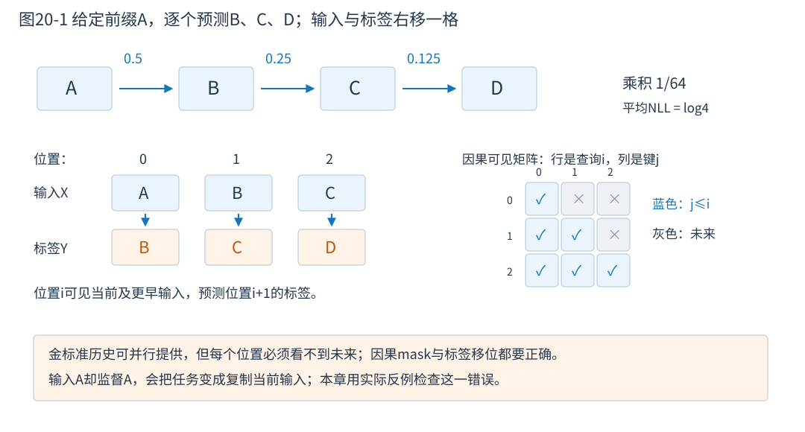
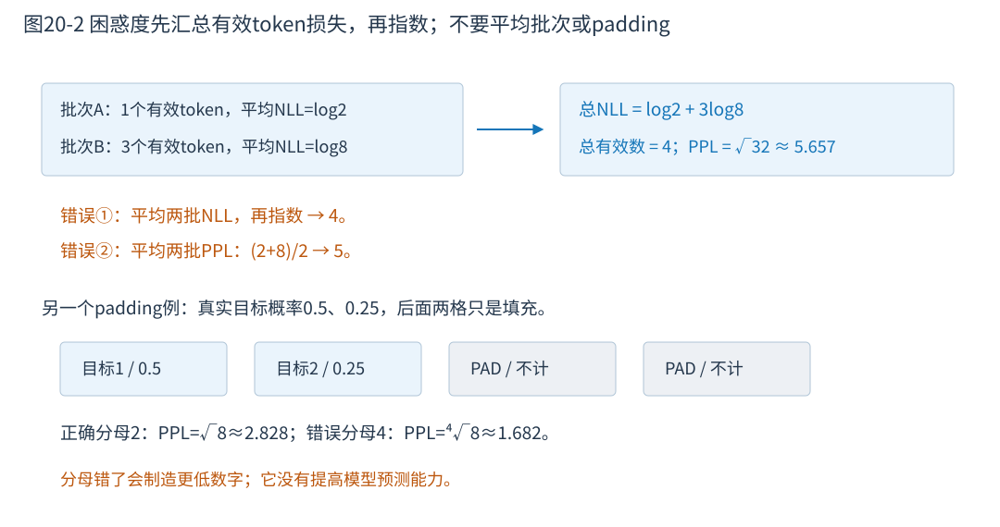
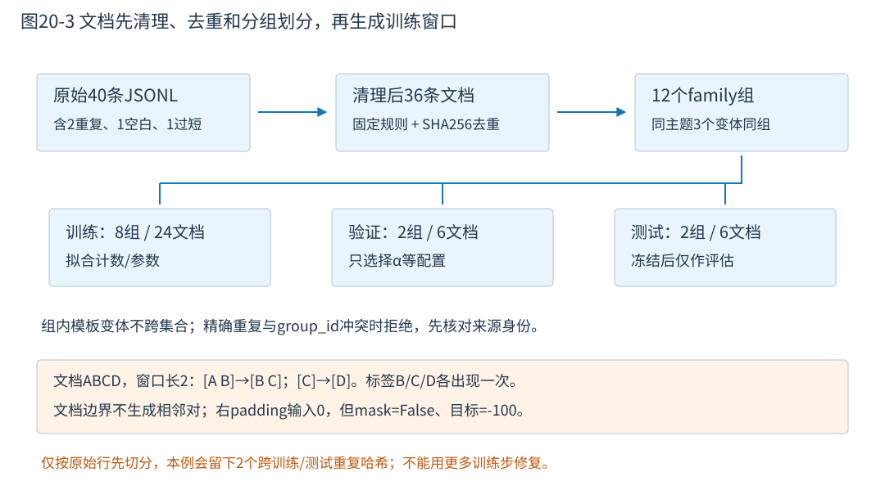
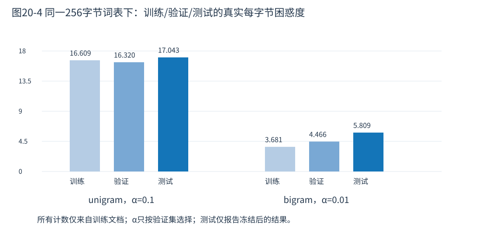
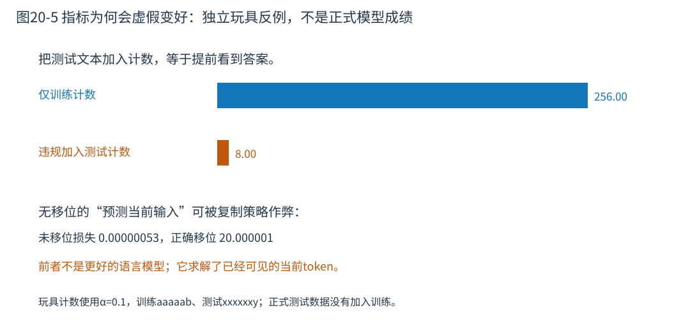

# 第20章：语言模型目标、数据与预训练

> 在训练一个更大的网络之前，先确认它在预测什么、答案放在哪里、哪些位置计入损失，以及测试文本是否已进入训练。本章用原创小语料、计数模型和可执行反例建立这些基础。更新日期：2026-11-15。

[阅读入口](../../README.md) · [章节计划](../chapter-plan.md) · [公共符号](../appendices/notation.md) · [完整实验](../../examples/20-language-model-pretraining/README.md)

## 1. 语言模型究竟学什么

第14章把文本变成token ID和向量，第16章建立了带可见约束的序列计算。现在还缺一个学习目标：拿到一段没有人工答案标注的文本，怎样构造输入与监督信号？

以文本ABCD为例，已知A时预测B，已知AB时预测C，已知ABC时预测D。答案直接来自原文中下一个token，这种从数据自身构造监督的方式属于 **自监督学习** 。它仍然有明确的输入、目标和损失，并不是“没有目标地让模型读书”。[1, §12.4.1–12.4.2][2]

本章采用 **自回归语言建模** ：按照一个约定顺序，用历史预测下一token。预训练也可以采用掩码等其他目标；这里的定义不代表所有模型都使用相同目标或架构。计数模型、循环网络和因果Transformer都能实现某种下一token分布，“语言模型”不等同于“Transformer”，也不自动意味着大参数模型。

学完后，你应能：

- 从概率链式法则推导自回归目标，解释输入/标签为何错开一格。
- 区分因果可见约束、右padding mask和损失忽略标签。
- 按有效目标token正确归约负对数似然与困惑度。
- 说明清理、去重、分组划分和模型选择各在哪一步完成。
- 运行可复现语料管线、unigram/bigram基线，以及“数字更低但任务做错”的反例。

前置：[03章](03-probability.md)的条件概率、[05章](05-machine-learning.md)的交叉熵与数据职责、[14章](14-tokenization-and-embeddings.md)的byte/token/词表、[16章](16-transformer.md)的因果注意力。本章会重新给出与目标相关的公式和小数值例子。

## 2. 从联合概率到下一token条件分布

### 2.1 链式分解不是模型近似

固定一段长度为 $`L`$ 的token序列 $`(x_1,\ldots,x_L)`$。概率链式法则给出

```math
p(x_1,\ldots,x_L)
=p(x_1)\prod_{t=1}^{L-1}p(x_{t+1}\mid x_1,\ldots,x_t).
```

这是概率恒等式；将条件历史限制到有限窗口、把分布交给某种神经网络或计数表表示，才引入模型假设。[1, §12.4.1]

例如给定前缀A，模型对真实后续B、C、D分别分配概率0.5、0.25、0.125：

```math
p(B,C,D\mid A)=0.5\times0.25\times0.125=\frac1{64}.
```

对数把乘积变成和。最大化真实后续序列概率，等价于最小化负对数概率；按三个预测目标平均：

```math
\overline\ell
=-\frac13\left(\log0.5+\log0.25+\log0.125\right)
=\frac{\log64}{3}=\log4.
```

本章log均为自然对数。必须对 **真实目标** 分到的概率求对数，不是每次选最大概率后再计算；即使模型猜中了类别，给真实目标0.51与0.99也会产生不同损失。



*图20-1：原创ABCD例子，依据[1, §12.4.1]和[2, §9.3.1–9.3.2]绘制。上方条件概率相乘；下方输入ABC对应目标BCD。蓝格包括当前输入，灰格是未来输入；对角线可见不表示答案可见。*

### 2.2 首token、EOS与文档边界都要声明

完整联合概率还需要 $`p(x_1)`$。变长文档若要建立包含“何时停止”的生成概率，还需EOS或另一种长度/结束约定。不能把所有这些边界项悄悄省略，又声称计算了完整文档概率。

本章与后续微型模型统一使用固定UTF-8字节0～255，没有额外BOS/EOS：每篇文档的首字节作为已知输入，只评价之后的相邻字节预测；文档最后一个字节不再预测“文档结束”。所以结果是明确范围内的 **每个有效后续字节的条件预测损失** ，不含首字节和终止概率。换一套边界协议时，指标范围也应重新说明。

文档A末尾与文档B开头在原始来源中未必相邻。本章不把它们连成训练对；若实际系统要打包文档，则应声明分隔符、注意力隔离和跨文档损失策略。简单拼接不等于自然获得正确边界处理。

## 3. 记号与目标形状

| 符号 | 含义 | 本章形状/约定 |
| --- | --- | --- |
| $`V`$ | 词表大小 | 固定256个UTF-8字节 |
| $`B,T`$ | 批次样本数、每个窗口最多输入位置数 | 默认 $`T=64`$ |
| $`\mathbf X,\mathbf Y`$ | 输入ID与右移后的目标ID | $`B\times T`$，整数 |
| $`m_{at}`$ | 位置是否是有效目标 | 0或1，padding为0 |
| $`\mathcal Z`$ | 输出logit | $`B\times T\times V`$ |
| $`\mathcal P`$ | 按词表轴归一化的概率 | 同上 |
| $`\boldsymbol\theta`$ | 模型参数 | 神经模型可梯度训练；计数模型由频次估计 |
| $`M`$ | 本次归约中有效目标总数 | $`\sum_{a,t}m_{at}>0`$ |
| $`S,\overline\ell`$ | 负对数似然总和、有效token平均值 | $`S/M`$ |
| $`\alpha`$ | 计数平滑强度 | 正数，由验证集选择 |
| $`N_{ij},N_i`$ | 训练集中相邻字节计数、某前字节总计数 | 不使用验证/测试计数 |

ID的0代表真实字节NUL，不天然等于PAD。本章为存储右padding也填0，但仅在mask=False的位置赋予“填充”用途；真实NUL位置仍有效。目标用−100表示忽略项，这个值不在0～255的词表内。不能按“输入ID是否为0”推断全部有效位置。

## 4. 移位、因果关系和teacher forcing

### 4.1 输入当前token，预测下一个token

完整序列ABCD提供3对监督，张量应是

```math
\mathbf X=[A,B,C],\qquad \mathbf Y=[B,C,D].
```

位置0的logit对应“已经看见A之后，B的分布”；位置1对应已经看见AB之后C的分布。若把目标写成ABC，当前输入本身就是答案，模型可以学习复制；损失可能非常低，却没有完成下一token任务。

实际反例让一个固定策略给“当前输入”分配logit20，其余255个字节分配0。在输入ABC时，以ABC为错误未移位标签，平均损失仅约 $`5.26\times10^{-7}`$；换成正确目标BCD，损失约20.000001。前者的小数字没有展示更好的语言建模能力，只展示监督对象写错。

### 4.2 为什么训练时可以同时提供整段历史

训练时把真实过去token作为输入，常称为 **teacher forcing** 。若模型满足因果约束，整段输入可以一次提供，但位置 $`t`$ 的输出只能依赖不晚于 $`t`$ 的输入。序列中的后面位置虽然存在于内存，不能影响前面位置的预测。[1, §12.4.2][2]

对注意力中的查询位置 $`t`$、键位置 $`j`$，可见条件可写成

```math
A_{atj}=\mathbb I[j\le t]\;m_{aj}^{\mathrm{input}}.
```

其中 $`m^{\mathrm{input}}`$ 标记真实输入键，和目标损失mask作用不同。自回归输入已经右移成“当前输入预测下一token”，所以因果矩阵通常允许对角线；需要禁止的是未来输入，不是当前输入。第16章解释了该可见矩阵如何参与注意力。

实际生成时，真实未来答案不可用，只能把已经选择的输出接到前缀，继续预测。训练时用金标准历史、生成时用模型自己的历史，也可能导致错误积累；不能根据teacher forcing损失低就保证长生成永远正确。

### 4.3 三种屏蔽不能混为一谈

-  **因果可见约束** ：阻止一个位置使用未来输入。
-  **输入padding mask** ：阻止填充键被当作真实历史参与注意力。
-  **目标损失mask** ：不把不存在的目标计入损失与分母。

这些设置通常同时需要。只忽略padding损失，不能修复未来可见；只加因果矩阵，不能修复标签未移位；PAD输出不要求全是0，只要求它们不会污染有效计算和评估。

配套入口只读复用第21章的TinyDecoderLM结构，用一个随机初始化小实例作接口探针：改变未来后缀，前三个位置logit完全不变；追加右padding并给正确mask，有效前缀最大差约 $`1.65\times10^{-17}`$。这验证可见/形状协议，不报告该未训练探针的语言能力。

## 5. 负对数似然、交叉熵和正确归约

### 5.1 每个有效位置都是一次词表分类

对输出logit $`\mathcal Z_{atk}`$，在词表轴上做softmax：

```math
\mathcal P_{atk}
=\frac{\exp\mathcal Z_{atk}}{\sum_{j=0}^{V-1}\exp\mathcal Z_{atj}}.
```

位置真实目标为 $`Y_{at}`$，其负对数似然是 $`-\log\mathcal P_{at,Y_{at}}`$。全批次的目标是

```math
S=-\sum_{a=1}^{B}\sum_{t=1}^{T}
m_{at}\log\mathcal P_{at,Y_{at}},
\qquad
\mathcal L=\overline\ell=\frac{S}{M},
\qquad
M=\sum_{a,t}m_{at}>0.
```

对padding的 $`\mathbf Y`$ 实际存−100，上式中的有效项求和理解为仅取 $`m=1`$ 的合法目标；不能先用−100索引概率再乘0。实现应使用接口的忽略标签，或先布尔筛选有效项。[4]

~~~python
# logits: B,T,V；labels: B,T，填充目标为-100
valid = labels != -100
count = valid.sum()
if count == 0:
    raise ValueError("batch has no valid targets")
loss_sum = F.cross_entropy(
    logits.transpose(1, 2), labels,
    ignore_index=-100, reduction="sum"
)
loss = loss_sum / count
~~~

转置后接口形状是 $`B\times V\times T`$，类别轴在第二维；也可把前两轴展成二维 $`BT\times V`$，目标展成 $`BT`$。两种方法应得到同一个归约。这里没有类别权重，若引入加权损失，分母规则需按具体定义重新说明。

PyTorch内部使用稳定的log-softmax/交叉熵，不必先把logit变成概率再传入该接口。NumPy手算版先减每行最大值再计算log-sum-exp；本机两实现平均损失最大差约 $`8.88\times10^{-16}`$，padding位置梯度为0。

### 5.2 为什么padding越多不能让成绩越好

假设只有两个有效目标，其真实概率为0.5、0.25，另有两个padding位置。正确NLL和是 $`\log2+\log4=\log8`$，分母为2；如果把四格都平均，分母变4，指标会错误变小。

 **分母必须数有效目标，而不是分配的内存格数。**  同样，最后一个较小批次不能与大批次获得相同权重；评估全数据时应累计全部 $`S`$ 和 $`M`$，最后只除一次。梯度累积时若每个微批次有效token数不同，也需按目标token权重组合，不能机械平均各微批损失。



*图20-2：原创两批次与padding反例，数字可手算。它将“先汇总损失/目标数”与两种错误平均方式分开，依据[2, §9.3.2]和[4]的损失定义绘制。*

## 6. 困惑度：同一目标范围内的指数化损失

### 6.1 定义与手算

 **困惑度（perplexity，PPL）**  是有效目标平均负对数概率的指数：

```math
\mathop{\mathrm{PPL}}\nolimits
=\exp\left(\frac SM\right)
=\left(\prod_{m=1}^{M}p_m\right)^{-1/M}.
```

$`p_m`$ 是第 $`m`$ 个真实目标分到的概率，要求为正以得到有限值；存在零概率时NLL和PPL发散。PPL可解释为真实目标概率的几何平均值的倒数，不是模型对“理解了多少词”的直接计数。[2, §9.3.2]

第2节的三个目标概率0.5、0.25、0.125，平均NLL为 $`\log4`$，所以PPL=4。若对256个字节均匀预测，平均NLL为 $`\log256`$，PPL=256；理想目标概率趋近1时PPL趋近1。

 **均匀预测是基线，不是PPL的上界。**  即便只有两类，若每个真实目标都只分到0.01概率，PPL也会是100，大于词表大小2；对真实目标越自信地预测错误，PPL可以任意大。

### 6.2 不要平均批次PPL

图20-2的批次A有1个有效目标，平均NLL为 $`\log2`$；批次B有3个有效目标，平均NLL为 $`\log8`$。正确全局结果为

```math
\overline\ell=\frac{\log2+3\log8}{4}
=\frac52\log2,\qquad
\mathop{\mathrm{PPL}}\nolimits=\sqrt{32}\approx5.65685.
```

直接平均两个批次损失后再指数会得到4；平均两个PPL会得到5；都不等于正确值。padding例子也一样：正确PPL为 $`\sqrt8\approx2.828`$，错误分母4给出约1.682。数字更低可能只是分母错了。

### 6.3 比较前先对齐单位

本章固定同一256字节词表、同一规范化文本和同一后续字节目标范围，模型间PPL可以直接比较。不同tokenizer的token粒度与长度不同，不能直接用更低token PPL比较语言能力；忽略前缀、EOS、上下文或padding的范围变化，也会改变指标。

本章同时报告每个被预测字节的平均NLL，以及除以 $`\log2`$ 得到的bits/byte。若跨分词器按原始字节报告，需要重新声明总NLL、字节分母及边界/正规化协议，不能只换一个单位名称便宣称所有条件已对齐。较低条件预测损失也不自动证明更好的事实准确性、指令遵循或生成质量。

## 7. 数据管线：清理、去重、分组与划分

### 7.1 在训练前固定规则和来源

语料不是没有来源的字符串集合。至少记录作者/许可、文档ID、相关来源组、文本清理规则、划分、分词配置及文件指纹。本章[原始JSONL](../../examples/20-language-model-pretraining/data/raw.jsonl)由作者原创，使用仓库许可证，没有外部数据下载。

固定清理规则为：NFC、统一CRLF/CR为LF、去行末空白与全文首尾空白；清理后不足2字节的文档不生成条件目标，因此丢弃。这里是普通短英文示意，规则不自动适用于源代码、精确保留空格的档案或其他数据类型；清理必须符合任务语义。

对规范化后的整篇文本计算SHA256，移除已知精确重复，保存被移除ID与保留ID。如果同一精确文本却被标成不同来源组，入口拒绝并要求先核对组身份，不悄悄把重复分散到集合。近似重复还可能表现为改写、模板或长公共片段，仅做整篇哈希并不能全面识别。[3]

### 7.2 本章真实语料的固定协议

原始40条包括12个family，每个family有3个同主语的句式变体，共36条；另加1条精确重复、1条只改换行/尾空白的重复、1条空白、1条过短文本。固定清理后留下36条。

例如同一猫主题的3个变体分别包含“the cat is near the window.”、“near the window, the cat waits.”、“today the cat waits near a window.”等原创句子。它们共享family-00，不会跨集合。组ID由作者预先声明，不是从测试成绩倒推的。

将12组按SHA256(20261115|group_id)升序排，前8组训练、接着2组验证、最后2组测试：

| 集合 | 组数 | 文档数 | 有效后续字节目标数 | 职责 |
| --- | --- | --- | --- | --- |
| 训练 | 8 | 24 | 971 | 估计计数或更新参数 |
| 验证 | 2 | 6 | 239 | 选择平滑强度 |
| 测试 | 2 | 6 | 245 | 选定并冻结后评估 |

同一家族和整篇精确哈希均无跨集合交集。模板结构仍跨family共享，本章没有实现完整的模糊去重或自然语言近重检测，所以不能把这个小协议称为“消除了所有潜在重叠”。结果高度模板化，主要用于检查管线与指标，不能当作真实语言泛化成绩。



*图20-3：原创数据协议示意，40→36、12组和8/2/2划分均由实际JSONL验证。窗口仅在单篇文档内产生，不能先把长文切碎再把相关片段随机分到训练和测试。*

### 7.3 为什么先划窗口再随意随机分很危险

来自同一文档的重叠窗口可能共享大部分字符，文档改写也可能只换少量词。若按行或窗口随机分，训练可能已经见过测试目标的大段上下文；低损失不再代表预期的独立预测。大规模语料的近重与长重复片段问题已有专门研究，本章的简单哈希只覆盖其中很小的一部分。[3, §4]

本章还故意演示一个坏划分：原始前24行作训练，最后部分作测试，再检查规范化文本哈希，会发现2个重复文档跨集合。这个检查得到的是数据身份重叠，不需要先训练模型。之后多跑训练步或换优化器都不能修复它。

清理规则如果预先固定，可以在划分前一致应用；需要拟合的词表、BPE合并、统计量或计数则只从训练部分学习。验证用于选择预先声明的候选，测试用于冻结后的报告；如果不断查看测试再调节，测试就承担了验证职责。

## 8. 上下文长度、窗口、padding与文档内移位

### 8.1 最大输入长度不等于文档长度

$`T=64`$ 表示一次最多输入64个byte token，不是64个汉字；第14章展示过汉字可能对应多个UTF-8字节。构造64个输入/目标对需要最多65个连续原始token，因为目标向右错一格。

若文档超过窗口，入口每次取最多 $`T+1`$ 个原始token，输入取除最后一个之外，目标取除第一个之外；下一段从偏移加 $`T`$ 开始。例如ABCD、$`T=2`$：

- 第一段输入AB，目标BC。
- 第二段输入C，目标D。
- C在第一段是目标、第二段是输入；B/C/D各作为目标一次，没有重复计分。

这不是所有任务的唯一分窗方法。这里每个窗口重新开始上下文，神经模型不能看见前窗更早历史；与带完整滑窗历史、状态传递或只计新增目标的评估相比，条件范围不同，必须注明。bigram只看前一个字节，因此本章窗口重置不改变它所需历史。

### 8.2 三个张量的对应

~~~python
parts = chunks(records, context_length=64)
batch = collate(parts, context_length=64)
# input_ids: B,64；attention_mask: B,64，True表示有效键
# labels: B,64；不存在的目标写-100
~~~

真实输入形成非空前缀，之后只允许右padding。完全没有有效目标的文档/批次不能拿来除以0；真实NUL输入仍有True的mask。这个协议与第21章公共微型模型接口一致，但语料清理/划分依然由本章自己的文件与清单负责。

文档AB与CD应只生成A→B、C→D，不生成B→C。输入padding虽填字节0，其目标不是“预测0”，所以labels必须写−100；反过来，真实目标字节0不能被错误忽略。入口实际核验这些对应关系。

## 9. 先用计数模型把目标跑通

### 9.1 Unigram与bigram的定义

不用先训练深网络，也能检查“按真实目标的条件概率评分”是否正确。 **unigram** 忽略历史，只估计目标字节频率； **bigram** 只依赖前一个字节，是保留一阶历史的简化条件模型。[1, §12.4.1]

令训练目标字节计数为 $`N_j`$、目标总数为 $`N`$，unigram加性平滑为

```math
p_\alpha(j)=\frac{N_j+\alpha}{N+V\alpha}.
```

令 $`N_{ij}`$ 是训练中 $`i\to j`$ 的相邻计数、$`N_i=\sum_jN_{ij}`$，bigram为

```math
p_\alpha(j\mid i)=\frac{N_{ij}+\alpha}{N_i+V\alpha},
\qquad \alpha>0.
```

分母对所有256字节求和，保证每行概率之和1；即使某个前字节训练中没出现，条件分布也退回均匀预测。若不平滑，测试中的未见相邻对可能得到0概率，损失无穷大。加性平滑是本章简单基线，不宣称是最佳语言建模方法。

手算一个小词表 $`V=3`$，某前字节后计数为[2,1,0]，取 $`\alpha=1`$，条件分布为[3/6,2/6,1/6]。加了3份平滑质量，分母也要加3，不能只改分子。

这些模型靠统计估计，不运行梯度优化；bigram有256行，每行概率总和为1，完整表有 $`256(256-1)=65280`$ 个独立概率自由度。unigram相应为255；这不同于神经网络可训练参数与梯度内存的账本。

### 9.2 验证选择与真实指标

每种模型都只用24篇训练文档计算计数。候选 $`\alpha`$ 为0.01、0.1、1，以最低验证平均NLL选择；不根据测试调节。选中unigram的 $`\alpha=0.1`$，bigram的 $`\alpha=0.01`$。保存计数及概率后再恢复，概率逐项一致。



*图20-4：来自实际报告的SVG柱图。单位是每个有效后续字节的PPL，两个模型的词表、文档和目标范围相同。各模型的平滑强度只按验证选择。*

| 模型 | 训练NLL/byte | 验证NLL/byte | 测试NLL/byte | 训练/验证/测试PPL |
| --- | --- | --- | --- | --- |
| Unigram，$`\alpha=0.1`$ | 2.809965 | 2.792410 | 2.835743 | 16.609 / 16.320 / 17.043 |
| Bigram，$`\alpha=0.01`$ | 1.303151 | 1.496404 | 1.759420 | 3.681 / 4.466 / 5.809 |

bigram本次测试为2.538307 bits/被预测byte，unigram为4.091112。加入前一个字节信息改善了本次固定模板数据上的预测；不能由此推断bigram掌握句意或比神经模型普遍更好。也不能拿这个byte PPL与其他tokenizer、其他数据的模型公开数字直接排名。

### 9.3 两个实际错误反例

另外用训练aaaaab、测试xxxxxxy、固定 $`\alpha=0.1`$ 做独立诊断：只用训练计数，测试PPL为256；违规把测试文本也加入计数，PPL降到约8.001。后者“更好”只因为提前看到了评估数据，不是合法的模型改进。这个故意错误的玩具实验没有把正式测试集加入训练。



*图20-5：独立玩具计数泄漏、固定复制当前输入策略的实际数值。它们用于展示失败模式，和图20-4的正式划分评估分开，不能混入模型成绩。*

另一个反例是第4节的未移位目标：复制策略在错误监督下损失接近0，正确移位后约20。再加上图20-2的错误分母，就得到三个排查方向：数据有没有泄漏、目标有没有对齐、归约有没有数对。模型架构升级之前先做这些检查，才能解释变化。

## 10. 本机运行与验收范围

在仓库根目录执行：

~~~powershell
& ./.venv/Scripts/python.exe -B examples/20-language-model-pretraining/run.py
~~~

默认输出build/experiments/20-language-model-pretraining，包括清理后的train/validation/test JSONL、corpus-manifest.json、两个计数模型NPZ、results.json与SVG结果图。源码中的原始语料保持不变；清理与划分逻辑见[corpus.py](../../examples/20-language-model-pretraining/corpus.py)。

发布图生成方式：

~~~powershell
node scripts/generate-chapter20-figures.mjs
& ./.venv/Scripts/python.exe -B examples/20-language-model-pretraining/run.py --figure-dir docs/assets/20-language-model-pretraining
~~~

2026-11-15，Python3.11.5、NumPy2.4.6、PyTorch2.15.0+cpu，CPU float64单线程实际执行通过。首次耗时9.564秒（导入4.894秒），Python跟踪分配峰值141.75MiB，不含大量原生张量内存，不能当作完整进程RSS；复跑耗时会随系统负载和缓存变化。

21项检查覆盖清理去重、真实NUL与padding区分、group/hash无交集、冲突组拒绝、坏划分重复、移位分窗、文档边界、有效目标总数、NumPy/PyTorch损失、padding梯度、复制反例、PPL手算与归约、均匀非上界、公共解码器因果/右padding、评估不改计数、两个模型恢复及独立泄漏反例。公共探针11408参数、随机初始化，没有对它训练或报告PPL；本章的正式指标来自计数模型。

原始文件SHA256、保留/丢弃ID、准确组列表、有效目标数和全部候选验证损失保存在清单。固定协议下的复现以这些记录为准；语料非常小，精确哈希与作者给定组也不覆盖所有近重形式。

## 11. 常见误区

-  **把标签等于输入当作next-token训练** ：当前位置通常已可见，复制即可作弊；先对齐移位关系。
-  **把因果mask与损失mask混用** ：一个限制信息流，一个限制监督项，分别检查。
-  **把byte 0一律当PAD** ：它也可能是真实NUL；有效性来自显式mask。
-  **声称计算了完整文档概率却省略首项/结束项** ：本章只评价声明的条件目标，其他协议需另外定义。
-  **把PPL当准确率或词表上界内的分数** ：它来自真实目标概率，可能大于词表大小且无有限上界。
-  **平均批次损失或PPL** ：应累计总NLL和有效token数，最后除法与指数各一次。
-  **文档先切碎再随机分集合** ：相邻或重叠片段可能共享答案，优先按文档/来源组划分。
-  **整篇哈希去重就等于所有近重消失** ：改写、模板和长公共片段需要额外处理与审计。
-  **测试上调平滑或分词规则** ：测试已被用来选择，不能继续当独立最终结果。
-  **把有限窗口默认当完整历史** ：本章窗口重置上下文，必须在评估协议中声明。
-  **把更小合成PPL当成大模型能力** ：任务、分词、目标边界和数据都需对齐，本次仅为小规模计数基线。

## 12. 习题与分步解析

### 12.1 题目

1. 给定A，真实B/C/D概率0.5、0.25、0.125，求条件概率、平均NLL和PPL。若要完整ABCD联合概率，还缺什么？
2. 输入ABCDE应提供哪4个输入ID、哪4个标签？允许因果注意力对角线为什么不泄露下一个答案？
3. 批次A有1个token、NLL均值log2，B有3个、均值log8，算正确PPL。平均两个PPL为什么不对？
4. 两个真实目标概率0.5、0.25，另两格padding，正确和错误分母各得什么PPL？
5. 在3符号小词表里，前符号后的计数[2,1,0]，$`\alpha=1`$，写出分布并检验和为1。若前符号从未出现呢？
6. 文档AB与CD能否产生B→C？ABCD分窗 $`T=2`$ 时C既当目标又当输入，是否表示重复计分？
7. 新文档含真实NUL字节0，怎样区分它与padding？labels中0和−100分别代表什么？
8. 同主语的改写跨训练测试，但整篇哈希都不同，能否宣称无重叠？本章的分组与模板边界是什么？
9. 若一次测试PPL下降，是哪些错误也可能造成？至少给出本章三个可执行排查方向。
10. 实践：将候选 $`\alpha`$ 加入0.001，保持训练/验证/测试职责，重做选择。能否根据测试更低再保留该候选？若重置上下文长度，应记录什么？

### 12.2 解析

 **题1。**  条件概率1/64，平均NLL为log64/3=log4，PPL=4。完整联合还需乘 $`p(A)`$；变长生成的结束/长度约定也要说明，不能把条件评分与完整文档概率混同。

 **题2。**  输入ABCD，标签BCDE。位置 $`t`$ 的当前输入是 $`x_t`$，目标是 $`x_{t+1}`$；对角线仅允许看 $`x_t`$，不允许未来 $`x_{t+1}`$。若没有移位，对角线就可能直接见到被监督的同一符号。

 **题3。**  总NLL=log2+3log8=10log2，总数4，均值2.5log2，PPL=$`2^{2.5}=\sqrt{32}`$约5.657。简单平均PPL得5，损失先平均再指数得4，两者都没有正确按目标数加权。

 **题4。**  总NLL=log8。正确分母2给 $`\sqrt8`$约2.828；错误分母4给 $`8^{1/4}`$约1.682。padding不是额外“概率1的真实目标”，不能利用它稀释分母。

 **题5。**  分母3+3=6，概率(3/6,2/6,1/6)，和为1。未见前符号时每项为1/3，正平滑保证有定义。本章真实词表256时相应每项1/256。

 **题6。**  文档边界不提供相邻关系，本协议不生成B→C。ABCD的两窗目标分别BC与D，所以每个目标一次；C在第二窗是用于预测D的输入，角色不同，不是重复的监督目标。

 **题7。**  真实位置mask=True，即使输入/标签为0也参与计算；padding输入可填0，但mask=False、label=−100，不参与损失。不能用输入不等于0构造通用mask。

 **题8。**  不能，改写或近重可能在精确哈希之外。本章用预声明family把同主语3种变体放同一集合，但一般模板仍跨family共享，未做完整模糊/长片段去重；所以只证明声明的组和整篇哈希不相交。

 **题9。**  检查规范化哈希/组/窗口身份是否重叠；用复制当前token反例核对标签移位和未来可见；按有效目标累加总NLL与总数，排除padding或批次平均错误。此外查tokenizer、边界及窗口条件是否变化。

 **题10。**  预先更新候选，用训练计数拟合，在验证上选择后冻结，再报告测试；不能先看测试更好再决定候选，否则它承担验证职责。改变上下文时记录窗口构造、是否重置历史、目标是否重复/遗漏，以及首token/边界/padding归约，确保新旧指标范围可解释。

## 13. 小结与下一步

自回归目标来自概率链式分解，具体训练则必须声明条件历史、首尾边界、移位标签和有效目标范围。因果可见关系决定能用哪些信息，损失归约决定怎样给预测计分；两者都不能由一个低数字代替检查。

本机语料管线、计数基线和失败反例让这些关系可核对：bigram在固定模板任务上比unigram更能利用相邻字节，违规测试计数、未移位标签和错误分母却同样能制造“更好”数字。下一章将在公共微型模型接口上训练真正的因果神经语言模型，沿用明确的字节、mask与评估约定。

## 14. 参考文献

1. Goodfellow、Bengio、Courville， **Deep Learning** ，2016，§12.4.1 n-gram、链式法则与平滑，§12.4.2神经语言模型。[官方章节](https://www.deeplearningbook.org/contents/applications.html)。
2. Zhang等， **Dive into Deep Learning** ，在线1.0.3，§9.3.1学习语言模型、§9.3.2困惑度、§9.3.3序列划分。[官方章节](https://d2l.ai/chapter_recurrent-neural-networks/language-model.html)。
3. Lee等，2022， **Deduplicating Training Data Makes Language Models Better** ，ACL，§4.1精确重复子串、§4.2近似整篇匹配及训练/评估重叠分析。本文仅使用简单整篇哈希与已知组，不冒称实现其大规模方法。[原论文PDF](https://aclanthology.org/2022.acl-long.577.pdf)。
4. PyTorch2.15， **CrossEntropyLoss** ，logit与整数目标形状、ignore_index、无类别加权时的归约规则。[官方接口](https://docs.pytorch.org/docs/2.15/generated/torch.nn.CrossEntropyLoss.html)。
5. Bengio、Ducharme、Vincent、Jauvin，2003， **A Neural Probabilistic Language Model** ，JMLR3，1137–1155，联合学习词表示与序列概率的经典背景。[期刊原文入口](https://jmlr.org/papers/v3/bengio03a.html)。

以上于2026-11-15核验。图20-1～3为原创定义/数值示意，见[生成器](../../scripts/generate-chapter20-figures.mjs)；图20-4～5直接来自实际报告，生成逻辑保留在run.py内。所有语料、数值例子和数据管线原创，无外部位图。

## 15. 实现与验证记录

2026-11-15正式CPU环境连续两次21项检查通过，语料清单、候选、计数/概率、正式指标和诊断逐项一致；补NUL检查的两次耗时9.146/9.141秒，首次导入4.665秒、Python跟踪峰值141.75MiB。两个NPZ模型逐元素恢复一致。HTML/PDF实际生成，15页PDF、87处公式、5幅SVG、32个链接；1440/390px无页面溢出、断锚、数学解析错误或未渲染Markdown。PDF无位图，字体全部嵌入、含书签/标签，未发现纸张外文字。已渲染15页逐页查看，并放大检查5图、公式、表格和代码；修正图中位置编号对齐及PPL轴刻度为准确小数。正式状态与提交由总计划维护。
