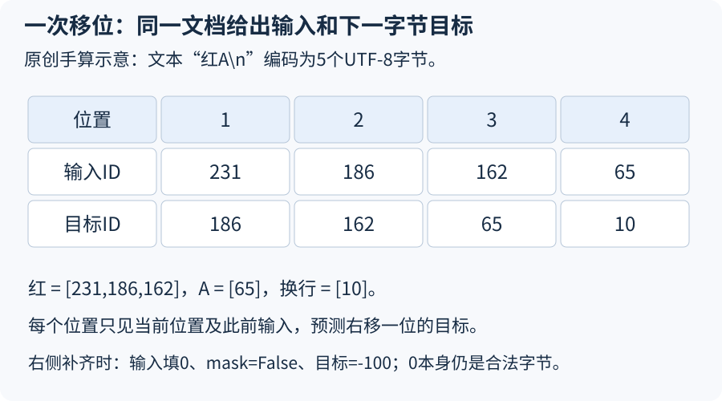
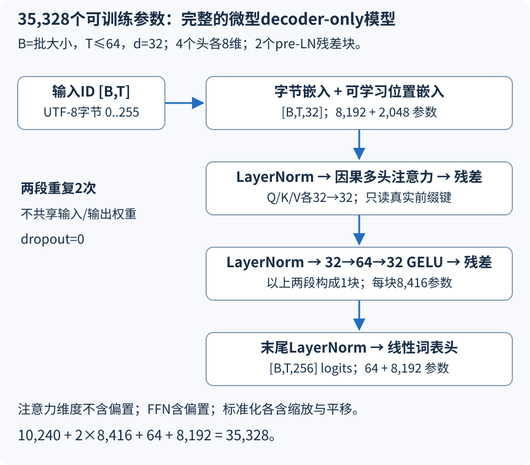
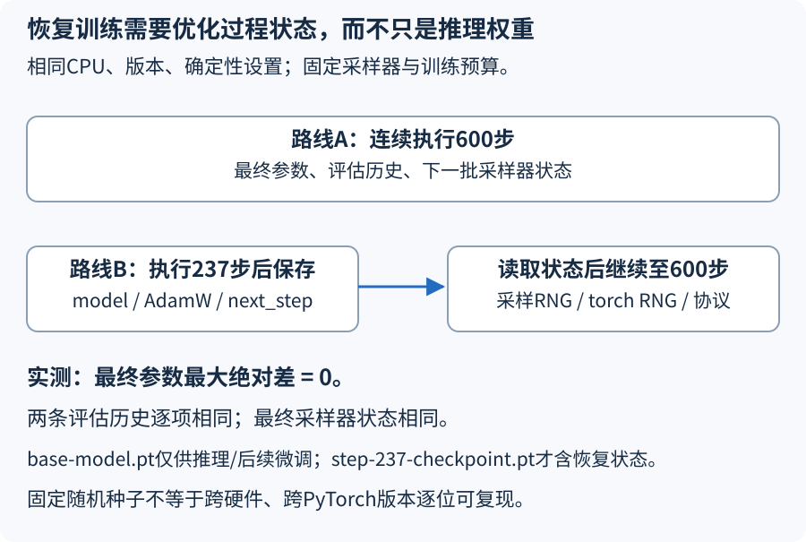
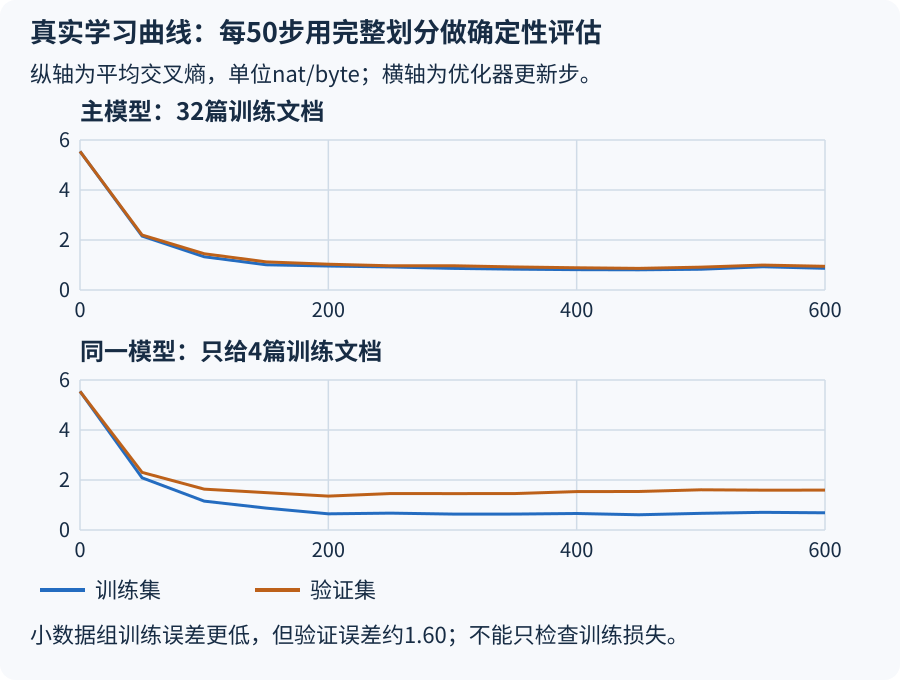
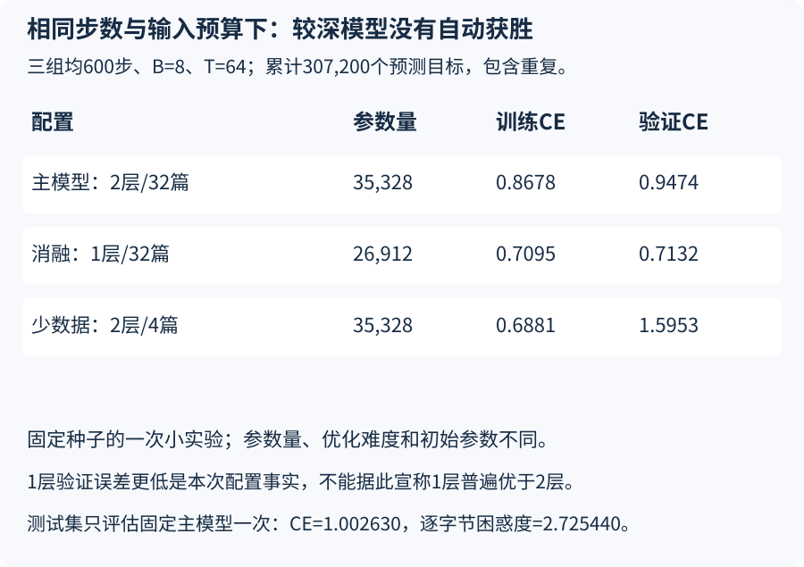

# 第 21 章：从零训练微型语言模型

> 本章把数据、decoder、优化、评估、采样与检查点连成一个可以在本机CPU执行的实验。模型只有35,328个参数；它学到原创小语料的局部模式，也留下重复、颜色不一致、任务外回答失败和非法UTF-8的证据。所有图均为可编辑的纯SVG。

[阅读入口](../../README.md) · [章节计划](../chapter-plan.md) · [公共符号](../appendices/notation.md)

## 1. 学习目标与前置知识

学完后，应能完成以下事情。

1. 从一篇文本构造输入、移位目标和补齐掩码，解释一个中文字为何对应多个预测位置。
2. 对照代码核算decoder的张量形状和35,328个参数，理解因果约束怎样避免目标泄漏。
3. 计算逐字节交叉熵与困惑度，说明评估分母、上下文切分和分词方式为什么必须固定。
4. 保存并恢复优化器、随机数与采样状态，用实际数值验证恢复，而不是只确认文件存在。
5. 联合检查曲线、消融和全部预声明样例，区分局部语言模式与未被实验建立的任务能力。

前置为[训练与优化器](09-training-and-optimizers.md)、[Transformer](16-transformer.md)和[文本数据与预训练目标](20-language-model-pretraining.md)。不熟悉交叉熵时先读[概率与信息论](03-probability.md)。本章不要求GPU，不下载外部预训练模型，也不调用在线生成服务。

## 2. 先把任务缩到可以解释的尺度

从零训练指的是随机初始化模型参数，再用本章训练文本更新参数。它不等于从零实现张量运算：矩阵乘法和自动求导仍由PyTorch完成。微型模型与大模型共享“前缀预测下一项”的基本接口；参数、语料、预算和能力则相差很远。

本章使用48篇原创短文。每个“颜色—形状”组合有英文和中文两个版本，共24组。例如一篇英文描述红色方块，另一篇中文表达相同组合；两篇必须进入同一划分，防止对应表达跨训练集与验证集泄漏。训练、验证、测试分别为16、4、4组，即32、8、8篇。训练不包含后续章节的复制、反转指令任务。

这里的泛化仅指：在同一个有限模板家族中，预测未用于更新的组合文本。不同划分仍共享句式和许多词，因此这种验证不能替代开放文本、陌生主题、事实正确性或推理评估。划分的完整组ID和语料SHA256写进检查点协议；原始文本见[corpus.jsonl](../../examples/21-tiny-language-model/corpus.jsonl)。

经典教材把序列联合分布分解为逐项条件分布；本章把这个思想落实为有限上下文的字节预测。花书第10章§10.2.3讨论序列的概率建模，§10.2.1解释teacher forcing，D2L §9.3.1给出语言模型的链式分解。[花书第10章](https://www.deeplearningbook.org/contents/rnn.html)、[D2L语言模型](https://d2l.ai/chapter_recurrent-neural-networks/language-model.html)。

## 3. 从文本到一个训练批次

### 3.1 字节词表与移位目标

本章固定词表为所有256种字节，ID就是0至255。不训练词表，没有BOS、EOS或专用PAD。UTF-8将文本编码为字节；ASCII字母通常占1字节，例子中的“红”占3字节。因此64个字节位置不等于64个汉字或64个词。

以字符串“红A\n”为例，其中`\n`表示一个真实换行。编码结果是：

```math
[231,186,162,65,10].
```

取前4项作为输入，后4项作为目标：

```math
\begin{aligned}
\mathbf x&=[231,186,162,65],\\
\mathbf y&=[186,162,65,10].
\end{aligned}
```

输入位置1预测第二个字节186，而不是预测输入自身231。一个汉字内部的后续字节也是合法预测目标。随机训练窗口可能从一个多字节字符的中间开始；模型处理的是字节ID，不要求每个窗口单独解码为完整文字。



*图21-1为本项目原创手算图。字节0仍表示真实NUL；补齐语义由额外掩码与忽略标签表达，不能让0同时承担无条件的“结束”含义。*

训练每次先均匀抽一篇训练文档，再均匀抽取文档内的合法起点，得到65个字节，构成64个输入与64个目标。文档被有放回地抽取；长文档并没有因为字节更多就获得同比例更大的文档抽取概率。窗口不跨文档，位置编码在每个窗口从0重新开始。该采样分布必须写入实验协议，不能笼统称为“遍历整个语料一次”。

### 3.2 符号与形状

| 符号 | 含义与本章取值 |
| --- | --- |
| $`B,T,V`$ | 批大小、输入位置数、词表大小；训练为8、64、256 |
| $`d,h,d_h`$ | 隐藏宽度、头数、每头宽度；32、4、8，且 $`d=hd_h`$ |
| $`L,d_{\mathrm{ff}}`$ | decoder块数与FFN中间宽度；2与64 |
| $`\mathbf X,\mathbf Y`$ | 输入与目标ID矩阵，形状均为 $`B\times T`$ |
| $`\mathbf Z`$ | 未归一化输出logits，形状为 $`B\times T\times V`$ |
| $`m_{bt}`$ | 第b个样本第t个目标是否计分；有效为1，忽略为0 |
| $`N`$ | 本次评估中真实计分目标总数，不含补齐位置 |
| $`k,\theta_k`$ | 优化器更新步与该步的模型参数；不同于文本位置t |

短评估片段右侧填充到64位置：输入填0，`attention_mask=False`，目标填`-100`。前者阻止补齐键被注意，后者阻止补齐目标进入损失。一个位置的目标被忽略，并不自动阻止其他位置读取它。为避免全掩码注意力行，本实现只支持“非空真实前缀，随后全为右补齐”；左补齐或中间有洞会明确报错。

## 4. decoder怎样产生下一字节分布

### 4.1 结构、形状和因果约束

字节嵌入表形状为 $`256\times32`$，位置嵌入表为 $`64\times32`$。二者相加得到批次隐藏状态 $`B\times T\times32`$。每个块使用pre-LN结构：

```math
\begin{aligned}
\mathbf U^{[\ell]}&=\mathbf H^{[\ell-1]}+
 \operatorname{MHA}_{\mathrm{causal}}\!\left(\operatorname{LN}_1(\mathbf H^{[\ell-1]})\right),\\
\mathbf H^{[\ell]}&=\mathbf U^{[\ell]}+
 \operatorname{FFN}\!\left(\operatorname{LN}_2(\mathbf U^{[\ell]})\right).
\end{aligned}
```

FFN在每个位置独立使用32→64→32的两层仿射变换，中间是GELU。这里先定义GELU，避免把新激活函数只当作名字。对标量a，

```math
\operatorname{GELU}(a)=a\Phi(a),
\qquad \Phi(a)=\int_{-\infty}^{a}\frac{e^{-u^2/2}}{\sqrt{2\pi}}\,du.
```

$`\Phi`$ 是标准正态分布的累积分布函数，值在0与1之间。GELU用它对输入做平滑门控：较大的正数大体保留，较负的数被压小，0附近平滑过渡；不是先随机抽一个正态数再作离散开关。本实现调用`F.gelu`的默认`approximate='none'`，使用该CDF定义，而非显式选择tanh近似。[PyTorch 2.15 GELU](https://docs.pytorch.org/docs/2.15/generated/torch.nn.functional.gelu.html)。

两块之后再做一次LayerNorm，线性词表头映射为256个logits。词表头与输入嵌入不共享参数。这里采用可学习位置嵌入与pre-LN，具体布局是本章实现选择，不把它说成原论文所有细节的逐项复刻。整体注意力结构可对照[D2L §11.7](https://d2l.ai/chapter_attention-mechanisms-and-transformers/transformer.html)。



*图21-2为依据本章实际代码绘制的原创结构图。LN的统计轴是最后的隐藏维，不能跨时间聚合未来位置。*

因果掩码在查询位置t只允许键位置 $`j\le t`$；补齐键还必须有效。所有位置的预测可以在训练时并行计算，因为每行注意力仍受这个约束。训练输入包含真实前缀，通常称为teacher forcing；它不会授权模型读取下一位置的目标。若漏掉因果掩码，当前位置便可能直接读取右侧字节，得到具有欺骗性的低损失。

本章实际更改最后两个输入字节，再比较前三个位置logits；最大差为0。另将右补齐字节0改成200，真实前缀logits的最大差仍为0。两项检查覆盖了这两个指定扰动，不是对任意实现的形式化证明。掩码中`True`表示允许读取，采用PyTorch SDPA的布尔约定，不能和其他API的禁止掩码混用。

### 4.2 手算参数量

每层注意力的Q、K、V、输出投影都是无偏置的32→32，合计：

```math
4\times32\times32=4096.
```

FFN含偏置，参数数目为：

```math
32\times64+64+64\times32+32=4192.
```

一个LayerNorm含32个缩放和32个平移参数；每块两个LayerNorm，得到128。每块总计：

```math
4096+4192+128=8416.
```

输入、位置嵌入合计10,240，最后LayerNorm为64，词表头为8,192。因此：

```math
10240+2\times8416+64+8192=35328.
```

代码按`sum(p.numel() for p in model.parameters())`实测一致。去掉一个块，得到26,912个参数。参数个数不包含优化器动量、梯度、激活或运行时开销。

## 5. 目标、评估与一个完整手算

### 5.1 从条件概率到计分协议

对固定长度的离散序列，链式法则给出：

```math
p_\theta(x_1,\ldots,x_n)=p_\theta(x_1)\prod_{t=1}^{n-1}p_\theta(x_{t+1}\mid x_1,\ldots,x_t).
```

本实现只训练“给定至少一个输入字节，预测下一字节”，没有第一字节的无条件预测，也没有文档结束符概率。上下文还受64位置限制。因此日志中的损失是所声明窗口协议的条件预测损失，不能直接当作所有文档完整联合概率的负对数。

设当前位置logits为 $`z_{btv}`$，目标ID为 $`y_{bt}`$。softmax对词表轴归一化：

```math
p_\theta(y_{bt}\mid\mathbf x_{b,\le t})=
\frac{\exp(z_{bt,y_{bt}})}{\sum_{v=0}^{255}\exp(z_{btv})}.
```

有效目标的平均交叉熵为：

```math
\mathcal L(\theta)=-\frac{1}{N}\sum_{b,t:m_{bt}=1}
\ln p_\theta(y_{bt}\mid\mathbf x_{b,\le t}),
\qquad N=\sum_{b,t}m_{bt}>0.
```

默认使用自然对数，单位为nat/byte。代码将`[B,T,V]`展平为`[B*T,V]`再调用交叉熵，不先手动softmax；忽略标签只用于整数目标。API对logits与`ignore_index`的定义已核对[PyTorch 2.15 cross_entropy](https://docs.pytorch.org/docs/2.15/generated/torch.nn.functional.cross_entropy.html)。

逐字节困惑度定义为：

```math
\operatorname{PPL}_{\mathrm{byte}}=\exp(\mathcal L).
```

它是目标概率几何平均数的倒数。均匀预测256种字节时，损失为 $`\ln256\approx5.545177`$，困惑度为256；这只是均匀基线，**不是困惑度的最大值**。给真实目标非常小的概率，困惑度可以任意大。不同tokenizer、不同上下文与不同计分位置的PPL不能直接排名；定义可参阅[D2L §9.3.2](https://d2l.ai/chapter_recurrent-neural-networks/language-model.html#perplexity)。

### 5.2 手算两位置与补齐

先用两个类别代替256字节，两个位置logits都为 $`[\ln3,0]`$。指数为[3,1]，归一化概率为[0.75,0.25]。第一个真实目标是类别0，第二个是类别1，所以：

```math
\begin{aligned}
\mathcal L&=-\frac{\ln0.75+\ln0.25}{2}\\
&=-\frac{\ln(3/16)}{2}\approx0.836988,\\
\operatorname{PPL}&=\exp(0.836988)=\sqrt{16/3}\approx2.309401.
\end{aligned}
```

若再追加一个补齐位置，目标为-100，它的logits无论是什么，都不应改变这次平均的分子或分母。若错误地把分母写成3，便把损失人为降低到了0.557992。这不是模型变好，而是计分规则错了。

### 5.3 评估如何覆盖文档

评估按原文顺序每64个预测目标切一段，最后一段右补齐。文档有n个字节便计分n−1个目标；不跨文档。每段起点重置上下文与位置编码，因此切点后的预测只使用该段内的输入，未保留此前段的隐藏状态或KV cache。这种重置降低了可用上下文，必须连同损失一起报告。

对所有段先累加负对数概率，再除以总有效目标数。不能先求每段平均再等权平均，因为短尾段会被放大。完整训练、验证、测试分别计分3,018、770、768个字节目标。训练更新使用随机窗口，曲线上的训练指标使用确定性完整评估，两者采样权重不同，因此不是把每步批次损失平滑一下得到的同一统计量。

## 6. 训练预算与检查点

### 6.1 更新步不是epoch

三组实验都执行600次AdamW更新，批大小8、上下文64，累计处理：

```math
600\times8\times64=307200
```

个预测目标。窗口与文档会重复，这不是307,200个不同字节，也不能换算成一个未声明的完整epoch。学习率固定0.003，权重衰减0.01，梯度总范数裁剪阈值1，dropout为0。模型初始化种子为20,261,115，训练窗口采样器种子17；精度为float32。

本章每50步评估一次训练与验证集，但预先规定取第600步作最终模型，不选验证损失最低的检查点。测试集在配置与主模型固定后只评估主模型一次；消融组没有测试集成绩。有限预算内使用验证曲线诊断波动和过拟合，不把测试反馈继续用于调参。

### 6.2 两类保存文件承担不同用途

`base-model.pt`保存模型配置、权重、字节词表元数据与语料/划分协议，足以做推理，供后续章节在相同基座上微调。它不包含AdamW状态，因此不能声称能精确继续本次优化轨迹。

`step-237-checkpoint.pt`额外保存优化器状态、下一更新步、专用窗口采样器状态、PyTorch随机数状态和评估历史。AdamW的一阶、二阶动量影响下一次更新；即使参数相同，重新创建空动量也通常走向另一条轨迹。随机采样器状态决定下一批数据，只有初始种子而没有当前位置也不够。官方保存/恢复教程明确包含优化器状态：[PyTorch通用检查点](https://docs.pytorch.org/tutorials/beginner/saving_loading_models.html#saving-loading-a-general-checkpoint-for-inference-and-or-resuming-training)。



*图21-3为本章实际执行结果。第二条路线先训练237步，保存，再读入状态训练至600；不是把连续路线的末尾权重复制过去冒充恢复。*

同一CPU和依赖版本下，两条路线最终参数最大绝对差为0，13个评估点的历史逐项相同，采样器状态相同。推理检查点重新加载后logits最大差也为0。这些结果不保证不同PyTorch版本、硬件或算子实现逐位一致；官方也说明了跨环境复现的限制：[PyTorch 2.15可复现性](https://docs.pytorch.org/docs/2.15/notes/randomness.html)。

## 7. 本机实践与真实结果

### 7.1 运行步骤和接口

在仓库根目录的PowerShell执行：

```powershell
& ./.venv/Scripts/python.exe examples/21-tiny-language-model/run.py --write-figures
```

完整入口见[run.py](../../examples/21-tiny-language-model/run.py)，模型见[model.py](../../examples/21-tiny-language-model/model.py)，编码见[tokenizer.py](../../examples/21-tiny-language-model/tokenizer.py)，图形生成见[figures.py](../../examples/21-tiny-language-model/figures.py)。文件与输出说明见[实践README](../../examples/21-tiny-language-model/README.md)。原创语料已经随仓库提供，不需要外部下载。

核心模型接口如下，后续章节只复用它，不另造不兼容的基座：

```python
model = TinyDecoderLM(TinyLMConfig())
logits = model(input_ids, attention_mask)  # [B,T,256]
loss = F.cross_entropy(
    logits.reshape(-1, 256), targets.reshape(-1), ignore_index=-100
)
```

`attention_mask=True`表示真实键位置。输入是long类型ID；目标-100仅用于损失，不是合法输入ID。加载可信的本章检查点使用`load_checkpoint(path, map_location='cpu')`，返回模型和协议元数据。配置、分词和权重一起保存，防止拿同形状但不同词表的文件误配。

### 7.2 运行环境与曲线

实际环境为Windows CPU、Python3.11.5、NumPy2.4.6、PyTorch2.15.0+cpu，单线程，float32，确定性算法开关开启。实测时间和时间戳在最终验证记录中列出；时间包括主训练、独立恢复核验、两个消融和评估，不包含Python导入。没有声称测量峰值内存。



*图21-4逐项取自本机results.json。蓝色训练、橙色验证，纵轴均为nat/byte。波动保留，没有重绘成单调下降。*

主模型从训练CE约5.5455下降到0.867768；第600步验证CE为0.947393，逐字节PPL为2.578977。损失总体下降但会反弹：固定较高学习率、重复小语料与随机窗口使最后一步未必最好。本章按预声明预算保留这个终点。

### 7.3 层数与数据量对照

| 配置 | 参数量 | 训练文档 | 最终训练CE | 最终验证CE | 验证逐字节PPL |
| --- | ---: | ---: | ---: | ---: | ---: |
| 主模型，两块 | 35,328 | 32 | 0.867768 | 0.947393 | 2.578977 |
| 一块 | 26,912 | 32 | 0.709502 | 0.713180 | 2.040470 |
| 两块，仅前两个训练组 | 35,328 | 4 | 0.688122 | 1.595341 | 4.930008 |



*图21-5展示同一固定步数和字节预算下的配置结果。1层组参数更少，消耗的实际算力也未必相同；不是严格等FLOPs对照。*

这一轮1层模型验证误差更低，不能为了迎合“更深更好”而删除它。深度改变了参数量、优化过程及初始化后的具体数值；只做一个种子的配置对照不能推出普遍架构排序。两层主模型仍按预声明作为后续章节共同基座，其选择不声称是本实验最佳验证配置。

少数据组的训练CE更低，验证CE却更高。它在相同更新数中反复看到更少文档，并缺少更多组合；泛化差距也混合了训练覆盖范围变化。它是可解释的过拟合/覆盖不足证据，不是只凭一条曲线断言唯一因果机制。

固定主模型最后在测试集计分768个目标，CE为1.002630，逐字节PPL为2.725440。这里验证与测试仍来自同一个小模板家族，绝不能把数字解释为通用中文或英文建模水平。

### 7.4 生成算法与全部预声明样例

给定非空提示，取最后一个真实位置的logits。贪心选择概率最大的字节；温度采样用：

```math
q_\tau(v)=\frac{\exp(z_v/\tau)}{\sum_u\exp(z_u/\tau)},\qquad \tau>0.
```

本章采样温度为0.8，专用采样种子111。追加字节后重新输入最近64字节，位置从0重置；没有KV cache。遇换行字节10停止，或最多生成96个新字节。换行只是本次解码停止规则，不是模型词表中另设的EOS。


*图21-6节录三种预声明提示；完整6条输出和所有生成字节ID保存在results.json。省略使用“...”明确标注。*

- 提示`The red `：贪心从`star rests on the table.`开始，随后把同一物体写成`green square`，末尾出现`quiarquiaroom is quia`重复；温度0.8从`triangle rests on the table.`开始，后文变为`yellow triangle`，也有拼写错误。两个输出均达到96字节上限。
- 提示`红色`：贪心和温度0.8都续为“三角形放在桌上。记录写着：红色三角形。房间很安静，窗边有一束光。”，均用完96字节，未生成换行。它复现了训练模板，不是陌生知识测试。
- 提示`计算3+5=`：贪心续为“写着桌上。记录写着：红色方块。房间很安静，窗边有一束光。”并换行，没有回答8。温度采样也转入无关句子，且字节序列不是合法UTF-8，JSON显式记录`utf8_valid=false`。

每个输出字节在0至255中合法，不保证组合为合法UTF-8，更不保证内容一致。替代解码会把坏序列显示成替代字符，不能把它悄悄删掉。达到字节上限也可能截断多字节字符，所以记录原始ID是检查真实输出的必要条件。

### 7.5 检查范围与资源

17项程序核对全部通过，包括参数计数、分组互斥、48篇无重复文本、编码往返、三配置有限且训练损失下降、因果与补齐扰动不泄漏、左补齐明确拒绝、检查点加载和精确恢复。它们证明本章这些输入下的实现性质，不代表语料质量、偏差或通用能力已被全面评测。

主模型float32参数数值负载为141,312字节；再计AdamW两个同形状动量约423,936字节。这个估计不含梯度、激活、临时张量、文件封装和框架进程开销，不能称为内存峰值。训练产物在`build/experiments/21-tiny-language-model/`，按仓库规则由读者重建；原始代码、语料和SVG属于可追溯源文件。

大学课程也把预训练、下游任务与对照实验作为完整实践链条。这里借鉴实验组织方式，语料、模型宽度、字节编码和训练协议均为本章原创小配置，并非直接运行课程作业：[Stanford CS224N Spring 2024 Assignment 4](https://web.stanford.edu/class/cs224n/assignments/a4_spr24_student_handout.pdf)。

## 8. 常见误区

| 误区 | 正确理解 |
| --- | --- |
| 输入和目标相同就能学下一个字节 | 目标必须右移；并同时限制未来注意力，防止直接读取答案 |
| loss下降就说明会回答问题 | 本章学的是模板字节预测；算术提示失败，颜色一致性也失败 |
| ignore_index已经解决所有补齐问题 | 它只控制目标计分；注意力读取权限由单独的键掩码控制 |
| 64个token就是64个汉字 | 本章token是字节；“红”占3个位置 |
| 困惑度必定不超过词表大小 | 256是均匀基线；真实目标概率更小时PPL可以更高 |
| 相同600步就完全公平 | 相同位置预算不等于相同参数、算力、数据覆盖或优化难度 |
| 保存state_dict就能原轨迹恢复 | 还需要优化器、步数、采样器/随机状态和一致的配置数据协议 |
| 只展示中文成功样例即可验收 | 所有预声明提示都要保留，包含重复、非法编码和任务外失败 |

## 9. 习题与详细解析

### 题1：字节与预算

“红A”有多少个UTF-8字节？若B=4、T=32、更新100步，累计处理多少个预测目标？能否说见过相同数量的不同汉字？

**解析**：“红”3字节，A为1字节，合计4。预算为4×32×100=12,800个预测目标，包含重复窗口，还包含一个字内的多个位置；既不是12,800个不同字节，也不是相同数量的汉字。

### 题2：补齐平均

两个有效目标的正确概率分别0.5与0.25，另有两个被忽略位置。计算CE与PPL。

**解析**：负对数和为 $`-\ln0.5-\ln0.25=\ln8`$，只除以2，得到CE≈1.039721。PPL为 $`\sqrt8\approx2.828427`$。若除以4，便把无效目标算入分母，错误地降低指标。

### 题3：去掉一个块

在保持其他模块不变时去掉一个decoder块，参数量改变多少？是否减半？

**解析**：减少8,416，从35,328变成26,912。输入嵌入、位置嵌入、末尾LN和输出头仍保留，所以不减半。若采用输入输出权重共享，账本还会改变，必须重新按实际实现计算。

### 题4：找恢复错误

只读回模型权重，重新创建AdamW，再将相同初始种子设为17，是否足以重现第238步？

**解析**：不足。AdamW动量被重置，窗口采样器也回到了起点，下一批一般不同。应恢复第237步后的优化器状态和采样器当前位置；还要恢复其他会影响随机运算的状态、更新步与相同数据协议。本章独立恢复实验用最终参数差0作实际证据。

### 题5：解释数据量对照

少数据组训练CE约0.688、验证约1.595，而主模型分别约0.868、0.947。能否说明少数据组更好？

**解析**：不能只看训练误差。相同预算反复拟合4篇文档，会使见过的内容更容易预测，但未见组合缺乏覆盖；验证更差。这个对照还同时改变覆盖范围和每篇曝光次数，若要分离机制，可另设匹配每篇曝光次数与匹配更新数的预声明实验，并保持测试集冻结。

### 题6：为什么低PPL仍会重复

模型测试逐字节PPL约2.725，英文生成却变色并重复，两者矛盾吗？

**解析**：不矛盾。评估在真实前缀上计算每个下一字节概率，生成则把自己的输出不断作为后续输入，错误会积累。平均指标还可能被重复模板中的容易字节主导，而颜色一致性只涉及少数位置。另需专门的一致性任务和自由生成诊断；PPL不会自动覆盖这些要求。

## 10. 小结与后续衔接

本章建立了可复用的字节decoder、明确的数据划分与计分协议、固定预算训练、完整状态恢复、消融和失败样例。最有价值的结果不是一句“训练成功”，而是每个数字都能回答：在哪些文本、哪些位置、哪个检查点与什么停止规则下得到。

后续[指令微调](22-instruction-tuning.md)将在同一基座上改变监督范围与任务数据；[LoRA](23-parameter-efficient-tuning.md)改变可训练参数化；[偏好优化](24-preference-alignment.md)再改变训练信号。共同接口让比较有据可查，但不意味着这个35k参数基座已有大模型能力。

## 11. 来源与图示说明

以下为2026-11-15核验的原始教材、大学课程与官方接口。没有引用未读取的课程讲义页码；本章全部示例语料、数值手算、图和训练结果均为本项目原创。

1. Goodfellow、Bengio、Courville，*Deep Learning*，第10章§10.2.3有向图形式的序列建模、§10.2.1 teacher forcing，作为经典基础。[官方正文](https://www.deeplearningbook.org/contents/rnn.html)。
2. D2L 1.0.3，§9.3.1链式语言模型、§9.3.2困惑度、§9.3.3移位序列。[官方正文](https://d2l.ai/chapter_recurrent-neural-networks/language-model.html)。
3. D2L 1.0.3，§11.7 Transformer结构；本章pre-LN与可学习位置嵌入按实际代码独立说明。[官方正文](https://d2l.ai/chapter_attention-mechanisms-and-transformers/transformer.html)。
4. Stanford CS224N，Spring 2024 Assignment 4，Self-Attention, Transformers, and Pretraining，核验课程年份、任务与预训练实验组织，不照搬其GPU预算。[官方作业PDF](https://web.stanford.edu/class/cs224n/assignments/a4_spr24_student_handout.pdf)。
5. PyTorch 2.15，交叉熵的logits输入、忽略标签；保存恢复和可复现性约束。[cross_entropy](https://docs.pytorch.org/docs/2.15/generated/torch.nn.functional.cross_entropy.html)、[检查点教程](https://docs.pytorch.org/tutorials/beginner/saving_loading_models.html)、[随机性说明](https://docs.pytorch.org/docs/2.15/notes/randomness.html)。

6幅SVG由[figures.py](../../examples/21-tiny-language-model/figures.py)生成，图21-1至3为原创结构与手算图，图21-4至6读取实际结果。无栅格嵌入、滤镜或外链字体。

## 12. 验证记录

- 实践：2026-11-15 23:18:55（UTC+8）实际运行退出码0，17项检查通过；含独立恢复、两组消融与评估共51.052秒（不含导入）。已修复Windows终端GBK无法打印非法UTF-8替代字符的问题，并完整复跑。基座SHA256与首次训练相同，完整指纹如下。

```text
326e1a5e405fc3280aae20e57f3eadd7ef0d7f54df3cb35af6a87bc679068e5a
```

- 数学：移位、形状、35,328参数账本、忽略目标分母、PPL单位与边界均有显式说明；精确恢复与生成失败保留实际证据。
- 发布：完整HTML/PDF已构建。1440px与390px均无页面横溢出、缺锚、公式错误、图裁切或Markdown残留；已修复长SHA行内代码的手机溢出。PDF为15页、6幅纯SVG、37处数学表达式，0栅格图像；11种字体嵌入，50个链接（13个内部链接），文字无替代乱码或越纸。逐页与六图已目视，学习曲线缩短图高后复核；最终记录写入后的PDF再审计与目视复核。
