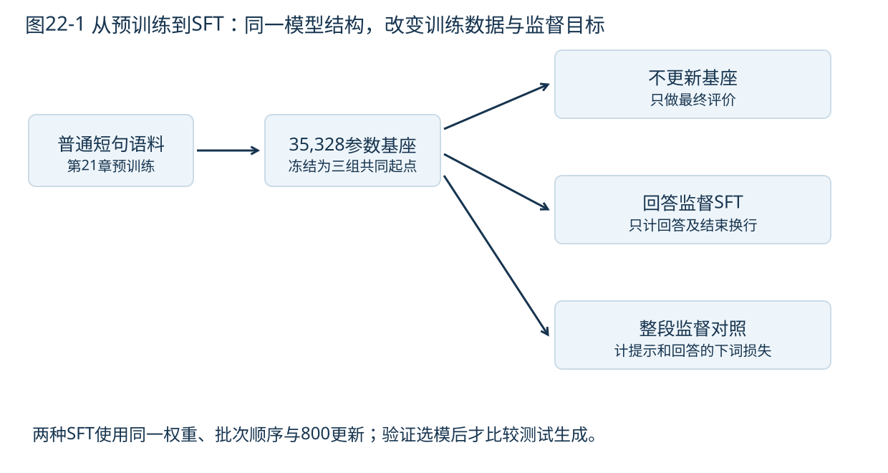
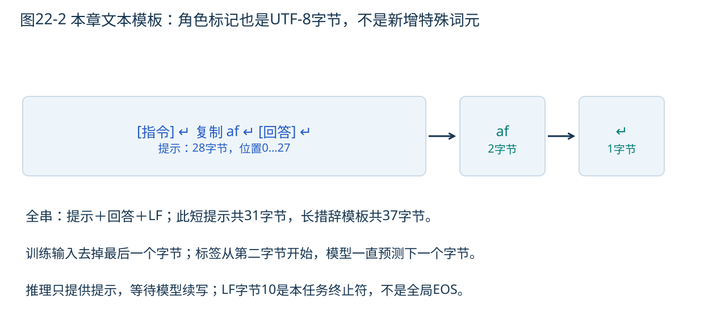
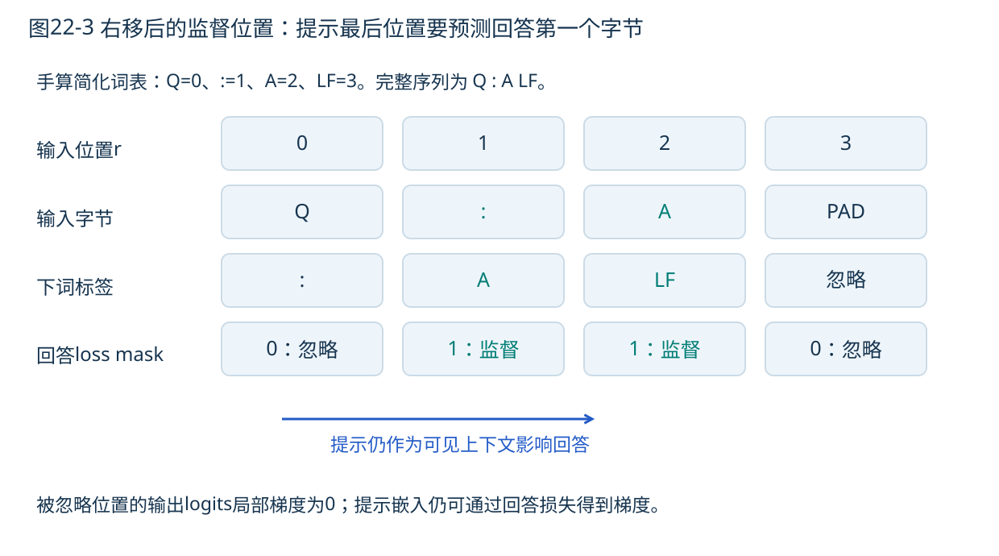
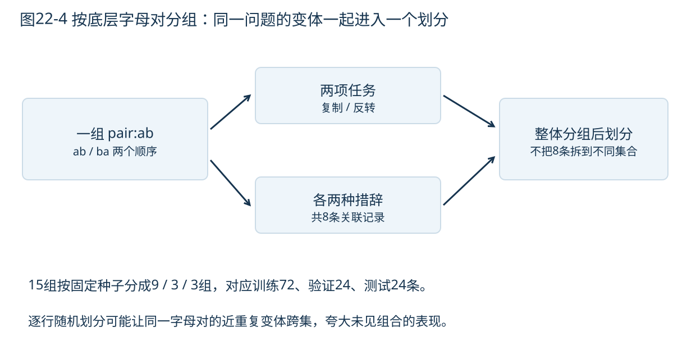
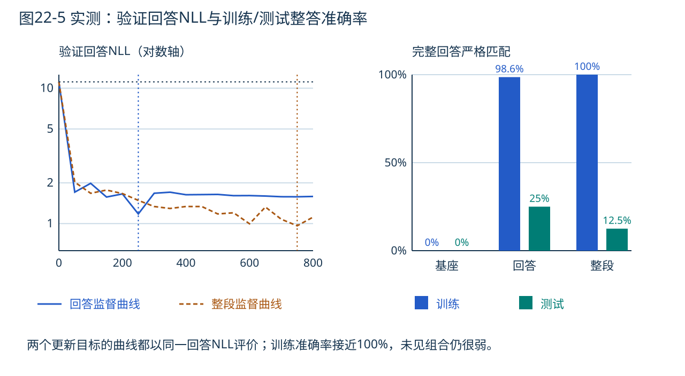

# 第22章：指令微调与数据构造

> 状态：完整正文、五幅SVG与共用基座SFT对照已完成独立验收；正式状态以章节计划为准。
> [阅读入口](../../README.md) · [前置：语言目标与数据](20-language-model-pretraining.md) · [前置：微型语言模型](21-tiny-language-model.md) · [公共符号](../appendices/notation.md) · [完整实验](../../examples/22-instruction-tuning/README.md)

## 1. 本章目标与前置知识

第21章的模型可以继续一段文本，但“接着写得像原语料”不自动等于“按指令给出指定回答”。监督微调（supervised fine-tuning，SFT）用指令和示范回答继续更新同一个语言模型，让训练目标更贴近期待的交互行为。[1，§3.1；2，第40页]

本章的重点不是把一份JSON交给训练器就结束，而是逐项回答：指令、角色标记和回答怎样变成一条词元序列？哪些下词预测参与损失？如何避免首个回答词元错位、填充污染和近重复跨集？怎样比较微调前后，既展示成功，也完整保留失败？

我们复用第21章真实预训练的35,328参数CPU基座，学习两个很小的字符操作任务。三个模型分别为未微调基座、只监督回答的SFT、整段文本监督对照。实际测试准确率仍然很低，这正好让我们分清格式适应、训练记忆和未见组合泛化，不能把它描述成通用指令助手。

前置是第16章的因果块、第20～21章的字节词元、下词目标与训练/生成区别。本章不做偏好优化，也不把示范学习当成已经完成全部对齐过程。

## 2. SFT改变了什么



图22-1为本章实际流程的原创SVG。结构、词表与上下文长度保持与第21章一致；SFT从已有参数出发继续训练。本实验全参数更新，并未使用下一章的低秩适配。

预训练通常从普通文本学习下一个词元；本章SFT把数据组织成“给定指令和历史，输出示范回答”的条件预测。核心仍是下词交叉熵，但输入分布、监督位置和样例权重发生了变化。

SFT提供的是示范，不直接提供“两个答案哪个更好”的比较信号。原始InstructGPT将示范SFT放在后续偏好学习之前，本章只使用其中的监督学习思想，不复现其数据规模、人工标注流程或效果。[1] 大学课程还强调在未见任务上评价指令泛化；本文只测试已见任务的未见字符组合，范围更窄。[2，第40/53页]

## 3. 数据记录与文本模板

### 3.1 字段不是网络天然理解的接口

一条实际训练记录为：

```json
{"id":"pair:af:af:copy:0","group_id":"pair:af","task":"copy","instruction":"复制 af","response":"af"}
```

`instruction` 是要求，`response` 是示范回答；`id` 用于追踪记录，`group_id` 用于把关联变体一起划分，`task` 用于分项评价。网络不会直接读取这些字段的含义：数据代码先把它们按固定格式拼成文本，再编码成词元编号。

若原数据是对话消息，可以表示为用户与助手两个消息：

```json
[{"role":"user","content":"复制 af"},
 {"role":"assistant","content":"af"}]
```

对话模板（chat template）负责把角色、内容、轮次边界转换成模型实际使用的序列。不同模型可能有不同控制标记；训练与推理必须使用匹配的约定，不能因为都叫“聊天模型”就任意替换标记。[3]

### 3.2 本章模板的精确定义

本章使用原创、单轮、纯文本模板：

```text
[指令]
复制 af
[回答]
af
```

提示部分包含 `[指令]`、指令正文和 `[回答]` 及相应换行；回答部分为两个字母和结束换行。最后一个换行也属于要学习的目标，否则模型没有被明确教会何时结束当前回答。



图22-2中的短提示占28字节，回答占2字节，终止LF占1字节，全串31字节。使用“原样输出”等较长措辞时，全串为37字节。本章词表是第21章固定的UTF-8字节0～255；这些中文角色标记会分成多个字节，**没有新增特殊词元**。

推理时仅给提示，保留同样的角色标记、空格和换行，让模型从回答位置继续生成。本任务的合法回答不含内部换行，因此把LF字节10作为停止条件；它是本任务约定，不是整个字节词表的通用EOS。一般多轮对话需要另行定义每轮结束及最终停止方式。

字节编码的前缀边界可精确用字节长度定位；若更换为BPE等词元化，不能无条件照搬“分别编码两段再拼接”的边界算法，应核对完整模板和实际词元序列。本文不调用Transformers库，也不把自定义文本标记假称为某个现成模型的官方模板。[3]

## 4. 符号与监督目标

| 符号 | 含义与形状 |
| --- | --- |
| $`B,V`$ | 批次大小、词表大小；本章 $`V=256`$ |
| $`L_i,p_i`$ | 第 $`i`$ 条全串字节长度、其中提示字节长度 |
| $`z^{(i)}_r`$ | 全串中零基位置 $`r`$ 的词元编号 |
| $`\mathbf{a}^{(i)}_r\in\mathbb{R}^{V}`$ | 模型在输入位置 $`r`$ 的词表logits列向量 |
| $`m^{(i)}_r`$ | 该位置的下词标签是否监督，取0或1 |
| $`M`$ | 当前批次全部被监督目标词元数 |
| $`\boldsymbol{\theta}`$ | 与第21章相同结构的模型全部参数 |

输入取全串去掉最后一个字节，标签取全串去掉第一个字节。因此位置 $`r`$ 的输入是 $`z_r`$，它预测的目标是 $`z_{r+1}`$，而不是 $`z_r`$。单样本输入长度为 $`L_i-1`$，代码批次按最长输入右侧填充。

本章回答监督掩码按**目标位置**定义：

```math
m^{(i)}_r=\mathbf{1}\{p_i\leq r+1<L_i\},
\qquad
M=\sum_{i=1}^{B}\sum_r m^{(i)}_r>0.
```

提示本身的后续字节不作为本章SFT目标，回答的所有字节和结束LF参与监督；填充目标不参与。损失为：

```math
\mathcal{L}_{\mathrm{SFT}}(\boldsymbol{\theta})
=-\frac1M\sum_{i=1}^{B}\sum_r m^{(i)}_r
\log p_{\boldsymbol{\theta}}\left(z^{(i)}_{r+1}\mid z^{(i)}_0,\ldots,z^{(i)}_r\right).
```

词表softmax沿 $`V`$ 个类别归一化，损失按整个批次的有效目标词元取平均，没有额外 $`1/2`$，也不除以包括填充在内的矩形总长度。本章每条回答恰有3个目标字节，因此批次的 $`M=3B`$；一般变长回答采用这种归约时，较长回答对总损失的贡献也更多，若改为先逐样本平均，需要重新说明权重。

## 5. 右移与loss mask：最容易差一个位置的地方

### 5.1 提示末尾位置要监督首个回答字节

用更小的四符号词表做手算：`Q=0`、`:=1`、`A=2`、`LF=3`。提示为 `Q:`，回答为 `A` 加换行，全串是 `Q : A LF`。



图22-3为原创对齐图。输入为 `Q : A`，对应标签为 `: A LF`，回答掩码为 `(0,1,1)`。位于提示最后一个符号 `:` 的输出，恰好预测回答首符号 `A`，所以该位置必须监督。若按“所有提示输入位置都忽略”直接切片，会错过第一个回答目标。

实际代码将前 $`p_i-1`$ 个标签设为忽略值：

```python
input_ids = full_bytes[:-1]
labels = full_bytes[1:]
labels[:prefix_length-1] = [-100] * (prefix_length-1)
```

这里 `-100` 是损失函数的忽略标签，不是词表编号。PyTorch的整数类交叉熵支持 `ignore_index=-100`；本章明确用未忽略目标数量计算平均，并拒绝一整批没有监督目标的情况，避免零分母或NaN。[4]

### 5.2 手算一个被监督的平均交叉熵

假设上面三个位置的词表概率为：

```math
\begin{pmatrix}
0.25&0.25&0.25&0.25\\
0.05&0.05&0.80&0.10\\
0.10&0.20&0.20&0.50
\end{pmatrix}.
```

第一行预测提示中的冒号，不计损失；第二行目标为A，概率0.8；第三行目标为LF，概率0.5。因此：

```math
\mathcal{L}=\frac{-\log0.8-\log0.5}{2}
\approx0.458145366.
```

若错误地仍除以全部3个位置，值就会被低估；若把提示也纳入目标，计算的则是另一个损失。代码以这些概率的对数作为logits，与公式及自动微分核对。

### 5.3 不监督提示不等于把提示从上下文删掉

记词表softmax为 $`s_{rj}`$，目标类别为 $`y_r`$。对局部logits，交叉熵梯度为：

```math
\frac{\partial\mathcal{L}}{\partial a_{rj}}
=\frac{m_r}{M}\left(s_{rj}-\mathbf{1}\{j=y_r\}\right).
```

$`m_r=0`$ 时，这个位置的输出没有直接损失梯度；但提示输入仍被后面的回答位置通过因果注意力读取，所以提示嵌入和共享参数仍可收到回答损失传回的梯度。本机检查恰好观察到被忽略输出logits的局部梯度为0，而提示第0位置嵌入的梯度范数约1.025067。

| 控制量 | 本章语义 | 不应混淆的作用 |
| --- | --- | --- |
| 因果注意力限制 | 只读当前与更早位置 | 防止读取未来真实回答 |
| `attention_mask` | True为有效输入键 | 让右侧填充不提供上下文 |
| `labels=-100` | 忽略该下词目标 | 决定哪些预测被监督 |

输入填充使用字节0，但只有 `attention_mask=False` 时才把它当填充；0没有被从词表中删除，也没有变成通用结束符。仅设损失忽略值，不能替代注意力中的填充限制。

## 6. 数据质量：关联样例要一起划分

### 6.1 原创任务与可检验标签

从小写字母 `a…f` 中取两个不同字母，构造复制与反转任务，每项任务各有两种措辞：复制/原样输出，反转/倒序输出。示范回答由明确规则生成并逐项核对，不调用外部教师模型，不下载第三方指令数据。

选不同字母是为了使复制和反转的正确答案不同；若大量使用 `aa`，两种任务都回答 `aa`，即使模型忽略了任务含义也可能得到较高分。



图22-4展示本章分组。以 `ab` 为例，`ab/ba` 两个顺序、两项任务、每项两种措辞，共8条关联记录，全部绑定到 `pair:ab`。15个无序字母对以固定种子2200打乱，分为训练9组72条、验证3组24条、测试3组24条。

如果逐行随机切分，模型可能在训练中已经看到同一个底层字母对及其逆序回答，验证只换了措辞，容易高估未见组合表现。本章测试的是已见任务中的未见字母对；单个字母仍可在训练中出现，不把它称为未见语言或未见任务泛化。

### 6.2 数据代码实际检查的内容

[数据与模板代码](../../examples/22-instruction-tuning/sft_data.py)检查非空字段、唯一ID与提示、标签规则、任务/措辞范围、分组标识和跨集不相交。指令与回答字段不含内部换行或NUL，保证本任务的模板和LF停止协议不会被这些字段混淆。

全串最长37字节，右移输入最长36，小于64字节上下文。代码对超长样例直接报错，不静默截断；否则可能切掉回答、终止符，或留下全是提示而没有目标的样例。真实批次同时含30和36位置输入，确实经过右侧填充检查，并非只在等长样例上假定填充正确。

这份数据很小、任务很窄。数据规则可检验，不等于已经覆盖真实开放对话的多种合理答案；开放任务还需要对示范质量、完整性与评价依据作明确选择。[2，第53页] 本章不把“多收一些同样模板”当成自动解决泛化的办法。

## 7. 公平比较：损失不同，评价口径保持一致

从同一个预训练检查点复制参数，固定两组的训练批次顺序、优化器、预算、精度与数据，只改变目标位置：

| 方法 | 更新目标 | 本章用途 |
| --- | --- | --- |
| 基座 | 不更新 | 观察微调前行为 |
| 回答监督 | 回答两字母及结束LF | 目标侧聚焦的SFT |
| 整段监督 | 提示与回答全部有效下词目标 | 检查监督范围对学习过程的影响 |

整段监督并非在任何任务下都错误；继续文本建模时可以有意使用它。本章想比较的是在有限预算里怎样分配学习权重。长提示占多数时，整段平均会给提示预测更多份额，回答的相对权重较小。两种更新损失的数值不能直接当成同一指标比较。

因此两组都按**验证回答平均NLL**选择检查点，而不是各自拿自己的训练目标选最小值。最终都用相同的回答NLL、教师强制字节准确率、自由生成完整回答匹配率和格式合法率评价。

教师强制准确率在每步都提供真实历史回答字节；自由生成后面的上下文来自模型自己的输出。前一步错了，后面可能继续错，所以较高逐字节准确率不必对应较高整答匹配率。格式合法只要求两个合法字母加LF，不能代替任务正确。

## 8. 本机SFT实践与基座追踪

### 8.1 共用模型与检查点来源

直接只读复用第21章的[模型API](../../examples/21-tiny-language-model/model.py)和固定字节词表，不复制一份可能漂移的模型实现。配置为词表256、上下文64、宽32、4头、2层、FFN宽64、Dropout0，共35,328参数。

已训练基座来自第21章600步终点。22章实测先将其冻结复制为本地 `base-used.pt`，原基座与副本文件SHA-256均为：

```text
326e1a5e405fc3280aae20e57f3eadd7ef0d7f54df3cb35af6a87bc679068e5a
```

参数状态的SHA-256为：

```text
60530df67c1c9013e573b57a044c1e996e09b455216d7671ee59835198aca582
```

基座预训练的普通语料协议见第21章，不把本章指令答案对加入它。这里不额外宣称测试字母子串在所有普通文本中从未出现；本章独立划分针对指令组合数据。正式复跑若基座文件不同，必须记录新来源，不能沿用本次结果声称相同起点。

### 8.2 环境、预算与运行

环境为Windows、Python3.11.5、PyTorch2.15.0+cpu，CPU、float32、1线程、确定性算法。两组各800次更新，批次16，AdamW学习率0.0015、动量0.9/0.999、$`\epsilon=10^{-8}`$、衰减0。每50次更新验证，最大预算固定，无早停。

两组都从相同基座开始，使用种子2201的同一批次抽样序列；程序比较初始状态与批次顺序的哈希，不只说“种子一样”就假定一致。每个验证最佳模型独立保存，再加载验证预测逐项一致。基座保持不更新。

先按第21章命令生成预训练基座，再从仓库根目录运行：

```powershell
& ./.venv/Scripts/python.exe -B examples/22-instruction-tuning/run.py
```

若仅检查数据、标签与梯度机制：

```powershell
& ./.venv/Scripts/python.exe -B examples/22-instruction-tuning/run.py --check-data-only
```

后者不训练SFT，不能当成完整实验完成。实际冻结副本复跑方法、输出文件和完整SHA见[运行说明](../../examples/22-instruction-tuning/README.md)。完整报告在 `build/experiments/22-instruction-tuning/` 的 `results.json`，包含全部24条测试输入、期望和三模型输出；没有只保存挑选的成功案例。

## 9. 2026-11-15实测：格式适应与泛化分开看

### 9.1 三组整体指标

23:17（Asia/Shanghai）实训通过。两种SFT的验证最优更新分别为250和750；同一验证回答NLL分别为1.17828和0.96350。所有训练与选模结束后才进入最终测试阶段。

| 方法 | 训练整答正确 | 测试整答正确 | 测试格式合法 | 测试回答NLL |
| --- | --- | --- | --- | --- |
| 基座 | 0/72 | 0/24 | 0/24 | 9.97313 |
| 回答监督 | 71/72 | 6/24 | 24/24 | 0.94879 |
| 整段监督 | 72/72 | 3/24 | 24/24 | 1.62512 |



图22-5使用真实曲线和计数。两组明显学到了当前回答格式，训练题也几乎全对；在未见字母对上，回答监督只有25%、整段监督只有12.5%整答正确，仍存在很大的泛化差距。不能把格式100%描述为指令100%完成。

回答监督组复制任务5/12正确、反转1/12；整段监督组复制2/12、反转1/12。当前差别主要不来自反转能力突然变好，模型仍常忽略顺序或复用熟悉组合。一个种子、3个底层测试组，没有足够证据宣称回答监督对所有任务都普遍更好。

整段组的验证NLL更低，最终测试NLL却更高，提醒我们小验证集和有限关联组数仍有估计不确定性。两组没有根据测试结果重新选训练轮或改学习率，保留这次预先固定协议的结果。

### 9.2 按文件顺序展示成功与失败

下表是测试文件最前面4条，保持原顺序，没有按成功筛选。微调输出均在LF处终止；基座达到8个新字节上限仍未终止。

| 指令 | 期望 | 基座前8字节续写 | 回答监督 | 整段监督 |
| --- | --- | --- | --- | --- |
| 复制 de | `de` | `able. A ` | `de`，正确 | `df`，错误 |
| 原样输出 de | `de` | `d square` | `de`，正确 | `df`，错误 |
| 反转 de | `ed` | ` square ` | `de`，错误 | `ef`，错误 |
| 倒序输出 de | `ed` | `d square` | `de`，错误 | `ed`，正确 |

回答监督组对同一个 `de` 很容易一直输出 `de`，虽然复制时对、反转时错。整段组也有单条正确，但整体结果仍弱。固定样例解释行为，全部记录与计数提供更完整证据，二者不能相互替代。

测试教师强制字节准确率分别约2.78%、68.06%、70.83%；整段组逐字节准确率略高，却有更低的自由生成整答准确率。这与两种评价提供的历史上下文不同、错误位置及误差累积有关，不能只看逐词准确率决定助手已经可用。

### 9.3 数值检查与资源

手算交叉熵0.4581453659370775，自动微分值0.45814536593707755；忽略输出的局部梯度为0，提示嵌入仍有非零梯度。首答目标对齐、每条3个监督字节、真实30/36位置右padding、全忽略批次拒绝、单条/填充批次前向一致、两种SFT相同起点及相同批次哈希、检查点恢复均通过。

SFT训练与全部评价检查约42.737秒，含库导入约50.723秒，不含随后SVG与文档生成。三份JSONL共13320字节，只是数据文件大小，不是模型、梯度、优化器或进程总内存；进程峰值内存未测量。后续其他平台的浮点末位和结果可变，当前数据规模也不能代表大型指令微调资源。

## 10. 常见误区与适用边界

- **JSON里写了role模型就自然知道角色**：字段要经过一致模板转换成真实词元序列。
- **忽略所有提示输入位置就等于正确回答mask**：应按右移目标定位，提示最后位置要预测首个回答词元。
- **loss mask把提示从上下文删了**：它只取消相应输出的直接损失，提示仍影响回答。
- **padding只设ignore_index即可**：还需保证填充不作为有效注意力键。
- **字节0是天然PAD或EOS**：本章通过mask赋予特定位置的填充语义，词表本身仍有256种字节。
- **训练损失低就证明会执行新指令**：本机训练近乎全对，未见组合仍很弱。
- **格式正确就等于任务正确**：任意两个合法字母加换行都可能过格式检查，却不满足复制或反转。
- **回答监督在所有任务都一定优于整段监督**：目标、数据比例与优化预算会影响结论，应使用统一最终指标验证。
- **微调完成就等于学会所有新知识或完成偏好对齐**：示范数据、目标和评价范围有明确边界。[1,2]

## 11. 习题与解析

### 11.1 习题

1. 提示长度为5，完整序列长度为9，输入输出采用本章零基右移。哪些输出位置应参与回答监督？分母是多少？
2. 为什么监督第一个回答目标时，当前输入仍处于提示末尾？若把前5个输出全部忽略，会漏掉什么？
3. 重算第5节交叉熵。若错误除以3，得到什么？这是否还是同一归约？
4. 被忽略提示输出的logits梯度为0，为什么提示嵌入仍可更新？如何用实际自动微分检查？
5. 为什么把 `复制 ab` 放训练、`反转 ba` 放测试，可能夸大真正未见组合能力？本章如何分组？
6. 一个模型测试格式100%、整答25%，应该怎样报告？若另一个模型教师强制字节准确率更高，是否必然更适合自由生成？
7. 修改数据后发现少数样例超过上下文，为什么不应直接截断后继续沿用原mask？若需要多轮对话，应怎样定义监督区？

### 11.2 参考解析

1. 回答全串位置为5、6、7、8，对应输出位置4、5、6、7，共4个监督目标。有效输出位置0～7，前4个忽略，不能把提示最后输出位置4也删掉。
2. 位置 $`r`$ 预测 $`r+1`$；提示最后位置4预测全串位置5的首个回答词元。忽略前5个输出就会漏掉该首答目标。
3. 正确值约0.458145366；错误除以3约0.305430244。忽略项应从有效目标数中排除，该错误改变了平均的尺度。
4. 回答位置通过注意力读取提示，所以回答损失能沿上下文路径到达提示输入及共享参数。本章保留logits梯度并检查忽略处为0，同时读取提示位置嵌入的梯度范数，确认为非零。
5. 两条记录共享同一底层字母对，训练中可能已经暴露所需组合或其逆序答案。本文将两个顺序、两项任务、两个措辞的8条记录绑定同一无序对，整组进入一个划分。
6. 分别报告格式24/24、整答6/24并展示失败，不合成一个“成功率100%”。教师强制提供真实前缀，自由生成使用自己的前缀，逐字节分数不保证完整序列成功；本机整段组就是反例。
7. 截断会改变回答和终止位置，也可能删除全部目标，应重新构造并验证序列、边界与有效目标数。多轮需要按模板标记每段助手回答的目标位置，用户及其他非监督部分仍可作为上下文；本章只实现单轮，不声称已经验收多轮逻辑。

## 12. 小结与下一步

SFT继续使用语言模型的条件下词学习，但模板、目标mask、数据分组与评价方式决定了到底学什么。监督位置对齐后，提示可以作为条件而不计自身输出损失；训练记忆、格式和新组合行为仍需要分别评价。

下一章保留这套数据协议，讨论怎样只更新部分低秩参数。参数更新方式变化之后，数据质量、回答mask与冻结测试的要求继续成立。

## 13. 参考文献

来源于2026-11-15核验；模板、数据和五幅SVG原创。CPU实测记录保持原日期；2026-11-17整合复验HTML/PDF、双视口、字体矢量及全页目视通过。

1. Ouyang等，*Training language models to follow instructions with human feedback*，2022，§3.1～3.2、§3.5：[原始论文](https://arxiv.org/abs/2203.02155)。
2. Sharma，Stanford CS224N Spring 2024，第10讲 *Prompting, Instruction Finetuning, and DPO/RLHF*，PDF第40、53页：[官方讲义](https://web.stanford.edu/class/cs224n/slides/cs224n-spr2024-lecture10-prompting-rlhf.pdf)。讲义基于Jesse Mu。
3. Hugging Face Transformers，角色与聊天模板：[文档](https://huggingface.co/docs/transformers/chat_templating)。本章运行不依赖该库。
4. PyTorch2.15，CrossEntropyLoss，整数标签、ignore_index与非忽略目标平均：[官方接口](https://docs.pytorch.org/docs/2.15/generated/torch.nn.CrossEntropyLoss.html)。
