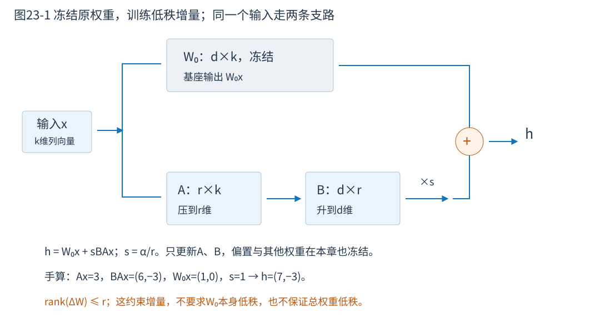
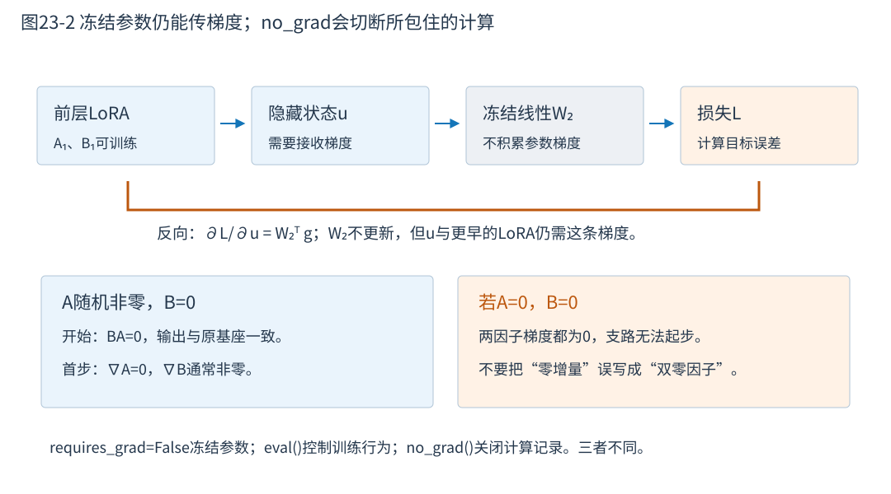
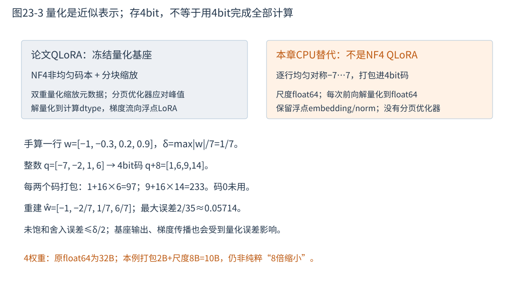
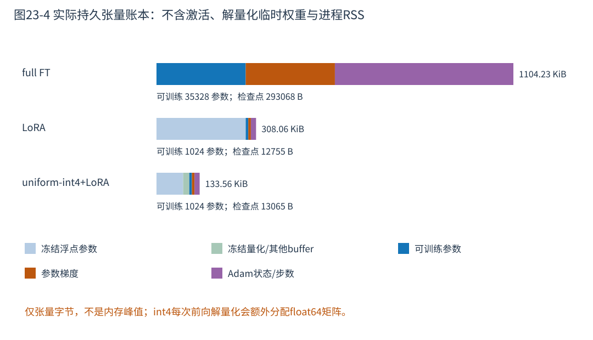
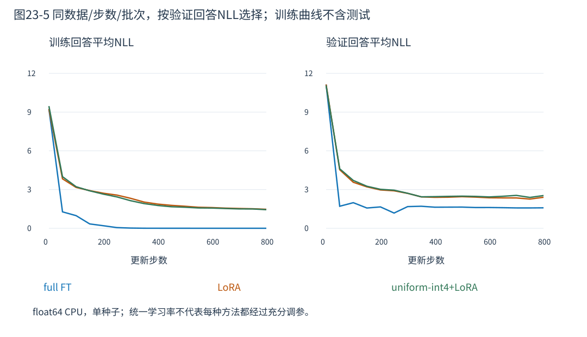
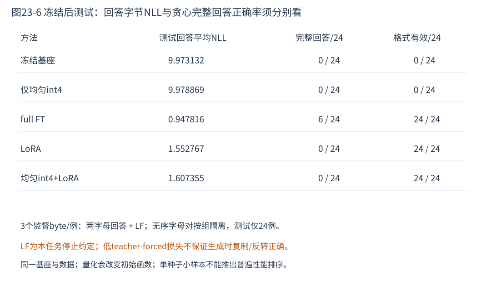

# 第23章：参数高效微调：LoRA与QLoRA

> 训练一个任务时，是否必须为基座的每个权重都保存梯度和优化器状态？本章从一个可手算的低秩支路出发，解释LoRA的形状、梯度、初始化、合并和保存；再将冻结、量化与运行内存逐一分开。实践复用第21章基座和第22章数据，保留实际出现的失败结果。更新日期：2026-11-17。

[阅读入口](../../README.md) · [章节计划](../chapter-plan.md) · [公共符号](../appendices/notation.md) · [完整实践](../../examples/23-parameter-efficient-tuning/README.md)

## 1. 问题、目标与前置知识

第22章通过监督微调，让预训练模型适应“给指令、输出回答”的任务。全参数微调会更新基座的全部可训练参数：不仅要保存权重，还要保存对应梯度和Adam一阶、二阶状态。为多个任务各保存一份完整模型，存储也会随任务数增长。

LoRA（Low-Rank Adaptation，低秩适配）提出一种不同参数化：保留原权重，在选定线性变换旁添加较小的可训练增量。小的是增量的表示与优化状态；基座本身仍参与前向和反向中的信息传播。[1, §4] 这不保证每个任务都能靠很小增量学好，后面的实际生成结果会展示限制。

学完后应能：

- 给定输入/输出尺寸与秩，写出A、B的形状、参数数和行批次代码。
- 手算低秩支路及梯度，解释为何“冻结”不等于“不传播梯度”。
- 说明零增量初始化、缩放、目标层选择与权重合并的条件。
- 区分量化存储、解量化计算、适配器训练以及激活/优化器内存。
- 验证适配器与准确基座匹配，解读真实CPU对照及其失败边界。

前置：[01章](01-linear-algebra.md)的矩阵乘法、[08章](08-backpropagation.md)的链式法则、[09章](09-training-and-optimizers.md)的Adam、[21章](21-tiny-language-model.md)的微型因果模型、[22章](22-instruction-tuning.md)的回答损失与数据职责。本章重新讲解秩、初始化和量化，不要求预先知道PEFT库。

## 2. 先分清三种改变

 **全参数微调** 改变既有参数； **LoRA** 在选定层改变参数增量的表达方式，并冻结既有参数； **量化** 用较少离散码和缩放信息近似存储数值。三者关注的问题不同，后两者可以组合。

“冻结一个模型”也不等于“模型已经适应任务”：本章冻结基座在新指令上完整回答为0/24。LoRA需要从任务损失学习；量化本身没有提供新的监督信号，单纯压缩也不能赋予指令能力。

本章做两类事情：完整训练普通LoRA；为了看清量化机制，另外实现一个 **逐行均匀四位存储的CPU教学替代** 。它不是论文的NF4 QLoRA。论文QLoRA的概念在第8节解释，实际报告明确列出未执行项，不把替代实现冠以完整论文方法名称。

## 3. 符号、形状与“秩”

| 符号 | 含义 | 形状/范围 |
| --- | --- | --- |
| $`\mathbf x,\mathbf h`$ | 单位置输入、输出列向量 | $`k`$维、$`d`$维 |
| $`\mathbf W_0`$ | 原始冻结线性权重 | $`d\times k`$ |
| $`\mathbf A,\mathbf B`$ | 可训练低秩因子 | $`r\times k`$、$`d\times r`$ |
| $`r`$ | 支路中间维度，给更新矩阵提供秩上界 | 正整数，不大于 $`\min(d,k)`$ |
| $`\alpha,s`$ | LoRA超参数、实际乘法缩放 | $`s=\alpha/r`$，本章取正 |
| $`\Delta\mathbf W`$ | 实际权重增量 | $`s\mathbf B\mathbf A`$，$`d\times k`$ |
| $`\mathbf X`$ | 行批次/多位置输入 | $`N\times k`$；序列可展平 $`N=BT`$ |
| $`\mathbf g`$ | 损失对单位置输出的梯度 | $`d`$维列向量 |
| $`P_0,P_t`$ | 冻结基座参数数、可训练参数数 | 用于张量字节账本 |
| $`\delta_i,q_{ij}`$ | 第 $`i`$ 行量化步长、离散整数 | 本章均匀量化专用，非LoRA缩放 $`s`$ |

矩阵的 **秩（rank）** 是其列空间的维数，即最多有多少列线性独立。例如一张矩阵的每列都是同一个向量的倍数，所有输出变化只沿一条方向，非零时秩为1。它不等于“非零元素的个数”，也不是网络层数。

乘积 $`\mathbf B\mathbf A`$ 的输出总在 $`\mathbf B`$ 的至多 $`r`$ 个列向量张成的空间内，因此

```math
\mathop{\mathrm{rank}}\nolimits(\mathbf B\mathbf A)
\le\min\bigl(\mathop{\mathrm{rank}}\nolimits(\mathbf B),\mathop{\mathrm{rank}}\nolimits(\mathbf A)\bigr)
\le r.
```

这约束的是 **一层的更新矩阵** 。原始 $`\mathbf W_0`$ 可以满秩；总权重也可以满秩。多个层、非线性和注意力共同构成的模型变化，不能简单称作“整个模型只剩r种能力”。

## 4. 低秩支路：从列向量到代码

### 4.1 同一输入的两个线性变换

普通线性层忽略偏置时为 $`\mathbf h=\mathbf W_0\mathbf x`$。LoRA改为

```math
\mathbf h
=\mathbf W_0\mathbf x+s\mathbf B\mathbf A\mathbf x,
\qquad s=\frac{\alpha}{r}.
```

先计算 $`\mathbf A\mathbf x`$，从 $`k`$ 维变成 $`r`$ 维；再乘 $`\mathbf B`$，回到 $`d`$ 维。两个支路输出形状相同，才能逐元素相加。[1, §4.1] 本章没有新增偏置，原有偏置也冻结；其他项目若训练偏置或额外分类头，必须把它们计入可训练参数与检查点。



*图23-1：依据LoRA论文[1, §4.1、式3]理解后原创绘制，布局及手算例子原创。输入输出按列向量标形状；图中的r维瓶颈属于更新支路，基座支路仍直接参与输出。*

$`\alpha/r`$控制支路的数值尺度。它不是概率，也没有必须小于1的限制；本章 $`r=4,\alpha=8`$，所以 $`s=2`$。改变秩时缩放、初始化与学习率相互影响，不能因为用了这个公式就认为所有秩的训练轨迹或最佳学习率相同。

### 4.2 可逐项核对的例子

取 $`k=3,d=2,r=1,s=1`$：

```math
\mathbf W_0=
\begin{bmatrix}1&0&-1\\0&1&1\end{bmatrix},
\quad
\mathbf x=
\begin{bmatrix}2\\-1\\1\end{bmatrix},
\quad
\mathbf A=\begin{bmatrix}1&-1&0\end{bmatrix},
\quad
\mathbf B=\begin{bmatrix}2\\-1\end{bmatrix}.
```

依次计算

```math
\mathbf A\mathbf x=2+1=3,\qquad
\mathbf B\mathbf A\mathbf x=
\begin{bmatrix}6\\-3\end{bmatrix},
\qquad
\mathbf W_0\mathbf x=
\begin{bmatrix}1\\0\end{bmatrix}.
```

因此 $`\mathbf h=(7,-3)^\top`$。增量矩阵为

```math
\mathbf B\mathbf A
=\begin{bmatrix}2&-2&0\\-1&1&0\end{bmatrix};
```

第二行是第一行的 $`-1/2`$，秩为1。先算增量矩阵再乘输入，与两小矩阵依次作用应相同；训练时通常保留小矩阵支路，避免显式构造整张增量。

### 4.3 PyTorch的行批次对应

输入最后一维为 $`k`$，PyTorch Linear保存的weight形状为 $`d\times k`$。行批次公式是

```math
\mathbf H
=\mathbf X\mathbf W_0^\top
+s(\mathbf X\mathbf A^\top)\mathbf B^\top.
```

~~~python
# x: ... , k；A: r,k；B: d,r
base_output = base(x)
update = F.linear(F.linear(x, lora_A), lora_B)
output = base_output + (alpha / rank) * update
~~~

Linear沿最后一维变换，所以同一实现支持 $`N\times k`$ 和 $`B\times T\times k`$。不能把代码里的A/B顺序按名字随意互换；列向量公式是BAx，行批次是XAᵀBᵀ，二者描述同一计算。

## 5. 参数数、目标层与初始化

### 5.1 参数少到什么程度

一层完整权重有 $`dk`$ 个元素，两个因子有 $`rk+dr=r(d+k)`$ 个元素。若原权重冻结，训练该层支路只需为这部分新元素维护梯度与优化器状态。

只有当 $`r(d+k)\lt dk`$ 时，因子元素才比整张权重少。比如 $`d=k=32,r=4`$，完整权重1024，因子256，是四分之一；若 $`r=32`$，因子反而有2048。因子还存在非唯一表示：对可逆 $`r\times r`$ 矩阵 $`\mathbf R`$，$`\mathbf B\mathbf R`$ 与 $`\mathbf R^{-1}\mathbf A`$ 的乘积不变，因此“可训练张量元素数”不应叫作独立函数自由度。

第21章有2个Transformer块；本章只在每块独立的q_proj、v_proj上添加支路，共4张32×32矩阵：

```math
P_t=2\times2\times4(32+32)=1024.
```

完整基座35328参数都冻结。加支路后总的浮点参数元素为36352，可训练部分占总数约2.817%；若以原基座为分母则约2.899%。报告比例前必须说清分母，不能混算。

### 5.2 为什么选择q/v并非唯一正确答案

q改变注意力的匹配，v改变被聚合的信息；LoRA原论文研究了注意力目标矩阵的不同选择。[1, §4.2、§7.1] 我们选择q/v是为了可手算、便于复用公共模型，并不是理论证明“只改这两处一定够用”。

其他设置可以给k/o、前馈层、输出头等添加支路，但参数数、能力与成本都会改变。QLoRA论文的实验进一步研究广泛覆盖线性层的重要性。[2, §4] 本章后面的q/v负结果不能反推所有LoRA设置都失败；也不能增加秩到32，就声称本章已等价于全参数微调，因为其他模块仍冻结。

### 5.3 零增量不能写成双零因子

初始化时常让A随机非零、B全零。这样 $`\mathbf B\mathbf A=0`$，开始的函数与原基座一致；A可采用论文的随机高斯或官方Linear实现的Kaiming均匀分布，本章采用后者。[1, §4.1][3, Linear.reset_parameters]

为何不将A和B同时清零？下一节梯度会说明，两个因子若都为0，彼此梯度也为0，这个支路无法从普通损失梯度起步。零增量的要求只需要乘积为0。

## 6. 冻结与梯度：损失怎样走到A、B

### 6.1 用链式法则推导

对单样本，设输出梯度 $`\mathbf g=\nabla_{\mathbf h}\mathcal L`$，并暂把输入与原权重视为独立变量。先设 $`\mathbf u=\mathbf A\mathbf x`$，增量输出为 $`s\mathbf B\mathbf u`$。线性层反向得到

```math
\nabla_{\mathbf B}\mathcal L=s\mathbf g\mathbf u^\top,
\qquad
\nabla_{\mathbf u}\mathcal L=s\mathbf B^\top\mathbf g.
```

再通过 $`\mathbf u=\mathbf A\mathbf x`$，得到

```math
\nabla_{\mathbf A}\mathcal L
=s(\mathbf B^\top\mathbf g)\mathbf x^\top,
\qquad
\nabla_{\mathbf x}\mathcal L
=(\mathbf W_0+s\mathbf B\mathbf A)^\top\mathbf g.
```

形状分别为 $`d\times r`$、$`r\times k`$、$`k`$维。批次情形对各样本/位置贡献求和，并带上损失归约的权重。$`\mathbf W_0`$在数学上也有导数，但在本章训练中被设为常量，不积累参数梯度、也不更新。

B=0时A的首步梯度为0；B的首步梯度取决于非零的Ax和输出梯度，通常非零。“通常”需要保留：若特定数据恰好Ax=0或损失梯度为0，也可能没有更新。B更新后，A便可能收到梯度。

### 6.2 延续手算，核对自动微分

取目标 $`\mathbf y=(1,1)^\top`$，损失采用单样本 $`\frac12\|\mathbf h-\mathbf y\|_2^2`$，不额外除以输出维数。残差为 $`(6,-4)^\top`$，因此

```math
\mathcal L=\frac12(36+16)=26,\qquad
\mathbf g=\begin{bmatrix}6\\-4\end{bmatrix}.
```

由于 $`\mathbf B^\top\mathbf g=2\times6+(-1)\times(-4)=16`$，可逐项得到

```math
\nabla_{\mathbf B}\mathcal L=
\begin{bmatrix}18\\-12\end{bmatrix},
\quad
\nabla_{\mathbf A}\mathcal L=
\begin{bmatrix}32&-16&16\end{bmatrix},
\quad
\nabla_{\mathbf x}\mathcal L=
\begin{bmatrix}22\\-20\\-10\end{bmatrix}.
```

入口以float64验证上述输出、损失和全部梯度，并以NumPy核对前向。这里A/B不在零初始化状态；它是展示一般梯度的手算，和首步初始化检查是两个不同例子。



*图23-2：原创梯度路径，依据第08章链式法则、[1, §4.1]与PyTorch[4]绘制。冻结W₂仍应把输出梯度传给更早的隐藏状态；图下方将零增量与双零因子区别开。*

### 6.3 三个API解决不同问题

~~~python
for parameter in model.parameters():
    parameter.requires_grad_(False)
# 再添加可训练的LoRA参数
optimizer = torch.optim.AdamW(
    [p for p in model.parameters() if p.requires_grad],
    lr=0.0015, weight_decay=0
)
~~~

requires_grad=False控制参数是否需要积累梯度；eval()切换Dropout等模块的行为，不会关闭梯度；no_grad()使所包住计算不记录反向图。[4, Locally disabling gradient computation]

不能把整个训练模型包进no_grad()。即使某个基座层冻结，也可能需要经过它将梯度传到更早的LoRA层：若输出是 $`\mathbf W_2\mathbf u`$，仍需 $`\mathbf W_2^\top\mathbf g`$。只有明确不需要该路径的场景才可局部省略记录，不能根据“权重冻结”一概判断。

实际训练同时检查：优化器仅接收允许更新的元素；A/B梯度有限；冻结参数grad为None；训练前后冻结参数及量化buffer指纹不变。只统计requires_grad数量不够，错误的参数组或意外原地修改仍可能破坏冻结约定。

## 7. 推理合并与适配器检查点

线性支路无非线性且本章LoRA dropout=0时，可把

```math
\mathbf W_{\mathrm{merged}}
=\mathbf W_0+s\mathbf B\mathbf A
```

保存为普通线性权重。前向在实数运算中相同，浮点运算顺序可能产生小差异。本章在模型副本上合并，普通LoRA最大logit差约 $`2.18\times10^{-14}`$，量化教学版本约 $`1.95\times10^{-14}`$，不改原基座。

有训练期dropout的支路，只能在相应推理行为下讨论合并；不能期待训练随机支路逐次等价。合并后无需再计算低秩分支，但不能既保留已合并权重又叠加同一支路，否则会重复加增量。量化基座合并还涉及解量化或再次量化：本章将目标层解量化后合成浮点层；若重新压回4bit，会引入新的误差，不保证与未重压的函数相同。

 **适配器文件不包含完整模型。**  本章只存8个A/B张量、rank/alpha、目标层列表、tokenizer/模板协议、数据指纹、基座文件SHA256和量化配方。恢复必须先获得相同基座，再按相同位置和配方添加支路。更换模型结构、字节词表或基座版本，不能因为张量尺寸相同就默认为兼容。

入口实际保存并恢复三个模型；两种适配器的logit逐元素一致，并构造错误基座hash文件验证拒绝加载。这是 **推理恢复** ；如果要从中断点继续同轨迹训练，还需Adam状态、随机数状态、采样位置等，第09章已讨论，不能把推理文件当完整训练断点。

## 8. 量化与QLoRA：减少的是哪一种表示

### 8.1 从浮点到离散码

量化将连续范围内的数近似映射到有限集合。对码本 $`\mathcal C=\{c_0,\ldots,c_{K-1}\}`$、正尺度 $`\delta`$，一种最邻近表示为

```math
q=\mathop{\mathrm{arg\,min}}\limits_{j}|w/\delta-c_j|,
\qquad
\widehat w=\delta c_q.
```

$`q`$存的是码索引，$`\widehat w`$是计算时近似恢复值；相等距离的舍入规则也需确定。4bit最多编码16种状态，仍需码本/尺度等辅助信息。量化不等同于简单把float64转成另一个浮点dtype。

分块或分行缩放能减轻一个极端值拉大整张矩阵范围的问题，但会多存尺度。量化误差也会改变前向及传往更早层的梯度，低秩支路能否补偿取决于数据和覆盖范围，并非数学上保证恢复原模型。

### 8.2 论文QLoRA的三个主要组成

 **QLoRA** 将冻结的低位基座与可训练LoRA结合，论文方法包含以下关键设计。[2, §2–3]

1.  **NF4（4-bit NormalFloat）** ：使用针对近似零中心正态权重分布设计的非均匀码本，零附近表示更密，包含精确零。它不是16个等间隔整数，也不保证对任意权重分布都是最佳。
2.  **双重量化（double quantization）** ：再压缩第一层量化所需的尺度元数据，不是“把权重连续量化两次就自然更准”。
3.  **分页优化器（paged optimizers）** ：论文利用CPU/GPU统一内存的分页转移应对优化器相关的内存峰值，不是取消优化器状态，也不能忽略CPU内存与传输成本。

存储dtype和计算dtype必须分开。论文把低位存储的权重解量化到计算精度，通常为BF16，再做前向/反向矩阵运算；更新的是LoRA浮点因子，不直接对离散码执行普通梯度下降。不要写成“所有激活、梯度和乘法都只用4bit”。

一个只算元数据的例子：每64权重存一个32bit尺度，平均每权重增加0.5bit；若这些尺度按每组256个再用8bit编码，并增加二级32bit尺度，则开销约为

```math
\frac8{64}+\frac{32}{64\times256}
\approx0.127\ \text{bit/weight}.
```

相对0.5约省0.373bit/weight。这是按论文块大小的理论账，不是本机实测显存，也没有包括所有实现元数据。[2, §3 Double Quantization]

### 8.3 本章CPU替代的准确边界

当前项目锁定环境未安装或验证完整bitsandbytes/NF4训练后端，本章没有执行完整NF4 QLoRA，也没有测GPU显存。不能据此写成“CPU永远不支持QLoRA”：2026-11-15核验的bitsandbytes0.50.2安装文档已列Windows AVX2 CPU构建；具体量化/训练功能还应按版本和后端另行实测。[6]

为让机制可审计，本章自己实现逐行对称 **均匀** 量化。对第 $`i`$ 行：

```math
\delta_i=\frac{\max_j|W_{ij}|}{7},
\qquad
q_{ij}=\mathop{\mathrm{round}}\nolimits(W_{ij}/\delta_i)\in\{-7,\ldots,7\},
\qquad
\widehat W_{ij}=\delta_iq_{ij}.
```

零行单独设尺度1、整数全0，避免除0。15个整数等级编码为 $`q+8`$，占用4bit，码0未使用；两个码打包进一个uint8。尺度和计算用float64，每次前向解包/解量化；没有NF4、双重量化、分页优化器或优化过的低位矩阵核。

所有原始Linear权重量化，embedding和LayerNorm仍为浮点，偏置原值冻结。只在同样q/v位置训练LoRA，因此与论文广泛覆盖层的实验也不同。这是学习表示、误差和梯度的独立替代，不能用它对完整QLoRA性能下结论。



*图23-3：量化概念依据[2, §2–3]原创绘制；右侧替代配方与打包数值原创，入口实际核验。图中的δ=1/7是量化尺度，与LoRA缩放s区别。*

### 8.4 手算量化误差与存储

一行权重为 $`[-1,-0.3,0.2,0.9]`$，尺度为 $`1/7`$，整数为 $`[-7,-2,1,6]`$，重建为

```math
[-1,-2/7,1/7,6/7].
```

最大误差来自0.2与1/7之差，为 $`2/35\approx0.05714`$。本例未发生截断饱和，最邻近均匀舍入误差不超过半个步长，即 $`1/14`$。若使用外部截断阈值导致饱和，半步长界不再覆盖截断误差。

四位码[1,6,9,14]打包成十进制[97,233]。四个float64原权重共32B；打包2B加一个float64尺度8B，共10B，不能只看“每权重4bit”便报告存储缩小8倍。奇数权重数还需要补半字节并在解包时裁掉；入口核验奇数形状与零行。

## 9. 训练内存：哪些省下，哪些还在

设基座有 $`P_0`$ 个冻结float64元素，支路有 $`P_t`$ 个可训练float64元素。在本章无主权重副本的设置下，参数/梯度/Adam矩张量近似账为

```math
\underbrace{8P_0}_{\text{frozen weights}}
+\underbrace{8P_t}_{\text{trainable weights}}
+\underbrace{8P_t}_{\text{gradients}}
+\underbrace{16P_t}_{\text{Adam moments}}\quad\text{bytes}.
```

还需加Adam步数张量、buffer、激活、反向保存项、临时矩阵、框架及分配器开销。本章实际逐tensor求numel×element_size，不用这个近似式代替真实账本。若采用FP32、混合精度主权重或不同优化器，系数相应改变。

冻结减少参数梯度和优化器状态；它不会自动清除所有激活。越早的支路要更新，后续冻结模块仍可能需要反向计算输入梯度。量化减少基座的持久存储；本章解量化会临时构造float64矩阵，所以持久字节下降不等于峰值按同一倍数下降，也不表示更快。



*图23-4：直接读取实际模型参数、buffer、梯度与Adam状态，单位KiB=1024B，不含激活、临时解量化矩阵和进程RSS。检查点文件还含容器及元数据，不能与裸张量字节等同。*

本机三方法在完成800步、恢复最佳权重前记录持久张量：

| 方法 | 可训练元素 | 冻结参数/缓冲B | 可训练参数B | 梯度B | Adam状态B | 合计KiB |
| --- | --- | --- | --- | --- | --- | --- |
| 全参数 | 35328 | 0 / 0 | 282624 | 282624 | 565480 | 1104.227 |
| LoRA | 1024 | 282624 / 0 | 8192 | 8192 | 16448 | 308.063 |
| 均匀int4+LoRA | 1024 | 84480 / 19456 | 8192 | 8192 | 16448 | 133.563 |

量化基座的原始Linear权重共24576个，打包12288B；尺度与冻结偏置也计入buffer。其他10560个基座元素仍是float64。对于这个微型模型，embedding等占比高，更不能把大模型论文的压缩比直接搬到此处。

这是 **张量负载账本** ，不是运行时内存峰值，本章没有报告RSS或GPU显存节省倍数。LoRA适配器文件12755B、均匀量化适配器13065B，全参数推理文件293068B，文件大小还随序列化元数据变化。

## 10. 同基座CPU实践：协议先固定

### 10.1 数据、目标和比较对象

只读使用第21章35328参数微型解码器与其检查点；只读复用第22章原创复制/反转数据及模板。15个无序字母对按9/3/3组划分，训练72、验证24、测试24条，ab/ba属于同组；同一组不跨集合。

词表为固定UTF-8字节0～255，输入格式为“[指令]…[回答]…”。prompt仍作为上下文，但不参与本章损失；每条只监督两字母回答加LF，共3个有效目标，输入右padding用显式mask、目标−100。LF仅为本任务停止约定，不当作所有文本通用EOS。代码复用22章collate，避免重新写错第一个回答字节的移位。本文NLL使用自然对数，按有效回答字节取均值，单位为nats/回答byte。

比较五个对象：冻结原基座、仅均匀量化基座、全参数微调、普通LoRA、均匀量化+LoRA。前两者没有任务训练，只作为能力与压缩扰动基线。量化改变初始函数，因此不能说全部方法数值上从完全相同输出开始；它们来自同一份原始权重文件。

### 10.2 训练与选择规则

三个训练方法都使用回答only交叉熵、AdamW、学习率0.0015、betas=(0.9,0.999)、epsilon=1e-8、weight_decay=0；batch16、800次更新，CPU float64单线程，无Dropout。A的初始化seed2300，三个方法的批次采样seed2201，入口核对批次序列hash相同。

每50步评价完整训练/验证回答NLL，最低验证NLL选择并恢复最佳权重。 **所有方法及选择冻结后才评价测试** ，没有按测试改秩、目标层或学习率。生成使用贪心、最多8个新字节、遇LF停止；完整回答正确需实际输出两目标字母并停止，不能只看teacher forcing下逐字节分类。

统一学习率方便排查预算差异，但没有为每种方法分别充分调参；这里只有一个训练种子，不能把单次排序当作普遍性能结论。若想研究rank或学习率，需预先声明验证搜索和多种子预算，再保留一次独立最终测试。



*图23-5：800步真实记录，采样间隔50，曲线只含训练和验证；与图23-4一样由results.json生成。rank4/alpha8、q/v覆盖固定，后续测试不参与曲线选择。*

## 11. 实测结果：参数节省与任务成功是两回事

2026-11-15，Python3.11.5、NumPy2.4.6、PyTorch2.15.0+cpu，首次完整运行23.407秒，含导入1.505秒。全参数、LoRA和均匀量化+LoRA的训练与各自检查约6.781、5.739、6.332秒；不是稳定吞吐基准，系统负载、评估、恢复与文件操作均包含其中。

| 方法 | 验证选择步 | 测试回答NLL | 测试完整正确 | 训练完整正确 |
| --- | --- | --- | --- | --- |
| 冻结基座 | 0 | 9.973132 | 0/24 | 0/72 |
| 仅均匀int4 | 0 | 9.978869 | 0/24 | 0/72 |
| 全参数 | 250 | 0.947816 | 6/24 | 71/72 |
| LoRA | 750 | 1.552767 | 0/24 | 20/72 |
| 均匀int4+LoRA | 750 | 1.607355 | 0/24 | 22/72 |



*图23-6：所有选择冻结后生成。测试每种24条，不对小样本推断显著性或泛化到自然语言指令能力；“格式有效”与“完整正确”分别计数。*

三个训练模型都学会了任务要求的两字母加LF格式，测试格式有效24/24；但LoRA两方法完整正确仍0/24。例如指令“复制 de”，全参数模型输出de，两个LoRA模型输出dc：第一个字母对、格式对，仍没有完成复制。

普通LoRA测试teacher-forced字节准确率40/72，均匀量化+LoRA为42/72；这些指标含容易预测的LF，不能替代完整回答成功率。训练集本身也只有20/72或22/72完整正确，说明当前覆盖、秩、初始化和固定优化预算下存在明显拟合限制；不能将所有失败都归咎为测试集合分组更难。

本次能确定：1024个可训练元素确实更新、冻结基座没变、指标下降、参数状态账减少。不能确定：LoRA与全参数在充分调参后谁更好、NF4 QLoRA是否能达到同样表现、换更强基座或更多种子会怎样。 **机制验证通过和任务能力不足可以同时成立** ；保留负结果比按测试结果临时改实验更有教学价值。

## 12. 运行、保存与复现

仓库根目录执行：

~~~powershell
& ./.venv/Scripts/python.exe -B examples/23-parameter-efficient-tuning/run.py
~~~

需先运行21章生成基座，22章数据文件已随仓库提供。默认输出build/experiments/23-parameter-efficient-tuning/results.json、全参数文件及两种适配器；完整代码见[adapters.py](../../examples/23-parameter-efficient-tuning/adapters.py)与[run.py](../../examples/23-parameter-efficient-tuning/run.py)。

复跑到独立目录，不写其他章节的检查点：

~~~powershell
& ./.venv/Scripts/python.exe -B examples/23-parameter-efficient-tuning/run.py --output-dir build/experiments/23-parameter-efficient-tuning/repeated --skip-figures
~~~

入口34项核对覆盖手算/NumPy前向、一般梯度、首步A/B梯度、双零停滞、行列/合并、冻结输入梯度、四位打包/零行/奇数形状、错误no_grad、参数数、有限梯度、冻结grad为空、冻结tensor不变、merge等价、仅适配器保存、推理重载、批次顺序、原基座文件未改与错误基座拒绝。结果记录依赖版本、dtype、种子、数据/基座hash和全部候选选择轨迹。

默认结果图从同一次报告生成，普通示意图也为原生SVG。跨平台浮点实现可能有微小差别；复现应比较实际数值与声明的容差，耗时/文件容器字节不要求跨平台完全相等。未经验证的完整NF4后端和训练断点恢复不计入本章已执行结果。

## 13. 常见误区

-  **把低秩更新叫作低秩基座** ：限制是ΔW，不是W₀本身。
-  **把rank当作参数元素数** ：一层新增r(d+k)，而且因子表示有冗余。
-  **A/B同时初始化0** ：两因子梯度同时停住；零乘积不要求双零。
-  **冻结后整段no_grad** ：可能切断通往早期LoRA的梯度；eval也不负责冻结。
-  **只看trainable比例就报告峰值节省** ：激活、临时权重、状态dtype都还要计账。
-  **把int4存储当int4计算** ：必须说明解量化和实际计算dtype。
-  **把均匀int4替代叫NF4 QLoRA** ：码本、元数据、覆盖层与优化器都不同。
-  **合并后再加同一支路** ：增量重复；重新量化合并权重又会改变函数。
-  **只有适配器文件就能独立推理** ：还需要匹配基座、配置、目标位置和tokenizer。
-  **格式正确等于任务正确** ：本次LoRA格式24/24、完整任务0/24，是直接反例。
-  **根据测试差再挑rank** ：应回到新的验证设计，不能继续把该测试称独立最终评价。

## 14. 习题与分步解析

### 14.1 题目

1. 对64输入、32输出、rank4的无偏置Linear，A/B形状与新增元素数各是多少？若原权重冻结，完整权重数是多少？
2. 证明BA的秩最多r。W₀满秩时，W₀+BA一定低秩吗？
3. 第4节手算若将alpha从1改为2、rank仍1，输出变成什么？
4. 复算第6节A/B梯度。若只让B为0而A保留原值，哪一个首步梯度必为0？两因子都0会怎样？
5. 某个冻结层输入来自上一LoRA支路，为何仍可能需要反向计算？eval与no_grad能否代替requires_grad设置？
6. 本章四张32×32矩阵、rank8、alpha16时新增多少元素？可否只因rank翻倍就断言完整回答率翻倍？
7. 手算权重[-1,−0.3,0.2,0.9]的尺度、整数、重建与两打包字节。半步长误差界何时不适用？
8. 冻结float64基座1000元素、LoRA100元素，忽略步数/激活/其他开销，参数+梯度+两矩共多少B？与1100元素全部训练比较。
9. 保存了A/B且形状正确，换另一个同结构基座是否自动兼容？量化配方更换和重新量化合并权重又有什么后果？
10. 本次LoRA测试字节准确率超过一半、完整回答0/24，能否宣称实现有错？下一轮若要比较rank，应如何设计，能否按本次测试选择？

### 14.2 解析

 **题1。**  A为4×64，共256；B为32×4，共128，合计384。完整原权重32×64=2048，仍需要保存并计算；冻结只是不更新它。偏置若另训练，应额外计数。

 **题2。**  BA输出属于B的列空间，维数至多r。取W₀=I、BA=0即可得到满秩总权重，故不一定低秩；即使BA非零，总权重也通常可以满秩。

 **题3。**  s从1变2，基座输出(1,0)，增量(6,−3)变(12,−6)，总输出(13,−6)。不是把整个输出(7,−3)乘2，因为冻结支路没有乘该缩放。

 **题4。**  Ax=3，g=(6,−4)，Bᵀg=16，所以B梯度(18,−12)，A梯度(32,−16,16)。B=0时A梯度必为0；本例目标与原输出下B梯度仍可非零。A/B都为0时两梯度为0，普通梯度更新无法启动该支路。

 **题5。**  输入梯度为Wᵀg，它将损失连接到更早的可训练参数。eval控制模块行为，no_grad关闭记录，都不是准确的“只冻结这个参数”的替代；应将冻结叶参数requires_grad=False并限定优化器参数组。

 **题6。**  每矩阵8(32+32)=512，共2048；缩放仍2。参数量、模型函数空间、优化难度和生成成功率不是线性比例，不能推出正确率翻倍；更高rank还需重新验证和预算。

 **题7。**  δ=1/7，q=[−7,−2,1,6]，码[1,6,9,14]，字节[97,233]；重建[-1,−2/7,1/7,6/7]。最大误差2/35≤1/14。发生额外截断饱和、换非均匀码本或尺度再被近似时，不能机械套用同一个半步长界。

 **题8。**  冻结基座8000B，可训练权重800B、梯度800B、两矩1600B，合计11200B。1100个元素全部训练的同类账为1100×(8+8+16)=35200B。两者都没算激活和框架开销，不能当RSS。

 **题9。**  不自动兼容；A/B是相对于具体基座学习的增量。检查准确基座hash、结构、目标层、词表和量化配方。改配方会改变冻结函数；合并后重新量化又引入误差，需要重新评价，不是无损文件转换。

 **题10。**  不能只根据能力差判定实现错误，应先查看机制核验、训练拟合、目标/选择协议与生成样例。本章机制核验通过但小支路能力不足。新一轮预先声明rank/alpha/lr候选、目标层与多种子预算，使用训练拟合和验证选择；已经用于诊断的测试不应继续充当全新独立最终集合。

## 15. 小结与来源

LoRA用低秩因子表示增量，冻结原参数，同时保留必要反向路径。初始化保证从基座函数起步；形状、参数组、冻结指纹、合并与准确基座恢复让机制可核对。量化改变存储和近似函数，QLoRA则在特定量化/训练设计中结合低位基座与可训练适配器。

本机结果展示了节省与限制：可训练元素从35328减到1024，持久张量账显著变小；但固定q/v、单种子、统一预算下，普通与量化教学LoRA都没有在24条测试上生成完整正确回答。后续偏好优化、推理或多模态工作仍需独立的数据、目标和能力验收，不能由“使用了LoRA”自动继承保证。

1. Hu等，2021， **LoRA: Low-Rank Adaptation of Large Language Models** ，arXiv2106.09685v2，§4.1低秩增量/初始化/合并，§4.2目标层与成本，§7.1目标矩阵实验。[原文HTML](https://arxiv.org/html/2106.09685v2)。
2. Dettmers、Pagnoni、Holtzman、Zettlemoyer，2023， **QLoRA: Efficient Finetuning of Quantized LLMs** ，§2量化/LoRA/内存，§3 NF4/双重量化/分页优化器，§4层覆盖实验。[原文HTML](https://arxiv.org/html/2305.14314v1)。
3. Microsoft， **loralib官方Linear实现** ，A/B形状、缩放、冻结、Kaiming/零初始化及合并；只据其核对行为，本章实现与教学例子另写。[源文件](https://github.com/microsoft/LoRA/blob/main/loralib/layers.py)。
4. PyTorch2.15， **Autograd mechanics** ，Locally disabling gradient computation、Setting requires_grad、Grad Modes、Evaluation Mode。[官方文档](https://docs.pytorch.org/docs/2.15/notes/autograd.html#locally-disabling-gradient-computation)。
5. Hugging Face PEFT0.21.0， **LoRA** ，Initialization、QLoRA-style training、target_modules/r/lora_alpha；本章不依赖安装PEFT。[版本化文档](https://huggingface.co/docs/peft/v0.21.0/package_reference/lora)。
6. bitsandbytes0.50.2， **Installation Guide** ，CPU平台与AVX2要求；仅核验文档，没有在本项目运行其NF4训练。[版本化安装说明](https://huggingface.co/docs/bitsandbytes/v0.50.2/en/installation#cpu)。

以上于2026-11-15核验。图23-1～3基于定义与原创例子，图23-4～6来自实际报告，源程序为[figures.py](../../examples/23-parameter-efficient-tuning/figures.py)。所有配图为本地原生SVG，语料来自第22章原创数据，无外部位图。

## 16. 实现与出版验收记录

2026-11-15首轮与2026-11-17复跑均34项通过；复跑25.614秒。修复相对输出目录在检查点路径记录时的异常后，使用正文中的相对目录命令完整复跑，所有检查、训练/验证轨迹、选择时点、指标、逐例生成及三个模型张量均逐项一致。普通/量化LoRA仅8个A/B张量恢复正确，错误基座hash被拒绝。HTML/PDF实际生成：17页、100处公式、6幅SVG、37链接，1440/390px无页面溢出、断锚、数学解析错误、未渲染Markdown或图中文字越界；PDF零位图，字体全部嵌入、含书签/标签，无纸张外文字。已渲染17页逐页查看并放大核对6图、公式、表格、代码和分页。RSS与GPU显存未测，完整NF4 QLoRA未执行；最终章节状态与提交由总计划维护。
