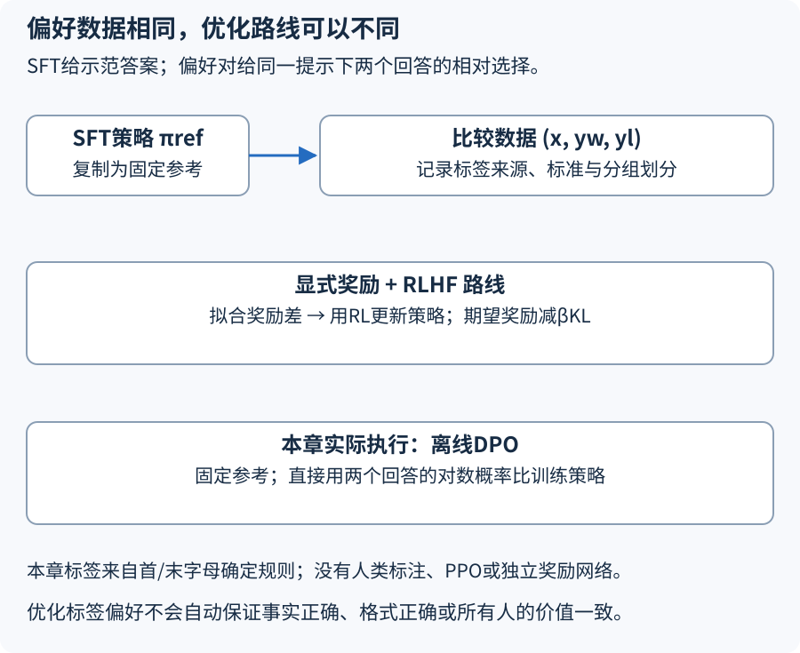
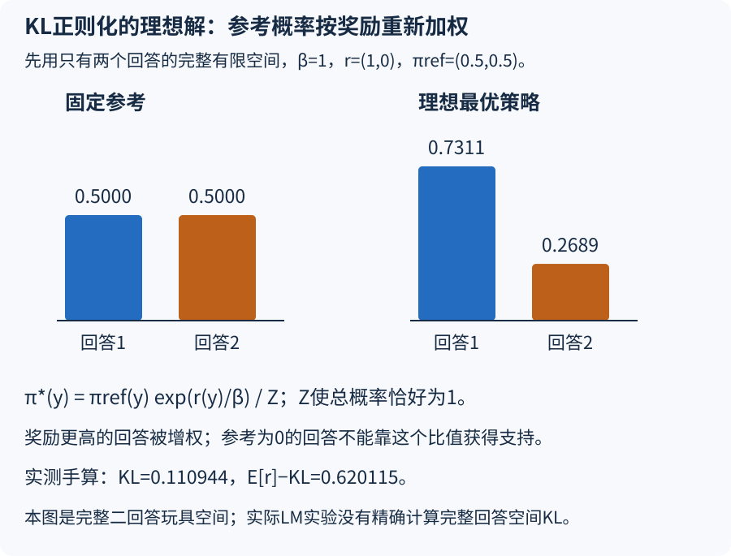
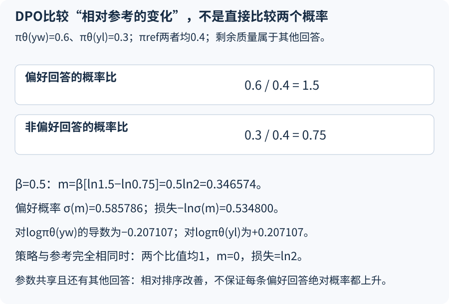
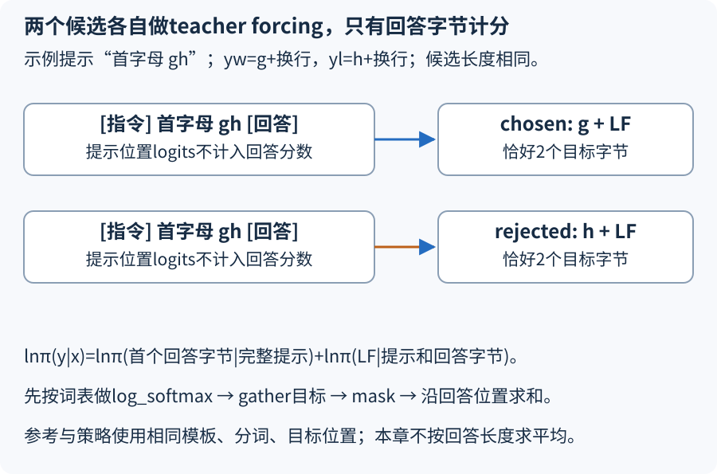
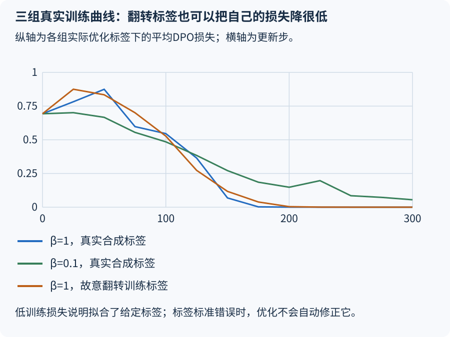
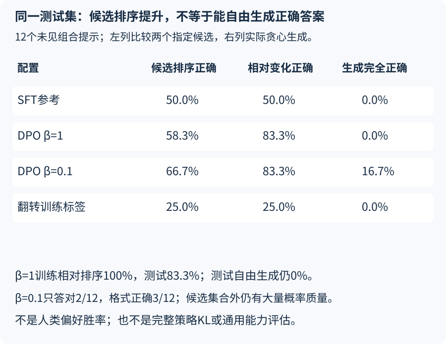

# 第 24 章：偏好学习与对齐

> 同一提示有多个回答时，示范数据告诉模型模仿哪一个，偏好数据告诉模型两者之间更选择哪一个。本章先解释奖励、概率比和参考策略，再从KL正则目标推到DPO，并在第22章的固定SFT基座上做真实CPU实验。合成规则标签不称为人类偏好；排序改善而生成失败的结果同样保留。

[阅读入口](../../README.md) · [章节计划](../chapter-plan.md) · [公共符号](../appendices/notation.md)

## 1. 学习目标与前置知识

学完后，应能解释偏好对、奖励分数、参考策略与生成策略的不同角色；从Bradley–Terry比较概率推到奖励建模损失；在明确支持集与归一化条件下推导KL正则目标的最优策略；逐项计算DPO对数概率比、梯度和回答掩码；区分候选排序、相对参考的变化与自由生成三种评估。

前置为[概率与信息论](03-probability.md)、[语言模型预训练](20-language-model-pretraining.md)、[微型语言模型](21-tiny-language-model.md)和[指令微调](22-instruction-tuning.md)。需要清楚对数概率、交叉熵、KL与自动求导。DPO的现代发展超出2016年花书的时代范围，本章以原始论文和大学课程为直接依据，不把新方法错误归到经典教材中。

## 2. 偏好标签究竟提供了什么

设提示为“首字母 gh”，两个候选回答分别为`g`与`h`。本章规则选择前者，因此一条数据写成 $`(x,y_w,y_l)`$：x为提示，w表示被选中的回答，l表示未选中的回答。候选本身和选择依据必须一起记录。

这条标签只表达特定规则下的相对比较。它不提供绝对奖励值，也不意味着被选中回答在所有维度都完美。真实人类比较可能混合正确性、简洁、礼貌、风格等标准，也可能存在噪声、分歧和顺序偏差。把“chosen”直接当作“客观真理”，会遗漏数据收集过程最关键的假设。

本章全部标签由字符串规则生成：取首或末字母。它适合核对优化方向，无法测量人类满意度或不同群体的价值一致性。[Stanford CS224N Spring 2024 Lecture 10](https://cs224n.stanford.edu/slides/cs224n-spr2024-lecture10-prompting-rlhf.pdf)区分示范微调、比较奖励与偏好优化；本章采用这种循序组织，实际数据和小模型配置另行说明。



*图24-1为原创流程图。显式奖励模型和PPO只作为原理背景讲解；本章实际执行的是固定离线数据的DPO。*

## 3. 符号与回答概率

| 符号 | 含义、范围与实现对应 |
| --- | --- |
| $`x,y`$ | 提示与完整候选回答；本章回答含一个ASCII字母及终止换行 |
| $`y_w,y_l`$ | 同一提示下的偏好与非偏好候选；w不是参数权重 |
| $`\pi_\theta(y\mid x)`$ | 当前策略赋给回答y的条件概率；参数θ被更新 |
| $`\pi_{\mathrm{ref}}(y\mid x)`$ | 固定SFT参考策略；不随DPO步骤更新 |
| $`r_\phi(x,y)`$ | 显式奖励模型的实数输出；可正可负，不是概率 |
| $`\beta`$ | 正数，在KL正则目标中控制对参考分布的偏离代价 |
| $`\Delta_\theta,m_\theta`$ | 相对对数概率差与缩放间隔，均为标量 |
| $`B,T,V`$ | 批次候选数量、输入位置数、字节词表256；每对有两个候选 |
| $`\mathcal D`$ | 记录提示、两个候选及其选择的离线比较数据集 |

语言模型并不直接输出整句的一个概率。它输出各位置的256维logits，通过词表轴log-softmax得到下一字节对数概率，再对回答位置求和：

```math
\ln\pi_\theta(y\mid x)=\sum_{t=1}^{|y|}\ln\pi_\theta(y_t\mid x,y_{\lt t}).
```

这里 $`|y|`$ 是字节数。提示作为上下文参与计算，但不计入回答分数；补齐位置也不计分。终止换行属于回答，必须同时用于策略和参考。若只对一个模型加终止符，或一边取平均、一边求和，概率比便不再比较相同事件。

本章两个候选都为“一个字母+换行”，恰好2个目标字节，避免把长度变化混进这个小实验。对不同长度回答，原始序列对数概率仍是求和；改成长度平均会改变DPO目标，不能声称只是数值稳定技巧。

## 4. 从比较概率到奖励建模

### 4.1 Bradley–Terry模型

设两个候选的潜在奖励为 $`r_w,r_l\in\mathbb R`$。Bradley–Terry模型假定比较概率为：

```math
\begin{aligned}
P(y_w\succ y_l\mid x)
&=\frac{e^{r_w}}{e^{r_w}+e^{r_l}}\\
&=\frac{1}{1+e^{-(r_w-r_l)}}
=\sigma(r_w-r_l).
\end{aligned}
```

$`\sigma(a)=1/(1+e^{-a})`$ 是logistic函数。差为0时比较概率为0.5；差越正，越支持前者。这是对偏好噪声结构的建模假设，不是说人类真的在脑中计算指数。固定的噪声尺度可以吸收到奖励单位中；缺少这种尺度约定时，奖励大小没有唯一解释。

对已标注前者胜出的比较，最大似然对应最小化：

```math
\mathcal L_{\mathrm{RM}}(\phi)
=-\mathbb E_{(x,y_w,y_l)\sim\mathcal D}
\ln\sigma\!\left(r_\phi(x,y_w)-r_\phi(x,y_l)\right).
```

只出现奖励差，给同一提示的所有回答同时加任意常数c(x)，比较概率不变。因此成对数据不能识别绝对奖励零点。奖励模型输出高分也不能自动解释为事实正确概率。原始DPO论文§3列出这一比较模型与损失。[DPO论文§3](https://arxiv.org/html/2305.18290v3#S3)。

### 4.2 显式奖励的RLHF路线

经典的三阶段路线是：先用示范数据得到SFT策略；收集比较数据，拟合奖励模型；再用奖励模型反馈更新生成策略。InstructGPT论文§3.1明确描述这些阶段，并使用PPO执行第三阶段。[原始方法](https://arxiv.org/html/2203.02155v1#S3.SS1)。

固定一个提示x，常见正则化目标是：

```math
J_x(\pi)=\mathbb E_{y\sim\pi(\cdot\mid x)}[r(x,y)]
-\beta D_{\mathrm{KL}}\!\left(\pi(\cdot\mid x)\Vert\pi_{\mathrm{ref}}(\cdot\mid x)\right).
```

第一项要求更多地生成高奖励回答；第二项惩罚偏离固定参考。KL的方向是当前策略到参考，期望也按当前策略取。单条回答的对数比可以为负，只有整个分布上的期望KL保证非负；不能把每个token的对数比都当作非负距离。

奖励只是代理。如果标注标准和真实目标有偏差，策略可能学会取悦评分器而没有改善事实质量。KL有助于限制变化，却不证明奖励本身可靠。PPO、在线采样和价值函数属于另一套优化过程；本章不以DPO小实验冒充完整RLHF复现。

## 5. 从KL目标一步步到DPO

### 5.1 先声明条件，再求理想策略

为避免无限回答空间的技术细节，先固定一个有限完整回答集合 $`\mathcal Y`$。假设参考在该集合每个回答上均为正，β>0，奖励有限，策略为归一化概率分布。定义：

```math
Z(x)=\sum_{y\in\mathcal Y}\pi_{\mathrm{ref}}(y\mid x)e^{r(x,y)/\beta},
\qquad 0\lt Z(x)\lt \infty,
```

以及候选最优分布：

```math
\pi^*(y\mid x)=\frac{\pi_{\mathrm{ref}}(y\mid x)e^{r(x,y)/\beta}}{Z(x)}.
```

代入KL定义，把目标逐项改写：

```math
\begin{aligned}
J_x(\pi)
&=\sum_y\pi(y\mid x)r(x,y)
-\beta\sum_y\pi(y\mid x)\ln\frac{\pi(y\mid x)}{\pi_{\mathrm{ref}}(y\mid x)}\\
&=-\beta\sum_y\pi(y\mid x)
\ln\frac{\pi(y\mid x)}{\pi_{\mathrm{ref}}(y\mid x)e^{r(x,y)/\beta}}\\
&=-\beta\sum_y\pi(y\mid x)\ln\frac{\pi(y\mid x)}{\pi^*(y\mid x)}
+\beta\ln Z(x)\\
&=-\beta D_{\mathrm{KL}}(\pi\Vert\pi^*)+\beta\ln Z(x).
\end{aligned}
```

第三行利用分母为 $`Z(x)\pi^*(y\mid x)`$，并使用 $`\sum_y\pi(y\mid x)=1`$。因为KL非负，目标至多为 $`\beta\ln Z(x)`$，在 $`\pi=\pi^*`$ 时达到。若参考某处为0，有限KL的策略不能在那里放正质量；对数概率比也必须在共同支持上定义。无限回答集合还需有限配分函数与归一化条件，不能跳过这些条件。



*图24-2为原创有限空间手算。两个回答各参考概率0.5、奖励1与0、β=1时，最优概率约0.731059与0.268941；KL约0.110944，目标约0.620115。它不是对实际模型完整回答空间做的精确KL计算。*

### 5.2 为什么配分函数可以消去

将最优策略等式取对数并移项：

```math
r(x,y)=\beta\ln\frac{\pi^*(y\mid x)}{\pi_{\mathrm{ref}}(y\mid x)}+\beta\ln Z(x).
```

同一提示的两个回答相减，第二项完全相同，所以消去：

```math
\begin{aligned}
r(x,y_w)-r(x,y_l)
=\beta\bigg[
\ln\frac{\pi^*(y_w\mid x)}{\pi_{\mathrm{ref}}(y_w\mid x)}
-\ln\frac{\pi^*(y_l\mid x)}{\pi_{\mathrm{ref}}(y_l\mid x)}
\bigg].
\end{aligned}
```

于是可以用参数化策略定义隐式奖励差，而不显式拟合另一个奖励网络。为便于代码和手算，先定义：

```math
\begin{aligned}
\Delta_\theta={}&\bigl[\ln\pi_\theta(y_w\mid x)-\ln\pi_\theta(y_l\mid x)\bigr]\\
&-\bigl[\ln\pi_{\mathrm{ref}}(y_w\mid x)-\ln\pi_{\mathrm{ref}}(y_l\mid x)\bigr],\\
m_\theta={}&\beta\Delta_\theta.
\end{aligned}
```

将这个间隔代入比较似然，得到DPO损失：

```math
\mathcal L_{\mathrm{DPO}}(\theta)
=-\mathbb E_{\mathcal D}\ln\sigma(m_\theta)
=\mathbb E_{\mathcal D}\mathop{\mathrm{softplus}}\nolimits(-m_\theta).
```

其中 $`\mathop{\mathrm{softplus}}\nolimits(a)=\ln(1+e^a)`$，实现使用稳定版本以避免先指数溢出。推导对应原论文§4与附录A.1、A.2；从理想分布解到有限网络拟合，还受模型容量、数据覆盖和优化误差限制。这个代换不表示任意有限数据上的DPO解必定满足所有实际人类偏好。[原始推导](https://arxiv.org/html/2305.18290v3#S4)。

### 5.3 β的两个角色需要一起理解

在固定奖励的理想最优策略中，较大的β增大KL代价，分布倾向靠近参考；较小的β让奖励重加权更尖锐。在DPO损失中，β同时缩放间隔和梯度。策略初始等于参考时，间隔为0，而损失对两个回答对数概率的偏导大小为β/2。因此“β小”不等于把学习率简单变大；有限步的表现也不必单调符合某条直觉。

DPO实现没有在每个批次额外精确计算完整序列KL。参考比值来源于上述正则目标的代换，它仍不保证实际训练过程的全局KL小于一个指定硬阈值。

## 6. 手算、梯度与代码计分

### 6.1 一个合法概率例子

设两个指定回答的策略概率为0.6、0.3，参考概率均为0.4；其余回答分别承担剩下0.1、0.2的质量。取β=0.5：

```math
\begin{aligned}
\Delta_\theta&=\ln(0.6/0.4)-\ln(0.3/0.4)=\ln2,\\
m_\theta&=0.5\ln2\approx0.346574,\\
\sigma(m_\theta)&\approx0.585786,\\
-\ln\sigma(m_\theta)&\approx0.534800.
\end{aligned}
```

比较概率0.585786与模型直接分给回答的0.6不是同一个量。若初始策略与参考相同，两个比值都为1，间隔0，损失为ln2≈0.693147，而不取决于参考原本更偏爱哪个候选。



*图24-3为原创手算图；程序使用float64叶变量独立核对间隔、损失与下面的偏导。*

### 6.2 梯度为什么强调困难比较

单对损失记为 $`\ell=-\ln\sigma(m)`$。先对间隔求导：

```math
\frac{\partial\ell}{\partial m}=-(1-\sigma(m))=-\sigma(-m).
```

再对两个回答的对数概率求偏导：

```math
\begin{aligned}
\frac{\partial\ell}{\partial\ln\pi_\theta(y_w\mid x)}&=-\beta\sigma(-m),\\
\frac{\partial\ell}{\partial\ln\pi_\theta(y_l\mid x)}&=+\beta\sigma(-m).
\end{aligned}
```

上例分别为−0.207107与+0.207107。间隔很负时，模型相对参考更不支持被选中的回答，更新权重更大；间隔很正时，更新权重减小。整个参数梯度还需要乘上各对数概率对θ的梯度；神经网络共享参数，不能把两个回答对数概率当作独立旋钮，因而不能保证每条chosen的绝对概率每步都上升。

### 6.3 回答掩码和稳定实现



*图24-4为原创代码映射。提示最后一个输入位置预测回答首字节，再由该字节预测换行；两个候选分别计算，不能在一个候选后拼另一个候选。*

完整实现见[run.py](../../examples/24-preference-alignment/run.py)。核心片段是：

```python
logp = F.log_softmax(logits, dim=-1)
selected = logp.gather(-1, targets.unsqueeze(-1)).squeeze(-1)
answer_logp = (selected * response_mask).sum(-1).reshape(-1, 2)
delta = (answer_logp[:, 0] - answer_logp[:, 1]) - ref_delta
loss = F.softplus(-beta * delta).mean()
```

这里`F.softplus`保持其内部默认`beta=1`；代码中的外部`beta`是DPO间隔系数，两者不能混为一谈。

`ref_delta`来自固定参考的无梯度缓存；不能让参考也接受同一个优化器更新。mask对应右移目标，不是把提示输入删除。代码还逐次输入前缀，单独累加两个目标的log-softmax，与一次teacher forcing分数比较；float32最大差约3.815×10⁻⁶。额外补齐位置实际填200，但掩码为False，回答分数在容差内不变。极端间隔±1000的softplus仍保持有限。

稳定log-softmax与softplus的官方语义已核验：[PyTorch 2.15 log_softmax](https://docs.pytorch.org/docs/2.15/generated/torch.nn.functional.log_softmax.html)、[softplus](https://docs.pytorch.org/docs/2.15/generated/torch.nn.functional.softplus.html)。

## 7. 本机实践：数据、参考和预算

### 7.1 来源链与独立数据

本章从第22章`response_only.pt`读取SFT模型，复制到本章忽略产物目录中的`sft-used.pt`，固定文件指纹后再训练。该模型源自第21章35,328参数decoder，保留同一UTF-8字节词表、上下文64与结构。第22章在验证集选定第250步；本章不改写那个检查点，也不借用第22章测试数据更新参数。

第22章任务为a..f字母的复制/反转，回答为两个字母。本章新建g..l字母的首/末字母任务，回答为一个字母。两套指令无交集，但模板相同。这意味着本章含有明确的任务与输出分布变化；它既检查偏好损失，也暴露基座覆盖不足，不能把所有失败归因于某个β。

新增15个无序字母对，每组包含两个顺序与两个任务，共60条比较。按固定seed2400打乱组，训练9组36条、验证3组12条、测试3组12条，正反顺序不跨集。每条chosen符合确定规则，rejected是另一个字母；没有平局，也没有人类标注。

原始三份JSONL与生成/校验逻辑见[data.py](../../examples/24-preference-alignment/data.py)、[训练数据](../../examples/24-preference-alignment/data/train.jsonl)、[验证数据](../../examples/24-preference-alignment/data/validation.jsonl)、[测试数据](../../examples/24-preference-alignment/data/test.jsonl)。程序核对静态文件与声明规则完全相同，并记录分组ID和三个文件SHA256。它们只代表这个合成标准，不代表人类评价可靠性。

### 7.2 三个预先固定的训练配置

三个训练组都从相同SFT权重开始，参考固定为同一SFT副本，更新全部35,328参数。AdamW学习率0.0005，权重衰减0，梯度裁剪1，float32、CPU单线程，批大小12对，更新300步。每组累计处理3,600对（有放回、含重复），每对两候选、每候选两个回答目标。

- 正常标签，β=1。
- 正常标签，β=0.1，用于观察尺度变化。
- β=1，故意翻转全部训练标签，使优化选择与声明规则相反。

窗口采样器种子2401，运行种子2402；基座本身已固定，没有再随机初始化。每25步检查完整训练与验证数据，最终一律取第300步，不按验证曲线选检查点。全部配置和预算在训练前声明；最终冻结后，各模型在同一测试集评估一次，记录所有12条贪心输出，不用测试反馈继续调参。

从仓库根目录执行：

```powershell
& ./.venv/Scripts/python.exe examples/24-preference-alignment/run.py --write-figures
```

先完成第21与22章才能得到真实基座；缺少文件时程序报错，不会悄悄换成随机模型。详见[实践README](../../examples/24-preference-alignment/README.md)。

## 8. 真实结果：不要把三种正确率混在一起

### 8.1 损失下降验证了优化方向



*图24-5由实际结果JSON绘制。翻转组画的是它实际优化的错误标签损失；若改按原规则计算，其损失反而很高。*

β=1正常组训练损失从ln2降到约0.0000934；β=0.1降到0.055089；翻转组自己的错误目标降到约0.0001006。翻转组按原规则计分的训练损失却约11.26332，原始候选排序正确率为0。优化过程遵循给定标签，不会自行发现数据标准错了。

DPO损失含β，不同β的数值既反映拟合，也反映间隔尺度；不能只挑最小损失便称模型最好。验证曲线保留波动，固定最终点也可能不是某个诊断指标的最好点。

### 8.2 三种评估定义

1. **原始候选排序**：比较当前策略的两个回答对数概率，chosen更高算正确。
2. **相对变化排序**：比较扣除参考偏向后的Δ，Δ>0算正确。它衡量是否相对参考向标签方向移动，未必已经翻转原始排序。
3. **自由生成完全匹配**：给完整提示，贪心生成最多4个新字节，遇换行停止；必须恰好输出正确字母再换行。它不受限于两个候选。

前两项的近似平局（差绝对值≤10⁻⁷）记0.5分。格式正确另定义为恰好一个g..l字母再换行；基座输出`a`再换行也不满足本章格式。所有候选分数、输出字节和停止情况都保留在JSON。

| 模型 | 测试原始排序 | 测试相对变化 | 测试完全匹配 | 格式正确 |
| --- | ---: | ---: | ---: | ---: |
| SFT参考 | 50.0% | 50.0%（全为平局） | 0/12 | 0/12 |
| DPO，β=1 | 58.3% | 83.3% | 0/12 | 0/12 |
| DPO，β=0.1 | 66.7% | 83.3% | 2/12 | 3/12 |
| 翻转训练标签，β=1 | 25.0% | 25.0% | 0/12 | 0/12 |



*图24-6不是人类偏好胜率。12个同一模板家族的合成提示只能支持这张表的有限结论。*

### 8.3 为什么排序更好却仍生成失败

β=1组训练相对变化正确率100%，训练原始排序约97.2%，但测试自由生成为0。测试chosen平均对数概率约−14.154，参考为−16.087：虽然平均改善，指定回答仍可能非常不可能。DPO比较只有两个候选，词表与回答空间还有大量其他结果，贪心可能选中那些结果。

例如测试提示“首字母 hk”，SFT生成`a`再换行，β=1生成`d`再换行；“末字母 hk”在β=1下输出字节[100,231,100,231]，未停止，其中含非法UTF-8。β=0.1对“首字母 hk”输出`hsth`且未停止，说明首字母对了也不等于完整回答格式对。全部模型、全部测试提示都保留，没有只展示两条成功样例。

程序还把每对两个候选的原始概率在这个二候选集合内重新归一化，计算当前到参考的条件KL。β=1测试平均约0.402192，β=0.1约2.871336。这只是二候选子集上的诊断：它忽略集合外质量，**不是完整生成策略KL**，不能拿来验证一个全局KL上界。

本次结果提示应先检查SFT对新任务、字母与终止格式的覆盖，再设计更多标签与多种候选。这个后续方向尚未在本章执行；不能以调试建议代替已经证明的方法改进。

## 9. 常见误区与适用边界

| 误区 | 本章建立的区别 |
| --- | --- |
| chosen一定客观正确 | 标签只表达声明标准；翻转控制组也能降损失 |
| 奖励分数就是正确概率 | 实数奖励经差值和sigmoid形成比较概率；绝对零点不可辨识 |
| 参考也一起训练效果更好 | 这会改变标准DPO目标；本章参考参数和缓存始终固定 |
| DPO已经精确算了全局KL | 目标经代换得到；实际本章仅报告二候选条件KL诊断 |
| 训练时只需chosen概率 | DPO同时需要chosen、rejected及两者对应的参考概率 |
| 相对变化83.3%就是回答正确83.3% | 原始排序与自由生成分别计分，β=1生成实测0% |
| 小β必然更好 | β改变理想正则强度，也改变有限步梯度尺度与优化行为 |
| 合成规则任务就是人类对齐验收 | 没有人类标注、开放任务或多群体评测，不能推出这些结论 |

在真实数据中还应记录标注者与规则、候选采样来源、平局/噪声处理、任务覆盖、长度偏差和分布变化。本章没有执行这些社会层面或通用助手评价，不把它们藏在一个“alignment passed”状态里。

## 10. 习题与详细解析

### 题1：奖励平移

同一提示两个奖励为2与1，分别加上100后，比较概率是否改变？

**解析**：原差为1，新差仍为1，因此概率均为σ(1)≈0.731059。成对比较只能识别差值；对不同提示加不同常数也不会改变各提示内部的比较。它说明绝对奖励零点无法由这些标签单独确定。

### 题2：先比较参考，再比较变化

策略对两个回答概率0.4与0.2，参考为0.6与0.1，β=1。策略原始排序支持哪一个？DPO间隔符号是什么？

**解析**：原始比为2，支持第一个。但相对变化比为 $`(0.4/0.6)/(0.2/0.1)=1/3`$，间隔为−ln3<0。它相对参考降低了对第一个的偏向，因此相对变化未支持该标签。原始排序与相对变化不是同一个量。

### 题3：回答求和与求平均

两个候选均为两个目标字节，若把它们的对数概率都除以2，并保持β不变，目标是否完全不变？

**解析**：相对间隔也被除以2，sigmoid与softplus输入改变，因此损失和梯度都改变。只有同时把β乘2，才在这个所有候选长度严格相同的例子中恢复相同间隔。变长回答不能用单个常数统一修复，应按声明的序列概率目标处理。

### 题4：参考零概率

参考对某回答概率0，当前策略给它0.1，在当前到参考的KL中会发生什么？

**解析**：该项包含0.1ln(0.1/0)，KL发散为正无穷。有限KL要求当前策略的支持包含在参考支持内。有限logits的softmax在精确数学中各字节概率为正，但实际计算仍应使用log-softmax避免概率下溢，不能用零概率直接相除。

### 题5：翻转标签为什么不报错

翻转组训练损失接近0，能否据此验收“对齐正确”？

**解析**：只能验收优化器对提供的错误目标起作用。以原先声明的首/末规则评估，排序反而变差。应把数据标准、训练目标和外部评价分开检查。这个控制实验正用于证明低损失不是正确性判据。

### 题6：二候选KL等于完整KL吗

两个模型在指定候选集合内的归一化概率完全相同，但一个模型给这个集合总质量0.9，另一个只给0.01。二候选条件KL能发现这个差异吗？

**解析**：不能。子集内重新归一化消掉总质量，它们的条件KL为0，但整体策略可以差得很远，自由生成也可能完全不同。因此要同时记录原始回答对数概率、生成和任务指标，不能用子集KL替代全局序列分布。

## 11. 小结与后续衔接

偏好学习把“哪个更被选择”变成统计信号。Bradley–Terry提供比较概率；KL目标通过参考和奖励定义理想策略；DPO消去同一提示的配分函数，用固定参考的对数概率比直接更新模型。每一步都有假设和计分范围，不能只记一个损失公式。

本机实验验证了数学、固定参考和代码计分，也显示标签错误、基座覆盖不足与候选外质量会限制结果。[评估与误差分析](27-model-evaluation.md)将进一步组织固定指标、失败类别和证据，避免用单一训练损失代替验收。

## 12. 来源与图示说明

以下原始论文、大学课程和官方API于2026-11-15核验。六幅图为本项目原创纯SVG，没有搬用论文截图；完整可编辑源见[figures.py](../../examples/24-preference-alignment/figures.py)。

1. Rafailov等，*Direct Preference Optimization: Your Language Model is Secretly a Reward Model*，§3比较与RLHF背景，§4式(4)–(7)，附录A.1/A.2/A.4推导与梯度。[原文v3](https://arxiv.org/html/2305.18290v3)。
2. Ouyang等，*Training language models to follow instructions with human feedback*，§3.1三阶段方法与§3.5模型训练；用于说明显式奖励与PPO的原始路线，不把本文结果说成本章复现。[原文v1](https://arxiv.org/html/2203.02155v1)。
3. Stanford CS224N Spring 2024，Archit Sharma，Lecture 10: Prompting, Instruction Finetuning, and DPO/RLHF。核对PDF第60页的比较建模、第62页的KL目标和第70页的路线总结；讲义页码标签与PDF页索引不完全相同，这里使用从1起算PDF页。[官方PDF](https://cs224n.stanford.edu/slides/cs224n-spr2024-lecture10-prompting-rlhf.pdf)。
4. PyTorch 2.15，稳定词表对数概率与softplus。[log_softmax](https://docs.pytorch.org/docs/2.15/generated/torch.nn.functional.log_softmax.html)、[softplus](https://docs.pytorch.org/docs/2.15/generated/torch.nn.functional.softplus.html)。

## 13. 验证记录

- 实践：2026-11-15 23:41:47（UTC+8）完整运行退出码0，22项核对通过；三组训练和评估共7.343秒（不含导入）。Python3.11.5、NumPy2.4.6、PyTorch2.15.0+cpu，float32、CPU单线程。逐前缀与并行回答评分最大差3.815×10⁻⁶，实际右补齐分数差0，检查点重新加载logits差0。已修复复用模型时同名绘图模块的导入优先级，并重新执行完整入口。
- SFT输入冻结文件SHA256如下，来源为第22章response-only、验证选定第250步；程序还保存模型状态SHA与原始21章来源链。

```text
77d94287f5b8d4f1df3a1aaa2c937ec026c1bf1e42c9c9380985faee61e75201
```

- 发布：HTML/PDF已构建；1440px与390px均无页面横溢出、缺锚、公式错误、图裁切或Markdown残留。PDF共15页、35处数学表达式、6幅纯SVG、0栅格，13种字体均嵌入，42个链接（14个内部），无乱码或越纸。全部15页与六图已目视；修正训练曲线纵轴上界后，最终记录写入版本再导出并复核。
