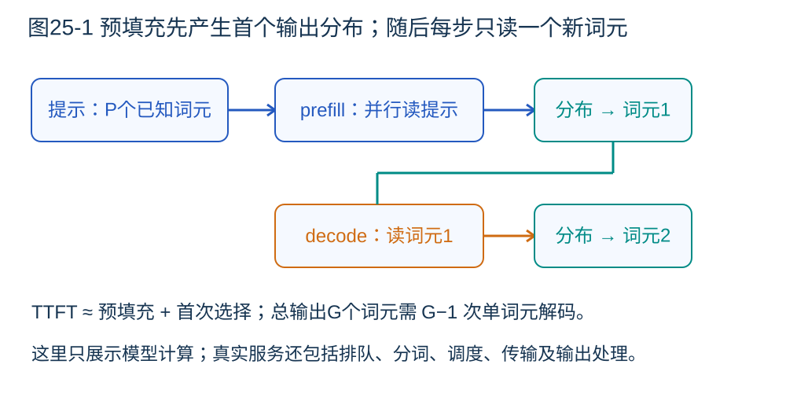
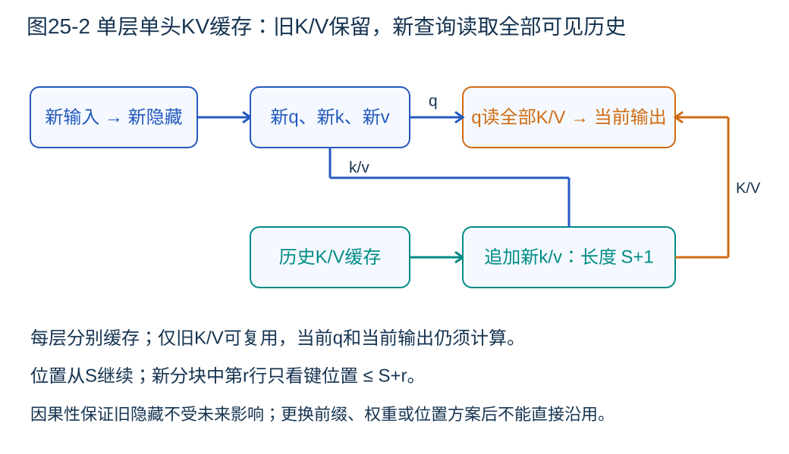
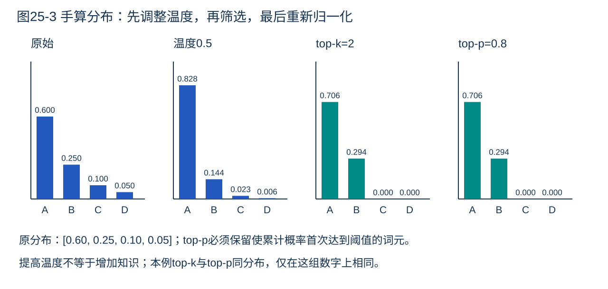
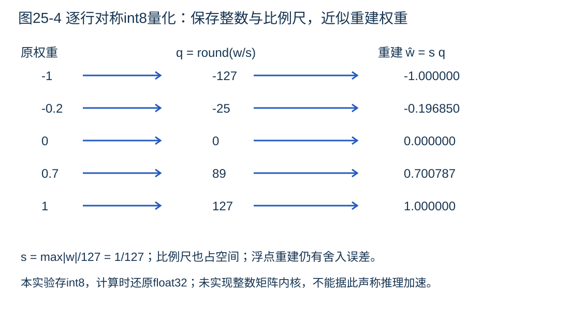
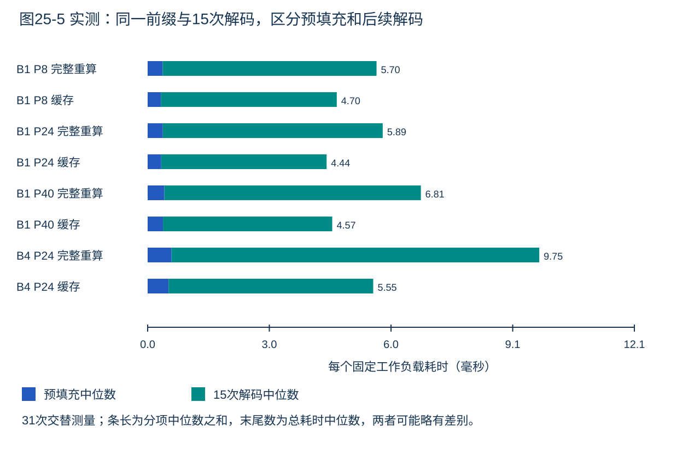

# 第 25 章：LLM 推理、采样与效率

> 状态：完整正文、五幅SVG及CPU推理实验已完成独立验收；正式状态以章节计划为准。

[阅读入口](../../README.md) · [章节计划](../chapter-plan.md) · [公共符号](../appendices/notation.md)

## 1. 本章目标与前置知识

第21章已经得到一个能逐字节预测的微型语言模型。本章保持权重固定，回答三个新问题：怎样选择下一个词元，怎样复用已经算过的历史，以及“更省空间”和“更快”应该怎样验证。

读完应能：

- 区分预填充、首个输出与后续解码；准确数出模型调用次数。
- 解释KV缓存为何成立，手算一次带历史的注意力，正确处理位置与因果mask。
- 从logits手算温度、top-k与top-p后的分布，区分随机采样与贪心。
- 解释量化比例尺与舍入误差，报告模型存储、缓存存储、延迟和吞吐的不同含义。
- 用相同输入和计算预算比较实现，保留误差、波动和不加速的结果。

前置：[第16章](16-transformer.md)的因果自注意力，以及[第21章](21-tiny-language-model.md)的字节模型、上下文限制和检查点。对数、softmax及数值稳定性见[第04章](04-numerical-optimization.md)。本章不训练新模型，也不把短文本续写当成助手能力评测。

## 2. 推理到底在重复什么

推理（inference）是在固定参数下计算预测。自回归生成每选出一个新词元，就把它加入条件，继续预测下一个。所有提示词元都已知，能一起处理；尚未选出的回答词元有先后依赖，通常逐步产生。[1]



**图25-1**：本章原创时间线，概念依据Stanford CS336 Spring 2025第10讲。预填充（prefill）读入整个提示，建立历史表示，并给出第一个输出分布。解码（decode）阶段再读入刚选中的词元，给出下一个分布。[1]

提示有 $P$ 个词元，要输出 $G$ 个词元：一次预填充就能选出第1个，随后只需要 $G-1$ 次解码。最后选出的第 $G$ 个词元如果不再需要后续分布，就不必再送进模型。把“生成16个词元”机械实现为“预填充后再做16次解码”，会多计算一次。

无缓存的朴素实现每步重新读完整前缀。假设 $P=3,G=4$，模型处理的前缀长度依次为3、4、5、6，共18个位置；有缓存时只处理3、1、1、1，共6个新位置。缓存仍需读取旧历史参与注意力，并没有免除所有历史开销。

## 3. 符号、形状与计时口径

| 记号 | 含义 |
| --- | --- |
| $B,P,G$ | 批次、提示词元数、需要的输出词元数 |
| $L,H,d_h,d$ | 层数、头数、每头维度、隐藏维度，$d=Hd_h$ |
| $S,C$ | 当前已缓存的位置数、本次输入的新分块长度 |
| $V,\mathbf{z}$ | 词表大小，以及最后位置的logits列向量 $\mathbf{z}\in\mathbb{R}^{V}$ |
| $\tau,k,p_0$ | 正温度、top-k个数、top-p累计概率阈值 |
| $\mathbf{K},\mathbf{V}_{\mathrm{cache}}$ | 单头历史键和值，形状 $S\times d_h$；后者不是词表大小 |
| $b$ | 一个缓存元素占用的字节数 |

概率均沿词表维归一化，对数为自然对数。公式以单样本列向量描述查询，代码使用行批次：输入 `[B,C]`，每层缓存K和V分别 `[B,H,S,d_h]`，输出logits `[B,C,V]`。本章缓存适配器只支持等长、无padding输入；第21章普通前向支持的右padding不自动成为这个适配器的能力。

延迟（latency）是一项工作完成所需时间；吞吐（throughput）是单位时间完成的工作量。首词元延迟（time to first token，TTFT）包含首次输出前的等待；词元间延迟（inter-token latency，ITL）描述后续相邻输出间隔。真实服务还可能包含排队、分词、调度和传输，本章只测CPU模型调用，不把它称为完整服务TTFT。[1]

## 4. KV缓存：因果性使历史可以复用

### 4.1 为什么保留K和V

因果模型中，位置 $s$ 的隐藏表示只能依赖不晚于 $s$ 的词元。新增更晚词元不会改变旧位置表示。逐层归纳：旧输入嵌入不变；旧查询能看到的键值集合不变；按位置计算的归一化和前馈层也不变，所以该层旧输出不变。最终每层旧K/V均能复用。[1,2]

上述推理要求权重和前缀固定、位置方案一致、推理中关闭dropout，并保留相同的可见范围。双向注意力的旧位置可能读取新增后缀；这种情况不能直接套用此证明。旧查询不需要缓存，因为本次只需要新位置的输出。



**图25-2**：原创缓存数据流。缓存是每层的中间状态，不是“模型记住了任意对话”的长期记忆。切换请求、更改前缀或模型权重时，不能沿用不匹配的缓存。[2]

### 4.2 一个新查询怎样读历史

单头新查询 $\mathbf{q}\in\mathbb{R}^{d_h}$，追加后键和值分别有 $S+1$ 行。当前输出为

$$
\boldsymbol{\alpha}
=\operatorname{softmax}\!\left(\frac{\mathbf{K}\mathbf{q}}{\sqrt{d_h}}\right),
\qquad
\mathbf{o}=\mathbf{V}_{\mathrm{cache}}^{\top}\boldsymbol{\alpha}.
$$

softmax沿全部可见键归一化。取 $d_h=2$，查询 $\mathbf{q}=(1,0)^{\top}$，三行键依次为 $(1,0),(0,1),(1,1)$，三行值依次为 $(1,0),(0,2),(3,1)$。

第一步，分数为 $(1,0,1)/\sqrt{2}$。第二步，指数约为 $(2.0281,1,2.0281)$，除以总和约5.0562，得到

$$
\boldsymbol{\alpha}\approx(0.401112,0.197776,0.401112)^{\top}.
$$

第三步，加权相加：第一坐标为 $0.401112+3\times0.401112\approx1.604448$，第二坐标为 $2\times0.197776+0.401112\approx0.796664$。旧的两行键值没有重算，但新查询仍读取了它们。

### 4.3 新分块不能丢失绝对位置

若已有 $S$ 个位置，本次新块长度为 $C$，新块局部编号 $r=0,\ldots,C-1$ 对应绝对位置 $S+r$。键编号 $j=0,\ldots,S+C-1$ 的允许条件是

$$
M_{rj}=\mathbb{1}\{j\le S+r\}.
$$

例如 $S=3,C=2$，可见矩阵为

$$
\mathbf{M}=
\begin{bmatrix}
1&1&1&1&0\\
1&1&1&1&1
\end{bmatrix}.
$$

新块第一行不能看第二行。仅设置不带历史偏移的局部三角mask，会把旧历史也错误遮掉；给带past K/V的SDPA直接传 `is_causal=True` 也不能替代本章显式偏移规则。代码写为：

```python
positions = torch.arange(past, past + chunk)
allow = torch.arange(past + chunk)[None, :] <= positions[:, None]
y = F.scaled_dot_product_attention(
    q, k, v, attn_mask=allow[None, None], dropout_p=0.0
)
```

学习位置嵌入也必须读取 $S,\ldots,S+C-1$，不能每块重置成0。本机故意比较重置与接续的位置嵌入，最大差约0.25981。第21章只有64个学习位置；适配器遇到超限直接拒绝，没有实现滑动窗口，也不能把丢弃旧缓存后位置重置称为等价推理。

### 4.4 节省什么，付出什么

固定宽度下，完整重算前缀长度为 $P+s$ 时，密集注意力分数矩阵有平方数量元素；缓存解码每个新查询只与历史交互，注意力工作随历史长度线性增长。对 $G-1$ 个后续步骤求和：

$$
\begin{aligned}
\text{重算的注意力量级}&:\ \sum_{s=1}^{G-1}O((P+s)^2d),\\
\text{缓存的解码注意力量级}&:\ \sum_{s=1}^{G-1}O((P+s)d).
\end{aligned}
$$

两者还共同需要一次预填充，且线性层、前馈层、输出词表投影、内存读写和Python开销另有成本。不能把这两式当作整个模型的精确运行时间。当前实现用 `torch.cat` 追加，还会分配和复制缓存，生产实现可采用预分配等不同方案。[1,2]

标准多头注意力的KV张量存储为

$$
\text{KV字节数}=2LBHSd_hb=2LBSdb.
$$

前面的2来自K和V。取本章 $L=2,B=1,S=39,d=32,b=4$，得到19968字节。它没有包括参数、张量对象、临时注意力、内存分配器和解释器；总进程内存不能用它代替。

## 5. 从分数到下一个词元

### 5.1 贪心与温度

贪心（greedy）选择最大logit的词元，遇到并列时需有固定规则。本实现沿词表顺序选首个最大值。它是局部最优选择，不保证整段序列的概率最大，更不保证事实正确。

温度采样先构造

$$
q_i(\tau)=\frac{\exp(z_i/\tau)}{\sum_{j=1}^{V}\exp(z_j/\tau)},\qquad\tau>0,
$$

再按这个分布随机抽样。实现用稳定softmax，等价于先减最大缩放logit。对有限且有唯一最大值的logits，温度趋近0时分布集中到最大项；温度增大则相对更平坦。直接除以0没有定义，因此接口拒绝零温度，贪心使用独立分支。[3,4]



**图25-3**：原创手算。纵向概率范围为0到1，横向候选为A、B、C、D；并非模型真实词表的性能图。

给定原概率 $(0.6,0.25,0.1,0.05)$，可取logits为各概率的对数。温度0.5使指数变为概率平方，平方和为

$$
0.6^2+0.25^2+0.1^2+0.05^2=0.435.
$$

归一化得到约 $(0.827586,0.143678,0.022989,0.005747)$。最大候选更集中，但模型没有因此获得新知识。

### 5.2 top-k：固定候选个数

先按概率降序排序，只保留前 $k$ 个，再在它们之间重新归一化；本实现并列时按原词表编号稳定排序。对上例 $k=2$，保留A与B，其总概率0.85，得到 $(0.6/0.85,0.25/0.85,0,0)$，约为 $(0.705882,0.294118,0,0)$。

固定 $k$ 的限制是：一个位置可能很确定，另一个位置却有许多合理候选，仍强制使用相同个数。被删词元不可能在本步被采样，不能把筛选后分布当成原始模型分布。[3]

### 5.3 top-p：固定覆盖的概率质量

核采样（nucleus sampling，又称top-p）在降序概率中，保留累计概率**首次达到或超过**阈值 $p_0$ 的最短前缀，然后重归一化。[3,4]

$$
m=\min\left\{r:\sum_{j=1}^{r}q_{(j)}\ge p_0\right\},
\qquad
\widetilde q_{(i)}=
\begin{cases}
q_{(i)}/\sum_{j=1}^{m}q_{(j)},&i\le m,\\
0,&i>m.
\end{cases}
$$

括号下标表示排序后名次。上例 $p_0=0.8$：第一项0.6未达到阈值，加入第二项累计0.85，因此保留A、B。不能因为B使累计“超过0.8”就把B删掉。若原分布为 $(0.5,0.25,0.125,0.125)$ 且阈值0.5，第一项恰好达到时只保留它。

本实现顺序固定为“温度 → top-k → top-p → 重新归一化”；top-p判断使用top-k保留后已归一化的分布。同时设置多个筛选会改变结果，因此报告采样时必须写明顺序、参数、种子和终止规则。本章固定产生16字节、无提前终止；不是把换行或字节0默认为全局EOS。

## 6. 量化：小存储不自动产生快计算

### 6.1 比例尺、整数与重建

量化（quantization）用有限离散值近似浮点数。对线性层权重的第 $r$ 行采用对称int8量化：

$$
s_r=\frac{\max_j|w_{rj}|}{127},\qquad
q_{rj}=\operatorname{clip}\!\left(\operatorname{round}(w_{rj}/s_r),-127,127\right),
\qquad
\widehat w_{rj}=s_rq_{rj}.
$$

这是每输出行一个比例尺，零点为0；全零行单独令比例尺1，仍重建为零。忽略端点数值误差且无裁剪时，四舍五入给出的重建误差不超过 $s_r/2$。异常大权重增大比例尺，使同行小权重的分辨率降低。实际大模型量化还需处理激活异常值与不同计算内核；本章不是LLM.int8()论文算法的实现。[1,5]



**图25-4**：原创手算，$\mathbf{w}=(-1,-0.2,0,0.7,1)$。比例尺 $1/127$，整数为 $(-127,-25,0,89,127)$，重建约 $(-1,-0.196850,0,0.700787,1)$。第二项误差约0.003150，低于 $1/254\approx0.003937$。

对矩阵 $\mathbf{W}\in\mathbb{R}^{m\times n}$，float32仅权重占 $4mn$ 字节；int8权重加float32行比例尺占 $mn+4m$ 字节。偏置、未量化的嵌入/归一化、KV缓存都另算。模型总量不能直接除以4。

### 6.2 误差如何进入输出

列向量线性层输出为 $\mathbf{y}=\mathbf{W}\mathbf{x}+\mathbf{b}$，量化后变化为

$$
\Delta\mathbf{y}=(\widehat{\mathbf{W}}-\mathbf{W})\mathbf{x}.
$$

同一权重误差对不同输入可能产生不同影响，多层网络还会继续传播。少数探针上argmax不变不等于概率完全相同，也不证明所有任务保持准确。本章分别报告权重、logits和一条固定文本的交叉熵变化，不将它包装成全面质量评估。

真实执行的 `RowInt8Linear` 保存int8权重和比例尺，但每次前向都重建float32权重，再调用浮点矩阵乘法。这验证了存储与近似误差，却增加转换工作；没有整数算子、硬件适配和融合，不应承诺加速。[5]

## 7. 从公式到完整实现

完整入口：[run.py](../../examples/25-language-model-inference/run.py)；缓存、采样及量化代码：[inference.py](../../examples/25-language-model-inference/inference.py)；SVG生成器：[figures.py](../../examples/25-language-model-inference/figures.py)。[实验说明](../../examples/25-language-model-inference/README.md)列出全部命令和限制。

适配器逐层调用原21章权重，先对新位置做嵌入和归一化，再计算新Q/K/V，把新K/V沿缓存时间轴拼接，最后只输出新位置的logits。没有复制修改21章模型文件。

```python
k = torch.cat([old_k, new_k], dim=2)  # [B,H,S+C,d_h]
v = torch.cat([old_v, new_v], dim=2)
# query只有C行，键值共有S+C行；用绝对offset构造可见矩阵
```

缓存适配器检查上下文、层数、批次/头/长度/维度、精度和设备是否一致。它不支持padding、变长批次、跨请求共享、窗口淘汰或训练反传，遇到不满足接口条件的输入应先修正数据和协议。

## 8. 本机实验：先验等价，再比较时间

### 8.1 固定来源与命令

2026-11-15在Windows、Python3.11.5、NumPy2.4.6、PyTorch2.15.0+cpu实跑，float32、CPU单线程、确定性算法。只读第21章35328参数基座，不进行新增训练；学习率、优化器及训练步数不适用。

```powershell
& ./.venv/Scripts/python.exe -B examples/21-tiny-language-model/run.py
& ./.venv/Scripts/python.exe -B examples/25-language-model-inference/run.py
```

若21章检查点已存在且指纹一致，不需要重新训练。来源为 `build/experiments/21-tiny-language-model/base-model.pt`，文件SHA256：

```text
326e1a5e405fc3280aae20e57f3eadd7ef0d7f54df3cb35af6a87bc679068e5a
```

计时输入是种子2503生成的固定字节序列，范围0～255；同一形状的缓存/重算路线读取相同序列。它们用于机制与计算成本，随机字节不是自然语言测试集。采样探针是本教程原创短句 `The red box is `；量化探针是另一条固定原创短句，不借用测试集选配置。

输出保存到 `build/experiments/25-language-model-inference/results.json`，含原始每次计时、采样字节、源检查点元数据和检查结果。模型权重前后逐张量相等；量化模型使用深拷贝，状态字典恢复后输出逐位相等。

### 8.2 缓存与采样检查

- 两个样本共47位置，按7、1、5、3、31长度分块；所有位置logits对完整前向最大误差约 $3.81\times10^{-6}$。
- 逐词元增量与每步完整前向比较，最大误差约 $5.48\times10^{-6}$；同一提示的16字节贪心结果一致。
- 分块包含长度大于1的新增块，覆盖历史offset和块内因果边界；超64位置拒绝。
- 手算温度、top-k、top-p及阈值恰好相等的边界通过；温度0、负温度、无效k/p均拒绝。
- 固定种子2504从温度0.5分布采样20000次，频率为 $(0.8283,0.1415,0.0239,0.0063)$，最大偏差约0.00218；这检验采样机制，不是模型能力。

微型模型的贪心续写为 `tresquare rese r`。固定种子2501时，温度0.7、top-k=5、top-p=0.9三种配置恰好都输出 `table. A small n`。不同分布可以抽中同一条序列；一条样例不能证明三种策略相同，也不能用较顺畅的样例证明模型理解真实世界。原始字节完整保留，UTF-8解码仅用显式替代字符显示不完整编码。

### 8.3 速度：相同工作负载下报告分项

每项先暖身5次，再测31次；缓存/重算顺序交替，减少固定先后带来的影响。固定16个输出分布，意味着一次预填充加15次后续解码；无采样、无提前终止，不计加载、分词、argmax、网络和排队。第一个输出分布使用提示末位置；后续固定输入对应同一续写。



**图25-5**：真实本机中位数；堆叠条为两个分项中位数之和，标签为总耗时中位数，两者可能略有差异。B为批次，P为提示字节数，均未超过64位置。

| B / P | 重算总中位ms | 缓存总中位ms | 缓存总耗时10%～90%分位ms |
| --- | --- | --- | --- |
| 1 / 8 | 5.703 | 4.696 | 4.397～5.235 |
| 1 / 24 | 5.889 | 4.442 | 4.164～4.971 |
| 1 / 40 | 6.806 | 4.574 | 4.455～5.648 |
| 4 / 24 | 9.749 | 5.553 | 4.992～6.102 |

B1/P24时，15次解码中位数由5.465ms降为4.111ms。以 $B(G-1)$ 除以后续解码耗时，聚合解码吞吐由约2745升至3649字节/秒；B4/P24缓存约11797字节/秒，但整个批次完成时间更长。吞吐增长与单请求等待不是同一个指标。

B1/P24完整重算每序列累计投影位置504，有缓存39。位置工作量约减少12.9倍，实际总耗时只约减少1.33倍：模型很小，Python调用、张量操作、缓存复制、注意力读历史等仍有成本。不得把位置计数比当作实际加速倍数。并行其他任务、CPU频率和内存压力都会改变计时，分位数也不是跨机器置信区间。

### 8.4 量化：压缩成功，当前内核没有加速

所有13个线性层量化，嵌入和归一化保留float32。参数/缓冲张量总字节由141312降到70400，约为原来的49.8%；不包含Python对象和计算时反量化临时内存，进程峰值未测。

最大权重绝对误差约0.002811，固定48字节文本上的最大logit误差约0.16646；这条探针所有位置argmax相同，但逐目标平均字节交叉熵由3.760314变为3.763218，概率已发生变化。

首次量化探针总中位为7.731ms，但它的输入与前述缓存基准不同。为使量化比较具有相同工作负载，另于2026-11-15T23:58:20+08:00补做同输入测量：固定seed2506、B1/P24、16个输出分布，无缓存；两种实现各暖身5次，再交替顺序31次。浮点模型总中位5.736ms（10%～90%分位5.373～6.307ms），int8存储/float32重建为7.160ms（6.601～7.642ms）。两种实现处理完全相同的39字节序列，原始逐次计时、字节和基座指纹保存在build/experiments/25-language-model-inference/matched-quantization.json，源权重前后相等。这个小CPU实现压缩了存储，却因每次反量化而更慢；不把结论推广到真正整数内核或其他硬件。

全部检查与计时约2.188秒，含库导入约5.093秒，不含后续SVG与出版。没有测量峰值RSS，张量字节数不能代替总内存。所有速度为微型CPU实验，不外推到GPU服务或大语言模型。

## 9. 常见误区与边界

- **缓存保存的是旧输出概率**：实际保存每层的键和值，新查询仍需读取它们。
- **有缓存就不用关注位置和mask**：错误偏移会改变数学计算；只对一个token检查不够。
- **KV缓存能绕过学习位置上限**：本基座超64位置直接拒绝。
- **采样温度0就是正常除法**：温度公式只定义于正数，贪心应有明确分支。
- **top-p丢掉使累计超过阈值的一项**：应保留首个达到或超过阈值的项。
- **不同参数必须生成不同样例**：概率不同也可能采到相同序列。
- **int8模型必然缩为四分之一且快四倍**：比例尺、未量化部分、缓存和计算内核都影响结果。
- **每秒词元越多就越好**：还要比较延迟、相同词元化、质量、批次和完整工作范围。

## 10. 习题与解析

### 10.1 习题

1. 提示5个词元，输出3个词元；两条路线分别处理多少新/重复位置？为什么最后输出不必再喂入？
2. 已缓存4个位置，新块长度3，写出 $3\times7$ 可见矩阵。
3. 单头手算中，如果第三行值由 $(3,1)$ 改成 $(0,0)$，输出变成什么？键不变时权重是否改变？
4. 对 $(0.6,0.25,0.1,0.05)$，top-p阈值0.9保留几项？归一化后的第三项是多少？
5. 权重矩阵为 $8\times16$，float32、int8加每行float32比例尺各多少字节？为何不是严格4倍？
6. $L=2,B=4,S=39,d=32$、float32缓存多少字节？这是否等于进程内存？
7. 一个量化模型argmax全相同，能否说完全无损？一个缓存方案减少13倍位置计算，能否说加速13倍？

### 10.2 参考解析

1. 无缓存长度5、6、7，共18位置；缓存5、1、1，共7新位置。第三个输出来自最后一次分布，如果不求第四个分布，就不必输入它。
2. 三行依次是 `1111100`、`1111110`、`1111111`。新位置绝对编号4、5、6，每行可见到自己。
3. 权重不变，因为只依赖查询与键；输出变为 $(0.401112,0.395552)$，与原输出相差第三行贡献 $(1.203336,0.401112)$。
4. 前两项0.85不足，前三项0.95达到阈值，保留三项；第三项为 $0.1/0.95\approx0.105263$。
5. float32为512字节；int8权重128加比例尺32，共160字节，比例3.2倍。尚未计算偏置和其他模块。
6. $2\times2\times4\times39\times32\times4=79872$ 字节；只是KV有效张量，不是总内存。
7. 两者都不能。logits与概率可能变化，其他任务可能翻转；速度还受未减少的计算、读写及调度影响，必须实测相同工作负载。

## 11. 小结与来源

生成策略决定从模型分布怎样选词，KV缓存复用因果模型不变的历史，量化近似表示数值；三者改变的对象不同。先验明等价或测量误差，再在相同口径下比较质量、延迟、吞吐和存储，才有可解释的效率结论。

下一章把外部检索内容放入提示。检索会改变输入长度与信息来源，但不会自动免除上下文限制和上述推理成本。

来源于2026-11-15核验；五幅SVG与实验原创。HTML/PDF、双视口、字体矢量与全页目视通过。

1. Stanford CS336，Spring 2025，第10讲 *Inference*，`arithmetic_intensity_of_inference`、`compute_transformer_stats`、`throughput_and_latency`、`quantization`：[官方讲义源码](https://github.com/stanford-cs336/spring2025-lectures/blob/main/lecture_10.py)，[课程存档](https://cs336.stanford.edu/spring2025/)。
2. Hugging Face Transformers 4.50.0，*Caching*，KV追加、mask与位置：[固定版本官方说明](https://huggingface.co/docs/transformers/v4.50.0/en/cache_explanation)。本章不依赖Transformers运行。
3. Holtzman等，*The Curious Case of Neural Text Degeneration*，ICLR2020，§3.1～3.3：[原始论文v2](https://arxiv.org/abs/1904.09751v2)。
4. Hugging Face Transformers 4.50.0，GenerationConfig温度与top-k/top-p参数：[官方接口](https://huggingface.co/docs/transformers/v4.50.0/en/main_classes/text_generation)。
5. Dettmers等，*LLM.int8(): 8-bit Matrix Multiplication for Transformers at Scale*，NeurIPS2022，§3：[原始论文v2](https://arxiv.org/abs/2208.07339v2)。此算法包含本章未实现的向量量化和异常值混合精度处理。


## 12. 整合验证记录

原CPU检查与缓存基准保持原始记录；额外同输入量化对照已实际执行，见第8.4节。补充入口为`--matched-quantization-only`。2026-11-17单章HTML/PDF整合复验：13页PDF、83处公式、5幅纯SVG、零位图；双视口、字体/结构审计及逐页目视通过。
