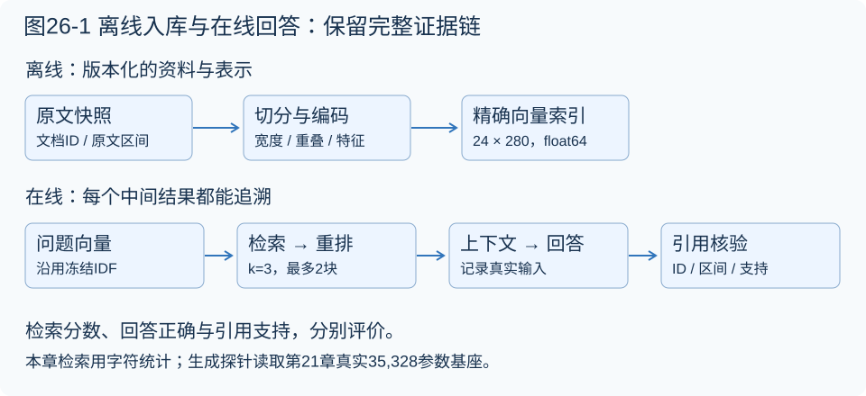
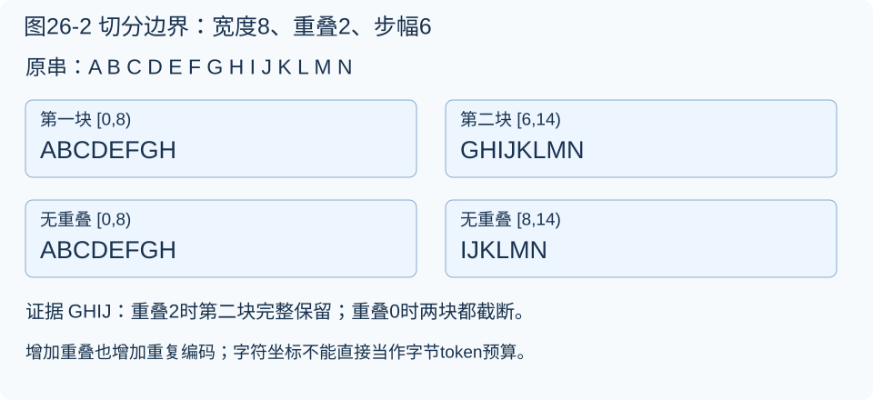
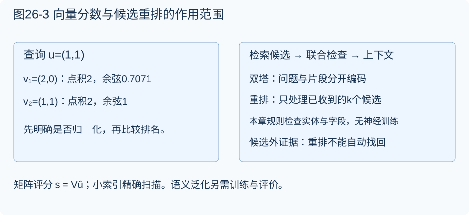
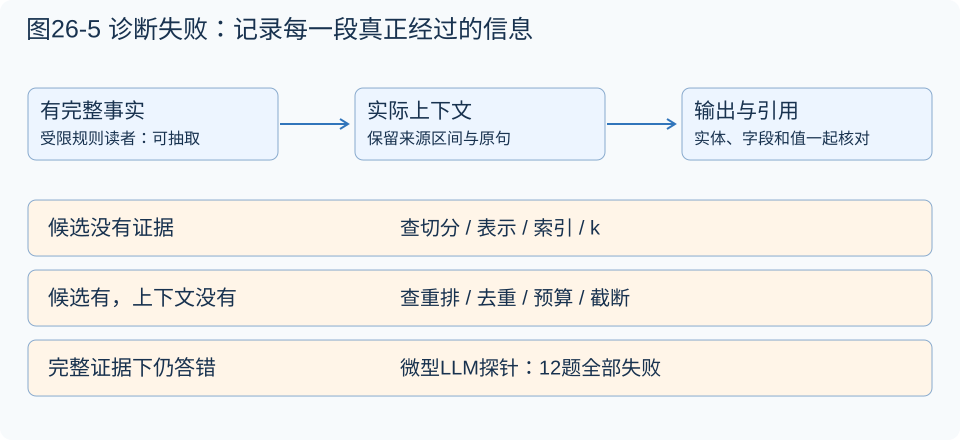

# 第26章：检索增强生成

> 把“找得到”“装得下”“读得对”“引得准”分开检查。本章用原创文档、可审计的NumPy检索和第21章真实基座建立CPU实验；受限抽取器的成功与微型语言模型的失败分别报告。

[阅读入口](../../README.md) · [章节计划](../chapter-plan.md) · [公共符号](../appendices/notation.md) · [完整实践](../../examples/26-retrieval-augmented-generation/README.md)

## 1. 为什么还要查文档

第21章的参数记住了小语料的一些模式，第25章研究怎样解码这些参数给出的分布。现在换一个问题：“Sol几点开放？”如果开放时间只存在于后来加入的设施手册中，生成更长、调低温度或多运行几次，都没有把那条新事实交给模型。

**检索增强生成**（retrieval-augmented generation，RAG）先按问题检索外部资料，再把选出的资料作为生成条件。知识库可以独立更新，检索结果也可以记录下来；这增加了可检查的证据渠道，最终回答仍要核验。Stanford CS224V 2024第1讲第23页把检索与回答可核验性并列讨论，并展示了有检索仍会出错的问题。[1]

本章要学会：

1. 切分文档，保留原文位置和来源版本。
2. 把查询与片段映射为向量，解释相似度、精确索引、召回与近似搜索。
3. 区分第一阶段检索和重排序，计算小型向量例子。
4. 按上下文预算拼接证据，检查引用是否真的支持问题与回答。
5. 分别评价检索、上下文、抽取/生成和拒答，定位失败环节。

前置是第14章的文本表示、第20章的数据隔离、第25章的上下文与解码。这里不下载大型嵌入模型，也不调用在线服务；数学解释神经检索的基本形式，实际检索使用明确的字符统计基线。后者可由NumPy逐项检查，不能称作已经训练好的语义双塔。

## 2. 两条流水线与三类状态



*图26-1为原创数据流。文档、切分器、向量规则共同决定索引；在线路径另外记录候选、上下文、回答及引用。实验生成器为第21章基座，不从测试答案建立索引。*

**离线入库**先读固定资料快照，按规则切成片段，再生成片段表示并建立索引。**在线查询**先编码问题，找候选，再重排和选上下文，最后回答。不同步骤的状态应一起保存：

- 内容状态：文档ID、正文、版本或快照、原文位置。
- 表示状态：正规化、词表/特征顺序、IDF或编码器参数。
- 回答状态：查询、候选分数、真正送入生成器的文字、解码参数、输出与引用。

原始RAG论文把检索器和生成器组合为概率模型，实验使用DPR与BART。本章讨论的“检索后拼接上下文”是较简单的工程路径，不声称复现其端到端训练或隐文档边缘化。[2，§2]

| 符号 | 含义与形状 |
| --- | --- |
| $q,y$ | 查询与回答序列 |
| $\mathcal D,\mathcal C$ | 文档集合、切分后的片段集合 |
| $M,d$ | 片段数、向量宽度 |
| $c_j$ | 第$j$个片段，带来源ID与原文区间 |
| $E_Q,E_D$ | 查询编码函数、片段编码函数 |
| $\mathbf u,\mathbf v_j$ | 查询与片段列向量，均在$\mathbb R^d$中 |
| $\mathbf V$ | 片段按行存放的矩阵，形状$M\times d$ |
| $k,m$ | 第一阶段候选数、最后上下文片段数，$m\le k$ |
| $\theta,\eta$ | 生成器、检索器的参数或表示规则 |
| $B$ | 总输入上下文预算，需指定计量单位 |

## 3. 切分：边界也是信息

### 3.1 片段的内容和坐标

文档很长时，整篇放入模型可能超出预算，也可能让目标事实被无关内容稀释。切分把文档变成可单独检索的片段。固定长度切分只是最容易分析的一种方法，段落、标题和语义边界也可以形成不同协议。

设原文字符串长$L$，窗口宽度$w$，重叠$o$，要求$0\le o<w$。步幅为$s=w-o$，第$j$个起点为$js$，片段为：

$$
c_j=\operatorname{text}[js:\min(js+w,L)].
$$

下标从0开始，右端点不包含在内；已经到达文末就停止。只保存片段文字会丢失定位能力，实践同时保存：

```json
{"doc_id":"sol-hours","start":0,"end":72,"text":"..."}
```

这里的坐标是Python字符串码点下标，既不是UTF-8字节下标，也不是模型token下标。换一种文本正规化或字符编码，旧坐标可能不再指向原来的文字。我们对每个片段实际检查 `text == original[start:end]`。

### 3.2 一个跨边界的小例子

长度14的字符串 `ABCDEFGHIJKLMN`，$w=8,o=2,s=6$，得到 `ABCDEFGH`、`GHIJKLMN`。位于原文$[6,10)$的证据 `GHIJ` 被第一块截断，却完整落在第二块中。若$o=0$，两块为 `ABCDEFGH`、`IJKLMN`，没有单块保留完整证据。



*图26-2为原创手算。重叠产生重复内容，不表示所有查询都必然改善；完整性还取决于证据长度、边界与候选排名。*

减小窗口通常使定位更细，但可能分离实体、条件与答案；增大窗口增加背景，也占用更多输入预算。重叠可以缓解部分边界问题，但增加编码、存储和去重负担。实践用验证集选择切分协议，测试集仅作冻结后的评价。

## 4. 从向量到排名

### 4.1 神经双塔为何可以预计算

双塔检索分别计算：

$$
\mathbf u=E_Q(q)\in\mathbb R^d,\qquad
\mathbf v_j=E_D(c_j)\in\mathbb R^d,\qquad
s_j=\mathbf u^\top\mathbf v_j.
$$

片段向量不依赖当前查询，因此可以预先计算。DPR原论文采用独立的查询、片段BERT编码器，使用点积检索；“两塔”不要求它们必须共享参数。[3，§3.1]

向量接近是否代表相关，依赖训练数据与目标。把随机网络输出叫作embedding，并不能自动获得同义词理解。若用相关片段$c^+$和负片段集合$\mathcal N$训练，可以构造：

$$
\mathcal L_{\mathrm{ret}}
=-\ln
\frac{\exp(\mathbf u^\top\mathbf v^+)}
{\exp(\mathbf u^\top\mathbf v^+)+
 \sum_{c^-\in\mathcal N}\exp(\mathbf u^\top\mathbf v^-)}.
$$

这就是在当前候选集合上识别正例的交叉熵：增加正例分数、降低竞争负例分数。分母中的“负例”如果其实也支持问题，会引入错误监督；训练目标较低也不保证新领域召回。这里给出目标以衔接已学的嵌入与交叉熵，**本章不实际训练DPR**。

### 4.2 余弦、范数和手算

余弦相似度为：

$$
\operatorname{cos}(\mathbf u,\mathbf v)
=\frac{\mathbf u^\top\mathbf v}
{\|\mathbf u\|_2\|\mathbf v\|_2},
\quad \|\mathbf u\|_2,\|\mathbf v\|_2>0.
$$

把非零向量各自除以范数后，点积就是余弦。若$\mathbf u=(1,1)^\top$，两个片段为$\mathbf v_1=(2,0)^\top$、$\mathbf v_2=(1,1)^\top$，原始点积都为2；余弦却依次为$1/\sqrt2$、1。这说明归一化改变了评分规则，不能把任意点积索引默认为余弦索引。

单位向量还满足：

$$
\|\widehat{\mathbf u}-\widehat{\mathbf v}\|_2^2
=2-2\widehat{\mathbf u}^{\top}\widehat{\mathbf v}.
$$

所以在相同的单位向量上，最大余弦与最小欧氏距离给相同排名。推导只需展开平方，利用两个范数均为1；没有归一化时一般不成立。零向量没有定义良好的余弦，实践将其编码为全零并按固定顺序处理分数并列，不把这种结果当有效语义匹配。

### 4.3 实际基线：可检查的字符TF-IDF

本章对小写文本压缩连续空白，再取相邻3字符特征。例如`Sol fee`包含`sol`、`ol `、`l f`等片段。它们是检索特征，和第21章生成模型的UTF-8字节词表不同。

令$f_{jt}$为特征$t$在片段$j$中的次数，$\mathrm{df}_t$为出现过它的片段数。采用明确的平滑与对数频次约定：

$$
\mathrm{idf}_t=1+\ln\frac{M+1}{\mathrm{df}_t+1},
\qquad
a_{jt}=
\begin{cases}
(1+\ln f_{jt})\mathrm{idf}_t,&f_{jt}>0,\\
0,&f_{jt}=0.
\end{cases}
$$

每行再按L2范数归一化。查询使用同一特征顺序和已冻结的IDF，未在索引词表出现的特征忽略。这个公式与scikit-learn官方文档解释的平滑IDF、sublinear TF及L2归一化约定对应；程序直接用NumPy实现，没有安装或调用该库。[4，§8.2.3.4]

若$M=3,\mathrm{df}_t=1$，则$\mathrm{idf}_t=1+\ln2\approx1.693147$；出现两次时，未归一化权重为$(1+\ln2)^2\approx2.866747$。归一化还要除以当前整行范数，不是将每个数单独变成1。

### 4.4 索引和召回分别指什么

本实验把所有归一化行放在$\mathbf V$中，查询分数一次算出：

$$
\mathbf s=\mathbf V\widehat{\mathbf u}\in\mathbb R^M.
$$

再按分数降序取前$k$项。计算点积的时间量级为$O(Md)$，矩阵数值负载量级为$O(Md)$；完整排序还需约$O(M\log M)$。这里只建24行的小索引，精确扫描便于核对，也不会把这种规模的运行速度推广到数百万片段。

近似最近邻索引用更少比较换取可能漏掉精确前$k$项的风险。此时要分清两个指标：

- **近似索引召回**：返回集合与同一评分下精确前$k$项的重合程度。
- **任务证据召回**：返回内容是否含有回答问题所需的证据。

精确找到评分最高的片段，也可能找错主题。DPR讨论大规模向量索引和精确/近似检索的工程衔接；本章未安装FAISS，不声称测量近似索引效果。[3，§3.1]

## 5. 重排序：候选找回来以后

第一阶段通常优先覆盖范围与速度；第二阶段可以对少量候选使用更贵的查询—片段联合函数$g(q,c)$，重新选出上下文。联合编码器可以让两段内容互相注意，但片段得分依赖查询，无法像双塔那样把最终得分全部离线预计算。



*图26-3左侧用本章余弦手算，右侧是候选重排示意。正式实践的重排是公开的规则函数，未训练神经交叉编码器。*

假设真实支持片段排第4，而第一阶段只取$k=3$。即使重排器对候选判断完全正确，也无法把没有收到的第4项变回来。若已取回3项而上下文只能放$m=1$项，重排才有机会改变最终保留哪一项。

受限实践的规则重排检查完整句子中是否出现查询实体及字段：实体匹配记2分，字段匹配记1分；再按第一阶段分数破同分。它认识预声明的opening、fee/price和capacity字段，属于任务专用知识，不是训练得到的泛化能力。抽取器仍须同时匹配实体与字段，并保存被使用的原文句子。测试中无重排也同样成功，不能宣称规则重排带来实测提升。

## 6. 上下文与生成概率

### 6.1 拼接要记录实际输入

检索器交出的候选不等于生成器真正看到的内容。提示模板、问题、来源标记和片段共同占用输入预算：

$$
B_{\mathrm{template}}+B_q+\sum_{j=1}^{m}B_{c_j}
\le B_{\mathrm{input}}.
$$

如果预留输出空间还要从模型的总窗口中扣除，应另说明具体实现。字符宽度72只是切分参数；模型上下文64是字节token位置，不能直接相减。

我们保存每段实际输入。语言模型探针使用`d:证据句\nq:问题\na:`，只放受限读者从真实检索上下文找到的完整句子。所有初始提示都检查不超过64字节，避免因初始截断丢掉答案；生成后沿用第21章最近64字节重算规则。该证据句选择额外利用了任务规则，所以这是容易的有证据诊断，也未使基座回答成功。

### 6.2 条件生成与原始RAG模型

固定选出的上下文$C(q)$后，普通自回归生成写成：

$$
p_\theta(y\mid q,C(q))
=\prod_{t=1}^{T}p_\theta(y_t\mid y_{<t},q,C(q)).
$$

这里检索结果进入条件，模型参数没有因为一次检索自动更新。当前生成器是否学会利用这些条件，需要实际训练或评估来回答。

原始RAG-Sequence把文档$c$作为隐变量，对候选近似求和：[2，§2.1]

$$
p(y\mid q)\approx
\sum_{c\in\operatorname{TopK}(q)}
p_\eta(c\mid q)\,p_\theta(y\mid q,c).
$$

若两个候选概率为0.7和0.3，指定回答在两种文档条件下的概率为0.2和0.8，混合结果是$0.7\times0.2+0.3\times0.8=0.38$。这既不是只选最高分文档得到的0.2，也不是把两个概率直接相乘。截断求和可能漏掉候选外质量；若再在候选内重新归一化，则又定义了不同的条件混合。

本机程序只做检索、选择和拼接，不进行这项概率边缘化训练。理解区别有助于读论文时把模型定义与常见简化实现对应起来。

## 7. 引用：能定位还要能支持

一句回答后面写“[1]”，只表示它附了一个标记。至少检查四件事：

1. 引用ID是否存在，能否定位到固定版本的原文？
2. 引用句是否真出现在记录的区间，是否被截断或改写？
3. 句子中的实体、时间、条件是否对应当前问题？
4. 回答里的每个事实主张是否得到证据支持？

例如问题是Sol开放时间，回答“08:30”，引用`Sol opens at 08:30.`能支持；同一个数出现在另一个设施的句子里，字面包含也不足以支持当前回答。引用`Sol closes at 17:10.`更不能支持开放时间。复杂回答的组合推理还可能超出任何单句字面匹配。

本实践限定为单实体单字段事实，保存文档ID、片段ID、原文起止位置和完整句。自动核验先确认原文切片相等，再检查回答值、实体字段及预先标注的来源。它适用于这份可控数据，不能代替开放文本的蕴含判断与人工复核。无证据时抽取器返回空答案和理由；随便挂一个来源会让错误变得更难发现。

## 8. 分开评价每一环

### 8.1 三个问题不能共用一个分数

对$q_i$，令$G_i$是足以支持答案的片段集合，$R_k(q_i)$是第一阶段结果。通常可定义逐问题证据召回：

$$
\operatorname{Recall@}k(q_i)=
\frac{|R_k(q_i)\cap G_i|}{|G_i|},
\qquad |G_i|>0.
$$

一份答案可能有多个等价证据，$G_i$需按任务标注。程序主要报告更简单的**证据命中率**：在可回答问题中，至少一个候选包含正确来源、实体、字段和完整答案的比例：

$$
\operatorname{Hit@}k
=\frac1n\sum_{i=1}^{n}
\mathbf1\{R_k(q_i)\text{含完整支持事实}\}.
$$

它不是多证据召回率。接着对实际上下文$C(q_i)$另算命中率。回答EM要求剥除输出两侧空白后与参考答案完全一致；规则抽取输出已经是数值字符串，不把包含答案的长段胡话算对。

最后分别报告无答案问题的拒答率，以及已输出回答的引用正确比例。后者的分母是实际输出数，可能通过大量拒答变高，所以必须连同覆盖率和可回答EM展示。空分母记“不适用”，不能写100%。

### 8.2 用干预定位错误

- 候选没有支持事实：先查切分、表示、索引或$k$。
- 候选中有，实际上下文没有：查重排、去重、预算和截断。
- 送入完整证据仍答错：查读者或生成器，不能继续用检索分数冒充回答质量。
- 答案正确但来源不支持：引用链失败，也可能只是猜中了答案。
- 无资料仍给确定答案：检查拒答与证据使用协议。

这些是诊断路径，不意味着每个问题只有一个独立根因。小模型的生成失败可能同时受预训练范围、任务训练、架构和预算限制，本章不会仅凭一次对照宣称找到了唯一原因。

## 9. 本机实验：规则读者与真实基座分开报告

### 9.1 数据、划分与协议

[data.py](../../examples/26-retrieval-augmented-generation/data.py)原创生成6个虚构设施，每个有时间、政策两篇文档，共12篇。设施名Sol、Luna等只是教学标识；开放时间、费用和容量不对应现实服务。JSONL原文随仓库提供，不需要下载；生成源和数据的使用范围均为本项目原创示例。

验证集6题只问容量，测试含12个开放时间/费用问题及4个不存在设施的问题。划分固定，问题与ID跨集不相同，检索库包含用于回答问题的资料。这是检索任务的正常前提，不是把测试答案标签当作索引训练数据。验证和测试共享设施与句式，测试也更容易，因而不能当作陌生领域或复杂多跳泛化证据。

选择规则预先规定：

- 比较宽度36、72、144字符，各配重叠0或12，共6种。
- 固定第一阶段$k=3$、实际上下文最多2块。
- 先最大化验证回答EM；再选索引累计字符更少的方案，仍并列时按宽度与重叠数升序。
- 固定选中协议后再运行测试。额外切分/候选/重排对照只是诊断，不再反向修改协议。

计数、IDF和特征顺序由资料快照得到，没有梯度训练的检索参数，也没有学习率或训练种子。查询标签不进入表示。第21章35,328参数基座保持既有参数，只作真实生成探针；它的来源指纹写进报告，可与21章核对。

### 9.2 验证确实能暴露切分问题

| 宽度 | 重叠 | 片段数 | 验证回答EM |
| --- | ---: | ---: | ---: |
| 36 | 0 | 48 | 0/6 |
| 36 | 12 | 66 | 5/6 |
| 72 | 0 | 24 | 6/6 |
| 72 | 12 | 30 | 6/6 |
| 144 | 0 | 12 | 6/6 |
| 144 | 12 | 12 | 6/6 |

选中72字符、无重叠：它与144字符方案的累计索引字符数相同，再按较小宽度破同分。容量事实位于第二个句子，36字符切分会截断或分离实体、字段和值；重叠改善了本次验证集，但不是无条件修复。


*图26-4来自本机results.json。右侧是不同回答器的结果；规则读者100%与真实语言模型0%不是同一种模型的两个名字。*

### 9.3 测试容易，多个检索对照全部相同

选中协议对12个可回答测试问题的候选命中、上下文命中、规则回答EM均为100%；4个无证据问题全部拒答；12个输出的引用均通过本数据的来源/字段核验。

保持相同测试集，$k=1$、不重排、36字符无重叠和144字符无重叠的规则回答也全部正确。开放时间与费用恰好都在各篇首句，较小切分没有像验证容量问题那样受损。因此本实验支持“验证中有边界效应”，**没有建立选中方案、重叠或重排在测试上更优的证据**。

无检索时，同一抽取器对12题均无法输出答案，4个未知问题仍拒答。这说明该受限读者的回答来自已提供文本；永远拒答也会得到后一个指标100%，所以不能只报拒答率。

### 9.4 给语言模型完整证据，仍然失败

把第21章实际基座加载到CPU，贪心解码，每题最多16个新字节或遇换行停止；分别用只有问题、有完整检索证据句的两种提示评价全部12题。模型不使用缓存，沿用最近64字节重算，所有初始提示完整保留证据和问题。它未接受设施问答微调。

两种设置的严格答案EM均为0/12。例如：

| 问题 | 真实答案 | 无检索实际续写 | 有检索实际续写 |
| --- | --- | --- | --- |
| Sol opening time? | 08:30 | ` gle. Thianoname` | ` re re red renon` |
| Sol fee? | 12 | `stable. A small ` | ` str on the n th` |

这些是报告中的原始文本，空白保留在原始字节ID中。部分其他输出不是合法UTF-8，报告同时保留`utf8_valid`和全部字节，不能悄悄删除。数字极低并不反驳一般RAG方法；它表明这个微型基座在给定协议下不会利用这些问答证据。规则抽取器的成功也不证明基座已经会阅读。



*图26-5为原创诊断图。受限读者可用完整事实；证据缺失、上下文漏选与有证据仍生成失败需要不同检查。*

### 9.5 运行、资源和恢复

在仓库根目录执行：

```powershell
& ./.venv/Scripts/python.exe examples/21-tiny-language-model/run.py
& ./.venv/Scripts/python.exe examples/26-retrieval-augmented-generation/run.py
& ./.venv/Scripts/python.exe examples/26-retrieval-augmented-generation/figures.py
```

若21章基座已经存在，只需后两步。`--skip-lm`只运行检索机制，不能被记作完整生成探针已执行。完整报告在`build/experiments/26-retrieval-augmented-generation/results.json`；索引矩阵、IDF和特征顺序保存为`index.npz`并实际恢复逐项比较，不只检查文件存在。

Windows、Python3.11.5、NumPy2.4.6；检索float64，生成PyTorch2.15.0+cpu、float32、1线程。首次完整执行含导入约2.732秒，其中检索/核验约0.048秒，配对生成约0.173秒。不是服务端P95延迟或并发吞吐。选中矩阵形状24×280，数值负载53,760字节，未测进程峰值内存。

首次234项断言通过，其中绝大多数是六种切分配置的逐片段原文位置核验；其余检查词表、归一化、索引恢复、顺序确定性、引用、拒答、候选重排集合不变、手算和12题完整提示。这个数量不代表234个独立能力评测任务。最新执行时间和资源见原始JSON；源码与图可重建，权重与构建缓存不提交Git。

## 10. 常见误区

| 误区 | 解释 |
| --- | --- |
| 向量相近就是真实、最新、适用 | 相似度负责排名，来源版本、条件和真实性另行核验 |
| 更大的k一定更好 | 增加候选也可能增加干扰和预算占用；需要分开检索与上下文评价 |
| 重叠越多越不会漏 | 它缓解特定边界，仍受证据长度和排名限制，并增加重复 |
| 重排器能修复所有检索漏召回 | 它通常只能重排收到的候选，不能凭空恢复候选外证据 |
| 看到了答案字符串就算引用正确 | 还需匹配问题实体、字段、条件及实际主张 |
| 规则抽取100%证明LLM懂了 | 本章同一真实基座的配对EM均为0，必须区分组件 |
| 无证据拒答100%就是可靠系统 | 还应报告可回答问题覆盖和正确率，永远拒答也能得到这个数 |
| 更新文档不用更新索引 | 文本、切分、表示变化均可能使向量和坐标过时，要保持版本一致 |

## 11. 习题与分步解析

### 题1：计算窗口

长度14，窗口8，重叠2，列出起止位置。若证据为$[6,10)$，哪一块完整包含它？

**解析**：步幅6，得到$[0,8)$、$[6,14)$，第二块完整包含。无重叠时为$[0,8)$、$[8,14)$，均不完整。代码对尾部到达文末即停止，避免多生成仅重复后缀的窗口。

### 题2：点积能否直接当余弦

查询$(1,1)^\top$，候选$(2,0)^\top$、$(1,1)^\top$，分别算两种分数。

**解析**：原始点积均2；范数依次为$\sqrt2,2,\sqrt2$，余弦为$2/(2\sqrt2)=1/\sqrt2$与$2/2=1$。归一化有实际意义，必须写进索引协议。

### 题3：重排的上限

候选3项都不含证据，重排后回答错了。能否只加大重排网络解决？

**解析**：候选范围内没有所需信息。先加入人工正确片段做读者诊断，若能回答，则重点检查切分、检索表示和$k$。加大重排网络仍只接触同一候选集合，无法保证修复。

### 题4：算两种命中

两题各有唯一证据，候选都找到，但最终上下文只在第一题保留。候选命中与上下文命中分别多少？

**解析**：候选2/2=100%，上下文1/2=50%。若只报告前者，会掩盖预算或重排导致的证据损失；还不能直接推出回答EM一定是50%，生成器可能读错或猜中。

### 题5：检查引用

问题问Sol开放时间，回答08:30，引用Luna的开放时间句，句中恰巧也有08:30。仅检查字符串包含能否验收？

**解析**：不能。数值相同并不使实体相同；必须核对来源所述对象、字段与问题。开放任务还需检查附带限制和时间有效性。本章引用核验额外使用预标注来源与明确字段，范围有限。

### 题6：计算原始RAG混合

候选概率0.7、0.3，指定回答的条件概率0.2、0.8。结果多少？是否等于选择最可信文档？

**解析**：按乘法法则先求联合贡献0.14和0.24，再相加为0.38；选择第一篇只得到0.2。实际拼接两篇再单次生成，是另一种条件模型，不能自动继承这个数值。

### 题7：理解本次负结果

选中检索与无重排、不同宽度测试都100%，而验证有差别。应怎样报告？

**解析**：如实列出验证边界效应与测试相同结果，解释两套问题证据位置不同。可以在后续预声明更难的跨句、否定和同名条件问题上重新评价，但不能根据这些测试答案挑新切分后仍称原测试独立。

## 12. 小结与下一步

RAG让外部资料成为生成条件，也让错误多了可以定位的中间环节。切分保留信息与坐标，表示和索引定义排名，重排与预算决定实际上下文，读者和生成器决定怎样回答，引用链决定是否有可检查支持。

本机的成功局限在受限规则问答；真实微型语言模型在完整证据下仍失败。下一章把这些组件和前面的语言模型、SFT放进统一评估协议，继续检查样本范围、失败分类与资源代价。

## 13. 参考来源与图示

主来源于2026-11-15核验。现代RAG由论文与大学课程补足花书。文档、手算和五幅SVG均原创；[图源](../../examples/26-retrieval-augmented-generation/figures.py)从实测报告重建结果图，其余图解释结构与手算。2026-11-17导出复验见[逐章验收记录](../appendices/chapter-validation.md)。

1. Monica Lam，Stanford CS224V，2024，Lecture1，PDF第23页（零基页22）Reading/RAG与回答grounding问题：[大学官方讲义](https://web.stanford.edu/class/cs224v/lectures_2024/l-introduction.pdf)。
2. Lewis等，*Retrieval-Augmented Generation for Knowledge-Intensive NLP Tasks*，NeurIPS2020，arXiv v4，§2.1–2.4：隐文档、DPR和生成器，特别区分RAG-Sequence与本章简化拼接：[原始论文](https://arxiv.org/html/2005.11401v4)。
3. Karpukhin等，*Dense Passage Retrieval for Open-Domain Question Answering*，EMNLP2020，arXiv v3，§2–3：检索/阅读两阶段、双塔、点积、训练及索引：[原始论文](https://arxiv.org/html/2004.04906v3)。
4. scikit-learn1.9.1官方用户指南，§8.2.3.4，TF-IDF、平滑、sublinear TF与归一化；仅作为公式约定来源，本机为NumPy实现：[官方文档](https://scikit-learn.org/stable/modules/feature_extraction.html#tfidf-term-weighting)。
