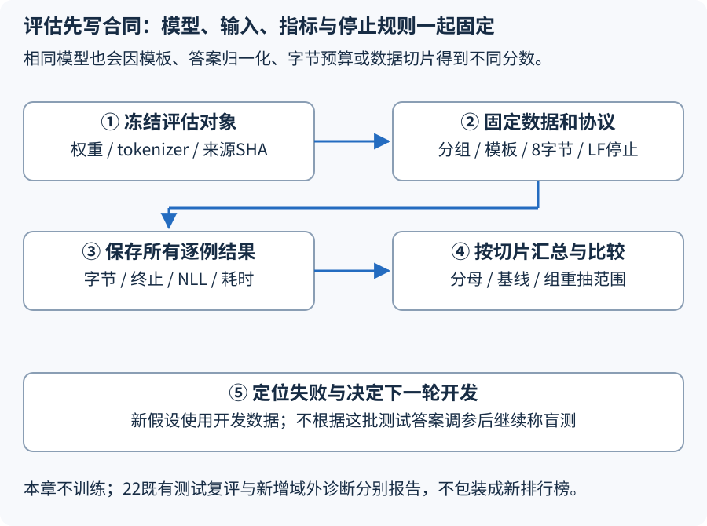
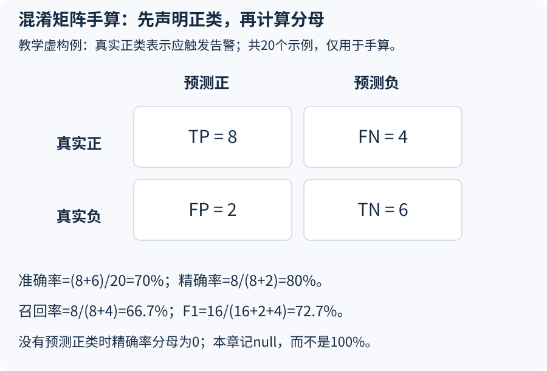
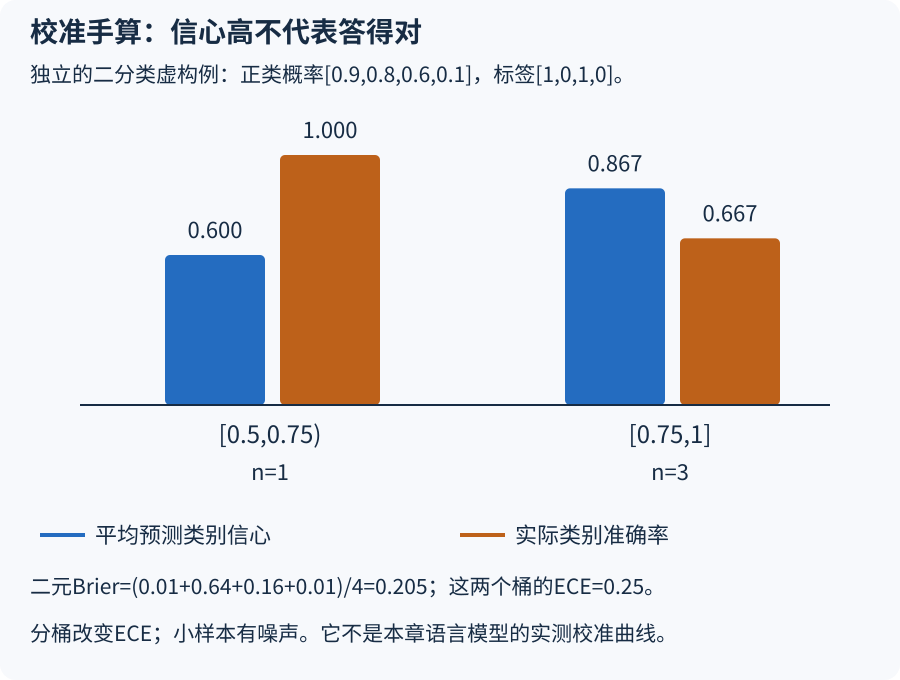
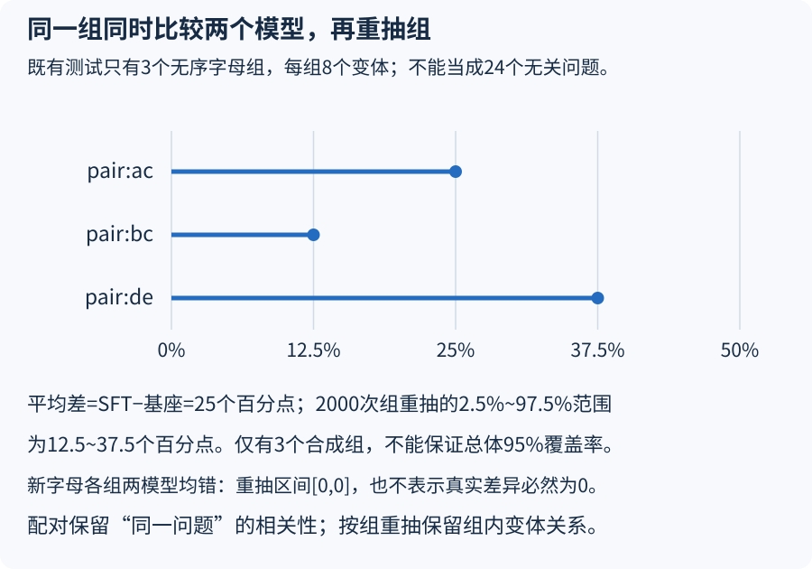
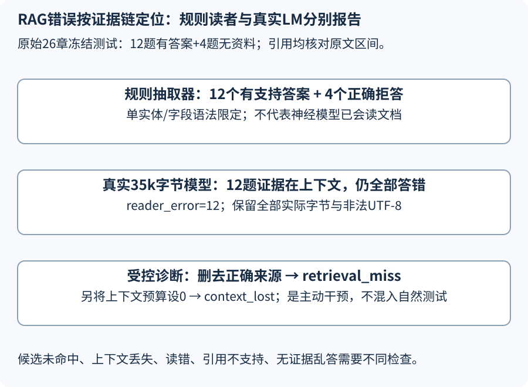
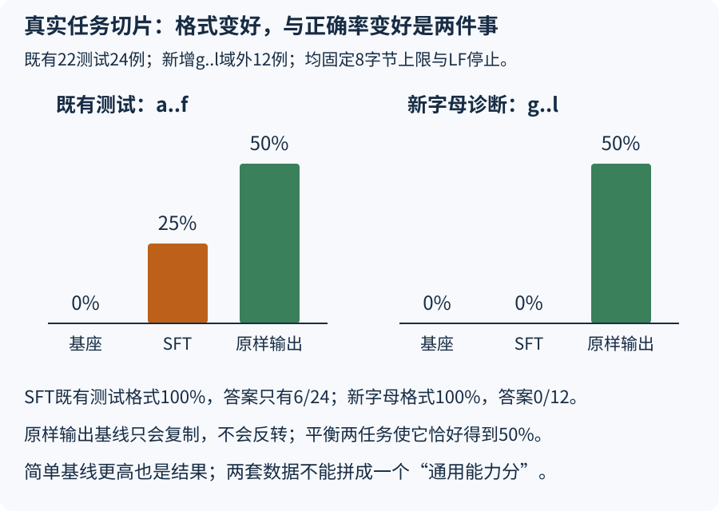
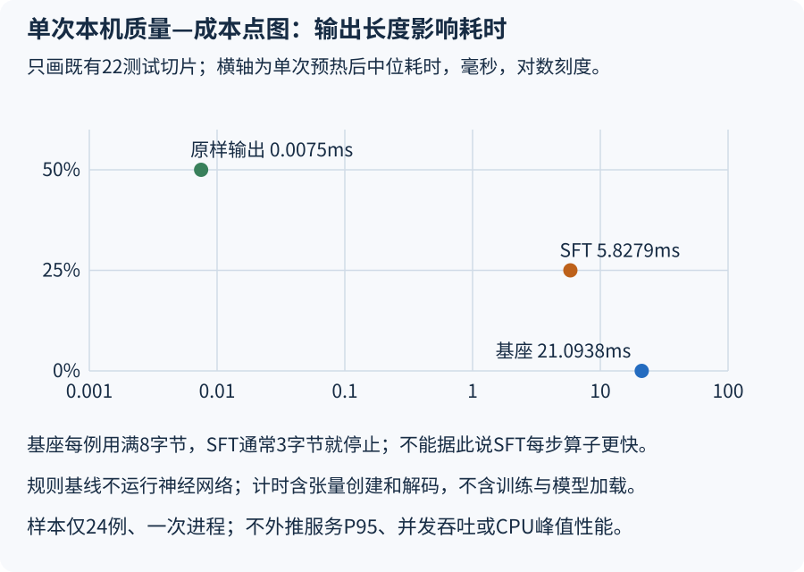

# 第 27 章：模型评估与失败分析

> 分数必须带着任务、数据、协议和分母一起阅读。本章固定第21章基座与第22章SFT，复评已有测试并新增域外诊断，再分开审计第26章的检索、规则读者与真实语言模型。更简单的基线获胜、零分、非法UTF-8和引用失败都属于结果。

[阅读入口](../../README.md) · [章节计划](../chapter-plan.md) · [公共符号](../appendices/notation.md) · [完整实践](../../examples/27-model-evaluation/README.md)

## 1. 学习目标与前置知识

学完本章，应能：

1. 写出完整评估协议，区分训练、选配置与最终评价，识别同组变体和重复测试造成的泄漏。
2. 从混淆矩阵手算准确率、精确率、召回率和F1，解释EM、序列NLL、格式与停止率为什么不能互相替代。
3. 用小例子区分预测概率、准确性和校准，理解Brier与分桶ECE的计算及局限。
4. 在同一问题上配对比较，按语义组重抽，说明小样本区间为什么不能保证通用能力。
5. 对RAG按证据链定位失败，报告真实模型、规则组件、人工评价与资源测量各自的范围。

前置为[概率统计](03-probability.md)、[微型语言模型](21-tiny-language-model.md)、[SFT](22-instruction-tuning.md)、[偏好学习](24-preference-alignment.md)和[检索增强生成](26-retrieval-augmented-generation.md)。本章不更新模型参数；“训练步数”和“优化器学习率”不适用，实际更新次数为0。

## 2. 先写评估合同，再看结果

“模型准确率25%”还缺少几乎全部上下文：对什么任务、多少题、输出怎么停止、答案如何归一化、有没有拒答、是否选过最佳种子？这些选择都可能改变数字。

本章把评估合同分为四部分：对象指纹（权重、tokenizer、配置），输入协议（数据、分组、模板、上下文），输出协议（解码、预算、停止、归一化），计分协议（事件、分母、汇总、资源计时范围）。所有逐例输出先保存，再汇总为表格。花书§11.1强调按实际目标选择指标，§11.5说明如何用可控案例调试组件；方法论不是训练结束后的附录。[花书第11章](https://www.deeplearningbook.org/contents/guidelines.html)。



*图27-1为原创流程。依据测试失败提出的下一轮改进，应在开发数据或新预声明评价中验证；不能一边按这批答案修改模型，一边继续称它为独立测试。*

### 2.1 污染不只包括逐字重复

训练与测试包含相同文本是最直接的污染。更隐蔽的情况包括：同一事实换个问法分到两侧、文档的相邻片段跨集、翻译与原文跨集，以及反复查看测试分数后选择配置。仅检查文件SHA不同，不能证明内容独立。

划分应先确定最小独立单位。本教程将无序字母对视为一组，把ab、ba及不同指令表述留在同一侧；知识问答还可能需要按文档、实体、时间或来源划分。固定seed只能重复一次划分，不能使不合理的划分自动可靠。花书§5.3明确区分验证与测试，并讨论长期反复使用同一基准的问题。[经典来源](https://www.deeplearningbook.org/contents/ml.html)。

### 2.2 本章的两套语言模型数据

- **既有测试复评**：使用第22章已经冻结的24条测试，包含3个无序字母组，每组8个变体。本章不把它包装成新盲测；作用是用统一指标重新检查已有结论。
- **新增字母诊断**：12条原创复制/反转指令，使用g..l中的6个字母对，每组2条。任务模板保持不变，输出字母超出SFT的a..f训练范围。这是范围有限的分布变化诊断，不是开放语言理解基准。

两套均未用于本章参数更新或调参。代码核对指令不与第22章训练、验证指令重合，并保留来源标签和组ID；原始文件见[evaluation.jsonl](../../examples/27-model-evaluation/evaluation.jsonl)。即使指令不重复，模板共享仍使问题非常简单，不能推出陌生领域表现。

## 3. 指标必须对应一个明确定义的事件

| 符号 | 本章含义 |
| --- | --- |
| $`n,i`$ | 某个数据切片的样本数、样本下标 |
| $`y_i,\hat y_i`$ | 参考答案、模型实际输出 |
| $`z_i`$ | 某个二元事件是否发生，例如完全匹配，取0或1 |
| $`p_i,c_i`$ | 二分类正类概率、预测类别的信心；二者不是同一个数 |
| TP、FP、FN、TN | 真阳性、假阳性、假阴性、真阴性，须先声明正类 |
| $`g,G,n_g`$ | 语义组、组数、该组样本数 |
| $`d_g`$ | 同组上两个模型正确率的差，单位为比例 |
| $`B_b`$ | 校准分桶中的样本下标集合；下标b不是批大小 |

### 3.1 完全匹配、格式和停止

本章复制/反转任务中，仅当按时停止且输出字节恰好等于参考字节加LF，才令 $`z_i=1`$，其余为0。严格EM为：

```math
\operatorname{EM}=\frac1n\sum_{i=1}^{n}z_i.
```

生成最多8个新字节，遇换行LF停止。格式合格定义为恰好两个a..l的ASCII字母再换行；“de”格式对但顺序错，属于答案错误。“de”之后继续输出其他文字，也不满足严格EM。UTF-8是否合法、是否停止和格式是否合格另外报告，防止把不同错误压成同一个0。

开放问答常允许多个等价答案，或预先声明去大小写、空白等归一化。归一化会改变任务：不能去掉小数点后把3.5与35视为相同，也不能事后为某个输出补一条特殊规则。SQuAD原论文§6.1分别定义EM与词袋重叠F1；它的英语冠词/标点处理不应无条件移植到数字或字母顺序任务。[原始评价协议](https://aclanthology.org/D16-1264.pdf)。

### 3.2 混淆矩阵与手算

先暂时离开语言生成，考虑20个虚构告警样本，“应触发告警”为正类。真实正例12个，预测正例10个，其中8个正确；真实负例8个。于是TP=8、FP=2、FN=4、TN=6。



*图27-2为原创手算，真实类别作为行、预测类别作为列。它不是本章语言模型的实测混淆矩阵。*

```math
\begin{aligned}
\operatorname{Accuracy}&=\frac{\mathrm{TP}+\mathrm{TN}}n=\frac{14}{20}=0.7,\\
\operatorname{Precision}&=\frac{\mathrm{TP}}{\mathrm{TP}+\mathrm{FP}}=\frac8{10}=0.8,\\
\operatorname{Recall}&=\frac{\mathrm{TP}}{\mathrm{TP}+\mathrm{FN}}=\frac8{12}=\frac23.
\end{aligned}
```

精确率问“发出的告警有多少是真的”，召回率问“该发出的告警找回多少”。F1为两者的调和平均：

```math
\begin{aligned}
F_1&=\frac{2PR}{P+R}
=\frac{2\mathrm{TP}}{2\mathrm{TP}+\mathrm{FP}+\mathrm{FN}}\\
&=\frac{16}{22}=\frac8{11}\approx0.727273.
\end{aligned}
```

没有预测正例时，精确率分母为0，本章记null（不适用），不写100%。类别很不平衡时准确率也可能误导：100个样本只有1个正例，全部预测负可得99%准确率，却一个正例也没找回。实际目标若更在意漏报，就不能只优化总准确率。

多类别时，宏平均先对每类计分再等权平均，微平均先累积计数再计分；它们对大类与小类的权重不同。必须声明零分母处理，不能把两种平均方式混在同一列。词袋F1还有另一种含义：它按预测与参考的token计数重叠计算。`red square`与`square red`的词袋F1可以为1，但词序不同；本章顺序任务坚持使用严格EM。

### 3.3 序列NLL为什么还不能代替任务分数

语言模型对目标回答各字节计算负对数概率，再按真实目标字节数平均：

```math
\overline{\mathcal L}
=-\frac{\sum_i\sum_t\ln\pi_\theta(y_{it}\mid x_i,y_{i,<t})}
{\sum_i|y_i|}.
```

这里包括回答终止换行，不计提示；使用真实回答前缀，和自由生成时输入自己输出的过程不同。逐字节PPL为该平均的指数。较低NLL表示指定目标在这些真实前缀下更可能，未必使每一步贪心都选对，也不保证自由生成保持格式。不同tokenizer和计分范围的PPL不能直接排名。

## 4. 校准：概率与正确性如何对应

### 4.1 先定义概率事件

二分类中，$`p_i`$ 是正类概率，预测类别由0.5阈值决定；预测类别的信心是 $`c_i=\max(p_i,1-p_i)`$。若模型说0.9信心的预测在大量同类样本上约90%正确，可以称这一范围较好地校准。高准确率不自动等于校准，低信心也不自动说明这一个答案错误。

语言模型的“下个字节最大概率”不是“整段回答事实正确概率”。若没有为整段正确性定义和验证概率事件，不能把token softmax直接贴成回答置信度。HELM §4.4区分准确性与校准，并讨论分桶测量；本章只做可手算的二分类演示。[原始评价研究](https://arxiv.org/html/2211.09110v2)。

### 4.2 二元Brier分数手算

取正类概率[0.9,0.8,0.6,0.1]，真实标签[1,0,1,0]。预测类别正确3/4，但第二例错误且信心高。二元Brier定义为：

```math
\operatorname{Brier}=\frac1n\sum_i(p_i-y_i)^2.
```

本例为：

```math
\frac{0.01+0.64+0.16+0.01}{4}=0.205.
```

它使用概率而非只看类别。这里采用单个正类概率的二元约定；若把两个类别的平方误差都相加，数值会多一倍，报告时应说明。

### 4.3 分桶ECE手算

把预测类别信心分成两个桶。每桶的准确率和平均信心为：

```math
\operatorname{acc}(B_b)=\frac1{|B_b|}\sum_{i\in B_b}\mathbf1\{\hat y_i=y_i\},
\qquad
\operatorname{conf}(B_b)=\frac1{|B_b|}\sum_{i\in B_b}c_i.
```

有限样本的分桶估计为：

```math
\widehat{\operatorname{ECE}}
=\sum_b\frac{|B_b|}{n}
\left|\operatorname{acc}(B_b)-\operatorname{conf}(B_b)\right|.
```

信心序列为[0.9,0.8,0.6,0.9]。桶[0.5,0.75)只有0.6那一例，准确率1，贡献0.25×0.4=0.1；桶[0.75,1]有3例，准确率2/3、平均信心2.6/3，贡献0.75×0.2=0.15。合计ECE=0.25。



*图27-3是独立手算，不是基座或SFT的实测校准曲线。先定义桶和边界；空桶跳过。*

若只比较全体平均信心0.8与准确率0.75，差只有0.05，局部偏差被抵消。ECE又随分桶数量和方式改变，小样本噪声很大；不能把一个小ECE当作所有概率都可靠的证据。

## 5. 比较模型时保留配对和组结构

### 5.1 同一问题上的差值

对相同问题，记基座正确事件 $`a_i`$、SFT正确事件 $`b_i`$。关注差值 $`b_i-a_i`$，而不是从两套问题分别取分数相减。本章同一无序字母组内有多个近似变体，若把它们当作独立抽样，会夸大信息量。

每组先求：

```math
d_g=\frac1{n_g}\sum_{i\in g}(b_i-a_i).
```

本章同一切片内各组大小相同，因此组均值的平均也等于逐样本平均；如果组大小不同，二者不再相同，应先声明目标是“平均问题”还是“平均组”。

既有测试的三个组差为：ac组0.25、bc组0.125、de组0.375，平均为0.25，即SFT比基座多25个百分点。这里是百分点差，不是“提升25%”的相对比值；基座分母为0时相对提升率无定义。

### 5.2 描述性的组bootstrap

bootstrap通过从已观察样本中有放回重抽，观察统计量怎样变化。本章每次重抽G个组，同一组的两个模型结果一起取，重复2,000次，再取差值分布的2.5%和97.5%分位数。基础重抽思想可参阅Stanford CS109 Winter 2024 Lecture19；按组保留本任务的相关结构是本章明确实现的选择。[大学课程讲义](https://web.stanford.edu/class/archive/cs/cs109/cs109.1244/lectures/19_sampling_bootstrap.pdf)。



*图27-4来自本机三个组的真实差值。固定seed2701，2,000次，描述性范围为12.5至37.5个百分点。*

只有3个合成组，不能保证该范围对真实总体有95%覆盖率，也不能据此宣称通用能力显著改善。域外6组两模型全错，所有重抽差都为0，区间[0,0]更不意味着真实总体差异确定为0。重抽无法生成从未观察到的困难或变化；它不修复数据污染、选择偏差或错误指标。

## 6. RAG必须沿证据链定位

第26章保存了候选、实际上下文、回答和引用。本章重新建立冻结索引，复算同一16题，并逐个核验引用区间是否等于原文切片。没有只根据报告上的“passed”再贴一个通过标志。

| 条件 | 本章互斥分类 | 优先检查 |
| --- | --- | --- |
| 无答案问题且未输出 | 正确拒答 | 同时检查有答案问题的覆盖，防止永远拒答 |
| 无答案问题仍输出 | 无支持回答 | 资料边界、拒答协议及输出事实 |
| 有答案，候选不含支持事实 | retrieval_miss | 切分、表示、索引、候选数 |
| 候选有，实际上下文没有 | context_lost | 重排、预算与截断 |
| 上下文有，答案仍不对 | reader_error | 读者、任务覆盖与生成协议 |
| 答案对，引用不支持 | unsupported_citation | 来源、原文位置、实体与字段 |
| 答案与支持均满足 | correct_supported | 保留证据，继续看其他切片 |

这种按顺序分类便于计数，不意味着每条错误只有一个因果根源。代码同时保留原始布尔标记与全部中间数据，避免分类顺序隐藏其他问题。“读错”也不应全部叫作幻觉：非法编码、未停止、抄写错误与无证据的事实断言需要区分。



*图27-5区分原始测试与主动诊断。删去正确来源、把上下文预算设为0是明确的受控干预，不混入16题自然测试成绩。*

固定72字符、无重叠、k=3、最多2块上下文的规则抽取器，得到12个有支持答案、4个正确拒答。这是单实体、单字段语法下的规则程序。第21章真实35k参数基座在相同12个有答案问题上，即使实际提示带完整证据，EM仍为0；本章将这12条归为reader_error，保留全部生成字节。规则组件成功不能作为该语言模型会阅读的证明。

第26章的问题、参考答案与文档都是虚构教学资料，测试相当容易；这些比例不能推广到现实检索问答。本章对引用做的自动核验也只适用于明确字段与参考来源，不等于开放文本的逻辑蕴含判断。

## 7. 人工评价应怎样记录

复杂回答的正确性和有用性可能无法完全自动计分。人工评价应先写标准，再盲化模型身份、随机化输出顺序、允许平局和“无法判断”，记录标注者与分歧。不能只让评价者选更长、更像权威的答案。

本章提供[人工评价表](../../examples/27-model-evaluation/human-rubric.md)，分别记录事实正确、证据支持、任务完成和表达清晰。事实与引用优先核查来源；表达风格不能抵消事实错误。多名评价者分歧应保存并讨论，是否计算一致性取决于评分尺度与流程设计。

本章**没有执行人类标注**，不提供虚构的人类满意度、标注者一致率或人类胜率。若用另一个模型作评审，也必须报告评审模型、提示、顺序偏差和人工复核范围；模型判断不自动等于人类共识。HELM强调不同任务和多种指标的覆盖，本章也不把一个总分称作完整能力画像。[HELM原文](https://arxiv.org/html/2211.09110v2)。

## 8. 本机实践与结果

### 8.1 实际执行

在仓库根目录执行：

```powershell
& ./.venv/Scripts/python.exe examples/27-model-evaluation/run.py --write-figures
```

代码读取实际的21、22检查点及26报告；缺少依赖产物时明确报错。源码见[run.py](../../examples/27-model-evaluation/run.py)与[data.py](../../examples/27-model-evaluation/data.py)。它复制冻结输入，加载同一模型API，不重新训练、不改写前章来源。运行报告在`build/experiments/27-model-evaluation/results.json`，包括版本、SHA、协议、全部预测、NLL、时间、分类与检查记录。

2026-11-17复跑与2026-11-15保存的准确率、回答NLL和失败分类一致；耗时随本机负载变化。Python3.11.5、NumPy2.4.6、PyTorch2.15.0+cpu，CPU单线程；模型float32，统计float64，贪心生成，环境seed2700。没有本章训练数据、优化器或新增可训练参数。

### 8.2 同协议下，简单基线胜过SFT

| 模型/方法 | 既有测试EM（24例） | 域外EM（12例） | 两套格式正确率 |
| --- | ---: | ---: | ---: |
| 第21章基座 | 0/24 | 0/12 | 均0% |
| 第22章SFT | 6/24=25% | 0/12 | 均100% |
| 原样输出基线 | 12/24=50% | 6/12=50% | 均100% |



*图27-6保留简单基线更好的结果。两套数据任务各半复制与反转；原样输出不理解指令，只回显末尾payload，所以复制全对、反转全错。它不是通用算法上界。*

基座既有24例的互斥主分类是23条未停止、1条非法UTF-8；实际布尔记录中24条均未停止，其中1条还同时存在非法编码。域外12例全部未停止。SFT均按时以两个字母停止，但既有18条、域外12条答案错误。这个转变说明SFT学会了模板输出形式，尚未可靠完成任务，更未把字母规律泛化到新范围。

基座既有测试回答NLL为9.973132 nat/byte，SFT为0.948792；域外分别为10.323870与8.450724。它们计分同一目标事件，单位可比较；仍不能用NLL下降替代EM。既有切片计分72个回答字节、域外36个，都含换行而不含提示。

### 8.3 质量与资源要同时声明条件



*图27-7读取2026-11-17本机复跑的计时，横轴为毫秒对数刻度。它不是服务性能测试，也没有混入模型加载或训练耗时。*

既有测试的本次中位耗时约为基座21.094ms、SFT5.828ms、规则基线0.0075ms。基座每例生成满8字节，SFT通常3字节就停止，所以不能推出SFT每次神经网络前向或每token算子更快。两模型参数量相同，规则基线则根本不运行神经网络。

报告同时保留本次样本P95，但只有24例或12例、一次预热进程，不能据此承诺稳定尾延迟、并发吞吐或硬件峰值。两次运行延迟明显不同而答案一致，正说明计时条件和重复测量的重要性。若质量和成本均不劣且至少一项更好，可以在**同一已声明任务和测量范围**内讨论支配关系；不据此给通用模型排总榜。

每个模型参数数值负载为141,312字节，不含激活、临时张量、Python和框架开销；未测进程峰值内存。完整评估与检查约1.466秒，不含导入及SVG生成，不能用这个小实验估计线上服务容量。

## 9. 常见误区

| 误区 | 更准确的解释 |
| --- | --- |
| 固定seed就没有数据污染 | seed固定随机过程；语义组、来源与使用历史仍需核查 |
| 格式100%就是任务100% | 本章SFT域外格式100%，严格EM为0 |
| PPL低说明事实可靠 | PPL评价特定token事件；事实、引用与完整生成另计分 |
| 相对提升可以随意用百分比写 | 0到25%为25个百分点；相对0的提升率无定义 |
| 重抽区间[0,0]表示差异确定为0 | 小样本全相同时bootstrap不会创造未见的变化 |
| 高检索命中就是好回答 | 真实基座在有完整证据时仍全部答错 |
| 所有错误都叫幻觉 | 编码、停止、格式、顺序、无支持断言应分别记录 |
| 有效引用ID等于证据支持 | 还需核对原文区间、实体、字段与事实主张 |
| 规则基线太简单，可以不报 | 它若更高，是任务或模型不足的重要证据 |
| 一次本机P95就是线上承诺 | 样本、负载、并发和服务开销都不同 |

## 10. 习题与详细解析

### 题1：不平衡类别

100题中只有1题为正类，全部预测负。准确率、召回率与精确率分别怎样？

**解析**：TN=99、FN=1、TP=FP=0。准确率99%，召回率0/1=0，精确率0/0不适用；本章记null。F1的计数公式分母为1，因此F1为0。高准确率没有找到任何正例。

### 题2：排序任务能用词袋重叠吗

任务要求输出`ab`，模型输出`ba`。若按字符袋重叠，F1可能是多少？应怎样验收？

**解析**：字符计数完全相同，重叠F1可为1，但顺序错误。应用目标是顺序变换，所以应使用严格序列匹配，另记录格式。不能因某个指标漂亮而更换任务定义。

### 题3：校准桶贡献

10个预测属于同一信心桶，平均信心0.9，实际7个正确；总样本20个。该桶对ECE的贡献是多少？

**解析**：准确率0.7，差0.2，权重10/20=0.5，贡献0.1。它只说明这一桶的平均差，桶内不同概率和不同任务仍可能混杂；不等于每个预测都错0.2。

### 题4：按问题还是按组重抽

一个事实被改写成20种问法，另一事实只有1种。直接随机重抽21条，隐含了什么权重？

**解析**：第一事实约占20/21权重，并被当作20次近似独立观察。若目标是平均事实表现，应按事实组抽样，并明确组内汇总；若目标是现实查询频率，则需要真实频率依据。重抽单位应对应采样与应用单位。

### 题5：查RAG哪一环

候选中有正确句子，但实际提示未带入，最终答错；另一题实际提示带正确句仍答错。应分别先查什么？

**解析**：前者是context_lost，查重排、预算与截断；后者是reader_error，查读者与任务覆盖。它们都可能同时存在其他问题，所以保留中间数据。检索分数再高也不能代替这两项检查。

### 题6：速度差能否说明模型更快

A每题输出8字节、B每题3字节，B总耗时更短。能否宣称B的每token速度更快？

**解析**：不能。总生成步数不同，停止行为也不同；还需相同输入、输出长度、批次与实现下的重复计时。任务完成总延迟仍有应用意义，但要声明它包含停止行为，不能改变成算子速度结论。

### 题7：人工评价事实

没有人类标注，却把模型评审的偏好率写成“用户满意度”。应怎样改正？

**解析**：如实写评审模型、提示、判断规则和样本范围，标为模型评审结果；保留顺序控制、分歧和人工复核计划，未做就明确未做。统计形式相似不意味着评价主体或含义相同。

## 11. 小结与下一步

完整评估从协议开始，以证据结束。分数的单位、分母、数据组、输出停止、校准事件、比较方式和资源范围都需要显式定义。本机结果显示：模板形式、局部似然、候选命中与完整回答能力可以相互分离。

[综合实践](30-capstone.md)将把固定数据、来源链、训练/推理入口、评估结果和失败记录组织成一个可重建的小项目。目标是得到可核验的工程与学习结论，不是把受限教学任务装饰成通用助手产品。

## 12. 参考来源与图示

主来源于2026-11-15核验，实验于2026-11-17复跑。七图均为原创SVG：[图源](../../examples/27-model-evaluation/figures.py)中1～3为协议/手算，4～7读取实测报告。出版检查见[逐章验收](../appendices/chapter-validation.md)。

1. Goodfellow等，2016，*Deep Learning*，§5.3验证/测试、§11.1指标、§11.5调试。[第5章](https://www.deeplearningbook.org/contents/ml.html)、[第11章](https://www.deeplearningbook.org/contents/guidelines.html)。
2. Rajpurkar等，*SQuAD: 100,000+ Questions for Machine Comprehension of Text*，EMNLP2016，§6.1，PDF第7页，EM与词袋F1及归一化规则。[原始论文](https://aclanthology.org/D16-1264.pdf)。
3. Liang等，*Holistic Evaluation of Language Models*，§4.3准确性、§4.4校准与不确定性、§4.9效率。[原文v2](https://arxiv.org/html/2211.09110v2)。
4. Jerry Cain等，Stanford CS109 Winter2024，Lecture19，*Sampling and the Bootstrap*，2024-02-23，有放回重抽；本章采用按组配对，并说明限制。[官方讲义](https://web.stanford.edu/class/archive/cs/cs109/cs109.1244/lectures/19_sampling_bootstrap.pdf)。
