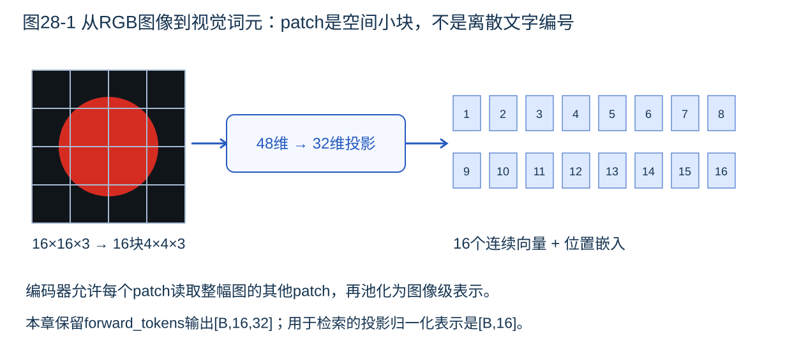
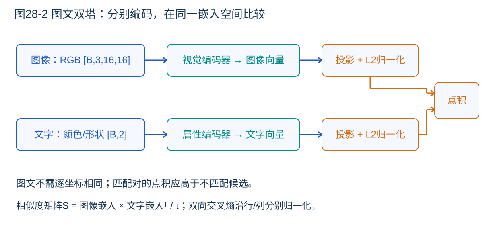
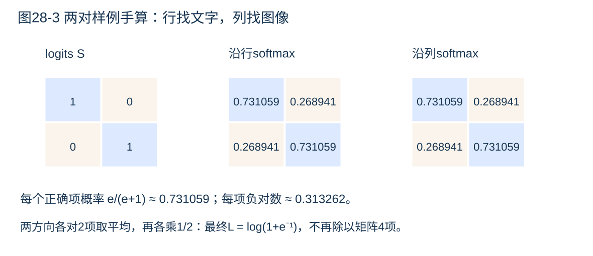
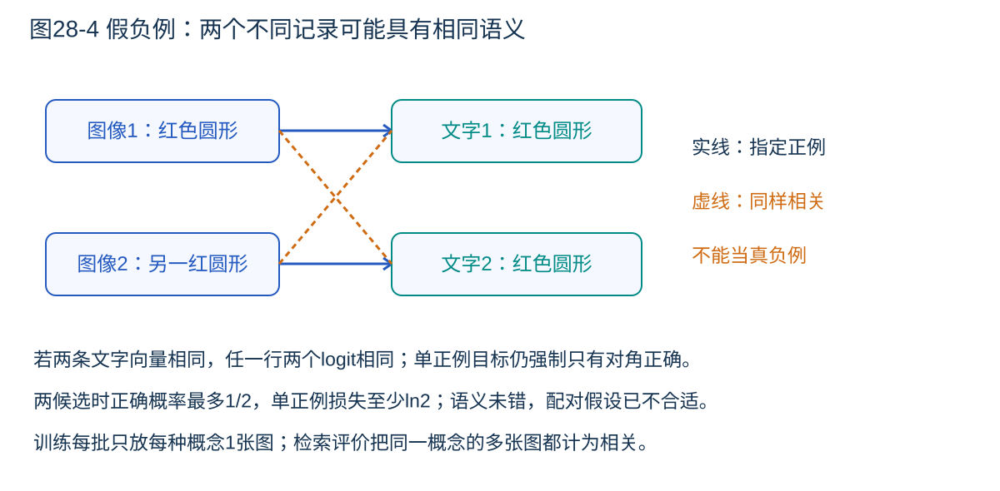
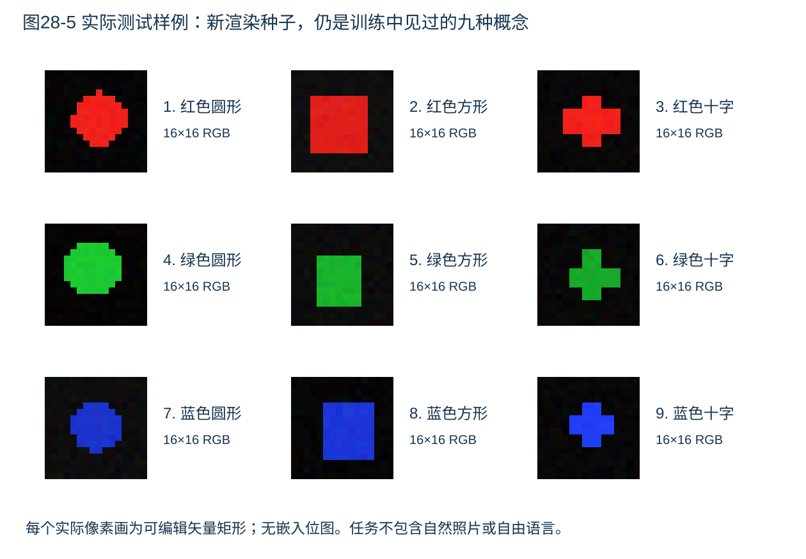
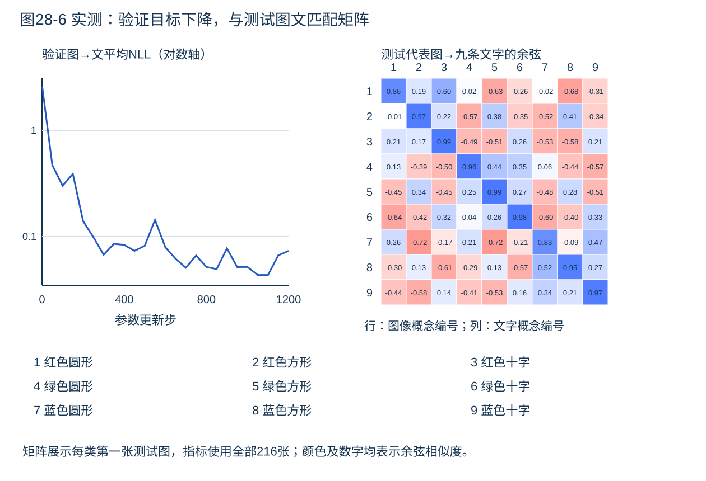

# 第 28 章：多模态表示与 CLIP

> 状态：完整正文、六幅SVG及原创图文双塔训练已完成独立验收；正式状态以章节计划为准。

[阅读入口](../../README.md) · [章节计划](../chapter-plan.md) · [公共符号](../appendices/notation.md)

## 1. 本章目标与前置知识

前面的语言模型把文字变成向量。现在给出一张红色圆形图和文字“红色圆形”，怎样让两个不同形式的输入可以比较？本章学习图像和文字的表示、图文配对目标，以及从匹配分数进行检索的方法。

本章目标：

- 从图像patch逐步得到连续视觉词元，分清像素、词元和图像级向量。
- 解释图文双塔与归一化，手算余弦相似度矩阵和双向对比损失。
- 说明正例、批内负例及假负例，知道一一配对假设何时不成立。
- 运行一个真实的小型图文训练实验，分别评价两个检索方向，并保留失败样例。
- 区分CLIP原理、小型机制实验、零样本迁移和开放世界理解。

前置：[第03章](03-probability.md)的交叉熵，[第11章](11-convolutional-networks.md)的图像与卷积，[第14章](14-tokenization-and-embeddings.md)的表示，[第16章](16-transformer.md)的Transformer。第27章讨论的指标与失败分析原则同样适用。

## 2. 先把两种输入放到可以比较的空间

多模态（multimodal）表示学习处理不同形式的信息，例如图像、文字和声音。本章只处理图像与文字。原始图像是空间排列的颜色数值，文字是离散符号序列；直接比较像素和文字编号没有语义意义。

编码器（encoder）把原始输入映射为向量。若分别训练两个完全独立的编码器，即使输出维度相同，也不保证它们的坐标系统可直接比较。需要一个共同目标，让相关图文靠近、无关候选相对更远。CLIP（Contrastive Language–Image Pre-training，图文对比预训练）使用成对图文学习这种联系。[1,2]

本章不会下载大型预训练CLIP。我们从零训练一个11840参数的原创双塔：图像为16×16合成彩色图形，文字塔只接收颜色与形状两项离散属性。它保留“分别编码、共享空间、对比训练、双向检索”的机制，不能替代自然语言编码器或真实照片模型。

## 3. 图像怎样成为视觉词元

| 记号 | 含义与形状 |
| --- | --- |
| $`B,N`$ | 批次配对数、每图patch数 |
| $`d,d_e`$ | patch隐藏维度、共享检索嵌入维度 |
| $`I_i,T_i`$ | 第 $`i`$ 个图像与对应文字/属性 |
| $`\mathbf{u}_i,\mathbf{v}_i`$ | 单位图像/文字列向量，均为 $`d_e`$ 维 |
| $`\mathbf{S},\tau`$ | $`B\times B`$ 图文logits矩阵、正温度 |


### 3.1 从局部像素到一个向量

图像patch是空间上相邻的一小块。将RGB图像分成大小相同且不重叠的patch，展开每块像素，再用同一个线性层投影为固定维度的向量。这个连续向量称为视觉词元（visual token）；它不是文字词表中的一个整数编号。[3]



**图28-1**：本章原创patch示意，依据ViT论文§3.1的分块投影思路。视觉词元与语言词元都可作为Transformer的序列输入，但原始信息和构造方法不同。[3]

令图像高宽为 $`H_I,W_I`$，通道数 $`C_I`$，patch边长为 $`P_I`$，要求长宽可整除。patch数

```math
N=\frac{H_IW_I}{P_I^2},\qquad
\mathbf{p}_j\in\mathbb{R}^{P_I^2C_I},\qquad
\mathbf{x}_j=\mathbf{W}_p\mathbf{p}_j+\mathbf{b}_p+\mathbf{e}_j.
```

其中 $`j=1,\ldots,N`$ 是空间块的固定顺序；投影矩阵形状为 $`d\times(P_I^2C_I)`$，位置嵌入 $`\mathbf{e}_j`$ 和词元 $`\mathbf{x}_j`$ 均为 $`d`$ 维列向量。相同投影用于所有块，位置项说明块的空间位置。

本章取 $`H_I=W_I=16,C_I=3,P_I=4,d=32`$。因此每块48维，共16块；代码输入 `[B,3,16,16]`，投影和转轴后为 `[B,16,32]`。用卷积核4、步幅4的卷积也能完成同一投影：每个输出空间位置只读取一个不重叠patch，卷积核展开后正是共享的线性矩阵。

手算一个更小例子：单通道2×2块按固定顺序展开为 $`(1,2,3,4)^{\top}`$；投影两行为 $`(1,0,0,1)`$ 与 $`(0,1,-1,0)`$，偏置 $`(0,1)^{\top}`$。先得到 $`(5,-1)^{\top}`$，加偏置为 $`(5,0)^{\top}`$；再加该空间位置嵌入。改变展开顺序却不改变权重顺序，会计算出不同结果。

### 3.2 词元序列和图像级向量不同

视觉Transformer让各patch读取其他patch，从局部像素形成包含全局上下文的表示。图像不是自回归文字，本章视觉自注意力不加因果mask，所有patch可以相互读取。

经过编码器后得到 $`N`$ 个隐藏向量。为了检索，还需合成一个图像级向量。本实验对16个隐藏向量取平均，再线性投影到16维。原始ViT常使用额外的分类词元（class token）汇聚信息；CLIP的不同视觉编码器也有相应设计。本章采用平均池化，未复现原始ViT/CLIP架构。[1,3]

模型保留两个接口：`forward_tokens` 输出 `[B,16,32]` 的上下文化patch序列；普通 `forward` 输出 `[B,16]` 的图像级归一化嵌入。两个16分别是patch个数和嵌入维度，含义不同。

## 4. 图文双塔与共享嵌入空间

### 4.1 两个编码器，各自处理自己的输入

双塔（dual encoder）指图像与文字分别经过自己的编码器和投影，再通过向量相似度比较。候选文字可预先编码，查询图像只需与候选向量做点积；反方向同理。[1,2]



**图28-2**：本章原创双塔示意。两塔输出相同维度，但它们的参数、输入结构和逐坐标含义都不要求相同；训练目标学习的是跨模态的相对关系。

一个匹配对记为 $`(I_i,T_i)`$。未归一化输出为 $`\mathbf{a}_i=f_{\boldsymbol{\theta}_I}(I_i)`$ 和 $`\mathbf{b}_i=g_{\boldsymbol{\theta}_T}(T_i)`$，均为 $`d_e`$ 维列向量。非零向量做L2归一化：

```math
\mathbf{u}_i=\frac{\mathbf{a}_i}{\|\mathbf{a}_i\|_2},\qquad
\mathbf{v}_i=\frac{\mathbf{b}_i}{\|\mathbf{b}_i\|_2}.
```

二者点积就是余弦相似度，范围 $`[-1,1]`$；它比较方向，避免仅放大范数就任意增加分数。本实现使用带 $`10^{-8}`$ 下限的归一化，并检查实际输出范数接近1。若原始向量为零，不能宣称得到单位向量。

### 4.2 温度把相似度变成可训练分数

一个批次有 $`B`$ 对图文，定义logit

```math
S_{ij}=\frac{\mathbf{u}_i^{\top}\mathbf{v}_j}{\tau},\qquad\tau>0.
```

这里 $`i`$ 是图像编号，$`j`$ 是文字编号。代码将向量按行堆叠：$`\mathbf{U},\mathbf{V}\in\mathbb{R}^{B\times d_e}`$，所以分数矩阵为 $`\mathbf{S}=\mathbf{U}\mathbf{V}^{\top}/\tau`$。它不是单个图像内部的自注意力矩阵。

温度越低，同样相似度差转换成更大logit差，softmax更集中。它也会改变梯度尺度，并非越小越好。原始CLIP学习一个指数参数化的logit比例；本章固定 $`\tau=0.1`$，不新增温度参数。[1,4]

余弦高不等于已校准的“文字为真概率”。后面的softmax还取决于候选集合；增加候选、修改文字、改变温度都可能改变概率，必须用实际任务评价。

## 5. 双向对比损失逐步推导

### 5.1 行与列回答两个不同问题

先假设每个批次只有一一对应的正例：图像 $`I_i`$ 只匹配文字 $`T_i`$，其他文字为本批负例。对比学习（contrastive learning）提高正例相对于其他候选的分数，而不是只要求某个绝对余弦数值。[1]

图像找文字时，对矩阵每一行沿文字候选归一化：

```math
q^{I\to T}_{ij}=\frac{\exp(S_{ij})}{\sum_{k=1}^{B}\exp(S_{ik})},
\qquad
\mathcal{L}_{I\to T}=-\frac1B\sum_{i=1}^{B}\log q^{I\to T}_{ii}.
```

文字找图像时，对同一矩阵每一列沿图像候选归一化：

```math
q^{T\to I}_{ij}=\frac{\exp(S_{ij})}{\sum_{k=1}^{B}\exp(S_{kj})},
\qquad
\mathcal{L}_{T\to I}=-\frac1B\sum_{j=1}^{B}\log q^{T\to I}_{jj}.
```

最终损失 $`\mathcal{L}=\tfrac12(\mathcal{L}_{I\to T}+\mathcal{L}_{T\to I})`$。每个方向先对 $`B`$ 个查询取平均，再对两个方向平均，不能把 $`B^2`$ 个矩阵项当成同样的监督标签。[1]

```python
logits = image_features @ text_features.T / temperature
labels = torch.arange(batch_size)
loss = 0.5 * (
    F.cross_entropy(logits, labels)
    + F.cross_entropy(logits.T, labels)
)
```

整数标签是本批正确配对的索引，不是全局颜色或形状编号。图文同步换顺序后，对角对应仍成立；只交换文字而不更新标签，则训练了错误配对。

### 5.2 两对样例完整手算



**图28-3**：原创手算；取两组单位向量 $`(1,0)^{\top},(0,1)^{\top}`$，图文一一相同，$`\tau=1`$。余弦矩阵和logit矩阵均为单位矩阵。

第一步，每行指数为 $`(e,1)`$ 或 $`(1,e)`$，正确项概率均为 $`e/(e+1)\approx0.731059`$。第二步，每个正确项负对数为

```math
-\log\frac{e}{e+1}=\log(1+e^{-1})\approx0.313261688.
```

第三步，两行平均仍为该值；两列也相同，最后两方向平均仍为0.313261688。两个向量已经正交，但有限logit差仍给负候选非零概率，所以损失没有变成0。

若只改温度为0.5，对角logit变为2，正确概率约0.880797，损失为 $`\log(1+e^{-2})\approx0.126928`$。这是这组固定向量的数值变化，不证明训练时应无限减小温度。

### 5.3 梯度为什么同时吸引与排斥

利用交叉熵对logit的导数，对任意 $`S_{ij}`$ 有

```math
\frac{\partial\mathcal{L}}{\partial S_{ij}}
=\frac{q^{I\to T}_{ij}+q^{T\to I}_{ij}-2\mathbb{1}\{i=j\}}{2B}.
```

正例项通常为负，梯度下降会提高它；非对角项为正，会降低它。某个负例当前概率越高，对修正的贡献通常越大。再经过点积、归一化和两塔编码器的链式法则，梯度才能更新网络参数，不能直接把logit梯度当成全部参数梯度。

上例 $`B=2`$ 时，对角导数约−0.134471，非对角约0.134471。本机用float64手算和自动微分逐项对照。若没有负例且 $`B=1`$，行列softmax都只有一个候选，概率恒为1、损失恒为0，单靠这个目标无法学到区分能力。

## 6. 负样本与假负例

### 6.1 “不是这一对”不等于“语义不相关”

批内负例（in-batch negatives）复用其他记录的文字与图像，不必为每个查询另建候选。但上述对角标签隐含一一匹配假设。两条不同记录可能都是红色圆形；把它们相互作为负例，会错误惩罚合理匹配，这叫假负例（false negative）。



**图28-4**：本章原创反例。若两条文字完全相同且编码器确定，它们的向量相同；对任一图像，两个logit都一样，行softmax各为1/2。两候选时行损失至少 $`\log2`$，不能靠继续训练把指定对角概率提高到1。

本机重复语义示例给出损失0.69314718056，与 $`\log2`$ 一致。这个反例不是说所有语义相近样本都应合并，而是说明标签关系应由任务定义和数据决定，不能仅由文件行号决定。

### 6.2 本章怎样处理多正例

训练每个批次固定九种概念各一张图，对应九条不同属性文字，避免同概念重复进批。验证与测试每个概念有多张图，反向检索则把同一概念所有图都当作相关结果，而非只认可某个文件编号。

拓展：若训练确实含多个相关候选，可以显式给出正例集合 $`\mathcal{P}(i)`$，例如使用

```math
-\log\frac{\sum_{j\in\mathcal{P}(i)}\exp(S_{ij})}{\sum_{j=1}^{B}\exp(S_{ij})}.
```

这是多正例目标的一种定义；也存在对各正例分别平均对数概率的其他目标，不能混为一式。本章没有训练这个拓展版本，而是通过每类一图的采样保证单正例前提。所有候选若都相关，上式也无法提供负例区分信号。

## 7. 跨模态检索：分数、候选与指标

检索（retrieval）给定查询，从有限候选中按相似度排序。图像到文字时，对一张图的九个文字分数排序；文字到图像时，对一条文字的216张图分数排序。两种方向的查询数量、候选数量和相关结果数都不同。[2]

对于查询 $`q`$，令 $`\mathcal{R}_q`$ 为相关候选集合，$`\mathop{\mathrm{TopK}}\nolimits(q)`$ 为返回的前K项。本实验使用查询命中率：

```math
\mathop{\mathrm{Hit@K}}\nolimits=\frac1Q\sum_{q=1}^{Q}
\mathbb{1}\{\mathop{\mathrm{TopK}}\nolimits(q)\cap\mathcal{R}_q\ne\varnothing\}.
```

$`Q`$ 是查询数，不是批次大小。只有一个相关候选时，它也常按检索基准记作Recall@K；多个相关图像时，本章明确称“命中”，不把它和“找回全部相关结果的比例”混淆。

例：一条“红色圆形”查询有24张相关测试图，只返回其中一张，Hit@1可为1；但找回相关图的比例只有1/24，不能声称召回了所有24张。

CLIP论文的零样本分类用类别文字建立候选表示，再让图像选择最相似描述，无需为该下游任务额外训练分类头。[1] 本实验九种组合在训练中全部出现，测试只换图形位置、大小、亮度与噪声，因此测试成功属于已知概念的新渲染泛化，不能称为未见类别零样本迁移。

## 8. 本机实践：原创小图文数据

### 8.1 数据是什么，怎样划分



**图28-5**：来自实际测试张量，各类别取第一张；每个像素以矢量矩形绘出，无嵌入位图。它保留了16×16输入的分辨率，不伪造自然照片细节。

数据由本教程原创程序生成：红/绿/蓝三色，圆形/方形/十字三形，九种组合。背景、中心、大小、亮度及高斯噪声随机变化，RGB裁剪到0～1。数据与项目采用相同许可，没有下载第三方图片或预训练权重。

| 划分 | 随机种子 | 每类图数 | 总图数 | 用途 |
| --- | --- | --- | --- | --- |
| 训练 | 2801 | 64 | 576 | 梯度更新，每批每类随机取1图 |
| 验证 | 2802 | 16 | 144 | 选择最低图→文平均交叉熵检查点 |
| 测试 | 2803 | 24 | 216 | 模型与配置冻结后评价 |

三份图像按像素哈希检查无完全重复。独立种子避免相同渲染记录跨集合，却不把同一九种概念变成未见类别；它们仍来自同一个简单生成规则，也不代表自然图像分布。每份张量SHA256写入结果与检查点协议。

文字编码器接收 `[颜色索引,形状索引]`，颜色顺序红、绿、蓝，形状顺序圆、方、十字，各为0～2。展示文字由固定词表生成，例如“绿色方形”；模型没有处理任意中文句子、自由措辞、否定或空间关系。这套属性编号不能混入第21章的UTF-8字节词表。

### 8.2 模型、训练预算与入口

模型为：4×4步幅4patch投影，16个32维学习位置，一个宽32/4头/前馈64的PreLN视觉Transformer，无dropout；最终归一化后平均池化，再投影16维。文字塔两个16维属性嵌入拼为32维，再投影16维。两塔均做L2归一化。

实际总参数11840，其中视觉塔11216；本章从随机初始化端到端训练，不称作“微调预训练CLIP”。训练使用固定温度0.1、batch9、AdamW，学习率0.001、weight decay0.001，默认betas(0.9,0.999)、epsilon $`10^{-8}`$，1200步。初始化种子2800，批次采样种子2804。每50步及第1步验证；按最低验证图→文九分类平均NLL选择第1050步，不用测试选配置。

2026-11-15在Windows、Python3.11.5、NumPy2.4.6、PyTorch2.15.0+cpu上运行，float32、CPU单线程、确定性算法。命令：

```powershell
& ./.venv/Scripts/python.exe -B examples/28-multimodal-representations/run.py
```

[入口](../../examples/28-multimodal-representations/run.py)、[模型](../../examples/28-multimodal-representations/model.py)、[数据生成](../../examples/28-multimodal-representations/data.py)、[实验说明](../../examples/28-multimodal-representations/README.md)均在仓库中；[图源](../../examples/28-multimodal-representations/figures.py)从真实结果生成六幅SVG。

保存文件 `build/experiments/28-multimodal-representations/dual-encoder.pt`，包含schema、config、模型参数和生成/训练协议。文件SHA256：

```text
da3c49769b23599a817c651d4d49bbdeaac65ee592d68a69f1727e9e07a293a7
```

加载后验证视觉输出逐位相等。后续章节可只读复用 `model.vision.forward_tokens(images)` 的连续视觉序列；这个保存文件是推理权重，不含优化器完整中断状态，不能宣称完成断点续训验证。

### 8.3 本机真实结果



**图28-6**：左侧为真实验证图→文平均NLL，非训练双向批次loss；右侧每类取首张测试图，仅作表示示例。完整指标使用全部216张图，不能由九个对角块代替。

| 模型/划分 | 图→文Hit@1 | 图→文Hit@3 | 图→文平均NLL |
| --- | --- | --- | --- |
| 随机初始 / 测试 | 22/216，10.19% | 72/216，33.33% | 3.251616 |
| 训练模型 / 训练 | 576/576，100% | 576/576，100% | 0.007262 |
| 训练模型 / 验证 | 143/144，99.31% | 144/144，100% | 0.043441 |
| 训练模型 / 测试 | 206/216，95.37% | 216/216，100% | 0.124822 |

随机初始文字→图像Hit@1为0/9，训练后为9/9；每条文字的候选集合有216张图，其中24张同概念均相关。这不表示216张图都排在了各自查询首位，也不能拿九个查询的100%与216个查询的95.37%直接比较难度。

测试十个错误都在相同颜色内混淆形状：红圆有2错、红方1错、绿圆1错、绿方3错、绿十字1错、蓝十字2错；其他类别全对。例如零基测试索引14的红圆被判为红十字，索引101的绿方被判为绿圆。全部预测和九乘九混淆矩阵保留在JSON，不只选成功图。

故意循环错配九条候选文字、却保留原标签时，图→文Hit@1降为4/216，约1.85%。这是评价标签/候选映射失配的负对照，不是额外训练；将候选反序并正确更新索引映射时，预测语义保持一致。说明检索排序必须与候选元数据一起解释。

最后1200步训练批次loss仍很低，但验证NLL约0.073284，高于1050步的0.043441；继续优化训练批次并不保证验证更好。我们恢复1050步，仍报告比验证低的测试命中率，不按测试结果再挑其他步数。

### 8.4 数值检查与资源边界

- float64手算与自动微分对比损失均为0.31326168751822286，梯度符号和平均尺度一致。
- 两条重复语义的单正例损失为0.6931471805599453，符合 $`\log2`$ 反例。
- 卷积patch投影与显式展开线性层最大误差约 $`1.79\times10^{-7}`$；视觉序列形状 `[2,16,32]`。
- 所有参数梯度有限，图文嵌入为单位范数；检查点磁盘保存/加载输出一致。

训练、全部评价与检查约3.270秒，含库导入约6.054秒，不含随后图和文档生成。三份图像与标签有效张量共2882880字节，不含模型、梯度、优化器、图表或解释器；峰值进程内存未测。仅一次初始化、一个简单生成分布、九种概念，不能外推到大型CLIP资源和能力。

## 9. 常见误区与局限

- **patch词元是某个文字token编号**：它是由局部像素投影得到的连续向量。
- **同维图文向量天然可比较**：共享空间需要目标学习，并非维度相同即可。
- **对比loss只是让两个向量完全相等**：它比较正例与候选的相对分数，还有负例与温度。
- **矩阵所有元素都平均同一种标签**：两方向分别按查询取交叉熵平均，正确配对在对角。
- **不同文件都能当负例**：语义重复可能制造假负例，需要相关集合定义。
- **高相似度代表内容必定正确**：候选集合、偏差与分布外输入都影响解释。
- **图文匹配高分就能描述图像**：本模型没有生成解码器，不会自主写说明或回答任意问题。
- **新随机种子的测试就是零样本类别**：九种概念已在训练出现；自然照片、未见组合和自由文本均未验证。

原CLIP论文也讨论了细粒度识别、抽象关系、分布与偏差等限制；本实验更小，不能借用其大型预训练结果为自身背书。[1]

## 10. 习题与解析

### 10.1 习题

1. RGB图像32×48，patch边长8，投影宽64：有多少词元，每块几维，投影矩阵多大？
2. 重算2×2像素块的投影，若取消偏置会怎样？为什么换展开顺序必须同步换权重列？
3. 手算第5节温度0.5时的损失与对角正确概率。若再除以4，为什么尺度错误？
4. 对三对图文的分数矩阵，图→文和文→图softmax分别沿哪个轴？只打乱文字不改标签会怎样？
5. 两条文字完全相同、都描述两个相关图像时，单对角目标有什么问题？为何训练batch1不是解决办法？
6. 一条文字有24张相关图，前3项只出现2张相关，Hit@3与找回相关图比例各多少？
7. 测试命中率95.37%能否证明模型理解所有图像或能回答“不是红色的物体在哪里”？应该加哪些独立评价？

### 10.2 参考解析

1. $`N=32\times48/8^2=24`$；每块 $`8^2\times3=192`$ 维；列向量投影矩阵为 $`64\times192`$，行批次结果 `[B,24,64]`。
2. 无偏置为 $`(5,-1)^{\top}`$；加偏置变 $`(5,0)^{\top}`$。矩阵每列对应固定像素位置/通道，顺序不匹配就对错误像素施加了权重。
3. 正确概率 $`e^2/(e^2+1)\approx0.880797`$，最终损失 $`\log(1+e^{-2})\approx0.126928`$。每方向已经对查询平均、再对两方向平均，再除矩阵项数会重复缩放。
4. 分数形状 `[图像,文字]`；图→文沿列维为每行归一化，文→图沿行维为每列归一化。只改文字顺序却保留对角标签，会把不对应项当正例；同步重排并正确映射标签才是同一任务。
5. 相同文字向量使同一行两个分数相同，正确项概率只能1/2，损失至少 $`\log2`$；batch1则没有负候选，loss恒0，不提供区分训练信号。应改采样或明确多正例目标。
6. 至少一个相关结果被找到，所以Hit@3为1；找回相关图比例为2/24约8.33%。对多个查询还需按定义汇总。
7. 不能。本模型只接受颜色/形状属性，也没有语言生成或定位接口。应独立设计未见概念/组合、分布变化、不同措辞或关系任务，并保证接口、数据和指标适配，不能仅换提问文字就宣称通过。

## 11. 小结与来源

图像patch构成连续视觉序列，双塔通过归一化相似度和双向交叉熵学习配对。检索必须定义候选与相关性，分析假负例和双向指标。下一章把视觉序列连接到语言模型；本章图像级检索成功不能代替文字生成能力。

来源核验：2026-11-15；HTML/PDF、双视口、字体矢量与目视通过。

1. Radford等，*Learning Transferable Visual Models From Natural Language Supervision*，ICML2021，§2.3、图3对比目标、§2.4编码器、§3.1零样本迁移、§6限制：[原始论文](https://arxiv.org/abs/2103.00020)。
2. Krishna，Stanford CS231n Spring2025，第16讲 *Multi-Modal Foundation Models*（2025-05-27），PDF第16～20、24页：[官方讲义](https://cs231n.stanford.edu/slides/2025/lecture_16.pdf)。已读取具体页面。
3. Dosovitskiy等，*An Image is Worth 16x16 Words: Transformers for Image Recognition at Scale*，ICLR2021，§3.1与式(1)：[原始论文v2](https://arxiv.org/abs/2010.11929v2)。
4. OpenAI CLIP，`VisionTransformer` 与 `CLIP.forward` 的归一化和指数logit比例：[源码](https://github.com/openai/CLIP/blob/main/clip/model.py)。本章不使用其库和权重。
