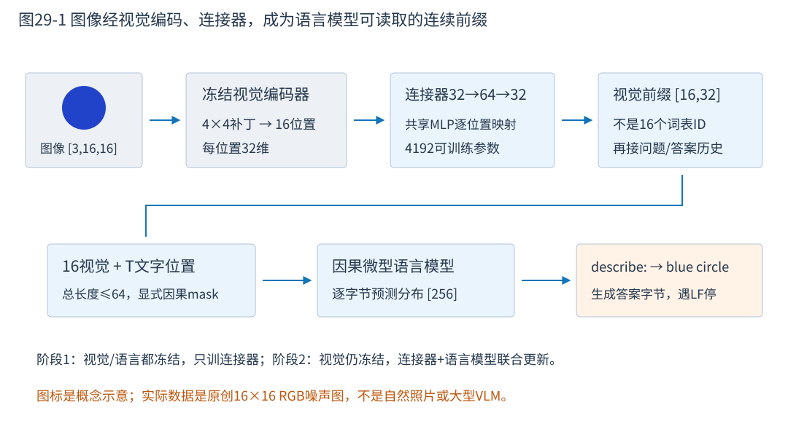
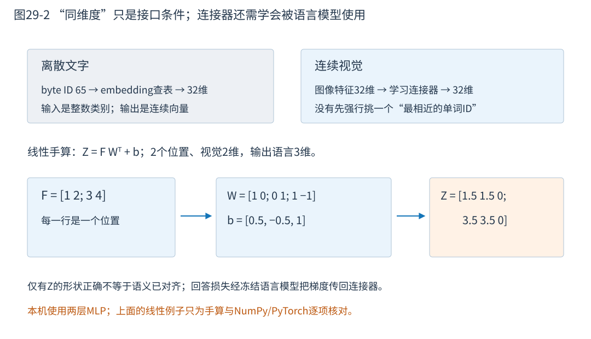
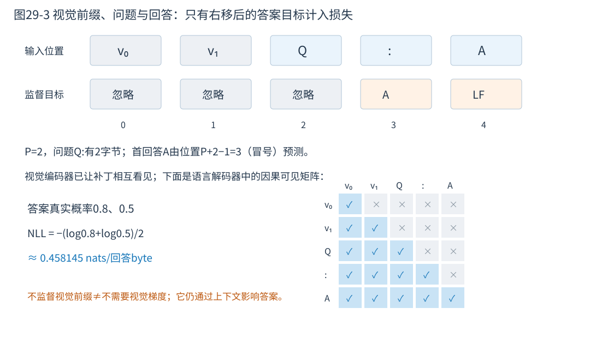
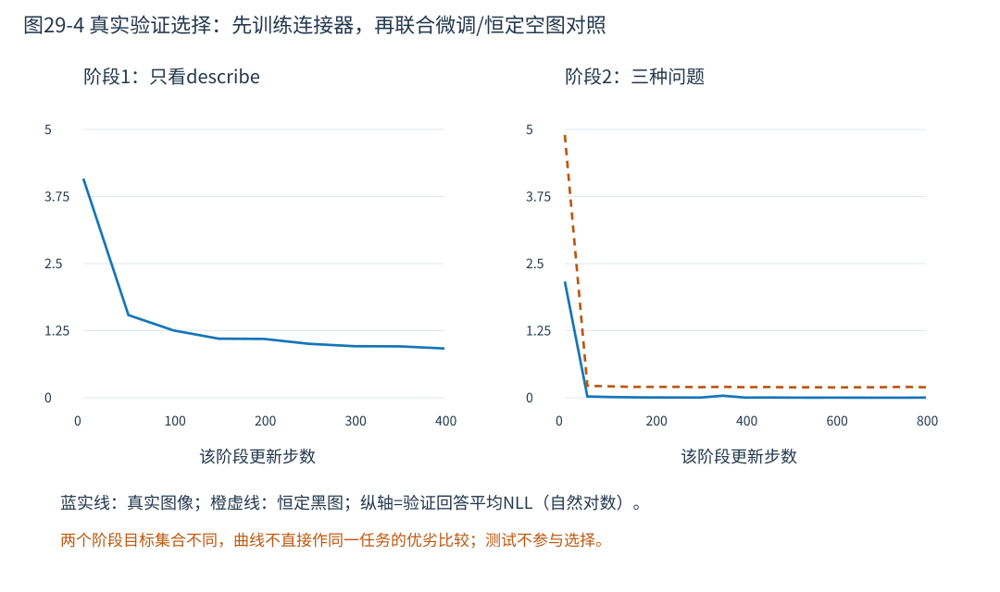
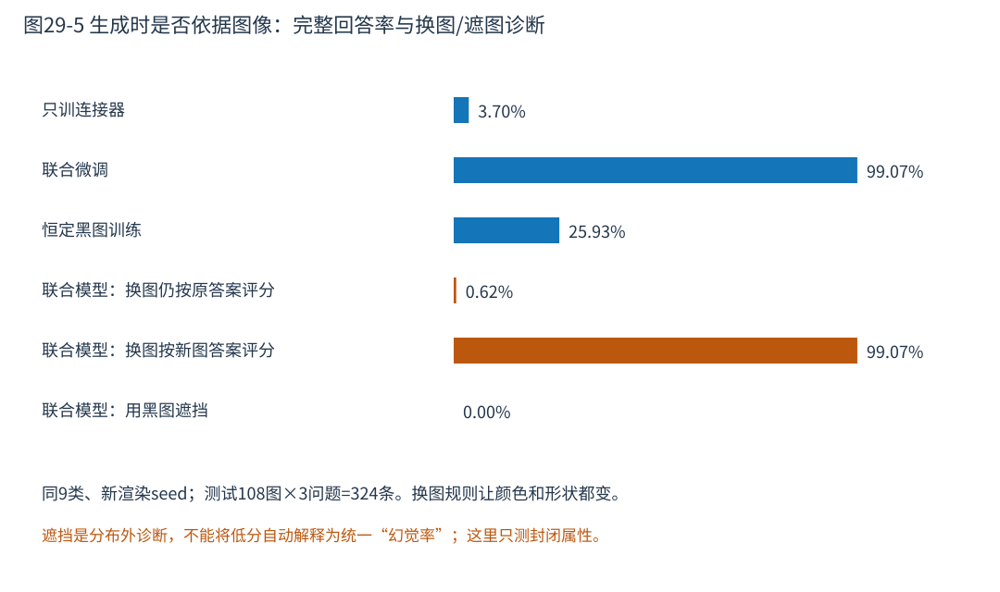
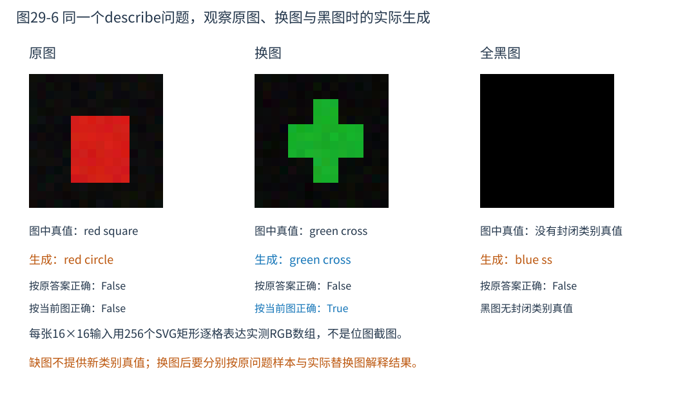

# 第29章：视觉语言模型与多模态指令

> 语言模型已经能读取文本，但一幅图像怎样进入它的计算？本章将冻结视觉特征变成连续前缀，逐步对齐形状、位置、注意力与回答监督；用小模型实际训练、空图对照和换图干预检验“回答是否依据图像”。更新日期：2026-11-17。

[阅读入口](../../README.md) · [章节计划](../chapter-plan.md) · [公共符号](../appendices/notation.md) · [完整实践](../../examples/29-vision-language-models/README.md) · [验收记录](../appendices/chapter-validation.md)

## 1. 从图文相似度到“看图回答”

第28章的双塔模型能给图像和候选文字计算相似度。这适合检索或选择，但还没有定义如何逐字生成回答。若想问同一幅图“什么颜色”“什么形状”“简要描述”，需要让语言生成既以问题为条件，也以图像为条件。

 **视觉语言模型（vision-language model，VLM）** 是处理视觉与语言信息的模型总称，并不只指聊天模型。本章关注 **图像条件的自回归回答生成** ：图像先被编码为特征，连接模块把特征送入语言模型，再逐token输出答案。[1, §4] 双塔对齐与生成式融合有联系，但“相似度高”不能自动推出“自由生成正确”。

本章目标：

- 解释视觉编码器、连接器、连续视觉token和语言解码器各做什么。
- 手算投影与梯度，核对列向量定义和行批次代码。
- 对齐视觉前缀、问题、右移标签、padding和首回答目标。
- 区分冻结连接器训练、联合微调、从零训练和仅推理。
- 运行CPU小VLM，结合真实误例、换图和空图对照分析视觉依赖与局限。

前置：[16章](16-transformer.md)的因果注意力、[21章](21-tiny-language-model.md)的字节解码器、[22章](22-instruction-tuning.md)的回答only目标、[23章](23-parameter-efficient-tuning.md)的冻结/梯度、[25章](25-language-model-inference.md)的生成、[28章](28-multimodal-representations.md)的视觉补丁与双塔。本章会重述所需接口和边界。

## 2. 整体结构：图像不必先翻译成一个单词

以蓝色圆形为例，图像编码器提取一串带空间信息的向量；连接器将这些向量变为语言模型的隐藏宽度；它们和问题文字embedding一起构成输入。解码器在生成每个回答字节时，都有机会通过注意力使用这些视觉条件。



*图29-1：依据LLaVA[1, §4.1–4.2]理解后原创绘制，尺寸、两阶段预算与例子来自本教程。实际采用第28章微型视觉编码器、第21章微型语言模型和新连接器，不是LLaVA模型或论文指标复现；图标为概念示意。*

语言模型的输入层最终接收连续向量，而不只是整数ID。文字的整数ID经embedding查表变为向量；视觉特征也可以经过可训练映射，直接占据相同宽度的输入位置。这种向量常称为 **连续视觉token** 或视觉前缀；它没有必须对应的词表ID。

“token”在这里表示序列计算单元，不能一律理解为可打印词、byte ID或已识别物体。一个视觉位置可能编码局部外观，也可能在视觉自注意力后整合整幅图的关系；不要求一个位置刚好等于“圆形”这个词。

## 3. 符号与实际形状

| 符号 | 含义 | 本章接口 |
| --- | --- | --- |
| $`\mathbf I`$ | 单幅RGB图像 | $`3\times16\times16`$，float32，值域0～1 |
| $`P,d_v`$ | 视觉位置数、视觉宽度 | 16、32 |
| $`\mathbf F=g_\psi(\mathbf I)`$ | 视觉位置特征，按行存放 | $`P\times d_v`$ |
| $`c_\phi,\mathbf Z`$ | 连接器、映射后的视觉前缀 | $`P\times d_\ell`$ |
| $`d_\ell`$ | 语言模型隐藏宽度 | 32 |
| $`\mathbf W,\mathbf b`$ | 线性连接器的权重、偏置 | $`d_\ell\times d_v`$、$`d_\ell`$维 |
| $`q_1,\ldots,q_Q`$ | 问题文字token | 固定UTF-8字节0～255 |
| $`a_1,\ldots,a_A`$ | 回答目标token，含本任务终止LF | 变长字节序列 |
| $`\theta,\psi,\phi`$ | 语言、视觉、连接器参数 | 冻结范围按阶段声明 |
| $`T,N`$ | 文字输入位置数、组合输入位置数 | $`N=P+T\le64`$ |
| $`m_i,M`$ | 是否监督该输出、总有效回答目标数 | prefix/prompt/padding为0 |

本章的$`\mathbf F,\mathbf Z`$用行表示位置，符合实际张量最后一轴保存特征的约定；对单位置向量仍沿用列向量公式。批次时在最前增加B轴，例如视觉特征为 $`B\times16\times32`$。图像的空间位置、语言序列位置和训练更新步是三个不同编号。

## 4. 视觉编码与连接器，逐步讲清

### 4.1 从16×16图像到16个位置

第28章编码器用4×4、步幅4的卷积将RGB图像划成4×4补丁网格，共16个位置。每个补丁包含 $`3\times4\times4=48`$ 个数，映射为32维，并加入已学习的空间位置；再通过一层双向视觉Transformer和LayerNorm。

本章复用forward_tokens的 $`B\times16\times32`$ 输出， **没有** 调用图像级mean pool、16维投影和L2归一化。不能把双塔用于检索的单个归一化向量，与这里保留空间位置的特征序列混用。保留16个位置也不等于保证模型能正确定位每个物体。

视觉模块共11216参数，其中图像级投影528参数在本章路径中不使用；实际token路径10688参数，全部冻结。视觉编码器的权重来自第28章原创9概念任务，不是大型自然图像预训练权重。下游也只评价这些已见概念的新位置/大小/亮度/噪声扰动。

### 4.2 维度相同，还需要学会连接

对一个视觉列向量 $`\mathbf f_p`$，最简单的连接器为

```math
\mathbf z_p=\mathbf W\mathbf f_p+\mathbf b.
```

把P个位置按行堆叠：

```math
\mathbf Z=\mathbf F\mathbf W^\top
+\mathbf1_P\mathbf b^\top.
```

输出宽度应等于文字embedding宽度，才能沿序列轴拼接；但这只是 **接口可相接** ，不是“语义已经一致”。视觉特征的坐标、尺度和任务语义未必符合语言模型原来熟悉的输入，连接器要通过训练学会让这些表示对回答有用。[1, §4.1][2, §3.3]

本机使用共享于各视觉位置的两层MLP：

```math
\mathbf z_p=\mathbf W_2\operatorname{GELU}(\mathbf W_1\mathbf f_p+\mathbf b_1)+\mathbf b_2.
```

尺寸为32→64→32，元素数 $`32\times64+64+64\times32+32=4192`$。16个位置共用同一组权重，不能再乘16作为参数数。MLP不压缩视觉位置数量；若要减少P，还需要池化、重采样或另一种连接结构。



*图29-2：连接模块依据[1, §4.1]、[2, §3.3]理解后原创绘制；两位置线性手算原创。实际模型用MLP，该小线性例子只为看清形状和数值，不假称是完整VLM前向。*

### 4.3 手算一遍映射与梯度

先用更小的线性连接器，设视觉宽度2、语言宽度3：

```math
\mathbf F=\begin{bmatrix}1&2\\3&4\end{bmatrix},
\qquad
\mathbf W=\begin{bmatrix}1&0\\0&1\\1&-1\end{bmatrix},
\qquad
\mathbf b=\begin{bmatrix}0.5\\-0.5\\1\end{bmatrix}.
```

第一行先映射为(1,2,−1)，加偏置变为(1.5,1.5,0)；第二行同理得到(3.5,3.5,0)，因此

```math
\mathbf Z=
\begin{bmatrix}1.5&1.5&0\\3.5&3.5&0\end{bmatrix}.
```

假设下游传来的输出梯度为

```math
\mathbf G=
\begin{bmatrix}1&0&-1\\0&2&1\end{bmatrix}.
```

行批次反向公式与具体结果是

```math
\nabla_{\mathbf W}\mathcal L=\mathbf G^\top\mathbf F
=\begin{bmatrix}1&2\\6&8\\2&2\end{bmatrix},
\qquad
\nabla_{\mathbf b}\mathcal L=\mathbf G^\top\mathbf1_2
=\begin{bmatrix}1\\2\\0\end{bmatrix},
```

```math
\nabla_{\mathbf F}\mathcal L=\mathbf G\mathbf W
=\begin{bmatrix}0&1\\1&1\end{bmatrix}.
```

入口用float64构造 $`\mathcal L=\sum_{p,j}G_{pj}Z_{pj}`$ 来产生该已知梯度，逐项核验，并以NumPy验证前向。此小例子的损失不是VLM回答交叉熵；它专门验证连接映射的局部反向，不能把两种实验含义混淆。

## 5. 连续前缀怎样接入因果语言模型

### 5.1 沿序列轴拼接

设问题及已提供回答历史的文字embedding为 $`\mathbf E`$，组合输入为

```math
\mathbf H^{(0)}=
\begin{bmatrix}\mathbf Z\\\mathbf E\end{bmatrix}
+\mathbf E_{\mathrm{position}}.
```

这里是按位置行堆叠，不是按特征列拼接。每个位置始终32维，位置数从T增加到P+T。文字位置偏移P：第一个文字token用语言位置P，而不是仍用位置0与视觉重叠。

视觉编码器里的二维空间位置告诉特征“来自图像哪个补丁”；组合序列的一维位置告诉解码器“处于当前输入序列哪里”。两者作用不同，不是因为已有视觉位置就一律取消语言位置。实际模型的规则各异，必须与所用基座和连接方式一致。

生成时每步重新计算完整已提供前缀。本章直接复用21章embedding、blocks、final_norm、lm_head，在本章wrapper中构造连续输入；没有修改21或28的源文件。视觉位置不经过文字embedding查表，也不需要编造16个额外词表ID。

### 5.2 因果约束不禁止完整图像信息

组合解码器仍用允许 $`j\le i`$ 的因果可见关系，加上输入有效键mask。问题和回答排在16个视觉位置之后，所以每个文字位置都能读取全部视觉前缀及不晚于自己的文字历史。

视觉编码器之前已在图像内做双向注意力，因此某个视觉向量可能含整幅图的信息；这不构成答案泄漏，因为图像是已知条件，不含未来金标准回答。语言解码器中的视觉位置不能反过来读取后面的问题或答案输入。

训练时整段金标准历史可以并行输入，因果约束使较早输出看不到未来答案；生成时则只输入已有问题和模型已选出的回答字节。忽略视觉位置的损失，并不能代替因果mask；二者分别控制监督与信息流。

### 5.3 16个视觉位置也占上下文

第21章位置embedding和模型接口上限为64，本章必须满足 $`P+T\le64`$。实际最长训练样本：16视觉位置、10字节describe问题、13字节回答含LF；文字右移后输入22位置，组合38位置。

如果图像改成更高分辨率、补丁数增加，不能只检查文字长度。忽略视觉前缀可能导致位置越界，或静默截掉回答监督。本章明确拒绝超过64的组合，不静默截断。

注意力的成对位置规模从 $`T^2`$ 变为 $`(P+T)^2`$。38位置相对22位置的网格约为2.98倍；这只描述简单全注意力位置对数，不是实际耗时或峰值内存的相同倍数。缓存、算子、层数与激活都会影响运行成本。

## 6. 多模态回答目标：首个答案究竟在哪一格

### 6.1 概率与平均交叉熵

给定图像I和问题q，回答含声明的任务终止字节。固定视觉编码器参数ψ时，将条件分布记为$`p_{\theta,\phi}`$：

```math
p_{\theta,\phi}(a_1,\ldots,a_A\mid\mathbf I,q)
=\prod_{t=1}^{A}p_{\theta,\phi}(a_t\mid\mathbf I,q,a_{<t}).
```

在有效回答目标上计算平均负对数似然：

```math
\mathcal L
=-\frac1M\sum_i m_i\log p_{\theta,\phi}(y_i\mid\text{allowed history}),
\qquad M=\sum_i m_i>0.
```

本章自然对数，单位nats/有效回答byte；视觉位置、问题、padding都不计分。没有要求模型去“预测下一块图像特征”，也不计算图像生成概率。[1, §4.2、式3]

### 6.2 两个视觉位置的手算对齐

用较小例子说明：P=2，问题为Q:，回答为A与LF。组合输入与目标如下图：



*图29-3：原创两视觉位置和Q:A例子，依据[1, §4.2]的回答目标与第22章移位规则绘制。位置3输入冒号，用来预测A；位置4输入A，用来预测LF。视觉前缀和问题不是监督目标。*

按0基下标，问题含Q个字节时，首个回答目标落在组合输出位置 $`P+Q-1`$，即 **最后一个问题输入位置** 。本章问题非空；如果采用无问题或特殊BOS模板，边界要重新定义，不能无条件沿用同一索引。

若两个真实回答目标的概率是0.8和0.5，损失为

```math
-\frac{\log0.8+\log0.5}{2}
\approx0.458145.
```

入口核验该手算，prefix与问题输出logit的局部损失梯度为0。 **局部不计分不等于上下文没有梯度** ：视觉前缀通过注意力影响答案，连接器仍需要从答案接收梯度。

### 6.3 冻结语言模型时也要保留反向路径

冻结视觉和语言参数，只训练连接器时，可以把固定图像的视觉特征在eval/no_grad下缓存，因为在视觉编码之前没有需要训练的本章模块。但不能把“连接器→语言模型→损失”整段放入no_grad，否则梯度走不到连接器。

本章实际检查语言参数grad=None、连接器每个参数的梯度有限且总量非零，阶段1前后语言权重逐字节一致。进入阶段2才允许语言参数更新，视觉编码器仍冻结；原始21/28检查点文件始终不被改写。

## 7. 连接方式与训练阶段，不要只记一个名字

### 7.1 本章使用的两阶段方案

LLaVA原论文采用先对齐连接器、再进行多模态指令微调的阶段划分，视觉编码器保持冻结。[1, §4.2] 本章借鉴职责分离，使用自己的小模型、原创任务与预算：

1.  **阶段1** ：视觉与语言冻结，只训练4192参数MLP，使用describe图像描述任务400次更新。
2.  **阶段2** ：从阶段1验证最佳状态开始，保持视觉冻结，训练连接器与35328参数语言模型，共39520可训练元素，三类问题800次更新。

阶段1是在已有基座上训练新模块；阶段2是继续微调；加载最终权重生成回答才是推理。这不是“从零训练一个大型VLM”，也没有下载CLIP、Vicuna或复现LLaVA数据/性能。冻结弱小语言基座能否通过小连接器完成任务，需要实测，不能由论文名称代替证据。

### 7.2 拓展：Q-Former与交叉注意力

直接逐补丁映射保留P个视觉位置，容易追踪；BLIP-2的Q-Former则用一组可学习查询，通过交叉注意力从视觉特征抽取固定数量表示，再映射为语言前缀。[2, §3.1、§3.3] 它让输出位置数可与图像补丁数不同，但增加了查询、注意力和训练目标的设计。

另一类方法在语言网络中插入读取视觉特征的交叉注意力模块，使文字隐藏状态作为查询、视觉特征作为键和值。[2, §2.2] 第15章的注意力公式仍适用，但查询序列与被读取序列来自不同模态。这与本章“拼入同一条自注意力序列”的接口不同。

这些是连接方式的拓展，不是本章实际执行的方法，也没有在小实践中实现完整Q-Former。MLP、查询压缩、跨层交叉注意力的成本、上下文和可训练范围需分别说明，不能只写“加一个投影层”概括所有VLM。

## 8. 原创任务与CPU协议

### 8.1 图像先划分，再生成三个问题

复用第28章原创程序图像生成器：3颜色red/green/blue，3形状circle/square/cross，共9概念。训练/验证/测试使用新种子2901/2902/2903，分别每类32/8/12图：

| 集合 | 图像 | 每图问题数 | 记录数 | 有效回答字节数 |
| --- | --- | --- | --- | --- |
| 训练 | 288 | 3 | 864 | 6720 |
| 验证 | 72 | 3 | 216 | 1680 |
| 测试 | 108 | 3 | 324 | 2520 |

同图的color、shape、describe记录始终同集合，不能先做三个问答再随机分行。每个集合按完整像素SHA256核对精确图像不重叠，还核验与28章已生成图像无精确像素交集。固定图像生成规则和同9概念仍共享，所以它不证明自然图像、未知类别或新语言模板泛化。

问题分别为color:\n、shape:\n、describe:\n（\n表示一个LF换行字节）；答案是相应ASCII颜色、形状或二者组合，再加LF。输入没有class_id或真实属性文字，模型只读取图像特征和问题；class_id仅供数据生成与评估。LF是本任务结束规则，不是全局通用EOS。

### 8.2 缓存与训练配置

冻结视觉编码器采用float32 eval输出，在内存缓存全部特征，共958464B，约936KiB；不缓存连接器结果，因为连接器需要更新。固定图像只渲染一次，没有每步随机增强。内存缓存字节不等于进程峰值。

CPU、float32、单线程，初始化seed2900、批次采样seed2904，batch16；AdamW的betas=(0.9,0.999)、eps=1e-8、weight_decay=0。阶段1学习率0.01、400步；阶段2学习率0.002、800步，每50步按 **有效回答字节加权** 的验证NLL选择并恢复最优状态。阶段1验证只含describe，阶段2验证含三个问题，曲线目标范围不同。

追加一个 **恒定黑图训练对照** ：从相同阶段1最佳状态出发，使用相同阶段2问题/答案、采样顺序、学习率和800步，但所有图像输入替换为同一真实全黑RGB图经视觉编码器得到的特征。它仍有16个位置、相同位置偏移和模型结构，只移除了图像区分信息。

这不是把特征向量简单清零；黑图经过带偏置和位置的视觉网络后未必得到零特征。入口核对联合/对照的批次hash相同。各模型、超参数与验证选择冻结后，才评价测试和图像干预；只有一个种子，不报告普遍算法排名。



*图29-4：来自同次CPU结果，横轴为各阶段自身更新步数。阶段1只含描述；阶段2含三个问题，不能把两个面板的NLL不加说明直接比较。蓝实线是真实图像，橙虚线是恒定黑图训练对照；测试未用于选择。*

## 9. 实际结果与无图基线

2026-11-17，Python3.11.5、NumPy2.4.6、PyTorch2.15.0+cpu首次完整运行71.258秒，含导入2.607秒。阶段1、联合阶段2、空图对照的训练/评估/恢复分别约8.545、39.841、13.185秒；这些不是稳定吞吐基准。RSS和GPU显存未测，设备为CPU。

| 对象 | 验证最佳步 | 测试回答NLL | 全部完整正确 | color正确 | shape正确 | describe正确 |
| --- | --- | --- | --- | --- | --- | --- |
| 只训连接器 | 400/400 | 2.189331 | 12/324 | 0/108 | 0/108 | 12/108 |
| 联合微调 | 750/800 | 0.004191 | 321/324 | 108/108 | 106/108 | 107/108 |
| 恒定黑图训练 | 600/800 | 0.192343 | 84/324 | 36/108 | 36/108 | 12/108 |

表中测试NLL统一在全部三个任务计算；阶段1的最佳选择来自describe验证NLL约0.918273，和表中全任务2.189331范围不同。阶段1未训练color/shape模板，其生成失败不能单独用来证明视觉特征无信息；它也展示了冻结小语言基座与弱连接的限制。

联合与恒定黑图模型测试格式有效均324/324，前者完整答案321，后者84。 **格式、teacher-forced字节准确率与完整答案必须分开** ：黑图模型的字节准确率仍约88.57%，因为看到金标准历史后，很多字母后缀和LF容易预测，但生成时不知道图像属于哪一类。

对每类平衡、每图三个问题的集合，固定问题且输入恒定图像的确定性模型，每个任务只能输出一个固定答案。即便格式完全正确，其完整回答上限为

```math
\frac13\left(\frac13+\frac13+\frac19\right)
=\frac7{27}\approx25.926\%.
```

本次对照恰好84/324=7/27。这给出可理解的无图基线，而非“所有任务都应随机猜1/9”：颜色/形状各3类，描述有9种组合。



*图29-5：模型选择冻结后，测试108图、324问答。换图后既按原答案也按替换图真值评分；两种分母相同、参照答案不同。黑图遮挡按原图答案评分，不当作“缺图类别的准确率”。*

## 10. 回答依据图像吗：干预与视觉幻觉

### 10.1 换图比只看高分更有解释力

在问题和模型不变时，将每幅图替换为另一个概念的图。类ID按 $`k\mapsto(k+4)\bmod9`$，保留同类内视图序号；本章颜色和形状都发生变化。没有改模型、提示模板或解码规则。

联合模型此时按 **原图答案** 只有2/324正确；按 **实际替换图答案** 仍321/324正确。它大多随着当前图像改变回答，支持“在这个封闭任务上确实使用了图像”。只看原答案分数下降可能混入无意义扰动，但同时验证新图答案，可以区分破坏性干预与有语义的条件变化。

再将图像替换为全黑图，按原图答案计分为0/324。这说明正常信息移除后模型没有保留原图任务答案；全黑是训练任务之外的输入，没有“应当属于哪个颜色形状”的真值，不能把此0分改名为统一的视觉幻觉率，也不能从中证明模型会适当拒答。

### 10.2 视觉幻觉与一般错误的边界

 **视觉幻觉** 通常指生成了图像不支持的对象、属性或关系；例如图中没有狗，却自信描述“狗在奔跑”。原因可能涉及视觉表示、连接不足、语言先验、训练数据共现或提问方式，并非某一个模块的单一故障。[3, §2、§4]

本章的9概念属性任务只能研究简化的证据对应与属性错误。正常图像上仍有3条完整回答错误，不能用99%以上成绩将它们抹掉；更不能把封闭属性误差直接当作真实场景对象幻觉的标准测量。



*图29-6：直接选取联合模型的一条describe错误，显示同一问题的实际生成。每张16×16输入用256个SVG矩形逐格表达实测RGB数据，无嵌入位图；替换图按自身真值解释，黑图没有本任务类别真值。*

### 10.3 为什么不能只问“是不是有某物”

POPE研究用图像中存在/不存在的对象构造是非问题，并区分随机、常见和共现困难负例，报告精确率、召回率、F1等。[3, §5] 它关注一种具体对象幻觉测量，不等于所有视觉理解、OCR、计数和关系推理的总分。

若问题全部为肯定例，始终回答“是”也会很好看。小手算：10个有对象、10个无对象问题，模型全答“是”，则TP=10、FP=10、FN=0、TN=0；precision=1/2、recall=1、F1=2/3、accuracy=1/2。高召回没有证明它能识别不存在的对象。这里“是”为正类，定义分母后再解释指标。

本章没有执行POPE自然图像基准，也没有把上述手算伪装为本机模型结果。实际完成的是三任务生成、换图参照答案核对与遮图边界诊断；要研究开放场景幻觉，还需对应数据、标注覆盖、负例和独立评价，不能只靠回答听起来流畅。

## 11. 从公式到代码与模型恢复

连续接入的关键片段是：

~~~python
visual = connector(features)  # B,P,32，保留梯度
text = lm.token_embedding(input_ids)  # B,T,32
hidden = torch.cat([visual, text], dim=1)
hidden = hidden + lm.position_embedding(positions)[None]
for block in lm.blocks:
    hidden = block(hidden, combined_valid_keys)
logits = lm.lm_head(lm.final_norm(hidden))  # B,P+T,256
~~~

目标labels也必须是 $`B\times(P+T)`$：前P位置全−100，再接正确右移的文字labels；问题输出和右padding同样忽略。输入padding虽然填byte0，真实有效性来自mask，不能把0与所有视觉位置等同。

浮点数值也需要声明容差。改变padding长度可能让float32算子采取不同计算分块，本机有效前缀logit最大差约 $`4.53\times10^{-6}`$，在所用 $`10^{-5}`$ 容差内；同权重转float64的独立核验差约 $`7.99\times10^{-15}`$。改变未来后缀不影响更早位置，支持mask和连续前缀接口正确。

仓库根目录执行：

~~~powershell
& ./.venv/Scripts/python.exe -B examples/29-vision-language-models/run.py
~~~

需要先按21/28章生成基座；程序只读加载它们，默认写build/experiments/29-vision-language-models。报告含版本、种子、数据规则、准确基座SHA256、曲线、全部生成和干预。模型文件为connector-only.pt、joint.pt、text-prior.pt；文件内保存完整语言/连接器状态和协议，视觉权重仍来自28文件。

load_vlm_checkpoint需要模型文件、21基座和28视觉检查点，验证准确hash/配置/词表，再恢复。三种模型实际保存重载，输出逐元素一致；这是推理恢复，未实现优化器/采样状态的同轨迹训练续跑，不应混称完整训练断点。

## 12. 复现、范围与常见误区

完整入口[run.py](../../examples/29-vision-language-models/run.py)，公共本章接口[prefix_model.py](../../examples/29-vision-language-models/prefix_model.py)，数据及监督[data.py](../../examples/29-vision-language-models/data.py)，图源[figures.py](../../examples/29-vision-language-models/figures.py)。

34项实际核验涵盖图像划分/上游精确像素隔离、视觉/连接器尺寸、线性手算与NumPy/梯度、首回答逐样本对齐、视觉目标忽略、零前缀退化为共享语言API、未来因果干预、两精度padding、组合上下文拒绝、回答手算/忽略项梯度、冻结语言反向连接器、各阶段参数数/梯度/重载、冻结视觉/语言状态、源文件未改、阶段2批次一致和恒定图同问题输出不变。

~~~powershell
& ./.venv/Scripts/python.exe -B examples/29-vision-language-models/run.py --output-dir build/experiments/29-vision-language-models/repeated --skip-figures
& ./scripts/build.ps1 -Format all -Chapter 29
~~~

固定环境应复现模型选择、指标和生成；耗时、缓存状态和不同平台浮点实现可能不同。仅单种子，训练固定9概念和三个ASCII模板，不推及真实图片、未见类别、自由中文对话、OCR或多图推理。输出流畅也不能代替证据核对。

常见误区：

-  **图像必须先变成文字词表ID** ：本章视觉前缀直接是连续向量。
-  **同是32维就天然对齐** ：形状满足接口，语义还需学习和评价。
-  **空间位置等于语言序列位置** ：来源与组合顺序的职责不同。
-  **忽略视觉损失就不需要视觉路径梯度** ：上下文可影响答案，连接器仍靠反向学习。
-  **只冻参数就能把所有计算放no_grad** ：仅能省去不需要训练路径的固定视觉编码。
-  **上下文只数文字** ：本章16个视觉位置同样计入64上限。
-  **图像先做三个问答再随机分行** ：同图可能泄漏到测试，应先按图分。
-  **高字节准确率证明会看图** ：空图对照88.57%字节、仅25.93%完整回答。
-  **换图按原答案低就是模型坏了** ：还应按实际新图真值评价视觉响应。
-  **遮图分数就是标准幻觉率** ：缺图是不同条件，评价问题与真值要重设。

## 13. 习题与分步解析

### 13.1 题目

1. 16×16 RGB图像、4×4补丁/步幅4，有多少视觉位置？每补丁原始标量数和32维MLP参数共享如何理解？
2. 复算第4节线性连接器的输出、权重梯度、偏置梯度、输入梯度。两位置共用权重时梯度为何要求和？
3. 32→64→32含偏置连接器有多少参数？如果视觉位置增加到64，参数数会怎样，其他成本呢？
4. P=2、问题Q:、回答A与LF时，组合输入/监督目标各是什么？第一个答案落在哪个输出位置？
5. 真实目标概率0.8、0.5求平均NLL；若错误将5个组合位置都作为分母，得到什么数字？为什么不对？
6. 本章P=16、问题10字节、回答13字节含LF，移位后组合输入多长？若文字输入49位置，可以接入64上限模型吗？
7. 冻结视觉与语言只训练连接器，哪里可以no_grad缓存、哪里不能？参数未更新与梯度穿过有何区别？
8. 9概念均衡、恒定图、三个固定问题，确定性生成的完整回答率上限为何是7/27？能否用高teacher-forced字节准确率突破此结论？
9. 换图按原答案2/324、按新图321/324说明什么？全黑图按原答案0/324能否当标准幻觉率？
10. 实践设计：要研究未知颜色形状组合、自然照片或是否存在对象，应分别怎样修改划分/评价？本章高分能否直接作为这些任务的结论？

### 13.2 解析

 **题1。**  网格(16/4)×(16/4)=16位置，每补丁3×4×4=48标量。各位置应用相同卷积/MLP权重，位置数不是复制参数组的次数；特征/计算量仍随位置数增加。

 **题2。**  输出两行(1.5,1.5,0)、(3.5,3.5,0)。GᵀF得到三行(1,2)、(6,8)、(2,2)；G按位置求和得到(1,2,0)；GW得到(0,1)、(1,1)。同一个权重用于两条路径，所以链式法则对两位置贡献累加，不能只取最后位置。

 **题3。**  32×64+64+64×32+32=4192，位置64仍共用4192元素。激活、视觉前缀长度及语言注意力位置对会增大，上下文还可能不再容纳问题和回答；不能将参数不变解释为计算不变。

 **题4。**  输入[v₀,v₁,Q,:,A]，目标[忽略,忽略,忽略,A,LF]。位置3的冒号预测A，即P+Q−1=3；并不是位置4的A去监督A，否则可复制当前答案作弊。

 **题5。**  正确−log(0.4)/2约0.458145；错误除5约0.183258。未监督的前缀/问题不是额外“概率1的真实答案”，不能用来稀释分母。

 **题6。**  文字输入10+13−1=22，加16为38。文字输入49加16=65，超过64，应明确拒绝或重新设计表示/截断协议，不能只看49≤64。

 **题7。**  固定eval视觉编码前没有可训练本章模块，可缓存其输出；连接器之后的语言网络必须记录将损失传回连接器的计算。冻结参数不积累其grad，但输入梯度仍可能必要；验证阶段生成才可整体no_grad。

 **题8。**  同一问题/恒定图得到同一回答，颜色最多命中1/3、形状1/3、组合1/9，等权平均7/27。teacher forcing额外提供金标准历史，使后续字母容易预测，不改变自由生成时恒定输入只能选一个答案的事实。

 **题9。**  模型大多跟随实际换入图的语义，原答案低不代表生成错。仍有3条新图完整错误，且结论只在这个任务范围内。黑图没有原图对象的真值，0分只是对原任务答案的保持情况，不能当标准幻觉率或证明能拒答。

 **题10。**  未知组合需按概念组合预先留出训练未见组；自然照片需相应来源/许可/标注和域划分；对象存在性需正负例、困难负例及precision/recall/F1等。本章只测试已见概念新渲染，不替代任何上述评价；修改数据或超参数前重新设验证/独立测试职责。

## 14. 小结与参考来源

本章沿视觉编码器→连接器→连续前缀→因果解码器，核对形状、位置、监督与冻结梯度。联合模型完整答对321/324，仍有3条错误；恒定黑图84/324与双答案换图诊断说明当前封闭任务的视觉依赖。结论不外推为大型自然场景能力或标准幻觉评价。

1. Liu、Li、Wu、Lee，2023， **Visual Instruction Tuning** ，arXiv2304.08485v2，§4.1结构与视觉映射、§4.2回答目标与两阶段冻结职责。[原文HTML](https://arxiv.org/html/2304.08485v2)。
2. Li、Li、Savarese、Hoi，2023， **BLIP-2: Bootstrapping Language-Image Pre-training with Frozen Image Encoders and Large Language Models** ，§2.2模块化连接、§3.1 Q-Former、§3.3投影连续前缀。[原文HTML](https://arxiv.org/html/2301.12597v3)。
3. Li、Du、Zhou、Wang、Zhao、Wen，2023， **Evaluating Object Hallucination in Large Vision-Language Models** ，§2.2定义、§4数据/指令影响、§5 POPE与评价协议。本文没有执行其自然图像基准。[原文HTML](https://arxiv.org/html/2305.10355v3)。
4. LLaVA官方实现， **llava_arch.py** 的encode_images、prepare_inputs_labels_for_multimodal， **multimodal_projector/builder.py** 的线性/MLP映射；本章另写wrapper核对接入与忽略标签。[多模态接入](https://github.com/haotian-liu/LLaVA/blob/main/llava/model/llava_arch.py)、[连接器](https://github.com/haotian-liu/LLaVA/blob/main/llava/model/multimodal_projector/builder.py)。
