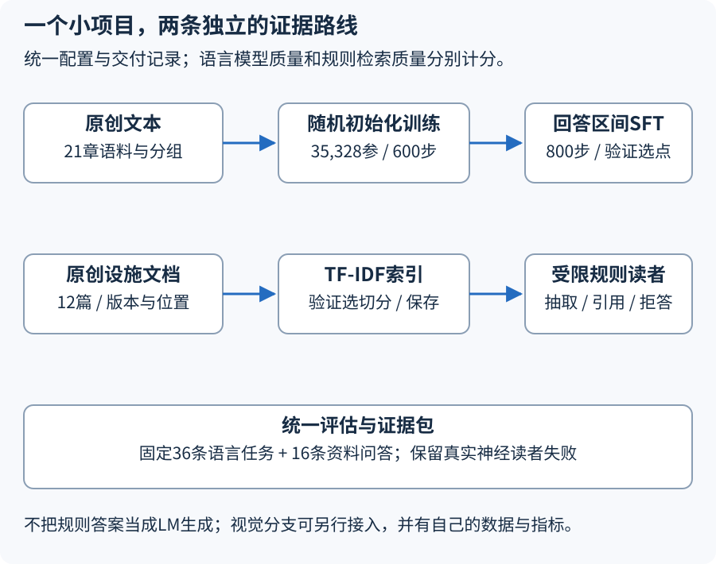
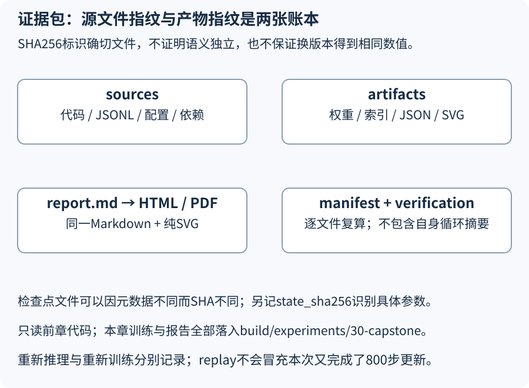
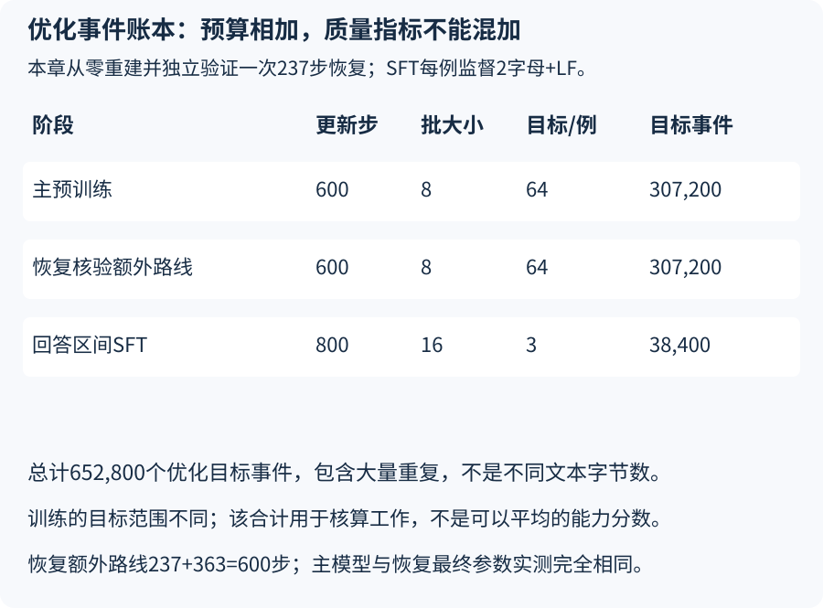
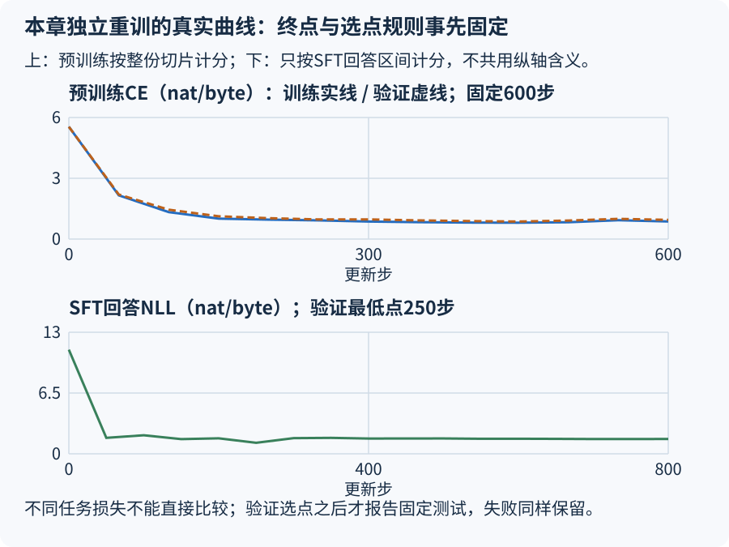
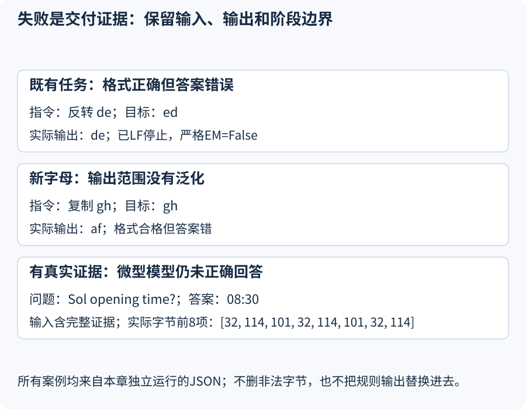
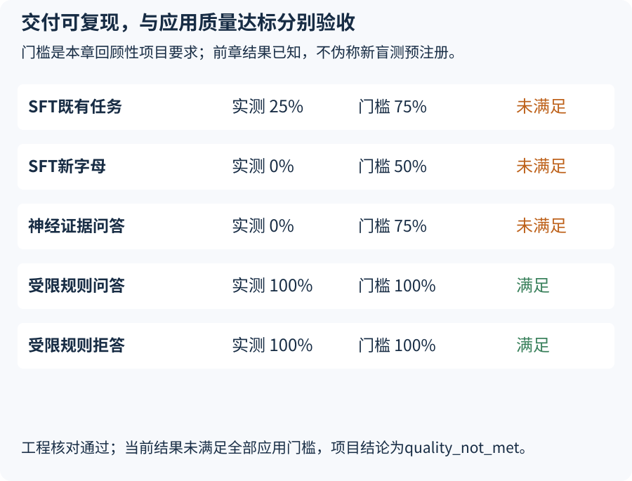

# 第30章：综合实践——把模型、证据与评估组织成可复现项目

> 对应任务：30；最后更新：2026-11-17。CPU从随机初始化完整重建已实际运行；工程流程与应用质量分别记录，当前神经任务质量未达示例门槛。

[阅读入口](../../README.md) · [章节计划](../chapter-plan.md) · [上一章：视觉语言模型](29-vision-language-models.md)

## 1. 本章目标与前置知识

前面已经会训练微型语言模型、做指令微调、查询资料和计算评价指标。现在要回答一个实际问题：换一位读者，能否知道用了什么数据、训练了哪些参数、为何选这个检查点，进而在本机重新运行并得到能核对的结果？

学完本章，应能：

1. 将问题限定为明确的输入、输出、数据范围和应用要求。
2. 区分随机初始化重训、从训练检查点继续、加载推理模型重放。
3. 用统一的配置、分组协议和输出目录连接训练、检索与评估。
4. 从全部输出定位失败，分别判断工程交付与应用质量。
5. 生成有源文件、指纹、曲线和失败记录的Markdown、HTML、PDF证据包。

主要前置是[第21章微型语言模型](21-tiny-language-model.md)、[第22章指令微调](22-instruction-tuning.md)、[第26章检索增强](26-retrieval-augmented-generation.md)和[第27章模型评估](27-model-evaluation.md)。这里复用其定义和代码，不再引入新网络结构。视觉学习可另沿[第28章](28-multimodal-representations.md)、[第29章](29-vision-language-models.md)推进；本次默认项目不依赖视觉权重。

## 2. 从可回答的问题开始

### 2.1 两条路线，各自保留结论

本项目名为“微型文本与证据实验”。文本路线输入两字母复制或反转指令，输出两个ASCII字母和换行。例如“反转 ab”应输出`ba`及LF。证据路线输入虚构设施问题，例如`Sol opens?`，输出资料里的一个字段，或在无证据时拒答。

这两项任务规模很小，但足以暴露不同问题。训练路线检验模型是否学会任务；资料路线检验证据是否找对、保留、读对。规则抽取器按已知句式读取字段，微型语言模型逐字节生成，二者不能互相替代计分。



图30-1为本仓库原创SVG，由[可编辑生成程序](../../examples/30-capstone/figures.py)生成。上排从随机参数训练，再进行回答区间SFT；下排构建资料索引、抽取答案。它们在报告中相遇，而非假装已经组成能完成开放问答的助手。

### 2.2 一个项目要提出哪些问题

花书第11章§11.1、§11.2、§11.5强调先明确性能目标、建立端到端基线并诊断问题。[1] 本章把它落实为可核对的任务说明：输入是否超长，答案按字节还是按语义比较，未知问题如何处理，比较哪种简单基线，什么失败会阻止应用。

Stanford CS224N的2025项目报告说明要求交代方法、基线、数据、评价、实验配置及误差分析。[2] 我们借用这种组织思路，使用本教程的Markdown格式；没有把本项目称为该课程官方作业或要求复现其模型。报告同时明确预期用途、评价条件与局限，借鉴Model Cards的披露原则。[5]

## 3. 符号、张量与项目对象

| 符号/对象 | 含义与形状 | 本章约定 |
| --- | --- | --- |
| $\boldsymbol{\theta}$ | 语言模型全部参数 | 35,328个标量 |
| $\mathbf{X}$ | 输入字节ID，$B\times T$ | 整数，ID为0到255 |
| $\mathcal{Z}$ | 未归一化输出，$B\times T\times256$ | 最后一轴对应字节词表 |
| $m_{i,t}$ | 第$i$例第$t$位置是否计损失 | 取0或1，区别于有效键mask |
| $\mathcal{D}_{\mathrm{tr}},\mathcal{D}_{\mathrm{val}}$ | 训练、验证数据 | 按既定group划分 |
| $\hat y_i,y_i$ | 实际输出、标准答案 | 语言任务严格含末尾LF |
| $U,B,T$ | 更新步、批大小、上下文长度 | 不将步数当数据条数 |
| $\tau_j$ | 第$j$项应用门槛 | 本章回顾性示例要求 |
| 检查点 | 参数、配置及可选训练状态的文件 | 推理与恢复用途不同 |
| 清单 | 路径及SHA256映射 | 标识文件内容，不能证明泛化 |

0是合法NUL字节，并非专用PAD。短样本右侧填0时，注意力有效位置标为False，对应标签为`-100`；不能把占位0当真实监督。输入有效键mask用于限制注意力，回答损失mask用于决定哪些目标参与交叉熵，作用不同。

## 4. 核心概念：把一次结果变成可追溯实验

### 4.1 从问题到完整预测协议

模型参数只是预测的一部分。给定同一模型，更改模板、截断策略、停止规则，也可能产生不同答案。因此一次预测应说明：

- 输入模板：`[指令]`、换行、指令、换行、`[回答]`、换行。
- 编码：固定UTF8字节词表，无额外BOS/EOS；字节数不等于汉字数。
- 上下文：64字节；语言任务生成时只保留最近64字节。
- 解码：贪心，最多新增8字节，遇字节10即LF停止。
- 正确性：两字母和LF整体相同才计严格EM；格式、有效UTF8和停止另外记录。

本章的神经证据问答使用另一种明确短模板，最多新增16字节。程序先检查完整初始提示不超过64字节，证据不会在送入之前被静默截去。不能把两种任务的不同生成预算混称为一次公平吞吐比较。

### 4.2 目标函数与可比较的计分范围

语言模型输出logits后，按词表轴softmax得到条件概率。沿第21、22章，用自然对数、以实际监督位置为分母：

$$
\mathcal{L}(\boldsymbol{\theta})=
-\frac{\sum_{i=1}^{B}\sum_{t=1}^{T}m_{i,t}
\ln p_{\boldsymbol{\theta}}(x_{i,t+1}\mid x_{i,\le t})}
{\sum_{i=1}^{B}\sum_{t=1}^{T}m_{i,t}}.
$$

分母必须大于0。预训练有效位置预测下一个字节；回答区间SFT仅对两个答案字母和LF计损失。相同的网络和单位nat/byte，不表示两个任务的平均损失可以直接比较：预测位置、条件上下文和数据分布已经不同。代码使用框架稳定的交叉熵计算，不先手工取softmax再对极小概率取对数。

验证集用于选择800步预算内回答NLL最低的SFT检查点。本次最低点在250步；预训练则始终取固定600步终点，验证曲线仅供诊断。选择规则不同，报告必须分别说明。

### 4.3 文件、参数和训练状态

推理检查点包括模型配置、字节编码元数据、参数和来源协议。加载后设为`eval()`，相同输入应得到相同logits。继续训练还需要优化器状态、当前步数、采样随机状态与相关随机数状态。[3]

为什么只有参数不够？以Adam为例，下一步更新依赖一阶、二阶动量；即使参数相同，丢掉动量也会改变后续轨迹。重新设置同一随机种子通常只回到随机序列开头，不等于回到第237步之后。

本章独立运行两条预训练路线：一条连续600步；另一条从相同初始状态训练237步、保存，再恢复363步。将两者最终参数逐元素相减，计算：

$$
\Delta_{\max}=\max_j
\left|\theta^{\mathrm{continuous}}_j-
\theta^{\mathrm{resumed}}_j\right|.
$$

本机实测为0，并核对评价历史和采样状态相同。这支持当前代码、软件和CPU环境下的恢复实现；PyTorch明确不保证跨版本、平台或CPU/GPU结果完全相同。[4]

### 4.4 源与产物的指纹

SHA256把任意文件内容映射为固定长度摘要。清单记录“路径→摘要”，运行后重新读取文件计算摘要，检查是否与清单一致。它能发现所记录文件被改变，但不能证明文本没有同义重复、测试没有泄漏或模型质量合格。

同一组参数可随不同协议元数据写入两个检查点，导致文件SHA256不同。因此本章同时记录文件摘要和`state_sha256`。本实现的后者按固定state_dict顺序连接参数名与连续CPU数组的原始字节；没有把形状和dtype另编码进摘要，因此还须单独核对配置、形状和dtype，不能跨任意序列化方案直接比较。



图30-2为原创证据包结构。`manifest.json`不包含自己的摘要，避免循环定义；另一个核验文件记录逐文件检查状态。清单外的源文件不受该清单证明，因此必须清楚描述记录范围。

### 4.5 工程通过与应用门槛

设第$j$项指标为$M_j$、最低门槛为$\tau_j$。本章五项均为越高越好，应用审核条件是：

$$
Q=\bigwedge_{j=1}^{5}\left(M_j\ge\tau_j\right).
$$

逻辑与要求每项通过；不能用一项100%抵消另一项0%。工程核对则检查形状、保存恢复、引用原文和文件未被改写。二者解决不同问题，可以同时出现工程核对通过、$Q$为假。

本章门槛为回顾性示例应用要求：前章结果已经公开，我们知道模型可能不通过，所以不称为新盲测预注册。若之后做新一轮模型选择，应在开发数据上确定协议，另行冻结尚未用于选择的评价集。

## 5. 手算：预算、评分和资源

### 5.1 更新步不是独立数据量

预训练每步8例、每例64个预测位置，600步的优化目标事件数：

$$
600\times8\times64=307\,200.
$$

恢复核验额外运行237+363=600步，因此另花307,200个事件。SFT每步16例，每例仅三个回答字节计损失：

$$
800\times16\times3=38\,400.
$$

合计652,800个优化目标事件。这里包含大量重复抽样；它不是独特字节数，也不是把不同任务损失合成一种质量指标。忽略恢复核验会少记近一半工作。



图30-3根据实际固定配置原创生成。框中的“目标/例”指本步参与损失的位置数，而非每条完整提示的长度。

### 5.2 一个强基线能暴露任务问题

现有24例测试中，复制和反转各半，两个字母不同。始终原样复制payload，在12条复制题正确、12条反转题错误：

$$
\mathrm{EM}_{\mathrm{echo}}=\frac{12}{24}=0.5.
$$

SFT实际正确6例，即0.25，比这个不理解任务的简单规则还低。不能因为它比基座0分高，就声称已经学会指令。新字母12例同理，复制基线6例正确，SFT为0。

### 5.3 数值负载不等于峰值内存

35,328个float32参数的纯数值负载为：

$$
35\,328\times4=141\,312\ \mathrm{byte}=138\ \mathrm{KiB}.
$$

本章索引矩阵为$24\times280$，float64纯数值负载为53,760 byte，即52.5 KiB。训练还需要梯度、优化器动量、激活、Python对象和框架运行时；这些简单乘法不能代替进程峰值内存测量。本次未测峰值，报告明确保留这一限制。

## 6. 从数学到项目代码

### 6.1 入口与复用方式

[项目入口](../../examples/30-capstone/run.py)只读导入已有章节的函数，在本章自己的目录保存新输出。它不调用会默认覆盖前章输出的总入口。完整运行方式与产物见[项目README](../../examples/30-capstone/README.md)，固定协议见[config.json](../../examples/30-capstone/config.json)。

| 阶段 | 复用接口 | 本章新增工作 |
| --- | --- | --- |
| 预训练 | 21章`read_data/run_training` | 随机初始化重训、独立恢复核验 |
| SFT | 22章`load_splits/train` | 用本章基座训练并保存本章权重 |
| 检索 | 26章`dataset/ExactIndex/evaluate` | 验证选配置、保存本章索引 |
| 评价 | 27章`load_records/predict/summarize` | 对本章权重复评并记录失败 |
| 报告 | 本章报告与图生成器 | 实际JSON生成Markdown、SVG和出版记录 |

固定配置的模型、优化器、预算和解码字段都由入口核对。底层函数有固定教学协议，所以不能只改JSON便假定实验已改变。应用门槛数值可调整，但要说明调整的时间与理由。

### 6.2 数据流与独立输出

预训练语料为21章原创48篇双语颜色/形状文本，24个语义group，按16/4/4个group划分为32/8/8篇训练/验证/测试文本。SFT为22章原创a..f两不同字母任务，无序字母对作为group，训练/验证/测试72/24/24例。

评价沿27章固定24条既有测试和12条g..l新字母诊断；前者是已知测试的复评，不是新盲测。证据数据沿26章原创12篇虚构设施文档、6条验证题与16条测试题，后者有12条可回答和4条无证据题。所有数据均是教学合成数据，没有外部下载或真实用户数据。

程序先记录已有21/22检查点及21/22/26/27结果报告的摘要，结束再次核对未变。新模型、索引、曲线、JSON和独立报告统一落在`build/experiments/30-capstone/`。rebuild会更新本章自己的实验产物；要保留多次实验，应先归档整个输出目录和对应源码版本。

### 6.3 重放并非再次训练

replay首先核对冷构建清单内的源与产物摘要，加载本章已有权重，然后重做语言任务、检索和神经证据问答。它比较原始字节、规则轨迹和证据问答完全一致，不要求运行延迟相同。

重放写入独立的`replay-results.json`等文件，保留冷构建的权重、SVG和报告。如果源文件变化，程序先报错；应建立新的实验记录，而非改写旧摘要来掩盖变化。当前依赖仍来自既有虚拟环境；“冷构建”指从随机参数开始重训，不表示重新安装系统、依赖或建立全新电脑环境。

## 7. 本机实践与实际结果

### 7.1 环境和运行

实测日期2026-11-17，Windows，Python 3.11.5、NumPy 2.4.6、PyTorch 2.15.0+cpu；CPU单线程，模型float32，检索float64。导出使用仓库既有Node依赖与Microsoft Edge。无需GPU、网络下载或外部大模型。

在仓库根目录依次运行：

```powershell
.\.venv\Scripts\python.exe examples/30-capstone/run.py --mode rebuild
.\.venv\Scripts\python.exe examples/30-capstone/run.py --mode replay
```

第一条包含报告导出。若只做数值流程可加`--skip-export`；如果流水线要求应用门槛通过才能返回成功，使用`--require-quality`，当前结果将返回退出码2。默认退出码0表示工程核对通过，质量结论必须读取`quality_review`。

预训练用AdamW、学习率0.003、权重衰减0.01、批8、上下文64、600步，初始化种子20261115、窗口采样种子17，梯度范数裁剪1。SFT用AdamW、学习率0.0015、无权重衰减、批16、800步、采样种子2201，每50步验证并恢复最低回答NLL检查点。

### 7.2 曲线、恢复和模型来源



图30-4从本章实际训练记录生成，预训练以实线/虚线区分训练/验证。预训练终点训练CE为0.8677684289、验证CE为0.9473926544 nat/byte；验证PPL约2.579。SFT最低回答验证NLL在250步；两张图的计分数据和范围不同，不能看曲线高度判断哪种方法“更强”。

独立237步保存恢复至600步后，最大参数绝对差为0，评价历史和采样状态相同。两个推理检查点重新加载后，在固定探针`The red `上的logits最大差均为0。

本章基座参数状态SHA256与第21章相同，说明当前确定性协议重建出同样参数；检查点的文件摘要不同，因为本章来源协议和序列化对象不同。同协议同环境重训是在核对再现性，不构成新的独立统计样本，也不能据此缩窄泛化误差的不确定性。完整文件摘要在实际报告的代码块及清单中记录，不把摘要放成可能溢出的长行内文字。

### 7.3 语言任务：格式进步与答案失败

| 方法 | 既有测试严格正确 | 新字母诊断严格正确 | SFT格式情况 |
| --- | ---: | ---: | --- |
| 本章基座 | 0/24 | 0/12 | 不适用此列 |
| 本章回答SFT | 6/24 | 0/12 | 两组均100%合格 |
| 始终复制基线 | 12/24 | 6/12 | 合法两字母及LF |

基座很多生成不能按LF停止，并可产生非法UTF8。SFT全部按格式停止，但既有任务18例答案错、新字母12例答案错。格式合格没有证明理解反转操作；训练更久、训练损失更低也不会自动消除分布变化。



图30-5是实际结果驱动的原创矢量图。完整JSON保留所有预测与原始字节；非法UTF8不会被人工改成可读正确答案。所选错误用于说明失败方式，不代替全量指标。

### 7.4 检索选择与真实神经读者

候选切分长度36、72、144字符，各配重叠0或12，共6种。验证EM相同先比较索引总字符数，再比较长度和重叠，最终选72字符、重叠0；检索$k=3$，上下文2块。测试数据和标准答案不参与该选择。

本章规则读者对12条可回答题全对，4条无证据题全部拒答，12条引用逐一核对为原文`doc[start:end]`。不过这些题很简单，事实都位于短句，不能由满分推断自然语言问答能力或某种切分普遍优越。

同样的12道可回答题，真正的基座和SFT分别执行无证据/完整证据两种输入，四组EM均为0。输入初始提示均不超过64字节，且含完整金标准证据。这里定位到的是当前模型/任务组合不能正确读取和生成答案；没有证据支持将失败全部归咎于检索丢失。

### 7.5 质量审核与实际资源



图30-6为原创实际结果图。本章示例门槛是SFT既有任务至少75%、新字母至少50%、神经证据问答至少75%、受限规则问答与拒答各100%。前三项未满足，后两项满足，应用结论为`quality_not_met`。换成当前固定分母，前三个门槛分别要求至少18/24、6/12、9/12正确；本次分别只有6、0、0例。门槛来自示例任务要求，没有统计置信保证。

工程核对检查恢复、参数数目、评价未改权重、索引数值重载、12条原文引用、完整证据、检查点重载、已有章节产物未变和失败计数闭合。清单摘要复核另记录，不能把每个检查都当一项独立模型能力。

实测耗时与清单数量在本章最终验收记录及实际JSON中给出。单次本机小实验的时间仅用于预算判断，没有多轮分位延迟、峰值内存或跨设备性能结论。

## 8. 常见误区与适用边界

**“一键跑通意味着助手可以上线。”** 程序可能正确实现一个尚不满足质量要求的模型。本次工程核对通过，神经任务质量不达标。

**“合成数据没有隐私，所以怎么划分都可以。”** 同一字母对的不同顺序或别名仍可能泄漏任务结构；语义group、模板和评价用途依然要说明。

**“报告有SHA就证明没有数据泄漏。”** SHA只核对文件内容，分组逻辑与语义独立仍需检查；本章明确复用了已公开的测试。

**“同样种子可在所有电脑上逐位重现。”** 这里的零差异是当前软件与CPU实现的实际观测，不覆盖未来版本或GPU。

**“规则检索满分就证明RAG模型理解证据。”** 规则读者和真实LM单独运行，后者有证据仍0分，不能合并结论。

**“把所有前沿技术接上才算综合。”** 一个项目要围绕问题选择必要模块。本章视觉、DPO、LoRA均非默认训练阶段；这些已在相应章节各自验收，没有声称本次再次训练。

## 9. 习题与详细解析

### 9.1 习题

1. 同样600步，批大小从8改16，目标事件数如何变化？这是否表示获得两倍独立信息？
2. 只有参数文件，能否保证从237步恢复后与连续600步相同？列出本项目还保存的状态及用途。
3. 既有测试6/24、新字母0/12、规则问答12/12。把36个语言问题和12个资料问题混成18/48，能否作为本项目达标分数？
4. 如果检查点文件SHA改变、参数state摘要相同，列出两种合理原因，以及还应核对什么。
5. 设计一轮针对“格式对但反转错”的后续实验。说明只改变什么、如何避免用现有测试不断调参，以及保留什么失败记录。
6. 实践：运行replay，比较冷构建与重放的原始字节预测和报告摘要。为什么延迟可以不同，而原始报告不应被覆盖？

### 9.2 解析

1. 原预算307,200，改为$600\times16\times64=614\,400$，目标事件数加倍。可能反复抽到同一窗口，独立语料量并未自动翻倍；批大小变化也会改变优化轨迹。当前固定协议会拒绝仅改JSON，应同步实现并作为新实验记录。
2. 不能。至少要有优化器一阶/二阶动量、当前步数和采样/RNG状态，且恢复时模型配置与训练协议一致。重新播种只会从随机序列开头开始。本项目通过独立恢复路线与连续路线比较参数、历史、采样状态，证实当前实现。
3. 18/48在明确这个人为混合分布时可描述混合样本的平均正确率，但不能替代各任务应用门槛。它把不同问题和能力按样本数混权，掩盖神经问答0分。应分别报告既有任务25%、新字母0%、规则100%，再逐项核对门槛。
4. 元数据改变或序列化容器细节改变都可导致文件摘要不同。还应核对参数名称、形状、dtype、编码与模型配置及来源协议，并对固定输入比较logits；仅参数摘要相同不保证模板和解码相同。
5. 可在开发数据上只增加“反转”任务的训练覆盖，与同预算原训练比较，保持初始化、优化器、模板、评价规则一致；不能同时扩大模型又换模板却只归因于数据。现有公开测试仅作回顾诊断，新的选择用训练/验证完成，最终另冻结未用于开发的分组评价。保存全部失败及格式/停止标记，并检验是否只是记住字母对。
6. 程序先验证冷构建清单，再加载同权重，比较36例原始字节以及规则/神经证据轨迹。CPU调度和缓存导致计时变化，所以不要求耗时逐位相等。重放不能改写原报告时间或SVG，否则清单描述的原始交付被破坏；本项目使用独立replay文件并复核原产物未变。

## 10. 本章小结与后续实践

本章完成了一条可实际重跑的CPU工程流程：随机初始化预训练、保存恢复、回答SFT、验证选择、固定评价、资料索引、真实模型证据探针以及同源报告。它的主要学习成果是让每项结论都能回到明确输入、配置和输出。

本次结果保留了一个必要事实：微型模型尚未满足应用要求。下一轮可以先在开发数据检查任务覆盖、模板与答案分布，再决定是否增加数据或模型；新的质量改进必须由新的评价证据支持。视觉项目可复用28/29章已有接口，使用独立图像数据与评价，不能把本章文字任务结果外推为视觉能力。

## 11. 参考文献与来源核验

以下一手来源于2026-11-17核验；图30-1至30-6均为原创纯SVG，由实际结果生成，不复制教材图片。

1. Goodfellow、Bengio、Courville，*Deep Learning*，2016，第11章§11.1 Performance Metrics、§11.2 Default Baseline Models、§11.5 Debugging Strategies。[官方正文](https://www.deeplearningbook.org/contents/guidelines.html)。
2. Stanford CS224N，*Project Report Instructions*，2025-02-27版本，§1第2—4页Approach、Experiments、Analysis、Conclusion。[课程归档PDF](https://web.stanford.edu/class/archive/cs/cs224n/cs224n.1254/project/CS224N_Final_Project_Report_Instructions_2025.pdf)。
3. PyTorch 2.15官方教程，*Saving and Loading Models*，“General Checkpoint for Inference and/or Resuming Training”。[官方文档](https://docs.pytorch.org/tutorials/beginner/saving_loading_models.html)。
4. PyTorch 2.15，*Reproducibility*，随机性控制与跨平台/版本边界。[官方文档](https://docs.pytorch.org/docs/2.15/notes/randomness.html)。
5. Mitchell等，*Model Cards for Model Reporting*，FAT* 2019，预期用途、评价条件与局限。[原始论文v2](https://arxiv.org/abs/1810.03993v2)。本章未进行真实人群分组评价。
6. 本仓库第21、22、26、27章代码、数据和指标；具体文件及SHA256见本项目manifest，原理出处见对应章节。

**实现与验证：** 完整CPU重建、独立重放和双份出版验证记录见[本章项目README](../../examples/30-capstone/README.md)。数值与出版记录以该文件及对应JSON为准，应用质量结论保留`quality_not_met`；核对通过不表示模型达到应用门槛。
