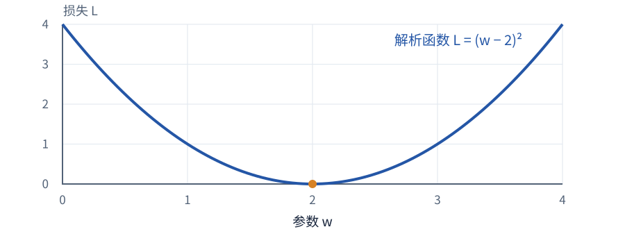
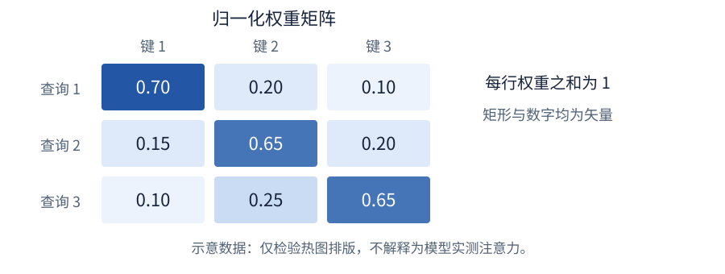

# 矢量曲线、热图与跨章导航

> 排版样张第二部分。所有图由可重复运行的生成脚本输出 SVG；解析曲线和热图数据均为示意数据。

## 1. 解析曲线与坐标

取标量函数 $`\mathcal{L}(w)=(w-2)^2`$，其导数为：

```math
\frac{\mathrm{d}\mathcal{L}}{\mathrm{d}w}=2(w-2).
```



该图只表达确定的解析函数，不是任何训练运行的损失记录。正式实验中的曲线必须说明数据、配置、指标和实际运行环境。

## 2. 带数值的矢量热图



用 $`a_{ij}`$ 表示第 $`i`$ 行、第 $`j`$ 列的权重，该例各行满足 $`\sum_j a_{ij}=1`$。图中保留具体数值，黑白打印或色觉差异也不应使信息完全丢失。

## 3. 概率公式与分步表达

以下式子用于检查条件概率、求和、分数和正体算子：

```math
\begin{aligned}
p_\theta(x_1,\ldots,x_T)
&=\prod_{t=1}^{T}p_\theta(x_t\mid x_{\lt t}),\\
\mathcal{L}(\theta)
&=-\frac{1}{T}\sum_{t=1}^{T}
\log p_\theta(x_t\mid x_{\lt t}).
\end{aligned}
```

其中 $`T`$ 是序列长度，$`x_{\lt t}`$ 表示当前位置之前的序列，$`\theta`$ 是参数集合。这里只检查排版；自回归分解的条件和训练目标将在正式语言模型章节展开解释。

## 4. 打印与缩放检查

检查图形时，需要同时观察完整页面和放大局部：中文标签不应缺字，箭头应对齐方框，曲线和热图网格应保持锐利。导出后还要检查 PDF 内部没有用图片对象替代这些矢量内容。

代码块、标题和表格不能相互覆盖。长段落跨页时，标题尽量与后文相邻，页码连续。数学公式应由文本、字体和矢量路径组成，不能作为低清截图插入。

## 5. 返回与参考

可返回[第一部分的符号与维度](01-layout.md#3-数学符号与维度)。跨文档的中文锚点应正确改写，不依赖外站脚本。

- 数学显示：[KaTeX 官方文档](https://katex.org/docs/node)。
- PDF 输出接口：[Playwright Page.pdf](https://playwright.dev/docs/api/class-page#page-pdf)。

本样张通过不代表正式教程章节已经完成；正文、实验及逐章验收仍按任务清单推进。
